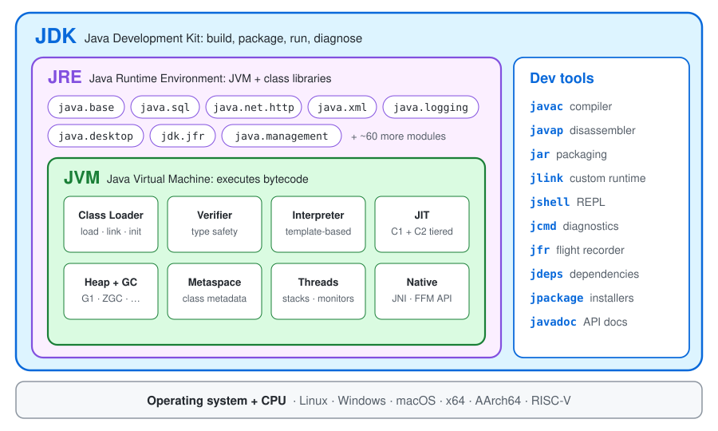
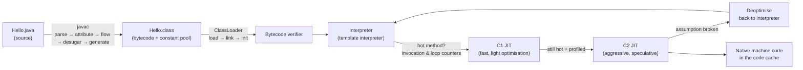
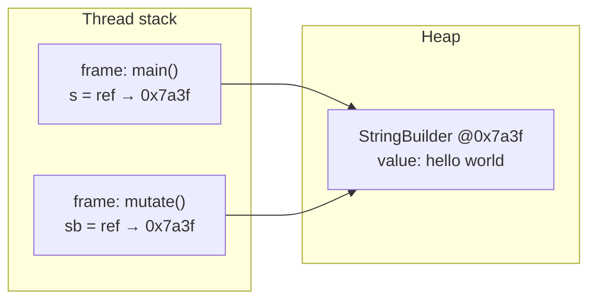

[🏠 Index](README.md) · [Next: 02 · OOP & the Object Model ➡️](02-oop-and-object-model.md)

# 01 · Java Platform Fundamentals

> *Everything about Java eventually comes back to three questions: what does the spec promise, what does the JVM actually do, and what does that cost? This chapter lays the foundation for all three.*


🧪 **Runnable labs:** [the programs behind this chapter's outputs](labs.md#chapter-01--platform-fundamentals)

---

## Table of contents
1. [Java is three things, not one](#1-java-is-three-things-not-one-)
2. [JDK vs JRE vs JVM](#2-jdk-vs-jre-vs-jvm-)
3. [From `.java` to machine code](#3-from-java-to-machine-code-)
4. [Anatomy of a program & ways to run it](#4-anatomy-of-a-program--ways-to-run-it-)
5. [Primitive types: the real table](#5-primitive-types-the-real-table-)
6. [Conversions, promotion & casting](#6-conversions-promotion--casting-)
7. [Integer arithmetic: two's complement, overflow, shifts](#7-integer-arithmetic-twos-complement-overflow-shifts-)
8. [Floating point: IEEE 754 and money](#8-floating-point-ieee-754-and-money-)
9. [`char`, Unicode & UTF-16](#9-char-unicode--utf-16-)
10. [Wrappers & autoboxing traps](#10-wrappers--autoboxing-traps-)
11. [Variables, `var`, `final`, scope](#11-variables-var-final-scope-)
12. [Operators & evaluation order](#12-operators--evaluation-order-)
13. [Control flow](#13-control-flow-)
14. [Arrays](#14-arrays-)
15. [Java is always pass-by-value](#15-java-is-always-pass-by-value-)
16. [Stack vs heap (first look)](#16-stack-vs-heap-first-look-)
17. [`static`, class initialization & init order](#17-static-class-initialization--init-order-)
18. [Packages & access control](#18-packages--access-control-)
19. [Binary compatibility & class-file versions](#19-binary-compatibility--class-file-versions-)
20. [Staff lens: running Java across an organisation](#20-staff-lens-running-java-across-an-organisation-)
21. [Interview questions](#21-interview-questions)
22. [References](#22-references)

---

## 1. Java is three things, not one 🟢

When someone says "Java", they might mean any of these:

| Layer | What it is | Defined by |
|---|---|---|
| **The language** | Syntax and semantics: classes, generics, lambdas, the memory model | **JLS**, the Java Language Specification |
| **The virtual machine** | An abstract machine that executes `.class` files (bytecode) | **JVMS**, the Java Virtual Machine Specification |
| **The platform / libraries** | `java.lang`, `java.util`, `java.net`… the Java SE API | Java SE Platform spec (JSR per release) |

**OpenJDK** is the open-source reference implementation of all three. Oracle JDK, Eclipse Temurin, Amazon Corretto, Azul Zulu, BellSoft Liberica, Microsoft's build, Red Hat's build and SapMachine are all *distributions* built mostly from OpenJDK source. GraalVM is a JDK distribution with an extra JIT compiler and native-image tooling.

The JVM doesn't know Java exists. It knows bytecode. That's why Kotlin, Scala, Clojure and Groovy run on it unchanged.

**Release cadence.** Since JDK 10 (2018), there's a feature release every six months, in March and September. Long-Term Support (LTS) releases: **8, 11, 17, 21, 25**. Since 17, a new LTS arrives every two years, so the next one is **29 (Sept 2027)**. As of late 2026, the newest feature release is **JDK 27**.

> [!NOTE]
> "Java EE" became **Jakarta EE** at the Eclipse Foundation. Starting with Jakarta EE 9, the packages moved from `javax.*` to `jakarta.*`. That single rename is why the Spring Boot 2 → 3 migration was painful.

---

## 2. JDK vs JRE vs JVM 🟢



- **JVM**: the runtime engine. It handles class loading, bytecode verification, interpretation, JIT compilation, garbage collection and threads.
- **JRE**: the JVM plus the standard class libraries. It's enough to *run* programs.
- **JDK**: the JRE plus development tools (`javac`, `jar`, `javadoc`, `jlink`, `jshell`, `jcmd`, `jfr`, `jpackage`, …).

🟡 **Modern reality.** Oracle stopped shipping a standalone JRE with JDK 11. Some vendors still publish JRE builds, but the modern approach is to build a trimmed runtime that contains only the modules you need, using `jlink` (see [Chapter 15](15-modules-and-build-tools.md)):

```bash
jlink --add-modules java.base,java.net.http,java.sql \
      --strip-debug --no-header-files --no-man-pages \
      --output build/runtime          # a 40–60 MB runtime instead of ~300 MB
```

🎯 **Interviewer's lens.** Nobody gets hired for reciting "JDK ⊃ JRE ⊃ JVM". The follow-up is what counts: *"Why would you build a custom runtime?"* Good answers are smaller container images, faster cold pulls, and a smaller attack surface.

---

## 3. From `.java` to machine code 🟢→🔴



Here's what's actually going on:

1. **`javac` does very little optimisation.** It folds constant expressions (`"a" + "b"` becomes `"ab"`), desugars syntax (enhanced for loops, string switch, lambdas → `invokedynamic`), erases generics, and writes bytecode. The heavy optimisation happens at runtime.
2. **Bytecode is a stack machine.** `a + b` compiles to `iload_1, iload_2, iadd`. You can inspect it with `javap -c -v Hello.class`.
3. **The JVM starts by interpreting.** It counts method invocations and loop back-edges. Hot code gets compiled by **C1**, which instruments it to collect a *profile*. If the code stays hot, **C2** recompiles it using that profile: it inlines, unrolls loops, does escape analysis, and makes *speculative* bets ("this call site only ever sees `ArrayList`").
4. If a bet turns out wrong (a `LinkedList` shows up), the JVM **deoptimises** and falls back to the interpreter, then recompiles later. This is why Java "warms up", and why a microbenchmark without warmup is fiction.

"Write once, run anywhere" really means *compile once to bytecode, then let a platform-specific JVM turn it into native code*. The portability lives in the bytecode and the libraries. The JVM itself is very much platform-specific.

> [!TIP]
> Chapter 09 goes deep on tiered compilation, inlining budgets, OSR, intrinsics and AOT caching (Project Leyden). For now, keep one fact: **Java performance is a runtime property, not a compile-time property.**

---

## 4. Anatomy of a program & ways to run it 🟢

```java
// Classic form: works on every Java version
public class Hello {
    public static void main(String[] args) {
        System.out.println("Hello, " + (args.length > 0 ? args[0] : "world"));
    }
}
```

Why `public static void main(String[] args)`?
- **`public`**: the launcher, which lives in a different package, must be able to call it.
- **`static`**: the launcher calls it without creating an instance.
- **`void`**: the exit status comes from `System.exit(int)`, not from a return value.
- **`String[] args`**: command-line arguments, *not* including the program name (unlike C's `argv[0]`).

**Java 25+ (JEP 512, final): compact source files and instance `main`.** This is meant for learning and scripting:

```java
// Hello.java: no class declaration, no static, no String[]  (Java 25+)
void main() {
    IO.println("Hello from a compact source file");
}
```

The launcher first looks for `static void main(String[])`. If that's missing, it accepts other forms, such as a non-static `main()` with no parameters, and instantiates the class itself. `java.lang.IO` provides `println`, `print` and `readln`.

**Ways to run code:**

| Command | Since | Use |
|---|---|---|
| `javac Hello.java && java Hello` | 1.0 | Classic compile-then-run |
| `java Hello.java` | 11 (JEP 330) | Single-file source launch, compiled in memory |
| `java Main.java` (with other source files next to it) | 22 (JEP 458) | Multi-file source programs |
| `jshell` | 9 (JEP 222) | REPL, great for checking puzzles during prep |
| `java -jar app.jar` | — | Runs the `Main-Class` from the manifest |

---

## 5. Primitive types: the real table 🟢

| Type | Bits | Range | Default (fields) | Wrapper | Notes |
|---|---|---|---|---|---|
| `boolean` | JVM-dependent* | `true`/`false` | `false` | `Boolean` | *Arrays of `boolean` use 1 byte per element in HotSpot; a single `boolean` local is an `int` slot on the operand stack |
| `byte` | 8 | −128 … 127 | `0` | `Byte` | Signed! `(byte) 0xFF == -1` |
| `short` | 16 | −32 768 … 32 767 | `0` | `Short` | Rarely worth using except in large arrays |
| `char` | 16 | `'\u0000'` … `'￿'` (0 … 65 535) | `'\u0000'` | `Character` | The only **unsigned** integral type, and a UTF-16 *code unit*, not a "character" |
| `int` | 32 | −2³¹ … 2³¹−1 (≈ ±2.1 billion) | `0` | `Integer` | Default integer literal type |
| `long` | 64 | −2⁶³ … 2⁶³−1 (≈ ±9.2 × 10¹⁸) | `0L` | `Long` | Writes to non-`volatile` `long` fields are allowed to tear (JLS §17.7) |
| `float` | 32 | ≈ ±3.4 × 10³⁸, ~7 decimal digits | `0.0f` | `Float` | IEEE 754 binary32 |
| `double` | 64 | ≈ ±1.8 × 10³⁰⁸, ~15–17 digits | `0.0d` | `Double` | IEEE 754 binary64; the default floating literal type |

**Literal syntax worth knowing:**

```java
int million   = 1_000_000;     // underscores allowed between digits (Java 7)
int hex       = 0xCAFE_BABE;   // hex (compile-time int; this one is negative!)
int binary    = 0b1010_0101;   // binary literal (Java 7)
int octal     = 010;           // 💣 OCTAL: this is 8, not 10
long big      = 9_000_000_000L; // must use L. Without it: "integer number too large"
float f       = 3.14f;         // without f: "possible lossy conversion from double"
char c        = 'A';      // 'A'
```

> [!WARNING]
> `int y = 09;` doesn't compile. A leading zero means octal, and 9 isn't an octal digit. People have shipped bugs by zero-padding numeric constants "for alignment".

🔴 **Defaults apply to fields and array elements only.** Local variables have *no* default. The compiler enforces **definite assignment** (JLS ch. 16) and rejects any read before a write:

```java
int x;
if (flag) x = 1;
System.out.println(x);   // compile error: variable x might not have been initialized
```

---

## 6. Conversions, promotion & casting 🟢→🟡

### Widening (implicit, always allowed)
```
byte → short → int → long → float → double
              char ↗
```

💣 **"Widening" doesn't always mean "lossless".** `int → float`, `long → float` and `long → double` can lose precision:

```java
int big = 123_456_789;
float f = big;                 // compiles silently
System.out.println((int) f);   // 123456792 — float only has a 24-bit significand
```

### Narrowing (explicit cast; truncates)
```java
(int) 3.99           //  3      — truncates toward zero
(int) -3.99          // -3
(byte) 200           // -56     — keeps the low 8 bits: 200 − 256
(char) -1            // '￿' (65535)
(int) Double.NaN     //  0      — NaN converts to 0
(int) 1e20           //  2147483647 — saturates at Integer.MAX_VALUE
(long) Float.POSITIVE_INFINITY // Long.MAX_VALUE
```

Converting floating-point to integer **saturates**. Narrowing one integer type to another **wraps**. Keep that asymmetry in mind; interviewers love it.

### Binary numeric promotion
Arithmetic on `byte`, `short` or `char` promotes to `int` first:

```java
byte a = 10, b = 20;
byte c = a + b;        // ❌ compile error: int cannot be converted to byte
byte d = (byte)(a + b); // ✅
a += b;                // ✅ compound assignment contains an implicit cast: a = (byte)(a + b)
```

💣 That implicit cast in `+=` hides overflow: `byte x = 127; x += 1;` leaves `x == -128` with no warning.

```java
System.out.println('A' + 'B');        // 131  (char + char → int)
System.out.println("" + 'A' + 'B');   // AB   (left-to-right: String + char)
System.out.println('A' + 'B' + "");   // 131  (int computed first, then String)
char next = 'A' + 1;                  // ✅ 'B': constant expression that fits in char
char c2 = 'A'; char n2 = c2 + 1;      // ❌ compile error: not a constant expression
```

---

## 7. Integer arithmetic: two's complement, overflow, shifts 🟡→🔴

Java integers are **two's complement** and **overflow silently**. There's no trap and no exception.

```java
Integer.MAX_VALUE + 1               // -2147483648 (wraps to MIN_VALUE)
Math.abs(Integer.MIN_VALUE)         // -2147483648 (!!) — no positive counterpart exists
-Integer.MIN_VALUE == Integer.MIN_VALUE   // true
long wrong = 1_000_000 * 1_000_000; // -727379968: multiplied as int, THEN widened
long right = 1_000_000L * 1_000_000; // 1000000000000
```

**Detecting overflow** (used when computing money, sizes, offsets):

```java
Math.addExact(a, b);        // throws ArithmeticException on overflow
Math.multiplyExact(a, b);
Math.toIntExact(someLong);
Math.multiplyHigh(x, y);    // high 64 bits of a 128-bit product (Java 9)
```

💣 **The binary-search bug.** This sat unnoticed in the JDK's own `Arrays.binarySearch` for about nine years:

```java
int mid = (low + high) / 2;          // overflows when low + high > Integer.MAX_VALUE
int mid = low + (high - low) / 2;    // ✅
int mid = (low + high) >>> 1;        // ✅ what the JDK uses now
```

### Division and remainder
```java
 7 /  2 ==  3      -7 /  2 == -3     // truncates toward zero
 7 %  2 ==  1      -7 %  2 == -1     // sign of the result follows the DIVIDEND
Math.floorDiv(-7, 2) == -4
Math.floorMod(-7, 2) ==  1           // ✅ use for hash bucketing / circular indices
1 / 0     // ArithmeticException
1.0 / 0   // Infinity  (floating point never throws)
0.0 / 0   // NaN
```

💣 `Math.abs(hash) % n` can still return a negative number when `hash == Integer.MIN_VALUE`. Use `Math.floorMod(hash, n)` or `(hash & 0x7fffffff) % n`.

### Shifts
```java
1 << 31     // -2147483648 (into the sign bit)
1 << 32     //  1 — int shift distance is masked with 0x1F (31); long uses 0x3F
1L << 32    //  4294967296
-8 >> 1     // -4          arithmetic shift: copies the sign bit
-8 >>> 1    //  2147483644 logical shift: fills with zeros
-1 >>> 28   //  15
```

### Bit tricks that show up in interviews (and inside `HashMap`)
| Expression | Meaning |
|---|---|
| `(n & (n - 1)) == 0` | `n` is a power of two (for `n > 0`) |
| `x & (n - 1)` | `x % n` when `n` is a power of two, and never negative. **This is how `HashMap` picks a bucket** |
| `x & -x` | Lowest set bit |
| `Integer.bitCount(x)` | Popcount, usually a single CPU instruction (an *intrinsic*) |
| `Integer.highestOneBit(x)` | Largest power of two ≤ x |
| `h ^ (h >>> 16)` | Mixes high bits into low bits: the exact `HashMap.hash()` spreader |

---

## 8. Floating point: IEEE 754 and money 🟡→🔴

```
double (binary64)
┌─┬─────────────┬──────────────────────────────────────────────────────┐
│S│  exponent   │                fraction (significand)                │
│1│   11 bits   │                      52 bits                         │
└─┴─────────────┴──────────────────────────────────────────────────────┘
value = (−1)^S × 1.fraction × 2^(exponent − 1023)        (normal numbers)
```

`0.1` in binary is `0.000110011001100…`, repeating forever, just as 1/3 repeats in decimal. It **cannot** be stored exactly, so:

```java
0.1 + 0.2                         // 0.30000000000000004
0.1 + 0.2 == 0.3                  // false
9007199254740992.0 + 1 == 9007199254740992.0   // true: above 2^53, doubles can't represent every integer
```

**The special values** (a favourite interview area):

```java
Double.NaN == Double.NaN                     // false: NaN is not equal to anything, including itself
Double.isNaN(x)                              // ✅ the right way to check
Double.valueOf(Double.NaN).equals(Double.NaN) // true: equals() compares bit patterns
0.0 == -0.0                                  // true
Double.valueOf(0.0).equals(-0.0)             // false
Math.min(0.0, -0.0)                          // -0.0
1 / 0.0 == Double.POSITIVE_INFINITY          // true
```

💣 Using `double` as a `HashMap` key, or sorting doubles with `==`-based logic, inherits all of these quirks. `Double.compare` defines a total order: `-0.0 < 0.0` and `NaN` sorts above everything.

**Comparing doubles:** never use `==` on computed values. Compare against a tolerance that fits the domain, e.g. `Math.abs(a - b) <= 1e-9 * Math.max(Math.abs(a), Math.abs(b))`, or use `Math.ulp` for unit-in-the-last-place reasoning.

Since **Java 17 (JEP 306)**, all floating-point arithmetic is strict IEEE 754 everywhere, so `strictfp` is a no-op.

### Money: `BigDecimal` (or `long` minor units)

```java
new BigDecimal(0.1)      // 0.1000000000000000055511151231257827021181583404541015625 💣
BigDecimal.valueOf(0.1)  // 0.1   ✅ (goes through Double.toString)
new BigDecimal("0.1")    // 0.1   ✅ best: exact from a string

var a = new BigDecimal("2.0");
var b = new BigDecimal("2.00");
a.equals(b)              // false 💣 equals() compares value AND scale
a.compareTo(b)           // 0     ✅ compare numerically

new HashSet<>(List.of(a, b)).size()  // 2  (uses equals/hashCode)
new TreeSet<>(List.of(a, b)).size()  // 1  (uses compareTo)

new BigDecimal("10").divide(new BigDecimal("3"));
// ArithmeticException: Non-terminating decimal expansion; no exact representable decimal result.
new BigDecimal("10").divide(new BigDecimal("3"), 2, RoundingMode.HALF_EVEN); // 3.33
```

🧠 **Staff lens on money.** A good answer goes beyond "use BigDecimal". The real design questions: **(1) What's the rounding policy, and where is it applied?** Round once, at defined boundaries such as invoice lines or totals, and use `HALF_EVEN` (banker's rounding) unless regulation says otherwise. **(2) What's the representation at the boundaries?** Store minor units as `long` in the database, send amounts as strings in JSON (JavaScript clients lose precision on large numbers), and always send the currency code alongside. **(3) How do you allocate a remainder?** Splitting $100 three ways needs a deterministic rule for where the leftover cent goes.

---

## 9. `char`, Unicode & UTF-16 🟡

A Java `char` is a **UTF-16 code unit**, not a character. Code points above U+FFFF (emoji, many CJK ideographs, musical symbols) need **two** `char`s, a *surrogate pair*:

```java
String s = "😀";                  // U+1F600
s.length()                        // 2   (code units)
s.codePointCount(0, s.length())   // 1   (code points)
s.charAt(0)                       // '\uD83D' — half of a surrogate pair
s.codePoints().count()            // 1
new StringBuilder(s).reverse()    // ✅ handles surrogate pairs correctly
```

💣 A "truncate to 140 chars" feature that uses `substring(0, 140)` can cut an emoji in half and produce invalid text. Even counting code points isn't enough for user-perceived characters: 👍🏽 is two code points, and family emoji are more. For truly user-facing truncation, use `java.text.BreakIterator` (grapheme clusters).

Strings are covered in depth in [Chapter 03](03-strings.md), including the internal `byte[]` with LATIN1/UTF16 "compact strings".

---

## 10. Wrappers & autoboxing traps 🟡→🔴

Autoboxing (Java 5) quietly inserts `Integer.valueOf(x)` and `x.intValue()` calls. Most wrapper bugs come from forgetting those calls are there.

### Trap 1: the cache and `==`
```java
Integer a = 127, b = 127;
Integer c = 128, d = 128;
a == b    // true  — valueOf() returns cached instances for −128…127
c == d    // false — two different objects
c.equals(d) // true ✅
```
- `Byte`, `Short`, `Long`: cache −128…127, always. `Character`: 0…127. `Boolean`: two constants.
- The upper bound of the `Integer` cache can be raised with `-XX:AutoBoxCacheMax=<n>`. **Never write code that depends on this.**
- The `new Integer(…)` constructors are deprecated for removal. Wrappers are *value-based classes*, and Project Valhalla may eventually make `==` identity on them meaningless.

### Trap 2: unboxing `null` → NPE (including inside a ternary)
```java
Map<String, Integer> counts = new HashMap<>();
int n = counts.get("missing");                 // NPE: null.intValue()

boolean hit = true;
Integer v = hit ? counts.get("missing") : 0;   // NPE! 💣
```
Why does the ternary throw? When one operand is `Integer` and the other is `int`, the conditional expression has type **`int`** (JLS §15.25). So the `Integer` gets unboxed even though you assign the result to an `Integer`. Fix: `hit ? counts.get("missing") : Integer.valueOf(0)`, or better, `counts.getOrDefault("missing", 0)`.

### Trap 3: `Long` keys vs `int` literals
```java
Map<Long, String> users = new HashMap<>();
users.put(1L, "ada");
users.get(1);          // null 💣 — get(Object) boxes 1 to an Integer; Integer.equals(Long) is false
users.containsKey(1);  // false
```
The same trap catches `Set<Short>.remove(i - 1)`: the argument is an `int` expression, so it gets boxed to `Integer`, and nothing is ever removed.

### Trap 4: boxing in hot loops
```java
Long sum = 0L;                      // 💣 capital L
for (long i = 0; i < 1_000_000_000L; i++) {
    sum += i;                       // unbox, add, box: a billion short-lived objects
}
```
Escape analysis sometimes rescues this. Don't count on it. Use primitives in hot paths, and primitive streams (`LongStream`) or primitive collections (fastutil, Eclipse Collections) for large data.

### Trap 5: overloading with boxing
```java
void m(long x)    { System.out.println("long"); }
void m(Integer x) { System.out.println("Integer"); }
m(5);   // prints "long": widening beats boxing (overload resolution phase 1)
```
Resolution runs in three phases: (1) no boxing and no varargs, (2) boxing allowed, (3) varargs allowed. The first phase that finds an applicable method wins. [Chapter 02](02-oop-and-object-model.md) covers this in detail.

---

## 11. Variables, `var`, `final`, scope 🟢→🟡

**`var` (Java 10, JEP 286)** is *local variable type inference*. The type is fixed at compile time; this isn't dynamic typing.

```java
var list = new ArrayList<String>();   // ArrayList<String>
var map  = new HashMap<>();           // 💣 HashMap<Object,Object>: the diamond had nothing to infer from
var x;                                // ❌ needs an initializer
var n = null;                         // ❌ null has no usable type
var arr = {1, 2};                     // ❌ array initializer needs an explicit type
for (var e : map.entrySet()) { }      // ✅ good use: hides a noisy type
```
- Allowed for: locals, `for` loops, try-with-resources, and lambda parameters (Java 11, so you can annotate them: `(@NonNull var s) -> …`).
- Not allowed for: fields, method parameters, return types.
- `var` is a *reserved type name*, not a keyword, so `int var = 3;` still compiles.

🧠 **When to use it.** Use `var` when the right-hand side already makes the type obvious (`new`, factory methods, long generic types). Avoid it when the type carries meaning the reader needs: `var result = service.process(x);` hides whether `result` is a `Future`, an `Optional` or a domain object.

**`final`** on a local or field means it's assigned exactly once. On a reference, the *reference* is final; the object it points to can still change:

```java
final List<String> names = new ArrayList<>();
names.add("ok");          // ✅ mutating the object
names = new ArrayList<>(); // ❌ reassigning the reference
```

**Effectively final** (Java 8): a local that is never reassigned can be captured by lambdas and inner classes without the `final` keyword. 🔴 The reason for the rule is that lambdas capture *values*, not variables. Java has no closures over mutable stack slots. A captured local can outlive its stack frame, so the copy must never be allowed to diverge from the original.

**`final` fields have special concurrency semantics.** A properly constructed object's `final` fields are guaranteed visible to all threads without synchronization (JLS §17.5). This is the foundation of safe immutable objects ([Chapter 11](11-concurrency-foundations-jmm.md)).

---

## 12. Operators & evaluation order 🟢→🟡

Java guarantees **left-to-right evaluation of operands** (JLS §15.7). C doesn't. That makes some classic puzzles deterministic in Java:

```java
int i = 5;
i = i++;              // i == 5 💣: the old value 5 is saved, i becomes 6, then the assignment writes 5 back
int j = 1;
j = j++ + ++j;        // 1 + 3 = 4: left operand evaluated first (value 1, j→2), then ++j (j→3, value 3)

int[] a = {0, 0};
int k = 0;
a[k] = k = 1;         // a = {1, 0}: the array index is evaluated BEFORE the right-hand side
```

**Short-circuiting:** `&&` and `||` skip the right operand when they can. `&` and `|` on booleans always evaluate both sides. Use the non-short-circuit form only when the right side has a side effect you need (and then rethink your design).

**Precedence you'll get wrong under pressure:**
```java
System.out.println(1 + 2 + "3" + 4 + 5);   // "3345": left-to-right, switches to String at "3"
boolean b = x & 1 == 0;   // ❌ parses as x & (1 == 0): == binds tighter than &
boolean ok = (x & 1) == 0;  // ✅
int r = a + b << 2;       // (a + b) << 2: shifts bind looser than +
```

**`==` vs `equals`:** for references, `==` compares *identity* (same object). `equals` compares *logical equality* as defined by the class. For primitives, `==` compares values, except that `NaN != NaN`.

---

## 13. Control flow 🟢

```java
// Classic switch: falls through without break 💣
switch (day) {
    case SATURDAY:
    case SUNDAY:
        System.out.println("weekend");
        break;
    default:
        System.out.println("weekday");
}

// Arrow switch (Java 14): no fall-through, can be an expression, must be exhaustive
String kind = switch (day) {
    case SATURDAY, SUNDAY -> "weekend";
    case MONDAY -> {
        log("ugh");
        yield "weekday";        // yield returns a value from a block
    }
    default -> "weekday";
};
```

- A `switch` on `String` (Java 7) compiles to a `switch` on `hashCode()` followed by `equals()` checks. A `null` selector throws NPE, except in pattern switches with an explicit `case null` (Java 21).
- **Labeled break/continue** exits nested loops cleanly:

```java
outer:
for (int[] row : grid) {
    for (int cell : row) {
        if (cell == target) break outer;
    }
}
```

- The enhanced `for` works on arrays (compiles to an indexed loop) and on any `Iterable` (compiles to `iterator()`/`hasNext()`/`next()`). Removing from the collection inside the loop → `ConcurrentModificationException` ([Chapter 06](06-collections.md)).

Pattern matching in `switch` (sealed types, record deconstruction, guards) is covered in [Chapter 08](08-modern-java-8-to-27.md).

---

## 14. Arrays 🟢→🟡

Arrays are **objects**. They live on the heap, carry a `length` field, have a class (`int[].class`, which prints as `[I`), and extend `Object`.

```java
int[] a = new int[3];          // {0, 0, 0}: elements always get default values
String[] s = new String[2];    // {null, null}
int[][] jagged = new int[3][]; // an array of 3 null int[] references
jagged[0] = new int[5];        // rows can have different lengths
```

### Covariance: a decades-old design wart
```java
Object[] objs = new String[2];   // compiles: arrays are covariant (String[] IS-A Object[])
objs[0] = 42;                    // 💥 ArrayStoreException at runtime
```
Every array store into a reference array therefore needs a runtime type check, which the JIT usually optimises away. Generics are **invariant** (`List<Object> l = new ArrayList<String>();` doesn't compile) precisely to avoid this hole. See [Chapter 05](05-generics.md).

### `java.util.Arrays` essentials
```java
int[] x = {1, 2}, y = {1, 2};
x == y                 // false: identity
x.equals(y)            // false: arrays inherit Object.equals 💣
Arrays.equals(x, y)    // true
Arrays.deepEquals(m1, m2)  // for nested arrays
Arrays.toString(x)     // "[1, 2]"   (x.toString() gives "[I@1b6d3586")
Arrays.asList(1, 2, 3) // fixed-size List view backed by the array: set() works, add() throws
int[] grown = Arrays.copyOf(x, 10);
```
**Sorting:** `Arrays.sort(int[])` uses **Dual-Pivot Quicksort**. It's not stable, which doesn't matter for primitives. `Arrays.sort(Object[])` and `List.sort` use **TimSort**: stable, adaptive, O(n log n) worst case, close to O(n) on partially sorted data. `Arrays.parallelSort` splits the work across the ForkJoin common pool.

💣 `Arrays.asList(new int[]{1,2,3})` returns a `List<int[]>` with **one** element. Varargs can't box a primitive array.

---

## 15. Java is always pass-by-value 🟢→🟡

Java passes **everything** by value. For objects, the value that gets copied is the *reference*. You can mutate the object it points to, but you can't make the caller's variable point at something else.

```java
static void reassign(StringBuilder sb) { sb = new StringBuilder("replaced"); }
static void mutate(StringBuilder sb)   { sb.append(" world"); }

StringBuilder s = new StringBuilder("hello");
reassign(s);   System.out.println(s);   // hello        — only the local copy was reassigned
mutate(s);     System.out.println(s);   // hello world  — both copies point to the same object
```



The test: *can you write a `swap(a, b)` method that swaps the caller's two variables?* In Java, no. That settles it.

---

## 16. Stack vs heap (first look) 🟢→🔴

| | **Thread stack** | **Heap** |
|---|---|---|
| Holds | Frames: local variables (primitives and *references*), operand stack, return address | Objects and arrays (conceptually all of them) |
| Scope | One per thread; a frame is freed when its method returns | Shared by all threads; reclaimed by the GC |
| Size | `-Xss` (default ~1 MB on 64-bit Linux) → `StackOverflowError` | `-Xms`/`-Xmx` → `OutOfMemoryError` |
| Thread-safety | Thread-confined by construction | Shared: needs a happens-before relationship for visibility |

🔴 **"Objects always live on the heap" is the *semantic* model. The physical reality is different.** C2's **escape analysis** can prove that an object never escapes a method. It then *scalar-replaces* it: the fields become registers or stack slots, and no allocation happens at all. That's why "avoid creating small objects" is often outdated advice, and why you need a profiler before believing an allocation claim. Details in [Chapter 09](09-jvm-internals.md).

---

## 17. `static`, class initialization & init order 🟡→🔴

### The order, exactly
For `new Child()` when neither class has been initialized yet:

1. **Class initialization** (once per class loader): superclass first, then each class's **static field initializers and `static {}` blocks in textual order**.
2. **Instance creation** (every `new`): memory is zeroed, so every field starts at its default.
3. The constructor runs `super(...)` first, recursively, all the way up to `Object`.
4. After `super(...)` returns: **instance field initializers and `{}` blocks in textual order**.
5. Then the rest of the constructor body runs.

```java
class Parent {
    static { System.out.println("1. Parent static block"); }
    { System.out.println("3. Parent instance block"); }
    Parent() {
        System.out.println("4. Parent constructor");
        describe();                        // 💣 virtual call from a constructor
    }
    void describe() { System.out.println("Parent.describe"); }
}

class Child extends Parent {
    static { System.out.println("2. Child static block"); }
    private String name = "child";
    { System.out.println("5. Child instance block, name=" + name); }
    Child() {
        super();
        System.out.println("6. Child constructor");
    }
    @Override void describe() { System.out.println("   Child.describe sees name=" + name); }
}

public class InitOrder {
    public static void main(String[] args) {
        new Child();
        System.out.println("--- second instance ---");
        new Child();
    }
}
```

Output:
```
1. Parent static block
2. Child static block
3. Parent instance block
4. Parent constructor
   Child.describe sees name=null      ← the subclass method ran before its field initializer!
5. Child instance block, name=child
6. Child constructor
--- second instance ---
3. Parent instance block
4. Parent constructor
   Child.describe sees name=null
5. Child instance block, name=child
6. Child constructor
```

> [!CAUTION]
> **Never call an overridable method from a constructor.** The subclass override runs against a half-built object, before the subclass's field initializers have run. A `final` field can even be observed with two different values. *Effective Java* Item 19 covers this. Java 25's **flexible constructor bodies (JEP 513)** let you validate arguments and initialize the subclass's own fields *before* calling `super(...)`, which helps with exactly this class of bug.

### What triggers class initialization (JLS §12.4.1)
✅ Triggers it: `new T()`, calling a static method of `T`, assigning or reading a static field of `T` (unless it's a constant variable), `Class.forName("T")`, initializing a subclass of `T`, and the main class at startup.

❌ Does **not** trigger it:
```java
class Config {
    static { System.out.println("Config initialized!"); }
    static final int TIMEOUT = 30;                  // compile-time constant
    static final Integer BOXED = 30;                // NOT a constant variable
}
int t = Config.TIMEOUT;     // nothing printed: the value 30 was INLINED into the caller by javac
Config[] arr = new Config[10];  // nothing printed: creating an array doesn't initialize the class
Class<?> c = Config.class;  // nothing printed
Integer b = Config.BOXED;   // prints "Config initialized!"
```
Also: `Child.someStaticFieldDeclaredInParent` initializes **only `Parent`**.

🔴 This laziness is what makes the **initialization-on-demand holder idiom** a thread-safe lazy singleton with no locking. The JVM runs class initialization under a lock exactly once, and the JMM guarantees that every thread sees the fully initialized result:

```java
public final class Registry {
    private Registry() {}
    private static final class Holder { static final Registry INSTANCE = new Registry(); }
    public static Registry get() { return Holder.INSTANCE; }   // Holder is initialized on the first call
}
```

💣 **Class-init deadlock:** if class `A`'s static initializer touches `B` while another thread's static initializer for `B` touches `A`, both threads block forever. In a thread dump, both appear as `RUNNABLE` (or `in Object.wait()`) inside `<clinit>`. It's rare, it's brutal to debug, and it's a good staff-level war story to understand.

---

## 18. Packages & access control 🟢→🟡

| Modifier | Same class | Same package | Subclass (other package) | Everyone |
|---|---|---|---|---|
| `private` | ✅ | ❌ | ❌ | ❌ |
| *(package-private)* | ✅ | ✅ | ❌ | ❌ |
| `protected` | ✅ | ✅ | ✅* | ❌ |
| `public` | ✅ | ✅ | ✅ | ✅ (but see JPMS below) |

\* 🔴 **The `protected` subtlety (JLS §6.6.2).** In another package, a subclass can access a protected member only through references of *its own type* (or its subtypes), not through a reference typed as the superclass:

```java
package a;
public class Base { protected void hook() {} }

package b;
public class Sub extends a.Base {
    void test(a.Base other, Sub same) {
        hook();         // ✅ inherited member via this
        same.hook();    // ✅ reference of type Sub
        other.hook();   // ❌ compile error: 'hook()' has protected access in 'a.Base'
    }
}
```

🔴 Since Java 9, **`public` no longer means "accessible to everyone"**. Under JPMS, a public type is only accessible outside its module if its package is `exports`ed. Deep reflection into a package requires `opens`. Java 17 (JEP 403) strongly encapsulated JDK internals, which is why old libraries that relied on `setAccessible(true)` broke ([Chapter 15](15-modules-and-build-tools.md)).

**Keywords trivia:** `goto` and `const` are reserved but unused. `var`, `yield`, `record`, `sealed`, `permits` and `non-sealed` are *contextual*: they're keywords only in specific positions, so old code using them as identifiers mostly still compiles. `_` became a keyword in Java 9 and has meant "unnamed variable" since Java 22 (JEP 456).

---

## 19. Binary compatibility & class-file versions 🔴

**Class-file major version = Java version + 44:**

| Java | 8 | 11 | 17 | 21 | 25 | 27 |
|---|---|---|---|---|---|---|
| major version | 52 | 55 | 61 | 65 | 69 | 71 |

Run a class compiled for 21 on a Java 17 JVM and you get `UnsupportedClassVersionError: … class file version 65.0, this version of the Java Runtime only recognizes class file versions up to 61.0`.

💣 **`-source`/`-target` vs `--release`.** If you compile on JDK 11 with `-source 8 -target 8`, javac still links against **JDK 11's class library**. A famous casualty: `ByteBuffer.flip()` gained a covariant `ByteBuffer` return type in JDK 9, so the bytecode references `flip()Ljava/nio/ByteBuffer;`, and on a real Java 8 runtime that throws `NoSuchMethodError`. **Always use `--release N`** (Java 9+). It compiles against the exact API signatures of version N.

💣 **Constant inlining breaks binary compatibility.** If library v1 has `public static final int MAX = 10;` and v2 changes it to 20, every client compiled against v1 still uses **10** until it's recompiled. For values that might change, expose a method, or use a non-constant initializer such as `Integer.valueOf(20)` or a value computed in a static block.

Other binary-compatibility rules a library owner must know (JLS ch. 13):
- Adding a method to an interface used to break every implementor. Default methods (Java 8) made that a source- and binary-compatible change *unless* it conflicts with an existing method.
- Changing a method's return type, even to a subtype, changes its descriptor and breaks already-compiled callers. Removing a public method breaks them too.
- Changing a field from `static` to instance → `IncompatibleClassChangeError`.

🧠 **Staff lens.** If you own a widely used internal library, *your* changes are other teams' production incidents. Run a binary-compatibility checker such as **japicmp** or **Revapi** in CI and treat a break as a major-version bump. Shared libraries are where staff engineers either earn trust or lose it.

---

## 20. Staff lens: running Java across an organisation 🟣

Questions an architect gets asked that a senior engineer usually doesn't:

**"Which JDK distribution should we standardise on?"** These are mostly builds of the same OpenJDK code, so the real differences are **support terms, update latency for security fixes, platform coverage (ARM, Alpine/musl), licensing, and extras** (Azul's C4/Falcon, GraalVM's native image, Corretto's AWS tuning). Pick one, pin it in a base container image, and automate updates. The worst outcome is 40 services on 9 different patch levels.

**"Should we track every 6-month release or stay on LTS?"** For most organisations: production on LTS (21 → 25 → 29), CI also running the latest feature release as an early-warning canary, and an annual upgrade window. Teams that keep up with releases migrate in small steps. Teams that jump 8 → 17 face a project.

**"How do we migrate 200 services from 17 to 25?"**
1. **Inventory**: JDK version, framework versions and risky libraries per service (`jdeps --jdk-internals` flags uses of internal APIs).
2. **Toolchain first**: compile everything with JDK 25 using `--release 17`, so the toolchain changes but the API surface doesn't.
3. **Runtime second**: run on JDK 25 in staging. Watch GC behaviour (ergonomics change between versions) and illegal reflective access, and fix deprecation warnings.
4. **Language level last**: raise `--release` to 25 to unlock new APIs and features.
5. Roll out by risk tier, with dashboards comparing CPU, p99 latency, GC pause time and RSS before and after.

That sequence (*toolchain → runtime → language*) is the kind of de-risking structure interviewers want to hear at staff level.

---

## 21. Interview questions

<details>
<summary><b>Q1. 🟢 Is Java compiled or interpreted?</b></summary>

Both. `javac` compiles source to platform-neutral bytecode. At runtime, the JVM first **interprets** bytecode, then **JIT-compiles** hot methods to native code (C1, then C2 with profile-guided speculation). It can also **deoptimise** back to the interpreter when a speculation fails. Since JDK 24/25, Project Leyden's AOT cache can additionally store pre-loaded and pre-linked classes and method profiles from a training run. Saying "interpreted" alone is wrong; saying "compiled" alone misses the most interesting part.
</details>

<details>
<summary><b>Q2. 🟢 Why is <code>main</code> public static void? Can it be different?</b></summary>

`public` so the launcher can call it, `static` so no instance is needed, `void` because exit codes go through `System.exit`. You can overload `main`, but the launcher only picks the standard signature (`String...` varargs also works). Since **Java 25 (JEP 512)**, the launcher also accepts instance `main()` methods and compact source files without a class declaration. It tries the classic `static void main(String[])` first.
</details>

<details>
<summary><b>Q3. 🟡 What does <code>long x = 1_000_000 * 1_000_000;</code> hold and why?</b></summary>

`-727379968`. Both operands are `int`, so the multiplication happens in 32-bit arithmetic, overflows silently (two's complement wrap), and only *then* is the result widened to `long`. Fix: make one operand a `long` (`1_000_000L * 1_000_000`) or use `Math.multiplyExact` to fail loudly.
</details>

<details>
<summary><b>Q4. 🟡 Why does <code>Integer a = 128, b = 128; a == b</code> return false but 127 returns true?</b></summary>

Autoboxing calls `Integer.valueOf`, which returns cached instances for −128…127 (the upper bound is configurable with `-XX:AutoBoxCacheMax`). 128 creates two distinct objects, and `==` compares identity. Always compare wrappers with `equals` (or unbox explicitly). Bonus: `Long`, `Short` and `Byte` cache the same range, but that isn't configurable.
</details>

<details>
<summary><b>Q5. 🟡 Explain the NPE in <code>Integer v = flag ? map.get(k) : 0;</code></b></summary>

The conditional operator's type is determined by its operands. With `Integer` and `int`, JLS §15.25 makes the whole expression type `int`, so `map.get(k)` is unboxed. If it returns `null`, you get an NPE, even though the target variable is an `Integer`. Fix: `Integer.valueOf(0)` for the other branch, or `map.getOrDefault(k, 0)`.
</details>

<details>
<summary><b>Q6. 🟡 Is Java pass-by-reference for objects?</b></summary>

No. Java is strictly pass-by-value. For objects, the *reference value* is copied. You can mutate the object through the copy, but reassigning the parameter doesn't affect the caller. Proof: you can't write a `swap(a, b)` that swaps the caller's variables.
</details>

<details>
<summary><b>Q7. 🟡 Why should you never use <code>double</code> for money? What about <code>new BigDecimal(0.1)</code>?</b></summary>

Binary floating point can't represent most decimal fractions exactly (0.1 repeats forever in binary), so sums drift. `new BigDecimal(0.1)` faithfully captures that already-inexact double: 0.1000000000000000055511151231257827021181583404541015625. Use `new BigDecimal("0.1")` or `BigDecimal.valueOf(0.1)`. Also remember `equals` compares scale (`2.0` ≠ `2.00`), so compare with `compareTo`, and specify a `RoundingMode` for division.
</details>

<details>
<summary><b>Q8. 🟡 What's printed: <code>System.out.println(0.1 + 0.2 == 0.3);</code> and how do you compare doubles?</b></summary>

`false` (the sum is 0.30000000000000004). Compare using a domain-appropriate tolerance (absolute, relative, or ULP-based), use `BigDecimal` for exact decimal arithmetic, or use integers in minor units. Know the special values too: `NaN != NaN`, and `0.0 == -0.0` is true while `Double.equals` distinguishes them.
</details>

<details>
<summary><b>Q9. 🔴 Why can <code>Math.abs()</code> return a negative number?</b></summary>

`Math.abs(Integer.MIN_VALUE)` is `Integer.MIN_VALUE`. In two's complement, the range is asymmetric (−2³¹ … 2³¹−1), so there's no positive counterpart, and negation overflows back to itself. This breaks code like `Math.abs(hash) % buckets`. Use `Math.floorMod(hash, buckets)` or mask the sign bit. `Math.absExact` (Java 15) throws instead.
</details>

<details>
<summary><b>Q10. 🔴 When does a class get initialized? Name two things that look like they'd trigger it but don't.</b></summary>

Initialization happens on: `new`, a static method call, a static field read or write (unless it's a constant variable), reflection via `Class.forName`, subclass initialization, or being the main class. Things that don't trigger it: reading a **compile-time constant** (`static final int X = 5`, which javac inlines into the caller), creating an array `new T[10]`, a `T.class` literal, and accessing a superclass's static field through a subclass (only the declaring class initializes). This laziness is what makes the holder-class singleton idiom thread-safe without locks.
</details>

<details>
<summary><b>Q11. 🔴 What goes wrong if a constructor calls an overridable method?</b></summary>

The subclass override runs *before* the subclass's field initializers and constructor body, so it sees default values (null/0/false), even for `final` fields. This causes NPEs and broken invariants, and lets `this` escape before construction finishes (which is also a concurrency hazard). Make such methods `private`, `static` or `final`, or move the logic into a factory method. Java 25's flexible constructor bodies let a subclass initialize its own fields before `super(...)`, which narrows the problem.
</details>

<details>
<summary><b>Q12. 🔴 Why is <code>int i = 5; i = i++;</code> still 5?</b></summary>

`i++` evaluates to the *old* value (5) and increments `i` to 6 as a side effect. Then the assignment stores the expression's value (5) back into `i`. Java's strict left-to-right evaluation makes this deterministic. In C, the equivalent is undefined behaviour.
</details>

<details>
<summary><b>Q13. 🔴 Explain array covariance and why generics are invariant.</b></summary>

`String[]` is a subtype of `Object[]`, so `Object[] o = new String[1]; o[0] = 1;` compiles but throws `ArrayStoreException` at runtime. That forces a runtime type check on reference-array stores. Generics were made invariant (`List<String>` is not a `List<Object>`) to catch this at compile time. Because erasure removes type arguments at runtime, there would be no way to check them later. Wildcards (`List<? extends Object>`) restore safe read-only covariance.
</details>

<details>
<summary><b>Q14. 🔴 Why prefer <code>javac --release 8</code> over <code>-source 8 -target 8</code>?</b></summary>

`-source/-target` only control language level and bytecode version. You still compile against the *current* JDK's class library, so you can silently link to APIs or signatures that don't exist on Java 8. The classic case is `ByteBuffer.flip()` returning `ByteBuffer` (a JDK 9 covariant override), which leads to `NoSuchMethodError` on JDK 8. `--release` uses the recorded API signatures of the target release.
</details>

<details>
<summary><b>Q15. 🔴 A library changed <code>public static final int LIMIT</code> from 10 to 20, but clients still see 10. Why?</b></summary>

Constant variables of primitive or `String` type are inlined into the client's bytecode at compile time, so clients carry the old literal until they're recompiled. Fix it by exposing the value via a method, or by making it a non-constant expression. Gate library releases with a binary-compatibility checker (japicmp, Revapi).
</details>

<details>
<summary><b>Q16. 🔴 What does <code>"😀".length()</code> return and why does it matter?</b></summary>

`2`. Java `String`/`char` use UTF-16 code units, and code points above U+FFFF are encoded as surrogate pairs. Naive `substring` or `charAt` logic can split pairs and corrupt text. Use `codePoints()`, `codePointCount`, `offsetByCodePoints`, or `BreakIterator` for user-perceived characters (grapheme clusters).
</details>

<details>
<summary><b>Q17. 🟣 How would you plan a JDK upgrade across hundreds of services?</b></summary>

Inventory first (versions, frameworks, internal-API usage via `jdeps --jdk-internals`). Then change the **toolchain** (new JDK, old `--release`), then the **runtime** (run on the new JVM, watch GC ergonomics, illegal reflective access, deprecations), then the **language level**. Roll out by risk tier with before/after dashboards (CPU, RSS, GC pauses, p99). Keep the base container image and CI matrix on a single, automatically updated patch version. And make the next upgrade cheaper: canary builds on the latest feature release, plus a standing upgrade cadence.
</details>

<details>
<summary><b>Q18. 🟣 Stack vs heap: are objects always heap-allocated?</b></summary>

Semantically, yes: objects have heap lifetime and identity. Physically, no. C2's escape analysis can prove an object doesn't escape a compilation unit and *scalar-replace* it into registers or stack slots, eliminating the allocation entirely. Lock elision follows the same reasoning. So "avoid small objects for performance" is often outdated. Profile allocation (JFR, async-profiler `-e alloc`) before optimising.
</details>

---

## 22. References
- [The Java Language Specification (SE 25)](https://docs.oracle.com/javase/specs/jls/se25/html/index.html): §4 types, §5 conversions, §12.4 initialization, §15.7 evaluation order, §17 memory model
- [The Java Virtual Machine Specification (SE 25)](https://docs.oracle.com/javase/specs/jvms/se25/html/index.html)
- JEPs: [330](https://openjdk.org/jeps/330) single-file launch · [458](https://openjdk.org/jeps/458) multi-file launch · [286](https://openjdk.org/jeps/286) `var` · [306](https://openjdk.org/jeps/306) strict FP · [512](https://openjdk.org/jeps/512) compact source files · [513](https://openjdk.org/jeps/513) flexible constructor bodies
- Joshua Bloch, *Effective Java* (3rd ed.): Items 6, 19, 60, 61
- Joshua Bloch & Neal Gafter, *Java Puzzlers*: still the best source of "what does this print?" questions

---

[🏠 Index](README.md) · [Next: 02 · OOP & the Object Model ➡️](02-oop-and-object-model.md)
