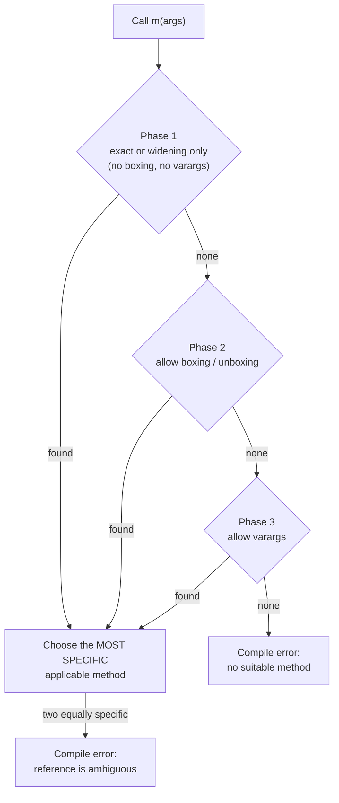
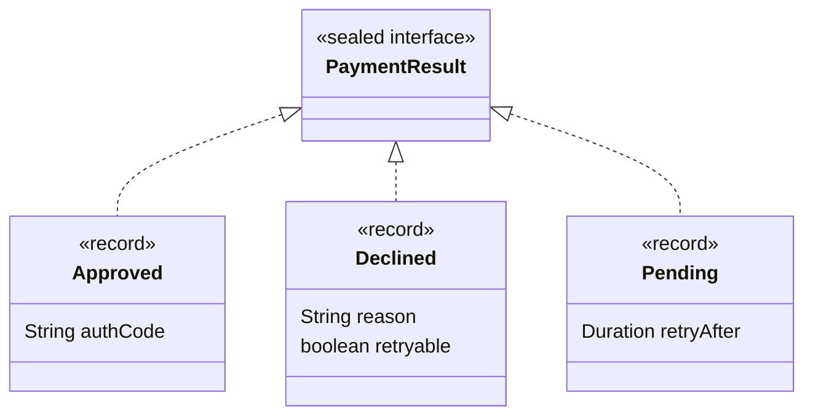

[⬅️ Prev: 01 · Platform Fundamentals](01-java-platform-fundamentals.md) · [🏠 Index](README.md) · [Next: 03 · Strings ➡️](03-strings.md)

# 02 · OOP & the Object Model

> *Junior engineers recite the four pillars. Senior engineers know where each pillar cracks. Staff engineers design types that don't need those pillars propped up.*

🧪 **Runnable labs:** [the programs behind this chapter's outputs](labs.md#chapter-02--oop-and-the-object-model)

---

## Table of contents
1. [What an object really is](#1-what-an-object-really-is-)
2. [Encapsulation is about invariants, not getters](#2-encapsulation-is-about-invariants-not-getters-)
3. [Inheritance and the fragile base class](#3-inheritance-and-the-fragile-base-class-)
4. [Polymorphism I: overloading (compile time)](#4-polymorphism-i-overloading-compile-time-)
5. [Polymorphism II: overriding & dynamic dispatch](#5-polymorphism-ii-overriding--dynamic-dispatch-)
6. [Abstract classes vs interfaces (modern edition)](#6-abstract-classes-vs-interfaces-modern-edition-)
7. [`java.lang.Object` and its contracts](#7-javalangobject-and-its-contracts-)
8. [`equals` & `hashCode`: the full story](#8-equals--hashcode-the-full-story-)
9. [`clone`, `finalize`, and why they're discouraged](#9-clone-finalize-and-why-theyre-discouraged-)
10. [Nested, inner, local & anonymous classes](#10-nested-inner-local--anonymous-classes-)
11. [Immutability by design](#11-immutability-by-design-)
12. [Records](#12-records-)
13. [Sealed types & algebraic data types](#13-sealed-types--algebraic-data-types-)
14. [Enums: far more than constants](#14-enums-far-more-than-constants-)
15. [Composition over inheritance & Liskov](#15-composition-over-inheritance--liskov-)
16. [Staff lens: modelling with types](#16-staff-lens-modelling-with-types-)
17. [Interview questions](#17-interview-questions)
18. [References](#18-references)

---

## 1. What an object really is 🟢→🔴

At the language level, an object is *identity + state + behaviour*. At the JVM level (HotSpot, 64-bit), it's a block of heap memory laid out like this:

```
┌──────────────────────────────┐
│ mark word (8 bytes)          │  identity hash · lock state · GC age bits
├──────────────────────────────┤
│ class pointer (4 bytes*)     │  → the Klass in Metaspace (vtable, field layout, …)
├──────────────────────────────┤
│ fields (reordered by size:   │  longs/doubles, ints/floats, shorts/chars,
│ 8 → 4 → 2 → 1 → refs)        │  bytes/booleans, references (4 bytes with compressed oops)
├──────────────────────────────┤
│ padding to 8-byte boundary   │
└──────────────────────────────┘
* with compressed class pointers (default).
  Compact Object Headers (JEP 519, Java 25 opt-in; default in Java 27 via JEP 534)
  merge mark word + class pointer into a single 8-byte header.
```

So a `new Object()` is 16 bytes, an `Integer` is 16 bytes (12-byte header plus a 4-byte `int`), and a `Long` is 24 bytes with classic headers. That's why `List<Integer>` costs several times more memory than an `int[]`. [Chapter 09](09-jvm-internals.md) has the full picture, including how to measure this with JOL.

**Methods are not stored in objects.** They live in the class metadata. Each object only points to its class, and virtual calls go through the class's *vtable* (§5).

---

## 2. Encapsulation is about invariants, not getters 🟢→🟡

Encapsulation isn't "make fields private and generate getters and setters." A class with a public setter for every field is a struct with extra steps. **Encapsulation means the object guarantees its own invariants**, so no caller can ever put it into an invalid state.

```java
// ❌ Anaemic: any caller can produce a broken account (negative balance, null currency)
public class Account {
    private BigDecimal balance;
    public BigDecimal getBalance() { return balance; }
    public void setBalance(BigDecimal b) { this.balance = b; }
}

// ✅ Encapsulated: state changes go through operations that preserve the invariant
public final class Account {
    private BigDecimal balance = BigDecimal.ZERO;

    public void deposit(BigDecimal amount) {
        requirePositive(amount);
        balance = balance.add(amount);
    }
    public void withdraw(BigDecimal amount) {
        requirePositive(amount);
        if (balance.compareTo(amount) < 0) throw new InsufficientFundsException(balance, amount);
        balance = balance.subtract(amount);
    }
    public BigDecimal balance() { return balance; }   // BigDecimal is immutable → safe to expose
    private static void requirePositive(BigDecimal a) {
        if (a.signum() <= 0) throw new IllegalArgumentException("amount must be > 0: " + a);
    }
}
```

**Tell, don't ask.** Callers should *tell* the object what they want (`account.withdraw(x)`), not *ask* for its state and decide for it (`if (acc.getBalance() > x) acc.setBalance(...)`). The second form spreads the business rule across every caller, and in a concurrent system it's also a race condition.

💣 **Leaking mutable internals** silently breaks encapsulation:
```java
public List<Order> orders() { return orders; }            // caller can clear() your list
public List<Order> orders() { return List.copyOf(orders); } // ✅ snapshot
public List<Order> orders() { return Collections.unmodifiableList(orders); } // ✅ read-only *view* (reflects later changes)
```

---

## 3. Inheritance and the fragile base class 🟡→🔴

What a subclass inherits: public and protected members, and package-private members if it's in the same package. Private fields still *exist* in the subclass object but can't be accessed by name. **Constructors are never inherited.** Every constructor starts with `super(...)`, either explicit or implicit.

**The fragile base class problem** (*Effective Java* Item 18) is the main reason inheritance across module or team boundaries is dangerous:

```java
public class InstrumentedHashSet<E> extends HashSet<E> {
    private int addCount = 0;

    @Override public boolean add(E e) { addCount++; return super.add(e); }
    @Override public boolean addAll(Collection<? extends E> c) {
        addCount += c.size();
        return super.addAll(c);
    }
    public int getAddCount() { return addCount; }
}

var s = new InstrumentedHashSet<String>();
s.addAll(List.of("a", "b", "c"));
System.out.println(s.getAddCount());   // 6, not 3 💣
```

`HashSet.addAll` is inherited from `AbstractCollection`, which calls `add()` for every element, and that call dispatches to *your* override. The subclass depends on an **undocumented implementation detail** of its parent. If the JDK changed `addAll` tomorrow, your count would silently change.

**Fix: composition plus forwarding (the decorator approach):**
```java
public class InstrumentedSet<E> implements Set<E> {
    private final Set<E> delegate;
    private int addCount;
    public InstrumentedSet(Set<E> delegate) { this.delegate = delegate; }
    @Override public boolean add(E e) { addCount++; return delegate.add(e); }
    @Override public boolean addAll(Collection<? extends E> c) { addCount += c.size(); return delegate.addAll(c); }
    // ...forward the remaining Set methods to delegate
}
```

> [!IMPORTANT]
> **Design for inheritance or prohibit it.** If a class isn't explicitly designed and documented for extension (which overridable methods call which, and when), make it `final` or give it only private constructors. Use `sealed` when you want a closed, known set of subclasses.

---

## 4. Polymorphism I: overloading (compile time) 🟡→🔴

Overloading is resolved **at compile time from static types**. The compiler picks the method in three phases (JLS §15.12.2). The first phase that finds an applicable method wins, and the rest are never considered:



```java
static void m(Object o)  { System.out.println("Object"); }
static void m(String s)  { System.out.println("String"); }
static void m(Integer i) { System.out.println("Integer"); }

m("hi");    // String
m(42);      // Integer: phase 1 finds nothing (int→Object needs boxing); phase 2 has Object and Integer, Integer is more specific
m(null);    // ❌ ambiguous: String and Integer are both applicable, and neither is more specific
```

```java
static void f(long x)    { System.out.println("long"); }
static void f(Integer x) { System.out.println("Integer"); }
static void f(int... xs) { System.out.println("varargs"); }
f(1);       // long: widening (phase 1) beats boxing (phase 2) beats varargs (phase 3)

static void g(Object o)  { System.out.println("Object"); }
static void g(int... xs) { System.out.println("int..."); }
g(1);       // Object: boxing (phase 2) beats varargs (phase 3)
```

💣 **Overloads that differ only in generic type arguments don't compile.** After erasure they have the same signature:
```java
void print(List<String> l)  {}
void print(List<Integer> l) {}   // ❌ name clash: both erase to print(List)
```

💣 **Overloading is static, even when the argument is a subtype at runtime:**
```java
static String classify(Collection<?> c) { return "Collection"; }
static String classify(List<?> l)       { return "List"; }
Collection<?> c = new ArrayList<>();
classify(c);    // "Collection": chosen from the static type, not the runtime type
```

> [!TIP]
> *Effective Java* Item 52: don't export two overloads with the same number of parameters when an argument could be valid for both. `List.remove(int index)` vs `List.remove(Object o)` is the cautionary tale: `list.remove(1)` on a `List<Integer>` removes the element at **index** 1, not the value 1.

---

## 5. Polymorphism II: overriding & dynamic dispatch 🟡→🔴

### Overriding rules (JLS §8.4.8)
| Rule | Detail |
|---|---|
| Signature | Same name and parameter types (after erasure). Use `@Override` and let the compiler check it |
| Return type | Same, or a **subtype** (covariant return, Java 5+). javac emits a *bridge method* |
| Access | Same or **wider** (`protected` → `public` is fine; `public` → `protected` is an error) |
| Checked exceptions | Same, narrower, or none. Never broader or new checked exceptions |
| `static` methods | Are **hidden**, not overridden. Resolved by static type |
| `private` methods | Not inherited, so there's nothing to override. A same-named method is a new method |
| `final` methods | Can't be overridden |
| Fields | **Never polymorphic**. A same-named field *hides* the parent's |

```java
class Animal {
    String name = "animal";
    static String kind() { return "Animal.kind"; }
    String speak()       { return "..."; }
}
class Dog extends Animal {
    String name = "dog";                           // hides Animal.name
    static String kind() { return "Dog.kind"; }    // hides Animal.kind()
    @Override String speak() { return "woof"; }
}

Animal a = new Dog();
a.name          // "animal": fields resolve against the static type
a.kind()        // "Animal.kind": static methods resolve against the static type
a.speak()       // "woof": instance methods dispatch on the runtime type
((Dog) a).name  // "dog"
```

### How dispatch works under the hood 🔴

```
   Animal's vtable                         Dog's vtable
┌───┬───────────────────────┐        ┌───┬───────────────────────┐
│ 0 │ Object.hashCode       │        │ 0 │ Object.hashCode       │
│ 1 │ Object.equals         │        │ 1 │ Object.equals         │
│ … │ …                     │        │ … │ …                     │
│ 5 │ Animal.speak          │        │ 5 │ Dog.speak  ◀── same slot, new target
└───┴───────────────────────┘        └───┴───────────────────────┘
invokevirtual #speak  →  load object's class → vtable[5] → jump
```

- **`invokevirtual`** (class methods): one indexed load from the vtable. Cheap.
- **`invokeinterface`**: a class can implement interfaces in any order, so there's no fixed slot. The JVM searches the *itable*, which is slower when it isn't optimised.
- **`invokestatic` / `invokespecial`** (constructors, `super.m()`, private methods): statically bound, no dispatch.

**What the JIT does about it.** HotSpot profiles each call site's receiver types:
- **Monomorphic** (one type seen): inline the target behind a cheap type guard. The call is effectively free.
- **Bimorphic** (two types): inline both behind an if/else.
- **Megamorphic** (three or more): fall back to a real vtable/itable call, which **blocks inlining** and every optimisation that depends on it.

**Class Hierarchy Analysis (CHA)** lets C2 devirtualize a call when only one implementation is loaded. If another subclass loads later, the compiled code is *deoptimised*. That's why "interfaces are slow" is a myth in steady state, and also why megamorphic call sites in hot loops (for example, a `List<Shape>` with ten implementations calling `area()`) are a real, measurable cost. See [Chapter 09](09-jvm-internals.md).

---

## 6. Abstract classes vs interfaces (modern edition) 🟡

| | Interface | Abstract class |
|---|---|---|
| Instance state | ❌ (only `public static final` constants) | ✅ any fields |
| Constructors | ❌ | ✅ (called via `super`) |
| Multiple inheritance | ✅ implement many | ❌ extend one |
| Method kinds | abstract, `default` (8), `static` (8), `private` (9) | anything |
| Member access | implicitly `public` (private methods allowed) | any modifier |
| Can be `sealed` | ✅ | ✅ |
| Best for | Capabilities and contracts (`Comparable`, `AutoCloseable`); API evolution via defaults | Shared state plus a *skeletal implementation* (template method) |

**The idiomatic combination** is an interface for the *type* plus an abstract skeletal class for *convenience*: `List` + `AbstractList`, `Map` + `AbstractMap`. Clients depend on the interface, and implementors extend the skeleton to save work.

### Default-method conflict rules (the "diamond")
1. **Classes win.** A method from the class or any superclass beats any interface default.
2. **More specific interfaces win.** If `B extends A` and both define `m()`, `B.m()` wins.
3. **Otherwise it's a compile error until you override**, optionally delegating with `X.super.m()`:

```java
interface Flyer   { default String move() { return "fly"; } }
interface Swimmer { default String move() { return "swim"; } }

class Duck implements Flyer, Swimmer {
    @Override public String move() {                 // required: the defaults conflict
        return Flyer.super.move() + "+" + Swimmer.super.move();
    }
}
```

🔴 **Why default methods exist at all:** Java 8 needed to add `stream()`, `forEach()` and `removeIf()` to `Collection` without breaking every implementation in the world. Defaults are an **API evolution tool**, not a way to get multiple inheritance of behaviour. Interfaces still can't hold state, which avoids the hard part of the diamond problem.

---

## 7. `java.lang.Object` and its contracts 🟢

| Method | Overridable | Notes |
|---|---|---|
| `equals(Object)` | ✅ | Logical equality. Default is identity (`==`) |
| `hashCode()` | ✅ | Must agree with `equals`. Default is the *identity hash* |
| `toString()` | ✅ | Default: `ClassName@hexIdentityHash`. Always override for debugging and logs |
| `getClass()` | ❌ final | Returns the runtime class. Its static type is `Class<? extends \|X\|>` |
| `clone()` | ✅ (protected) | Broken design; see §9 |
| `finalize()` | ✅ | Deprecated for removal (JEP 421). Don't use it |
| `wait()`, `notify()`, `notifyAll()` | ❌ final | Monitor methods; see [Chapter 11](11-concurrency-foundations-jmm.md) |

🔴 **The identity hash code is *not* a memory address.** The GC moves objects. HotSpot generates the value the first time it's requested (by default with a thread-local xor-shift generator) and stores it in the object's mark word, so it stays stable for the object's lifetime. `System.identityHashCode(o)` returns it even when `hashCode()` is overridden.

---

## 8. `equals` & `hashCode`: the full story 🟡→🔴

### The `equals` contract
For non-null references x, y, z:
1. **Reflexive**: `x.equals(x)`
2. **Symmetric**: `x.equals(y)` ⇔ `y.equals(x)`
3. **Transitive**: `x.equals(y) && y.equals(z)` ⇒ `x.equals(z)`
4. **Consistent**: repeated calls return the same result if nothing used in the comparison has changed
5. **Non-null**: `x.equals(null)` is `false`, never an NPE

### The `hashCode` contract
- Equal objects **must** have equal hash codes.
- Unequal objects *should* have different hash codes, for performance only.
- The value must be consistent while the fields used by `equals` don't change.

### A correct implementation
```java
public final class EmployeeId {
    private final String region;
    private final long number;

    public EmployeeId(String region, long number) {
        this.region = Objects.requireNonNull(region);
        this.number = number;
    }

    @Override public boolean equals(Object o) {
        if (this == o) return true;                          // fast path
        return o instanceof EmployeeId other                 // handles null too
            && number == other.number                        // cheapest comparison first
            && region.equals(other.region);
    }

    @Override public int hashCode() {
        return 31 * region.hashCode() + Long.hashCode(number);
    }

    @Override public String toString() { return region + "-" + number; }
}
```
(Or just write `record EmployeeId(String region, long number) {}`, which generates all three.)

**Why 31?** It's an odd prime, so no information is lost to multiplication overflow the way an even multiplier would lose bits, and `31 * i == (i << 5) - i`, which is cheap. `String.hashCode` uses the same constant. `Objects.hash(a, b, c)` is convenient but allocates a varargs array and boxes primitives. That's fine in most code, but avoid it in hot paths.

### Breaking symmetry with inheritance
```java
class Point {
    final int x, y;
    Point(int x, int y) { this.x = x; this.y = y; }
    @Override public boolean equals(Object o) {
        return o instanceof Point p && p.x == x && p.y == y;
    }
    @Override public int hashCode() { return 31 * x + y; }
}
class ColorPoint extends Point {
    final String color;
    ColorPoint(int x, int y, String color) { super(x, y); this.color = color; }
    @Override public boolean equals(Object o) {
        return o instanceof ColorPoint cp && super.equals(cp) && cp.color.equals(color);
    }
}

Point p = new Point(1, 2);
ColorPoint cp = new ColorPoint(1, 2, "red");
p.equals(cp);   // true
cp.equals(p);   // false 💣 symmetry broken
```

If you "fix" it by making `ColorPoint` ignore color when compared with a plain `Point`, you break **transitivity**: `red(1,2) = (1,2) = blue(1,2)`, yet `red ≠ blue`. If you use `getClass() != o.getClass()` instead of `instanceof`, symmetry holds, but you break **Liskov substitution**: a `ColorPoint` is no longer usable wherever a `Point` is expected (for example, `Set<Point>.contains`).

> [!IMPORTANT]
> **There's no way to extend an instantiable class with a new value component and keep the `equals` contract** (*Effective Java* Item 10). Use composition instead: `ColorPoint` *has a* `Point` and offers an `asPoint()` view.

### What breaks when the contracts are violated
```java
class Key {                       // equals/hashCode based on a MUTABLE field
    int id;
    Key(int id) { this.id = id; }
    @Override public boolean equals(Object o) { return o instanceof Key k && k.id == id; }
    @Override public int hashCode() { return Integer.hashCode(id); }
}

Map<Key, String> m = new HashMap<>();
Key k = new Key(1);
m.put(k, "v");
k.id = 2;                         // 💣 mutated while it's a key

m.get(k);            // null: the lookup goes to the bucket for hash(2)
m.get(new Key(1));   // null: right bucket, but equals fails (id is now 2)
m.size();            // 1: the entry is orphaned, effectively a memory leak
```

- `equals` overridden, `hashCode` not → two equal objects land in different buckets, so `HashSet` keeps both "duplicates" and `contains` returns false.
- `hashCode` that changes while the object is in a hash structure → the entry becomes unreachable.
- A constant `hashCode()` (`return 42;`) is *legal* but turns `HashMap` into a linked list or tree: O(n) or O(log n) lookups.

🧠 **Staff lens.** Hash-based collections are only as good as your `hashCode`. If an attacker controls the keys (for example, JSON field names or HTTP parameters), they can engineer collisions. Java 8's tree bins cap the damage at O(log n) for `Comparable` keys. That's one reason this design exists ([Chapter 06](06-collections.md)).

---

## 9. `clone`, `finalize`, and why they're discouraged 🟡

**`clone()` is a design accident:**
- `Cloneable` has no methods. It's a *marker* that changes the behaviour of the protected `Object.clone()`, which throws `CloneNotSupportedException` unless the class implements it.
- `Object.clone()` creates the copy *without calling a constructor*, so invariants established in constructors are bypassed.
- It's a **shallow** copy: mutable fields end up shared between the original and the clone.
- It doesn't work with `final` fields that need deep copying.

**Prefer copy constructors or static factories:** `new ArrayList<>(other)`, `List.copyOf(other)`, `Order.copyOf(order)`. Arrays are the one place `clone()` is idiomatic: `int[] copy = arr.clone();`.

**`finalize()`** is deprecated for removal (JEP 421, Java 18). It runs at an unpredictable time or not at all, it can resurrect objects, it delays reclamation by at least one GC cycle, and it has caused real outages when the finalizer thread fell behind. Use **try-with-resources** for deterministic cleanup and `java.lang.ref.Cleaner` as a last-resort safety net.

---

## 10. Nested, inner, local & anonymous classes 🟡→🔴

| Kind | Declared | Has an outer instance? | Typical use |
|---|---|---|---|
| **Static nested** | `static class X` inside a class | ❌ | Builders, helper types, `Map.Entry`-style types |
| **Inner (member)** | `class X` inside a class | ✅ `Outer.this` | Iterators that need outer state |
| **Local** | inside a method | ✅ (if declared in an instance context) | Rare; one-off helpers |
| **Anonymous** | `new Iface() { … }` | ✅ (if declared in an instance context) | Mostly replaced by lambdas |

💣 **Memory leak via the implicit outer reference:**
```java
public class ReportGenerator {
    private final byte[] cache = new byte[50_000_000];      // 50 MB

    class Row { }                       // inner: carries ReportGenerator.this
    static class SafeRow { }            // static nested: no hidden reference

    Row newRow() { return new Row(); }  // every Row kept anywhere pins the 50 MB generator
}
```
The same thing happens with anonymous listeners and callbacks registered on long-lived objects. *Default to `static` nested classes.*

🔴 **Version notes that impress interviewers:**
- **Nestmates (Java 11, JEP 181).** Before 11, an inner class accessing the outer class's `private` members needed compiler-generated `access$000` bridge methods. Now the JVM knows about nests and allows that private access directly.
- **Since javac 18**, an inner class that never uses its enclosing instance no longer gets a `this$0` field (serializable classes still do, for compatibility), which removes a whole class of accidental leaks.

**`this` in an anonymous class vs a lambda:**
```java
class Greeter {
    String name = "outer";
    void run() {
        Runnable anon = new Runnable() {
            String name = "anon";
            public void run() { System.out.println(this.name); }   // "anon": this is the anonymous object
        };
        Runnable lambda = () -> System.out.println(this.name);    // "outer": a lambda has no `this` of its own
        anon.run(); lambda.run();
    }
}
```
A lambda isn't an inner class. It compiles to a private method plus an `invokedynamic` call site, and it captures the enclosing instance only if it actually uses it ([Chapter 07](07-lambdas-streams-functional.md)).

---

## 11. Immutability by design 🟡→🔴

**Rules for an immutable class:**
1. No mutators (setters, or anything else that changes state).
2. Make the class `final` (or use private constructors plus static factories) so subclasses can't add mutability.
3. Make every field `private final`.
4. **Defensively copy** mutable inputs in the constructor and mutable outputs in accessors.
5. Don't let `this` escape during construction (no registering listeners or starting threads in the constructor).

```java
public final class Period {
    private final Instant start;
    private final Instant end;
    private final List<String> tags;

    public Period(Instant start, Instant end, List<String> tags) {
        if (start.isAfter(end)) throw new IllegalArgumentException(start + " after " + end);
        this.start = start;                 // Instant is immutable → sharing is safe
        this.end = end;
        this.tags = List.copyOf(tags);      // defensive copy, unmodifiable, rejects nulls
    }
    public Instant start() { return start; }
    public Instant end()   { return end; }
    public List<String> tags() { return tags; }   // already unmodifiable → return directly
}
```

💣 **Copy first, then validate.** If you validate a mutable argument (such as a `java.util.Date`) and *then* copy it, another thread can change it between the check and the copy, a TOCTOU (time-of-check-to-time-of-use) attack. Copy into your own field first and validate the copy.

**Why immutability matters at staff level:**
- **Thread-safety for free.** Final fields of a properly constructed object are visible to all threads without locks (JLS §17.5).
- **Safe sharing and caching.** You can share instances, cache the hash code (`String` does), and use them as map keys.
- **Failure atomicity.** An operation either produces a new object or fails, and never leaves the original half-modified.
- **The cost** is allocation churn for objects that change often. Use a mutable builder for those (`StringBuilder` → `String`), or persistent data structures.

---

## 12. Records 🟢→🔴

A **record** (Java 16, JEP 395) is a *transparent carrier for immutable data*. The state is the API.

```java
public record Money(BigDecimal amount, Currency currency) {

    public Money {                                       // compact canonical constructor
        Objects.requireNonNull(amount, "amount");
        Objects.requireNonNull(currency, "currency");
        // Normalise the scale so that 2.0 USD and 2.00 USD are EQUAL records.
        // RoundingMode.UNNECESSARY throws if this would lose precision, so it also validates.
        amount = amount.setScale(currency.getDefaultFractionDigits(), RoundingMode.UNNECESSARY);
    }                                                    // fields are assigned implicitly here

    public static Money of(String amount, String currencyCode) {
        return new Money(new BigDecimal(amount), Currency.getInstance(currencyCode));
    }

    public Money plus(Money other) {
        if (!currency.equals(other.currency))
            throw new IllegalArgumentException("currency mismatch: " + currency + " vs " + other.currency);
        return new Money(amount.add(other.amount), currency);
    }
}
```

**What the compiler generates:** `private final` fields; a canonical constructor; accessors named `amount()` and `currency()` (no `get` prefix); and `equals`, `hashCode` and `toString` built from *all* components. The class is implicitly `final` and extends `java.lang.Record`.

| Records can | Records cannot |
|---|---|
| Implement interfaces | Extend a class |
| Declare static fields and methods, and nested types | Declare instance fields beyond the components |
| Have compact, canonical or extra constructors (which must delegate to the canonical one) | Be mutable (fields are final) |
| Be generic: `record Pair<A, B>(A first, B second) {}` | Be abstract |
| Be declared locally inside a method | Hide components behind different accessor names |

🔴 **Gotchas that show up in reviews:**
- **Shallow immutability.** `record Team(List<String> members)` will happily store a mutable list. Fix it in the compact constructor: `members = List.copyOf(members);`.
- **Equality follows component `equals`.** That's why the `Money` example normalises the `BigDecimal` scale. Arrays as components compare by identity 💣.
- **Serialization is safer.** Records deserialize *through the canonical constructor*, so your validation runs. Classic classes deserialize without calling any constructor.
- **Not for JPA entities.** Entities need a no-arg constructor, mutability and proxying. Records are excellent for DTOs, query projections, value objects, event payloads and multi-value returns.

---

## 13. Sealed types & algebraic data types 🟡→🟣

A **sealed** class or interface (Java 17, JEP 409) restricts which classes may extend it. Every permitted subclass must say how it continues the hierarchy: `final`, `sealed` or `non-sealed`.

```java
public sealed interface PaymentResult permits Approved, Declined, Pending {}

public record Approved(String authCode)                   implements PaymentResult {}
public record Declined(String reason, boolean retryable)  implements PaymentResult {}
public record Pending(Duration retryAfter)                implements PaymentResult {}
```



Combined with pattern matching (Java 21), the compiler **checks exhaustiveness**:

```java
static String describe(PaymentResult r) {
    return switch (r) {                       // no default: the compiler knows every case
        case Approved a                               -> "approved " + a.authCode();
        case Declined(var reason, var retry) when retry -> "retry later: " + reason;
        case Declined d                               -> "declined: " + d.reason();
        case Pending p                                -> "pending, retry in " + p.retryAfter().toSeconds() + "s";
    };
}
```

If someone adds `record Refunded(...) implements PaymentResult` (and adds it to `permits`), **every switch without a `default` fails to compile** until it handles the new case. That's the point: the compiler finds every place that needs updating, instead of a runtime `default -> throw` finding it in production.

🧠 **This is algebraic data type modelling.** Records are *product types* (A **and** B), and sealed hierarchies are *sum types* (A **or** B). Functional languages have had this for decades. Together they let you **make illegal states unrepresentable**. Compare:

```java
// ❌ Every combination of nulls and flags is representable; most of them are invalid
class Result { boolean ok; String authCode; String error; Duration retryAfter; }

// ✅ Only valid shapes exist
sealed interface Result permits Ok, Err, Wait {}
```

**Rules:** permitted subclasses must be in the same module (or the same package if you're on the classpath). The `permits` clause can be omitted when all subclasses are in the same source file. Reflection exposes this through `Class.isSealed()` and `getPermittedSubclasses()`.

**Sealed vs enum vs visitor:**
- **Enum**: a fixed set of *singleton* values that carry no per-instance data.
- **Sealed + records**: a fixed set of *types*, each with its own data. This is the modern replacement for most Visitor patterns ([Chapter 17](17-design-patterns.md)).
- **Open interface**: when *third parties* must be able to add implementations.

---

## 14. Enums: far more than constants 🟢→🔴

An enum is a class whose instances are created once, at class initialization, as `public static final` fields. The constructor is implicitly `private`.

```java
public enum Operation {
    PLUS("+")  { public double apply(double x, double y) { return x + y; } },
    MINUS("-") { public double apply(double x, double y) { return x - y; } },
    TIMES("*") { public double apply(double x, double y) { return x * y; } },
    DIVIDE("/"){ public double apply(double x, double y) { return x / y; } };

    private final String symbol;
    Operation(String symbol) { this.symbol = symbol; }

    public abstract double apply(double x, double y);   // constant-specific bodies
    @Override public String toString() { return symbol; }

    private static final Map<String, Operation> BY_SYMBOL =
        Arrays.stream(values()).collect(Collectors.toUnmodifiableMap(Object::toString, op -> op));

    public static Optional<Operation> fromSymbol(String s) { return Optional.ofNullable(BY_SYMBOL.get(s)); }
}
```

**Facts worth knowing cold:**
- `values()` returns a **new cloned array on every call**. Cache it if you call it in a hot loop.
- `valueOf("X")` throws `IllegalArgumentException` for unknown names. It's case-sensitive.
- `==` is safe and idiomatic for enums. `equals` is `final` and identity-based.
- `compareTo` uses `ordinal()`, which is declaration order.
- 💣 **Never persist `ordinal()`.** Reorder or insert a constant and your stored data now means something else. With JPA, use `@Enumerated(EnumType.STRING)`.
- 💣 Enum constructors can't reference non-constant `static` fields of the same enum, because the constants are created *before* those static fields are initialized. That's a compile error.
- An enum's `hashCode()` is the identity hash, so it differs between JVM runs. That makes `HashMap<MyEnum, …>` iteration order unstable across runs; use `EnumMap`.

**`EnumSet` and `EnumMap` are the fastest collections in the JDK for their job:**
- `EnumSet` uses a bit vector: a single `long` for up to 64 constants (`RegularEnumSet`), a `long[]` beyond that (`JumboEnumSet`). `contains`, `add` and set algebra are bit operations.
- `EnumMap` uses an array indexed by ordinal, with no hashing at all.

**The enum singleton** (*Effective Java* Item 3) is immune to both reflection and serialization attacks:
```java
public enum Clock implements Supplier<Instant> {
    INSTANCE;
    public Instant get() { return Instant.now(); }
}
```
Reflection gets `IllegalArgumentException: Cannot reflectively create enum objects`. Serialization writes only the *name*, and deserialization calls `valueOf`, so no second instance can ever exist.

🔴 **A `switch` over an enum** from another compilation unit compiles to a lookup through a synthetic `$SwitchMap$…` array that maps ordinals at runtime. That way, reordering the enum in a library doesn't silently break already-compiled switches in client code.

---

## 15. Composition over inheritance & Liskov 🟡→🟣

**The Liskov Substitution Principle (LSP):** anywhere a `T` is expected, an `S extends T` must work *without the caller noticing*. That's a statement about **behavioural contracts**, not about signatures matching.

The classic violation:
```java
class Rectangle {
    protected int w, h;
    void setWidth(int w)  { this.w = w; }
    void setHeight(int h) { this.h = h; }
    int area() { return w * h; }
}
class Square extends Rectangle {               // "a square IS-A rectangle"… mathematically
    @Override void setWidth(int w)  { this.w = this.h = w; }
    @Override void setHeight(int h) { this.w = this.h = h; }
}

void stretch(Rectangle r) {
    r.setWidth(5); r.setHeight(4);
    assert r.area() == 20;                       // 💥 fails for Square (area is 16)
}
```
Mutable `Square` can't honour `Rectangle`'s implied contract that width and height vary independently. If both were immutable value objects, the problem would disappear. That's a strong hint that mutability, not the inheritance itself, causes most LSP violations.

**When inheritance *is* the right tool:**
- A genuine is-a relationship whose *behavioural* contract really holds.
- Both classes are under the same ownership (same package or team), or the base class is explicitly designed and documented for extension.
- You need the base type's protected hooks (template method).

**Otherwise, compose.** Hold a reference, forward calls, and expose an interface. Composition can be changed at runtime, tested in isolation, and doesn't leak the parent's implementation details.

---

## 16. Staff lens: modelling with types 🟣

1. **Make illegal states unrepresentable.** Sealed interfaces plus records turn validation rules into the type system. Every invalid shape the compiler rejects is a test you don't have to write and an incident you don't have to debug.
2. **Value objects everywhere money or identity is involved.** `CustomerId`, `Money`, `EmailAddress`, `Percentage`: wrapping primitives prevents an entire class of bugs, such as passing an `orderId` where a `customerId` was expected. With records, they cost a single line each.
3. **Closed vs open hierarchies are an API decision.** `sealed` means "we own every variant, and adding one is a breaking change we want flagged." An open interface means "you may extend this, and we'll keep the contract stable forever." Choose deliberately and document the decision.
4. **Equality semantics are a domain decision.** Is a `Customer` equal to another with the same email? With the same ID? Entities (identity-based) and value objects (attribute-based) need different `equals` strategies. Mixing them up causes bugs in caches, sets and ORMs ([Chapter 19](19-persistence-jdbc-jpa-hibernate.md)).
5. **Watch the memory model of your object graph.** Millions of tiny wrapper objects (boxed IDs, `Optional` fields, deep composition) have a real footprint. Project Valhalla (value classes, JEP 401, which Oracle has highlighted in JDK 28 early-access builds) aims to flatten such objects. Until it ships, measure (JOL, heap histograms) before you decide.

---

## 17. Interview questions

<details>
<summary><b>Q1. 🟢 What's the difference between overloading and overriding?</b></summary>

Overloading: same name, different parameter lists, in the same or a related class. It's resolved at **compile time** from static types, in three phases (exact/widening → boxing → varargs). Overriding: a subclass redefines an inherited instance method with the same signature. It's resolved at **runtime** from the receiver's actual class (dynamic dispatch via the vtable/itable). Static methods and fields are hidden, never overridden.
</details>

<details>
<summary><b>Q2. 🟡 Why must <code>hashCode</code> be overridden whenever <code>equals</code> is?</b></summary>

Hash-based collections first find a bucket using `hashCode`, then compare candidates with `equals`. If two equal objects return different hash codes, they land in different buckets, so `contains` and `get` miss and `HashSet` stores logical duplicates. The contract is: equal objects ⇒ equal hash codes. The reverse doesn't have to hold.
</details>

<details>
<summary><b>Q3. 🟡 What happens if a <code>HashMap</code> key is mutated after insertion?</b></summary>

If the mutation changes `hashCode`, lookups go to a different bucket and miss. Even a lookup with an "original-looking" key finds the right bucket but fails `equals`. The entry is orphaned: still counted in `size()`, unreachable through `get`, and effectively leaked. Keys should be immutable, or at least their equality-relevant fields should be.
</details>

<details>
<summary><b>Q4. 🔴 What does <code>m(null)</code> print given <code>m(Object)</code>, <code>m(String)</code> and <code>m(Integer)</code>?</b></summary>

It doesn't compile: the reference is ambiguous. `null` is applicable to all three. `String` and `Integer` are both more specific than `Object`, but neither is more specific than the other. With only `m(Object)` and `m(String)`, it would print "String", because the most specific applicable method wins.
</details>

<details>
<summary><b>Q5. 🔴 <code>void f(long)</code> and <code>void f(Integer)</code>: which runs for <code>f(5)</code>?</b></summary>

`f(long)`. Overload resolution phase 1 allows only identity and widening conversions (int → long), with no boxing. Phase 1 finds `f(long)`, so phase 2 (boxing) is never considered. This preserved backwards compatibility when autoboxing was added in Java 5.
</details>

<details>
<summary><b>Q6. 🔴 Can you extend a class, add a field and keep <code>equals</code> correct?</b></summary>

Not if the new field participates in equality and the superclass is instantiable. Using `instanceof` breaks symmetry. Ignoring the new field when comparing with the parent breaks transitivity. Using `getClass()` keeps the contract but violates Liskov (subclass instances never equal parent instances, so they fail in `Set<Parent>`). The standard fix is composition with an `asParent()` view, or making the base abstract or sealed.
</details>

<details>
<summary><b>Q7. 🟡 Abstract class or interface, and how do you decide?</b></summary>

Use an interface for a *type or capability* that many unrelated classes can have, and when you need multiple inheritance of type. It can evolve via default methods but holds no state. Use an abstract class when implementations share *state* or a skeletal algorithm (template method) and the hierarchy is under your control. Idiomatic Java often uses both: interface `List` + skeleton `AbstractList`.
</details>

<details>
<summary><b>Q8. 🟡 Two interfaces define the same default method. What happens?</b></summary>

The implementing class fails to compile until it overrides the method (it can delegate via `A.super.m()`). The resolution rules are: (1) a method from the class hierarchy beats any interface default; (2) a more specific sub-interface beats its parent; (3) otherwise the class must resolve the conflict explicitly.
</details>

<details>
<summary><b>Q9. 🔴 How does the JVM dispatch a virtual call, and why are megamorphic call sites slow?</b></summary>

`invokevirtual` indexes into the receiver class's vtable (a fixed slot per method). `invokeinterface` searches an itable. The JIT profiles receiver types per call site: monomorphic and bimorphic sites get inlined behind type guards, sometimes devirtualized entirely via class hierarchy analysis. A megamorphic site (three or more receiver types) falls back to a real table dispatch, which **prevents inlining**. That loses the escape analysis, constant folding and loop optimisations that inlining enables.
</details>

<details>
<summary><b>Q10. 🟡 What's the memory-leak risk with non-static inner classes?</b></summary>

Each instance holds a hidden reference to its enclosing instance (`Outer.this`). If the inner object outlives the outer one (it's cached, registered as a listener, or returned to a long-lived caller), it pins the entire outer object graph. Prefer static nested classes. Since javac 18, inner classes that never use the outer instance no longer get the `this$0` field, but don't rely on that.
</details>

<details>
<summary><b>Q11. 🟡 How do you make a class immutable? What about a record holding a <code>List</code>?</b></summary>

Make it final (or give it a private constructor), make all fields `private final`, add no mutators, defensively copy mutable inputs and outputs (copy *before* validating), and don't let `this` escape the constructor. Records give you the final fields but only shallow immutability, so normalise in the compact constructor: `members = List.copyOf(members);`.
</details>

<details>
<summary><b>Q12. 🔴 What problems do records solve, and when would you NOT use one?</b></summary>

They remove boilerplate for transparent, immutable data carriers and get `equals`, `hashCode` and `toString` right. Deserialization goes through the canonical constructor, so invariants hold. Don't use them for JPA entities (mutable, proxied, need no-arg constructors), for types whose representation should be hidden (records expose their state as their API), or for anything that needs inheritance.
</details>

<details>
<summary><b>Q13. 🔴 What do sealed types give you that enums and plain interfaces don't?</b></summary>

A closed set of *types*, each with its own state and behaviour, plus compiler-checked exhaustiveness in pattern-matching switches. Adding a variant becomes a compile error in every unhandled switch instead of a production bug. Enums are closed sets of *singleton instances*. Open interfaces can't be exhaustively matched. Sealed records model algebraic data types (sum of products).
</details>

<details>
<summary><b>Q14. 🔴 Why is the enum singleton considered the best singleton?</b></summary>

The JVM guarantees one instance per constant, created thread-safely during class initialization. Reflection can't instantiate enums (`Cannot reflectively create enum objects`). Serialization writes only the name and resolves it with `valueOf`, so deserialization can't create a duplicate. The downside: it can't extend a class, and it's eagerly initialized when the enum class initializes.
</details>

<details>
<summary><b>Q15. 🔴 Why shouldn't you persist <code>ordinal()</code>? What's another enum hashing pitfall?</b></summary>

Ordinal is declaration order. Insert or reorder constants and stored values silently change meaning, so persist the name (`EnumType.STRING`) or an explicit code field. Enum `hashCode` is the identity hash, which differs between runs, so `HashMap`/`HashSet` iteration order over enum keys isn't stable across JVM restarts. Use `EnumMap` and `EnumSet` (also much faster).
</details>

<details>
<summary><b>Q16. 🟡 Explain Liskov substitution with an example that isn't Rectangle/Square.</b></summary>

Say `ReadOnlyList extends ArrayList` and throws `UnsupportedOperationException` from `add`. Code that receives an `ArrayList` and calls `add` breaks, even though the types check. LSP is about *behavioural* contracts: preconditions can't be strengthened, postconditions can't be weakened, and invariants must be preserved. The JDK's own `List.of()` returning a `List` whose `add` throws is a deliberate, documented trade-off. The contract marks `add` as an "optional operation".
</details>

<details>
<summary><b>Q17. 🟡 Why is <code>clone()</code> considered broken?</b></summary>

`Cloneable` is a marker that changes the behaviour of the protected `Object.clone()`. The copy is created without running a constructor (invariants bypassed) and is shallow by default (shared mutable state). It doesn't work with final fields that need deep copies, and it throws a checked exception callers don't want. Use copy constructors or static factories. Arrays are the exception, where `arr.clone()` is idiomatic.
</details>

<details>
<summary><b>Q18. 🟣 How would you use the type system to reduce production bugs in a payments domain?</b></summary>

Wrap primitives in value types (`Money` with a normalised scale and currency, `PaymentId`, `MerchantId`) so arguments can't be mixed up. Model states as a sealed hierarchy of records (`Authorized`, `Captured`, `Refunded`, `Failed`) so invalid combinations can't be represented, and so pattern-matching switches are compiler-checked when a new state is added. Make objects immutable, with state transitions as methods that return new states, so the history stays auditable. Keep entities (identity equality) separate from value objects (structural equality).
</details>

---

## 18. References
- Joshua Bloch, *Effective Java* (3rd ed.): Items 10–13 (Object methods), 15–25 (classes and interfaces), 34–41 (enums)
- [JLS §8.4.8 Inheritance, Overriding, Hiding](https://docs.oracle.com/javase/specs/jls/se25/html/jls-8.html#jls-8.4.8) · [§15.12 Method invocation](https://docs.oracle.com/javase/specs/jls/se25/html/jls-15.html#jls-15.12)
- JEPs: [395 Records](https://openjdk.org/jeps/395) · [409 Sealed Classes](https://openjdk.org/jeps/409) · [181 Nestmates](https://openjdk.org/jeps/181) · [421 Deprecate Finalization](https://openjdk.org/jeps/421) · [401 Value Classes](https://openjdk.org/jeps/401)
- Barbara Liskov & Jeannette Wing, *A Behavioral Notion of Subtyping* (1994)

---

[⬅️ Prev: 01 · Platform Fundamentals](01-java-platform-fundamentals.md) · [🏠 Index](README.md) · [Next: 03 · Strings ➡️](03-strings.md)
