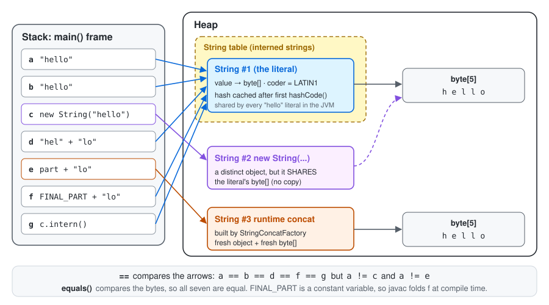

[⬅️ Prev: 02 · OOP & the Object Model](02-oop-and-object-model.md) · [🏠 Index](README.md) · [Next: 04 · Exceptions ➡️](04-exceptions.md)

# 03 · Strings

> *Strings are the most common object in almost every Java heap, the most common key in almost every map, and the input to almost every security bug. They deserve a chapter of their own.*

🧪 **Runnable labs:** [the programs behind this chapter's outputs](labs.md#chapter-03--strings)

---

## Table of contents
1. [Why `String` is immutable](#1-why-string-is-immutable-)
2. [Inside a `String`: from `char[]` to compact strings](#2-inside-a-string-from-char-to-compact-strings-)
3. [The string pool and `intern()`](#3-the-string-pool-and-intern-)
4. [Equality puzzles, solved properly](#4-equality-puzzles-solved-properly-)
5. [Concatenation: from `StringBuilder` to `invokedynamic`](#5-concatenation-from-stringbuilder-to-invokedynamic-)
6. [`StringBuilder`, `StringBuffer`, `StringJoiner`](#6-stringbuilder-stringbuffer-stringjoiner-)
7. [The `substring` memory leak (history lesson)](#7-the-substring-memory-leak-history-lesson-)
8. [API you should know by version](#8-api-you-should-know-by-version-)
9. [Text blocks](#9-text-blocks-)
10. [`split`, `replace`, case and comparison traps](#10-split-replace-case-and-comparison-traps-)
11. [Encodings: bytes are not characters](#11-encodings-bytes-are-not-characters-)
12. [Regular expressions & ReDoS](#12-regular-expressions--redos-)
13. [Performance & memory](#13-performance--memory-)
14. [Security notes](#14-security-notes-)
15. [Interview questions](#15-interview-questions)
16. [References](#16-references)

---

## 1. Why `String` is immutable 🟢→🟡

`String` is a `final` class whose state can't change after construction. Every "modifying" method (`concat`, `replace`, `toUpperCase`, …) returns a **new** string. This was a deliberate design decision, and it pays off in five ways:

| Reason | Why it matters |
|---|---|
| **Security** | Strings carry class names to class loaders, file paths to `File`, hosts to `Socket`, SQL to JDBC. If a string could change *after* a security check, you'd get a TOCTOU attack. |
| **Thread safety** | Immutable objects can be shared freely with no synchronization, which matters for the most widely shared type in the language. |
| **Hash caching** | The hash is computed once and cached in a field. Strings are the most common `HashMap` key, so that saves real time. |
| **Pooling** | Identical literals can share one instance (the string pool) only because no one can mutate it. |
| **Safe keys** | A `String` key can never be mutated after insertion (see [Chapter 02 §8](02-oop-and-object-model.md#8-equals--hashcode-the-full-story-)). |

> [!NOTE]
> "Immutable" means no *public* API can mutate it. Reflection could once poke at the internal array, and that's now blocked by strong encapsulation (Java 17, JEP 403) plus `final`-field integrity work (JEP 500, Java 26).

---

## 2. Inside a `String`: from `char[]` to compact strings 🟡→🔴

```java
// Java 9+ (simplified from java.lang.String)
public final class String implements Serializable, Comparable<String>, CharSequence, Constable, ConstantDesc {
    @Stable private final byte[] value;   // the characters, in LATIN1 or UTF16 form
    private final byte coder;             // 0 = LATIN1 (1 byte/char), 1 = UTF16 (2 bytes/char)
    private int hash;                     // cached hash code; 0 = not computed yet
    private boolean hashIsZero;           // Java 13+: distinguishes "hash is genuinely 0" from "not computed"
    ...
}
```

**Compact strings (Java 9, JEP 254).** Up to Java 8, `String` wrapped a `char[]`, using 2 bytes per character even for plain ASCII. Since Java 9, if every character fits in ISO-8859-1 (Latin-1), the string stores **1 byte per character**. Any character above U+00FF switches the whole string to UTF-16. For typical Western text-heavy heaps this roughly halves the memory used by string contents. (You can turn it off with `-XX:-CompactStrings`, but there's almost never a reason to.)

🔴 **What a string actually costs** (64-bit, compressed oops, classic headers):
```
String object:  12 header + 4 (value ref) + 4 (hash) + 1 (coder) + 1 (hashIsZero) → 24 bytes (padded)
byte[] "hello": 16 array header + 5 bytes → 24 bytes (padded)
Total for "hello": ~48 bytes to store 5 characters.
```
That's why millions of tiny strings (IDs, enum-like codes, JSON keys) are a classic heap problem, and why string deduplication exists (§13).

**The hash is lazy and racy, but benign.** `hashCode()` computes `s[0]*31^(n-1) + … + s[n-1]` the first time and caches it. Two threads might compute it at the same time, but they write the same value to an `int` field, so the race is harmless. This is the textbook example of a *benign data race*.

---

## 3. The string pool and `intern()` 🟡→🔴



- Every **string literal** and every **compile-time constant string expression** is interned. The JVM resolves the `ldc` instruction to a single canonical `String` held in the **string table**.
- The string table is a native hash table whose *entries* point to ordinary `String` objects **on the heap**. Interned strings moved from PermGen to the heap in **Java 7**, so they're garbage-collected like anything else once nothing references them.
- `s.intern()` returns the canonical instance for `s`'s contents, adding `s` to the table if no equal string is there yet.
- The table size is fixed and tunable with `-XX:StringTableSize=<buckets>`. `jcmd <pid> VM.stringtable` shows how it's being used.

**How many objects does `new String("hello")` create?** Up to **two `String` objects**: the interned literal (created when the `ldc` is first resolved, if it doesn't already exist) and the new object. In modern JDKs, the new object *shares the literal's `byte[]`*. The constructor copies the reference, not the bytes. So it's two `String`s and one `byte[]`.

💣 **Manual `intern()` is almost always the wrong tool for deduplication.** The string table is a fixed-size, natively managed table. Interning millions of dynamic values (user IDs, request paths) causes table contention and hurts GC pause times. Prefer:
- **GC string deduplication** (`-XX:+UseStringDeduplication`). Originally G1-only; since JDK 18, Serial, Parallel and ZGC support it too. It deduplicates the backing `byte[]` arrays of long-lived strings in the background.
- Or an application-level interner such as `ConcurrentHashMap<String,String>.computeIfAbsent(s, k -> k)`, or Guava's `Interners.newWeakInterner()`, scoped to the values you actually want shared.

---

## 4. Equality puzzles, solved properly 🟢→🟡

```java
public class StringEquality {
    static final String FINAL_PART = "hel";            // constant variable

    public static void main(String[] args) {
        String a = "hello";
        String b = "hello";
        String c = new String("hello");
        String d = "hel" + "lo";                       // constant expression → folded by javac
        String part = "hel";
        String e = part + "lo";                        // part is NOT final → concatenated at runtime
        String f = FINAL_PART + "lo";                  // constant expression → folded
        String g = c.intern();

        System.out.println(a == b);       // true   both are the same pooled literal
        System.out.println(a == c);       // false  new always creates a new object
        System.out.println(a == d);       // true   javac turned d into the literal "hello"
        System.out.println(a == e);       // false  runtime concatenation creates a new object
        System.out.println(a == f);       // true   folded at compile time
        System.out.println(a == g);       // true   intern() returns the pooled instance
        System.out.println(a.equals(c));  // true   always compare content with equals
    }
}
```

The rule behind `d` and `f`: JLS §15.29 *constant expressions* (literals, and `final` variables of primitive or `String` type initialized with constant expressions, combined with operators) are evaluated **by the compiler**. The result is a literal, and literals are interned. Make `part` final (`final String part = "hel";`) and `e` becomes `true` too.

> [!WARNING]
> Never compare strings with `==` in real code. It "works" in unit tests that use literals and then fails in production on strings that came off the network, out of the database or from `substring()`. Use `equals`, `Objects.equals(a, b)` (null-safe), or `"literal".equals(variable)`, which is null-safe too.

---

## 5. Concatenation: from `StringBuilder` to `invokedynamic` 🟡→🔴

**Up to Java 8**, javac compiled `a + b + c` to:
```java
new StringBuilder().append(a).append(b).append(c).toString();
```

**Since Java 9 (JEP 280, "Indify String Concatenation")**, javac emits a single `invokedynamic` instruction. On first execution, it bootstraps through `StringConcatFactory.makeConcatWithConstants`:

```
invokedynamic makeConcatWithConstants(String,String,String)String
    recipe: "\u0001\u0001\u0001"      ← \u0001 marks an argument slot; constant text is embedded inline
```

Why this was a big deal:
- **The strategy lives in the JDK, not in your bytecode.** The JDK can ship faster concatenation (exact pre-sizing of the result, no intermediate `StringBuilder` resizing, direct writes into the final `byte[]`) and your *already-compiled* jars get faster without recompiling.
- The generated code computes the exact final length and coder up front, so it allocates once.

💣 **Loops still need an explicit `StringBuilder`.** Indy concat optimises *one expression*. In a loop, each iteration creates a new intermediate string, so the total work is **O(n²)**:

```java
String s = "";
for (String part : parts) s += part;              // ❌ O(n²): copies everything every iteration

var sb = new StringBuilder(estimatedLength);       // ✅ O(n): presize if you can
for (String part : parts) sb.append(part);
String result = sb.toString();

String joined = String.join(",", parts);           // ✅ even better when that's all you need
```

---

## 6. `StringBuilder`, `StringBuffer`, `StringJoiner` 🟢→🟡

| | `StringBuilder` | `StringBuffer` | `StringJoiner` / `String.join` / `Collectors.joining` |
|---|---|---|---|
| Thread-safe | ❌ | ✅ (every method `synchronized`) | ❌ |
| Since | 5 | 1.0 | 8 |
| Use | Default mutable builder | Legacy; almost never right | Delimiter, prefix and suffix joining |

- **Growth policy:** default capacity is 16. When full, the new capacity is `old * 2 + 2`, and the array is copied. Presize with `new StringBuilder(n)` when you know the approximate size.
- `StringBuffer`'s synchronization is per method, so a sequence of appends from several threads still interleaves unpredictably. It gives you thread-safety without atomicity, which is rarely what you want. Use thread confinement instead.
- `sb.reverse()` handles surrogate pairs correctly. `sb.setLength(0)` reuses the buffer, which is handy in hot loops.

```java
String csv = Stream.of("a", "b", "c").collect(Collectors.joining(", ", "[", "]"));   // [a, b, c]
```

---

## 7. The `substring` memory leak (history lesson) 🔴

Before **Java 7u6**, `substring()` returned a new `String` that **shared** the parent's `char[]`, using an offset and a count. That made it O(1), but a tiny substring of a 10 MB string kept all 10 MB alive. The classic bug: read a huge file into a string, keep `substring(0, 8)` as an ID in a cache, and leak the entire file for every entry.

7u6 changed `substring` to **copy** the characters: O(n), but no hidden retention. The old workaround `new String(s.substring(...))` no longer does anything useful.

🧠 **Why this matters in an interview:** it's a clean example of a time-vs-space trade-off that the JDK team *reversed* after real-world experience. It also shows that "shared structure" optimisations create hidden retention, which still happens today with `ByteBuffer.slice()`, `List.subList()` views and similar APIs.

---

## 8. API you should know by version 🟢

| Version | Methods |
|---|---|
| 8 | `String.join`, `chars()`, `codePoints()` |
| 11 | `isBlank()`, `lines()`, `strip()` / `stripLeading()` / `stripTrailing()`, `repeat(n)` |
| 12 | `indent(n)`, `transform(fn)` |
| 15 | Text blocks; `formatted(...)`, `stripIndent()`, `translateEscapes()` |
| 21 | `indexOf(ch, begin, end)`, `splitWithDelimiters(regex, limit)`; `StringBuilder.repeat(...)` |

**`strip()` vs `trim()`:** `trim()` removes every char `<= U+0020` (an ASCII-era definition, which includes control characters). `strip()` removes Unicode whitespace as defined by `Character.isWhitespace`. For text from users or other systems, `strip()` is usually what you mean. (Note: `strip()` doesn't remove the non-breaking space U+00A0, which `isWhitespace` doesn't count as whitespace.)

**`isEmpty()` vs `isBlank()`:** `"  ".isEmpty()` is `false`, and `"  ".isBlank()` is `true`.

---

## 9. Text blocks 🟢→🟡

```java
String json = """
    {
      "id": 42,
      "name": "Ada"
    }
    """;
// → "{\n  \"id\": 42,\n  \"name\": \"Ada\"\n}\n"
```

How the compiler processes a text block (JEP 378):
1. Normalise line terminators to `\n`.
2. Strip **incidental indentation**: find the minimum indentation across all non-blank lines *and the closing delimiter line*, and remove it from every line. So the closing `"""` sets the left margin.
3. Strip trailing whitespace from each line.
4. *Then* interpret escape sequences.

Two escapes exist mainly for text blocks:
```java
String sql = """
    SELECT id, name \
    FROM users \
    WHERE active = true""";      // '\' at the end of a line = no newline: one long line

String padded = """
    red  \s
    green\s
    """;                          // \s = a single space that survives step 3's trailing-whitespace stripping
```
Put the closing `"""` on the same line as the last content line if you don't want a trailing newline.

> [!WARNING]
> Text blocks make SQL and JSON *readable*, not *safe*. Never `.formatted(userInput)` into SQL. Use bind parameters ([Chapter 19](19-persistence-jdbc-jpa-hibernate.md), [Chapter 25](25-security-for-java-engineers.md)).

---

## 10. `split`, `replace`, case and comparison traps 🟡

### `split` takes a regex
```java
"a.b.c".split(".")        // []         💣 "." means "any char"; all results are empty and trailing empties are removed
"a.b.c".split("\\.")      // [a, b, c]
"a|b".split("|")          // [a, |, b]  💣 "|" is alternation of two empty patterns
"a|b".split("\\|")        // [a, b]     or Pattern.quote("|")
"a,b,,".split(",")        // [a, b]     💣 trailing empty strings are dropped
"a,b,,".split(",", -1)    // [a, b, , ] ✅ a negative limit keeps them
",a".split(",")           // [, a]      leading empties are kept
"".split(",")             // [""]       💣 length 1, not 0
```
For CSV, use a real CSV parser. Quoting and escaping rules will defeat `split`.

### `replace` vs `replaceAll`
```java
"1.2.3".replace(".", "-")        // "1-2-3"  literal replacement, all occurrences
"1.2.3".replaceAll(".", "-")     // "-----"  💣 regex: every char
"cost: $5".replaceAll("\\$", "USD ")       // ✅
"a".replaceAll("a", "$1")        // 💥 IndexOutOfBoundsException: No group 1. The replacement string is parsed too!
"a".replaceAll("a", Matcher.quoteReplacement("$1"))   // ✅ "$1"
```

### Case conversion is locale-sensitive 💣
```java
Locale.setDefault(Locale.forLanguageTag("tr"));     // a Turkish server
"TITLE".toLowerCase();                 // "tıtle": dotless ı (U+0131)
"title".toUpperCase();                 // "TİTLE": dotted İ (U+0130)
"TITLE".toLowerCase().equals("title"); // false: header and enum parsing break in production
"TITLE".toLowerCase(Locale.ROOT);      // ✅ "title": always pass Locale.ROOT for protocol/identifier text
```
This "Turkish I" bug has hit HTTP header parsing, enum `valueOf` logic, and config keys in many popular libraries.

### Comparison
- `compareTo` is **lexicographic by UTF-16 code unit**, so `"Z" < "a"` and `"Zebra" < "apple"`. That's fine for keys and wrong for display order.
- For human-facing sorting, use `java.text.Collator.getInstance(locale)`.
- `equalsIgnoreCase` and `String.CASE_INSENSITIVE_ORDER` compare character by character. They work for most scripts but aren't full Unicode case folding (for example, "ß" vs "SS").

---

## 11. Encodings: bytes are not characters 🟡→🔴

A `String` is a sequence of UTF-16 code units. A file, socket or database column holds **bytes**. Every boundary crossing needs an encoding. If you don't specify one, the platform picks it, and that's how *mojibake* (`é` instead of `é`) happens.

```java
byte[] bytes = s.getBytes(StandardCharsets.UTF_8);            // ✅ always explicit
String back  = new String(bytes, StandardCharsets.UTF_8);
Files.readString(path);                                       // UTF-8 by default
new InputStreamReader(in, StandardCharsets.UTF_8);
```

- **JEP 400 (Java 18): UTF-8 by default.** `Charset.defaultCharset()` is now UTF-8 on every OS, which ends a whole class of "works on Linux, broken on Windows" bugs. Console and native-interop encodings remain platform-specific (`stdout.encoding`, `native.encoding`).
- **Lenient by default.** `new String(bytes, UTF_8)` replaces malformed input with U+FFFD (`�`) *silently*. For data where corruption must fail loudly, use a `CharsetDecoder` with `CodingErrorAction.REPORT`.
- **Length in bytes ≠ length in chars.** A `VARCHAR(255)` column might count bytes, chars or code points depending on the database. Truncation logic has to know which, or it'll split a multi-byte character.
- Watch for the **UTF-8 BOM** (`EF BB BF`) at the start of files produced by some Windows tools. Java's decoder does *not* strip it, so your first header becomes `"id"`.

---

## 12. Regular expressions & ReDoS 🟡→🔴

### Compile once, reuse everywhere
```java
private static final Pattern EMAIL = Pattern.compile("^[^@\\s]+@[^@\\s]+\\.[a-z]{2,}$", Pattern.CASE_INSENSITIVE);

boolean ok = EMAIL.matcher(input).matches();     // Pattern is immutable and thread-safe; Matcher is NOT
```
`String.matches`, `replaceAll`, `replaceFirst` and (mostly) `split` compile the regex **on every call**. In a hot path, that cost dominates. (`split` has a fast path for single-character, non-metacharacter delimiters.)

### Catastrophic backtracking (ReDoS)
`java.util.regex` is a **backtracking** engine. Some patterns have exponentially many ways to fail on a slightly-off input, and every one gets tried.

Modern JDKs detect and short-circuit many classic textbook cases. On JDK 21, `(a+)+b` against 26 `a`s followed by `!` returns instantly. **Bounded repetition still defeats those optimisations.** Measured on JDK 21:

| Pattern | Input | Time |
|---|---|---|
| `^(\w+\s?){1,100}$` | 8 words + `!` | ~0.9 s |
| `^(\w+\s?){1,100}$` | 10 words + `!` | **~66 s** |
| `(a+){2,40}b` | 28 × `a` + `!` | ~4 s, about 4× slower for every 2 extra characters (24 → 26 → 28: 0.26 s → 1.1 s → 4.2 s) |

One HTTP request carrying a crafted 30-character input can pin a CPU core for hours. That's **Regular-expression Denial of Service (ReDoS)**. It's a real attack class, and it has caused major outages in other ecosystems too.

**Defences:**
1. **Avoid nested or ambiguous quantifiers** (`(x+)+`, `(\w+\s?)*`, `(a|a?)+`). Make each character matchable in only one way.
2. **Possessive quantifiers** (`\w++`) and **atomic groups** (`(?>…)`) forbid backtracking into the group.
3. **Bound the input length** before matching. That's the cheapest defence there is.
4. **Use a linear-time engine** (RE2/J) for patterns or inputs you don't control.
5. **Add a timeout.** `java.util.regex` has none, but it reads input through `CharSequence.charAt`, so you can wrap the input in a `CharSequence` that checks a deadline or `Thread.interrupted()` and throws.

```java
// A deadline-aware CharSequence: regex evaluation calls charAt() constantly
record TimeoutCharSequence(CharSequence inner, long deadlineNanos) implements CharSequence {
    public char charAt(int i) {
        if (System.nanoTime() > deadlineNanos) throw new IllegalStateException("regex timeout");
        return inner.charAt(i);
    }
    public int length() { return inner.length(); }
    public CharSequence subSequence(int s, int e) { return new TimeoutCharSequence(inner.subSequence(s, e), deadlineNanos); }
    @Override public String toString() { return inner.toString(); }
}
```

---

## 13. Performance & memory 🔴→🟣

**How big is the problem?** The analysis behind JEP 192 (G1 string deduplication) found that in large Java applications, `String` objects made up roughly **a quarter of the live heap**, and about half of those were duplicates. Every heap histogram you'll ever look at will have `byte[]` and `String` near the top.

**Checklist for string-heavy services:**
- **Logging:** `log.debug("user=" + user)` builds the string even when DEBUG is off. Use parameterized logging, `log.debug("user={}", user)`, or a guard or lambda supplier for expensive arguments.
- **`toString()` in hot paths** (metrics tags, cache keys built by concatenation): build them once, or use structured keys (records) instead of concatenated strings.
- **`String.format` is slow**: it parses the format string every call. Use concatenation or a `StringBuilder` in hot paths.
- **Deduplication:** `-XX:+UseStringDeduplication` for long-lived duplicates (parsed JSON, CSV columns, repeated header values).
- **Large text:** stream it (`BufferedReader.lines()`, `Files.lines`) instead of loading a 1 GB file into a single `String`. The `byte[]` would need 1–2 GB of contiguous heap, which can turn into a G1 humongous allocation ([Chapter 10](10-memory-and-garbage-collection.md)).
- **`String.valueOf(char[])` and `new String(char[])` copy the array**, and so does `toCharArray()`. Be careful with them inside loops.

🧠 **Staff lens.** When a team reports "memory is high", look at the heap histogram before anything else (`jcmd <pid> GC.class_histogram | head -20`). If `byte[]`/`String` dominate, the fix is usually architectural: stop caching full payloads, intern a bounded set of keys, or switch to a streaming parser. GC tuning comes later, if at all.

---

## 14. Security notes 🔴

- **Passwords in `String`s.** Because strings are immutable and possibly interned, a password string can't be wiped. It lingers in the heap until GC, and in heap dumps and core files. APIs like `JPasswordField.getPassword()` and `KeyStore.load(..., char[])` use `char[]` so you can `Arrays.fill(pw, '\0')` after use. In web apps, the password usually arrives as a `String` from the framework anyway. Still, minimise its lifetime, never log it, and protect heap dumps as sensitive data.
- **Log injection.** User input containing `\n` can forge log lines (`user=bob\nINFO admin login success`). Use structured (JSON) logging, or escape CR/LF.
- **Format-string injection.** `String.format(userInput, args)` lets the user control the format. It's not memory-unsafe like C, but it can throw or leak argument values. Always use a constant format.
- **Unicode normalisation.** "é" can be one code point (U+00E9) or two (e + U+0301). Normalise (`java.text.Normalizer`, NFC/NFKC) before comparing identifiers, usernames or allow-lists, or attackers can register look-alike accounts.

---

## 15. Interview questions

<details>
<summary><b>Q1. 🟢 Why is <code>String</code> immutable in Java?</b></summary>

Security (strings are passed to class loaders, file and network APIs, so changing them after a check would be exploitable), thread safety without synchronization, hash code caching (strings are the most common map keys), and literal pooling, which is only safe because no one can mutate a shared instance.
</details>

<details>
<summary><b>Q2. 🟢 Difference between <code>==</code> and <code>equals</code> on strings? Give a case where <code>==</code> is true for two separately written strings.</b></summary>

`==` compares references, and `equals` compares contents. `==` is true for two identical literals (both interned), for compile-time constant expressions such as `"hel" + "lo"`, for `final` constant variables concatenated with literals, and for `intern()` results. It's false for `new String(...)` and for runtime concatenation of non-constant variables.
</details>

<details>
<summary><b>Q3. 🟡 How many objects does <code>new String("abc")</code> create?</b></summary>

Up to two `String` objects: the interned literal (if it doesn't already exist when the `ldc` is resolved) and the new instance. In modern JDKs, the new instance shares the literal's backing `byte[]`, so there's only one array.
</details>

<details>
<summary><b>Q4. 🟡 Where does the string pool live, and is it garbage collected?</b></summary>

Since Java 7, interned `String` objects live on the regular heap. The JVM's string table (a native hash table, sized with `-XX:StringTableSize`) holds references to them. Unreferenced interned strings are collected like any other objects. Before Java 7, they lived in PermGen, which was a common source of `OutOfMemoryError: PermGen space`.
</details>

<details>
<summary><b>Q5. 🔴 What are compact strings?</b></summary>

JEP 254 (Java 9). `String` stores a `byte[]` plus a `coder` byte instead of a `char[]`. If all characters fit in Latin-1, it uses 1 byte per char, otherwise UTF-16 (2 bytes per char). This roughly halves string memory for Latin-1-heavy workloads, and it's transparent to the API.
</details>

<details>
<summary><b>Q6. 🔴 How is <code>a + b + c</code> compiled today, and why is <code>+=</code> in a loop still bad?</b></summary>

Since Java 9 (JEP 280), it compiles to one `invokedynamic` bootstrapped by `StringConcatFactory`, which builds an exactly sized result, and the strategy can improve with JDK upgrades without recompiling. But that optimises a single expression. In a loop, each iteration creates a new intermediate string and copies everything accumulated so far, which is O(n²). Use a presized `StringBuilder` or `String.join`/`Collectors.joining`.
</details>

<details>
<summary><b>Q7. 🟡 <code>StringBuilder</code> vs <code>StringBuffer</code>?</b></summary>

Same API. `StringBuffer` synchronizes every method. That makes individual calls thread-safe but not *sequences* of calls, so it rarely gives the atomicity people expect. Use `StringBuilder` with thread confinement. `StringBuffer` is legacy.
</details>

<details>
<summary><b>Q8. 🔴 What was the <code>substring</code> memory leak?</b></summary>

Before Java 7u6, `substring` shared the parent's `char[]`, using an offset and a count. Keeping a small substring of a huge string retained the whole array. The JDK changed `substring` to copy, trading O(1) for O(n) to remove the hidden retention. The same class of problem still exists with views such as `subList` and `ByteBuffer.slice()`.
</details>

<details>
<summary><b>Q9. 🟡 What does <code>"a.b.c".split(".")</code> return?</b></summary>

An empty array. `split` takes a regex, and `.` matches any character, so every character is a delimiter, every token is empty, and trailing empty strings are removed. Use `split("\\.")` or `Pattern.quote(".")`. Also remember that `split(",", -1)` keeps trailing empties and `"".split(",")` returns `[""]`.
</details>

<details>
<summary><b>Q10. 🔴 Explain the "Turkish I" problem.</b></summary>

`toLowerCase()`/`toUpperCase()` without arguments use the default locale. In Turkish, `I` lowercases to dotless `ı` and `i` uppercases to dotted `İ`, so `"TITLE".toLowerCase().equals("title")` is false on a Turkish-locale server. This breaks header parsing, enum lookups and config keys. Always pass `Locale.ROOT` for machine-readable text.
</details>

<details>
<summary><b>Q11. 🔴 What is ReDoS and how do you prevent it in Java?</b></summary>

`java.util.regex` backtracks, so ambiguous patterns can take exponential time on crafted inputs. Modern JDKs short-circuit many classic nested-quantifier cases, but bounded repetitions like `^(\w+\s?){1,100}$` still blow up (over a minute on about 10 words on JDK 21). Prevent it by writing unambiguous patterns, using possessive quantifiers or atomic groups, capping input length, using a linear-time engine (RE2/J) for untrusted patterns, and adding a timeout via a deadline-checking `CharSequence` wrapper.
</details>

<details>
<summary><b>Q12. 🟡 Why should you specify a charset when converting bytes ↔ strings? Did Java 18 change this?</b></summary>

Without one, the platform default is used, which historically differed by OS and locale and caused mojibake. Java 18 (JEP 400) made UTF-8 the default everywhere, but being explicit (`StandardCharsets.UTF_8`) documents intent and protects code that runs on older JVMs. Also, decoding is lenient by default (malformed input becomes U+FFFD). Use a `CharsetDecoder` with `REPORT` when corruption must fail.
</details>

<details>
<summary><b>Q13. 🔴 Should you call <code>intern()</code> to save memory?</b></summary>

Rarely. The string table is a fixed-size native structure, and interning large numbers of dynamic values adds contention and GC work. Prefer GC string deduplication (`-XX:+UseStringDeduplication`, available for all major collectors since JDK 18) or an application-level, bounded interner for a known set of keys. First confirm with a heap histogram that duplicate strings really are the problem.
</details>

<details>
<summary><b>Q14. 🔴 Why do some security APIs use <code>char[]</code> for passwords instead of <code>String</code>?</b></summary>

A `String` can't be cleared. It stays in memory until GC (and possibly in the string table), and it can show up in heap dumps. A `char[]` can be overwritten right after use. In practice, frameworks often hand you a `String` anyway, so also keep secrets out of logs, keep their lifetimes short, and treat heap dumps as sensitive.
</details>

<details>
<summary><b>Q15. 🟣 A service's heap is dominated by <code>byte[]</code> and <code>String</code>. How do you approach it?</b></summary>

Take a class histogram, then a heap dump, and in MAT check the duplicate-strings report and the dominator tree for what retains them. Typical root causes: caching whole payloads instead of parsed fields, unbounded caches keyed by long concatenated strings, loading large files whole, and many duplicates of a small set of values. Fixes, in order: change what's retained (architecture), deduplicate a bounded value set, turn on GC string deduplication, and only then tune the heap. Measure before and after with the same workload.
</details>

---

## 16. References
- JEPs: [254 Compact Strings](https://openjdk.org/jeps/254) · [280 Indify String Concatenation](https://openjdk.org/jeps/280) · [378 Text Blocks](https://openjdk.org/jeps/378) · [400 UTF-8 by Default](https://openjdk.org/jeps/400) · [192 String Deduplication in G1](https://openjdk.org/jeps/192)
- [JLS §15.29 Constant Expressions](https://docs.oracle.com/javase/specs/jls/se25/html/jls-15.html#jls-15.29)
- [`java.util.regex.Pattern` Javadoc](https://docs.oracle.com/en/java/javase/25/docs/api/java.base/java/util/regex/Pattern.html): possessive quantifiers and atomic groups
- Aleksey Shipilëv, *JVM Anatomy Quarks*: short, precise notes on string internals and more

---

[⬅️ Prev: 02 · OOP & the Object Model](02-oop-and-object-model.md) · [🏠 Index](README.md) · [Next: 04 · Exceptions ➡️](04-exceptions.md)
