[⬅️ Prev: 03 · Strings](03-strings.md) · [🏠 Index](README.md) · [Next: 05 · Generics ➡️](05-generics.md)

# 04 · Exceptions & Error Handling

> *Error handling is where design quality shows. Anyone can write the happy path. The interesting questions are what happens when the database times out halfway through, who finds out, and whether you can safely try again.*

🧪 **Runnable labs:** [the programs behind this chapter's outputs](labs.md#chapter-04--exceptions)

---

## Table of contents
1. [The `Throwable` hierarchy](#1-the-throwable-hierarchy-)
2. [Checked vs unchecked: the real debate](#2-checked-vs-unchecked-the-real-debate-)
3. [`try` / `catch` / `finally` semantics, precisely](#3-try--catch--finally-semantics-precisely-)
4. [try-with-resources internals & suppressed exceptions](#4-try-with-resources-internals--suppressed-exceptions-)
5. [Anatomy and cost of an exception](#5-anatomy-and-cost-of-an-exception-)
6. [Errors you must be able to diagnose](#6-errors-you-must-be-able-to-diagnose-)
7. [Exceptions and threads](#7-exceptions-and-threads-)
8. [Exceptions, lambdas and streams](#8-exceptions-lambdas-and-streams-)
9. [Designing exceptions for an API](#9-designing-exceptions-for-an-api-)
10. [Anti-patterns that show up in code review](#10-anti-patterns-that-show-up-in-code-review-)
11. [Staff lens: an error-handling strategy for a system](#11-staff-lens-an-error-handling-strategy-for-a-system-)
12. [Interview questions](#12-interview-questions)
13. [References](#13-references)

---

## 1. The `Throwable` hierarchy 🟢

```mermaid
flowchart TD
    T["Throwable"] --> ER["Error<br/>(JVM / environment problems)"]
    T --> EX["Exception<br/>(checked)"]
    EX --> RT["RuntimeException<br/>(unchecked)"]
    EX --> IO["IOException"]
    EX --> SQL["SQLException"]
    EX --> IE["InterruptedException"]
    EX --> ROE["ReflectiveOperationException"]
    ROE --> CNF["ClassNotFoundException"]
    IO --> FNF["FileNotFoundException"]
    RT --> NPE["NullPointerException"]
    RT --> IAE["IllegalArgumentException"]
    IAE --> NFE["NumberFormatException"]
    RT --> ISE["IllegalStateException"]
    RT --> IOOBE["IndexOutOfBoundsException"]
    RT --> CCE["ClassCastException"]
    RT --> UOE["UnsupportedOperationException"]
    RT --> CME["ConcurrentModificationException"]
    ER --> VME["VirtualMachineError"]
    VME --> OOM["OutOfMemoryError"]
    VME --> SOE["StackOverflowError"]
    ER --> LE["LinkageError"]
    LE --> NCDFE["NoClassDefFoundError"]
    LE --> EIIE["ExceptionInInitializerError"]
    LE --> ICCE["IncompatibleClassChangeError"]
    ICCE --> NSME["NoSuchMethodError"]
    classDef checked fill:#fff1e5,stroke:#bc4c00,color:#24292f
    classDef unchecked fill:#dafbe1,stroke:#1a7f37,color:#24292f
    classDef error fill:#ffebe9,stroke:#cf222e,color:#24292f
    class EX,IO,SQL,IE,ROE,CNF,FNF checked
    class RT,NPE,IAE,NFE,ISE,IOOBE,CCE,UOE,CME unchecked
    class ER,VME,OOM,SOE,LE,NCDFE,EIIE,ICCE,NSME error
```



🟧 **Checked** (`Exception` but not `RuntimeException`): the compiler forces you to catch it or declare it.
🟩 **Unchecked** (`RuntimeException`): usually signals a programming error. Nothing forces you to handle it.
🟥 **`Error`**: the JVM or environment is in trouble. Don't catch these except at the very top of a thread or process.

> [!NOTE]
> Checked vs unchecked is purely a **compile-time** concept. At runtime the JVM doesn't distinguish them at all. That's why Kotlin and Scala, which have no checked exceptions, interoperate seamlessly, and why "sneaky throw" tricks work.

---

## 2. Checked vs unchecked: the real debate 🟡→🟣

**The original intent** (*Effective Java* Item 70):
- **Checked** for *recoverable* conditions the caller can reasonably be expected to handle: the file isn't there, the network failed, the insufficient-balance check failed.
- **Runtime** for *programming errors*: violated preconditions, broken invariants, null where non-null was required.
- **Errors** for the JVM.

**Why the industry drifted towards unchecked:**
1. **They don't compose with lambdas.** `Function<T,R>` can't throw `IOException`, so `stream.map(this::readFile)` doesn't compile ([§8](#8-exceptions-lambdas-and-streams-)).
2. **They leak abstractions.** A `UserRepository` that throws `SQLException` tells every caller it's backed by JDBC. Change it to a REST client and you break every signature.
3. **"Recoverable" depends on the caller.** Most callers can't actually recover from an `IOException`. They wrap it and rethrow, which adds noise without adding handling.
4. **Frameworks chose unchecked.** Spring translates `SQLException` into an unchecked `DataAccessException` hierarchy, and JPA, Jackson 3 and the AWS SDK v2 all use unchecked exceptions.

🧠 **The position I'd defend in an interview:**
> "Use checked exceptions sparingly, for conditions that are *part of a method's contract* and that *the immediate caller* can act on: a parser's `ParseException`, or a `NoSuchFileException` from a method whose whole job is opening a file. For everything else, use unchecked exceptions with a well-designed hierarchy, and handle them at **boundaries** (HTTP handlers, message consumers, job runners). For expected business outcomes, such as 'payment declined', I prefer **return types** (a sealed `Result`) over exceptions. They aren't exceptional, and callers must handle them."

This shows you know the trade-off and have a principled position, which is what the interviewer is checking for.

---

## 3. `try` / `catch` / `finally` semantics, precisely 🟡→🔴

### Catch order and multi-catch
```java
try { ... }
catch (FileNotFoundException e) { ... }     // more specific first
catch (IOException e) { ... }               // putting this first makes the line above unreachable → compile error
catch (SQLException | TimeoutException e) { // multi-catch (Java 7): e is implicitly final
    // the alternatives must not be subclasses of each other
}
```

### Precise rethrow (Java 7)
```java
void process() throws IOException, SQLException {   // NOT "throws Exception"
    try {
        readFile();     // throws IOException
        writeDb();      // throws SQLException
    } catch (Exception e) {                          // broad catch for logging
        audit(e);
        throw e;        // compiles: e is effectively final, so the compiler knows it's IOException | SQLException | unchecked
    }
}
```

### `finally`: when does it run?
`finally` runs on every exit path out of the `try`: normal completion, `return`, `break`, `continue`, or an exception. It does **not** run when:
- `System.exit()` or `Runtime.halt()` is called inside the `try` (shutdown hooks still run on `exit`, but not on `halt`);
- the JVM crashes or is killed (`kill -9`, OOM killer);
- the thread is a **daemon** and the JVM exits while it's still running;
- the `try` never finishes (infinite loop, deadlock).

### The `return` puzzles
```java
static int f() {
    int x = 1;
    try { return x; }          // the return VALUE (1) is evaluated and saved here
    finally { x = 2; }         // modifies the local, not the saved value
}                               // → returns 1

static int g() {
    try { return 1; }
    finally { return 2; }      // 💣 overrides the return, AND would swallow any exception from try
}                               // → returns 2

static List<String> h() {
    List<String> list = new ArrayList<>();
    try { return list; }       // saves the REFERENCE
    finally { list.add("added in finally"); }   // mutates the same object
}                               // → returns a list containing "added in finally"
```

> [!CAUTION]
> **Never `return` (or `throw`) from `finally`.** It silently discards any exception thrown in the `try`, including `OutOfMemoryError`. javac warns about it with `-Xlint:finally` ("finally clause cannot complete normally"). Turn that lint on, and make it an error in CI.

🔴 **Bytecode detail:** modern javac doesn't emit subroutines for `finally` (the old `jsr`/`ret` instructions are forbidden in class files from version 51 onwards). Instead it **copies the finally block** into every exit path, plus an exception-table entry that catches anything, runs the copy, and rethrows. A big `finally` block can bloat a method past the JIT's inlining or compilation size limits.

---

## 4. try-with-resources internals & suppressed exceptions 🟡→🔴

```java
try (var in = Files.newInputStream(src);
     var out = Files.newOutputStream(dst)) {
    in.transferTo(out);
}   // out.close() runs first, then in.close(): REVERSE order of declaration
```

**What javac generates** (JLS §14.20.3, simplified for one resource):
```java
{
    final InputStream in = Files.newInputStream(src);
    Throwable primary = null;
    try {
        /* body */
    } catch (Throwable t) {
        primary = t;
        throw t;
    } finally {
        if (in != null) {
            if (primary != null) {
                try { in.close(); }
                catch (Throwable suppressed) { primary.addSuppressed(suppressed); }   // ← the key line
            } else {
                in.close();          // no primary exception → a close() failure propagates normally
            }
        }
    }
}
```

**Why suppressed exceptions matter.** Before Java 7, the hand-written idiom `finally { in.close(); }` had a nasty flaw: if both the body and `close()` threw, the `close()` exception **replaced** the body's exception. The real cause vanished from the logs. Now the body's exception is the primary one, and close failures ride along as `getSuppressed()`.

```java
class Res implements AutoCloseable {
    private final String name;
    Res(String name) { this.name = name; System.out.println("open " + name); }
    @Override public void close() {
        System.out.println("close " + name);
        throw new IllegalStateException("close " + name);
    }
}

try (var a = new Res("A"); var b = new Res("B")) {
    throw new RuntimeException("body");
} catch (RuntimeException e) {
    System.out.println("caught: " + e.getMessage());
    for (Throwable s : e.getSuppressed()) System.out.println("  suppressed: " + s.getMessage());
}
```
<!-- lab-output: TryWithResources.java -->
```
open A
open B
close B
close A
caught: body
  suppressed: close B
  suppressed: close A
```

**Details that come up:**
- A resource variable that evaluates to `null` is skipped, with no NPE.
- If a *later* resource's initializer throws, the resources already opened are still closed.
- **Java 9:** you can use an existing effectively-final variable: `try (existingConnection) { … }`.
- `AutoCloseable.close()` throws `Exception`. `Closeable.close()` throws `IOException` and **must be idempotent** (calling it twice is harmless). Make your `close()` implementations idempotent anyway.
- Wrapper streams: in `new BufferedReader(new FileReader(f))`, if the `BufferedReader` constructor throws, the `FileReader` leaks. To be strictly safe, declare each layer as a separate resource.

---

## 5. Anatomy and cost of an exception 🔴

A `Throwable` carries a **message**, a **cause** (the chain), **suppressed** exceptions, and a **stack trace** that's captured at construction time by `fillInStackTrace()`.

### Why exceptions are expensive
The expensive part is usually **not** the `throw`. It's **constructing** the exception: `fillInStackTrace()` walks every frame of the current stack, and deep framework stacks (Spring, servlet filters, reactive operators) can be 150+ frames. Converting the trace to `StackTraceElement[]` happens lazily, on `getStackTrace()` or `printStackTrace()`, and costs even more.

When the throw and the catch are inlined into the same compiled method, C2 can turn the throw into a plain jump. If the exception object doesn't escape, the stack walk can disappear too. Don't rely on that. **Exceptions for control flow are slow in the general case.**

**Stackless exceptions** for high-frequency, expected failures (parsers, protocol decoders):
```java
public final class FastFailException extends RuntimeException {
    public FastFailException(String message) {
        super(message, null, /*enableSuppression*/ false, /*writableStackTrace*/ false);
    }
}
```

### `-XX:+OmitStackTraceInFastThrow` (on by default) 💣
When JIT-compiled code throws the same **implicit** exception (NPE, `ArithmeticException`, `ArrayIndexOutOfBoundsException`, `ArrayStoreException`, `ClassCastException`) many times at the same site, HotSpot switches to a **preallocated exception with no stack trace and no message**. Your logs fill up with bare `java.lang.NullPointerException` lines and no location.

**Debugging tip:** search the logs for the *first* occurrences, which still have traces, or restart with `-XX:-OmitStackTraceInFastThrow`.

### Helpful NullPointerExceptions (JEP 358)
Since Java 15 (opt-in in 14), NPE messages say *what* was null:
```
Cannot invoke "String.toLowerCase()" because the return value of "User.getEmail()" is null
```
Local variable names appear only if the code was compiled with `-g`. Otherwise you get `"<local4>"`.

### Walking the stack efficiently
`StackWalker` (Java 9) lazily streams frames, so you don't build a whole `Throwable` just to find your caller:
```java
Optional<String> caller = StackWalker.getInstance()
        .walk(frames -> frames.skip(1).findFirst().map(StackWalker.StackFrame::getMethodName));
```

---

## 6. Errors you must be able to diagnose 🟡→🔴

| Error | What it really means | First move |
|---|---|---|
| `OutOfMemoryError: Java heap space` | Live data exceeded `-Xmx`, or there's a leak | Heap dump (`-XX:+HeapDumpOnOutOfMemoryError`), MAT dominator tree. See [Ch 10](10-memory-and-garbage-collection.md) |
| `OutOfMemoryError: Metaspace` | Too many classes, usually a class-loader leak (redeploys, dynamic proxies) | Class histogram, `jcmd VM.metaspace` |
| `OutOfMemoryError: unable to create native thread` | OS thread or memory limit (ulimit, container PIDs limit), not heap | Count threads, look for unbounded thread creation |
| `StackOverflowError` | Unbounded recursion (or a genuinely deep but legitimate recursion, with `-Xss` too small) | Read the repeating frames in the trace |
| `ClassNotFoundException` (checked) | **Explicit** dynamic loading (`Class.forName`, `loadClass`) didn't find the class | Classpath and class-loader hierarchy |
| `NoClassDefFoundError` | The class existed at compile time but **can't be defined at runtime**: a missing jar, or **its static initializer failed earlier** | Look for an earlier `ExceptionInInitializerError` |
| `ExceptionInInitializerError` | A `static {}` block or static field initializer threw | Fix the initializer. The class is now permanently unusable in this class loader |
| `NoSuchMethodError` / `NoSuchFieldError` | Binary incompatibility: compiled against version X, running with version Y | `mvn dependency:tree`, check for version conflicts ([Ch 15](15-modules-and-build-tools.md)) |
| `AbstractMethodError` / `IncompatibleClassChangeError` | Same family: class shapes changed incompatibly between compile time and runtime | Align dependency versions |
| `UnsatisfiedLinkError` | A native library is missing or for the wrong architecture | `java.library.path`, check the platform/arch |

🔴 **The `ExceptionInInitializerError` → `NoClassDefFoundError` chain** causes a lot of confusion:
```java
class Config {
    static final Properties PROPS = load();          // throws because the file is missing
    static Properties load() { throw new IllegalStateException("config.properties missing"); }
}
// 1st access: ExceptionInInitializerError, caused by IllegalStateException: config.properties missing
// 2nd access: NoClassDefFoundError: Could not initialize class Config
```
The class is marked *erroneous* and never retried. If the first error got lost (logged on another thread, say), all you see are mysterious `NoClassDefFoundError`s for a class that's *clearly on the classpath*. Since JDK 18, the later `NoClassDefFoundError` carries the original failure as its cause, which helps a lot.

**Should you catch `StackOverflowError` or `OutOfMemoryError`?** Generally no. After an OOM, any thread may have died halfway through an operation, so locks may be held and data structures half-updated. The safest production policy is **fail fast and restart**: `-XX:+ExitOnOutOfMemoryError` (or `CrashOnOutOfMemoryError` to also get a core dump), plus a heap dump, plus an orchestrator that restarts the process.

---

## 7. Exceptions and threads 🟡→🔴

An uncaught exception terminates **only the thread** it was thrown in, not the JVM (unless it's the last non-daemon thread). Where it ends up depends on how the work was started:

```java
ExecutorService pool = Executors.newFixedThreadPool(2);

pool.execute(() -> { throw new IllegalStateException("boom-1"); });
// → the worker thread dies; the default UncaughtExceptionHandler prints the trace;
//   ThreadPoolExecutor replaces the worker.

Future<?> f = pool.submit(() -> { throw new IllegalStateException("boom-2"); });
// → NOTHING is printed. Ever. 💣 The exception is captured inside the Future.
//   You only see it if someone calls f.get(), which throws ExecutionException(cause = boom-2).
```

> [!WARNING]
> **Fire-and-forget `submit()` swallows exceptions.** This is one of the most common "the job just stopped and nothing was logged" bugs. Either keep and check the `Future`, use `execute()` with an `UncaughtExceptionHandler`, wrap the task body in try/catch with logging, or override `ThreadPoolExecutor.afterExecute` to inspect completed futures.

```java
Thread.setDefaultUncaughtExceptionHandler((t, e) ->
        log.error("Uncaught exception in thread {}", t.getName(), e));   // a process-wide safety net
```

**`InterruptedException` is a cancellation request, not an error:**
```java
try {
    item = queue.take();
} catch (InterruptedException e) {
    Thread.currentThread().interrupt();   // ✅ restore the flag so callers further up can see it
    return;                               // and stop what you were doing
}
```
Catching it and doing nothing (or just logging) **destroys the cancellation signal**: thread pools can't shut down and tasks can't be cancelled. [Chapter 11](11-concurrency-foundations-jmm.md) covers interruption in depth.

**`CompletableFuture`** wraps failures in `CompletionException` (from `join()`) or `ExecutionException` (from `get()`). Inside `exceptionally`/`handle`, the throwable may or may not be wrapped, depending on which stage failed. Always unwrap defensively ([Chapter 12](12-concurrency-advanced-juc-loom.md)).

---

## 8. Exceptions, lambdas and streams 🟡

Functional interfaces in `java.util.function` don't declare checked exceptions, so this doesn't compile:
```java
List<String> contents = paths.stream()
        .map(Files::readString)        // ❌ unhandled IOException
        .toList();
```

**Option 1: wrap in a domain-appropriate unchecked exception** (the usual choice):
```java
.map(p -> {
    try { return Files.readString(p); }
    catch (IOException e) { throw new UncheckedIOException("reading " + p, e); }
})
```

**Option 2: a small reusable adapter**:
```java
@FunctionalInterface
interface ThrowingFunction<T, R> { R apply(T t) throws Exception; }

static <T, R> Function<T, R> unchecked(ThrowingFunction<T, R> f) {
    return t -> {
        try { return f.apply(t); }
        catch (RuntimeException e) { throw e; }
        catch (Exception e) { throw new CompletionException(e); }
    };
}
// paths.stream().map(unchecked(Files::readString)).toList();
```

**Option 3: model failure as data.** This is the best option when partial failure is *expected* (batch imports, fan-out calls):
```java
sealed interface Result<T> {
    record Ok<T>(T value) implements Result<T> {}
    record Err<T>(Exception error) implements Result<T> {}
}

List<Result<String>> results = paths.stream()
        .<Result<String>>map(p -> {                    // type witness: lets the diamonds below infer <String>
            try { return new Result.Ok<>(Files.readString(p)); }
            catch (IOException e) { return new Result.Err<>(e); }
        })
        .toList();
// now you can report "97 imported, 3 failed: …" instead of aborting at the first failure
```

💣 Avoid "sneaky throw" tricks (generic type-erasure hacks that throw a checked exception without declaring it). They compile, but callers can't catch the exception by its real type without compiler complaints, which surprises everyone downstream.

---

## 9. Designing exceptions for an API 🟡→🔴

**The rules (adapted from *Effective Java* Items 69–77):**
1. **Use exceptions only for exceptional conditions.** Never for ordinary control flow (`try { iterate until IndexOutOfBounds }`).
2. **Prefer standard exceptions** where they fit: `IllegalArgumentException` (bad argument), `IllegalStateException` (object in the wrong state for this call), `NullPointerException` (null where forbidden; use `Objects.requireNonNull(x, "x")`), `IndexOutOfBoundsException` (`Objects.checkIndex`), `UnsupportedOperationException`, `ConcurrentModificationException`.
3. **Throw exceptions appropriate to the abstraction.** Translate low-level exceptions at layer boundaries, **and keep the cause**:
   ```java
   try { return jdbc.queryForObject(SQL, mapper, id); }
   catch (DataAccessException e) {
       throw new OrderLookupException("failed to load order " + id, e);   // ← cause preserved
   }
   ```
4. **Include failure-capture information.** The message should contain the *values* involved (`"amount -5 must be > 0 for account 123"`), but **never secrets or PII**.
5. **Strive for failure atomicity.** A failed call should leave the object in its prior state: validate before mutating, work on a copy, or roll back.
6. **Document every exception** a method can throw, checked or unchecked (`@throws`), including the conditions that cause it.
7. **Don't ignore exceptions.** If ignoring is genuinely correct, name the variable `ignored` and comment why.

### A practical service-level hierarchy
```java
public abstract class AppException extends RuntimeException {
    private final String code;          // stable, machine-readable: "PAYMENT_DECLINED"
    private final boolean retryable;    // drives retry policies and client behaviour

    protected AppException(String code, String message, boolean retryable, Throwable cause) {
        super(message, cause);
        this.code = code;
        this.retryable = retryable;
    }
    public String code()        { return code; }
    public boolean retryable()  { return retryable; }
}

public final class NotFoundException extends AppException {            // → 404, not retryable
    public NotFoundException(String entity, Object id) {
        super("NOT_FOUND", entity + " " + id + " not found", false, null);
    }
}
public final class ConflictException extends AppException {            // → 409, retry after re-reading
    public ConflictException(String message) { super("CONFLICT", message, false, null); }
}
public final class DependencyUnavailableException extends AppException { // → 503, retryable
    public DependencyUnavailableException(String dependency, Throwable cause) {
        super("DEPENDENCY_UNAVAILABLE", dependency + " unavailable", true, cause);
    }
}
```

Map it to HTTP **once**, at the boundary, using RFC 9457 *Problem Details* (Spring 6+ has `ProblemDetail` built in):
```java
@RestControllerAdvice
class ApiExceptionHandler {
    @ExceptionHandler(AppException.class)
    ResponseEntity<ProblemDetail> handle(AppException ex) {
        HttpStatus status = switch (ex) {
            case NotFoundException n -> HttpStatus.NOT_FOUND;
            case ConflictException c -> HttpStatus.CONFLICT;
            case DependencyUnavailableException d -> HttpStatus.SERVICE_UNAVAILABLE;
            default -> HttpStatus.INTERNAL_SERVER_ERROR;
        };
        ProblemDetail pd = ProblemDetail.forStatusAndDetail(status, ex.getMessage());
        pd.setType(URI.create("https://errors.example.com/" + ex.code().toLowerCase(Locale.ROOT)));
        pd.setProperty("code", ex.code());
        pd.setProperty("retryable", ex.retryable());
        return ResponseEntity.status(status).body(pd);
    }
}
```
(Making `AppException` `sealed` would let that `switch` drop the `default` and get exhaustiveness checking.)

---

## 10. Anti-patterns that show up in code review 🟡

| Anti-pattern | Why it hurts | Instead |
|---|---|---|
| `catch (Exception e) {}` | Failures vanish and corrupted state carries on | Handle, translate, or let it propagate |
| `catch (Exception e) { log.error(e); throw e; }` at every layer | The same stack trace logged 5 times, alert noise | Log **once**, at the boundary that handles it |
| `throw new ServiceException(e.getMessage())` | Loses the cause and the original stack trace | `new ServiceException("context", e)` |
| `catch (Throwable t)` deep in business code | Catches OOM and `StackOverflowError`, and continues with broken state | Only at thread or process top level |
| `catch (InterruptedException e) { }` | Kills cancellation, so pools can't shut down | Restore the flag and exit |
| `catch (NullPointerException e)` | Hides a bug | Fix the null source and validate inputs |
| `throws Exception` on public methods | Forces callers into catch-all blocks, no information | Declare specific types, or use unchecked exceptions |
| Exceptions for flow control | Slow (stack walks) and unreadable | Return values, `Optional`, `Result` |
| Returning `null` to signal failure | NPE far from the cause | Throw, or return `Optional` / `Result` |
| Logging PII or secrets in exception messages | Compliance incident waiting to happen | Log identifiers, not payloads |

---

## 11. Staff lens: an error-handling strategy for a system 🟣

At staff level, the question isn't "how do I catch this?" It's "how does the *system* behave when things fail, and how do humans find out?"

**1. Classify failures by what the caller should do:**

| Class | Examples | HTTP | Retry? | Page someone? |
|---|---|---|---|---|
| Client error | Validation, bad format | 400 / 422 | ❌ | ❌ (dashboard only) |
| Auth | Missing or invalid credentials, forbidden | 401 / 403 | ❌ | Only on spikes (attack?) |
| Not found | Unknown ID | 404 | ❌ | ❌ |
| Conflict | Optimistic-lock version mismatch, duplicate | 409 | ✅ after re-reading | ❌ |
| Throttled | Rate limit, quota | 429 + `Retry-After` | ✅ after the delay | If sustained |
| Transient dependency | Timeout, connection reset, 503 from downstream | 503 / 504 | ✅ with backoff + jitter, **only if idempotent** | On SLO burn |
| Bug | NPE, `IllegalStateException` | 500 | ❌ | ✅ |

**2. Retries are a system property, not a local one.** Three layers each retrying three times turns 1 failed call into **27** calls, a retry storm that amplifies an outage. Retry at *one* layer, cap the attempts, use exponential backoff with jitter, add retry budgets, and only retry idempotent operations or ones that carry an idempotency key ([Chapter 22](22-production-readiness-observability-resilience.md), [Chapter 23](23-distributed-systems-microservices.md)).

**3. Observability.** Log once at the handling boundary, with structured fields (`error.code`, `error.type`, a trace ID). Count errors by `code` in metrics. Attach exceptions to trace spans. Fingerprint stack traces so 10,000 identical errors group into one issue.

**4. Make "expected failures" explicit in types.** Payment declined, out of stock, duplicate request: these are business outcomes. A sealed `Result` makes callers handle them deliberately and keeps exception-based alerting for things that really are exceptional.

**5. Decide the crash policy.** For `Error`s (OOM), fail fast and let the orchestrator restart a clean process. A half-alive JVM is worse than a dead one.

---

## 12. Interview questions

<details>
<summary><b>Q1. 🟢 Checked vs unchecked exceptions: what's the difference and when do you use each?</b></summary>

Checked exceptions (subclasses of `Exception` but not `RuntimeException`) must be caught or declared, and the compiler enforces it. Unchecked exceptions (`RuntimeException` and `Error`) don't need to be. The rule of thumb is checked for recoverable conditions the immediate caller can act on, unchecked for programming errors. Modern practice uses checked exceptions sparingly because they don't compose with lambdas and leak implementation details across layers. Expected business outcomes are often better modelled as return types.
</details>

<details>
<summary><b>Q2. 🟡 Does <code>finally</code> always execute?</b></summary>

It runs on every normal or abrupt exit from the `try` (return, break, continue, exception). It doesn't run if `System.exit`/`Runtime.halt` is called, if the JVM crashes or is killed, if the thread is a daemon and the JVM exits, or if the `try` never completes. A `return` in `finally` overrides the try's return value and swallows any in-flight exception.
</details>

<details>
<summary><b>Q3. 🟡 What does <code>int f(){ int x=1; try { return x; } finally { x = 2; } }</code> return?</b></summary>

`1`. The return value is evaluated and stored before `finally` runs, and changing the local afterwards doesn't affect it. If the method returned a mutable *object*, mutations made in `finally` would be visible, because the saved value is the reference.
</details>

<details>
<summary><b>Q4. 🟡 What are suppressed exceptions?</b></summary>

When the body of a try-with-resources throws and `close()` throws too, the body's exception stays primary and the close exception is attached via `addSuppressed`, retrievable with `getSuppressed()`. Before Java 7, a hand-written `finally { close(); }` let the close exception *replace* the original and hide the real cause. Resources close in reverse order of declaration.
</details>

<details>
<summary><b>Q5. 🔴 <code>ClassNotFoundException</code> vs <code>NoClassDefFoundError</code>?</b></summary>

`ClassNotFoundException` is checked and is thrown by explicit dynamic loading (`Class.forName`, `ClassLoader.loadClass`) when the class can't be found. `NoClassDefFoundError` is an `Error` thrown when the JVM resolves a reference to a class that was present at compile time but can't be defined at runtime: either the jar is missing, or, very commonly, the class's static initialization failed earlier (the first attempt throws `ExceptionInInitializerError`, and later ones throw `NoClassDefFoundError: Could not initialize class X`).
</details>

<details>
<summary><b>Q6. 🔴 Why are exceptions expensive and how can you make them cheaper?</b></summary>

Most of the cost is in construction: `fillInStackTrace` walks the whole stack, and building `StackTraceElement`s later costs more. For high-frequency expected failures, use the 4-argument constructor with `writableStackTrace=false` (stackless exceptions), or avoid exceptions with return types. When the throw and the catch are inlined into the same compiled method, the JIT may reduce the throw to a jump, but you can't rely on that.
</details>

<details>
<summary><b>Q7. 🔴 Your logs show thousands of <code>NullPointerException</code> lines with no stack trace. Why?</b></summary>

`-XX:+OmitStackTraceInFastThrow` (on by default): after the same implicit exception is thrown repeatedly from JIT-compiled code at one site, HotSpot throws a preallocated exception with no stack trace or message. Find the earliest occurrences in the logs (they still have full traces) or run with `-XX:-OmitStackTraceInFastThrow`.
</details>

<details>
<summary><b>Q8. 🟡 What happens to an exception thrown inside a task passed to <code>ExecutorService.submit()</code>?</b></summary>

It's captured in the returned `Future`. Nothing is logged, and the exception only resurfaces as an `ExecutionException` when someone calls `get()`. With `execute()`, the exception kills the worker thread and reaches the `UncaughtExceptionHandler` (the pool replaces the worker). Fire-and-forget `submit` is a classic source of silent failures.
</details>

<details>
<summary><b>Q9. 🟡 How should you handle <code>InterruptedException</code>?</b></summary>

Treat it as a cancellation request. Either propagate it (declare `throws InterruptedException`) or restore the interrupt flag with `Thread.currentThread().interrupt()` and stop the current work promptly. Swallowing it breaks thread-pool shutdown and task cancellation.
</details>

<details>
<summary><b>Q10. 🟡 How do you deal with checked exceptions in streams?</b></summary>

Wrap them in an appropriate unchecked exception inside the lambda (`UncheckedIOException`), use a small adapter that turns a throwing function into a `Function`, or model per-element failures as data (a sealed `Result`) when partial failure is expected. Avoid sneaky-throw hacks that hide checked exceptions from the type system.
</details>

<details>
<summary><b>Q11. 🔴 What's wrong with <code>catch (Exception e) { log.error("failed", e); throw e; }</code> in every layer?</b></summary>

The same failure gets logged many times with full traces, which creates noise, inflates log costs, and makes alert deduplication harder. It also adds no context. Instead, translate exceptions at layer boundaries (adding context and preserving the cause), and log exactly once, at the boundary that actually handles the error (HTTP handler, message consumer, job runner).
</details>

<details>
<summary><b>Q12. 🔴 Should you catch <code>OutOfMemoryError</code>?</b></summary>

Almost never. When it's thrown, other threads may have died mid-operation, leaving locks held or data structures inconsistent. Prefer fail-fast: `-XX:+ExitOnOutOfMemoryError` plus `-XX:+HeapDumpOnOutOfMemoryError`, with an orchestrator restarting the process. A narrow exception is a deliberately bounded allocation where an OOM is expected and recoverable (for example, trying to allocate a huge optional buffer), and even that is better solved by sizing checks.
</details>

<details>
<summary><b>Q13. 🟣 Design the error-handling approach for a payments API.</b></summary>

Use a sealed result type for business outcomes (approved, declined with a reason, pending), so callers have to handle them. Use unchecked exceptions with stable codes and a `retryable` flag for technical failures. Map them to RFC 9457 Problem Details once, at the API boundary. Require idempotency keys so clients can retry safely. Retry only at one layer, with backoff, jitter and a budget. Log once with structured fields and trace IDs, and put no PII in messages. Track error rates by code against the SLOs, and page on bugs (5xx) and SLO burn, not on client errors.
</details>

<details>
<summary><b>Q14. 🔴 What does javac generate for a <code>finally</code> block?</b></summary>

It duplicates the finally code inline on every normal exit path (each `return`, `break` or fall-through), and adds an exception-table handler that catches any `Throwable`, runs another copy, and rethrows. The old `jsr`/`ret` subroutine instructions are no longer used and aren't allowed in modern class files. Large finally blocks therefore inflate method size, which can affect JIT inlining decisions.
</details>

---

## 13. References
- Joshua Bloch, *Effective Java* (3rd ed.): Items 69–77 (exceptions), Item 9 (try-with-resources)
- [JLS §11 Exceptions](https://docs.oracle.com/javase/specs/jls/se25/html/jls-11.html) · [§14.20 try statement](https://docs.oracle.com/javase/specs/jls/se25/html/jls-14.html#jls-14.20)
- [JEP 358: Helpful NullPointerExceptions](https://openjdk.org/jeps/358)
- [RFC 9457: Problem Details for HTTP APIs](https://www.rfc-editor.org/rfc/rfc9457)
- Brian Goetz et al., *Java Concurrency in Practice*: §7.1 on interruption

---

[⬅️ Prev: 03 · Strings](03-strings.md) · [🏠 Index](README.md) · [Next: 05 · Generics ➡️](05-generics.md)
