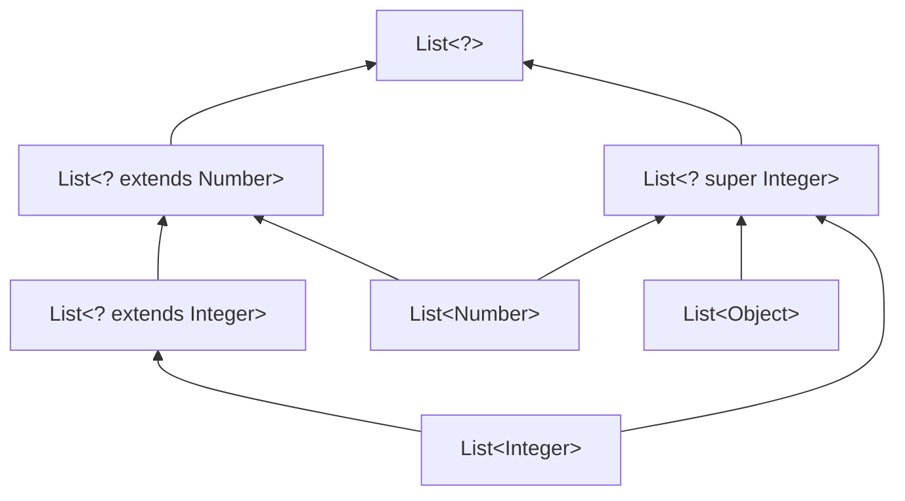

[⬅️ Prev: 04 · Exceptions](04-exceptions.md) · [🏠 Index](README.md) · [Next: 06 · Collections ➡️](06-collections.md)

# 05 · Generics

> *Generics are a compile-time contract the compiler enforces and then erases. Most of the confusion comes from forgetting that the runtime never sees them.*

🧪 **Runnable labs:** [the programs behind this chapter's outputs](labs.md#chapter-05--generics)

---

## Table of contents
1. [Why generics exist](#1-why-generics-exist-)
2. [Vocabulary that interviewers use precisely](#2-vocabulary-that-interviewers-use-precisely-)
3. [Generic classes, methods & inference](#3-generic-classes-methods--inference-)
4. [Bounded type parameters](#4-bounded-type-parameters-)
5. [Type erasure, bridge methods & what survives](#5-type-erasure-bridge-methods--what-survives-)
6. [The restrictions erasure imposes (and workarounds)](#6-the-restrictions-erasure-imposes-and-workarounds-)
7. [Variance: invariance, `? extends`, `? super`, PECS](#7-variance-invariance--extends--super-pecs-)
8. [Wildcards in depth: `?`, raw types, capture](#8-wildcards-in-depth--raw-types-capture-)
9. [Generic arrays, varargs & heap pollution](#9-generic-arrays-varargs--heap-pollution-)
10. [Recursive generics & self types](#10-recursive-generics--self-types-)
11. [Type tokens & super type tokens](#11-type-tokens--super-type-tokens-)
12. [Staff lens: designing generic APIs](#12-staff-lens-designing-generic-apis-)
13. [Interview questions](#13-interview-questions)
14. [References](#14-references)

---

## 1. Why generics exist 🟢

Before Java 5, collections held `Object`. Errors showed up at runtime, *far away from the bug*:

```java
List names = new ArrayList();           // raw, pre-2004 style
names.add("ada");
names.add(42);                          // compiles fine
String s = (String) names.get(1);       // 💥 ClassCastException, possibly in a different module
```

With generics, the compiler catches it **where the mistake happens**:
```java
List<String> names = new ArrayList<>();
names.add(42);                          // ❌ compile error: incompatible types
String s = names.get(0);                // no cast needed
```

The benefits are compile-time type safety, no casts, and self-documenting APIs (`Map<CustomerId, List<Order>>` says a lot). The runtime cost is *zero*: the generated bytecode is the same as hand-written casts.

---

## 2. Vocabulary that interviewers use precisely 🟢

| Term | Example |
|---|---|
| **Type parameter** (formal) | `T` in `class Box<T>` |
| **Type argument** (actual) | `String` in `Box<String>` |
| **Generic type** | `Box<T>` |
| **Parameterized type** | `Box<String>` |
| **Raw type** | `Box` (no type argument) |
| **Bounded type parameter** | `<T extends Number>` |
| **Wildcard** | `?`, `? extends Number`, `? super Integer` |
| **Generic method** | `static <T> T first(List<T> list)` |
| **Reifiable type** | A type fully available at runtime: primitives, non-generic types, raw types, `List<?>` |
| **Non-reifiable type** | `List<String>`, `T`: information erased at runtime |

---

## 3. Generic classes, methods & inference 🟢→🟡

```java
public final class Pair<A, B> {
    private final A first;
    private final B second;
    public Pair(A first, B second) { this.first = first; this.second = second; }
    public A first()  { return first; }
    public B second() { return second; }

    public <C> Pair<A, C> withSecond(C newSecond) {    // generic method on a generic class
        return new Pair<>(first, newSecond);
    }
    public static <X, Y> Pair<X, Y> of(X x, Y y) {     // static generic factory
        return new Pair<>(x, y);
    }
}
```

**Type inference timeline:**
- **Java 5:** inference from method arguments.
- **Java 7:** the diamond `new HashMap<>()` infers from the declared type.
- **Java 8:** inference uses the *target type* (assignment, method argument, return) and works through lambdas and nested calls.
- **Java 9:** diamond with anonymous classes.
- **Java 10:** `var`. 💣 `var list = new ArrayList<>();` is an `ArrayList<Object>`, because there's no target type to infer from.

When inference gives up, add an **explicit type witness**:
```java
List<String> empty = Collections.emptyList();                       // inferred from the target
process(Collections.<String>emptyList());                           // witness needed if process is overloaded
var mixed = List.of(1, 2.5);    // inferred as List<Number & Comparable<…> & Constable & ConstantDesc>, an intersection type
```

---

## 4. Bounded type parameters 🟡

```java
// Upper bound: T must be a Number, so .doubleValue() is available
static <T extends Number> double sum(List<T> xs) {
    double total = 0;
    for (T x : xs) total += x.doubleValue();
    return total;
}

// Multiple bounds: at most one class, and it must come first; then any number of interfaces
static <T extends Number & Comparable<? super T>> T maxNumber(List<T> xs) { ... }
```

🔴 **`Collections.max` is the signature that every serious Java interview eventually reaches:**
```java
public static <T extends Object & Comparable<? super T>> T max(Collection<? extends T> coll)
```
Why the strange `Object &`? Erasure replaces `T` with its **first** bound. Without `Object &`, the erased signature would be `Comparable max(Collection)`, which differs from the pre-generics `Object max(Collection)` and would have broken binary compatibility with every class compiled before Java 5. Putting `Object` first keeps the erasure `Object`. That constraint dates from 2004, but it still explains a lot about how compatibility shaped the whole design.

And why `Comparable<? super T>` rather than `Comparable<T>`? Because of real JDK types like `LocalDate`, which implements `Comparable<ChronoLocalDate>`, **not** `Comparable<LocalDate>`. With `Comparable<T>`, you couldn't sort or max a `List<LocalDate>`.

---

## 5. Type erasure, bridge methods & what survives 🔴

Generics were added in Java 5 with a hard constraint: **existing compiled code and existing JVMs had to keep working**, so the JVM couldn't change. The solution is **type erasure**:

1. Replace each type parameter with its first bound (or `Object` if unbounded).
2. Insert casts at use sites.
3. Generate **bridge methods** to keep polymorphism working after erasure.

```java
// What you write
class Box<T> { private T value; T get() { return value; } void set(T v) { value = v; } }
String s = new Box<String>().get();

// Roughly what the bytecode means
class Box { private Object value; Object get() { return value; } void set(Object v) { value = v; } }
String s = (String) new Box().get();         // ← the compiler-inserted checkcast
```

### Bridge methods
```java
class Node<T> {
    T data;
    void setData(T data) { this.data = data; }
}
class IntNode extends Node<Integer> {
    @Override void setData(Integer data) { super.setData(data); }
}
```
After erasure, `Node.setData(Object)` and `IntNode.setData(Integer)` have **different signatures**, so the "override" wouldn't actually override. javac fixes this by generating a synthetic bridge in `IntNode`:
```java
// synthetic bridge, generated by javac (ACC_BRIDGE | ACC_SYNTHETIC)
void setData(Object data) { setData((Integer) data); }
```
```
$ javap -p IntNode.class
class IntNode extends Node<java.lang.Integer> {
  IntNode();
  void setData(java.lang.Integer);
  void setData(java.lang.Object);      ← the bridge
}
```
Consequence: `Node raw = new IntNode(); raw.setData("oops");` compiles (with an unchecked warning) and fails with `ClassCastException` **inside the bridge**. Covariant return types (Java 5) also use bridge methods.

### What survives erasure
Erasure removes type arguments from **instances** at runtime. The **declarations** keep their generic signatures in the class file's `Signature` attribute, and reflection can read them:

```java
class Repo { List<Map<String, Integer>> rows; }
Field f = Repo.class.getDeclaredField("rows");
f.getType();         // interface java.util.List                 ← erased
f.getGenericType();  // java.util.List<java.util.Map<java.lang.String, java.lang.Integer>>  ← preserved!
```
Same for method parameter and return types, superclasses (`getGenericSuperclass()`), and interfaces. This is the loophole that super type tokens use (§11), along with Jackson, Spring and every DI container that resolves `List<SomeBean>` injection points.

> [!NOTE]
> **Why not reified generics like C#?** Reification would have required a new JVM and breaking changes to every collection-based API, and it would have split the ecosystem into "old" and "new" code. Java chose migration compatibility. Project Valhalla is revisiting parts of this (specialised generics over value types) without breaking that promise.

---

## 6. The restrictions erasure imposes (and workarounds) 🟡→🔴

| Not allowed | Why | Workaround |
|---|---|---|
| `new T()` | No `T` at runtime | Pass a `Supplier<T>` (`ArrayList::new`) or a `Class<T>` |
| `new T[n]` | Arrays need their element type at runtime | `IntFunction<T[]>` (like `toArray(String[]::new)`), or `(T[]) Array.newInstance(cls, n)` |
| `new List<String>[10]` | Generic array creation is unsafe (§9) | `List<List<String>>` |
| `x instanceof List<String>` | Type argument not available | `x instanceof List<?>`, or (Java 16+) a *checked* pattern: `if (coll instanceof List<String> l)` when the static type of `coll` already guarantees `String` |
| `List<int>` | Type arguments must be reference types | `List<Integer>` (boxing), `IntStream`, primitive collections; future Valhalla |
| `static T field;` | One static field shared by all parameterizations | Make the containing method generic instead |
| `class Oops<T> extends Exception` | `catch` needs a runtime type | Non-generic exception with a typed payload |
| `catch (T e)` | Same reason | Catch the bound, then rethrow |
| Overloads that differ only in type arguments | Same erasure → "name clash" | Different method names |
| `T.class` | No `T` at runtime | Pass `Class<T>` |

```java
// Generic array creation with a constructor reference: what Collection.toArray(IntFunction) does
static <T> T[] filled(int n, T value, IntFunction<T[]> arrayFactory) {
    T[] arr = arrayFactory.apply(n);
    Arrays.fill(arr, value);
    return arr;
}
String[] xs = filled(3, "x", String[]::new);   // ✅ a real String[], not an Object[]
```

---

## 7. Variance: invariance, `? extends`, `? super`, PECS 🟡→🔴

**Generics are invariant:** `List<Integer>` is **not** a subtype of `List<Number>`, even though `Integer` is a subtype of `Number`. If it were, this would compile:
```java
List<Integer> ints = new ArrayList<>();
List<Number> nums = ints;        // ❌ not allowed, and here's why:
nums.add(3.14);                  // would put a Double into a List<Integer>
Integer i = ints.get(0);         // 💥
```
(Arrays made exactly this mistake. See the `ArrayStoreException` in [Chapter 01](01-java-platform-fundamentals.md#14-arrays-).)

**Wildcards restore flexibility in a type-safe way:**


*(Arrows point from subtype to supertype.)*

| | `List<? extends Number>` (covariant) | `List<? super Integer>` (contravariant) |
|---|---|---|
| Accepts | `List<Number>`, `List<Integer>`, `List<Double>`… | `List<Integer>`, `List<Number>`, `List<Object>` |
| **Read** | ✅ as `Number` | Only as `Object` |
| **Write** | ❌ nothing except `null` | ✅ `Integer` (and subtypes) |
| Role | **Producer** of `T`s | **Consumer** of `T`s |

### PECS: **P**roducer **E**xtends, **C**onsumer **S**uper
```java
// java.util.Collections, verbatim
public static <T> void copy(List<? super T> dest, List<? extends T> src)
//                              ^ consumes T            ^ produces T

// So this works:
List<Number> dest = new ArrayList<>(List.of(0, 0, 0));
List<Integer> src = List.of(1, 2, 3);
Collections.copy(dest, src);                 // T = Integer: dest is a consumer of Integer, src a producer
```

More real signatures that follow PECS:
```java
boolean addAll(Collection<? extends E> c)                   // reads from c
void forEach(Consumer<? super T> action)                     // the action consumes T
<R> Stream<R> map(Function<? super T, ? extends R> mapper)   // consumes T, produces R
static <T> void sort(List<T> list, Comparator<? super T> c)  // the comparator consumes T
```

> [!TIP]
> **Comparators and functions almost always want `? super`.** A `Comparator<Object>` (compare by `toString`) or a `Comparator<Number>` can sort a `List<Integer>`. If your API takes `Comparator<T>`, callers can't reuse those general comparators.

```java
List<? extends Number> nums = new ArrayList<Integer>(List.of(1, 2, 3));
Number n = nums.get(0);      // ✅
nums.add(4);                 // ❌ compile error: it might be a List<Double>
nums.add(null);              // ✅ the only value of every reference type

List<? super Integer> sink = new ArrayList<Number>();
sink.add(42);                // ✅
Object o = sink.get(0);      // ✅ but only as Object
```

---

## 8. Wildcards in depth: `?`, raw types, capture 🔴

### `List<?>` vs `List<Object>` vs `List`
| | `List<?>` | `List<Object>` | `List` (raw) |
|---|---|---|---|
| Meaning | A list of *some specific, unknown* type | A list that holds any object | Generics switched off |
| Accepts `List<String>`? | ✅ | ❌ | ✅ (unchecked) |
| Can add a `String`? | ❌ (only `null`) | ✅ | ✅ (unchecked warning, unsafe) |
| Type safe? | ✅ | ✅ | ❌ |

**Raw types exist only for migration compatibility with pre-2004 code.** Never use them in new code, except in class literals (`List.class`) and `instanceof List`.

### Wildcard capture
The compiler gives each `?` a fresh internal name (`CAP#1`). It can't let you `set` an element taken from a `List<?>` back into the same list, because it doesn't know the two `?`s are the same type:

```java
static void swap(List<?> list, int i, int j) {
    list.set(i, list.set(j, list.get(i)));      // ❌ compile error: capture#1 vs capture#2
}
```
**Fix: a private helper with a named type parameter captures the wildcard:**
```java
public static void swap(List<?> list, int i, int j) { swapHelper(list, i, j); }

private static <T> void swapHelper(List<T> list, int i, int j) {
    list.set(i, list.set(j, list.get(i)));      // ✅ T names the captured type
}
```
The public API stays clean (`List<?>`), and the implementation gets a usable type variable. This is exactly how `Collections.swap` and `reverse` are written.

### When to use a wildcard vs a type parameter
- If a type parameter appears **only once** in a method signature, replace it with a wildcard: `void printAll(Collection<?> c)` rather than `<T> void printAll(Collection<T> c)`.
- If you need to *relate* two parameters, or a parameter to the return type, use a type parameter: `<T> T firstOf(List<T> l)`.
- **Never return a wildcard type** (`List<? extends Number> getNums()`). It forces every caller to deal with wildcards. Wildcards belong in *parameters*.

---

## 9. Generic arrays, varargs & heap pollution 🔴

**Heap pollution** happens when a variable of a parameterized type refers to an object that isn't of that type. The failure then shows up later, somewhere unrelated.

Varargs of a generic type creates exactly that hazard, because `T...` is really `T[]`, a generic array:
```java
static void dangerous(List<String>... stringLists) {      // warning: possible heap pollution
    Object[] array = stringLists;                          // arrays are covariant
    array[0] = List.of(42);                                // a List<Integer> sneaks in. No error!
    String s = stringLists[0].get(0);                      // 💥 ClassCastException, far from the cause
}
```

And the subtle one, from *Effective Java* Item 32:
```java
static <T> T[] toArray(T... args) { return args; }

static <T> T[] pickTwo(T a, T b, T c) {
    return toArray(a, b);         // inside pickTwo, T is erased: the compiler creates an Object[]!
}

String[] attrs = pickTwo("Good", "Fast", "Cheap");   // 💥 ClassCastException: Object[] cannot be cast to String[]
```
**Rule:** never return or expose a generic varargs array, and never store into it.

**`@SafeVarargs`** is the method author's promise: "I only read from the varargs array, and I don't leak it." It's allowed on `static`, `final` and (since Java 9) `private` methods, plus constructors, which are all methods that can't be overridden. `List.of(E...)`, `Arrays.asList(T...)`, `Stream.of(T...)` and `EnumSet.of(E, E...)` all carry it.

```java
@SafeVarargs
static <T> List<T> flatten(List<? extends T>... lists) {   // ✅ only reads the array
    List<T> result = new ArrayList<>();
    for (List<? extends T> l : lists) result.addAll(l);
    return result;
}
```

---

## 10. Recursive generics & self types 🔴

**Recursive type bounds** let a type refer to itself in its own bound:
```java
public abstract class Enum<E extends Enum<E>> implements Comparable<E> { ... }
// "E is an enum type whose compareTo accepts only its own kind":
// you can't compare Color.RED with Size.LARGE.

static <T extends Comparable<? super T>> T max(Iterable<T> items) { ... }
```

**The simulated self type** (the builder hierarchy pattern, *Effective Java* Item 2):
```java
public abstract class Pizza {
    public enum Topping { HAM, MUSHROOM, ONION, PEPPER }
    final Set<Topping> toppings;

    abstract static class Builder<T extends Builder<T>> {
        private final EnumSet<Topping> toppings = EnumSet.noneOf(Topping.class);
        public T addTopping(Topping t) { toppings.add(t); return self(); }   // returns the SUBCLASS type
        abstract Pizza build();
        protected abstract T self();                                         // each subclass returns `this`
    }
    Pizza(Builder<?> b) { toppings = b.toppings.clone(); }
}

public final class Calzone extends Pizza {
    private final boolean sauceInside;
    public static final class Builder extends Pizza.Builder<Builder> {
        private boolean sauceInside;
        public Builder sauceInside() { sauceInside = true; return this; }
        @Override public Calzone build() { return new Calzone(this); }
        @Override protected Builder self() { return this; }
    }
    private Calzone(Builder b) { super(b); sauceInside = b.sauceInside; }
}

Calzone c = new Calzone.Builder()
        .addTopping(Pizza.Topping.HAM)     // returns Calzone.Builder, not Pizza.Builder
        .sauceInside()                      // ✅ so the subclass method is still available
        .build();
```
Without the self type, `addTopping` would return `Pizza.Builder`, and `.sauceInside()` wouldn't compile.

---

## 11. Type tokens & super type tokens 🔴

### `Class<T>` as a type token: the typesafe heterogeneous container
```java
public final class Favorites {
    private final Map<Class<?>, Object> favorites = new HashMap<>();

    public <T> void put(Class<T> type, T instance) {
        favorites.put(Objects.requireNonNull(type), type.cast(instance));   // cast() = a runtime check
    }
    public <T> T get(Class<T> type) {
        return type.cast(favorites.get(type));
    }
}

var f = new Favorites();
f.put(String.class, "Java");
f.put(Integer.class, 0xCAFE);
String s = f.get(String.class);       // no unchecked casts anywhere
```
Limitation: `Class` objects can't express parameterized types. There's no `List<String>.class`.

### Super type tokens (Neal Gafter's trick)
Recall from §5 that the **superclass's** type arguments survive erasure. So create an anonymous subclass and read them back:

```java
public abstract class TypeRef<T> {
    private final Type type;
    protected TypeRef() {
        Type superclass = getClass().getGenericSuperclass();          // TypeRef<Map<String, List<Integer>>>
        this.type = ((ParameterizedType) superclass).getActualTypeArguments()[0];
    }
    public Type type() { return type; }
}

Type t = new TypeRef<Map<String, List<Integer>>>() {}.type();          // note the {}: an anonymous subclass
System.out.println(t);   // java.util.Map<java.lang.String, java.util.List<java.lang.Integer>>
```

You've used this many times without noticing:
```java
// Jackson
List<User> users = mapper.readValue(json, new TypeReference<List<User>>() {});
// Spring
ResponseEntity<List<User>> r = restTemplate.exchange(url, GET, null, new ParameterizedTypeReference<List<User>>() {});
// Guice: new TypeLiteral<List<User>>() {}
```

🎯 **Interviewer's lens.** "How does Jackson know the element type of a `List<User>` if generics are erased?" is one of the best generics questions. The answer combines erasure, the `Signature` attribute, anonymous subclasses and reflection.

---

## 12. Staff lens: designing generic APIs 🟣

1. **Generics should help callers, not show off.** If a signature needs three type parameters and two recursive bounds, check whether a simpler API with a concrete type would serve 95% of use cases.
2. **Use bounded wildcards on parameters for flexibility** (PECS), and **never on return types**.
3. **Generic signatures are part of your binary and source compatibility.** Tightening `Comparator<? super T>` to `Comparator<T>` is a *breaking change*. Widening the other way usually isn't. Gate shared libraries with API diff tools.
4. **Prefer `Supplier<T>`/`IntFunction<T[]>` parameters to `Class<T>` tokens**, unless you need runtime type checks or keys.
5. **Keep `@SuppressWarnings("unchecked")` as narrow as possible.** Put it on a single local variable declaration, with a comment proving why it's safe. A class-level suppression hides real bugs.
6. **Interop matters.** Kotlin sees `List<? extends T>` as `List<out T>`, and its declaration-site variance makes your wildcard choices visible to Kotlin callers. Design Java APIs that read naturally from both languages.
7. **Primitive generics cost memory.** `Map<Long, Long>` with ten million entries carries roughly 10M × (entry + two boxed `Long`s), which is hundreds of MB. Until Valhalla, specialised primitive collections (fastutil, Eclipse Collections, Agrona) are an architectural choice, not a micro-optimisation.

---

## 13. Interview questions

<details>
<summary><b>Q1. 🟢 What is type erasure?</b></summary>

The compiler checks generic types, then erases them: it replaces type parameters with their first bound (or `Object`), inserts casts at use sites, and generates bridge methods. At runtime, `List<String>` and `List<Integer>` are both just `List`. This kept binary compatibility with pre-Java-5 code and JVMs.
</details>

<details>
<summary><b>Q2. 🟡 Why isn't <code>List&lt;Integer&gt;</code> a subtype of <code>List&lt;Number&gt;</code>?</b></summary>

If it were, you could add a `Double` through the `List<Number>` reference into what is really a `List<Integer>`, which breaks type safety. Generics are invariant to prevent this at compile time. Use `List<? extends Number>` when you only need to read Numbers.
</details>

<details>
<summary><b>Q3. 🟡 Explain PECS with a JDK example.</b></summary>

Producer-Extends, Consumer-Super. If a parameter *produces* `T`s that you read, use `? extends T`. If it *consumes* `T`s that you write, use `? super T`. `Collections.copy(List<? super T> dest, List<? extends T> src)`: `src` produces elements and `dest` consumes them. Comparators and consumers are almost always `? super T`.
</details>

<details>
<summary><b>Q4. 🔴 What is a bridge method and when does javac generate one?</b></summary>

A synthetic method that keeps overriding and covariant returns working after erasure. When `IntNode extends Node<Integer>` overrides `setData(Integer)`, the erased superclass method is `setData(Object)`, so javac generates `setData(Object)` in `IntNode` that casts and delegates. Calling it through a raw type with the wrong argument fails with `ClassCastException` inside the bridge.
</details>

<details>
<summary><b>Q5. 🔴 If generics are erased, how does Jackson deserialize into <code>List&lt;User&gt;</code>?</b></summary>

With a super type token: `new TypeReference<List<User>>() {}` creates an anonymous subclass. The class file records its generic superclass in the `Signature` attribute, and erasure doesn't remove that. Jackson calls `getClass().getGenericSuperclass()`, casts to `ParameterizedType`, and reads the actual type argument `List<User>`.
</details>

<details>
<summary><b>Q6. 🔴 Why can't you create <code>new T[]</code> or <code>new List&lt;String&gt;[10]</code>?</b></summary>

Arrays are reified and covariant: they know and check their element type at runtime. Generic types are erased, so the runtime can't enforce `List<String>`. Allowing generic array creation would let heap pollution pass every array store check. Workarounds: `IntFunction<T[]>` (`String[]::new`), `Array.newInstance` with a `Class<T>`, or use lists instead of arrays.
</details>

<details>
<summary><b>Q7. 🔴 What is heap pollution? Give an example with varargs.</b></summary>

It's when a variable of a parameterized type refers to an object of a different parameterization. Example: `static void m(List<String>... ls) { Object[] a = ls; a[0] = List.of(42); String s = ls[0].get(0); }` throws `ClassCastException` later. `@SafeVarargs` is the author's promise not to write to or expose the varargs array.
</details>

<details>
<summary><b>Q8. 🔴 Why is the signature of <code>Collections.max</code> <code>&lt;T extends Object &amp; Comparable&lt;? super T&gt;&gt;</code>?</b></summary>

`Object &` makes the erasure of `T` be `Object`, preserving the pre-generics binary signature `Object max(Collection)`. `Comparable<? super T>` allows types whose comparability is declared on a supertype, such as `LocalDate implements Comparable<ChronoLocalDate>`.
</details>

<details>
<summary><b>Q9. 🔴 What is wildcard capture and how do you work around capture errors?</b></summary>

The compiler gives each `?` a fresh unknown type (`CAP#1`), so it can't prove that a value read from a `List<?>` can be written back. Fix it with a private generic helper, `<T> void helper(List<T> l)`, that names the captured type. The public API keeps the clean wildcard signature.
</details>

<details>
<summary><b>Q10. 🟡 <code>List&lt;?&gt;</code> vs <code>List&lt;Object&gt;</code> vs raw <code>List</code>?</b></summary>

`List<?>` is a list of some unknown specific type: type-safe, read-only except for `null`, and it accepts any `List<X>`. `List<Object>` holds anything, but `List<String>` isn't assignable to it. Raw `List` turns off generic checks entirely (unchecked warnings) and exists only for legacy compatibility.
</details>

<details>
<summary><b>Q11. 🔴 Explain the "simulated self type" pattern and where it's used.</b></summary>

An abstract builder declared as `Builder<T extends Builder<T>>` with `abstract T self()`. Base-class fluent methods return `T`, which is the concrete subclass's builder type, so chained calls keep access to subclass methods. Used for builder hierarchies, fluent assertion libraries (AssertJ's `SELF` type parameter) and `Enum<E extends Enum<E>>`.
</details>

<details>
<summary><b>Q12. 🟣 What's your stance on primitive-heavy generic collections in a high-throughput service?</b></summary>

Boxing costs memory (object headers plus references) and adds GC pressure and pointer-chasing cache misses. For hot paths or large datasets (millions of entries), use primitive specialisations (`int[]`, `IntStream`, fastutil, Eclipse Collections, Agrona) behind a domain interface, and measure with JOL/JFR before and after. Valhalla will reduce the need over time, but today it's an architectural decision that affects heap sizing and GC behaviour.
</details>

---

## 14. References
- Joshua Bloch, *Effective Java* (3rd ed.), Chapter 5: Items 26–33
- Maurice Naftalin & Philip Wadler, *Java Generics and Collections* (2nd ed.)
- [JLS §4.5 Parameterized Types](https://docs.oracle.com/javase/specs/jls/se25/html/jls-4.html#jls-4.5) · [§4.6 Type Erasure](https://docs.oracle.com/javase/specs/jls/se25/html/jls-4.html#jls-4.6)
- Angelika Langer, *Java Generics FAQ*: the most exhaustive resource on edge cases
- Neal Gafter, *Super Type Tokens* (2006 blog post)

---

[⬅️ Prev: 04 · Exceptions](04-exceptions.md) · [🏠 Index](README.md) · [Next: 06 · Collections ➡️](06-collections.md)
