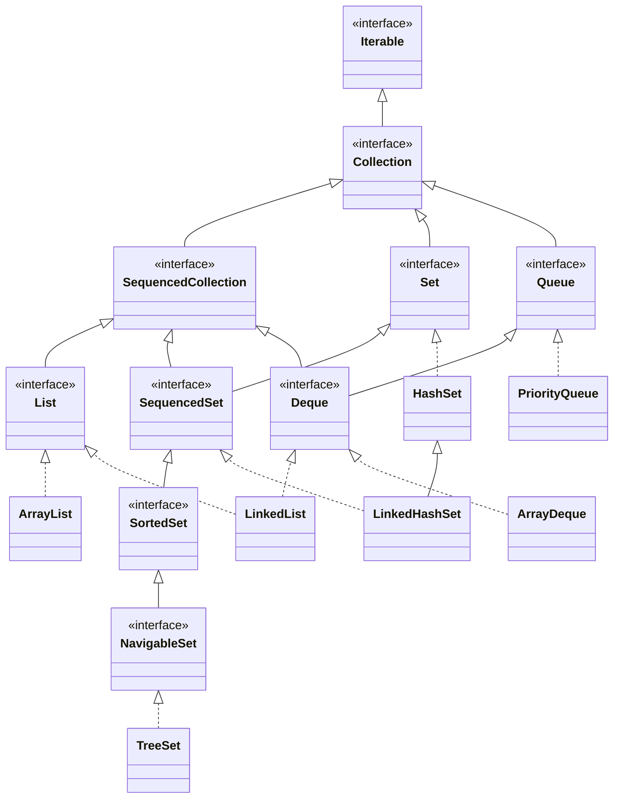
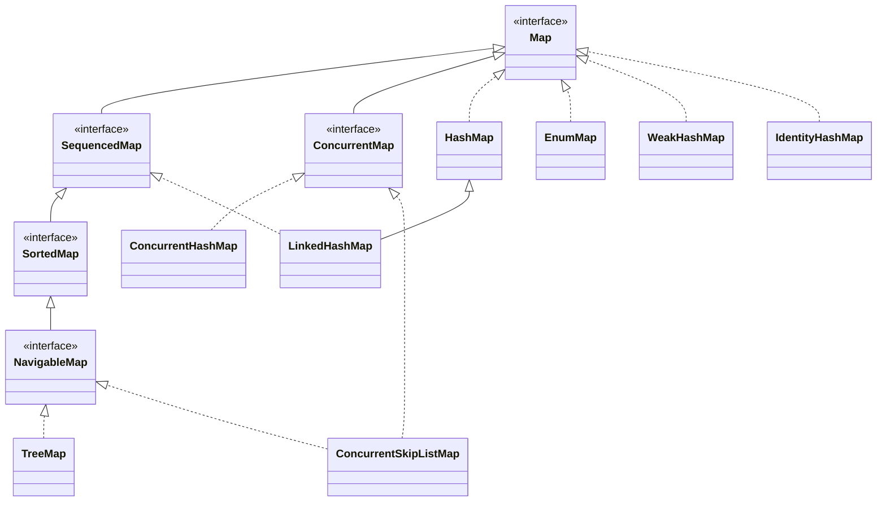
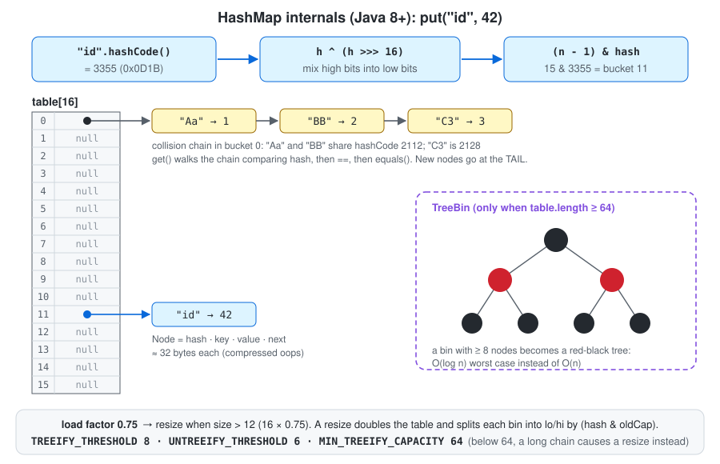
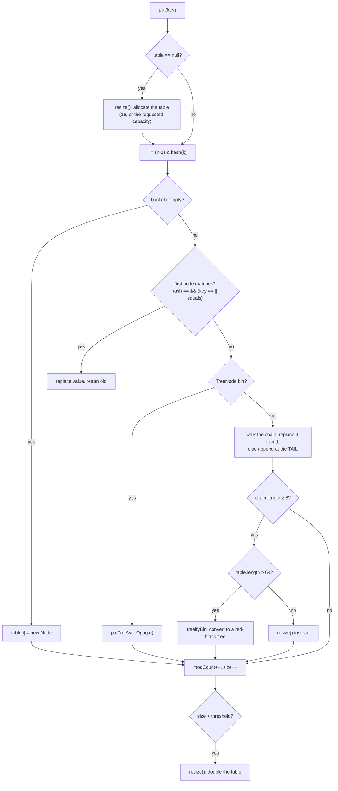
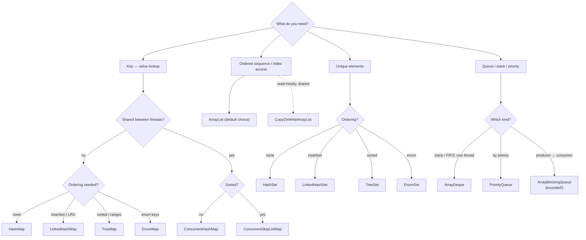

[⬅️ Prev: 05 · Generics](05-generics.md) · [🏠 Index](README.md) · [Next: 07 · Lambdas & Streams ➡️](07-lambdas-streams-functional.md)

# 06 · Collections Framework

> *Interviewers use collections to measure depth because everyone uses them and very few people have read the source. This chapter is basically that source, explained.*

🧪 **Runnable labs:** [the programs behind this chapter's outputs](labs.md#chapter-06--collections)

---

## Table of contents
1. [The shape of the framework](#1-the-shape-of-the-framework-)
2. [Complexity cheat sheet](#2-complexity-cheat-sheet-)
3. [`ArrayList` internals](#3-arraylist-internals-)
4. [`LinkedList`: why it almost never wins](#4-linkedlist-why-it-almost-never-wins-)
5. [`HashMap` deep dive](#5-hashmap-deep-dive-)
6. [`LinkedHashMap` & building an LRU cache](#6-linkedhashmap--building-an-lru-cache-)
7. [`TreeMap` & navigable collections](#7-treemap--navigable-collections-)
8. [Sets are maps in disguise](#8-sets-are-maps-in-disguise-)
9. [Specialist maps: `EnumMap`, `IdentityHashMap`, `WeakHashMap`](#9-specialist-maps-enummap-identityhashmap-weakhashmap-)
10. [Queues, deques & heaps](#10-queues-deques--heaps-)
11. [Iterators: fail-fast, weakly consistent, snapshot](#11-iterators-fail-fast-weakly-consistent-snapshot-)
12. [Immutable vs unmodifiable vs fixed-size](#12-immutable-vs-unmodifiable-vs-fixed-size-)
13. [Sequenced collections (Java 21)](#13-sequenced-collections-java-21-)
14. [`Comparable` & `Comparator` done right](#14-comparable--comparator-done-right-)
15. [Concurrent collections & `ConcurrentHashMap` internals](#15-concurrent-collections--concurrenthashmap-internals-)
16. [Memory footprint: what your collections really cost](#16-memory-footprint-what-your-collections-really-cost-)
17. [Choosing a collection](#17-choosing-a-collection-)
18. [Staff lens](#18-staff-lens-)
19. [Interview questions](#19-interview-questions)
20. [References](#20-references)

---

## 1. The shape of the framework 🟢



`Map` is **not** a `Collection`. It has its own hierarchy:



Legacy classes you should recognise but not use: `Vector`, `Hashtable` and `Stack` (fully synchronized, pre-1.2 designs), and `Enumeration`.

---

## 2. Complexity cheat sheet 🟢

| Structure | get / access | search (`contains`) | add | remove | Ordering | Nulls |
|---|---|---|---|---|---|---|
| `ArrayList` | **O(1)** | O(n) | O(1) amortised at the end, O(n) in the middle | O(n) | Insertion | ✅ |
| `LinkedList` | O(n) | O(n) | O(1) at the ends, O(n) to *find* a middle position | O(1) via iterator | Insertion | ✅ |
| `ArrayDeque` | — | O(n) | **O(1)** at both ends | O(1) at the ends | Insertion | ❌ |
| `PriorityQueue` | O(1) `peek` | O(n) | O(log n) | O(log n) `poll`, O(n) `remove(o)` | Heap order | ❌ |
| `HashMap` / `HashSet` | **O(1)** avg, O(log n) worst* | O(1) avg | O(1) avg | O(1) avg | None | ✅ 1 null key |
| `LinkedHashMap` | O(1) | O(1) | O(1) | O(1) | Insertion or access | ✅ |
| `TreeMap` / `TreeSet` | O(log n) | O(log n) | O(log n) | O(log n) | Sorted | ❌ keys (with natural ordering) |
| `EnumMap` / `EnumSet` | O(1) | O(1) | O(1) | O(1) | Enum ordinal | ❌ keys |
| `ConcurrentHashMap` | O(1) | O(1) | O(1) | O(1) | None | ❌ |
| `ConcurrentSkipListMap` | O(log n) | O(log n) | O(log n) | O(log n) | Sorted | ❌ |
| `CopyOnWriteArrayList` | O(1) | O(n) | **O(n)** (copies the array) | O(n) | Insertion | ✅ |

\* Since Java 8, a heavily colliding bucket turns into a red-black tree, so the worst case is O(log n) when keys are `Comparable` (§5).

---

## 3. `ArrayList` internals 🟢→🔴

```java
// simplified from java.util.ArrayList
transient Object[] elementData;   // the backing array; capacity = elementData.length
private int size;                 // number of elements actually used
protected transient int modCount; // inherited from AbstractList; bumps on structural changes
```

**Lazy default capacity.** `new ArrayList<>()` doesn't allocate an array of 10. It points at a shared empty sentinel, and the first `add` allocates capacity **10**.

**Growth.** When full, the new capacity is `old + (old >> 1)`, which is **1.5×**, and the old contents are copied with `System.arraycopy` (an intrinsic, essentially `memmove`). Appending is therefore *amortised* O(1): the copy cost of each resize is spread across the elements that triggered it.

```
capacity: 10 → 15 → 22 → 33 → 49 → 73 → 109 → 163 → 244 → …
```

**Insert or remove in the middle** shifts everything after the index with `System.arraycopy`. That's O(n), but it's a contiguous memory move, which modern CPUs do extremely fast. That's why `ArrayList` usually beats `LinkedList` even for middle insertions on moderately sized lists.

**Details worth knowing:**
- `ensureCapacity(n)` and `new ArrayList<>(n)` avoid repeated growth when you know the size.
- `trimToSize()` releases unused capacity. It's useful for long-lived, read-only lists built from unknown sizes.
- `removeIf` is O(n). It marks the doomed indices in a bitmap and compacts once, instead of shifting per removal.
- `subList(from, to)` returns a **view**. Structural changes to the parent after creating it make the view throw `ConcurrentModificationException`, and a view retains the whole parent array (a memory leak if you keep a tiny sublist of a huge list).
- `RandomAccess` is a marker interface that tells algorithms (`Collections.binarySearch`, `shuffle`) to use indexed access rather than iterators.

💣 **`list.remove(1)` on a `List<Integer>`** removes **index 1**, not the value 1, because the overload `remove(int)` beats `remove(Object)` without needing boxing. Use `list.remove(Integer.valueOf(1))`.

---

## 4. `LinkedList`: why it almost never wins 🟡→🔴

`LinkedList` is a doubly linked list. Each element lives in a separate `Node{item, next, prev}` of **24 bytes**, plus the element itself.

The textbook advantages, O(1) insert and remove, only hold *once you're already at the position*. Getting there is O(n) **pointer chasing**, and each hop is likely a cache miss, roughly 100× slower than reading from L1. Arrays are contiguous, so the CPU prefetcher streams them.

| Need | Use instead |
|---|---|
| Stack / LIFO | `ArrayDeque` (`push`/`pop`) |
| Queue / FIFO | `ArrayDeque` (`offer`/`poll`) |
| Random access | `ArrayList` |
| Lots of removals during iteration | `ArrayList.removeIf`, or build a new list |

The one legitimate niche is frequent insertion and removal *at the current position* of a `ListIterator` on a long list, where you never need random access. Even then, benchmark it.

> [!TIP]
> Even Joshua Bloch, who wrote `LinkedList`, has publicly joked that he never uses it. If an interviewer asks "ArrayList vs LinkedList", talk about **memory layout and caches**, not just Big-O. That's the staff-level answer.

---

## 5. `HashMap` deep dive 🟡→🔴



### 5.1 Structure
```java
transient Node<K,V>[] table;      // length is ALWAYS a power of two; allocated lazily on the first put
transient int size;
int threshold;                    // = capacity × loadFactor; resize when size exceeds it
final float loadFactor;           // default 0.75

static class Node<K,V> {          // ≈ 32 bytes with compressed oops
    final int hash;               // cached spread hash: never recomputed
    final K key;
    V value;
    Node<K,V> next;               // collision chain
}
```

### 5.2 From key to bucket
```java
static final int hash(Object key) {
    int h;
    return (key == null) ? 0 : (h = key.hashCode()) ^ (h >>> 16);   // spread high bits into low bits
}
int index = (table.length - 1) & hash;                               // fast modulo for powers of two
```

**Why a power-of-two size?** Because `x % n` becomes `x & (n - 1)`, which is one AND instruction instead of an integer division (tens of cycles). The cost is that **only the low bits of the hash pick the bucket**. In a 16-slot table, only the bottom 4 bits matter.

**Why `h ^ (h >>> 16)`?** To protect against hash codes that differ only in their *high* bits, such as `Float` keys or object addresses. Without the spreading step, all of those would land in the same bucket. XOR-ing the high half into the low half is a cheap partial fix that makes the high bits count.

**Null key:** hash 0, bucket 0. Null values are allowed too, which makes `get(k) == null` ambiguous: use `containsKey` or `getOrDefault`.

### 5.3 `put` step by step


**The equality check order** is `p.hash == hash && ((k = p.key) == key || (key != null && key.equals(k)))`. The cached `int` comparison filters out almost all non-matches before the potentially expensive `equals` runs.

### 5.4 Resize: the clever part
A resize doubles the capacity. Because sizes are powers of two, each node either **stays at index `i`** or **moves to `i + oldCap`**, decided by one bit:
```java
if ((e.hash & oldCap) == 0)  → "lo" list, stays at index i
else                         → "hi" list, moves to index i + oldCap
```
There's no rehashing and no recomputing `hashCode()`. The relative order within each list is preserved.

🔴 **Why this mattered historically.** Java 7's `HashMap` inserted at the **head** of the chain and *reversed* the list during transfer. Two threads resizing at the same time could create a **cycle** in a chain, and the next `get` on that bucket would **spin forever at 100% CPU**. That was a famous production failure mode of the "it's only read by multiple threads… mostly" variety. Java 8 switched to tail insertion and order-preserving splits. **`HashMap` is still not thread-safe**: concurrent puts lose updates and corrupt `size`. Java 8 just doesn't loop forever anymore.

### 5.5 Treeification (Java 8)
| Constant | Value | Meaning |
|---|---|---|
| `TREEIFY_THRESHOLD` | 8 | A chain reaching 8 nodes may become a red-black tree |
| `UNTREEIFY_THRESHOLD` | 6 | A tree that shrinks to ≤ 6 (during a resize split) goes back to a list |
| `MIN_TREEIFY_CAPACITY` | 64 | Below this table size, resize instead of treeifying |

**Why 8?** With a decent hash function and load factor 0.75, bucket sizes follow roughly a Poisson distribution (λ ≈ 0.5). The `HashMap` source comments put the probability of a bucket reaching 8 at about **0.00000006**. So a tree bin in practice means one of two things: a terrible `hashCode()`, or **an attack** (hash flooding with deliberately colliding keys). Treeification caps the damage at O(log n). The gap between 8 and 6 is hysteresis, so a bucket hovering around the threshold doesn't flip back and forth.

**How do you order keys in a tree when their hashes collide?** First by hash. If those are equal, by `compareTo` if both keys are the same `Comparable` class. Otherwise by a tie-breaker (class name, then `System.identityHashCode`). **This is why the O(log n) guarantee only really holds for `Comparable` keys like `String`.** Equal-hash, non-comparable keys force searches into both subtrees.

`TreeNode`s are about twice the size of plain `Node`s. That's another reason trees are a last resort, not the default.

### 5.6 Sizing correctly
```java
new HashMap<>(100);           // 💣 capacity 128 → threshold 96 → the 97th put triggers a resize
HashMap.newHashMap(100);      // ✅ Java 19+: sized so 100 mappings fit without resizing (capacity 256)
new HashMap<>((int) Math.ceil(100 / 0.75));   // ✅ pre-19 equivalent
```

### 5.7 Iteration order
Iteration walks the table from index 0 upward, then each chain. The order depends on capacity and on hash codes, and **it changes after a resize**. Code that relies on `HashMap` order passes tests on small maps and breaks in production. Use `LinkedHashMap` when order matters.

---

## 6. `LinkedHashMap` & building an LRU cache 🟡→🔴

`LinkedHashMap` extends `HashMap`. Its entries also carry `before`/`after` pointers, forming a doubly linked list through every entry, so iteration order is predictable and costs O(size), not O(capacity).

- **Insertion order** (default): re-inserting an existing key doesn't change its position.
- **Access order** (`new LinkedHashMap<>(cap, lf, true)`): every `get`/`put` moves the entry to the tail.

```java
public final class LruCache<K, V> extends LinkedHashMap<K, V> {
    private final int maxEntries;

    public LruCache(int maxEntries) {
        super(16, 0.75f, /* accessOrder */ true);
        this.maxEntries = maxEntries;
    }

    @Override
    protected boolean removeEldestEntry(Map.Entry<K, V> eldest) {
        return size() > maxEntries;          // called after each put: evict the least recently used
    }
}
```

💣 **In access-order mode, `get()` is a structural modification.** It relinks the list and bumps `modCount`. So:
- Calling `get` while iterating throws `ConcurrentModificationException`.
- Even *read-only* use from several threads corrupts the list. Wrapping it with `Collections.synchronizedMap` is the minimum, and the result is a globally locked cache.

🧠 For production caches, use **Caffeine**: bounded, concurrent, with W-TinyLFU eviction (which beats LRU's hit rate on most workloads), expiry, refresh-ahead and statistics. "I'd use `LinkedHashMap` for a quick single-threaded LRU and Caffeine for anything real" is the answer interviewers want.

---

## 7. `TreeMap` & navigable collections 🟡

`TreeMap` is a **red-black tree**: a self-balancing BST where no path is more than twice as long as any other, giving guaranteed O(log n) operations. Ordering comes from `compareTo` or a supplied `Comparator`.

The `NavigableMap` API is the real reason to use it:
```java
TreeMap<Instant, Price> prices = ...;
prices.floorEntry(t);          // the latest price at or before t: "the price in effect at time t"
prices.ceilingKey(t);          // first key ≥ t
prices.headMap(t, false);      // a VIEW of everything strictly before t
prices.subMap(from, true, to, false);  // a VIEW of the range [from, to)
prices.descendingMap();        // a reverse-order VIEW
prices.pollFirstEntry();       // remove and return the smallest
```
Typical uses are time series lookups, range queries, leaderboards, interval scheduling, and the **consistent-hashing ring** (`ceilingEntry(hash)`, wrapping around to `firstEntry()`; see [Chapter 24](24-system-design-for-java-architects.md)).

💣 **Sorted collections use `compareTo`/`compare` for equality, not `equals`.** If they disagree, the behaviour surprises people:
```java
new TreeSet<>(List.of(new BigDecimal("2.0"), new BigDecimal("2.00"))).size();   // 1 (compareTo == 0)
new HashSet<>(List.of(new BigDecimal("2.0"), new BigDecimal("2.00"))).size();   // 2 (equals differs)

var ci = new TreeSet<String>(String.CASE_INSENSITIVE_ORDER);
ci.addAll(List.of("Java", "JAVA"));   // size 1: "JAVA" is considered a duplicate
```

---

## 8. Sets are maps in disguise 🟢

| Set | Backed by |
|---|---|
| `HashSet` | `HashMap<E, Object>` with a shared dummy value `PRESENT` |
| `LinkedHashSet` | `LinkedHashMap` |
| `TreeSet` | `TreeMap` (a `NavigableMap`) |
| `EnumSet` | A bit vector (`long`, or `long[]` for more than 64 constants) |
| `ConcurrentHashMap.newKeySet()` | `ConcurrentHashMap<E, Boolean>` |
| `CopyOnWriteArraySet` | `CopyOnWriteArrayList` (O(n) `contains`!) |

So everything about hashing, resizing and treeification applies to `HashSet` too. Java 19 added `HashSet.newHashSet(n)` to presize correctly.

---

## 9. Specialist maps: `EnumMap`, `IdentityHashMap`, `WeakHashMap` 🟡→🔴

**`EnumMap<K extends Enum<K>, V>`** is an array indexed by `ordinal()`. There's no hashing or collisions, and it iterates in declaration order. Use it every time the key is an enum: it's faster and smaller than `HashMap`, and its iteration order is stable across runs (enum `hashCode` isn't).

**`IdentityHashMap`** compares keys with `==` and hashes with `System.identityHashCode`, *deliberately* violating the `Map` contract. It uses **open addressing with linear probing** in one array (keys and values interleaved), not chaining. Legitimate uses:
- "Visited" sets in graph traversal, deep copy and serialization, where two *equal* objects are still different nodes.
- Proxies or metadata keyed by object identity.

**`WeakHashMap`** holds keys through `WeakReference`s. When a key becomes otherwise unreachable, the GC clears it and the entry is expunged on the next map operation.
- 💣 **Values are strongly held.** If a value references its own key (`map.put(key, new Wrapper(key))`), the key never becomes weakly reachable, and you get a leak in a class designed to prevent leaks.
- 💣 It's not a cache: entries disappear on *the next GC*, not under memory pressure. A `String` literal key never goes away, because it's strongly reachable from the constant pool.
- Typical uses: metadata attached to objects you don't own (class-loader-scoped registries, listener maps).

---

## 10. Queues, deques & heaps 🟢→🟡

| Method | Throws on failure | Returns special value |
|---|---|---|
| Insert | `add(e)` | `offer(e)` → `false` |
| Remove head | `remove()` | `poll()` → `null` |
| Examine head | `element()` | `peek()` → `null` |

(This is why most queues forbid `null`: it's the "empty" signal from `poll`/`peek`.)

**`ArrayDeque`** is a resizable circular array with head and tail indices. It's O(1) at both ends, cache-friendly, and doesn't allow nulls. **Use it for every stack and every single-threaded queue.** `Stack` extends `Vector`, so it's synchronized and exposes index-based methods that break the LIFO abstraction.

**`PriorityQueue`** is a **binary min-heap** stored in an array, where the children of node `i` are at `2i+1` and `2i+2`:
- `offer`/`poll`: O(log n) (sift up / sift down). `peek`: O(1).
- `remove(Object)` and `contains`: O(n).
- Building from a collection: O(n) *heapify*, not O(n log n).
- 💣 **Its iterator does NOT return elements in priority order.** Only repeated `poll()` does.
- Max-heap: `new PriorityQueue<>(Comparator.reverseOrder())`.
- Top-K largest from a stream of N elements: keep a **min-heap of size K**, which is O(N log K) ([Chapter 26](26-coding-and-lld-interview-patterns.md)).

---

## 11. Iterators: fail-fast, weakly consistent, snapshot 🟡→🔴

### Fail-fast (most `java.util` collections)
Each iterator records `expectedModCount` when it's created. Every `next()` checks it against the collection's `modCount` and throws `ConcurrentModificationException` (CME) on a mismatch.

```java
List<String> list = new ArrayList<>(List.of("a", "b", "c", "d"));
for (String s : list) {
    if (s.equals("b")) list.remove(s);    // 💥 CME on the next call to next()
}
```
CME is **not** a concurrency mechanism. It happens in single-threaded code, and in multi-threaded code it's only *best effort* (the check isn't synchronized). Never rely on it for correctness.

🔴 **The second-to-last-element quirk** (a favourite trick question):
```java
List<String> list = new ArrayList<>(List.of("a", "b", "c", "d"));
for (String s : list) {
    if (s.equals("c")) list.remove(s);    // no exception, and "d" is never visited!
}
```
After `next()` returns `"c"`, `cursor == 3`. The removal makes `size == 3`. `hasNext()` is simply `cursor != size`, which is now `false`, so the loop exits *before* `next()` gets a chance to check `modCount`.

**Removing correctly:**
```java
list.removeIf(s -> s.equals("b"));                      // ✅ best: O(n), clear
for (Iterator<String> it = list.iterator(); it.hasNext(); ) {
    if (it.next().equals("b")) it.remove();             // ✅ updates expectedModCount
}
map.entrySet().removeIf(e -> e.getValue() == 0);        // ✅ works for maps too
```

### Weakly consistent (`ConcurrentHashMap`, `ConcurrentLinkedQueue`, skip lists)
Never throws CME. Traverses elements as they existed at some point at or after the iterator was created. It *may* reflect later updates, and it never returns an element twice.

### Snapshot (`CopyOnWriteArrayList`/`Set`)
Iterates over the array as it was when the iterator was created. It never sees later changes, and `iterator.remove()` throws `UnsupportedOperationException`.

---

## 12. Immutable vs unmodifiable vs fixed-size 🟡→🔴

| Factory | Mutable? | Nulls? | Notes |
|---|---|---|---|
| `List.of(...)`, `Set.of`, `Map.of` (9) | ❌ **immutable** | ❌ NPE, *even `contains(null)` throws* | Compact specialised classes; `Set.of`/`Map.of` throw on duplicates and **randomise iteration order per JVM run** |
| `List.copyOf(c)` (10) | ❌ immutable | ❌ | Returns the same instance if `c` is already an immutable `List.of`-style list |
| `Collections.unmodifiableList(l)` | ❌ through the view | ✅ | A **view**: changes to `l` show through |
| `Arrays.asList(arr)` | `set` ✅, `add`/`remove` ❌ | ✅ | **Fixed-size**, and writes go through to the array |
| `Stream.toList()` (16) | ❌ | ✅ allowed | Unmodifiable |
| `Collectors.toList()` | ✅ (in practice an `ArrayList`) | ✅ | Mutability *unspecified*. Don't rely on it either way |
| `Collectors.toUnmodifiableList()` (10) | ❌ | ❌ | |

```java
List<String> backing = new ArrayList<>(List.of("a"));
List<String> view = Collections.unmodifiableList(backing);
backing.add("b");
view.size();                // 2: an unmodifiable VIEW is not a snapshot

List.of("a").contains(null);       // 💥 NullPointerException
Map.of("k", 1, "k", 2);            // 💥 IllegalArgumentException: duplicate key: k
```

🔴 **Why does `Set.of` randomise iteration order?** The implementation mixes a per-JVM random `SALT` into its probing. That's deliberate: it stops code from quietly depending on an order that was never promised. Tests that pass "most of the time" against `Set.of` are a symptom.

---

## 13. Sequenced collections (Java 21) 🟢→🟡

Before Java 21, "get the last element" looked different for every type: `list.get(list.size() - 1)`, `deque.getLast()`, `sortedSet.last()`, and for a `LinkedHashSet`… iterate the whole thing. **JEP 431** added three interfaces that unify this:

```java
interface SequencedCollection<E> extends Collection<E> {
    SequencedCollection<E> reversed();          // a reverse-order VIEW
    void addFirst(E e);   void addLast(E e);
    E getFirst();         E getLast();
    E removeFirst();      E removeLast();
}
interface SequencedSet<E> extends SequencedCollection<E>, Set<E> { SequencedSet<E> reversed(); }
interface SequencedMap<K,V> extends Map<K,V> {
    SequencedMap<K,V> reversed();
    Map.Entry<K,V> firstEntry();  Map.Entry<K,V> lastEntry();
    Map.Entry<K,V> pollFirstEntry(); Map.Entry<K,V> pollLastEntry();
    V putFirst(K k, V v);  V putLast(K k, V v);
    SequencedSet<K> sequencedKeySet(); SequencedCollection<V> sequencedValues(); ...
}
```

```java
list.getLast();                       // instead of list.get(list.size() - 1)
linkedHashSet.getLast();              // previously required iterating the whole set
linkedHashMap.firstEntry();
for (var e : list.reversed()) { }     // no copying: a reversed VIEW
```
`List`, `Deque`, `LinkedHashSet`, `SortedSet`, `LinkedHashMap` and `SortedMap` all implement these interfaces. Sorted collections throw `UnsupportedOperationException` from `addFirst`/`putFirst`, because the comparator decides position.

---

## 14. `Comparable` & `Comparator` done right 🟢→🟡

- **`Comparable<T>`** is the *natural* ordering, defined by the class itself (`String`, `Integer`, `LocalDate`).
- **`Comparator<T>`** is an *external*, pluggable ordering. You can have many per type.

```java
Comparator<Employee> byDeptThenSalaryDesc =
        Comparator.comparing(Employee::department)
                  .thenComparing(Employee::salary, Comparator.reverseOrder())
                  .thenComparing(Employee::name, Comparator.nullsLast(Comparator.naturalOrder()));

employees.sort(byDeptThenSalaryDesc);     // List.sort = TimSort: stable, O(n log n)
```

💣 **The subtraction comparator overflows:**
```java
Comparator<Integer> broken = (a, b) -> a - b;    // Integer.MIN_VALUE - 1 overflows to positive
Comparator<Integer> correct = Integer::compare;  // or Comparator.naturalOrder()
```

💣 **`.reversed()` and lambdas:** `Comparator.comparing(e -> e.name()).reversed()` doesn't compile. Inference can't see through the chained call, so `e` becomes `Object`. Use a method reference (`Employee::name`) or a typed lambda (`(Employee e) -> e.name()`). Also remember that `reversed()` reverses the **entire chain built so far**, not just the last key.

**Contract:** `compare` must be antisymmetric and transitive, and *should* be consistent with `equals` (see the `TreeSet`/`BigDecimal` example in §7). A broken comparator can make TimSort throw `IllegalArgumentException: Comparison method violates its general contract!`, which is a real production error that usually comes from comparators involving `NaN`, random values or mutable fields.

---

## 15. Concurrent collections & `ConcurrentHashMap` internals 🔴

### Why not `Collections.synchronizedMap`?
It wraps every method in one lock, which serialises *all* access. Compound actions still race unless you hold the lock yourself, and **iteration must be manually synchronized**:
```java
Map<String, Integer> m = Collections.synchronizedMap(new HashMap<>());
synchronized (m) {                       // required, or you'll get CME / inconsistent reads
    for (var e : m.entrySet()) { ... }
}
```

### `ConcurrentHashMap` in Java 7 vs Java 8+
- **Java 7**: an array of `Segment`s (each a `ReentrantLock` guarding a mini hash table). The default concurrency level was 16, which means at most 16 concurrent writers.
- **Java 8+**: a complete redesign. A single table of `Node`s, with locking **per bucket**:

| Operation | Mechanism |
|---|---|
| `get` | **Lock-free**: volatile/acquire reads of the table slot and the node fields |
| `put` into an *empty* bucket | A single **CAS** on the table slot, no lock |
| `put` into a *non-empty* bucket | `synchronized` on the **first node** of that bucket only |
| Long chains | Treeify into a `TreeBin` (with its own lightweight read/write coordination) |
| Resize | **Cooperative**: threads that encounter a resize *help*, each claiming a stride of buckets. Finished buckets get a `ForwardingNode` that redirects readers to the new table |
| `size()` | Like `LongAdder`: a `baseCount` plus `CounterCell[]` striped counters to avoid CAS contention. The result is an *estimate* under concurrent updates. `mappingCount()` returns a `long` |

### Atomic compound operations: the right way to use it
```java
ConcurrentMap<String, LongAdder> wordCounts = new ConcurrentHashMap<>();
wordCounts.computeIfAbsent(word, k -> new LongAdder()).increment();   // ✅ atomic and scalable

ConcurrentMap<String, Integer> counts = new ConcurrentHashMap<>();
counts.merge(word, 1, Integer::sum);                                   // ✅ atomic read-modify-write

if (!counts.containsKey(word)) counts.put(word, 1);                    // ❌ check-then-act race
```

💣 **`computeIfAbsent` pitfalls:**
- The mapping function runs **while holding the bucket's lock**. Keep it short, and never do I/O or remote calls inside it.
- It must not modify *other* mappings of the same map. In Java 8, a recursive `computeIfAbsent` could hang forever. Since Java 9, it throws `IllegalStateException: Recursive update`.
- In Java 8, `computeIfAbsent` locked the bin *even when the key was already present*, which made it a contention hotspot for caches. Java 9 added a lock-free fast path for that case.

**Why no null keys or values?** Doug Lea's reasoning: in a concurrent map, `get(k) == null` can't tell "absent" from "mapped to null", and you can't fix it with `containsKey` because another thread may change the map between the two calls. Single-threaded `HashMap` callers can disambiguate. Concurrent callers can't, so nulls are banned outright.

### The rest of the concurrent family
| Class | Notes |
|---|---|
| `CopyOnWriteArrayList` | Every write copies the whole array. Ideal for **read-mostly** lists such as listeners. Terrible for write-heavy use |
| `ConcurrentLinkedQueue` / `Deque` | Lock-free (Michael–Scott queue). Unbounded, and `size()` is O(n) |
| `ConcurrentSkipListMap` / `Set` | Lock-free **sorted** map with expected O(log n). The concurrent alternative to `TreeMap` |
| `ArrayBlockingQueue` | Bounded. **One lock** with two conditions (`notEmpty`, `notFull`) |
| `LinkedBlockingQueue` | **Two locks** (`putLock`, `takeLock`), so producers and consumers don't contend. 💣 Unbounded (`Integer.MAX_VALUE`) by default |
| `SynchronousQueue` | Zero capacity: every `put` waits for a matching `take` (direct hand-off). Used by `newCachedThreadPool` |
| `PriorityBlockingQueue` | Unbounded, heap-ordered |
| `DelayQueue` | Elements become available only after their delay expires (schedulers, TTL eviction) |
| `LinkedTransferQueue` | `transfer()` waits until a consumer receives the element |

Blocking queues and executors are covered in depth in [Chapter 12](12-concurrency-advanced-juc-loom.md).

---

## 16. Memory footprint: what your collections really cost 🔴

Approximate bytes **per element** on 64-bit HotSpot with compressed oops and classic headers. Boxed values are assumed to be outside the small-integer cache.

| Collection of `Integer`/`Long` | ≈ bytes/element | Where it goes |
|---|---|---|
| `int[]` / `long[]` | 4 / 8 | Just the data |
| `ArrayList<Integer>` | ~20–22 | 4 for the reference (plus up to 50% spare capacity) + 16 for the `Integer` |
| `ArrayDeque<Integer>` | ~20–24 | Same idea |
| `LinkedList<Integer>` | ~40 | 24 for the `Node` + 16 for the `Integer` |
| `HashSet<Integer>` | ~53 | 32 for the `Node` + ~5 for the table slot at load 0.75 + 16 for the `Integer` |
| `HashMap<Integer, Integer>` | ~69 | 32 for the `Node` + ~5 for the slot + 16 for the key + 16 for the value |
| `HashMap<Long, Long>` | ~85 | 32 + ~5 + 24 + 24 |
| `TreeMap<Integer, Integer>` | ~72 | 40 for the `Entry` (5 references + colour) + 16 + 16 |

So **10 million `Long → Long` mappings is roughly 850 MB** of heap, compared with about 160 MB for two parallel `long[]`s. That one table explains why primitive collections and off-heap structures exist. **Compact object headers** (JEP 519, opt-in in Java 25 and the default in Java 27) save about 4 bytes per object, which adds up across millions of nodes and boxes. Measure your own case with JOL (`GraphLayout.parseInstance(map).totalSize()`).

---

## 17. Choosing a collection 🟢→🟡



---

## 18. Staff lens 🟣

1. **Collections are API contracts.** Accept the most general interface you need (`Collection<? extends T>`, `Iterable`) and return immutable results (`List.copyOf`, `Stream.toList()`). A method that returns your internal `ArrayList` has published your implementation forever.
2. **Big collections are a GC problem.** A 10M-entry map means tens of millions of objects for the GC to trace. Resizing a huge `HashMap` allocates a new table twice the size in one go, which can become a G1 *humongous* allocation and trigger an unplanned pause. Presize, partition, or move the data off-heap or into primitive collections.
3. **Hash flooding is a real attack.** If clients control keys (JSON field names, form parameters, header names), they can engineer collisions. `String` keys get tree bins with O(log n), but non-comparable keys with equal hashes degrade further. Real defences are input limits: max parameters, max JSON object size, max header count.
4. **Don't hand-roll caches.** Eviction policy, concurrency, expiry, refresh, stampede protection and metrics are a product in themselves. Use Caffeine in-process, and make a deliberate decision about distributed caches ([Chapter 23](23-distributed-systems-microservices.md)).
5. **Concurrency correctness beats concurrent collections.** A `ConcurrentHashMap` doesn't make `if (!map.containsKey(k)) map.put(k, v)` atomic. Interviews at this level often hinge on spotting check-then-act races in code that "uses thread-safe collections".

---

## 19. Interview questions

<details>
<summary><b>Q1. 🟢 How does <code>HashMap.get()</code> work?</b></summary>

It computes `hash(key)` (`hashCode()` XOR its upper 16 bits), picks the bucket with `(n-1) & hash`, then checks the first node: cached hash equal, and key `==` or `equals`. On a miss, it walks the chain (O(chain length)) or searches the tree bin (O(log n)). A null key always maps to bucket 0.
</details>

<details>
<summary><b>Q2. 🟡 Why is <code>HashMap</code>'s capacity always a power of two?</b></summary>

So the bucket index can be computed with a bitwise AND (`hash & (n-1)`) instead of a slower modulo, and so resizing can split each bucket into "stay at i" or "move to i + oldCap" by testing a single bit (`hash & oldCap`) without rehashing. The downside is that only the low bits pick the bucket, which is why `hash()` XORs the high 16 bits into the low ones.
</details>

<details>
<summary><b>Q3. 🔴 Explain treeification, including the numbers.</b></summary>

When a bucket's chain reaches 8 nodes (`TREEIFY_THRESHOLD`) *and* the table has at least 64 buckets (`MIN_TREEIFY_CAPACITY`), the chain becomes a red-black tree of `TreeNode`s. If the table is smaller than 64, the map resizes instead. During a resize split, a tree with ≤ 6 nodes (`UNTREEIFY_THRESHOLD`) goes back to a list. The gap is hysteresis. Trees are ordered by hash, then by `compareTo` for `Comparable` keys of the same class, then by a tie-breaker. With a good hash, a chain of 8 has a probability of about 6 × 10⁻⁸, so trees mostly appear with bad hash functions or collision attacks.
</details>

<details>
<summary><b>Q4. 🔴 Why was <code>HashMap</code> in Java 7 dangerous under concurrent modification, and is Java 8 safe?</b></summary>

Java 7 inserted at the head and reversed chains during resize. Two threads resizing concurrently could link a chain into a cycle, after which `get` looped forever at 100% CPU. Java 8 uses tail insertion and order-preserving lo/hi splits, which removes the infinite loop, but `HashMap` is still not thread-safe: concurrent puts can lose entries, corrupt `size` and leave readers seeing inconsistent state. Use `ConcurrentHashMap`.
</details>

<details>
<summary><b>Q5. 🔴 How does <code>ConcurrentHashMap</code> achieve thread safety in Java 8+?</b></summary>

Lock-free reads (volatile/acquire reads of slots and node fields). CAS to insert into an empty bucket. `synchronized` on the bucket's head node for non-empty buckets, so contention is per bucket. Tree bins for long chains. Cooperative multi-threaded resizing with `ForwardingNode`s that redirect readers to the new table. Striped counters (`CounterCell`s) for size. Compound operations like `compute`, `merge` and `computeIfAbsent` are atomic per key.
</details>

<details>
<summary><b>Q6. 🟡 Why doesn't <code>ConcurrentHashMap</code> allow nulls?</b></summary>

Because in a concurrent context `get(k) == null` is ambiguous (absent, or mapped to null?), and you can't disambiguate with a follow-up `containsKey`: the map may change between the two calls. Banning nulls makes `null` an unambiguous "absent" signal for `get`, `putIfAbsent`, `compute` and friends.
</details>

<details>
<summary><b>Q7. 🔴 What are the pitfalls of <code>computeIfAbsent</code> on <code>ConcurrentHashMap</code>?</b></summary>

The mapping function runs while holding the bucket lock. Long or blocking functions stall every other writer to that bucket (and readers of tree bins in some paths), so never do I/O inside it. It must not update other keys of the same map: that used to hang in Java 8 and throws `IllegalStateException: Recursive update` since Java 9. In Java 8 it locked even when the key was present, which Java 9 fixed with a fast path.
</details>

<details>
<summary><b>Q8. 🟡 What does fail-fast mean, and how do you remove elements while iterating?</b></summary>

Iterators compare their `expectedModCount` against the collection's `modCount` and throw `ConcurrentModificationException` on mismatch. It's a best-effort bug detector, not a thread-safety mechanism. Remove with `Iterator.remove()`, `Collection.removeIf`, or `entrySet().removeIf` for maps. Concurrent collections use weakly consistent or snapshot iterators that never throw CME.
</details>

<details>
<summary><b>Q9. 🔴 Removing an element inside a for-each over an <code>ArrayList</code> sometimes doesn't throw. When and why?</b></summary>

When you remove the second-to-last element. After `next()` returns it, `cursor == size - 1`. The removal shrinks `size` by one, so `hasNext()` (`cursor != size`) returns false and the loop ends before `next()` can check `modCount`. No exception, but the last element is silently skipped.
</details>

<details>
<summary><b>Q10. 🟡 <code>List.of</code> vs <code>Collections.unmodifiableList</code> vs <code>Arrays.asList</code>?</b></summary>

`List.of` is truly immutable, rejects nulls (even `contains(null)` throws NPE), and is compact. `unmodifiableList` is a read-only *view*, so changes to the backing list show through. `Arrays.asList` is fixed-size and write-through to the array: `set` works, `add`/`remove` throw. Also, `Stream.toList()` is unmodifiable and allows nulls, while `Collectors.toList()` makes no mutability promise.
</details>

<details>
<summary><b>Q11. 🟡 How would you implement an LRU cache in Java?</b></summary>

For a single thread: `LinkedHashMap` with `accessOrder=true` and an overridden `removeEldestEntry` that returns `size() > max`. Note that `get` mutates the structure in access-order mode, so concurrent use needs external locking. For production: Caffeine (bounded, concurrent, W-TinyLFU eviction, expiry, stats). In an interview from scratch: a `HashMap<K, Node>` plus a doubly linked list with sentinel nodes, giving O(1) get/put ([Chapter 26](26-coding-and-lld-interview-patterns.md)).
</details>

<details>
<summary><b>Q12. 🟡 <code>HashMap</code> vs <code>TreeMap</code> vs <code>LinkedHashMap</code>?</b></summary>

`HashMap`: O(1) average, no order. `LinkedHashMap`: O(1), predictable insertion or access order, slightly more memory. `TreeMap`: O(log n), sorted, with navigation and range-view APIs (`floorKey`, `subMap`), and it uses `compareTo` rather than `equals` for key equality.
</details>

<details>
<summary><b>Q13. 🔴 Why does <code>new HashMap&lt;&gt;(100)</code> still resize?</b></summary>

The constructor argument is the initial *capacity*, rounded up to a power of two (128), not the number of entries. The threshold is 128 × 0.75 = 96, so the 97th insertion triggers a resize. Use `HashMap.newHashMap(100)` (Java 19+), or `ceil(n / 0.75)` as the capacity.
</details>

<details>
<summary><b>Q14. 🔴 A <code>TreeSet</code> and a <code>HashSet</code> containing the "same" elements report different sizes. How?</b></summary>

`TreeSet` treats elements as equal when `compareTo`/`compare` returns 0. `HashSet` uses `equals`/`hashCode`. If the two disagree, the sets disagree: `BigDecimal("2.0")` vs `"2.00"` (compare equal, not `equals`), or a case-insensitive comparator. That's why comparators *should* be consistent with `equals`.
</details>

<details>
<summary><b>Q15. 🟡 Is <code>PriorityQueue</code>'s iterator sorted?</b></summary>

No. It walks the heap array in level order, which is only partially ordered. Only repeated `poll()` yields priority order. Also: `offer`/`poll` are O(log n), `peek` is O(1), `remove(Object)` is O(n), and building from a collection is O(n) heapify.
</details>

<details>
<summary><b>Q16. 🔴 What's wrong with <code>(a, b) -&gt; a - b</code> as a comparator?</b></summary>

Integer overflow: when `a` is very negative and `b` is positive (or the reverse), the subtraction wraps around and returns the wrong sign, which breaks transitivity. TimSort may then throw "Comparison method violates its general contract!" Use `Integer.compare` or `Comparator.naturalOrder()`/`comparingInt`.
</details>

<details>
<summary><b>Q17. 🔴 When would you use <code>IdentityHashMap</code> or <code>WeakHashMap</code>?</b></summary>

`IdentityHashMap` (open addressing, `==`, identity hash) for identity-based bookkeeping: visited sets in graph traversal, serialization or deep copy, where equal-but-distinct objects must be tracked separately. `WeakHashMap` to attach metadata to objects you don't control without keeping them alive. But values are strong (a value referencing its key leaks), and entries vanish at GC rather than under memory pressure, so it isn't a cache.
</details>

<details>
<summary><b>Q18. 🟣 A service holds a 20M-entry <code>HashMap&lt;Long, Long&gt;</code> and suffers long GC pauses. What would you do?</b></summary>

Quantify it first: roughly 85 bytes per entry, so about 1.7 GB across tens of millions of objects, with expensive marking and a resize that allocates a giant new table. Options, roughly in order: presize to avoid resize spikes; switch to a primitive map (fastutil `Long2LongOpenHashMap`, about 16–20 bytes per entry with no per-entry objects); shard or partition; move to an off-heap or memory-mapped store; or question whether it needs to be in-process at all (an external cache or store). Then re-evaluate GC choice and settings (G1 region size, ZGC) with measurements, not guesses.
</details>

---

## 20. References
- OpenJDK source: `java.util.HashMap`, `ConcurrentHashMap`, `ArrayList`. The implementation comments in `HashMap` and `ConcurrentHashMap` are excellent reading
- Joshua Bloch, *Effective Java*: Items 54, 58, 64; Maurice Naftalin & Philip Wadler, *Java Generics and Collections*
- [JEP 431: Sequenced Collections](https://openjdk.org/jeps/431) · [JEP 269: Convenience Factory Methods for Collections](https://openjdk.org/jeps/269)
- Doug Lea's concurrency-interest posts on `ConcurrentHashMap` design (including the null-value rationale)
- [Caffeine wiki: Efficiency (W-TinyLFU)](https://github.com/ben-manes/caffeine/wiki/Efficiency)

---

[⬅️ Prev: 05 · Generics](05-generics.md) · [🏠 Index](README.md) · [Next: 07 · Lambdas & Streams ➡️](07-lambdas-streams-functional.md)
