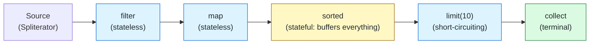

[⬅️ Prev: 06 · Collections](06-collections.md) · [🏠 Index](README.md) · [Next: 08 · Modern Java ➡️](08-modern-java-8-to-27.md)

# 07 · Lambdas, Streams & Functional Java

> *Lambdas changed how Java reads. Streams changed how Java thinks. Both are easy to use badly, and this chapter is about using them well.*

🧪 **Runnable labs:** [the programs behind this chapter's outputs](labs.md#chapter-07--lambdas-and-streams)

---

## Table of contents
1. [Lambdas & functional interfaces](#1-lambdas--functional-interfaces-)
2. [How lambdas really compile: `invokedynamic`](#2-how-lambdas-really-compile-invokedynamic-)
3. [Capture, effectively final, and `this`](#3-capture-effectively-final-and-this-)
4. [Method references (and their evaluation trap)](#4-method-references-and-their-evaluation-trap-)
5. [The `java.util.function` toolkit](#5-the-javautilfunction-toolkit-)
6. [`Optional`: what it's for and how it's abused](#6-optional-what-its-for-and-how-its-abused-)
7. [Stream mechanics: how a pipeline actually runs](#7-stream-mechanics-how-a-pipeline-actually-runs-)
8. [The operations you'll use daily](#8-the-operations-youll-use-daily-)
9. [Collectors in depth](#9-collectors-in-depth-)
10. [`reduce` vs `collect`](#10-reduce-vs-collect-)
11. [Parallel streams: when, why, and why not](#11-parallel-streams-when-why-and-why-not-)
12. [Stream Gatherers (Java 24)](#12-stream-gatherers-java-24-)
13. [Performance, debugging & resource streams](#13-performance-debugging--resource-streams-)
14. [Functional design in Java](#14-functional-design-in-java-)
15. [Staff lens](#15-staff-lens-)
16. [Interview questions](#16-interview-questions)
17. [References](#17-references)

---

## 1. Lambdas & functional interfaces 🟢

A **lambda** is an anonymous function. It can be used wherever a **functional interface** is expected: an interface with exactly **one abstract method** (SAM).

```java
Runnable r          = () -> System.out.println("hi");
Comparator<String> c = (a, b) -> a.length() - b.length();   // fine here: lengths can't overflow
Function<String, Integer> len = s -> s.length();
BiFunction<Integer, Integer, Integer> add = (var a, var b) -> a + b;   // var allowed (Java 11), e.g. for annotations
Supplier<List<String>> fresh = () -> {
    var list = new ArrayList<String>();
    list.add("seed");
    return list;
};
```

**Rules of the SAM count:**
- `default` and `static` methods don't count.
- Abstract methods that match public `Object` methods don't count. That's why `Comparator` is functional even though it declares `boolean equals(Object)`.
- `@FunctionalInterface` is optional, but it makes the compiler enforce the single-abstract-method rule. Use it on your own interfaces.

**Lambdas are typed by their target.** The same lambda text can be different types depending on context:
```java
Callable<String> a = () -> "x";      // Callable
Supplier<String> b = () -> "x";      // Supplier
Object o = () -> "x";                // ❌ no target type: "Object is not a functional interface"
Object ok = (Supplier<String>) () -> "x";   // ✅ a cast supplies the target
```

---

## 2. How lambdas really compile: `invokedynamic` 🔴

A lambda is **not** an anonymous inner class, either in the bytecode or at runtime.

```java
public class L {
    public static void main(String[] args) {
        int base = 10;
        Function<Integer, Integer> add = x -> x + base;
        System.out.println(add.apply(5));
    }
}
```

What javac produces (abridged `javap -c -p L.class`):
```
public static void main(java.lang.String[]);
   0: bipush 10
   2: istore_1
   3: iload_1
   4: invokedynamic #7, 0   // InvokeDynamic #0:apply:(I)Ljava/util/function/Function;
   ...
private static java.lang.Integer lambda$main$0(int, java.lang.Integer);   ← the lambda body
   ...
BootstrapMethods:
  0: #… REF_invokeStatic java/lang/invoke/LambdaMetafactory.metafactory(...)
```

1. **The body becomes a private method** (`lambda$main$0`). Captured variables become leading parameters. It's `static` if the lambda doesn't use `this`.
2. **The creation site becomes an `invokedynamic`.** The first time it executes, the JVM calls the bootstrap method `LambdaMetafactory.metafactory`, which **spins a small class at runtime** (a *hidden class* since JDK 15, JEP 371) that implements `Function` and forwards to `lambda$main$0`. The call site is then permanently linked.
3. **Non-capturing lambdas** (`() -> 42`) get linked to a **constant instance**: evaluating them repeatedly returns the same object on HotSpot. That's an implementation detail, not a spec guarantee. **Capturing lambdas** allocate a new instance per evaluation, holding the captured values as fields, though escape analysis often removes even that allocation.

**Why `invokedynamic` and not inner classes?**
- No `.class` file per lambda, so jars are smaller and class loading is cheaper.
- The translation strategy lives in the JDK and can improve without recompiling user code. That's the same idea as indy string concatenation ([Chapter 03](03-strings.md#5-concatenation-from-stringbuilder-to-invokedynamic-)).
- The JIT sees a simple forwarding class it can inline through.

> [!WARNING]
> **Lambda serialization** (`(Runnable & Serializable) () -> …`) works, but it ties the serialized form to compiler-generated synthetic method names, so recompiling can break deserialization. Avoid serializing lambdas.

---

## 3. Capture, effectively final, and `this` 🟡

Lambdas can capture **effectively final** locals: variables that are never reassigned after initialization.

```java
int count = 0;
list.forEach(s -> count++);            // ❌ "local variables referenced from a lambda must be final or effectively final"
```

**Why the rule?** Lambdas capture **values, not variables**. The lambda may run later, on another thread, after the stack frame is gone. Allowing mutation of a captured local would require heap-allocating it and synchronizing access, which reintroduces the data races Java is trying to prevent.

The "workarounds" usually point to a design problem:
```java
int[] count = {0};
list.forEach(s -> count[0]++);         // compiles, but it's a race if the stream is ever parallel
long count = list.stream().filter(...).count();   // ✅ express the computation as a reduction instead
```

**`this` inside a lambda** means the enclosing instance. A lambda doesn't introduce a new scope for `this` or for variable names (you can't shadow a local). An anonymous class *does* have its own `this` ([Chapter 02 §10](02-oop-and-object-model.md#10-nested-inner-local--anonymous-classes-)).

💣 **Memory leak:** a lambda that uses `this` (or any instance field) captures the whole enclosing object. Register such a lambda as a long-lived listener and you pin the entire object graph.

---

## 4. Method references (and their evaluation trap) 🟡

| Kind | Syntax | Equivalent lambda |
|---|---|---|
| Static method | `Integer::parseInt` | `s -> Integer.parseInt(s)` |
| Bound instance (a specific object) | `System.out::println`, `user::getName` | `x -> System.out.println(x)` |
| Unbound instance (the object is the first argument) | `String::length` | `s -> s.length()` |
| Constructor | `ArrayList::new`, `int[]::new` | `() -> new ArrayList<>()`, `n -> new int[n]` |

💣 **A bound method reference evaluates its receiver *immediately*. A lambda evaluates it *later*:**
```java
String name = null;
Supplier<Integer> lazy = () -> name.length();   // fine now; NPE only when get() is called
Supplier<Integer> eager = name::length;          // 💥 NPE right here, at creation time
```
The same applies to `someService.getClient()::send`: `getClient()` runs **once**, when the reference is created, not on every call. That's a subtle source of bugs when the client is supposed to be resolved per call.

---

## 5. The `java.util.function` toolkit 🟢

| Interface | Signature | Typical use |
|---|---|---|
| `Supplier<T>` | `() → T` | Lazy values, factories |
| `Consumer<T>` / `BiConsumer<T,U>` | `T → void` | Side effects (`forEach`) |
| `Function<T,R>` / `BiFunction<T,U,R>` | `T → R` | Mapping |
| `UnaryOperator<T>` / `BinaryOperator<T>` | `T → T`, `(T,T) → T` | `replaceAll`, `reduce` |
| `Predicate<T>` / `BiPredicate<T,U>` | `T → boolean` | Filtering |

**Primitive specialisations** avoid boxing: `IntFunction<R>`, `ToIntFunction<T>`, `IntUnaryOperator`, `IntBinaryOperator`, `IntPredicate`, `IntSupplier`, `ObjIntConsumer<T>`, and the `Long`/`Double` equivalents. In hot paths, `ToIntFunction` instead of `Function<T, Integer>` can be the difference between zero allocation and millions of `Integer`s.

**Composition:**
```java
Function<String, String> trim = String::strip;
Function<String, String> upper = s -> s.toUpperCase(Locale.ROOT);
Function<String, String> normalise = trim.andThen(upper);       // trim first, then upper
Function<String, String> same = upper.compose(trim);            // also trim first: compose = "before"

Predicate<String> blank = String::isBlank;
Predicate<String> valid = Predicate.not(blank).and(s -> s.length() <= 64);   // Predicate.not since Java 11
```

---

## 6. `Optional`: what it's for and how it's abused 🟡

`Optional<T>` was designed for **one** job: a **return type** that says "there may be no result", so the caller can't forget to handle absence.

```java
Optional<User> findByEmail(String email);

String display = repo.findByEmail(email)
        .map(User::displayName)
        .filter(n -> !n.isBlank())
        .orElse("anonymous");

User u = repo.findById(id).orElseThrow(() -> new NotFoundException("User", id));
repo.findById(id).ifPresentOrElse(this::notify, () -> log.warn("no user {}", id));   // Java 9
```

💣 **`orElse` vs `orElseGet`**, the most common Optional bug:
```java
User u = cache.find(id).orElse(loadFromDatabase(id));     // 💣 loadFromDatabase ALWAYS runs: it's an argument
User u = cache.find(id).orElseGet(() -> loadFromDatabase(id));   // ✅ runs only when empty
```

**Anti-patterns:**
| Don't | Why | Instead |
|---|---|---|
| `Optional` fields | Not `Serializable`, extra allocation and indirection, and the field can still be `null` | A nullable field plus an `Optional`-returning getter |
| `Optional` parameters | Callers have to wrap. Three states (null, empty, present) | Overloads, or a nullable parameter |
| `Optional<List<T>>` | Two ways to say "nothing" | An empty list |
| `opt.get()` without a check | Just an NPE with extra steps | `orElseThrow()`, which says what you mean |
| `if (opt.isPresent()) { x = opt.get(); }` | Imperative code wearing a disguise | `map` / `ifPresent` / `orElse` |
| `Optional.of(maybeNull)` | NPE when the value is null | `Optional.ofNullable` |
| Using `Optional` in hot loops | It allocates (unless escape analysis removes it) | Plain null checks inside tight internals |

There are primitive variants (`OptionalInt`, `OptionalLong`, `OptionalDouble`). `Optional.stream()` (Java 9) turns an Optional into a stream of 0 or 1 elements, which is handy with `flatMap`.

---

## 7. Stream mechanics: how a pipeline actually runs 🟡→🔴



**Five facts that explain almost every stream question:**

**1. Intermediate operations are lazy.** `filter`, `map` and the like only *describe* stages. They build a linked list of pipeline objects, and nothing runs until a terminal operation is called.

**2. Elements flow vertically, one at a time.** A stream doesn't do "all the filtering, then all the mapping". Each element goes through the whole chain of stateless stages before the next element starts. The terminal operation wraps the stages into a chain of `Sink`s and pushes elements through it:
```java
Optional<String> first = Stream.of("a", "bb", "ccc", "dddd")
        .filter(s -> { System.out.println("filter " + s); return s.length() > 1; })
        .map(s -> { System.out.println("map " + s); return s.toUpperCase(); })
        .findFirst();
```
<!-- lab-output: VerticalStream.java -->
```
filter a
filter bb
map bb          ← short-circuit: "ccc" and "dddd" are never touched
```

**3. Stateful operations are barriers.** `sorted()` has to see *every* element before it can emit the first one, and `distinct()` has to remember everything it has seen. On an infinite stream, `sorted()` never returns.

**4. Stream flags enable optimisations.** Sources and operations carry flags such as `SIZED`, `SORTED`, `DISTINCT` and `ORDERED`. `sorted()` on a stream already flagged `SORTED` does nothing. And since Java 9:
```java
long n = List.of(1, 2, 3).stream()
        .peek(System.out::println)      // 💣 prints NOTHING
        .count();                       // 3: computed straight from the SIZED source, so the pipeline is skipped
```
Put a `filter` before `count()` and the pipeline has to run. **Never put essential side effects in `peek`.** It exists for debugging.

**5. Streams are single-use.** A second terminal operation throws `IllegalStateException: stream has already been operated upon or closed`. If you need to traverse twice, keep a `Supplier<Stream<T>>`.

---

## 8. The operations you'll use daily 🟢→🟡

```java
// Creating
Stream.of(a, b, c);  Arrays.stream(arr);  list.stream();  map.entrySet().stream();
IntStream.range(0, 10);  IntStream.rangeClosed(1, 10);
Stream.iterate(1, i -> i <= 1000, i -> i * 2);        // Java 9: a bounded iterate
Stream.generate(UUID::randomUUID).limit(5);
Stream.ofNullable(maybeNull);                         // Java 9: 0 or 1 elements
Files.lines(path);  pattern.splitAsStream(text);  "a\nb".lines();

// Transforming
.map(f)   .mapToInt(f)   .boxed()   .mapToObj(f)
.flatMap(order -> order.lines().stream())             // one-to-many, flattened
.<String>mapMulti((n, sink) -> {                      // Java 16: imperative one-to-many, no intermediate streams
    if (n > 0) sink.accept("pos:" + n);
})
.filter(p)   .distinct()   .sorted(cmp)   .limit(n)   .skip(n)
.takeWhile(p)   .dropWhile(p)                         // Java 9: prefix operations for ordered streams

// Terminal
.toList()                                             // Java 16: unmodifiable, allows nulls
.collect(...)   .forEach(c)   .forEachOrdered(c)
.reduce(...)   .count()   .min(cmp)   .max(cmp)
.anyMatch(p)   .allMatch(p)   .noneMatch(p)           // short-circuiting
.findFirst()   .findAny()                             // findAny is cheaper in parallel
IntStream.of(…).sum() / .average() / .summaryStatistics()
```

💣 `allMatch` on an **empty** stream returns `true` (vacuous truth), and `anyMatch` returns `false`. This regularly breaks validation code like "all items are valid → approve", which happily approves an empty order.

---

## 9. Collectors in depth 🟡→🔴

```java
import static java.util.stream.Collectors.*;

record Employee(String name, String dept, double salary, int years) {}

// Grouping, with downstream collectors
Map<String, Long> headcount = emps.stream().collect(groupingBy(Employee::dept, counting()));

Map<String, Double> avgSalary = emps.stream().collect(groupingBy(Employee::dept, averagingDouble(Employee::salary)));

Map<String, Optional<Employee>> topEarner = emps.stream()
        .collect(groupingBy(Employee::dept, maxBy(Comparator.comparingDouble(Employee::salary))));

Map<String, List<String>> namesByDept = emps.stream()
        .collect(groupingBy(Employee::dept, TreeMap::new, mapping(Employee::name, toList())));   // sorted keys

Map<String, Set<String>> seniorNames = emps.stream()
        .collect(groupingBy(Employee::dept, filtering(e -> e.years() >= 5, mapping(Employee::name, toSet()))));  // Java 9

// Partitioning: always produces both keys, true and false
Map<Boolean, List<Employee>> seniorOrNot = emps.stream().collect(partitioningBy(e -> e.years() >= 5));

// toMap: the traps live here
Map<String, Double> salaryByName = emps.stream()
        .collect(toMap(Employee::name, Employee::salary));                  // 💣 duplicate name → IllegalStateException
Map<String, Double> safe = emps.stream()
        .collect(toMap(Employee::name, Employee::salary, Double::sum, LinkedHashMap::new));   // merge function + map type

// teeing (Java 12): two collectors in one pass, then combine
String summary = emps.stream().collect(teeing(
        counting(),
        averagingDouble(Employee::salary),
        (n, avg) -> "%d employees, average %.2f".formatted(n, avg)));

// Joining, statistics, post-processing
String csv = emps.stream().map(Employee::name).collect(joining(", ", "[", "]"));
DoubleSummaryStatistics stats = emps.stream().collect(summarizingDouble(Employee::salary));
List<String> frozen = emps.stream().map(Employee::name).collect(collectingAndThen(toList(), List::copyOf));
```

💣 **`toMap` rejects null values with an NPE** (it uses `putIfAbsent`/`merge` internally, and those treat `null` as "absent"). `groupingBy` rejects null *keys*. Both regularly blow up on real-world data.

### Writing a custom collector
A `Collector<T, A, R>` is five functions: **supplier** (new container A), **accumulator** (add T into A), **combiner** (merge two As, for parallel), **finisher** (A → R), and **characteristics** (`IDENTITY_FINISH`, `UNORDERED`, `CONCURRENT`).

```java
// Collect into an ImmutableMultiset-like Map<T, Integer> counting occurrences
static <T> Collector<T, ?, Map<T, Integer>> toCounts() {
    return Collector.of(
            HashMap<T, Integer>::new,                                   // supplier
            (map, t) -> map.merge(t, 1, Integer::sum),                  // accumulator
            (m1, m2) -> { m2.forEach((k, v) -> m1.merge(k, v, Integer::sum)); return m1; },  // combiner
            Collections::unmodifiableMap);                              // finisher
}
```

---

## 10. `reduce` vs `collect` 🔴

- **`reduce`** is an *immutable* reduction: it combines values into a new value (`sum`, `max`, string concatenation of a few items).
- **`collect`** is a *mutable* reduction: it accumulates into a mutable container (`ArrayList`, `StringBuilder`, `HashMap`).

```java
int total = nums.stream().reduce(0, Integer::sum);                      // identity, accumulator

int totalLength = words.stream().reduce(0,
        (acc, w) -> acc + w.length(),                                    // accumulator (T and U differ)
        Integer::sum);                                                   // combiner, used in parallel
```

**The rules** (they matter for parallel streams):
- The **identity** must really be an identity for the combiner: `combiner(identity, x) == x`. Using `reduce(10, Integer::sum)` in parallel adds the 10 *once per chunk*.
- Functions must be **associative** and **stateless**.

💣 **Mutable identity in `reduce`:**
```java
List<String> all = words.parallelStream().reduce(new ArrayList<>(),
        (list, w) -> { list.add(w); return list; },                     // mutates the SHARED identity
        (l1, l2) -> { l1.addAll(l2); return l1; });                     // 💥 races, duplicates, AIOOBE
List<String> ok = words.parallelStream().collect(Collectors.toList());  // ✅ collect gives each chunk its own container
```

---

## 11. Parallel streams: when, why, and why not 🔴→🟣

`.parallel()` splits the source with its **Spliterator**, processes the chunks on the **`ForkJoinPool.commonPool()`** (default parallelism = cores − 1, and the calling thread helps out), and combines the results.

**When it helps**, by Doug Lea and Brian Goetz's rough **NQ model**: `N` (number of elements) × `Q` (cost per element) should be well above **10,000** before parallelism pays for itself. On top of that, you need:
- a source that **splits cheaply and evenly** (arrays, `ArrayList`, `IntStream.range`, `HashMap`);
- stateless, non-blocking, CPU-bound operations;
- cheap combining (`sum`, not merging huge maps);
- no ordering constraints, or explicit `unordered()`.

**When it hurts:**
| Situation | Why |
|---|---|
| `LinkedList`, `Stream.iterate`, `BufferedReader.lines()` | Poor splitting: everything ends up serial plus overhead |
| Small N or cheap Q | Fork/join coordination costs more than the work |
| `findFirst`, `limit`, `sorted`, `forEachOrdered` on ordered streams | Ordering constraints force buffering and coordination |
| Blocking I/O inside the stream | **Blocks the shared common pool**, starving every other parallel stream and every `CompletableFuture.*Async` call that uses the default pool, JVM-wide |
| Shared mutable state (`list.add` inside `forEach`) | Data races: lost elements, `ArrayIndexOutOfBoundsException` |
| Boxed streams | Boxing costs dominate, so use `IntStream` and friends |

💣 **The custom pool "trick":**
```java
ForkJoinPool pool = new ForkJoinPool(8);
List<R> r = pool.submit(() -> items.parallelStream().map(this::work).toList()).get();
```
This works because tasks forked from inside a ForkJoinPool run in *that* pool, but it relies on an implementation detail. For I/O fan-out, use an explicit executor, `CompletableFuture`, virtual threads, or `Gatherers.mapConcurrent` (§12).

> [!IMPORTANT]
> **The staff-level rule:** no parallel streams in request-handling code paths unless they've been measured and approved. The common pool is a shared, JVM-wide resource, so one team's "harmless" `.parallel()` with a blocking call inside can quietly add latency to unrelated endpoints.

---

## 12. Stream Gatherers (Java 24) 🔴

Before Java 24, you couldn't add *custom intermediate operations* to streams. You had `map`, `filter` and the rest, plus whatever you could fake inside a collector. **JEP 485** (final in Java 24) added `Stream.gather(Gatherer)`, and gatherers are to intermediate operations what collectors are to terminal ones.

```java
import java.util.stream.Gatherers;

Stream.of(1, 2, 3, 4, 5, 6, 7).gather(Gatherers.windowFixed(3)).toList();
// [[1, 2, 3], [4, 5, 6], [7]]

Stream.of(1, 2, 3, 4).gather(Gatherers.windowSliding(2)).toList();
// [[1, 2], [2, 3], [3, 4]]

Stream.of(1, 2, 3, 4).gather(Gatherers.scan(() -> 0, Integer::sum)).toList();
// [1, 3, 6, 10]   (running totals)

Stream.of(1, 2, 3, 4).gather(Gatherers.fold(() -> 0, Integer::sum)).toList();
// [10]

// I/O fan-out with BOUNDED concurrency on virtual threads; preserves encounter order
List<Response> responses = urls.stream()
        .gather(Gatherers.mapConcurrent(16, this::fetch))
        .toList();
```

**A custom gatherer**, `distinctBy` (a long-requested operation):
```java
static <T, K> Gatherer<T, ?, T> distinctBy(Function<? super T, ? extends K> keyFn) {
    return Gatherer.ofSequential(
            HashSet<K>::new,                                              // per-pipeline state
            Gatherer.Integrator.ofGreedy((seen, element, downstream) -> {
                if (seen.add(keyFn.apply(element))) return downstream.push(element);
                return true;                                              // skip it and keep going
            }));
}

users.stream().gather(distinctBy(User::email)).toList();
```
A gatherer has an **initializer** (state), an **integrator** (per element; it can push 0..n elements downstream and return `false` to short-circuit), an optional **combiner** (for parallel), and an optional **finisher** (to flush state at the end, which is how `windowFixed` emits its last partial window).

---

## 13. Performance, debugging & resource streams 🟡→🔴

- **Streams vs loops.** For simple operations on small collections, a stream carries overhead (pipeline objects, lambda dispatch). In hot code, the JIT often inlines it down to loop-like code, but not always, especially in **megamorphic** pipelines that are shared across many call sites. Measure with JMH ([Chapter 20](20-testing-and-quality.md)) before rewriting either way.
- **Boxing is the usual real cost.** `Stream<Integer>.reduce(0, Integer::sum)` vs `IntStream.sum()` can differ by an order of magnitude on large data.
- **Readability first.** A ten-step stream with nested collectors is harder to review than a well-named loop. Optimise for the next reader.
- **Debugging:** use `peek` for a quick look (with its caveats), split long pipelines into named intermediate variables or methods, and use the IDE's stream debugger. In stack traces, look for the `lambda$method$N` frames.
- **Resource-backed streams must be closed:**
```java
try (Stream<String> lines = Files.lines(path)) {          // holds a file handle!
    return lines.filter(l -> l.startsWith("ERROR")).count();
}
```
`Files.lines`, `Files.list`, `Files.walk` and `Files.find` all keep OS resources open until the stream is closed. Forgetting this in a long-running service leaks file descriptors until you hit `Too many open files`.

---

## 14. Functional design in Java 🟡→🟣

Java isn't Haskell, but functional *ideas* make Java code better:

- **Pure core, imperative shell.** Keep business logic in pure functions (input → output, no I/O, no mutation) and push side effects (database, HTTP, clock) to the edges. Pure functions are trivially testable and safe to parallelise.
- **Immutability by default.** Records, `List.copyOf`, persistent data ([Chapter 02](02-oop-and-object-model.md#11-immutability-by-design-)).
- **Higher-order functions remove duplication:**
  ```java
  <T> T withRetry(Supplier<T> action, int attempts, Duration backoff) { ... }
  <T> T timed(String metric, Supplier<T> action) { ... }
  Order order = timed("order.load", () -> withRetry(() -> repo.load(id), 3, Duration.ofMillis(50)));
  ```
- **Strategy is just a function.** `Map<PaymentMethod, Function<Order, Receipt>>` often replaces a hierarchy of strategy classes ([Chapter 17](17-design-patterns.md)).
- **Sealed types plus pattern matching** give you the algebraic data types and exhaustive "pattern matching on shape" that functional languages are known for ([Chapter 08](08-modern-java-8-to-27.md)).

---

## 15. Staff lens 🟣

1. **Write team guidelines.** For example: no side effects in `map`/`filter`; `peek` only for debugging; no blocking I/O in parallel streams; prefer `toList()`; no `Optional` fields or parameters. Enforce them with static analysis (Error Prone, Sonar, ArchUnit) rather than relying on review.
2. **Parallelism is an operational decision,** not a coding trick. Treat `commonPool` as shared infrastructure. Use explicit, named, sized executors for application concurrency, so you get isolation and metrics.
3. **Streams vs reactive vs virtual threads.** Streams are for in-memory, pull-based data transformation. Reactive streams (Reactor, RxJava) handle push-based, back-pressured async flows. With virtual threads, plain blocking code plus `mapConcurrent` or structured concurrency covers many cases that used to *require* reactive. Know which tool solves which problem ([Chapter 12](12-concurrency-advanced-juc-loom.md)).
4. **Allocation awareness at scale.** Capturing lambdas, boxed streams and `Optional`s in a path that runs 50k times per second add GC pressure. Profile allocations (JFR, async-profiler `-e alloc`) before and after.

---

## 16. Interview questions

<details>
<summary><b>Q1. 🟢 What is a functional interface? Is <code>Comparator</code> one, given that it has two abstract methods?</b></summary>

An interface with exactly one abstract method (SAM), which can be the target of a lambda or a method reference. `Comparator` declares `compare` and `equals`, but `equals` matches a public `Object` method, so it doesn't count. Default and static methods don't count either. `@FunctionalInterface` makes the compiler enforce the rule.
</details>

<details>
<summary><b>Q2. 🔴 How is a lambda compiled and created at runtime?</b></summary>

javac moves the body into a private synthetic method (`lambda$enclosing$N`, static if it doesn't use `this`) and emits an `invokedynamic` at the creation site. On first execution, the bootstrap method `LambdaMetafactory.metafactory` spins a hidden class implementing the functional interface that forwards to the synthetic method, and links the call site. Non-capturing lambdas typically yield a cached singleton. Capturing ones allocate an instance holding the captured values.
</details>

<details>
<summary><b>Q3. 🟡 Why must captured local variables be effectively final?</b></summary>

Lambdas capture values, not variables. They may run later or on another thread, after the stack frame has gone. Allowing mutation would require heap-allocating the variable and synchronizing access, which reintroduces data races. The design pushes you towards expressing accumulation as a reduction instead of mutating shared state.
</details>

<details>
<summary><b>Q4. 🟡 What's the difference between <code>name::length</code> and <code>() -&gt; name.length()</code> when <code>name</code> is null?</b></summary>

A bound method reference evaluates its receiver at creation time, so `name::length` throws NPE immediately. The lambda evaluates `name` each time it's invoked, so the NPE happens only when it's called. The same timing difference applies to expressions like `service.getClient()::send`.
</details>

<details>
<summary><b>Q5. 🟡 <code>orElse</code> vs <code>orElseGet</code>?</b></summary>

`orElse(x)` takes a value, so the argument is always evaluated, even when the Optional is present. `orElseGet(supplier)` evaluates lazily, only when empty. Use `orElseGet` whenever computing the default is expensive or has side effects (a database call, object creation, logging).
</details>

<details>
<summary><b>Q6. 🟡 Where should you NOT use <code>Optional</code>?</b></summary>

As fields (not serializable, adds allocation, can still be null), as method parameters (forces callers to wrap, and creates three states), wrapping collections (use empty collections), and in tight hot loops (allocation). It's designed as a return type for "maybe no result".
</details>

<details>
<summary><b>Q7. 🔴 Explain laziness and vertical processing in streams. Why can <code>peek</code> not run at all?</b></summary>

Intermediate operations only build pipeline stages. The terminal operation creates a chain of `Sink`s and pushes each element through every stateless stage before taking the next, which is why short-circuiting operations can stop early. Stateful operations (`sorted`, `distinct`) buffer. Since Java 9, `count()` on a `SIZED` stream with no size-changing stages returns the size directly without traversing, so `peek` never runs. Never rely on `peek` for side effects.
</details>

<details>
<summary><b>Q8. 🔴 When do parallel streams help, and what are the risks?</b></summary>

They help for large N × cost-per-element (the NQ > 10,000 rule of thumb) with splittable sources (arrays, ArrayList, ranges), CPU-bound stateless operations and cheap combining. Risks: overhead on small data, poor splitting (LinkedList, iterate, I/O-backed sources), ordering constraints, shared mutable state, and above all **blocking calls on the shared common pool**, which starves other parallel streams and default-async `CompletableFuture`s across the whole JVM.
</details>

<details>
<summary><b>Q9. 🟡 What can go wrong with <code>Collectors.toMap</code>?</b></summary>

Duplicate keys throw `IllegalStateException` unless you provide a merge function. Null values throw NPE. The result is a `HashMap` with no ordering guarantee unless you pass a map supplier (`LinkedHashMap::new`, `TreeMap::new`). Use the 4-argument overload when any of these matter.
</details>

<details>
<summary><b>Q10. 🔴 <code>reduce</code> vs <code>collect</code>: why is <code>reduce(new ArrayList&lt;&gt;(), ...)</code> wrong?</b></summary>

`reduce` is designed for immutable values: the identity is shared and must be a true identity for an associative combiner. Mutating an `ArrayList` identity means every parallel chunk writes into the same list, causing races, duplicates and exceptions. `collect` is mutable reduction: the supplier creates a fresh container per chunk, and the combiner merges them.
</details>

<details>
<summary><b>Q11. 🔴 What are Stream Gatherers and why were they added?</b></summary>

Java 24 (JEP 485) added `Stream.gather(Gatherer)` for user-defined intermediate operations. Previously you couldn't add custom ones like windowing, scanning or distinct-by-key without awkward collector tricks. A gatherer has an initializer, an integrator (it can emit 0..n elements and short-circuit), an optional combiner and a finisher. Built-ins include `windowFixed`, `windowSliding`, `fold`, `scan` and `mapConcurrent` (bounded concurrency on virtual threads, order-preserving).
</details>

<details>
<summary><b>Q12. 🟡 Why should <code>Files.lines()</code> be used in try-with-resources?</b></summary>

The stream holds an open file handle until it's closed, and streams don't close themselves when the terminal operation completes. In long-running services, forgetting this leaks file descriptors until "Too many open files". The same applies to `Files.list`, `walk` and `find`.
</details>

<details>
<summary><b>Q13. 🟣 Your team wants to "use parallel streams to speed up" an endpoint that calls three services per item. What do you say?</b></summary>

No. That's blocking I/O on the JVM-wide common pool, which will starve other workloads and gives uncontrolled concurrency against downstream services. Use explicit concurrency with limits: virtual threads with structured concurrency, `Gatherers.mapConcurrent(n, …)`, or `CompletableFuture`s on a dedicated bounded executor. Add timeouts, per-dependency bulkheads and metrics. Then measure whether latency actually improves and whether the downstream services can handle the extra concurrency.
</details>

---

## 17. References
- Brian Goetz, [*State of the Lambda*](https://cr.openjdk.org/~briangoetz/lambda/lambda-state-final.html) and *Translation of Lambda Expressions*
- Richard Warburton, *Java 8 Lambdas*; Raoul-Gabriel Urma et al., *Modern Java in Action*
- JEPs: [126 Lambda Expressions](https://openjdk.org/jeps/126) · [371 Hidden Classes](https://openjdk.org/jeps/371) · [485 Stream Gatherers](https://openjdk.org/jeps/485)
- Doug Lea, *When to use parallel streams* (the NQ model)
- [`java.util.stream` package documentation](https://docs.oracle.com/en/java/javase/25/docs/api/java.base/java/util/stream/package-summary.html): non-interference, statelessness, side effects

---

[⬅️ Prev: 06 · Collections](06-collections.md) · [🏠 Index](README.md) · [Next: 08 · Modern Java ➡️](08-modern-java-8-to-27.md)
