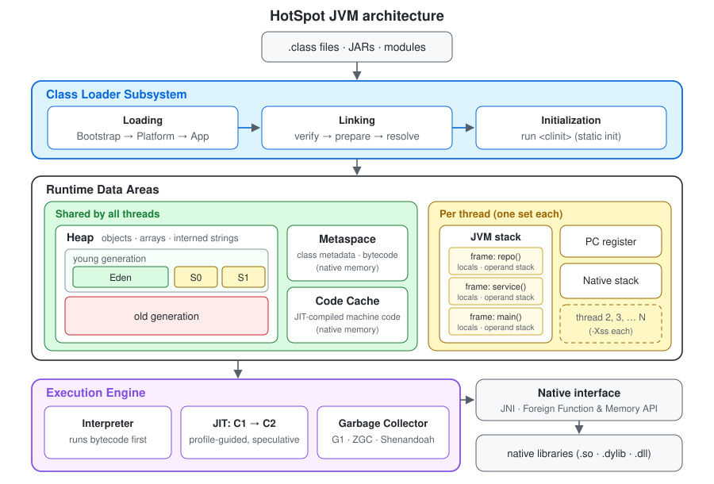
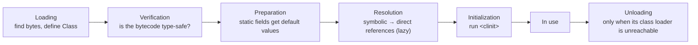
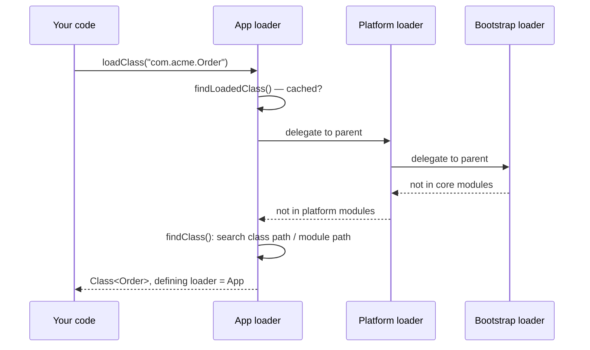
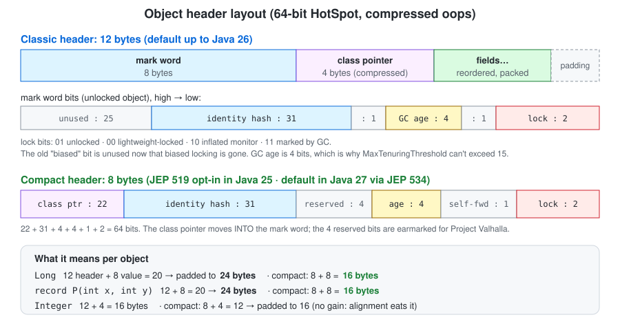
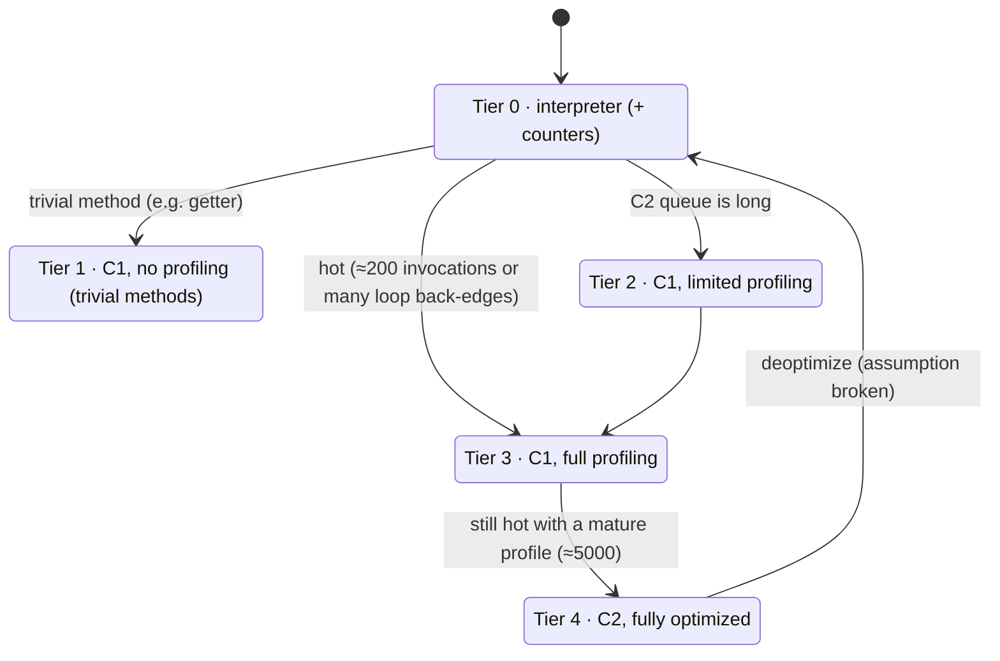

[⬅️ Prev: 08 · Modern Java](08-modern-java-8-to-27.md) · [🏠 Index](README.md) · [Next: 10 · Memory & GC ➡️](10-memory-and-garbage-collection.md)

# 09 · JVM Internals

> *You can write Java for years without knowing how the JVM works. You can't debug a production performance problem, explain a deoptimization storm after a deploy, or make a credible startup-time decision without it. This chapter is where staff interviews separate people.*

> [!TIP]
> **🧭 Decision guide: whether to tune the JIT and warm-up**
> - **When it matters:** when the first minutes after a deploy, CPU limits under two cores, or a few very hot loops decide latency or cost.
> - **Default**, assuming a current LTS and a typical service: leave the JIT flags alone. Keep hot paths simple and monomorphic, give pods enough CPU to compile during warm-up (or set `-XX:ActiveProcessorCount`), ramp traffic after deploys, and use the AOT cache for startup ([Chapter 30](30-startup-footprint-aot-native-image.md)).
> - **Alternatives:** targeted flags for a measured problem (code-cache size, compiler threads), Graal's JIT, or a native image when startup dominates.
> - **Failure modes:** minutes of slow warm-up in one-CPU pods; deoptimisation storms after a deploy (CPU rises while traffic is flat); megamorphic call sites in hot loops; methods over 8,000 bytes of bytecode that never get compiled.
> - **Evidence that would change it:** JFR compilation and deoptimisation events, or a profile that shows JIT activity rather than your code as the cost after warm-up.
> - **Argued in:** §8–§12 and §15.

🧪 **Runnable labs:** [the programs behind this chapter's outputs](labs.md#chapter-09--jvm-internals)

---

## Table of contents
1. [The big picture](#1-the-big-picture-)
2. [Runtime data areas](#2-runtime-data-areas-)
3. [Class loading: lifecycle](#3-class-loading-lifecycle-)
4. [Class loaders: hierarchy, delegation, identity](#4-class-loaders-hierarchy-delegation-identity-)
5. [The class file & bytecode](#5-the-class-file--bytecode-)
6. [The five `invoke` instructions](#6-the-five-invoke-instructions-)
7. [Object layout in memory](#7-object-layout-in-memory-)
8. [The interpreter and tiered compilation](#8-the-interpreter-and-tiered-compilation-)
9. [What the JIT actually does](#9-what-the-jit-actually-does-)
10. [Deoptimization](#10-deoptimization-)
11. [Safepoints & handshakes](#11-safepoints--handshakes-)
12. [Startup & warmup: CDS, Leyden AOT, CRaC, native image](#12-startup--warmup-cds-leyden-aot-crac-native-image-)
13. [Native code: JNI vs FFM](#13-native-code-jni-vs-ffm-)
14. [Tools for looking inside](#14-tools-for-looking-inside-)
15. [Staff lens](#15-staff-lens-)
16. [Interview questions](#16-interview-questions)
17. [References](#17-references)

---

## 1. The big picture 🟡



Three subsystems do all the work:
1. The **class loader subsystem** finds bytecode, verifies it, links it and initializes classes.
2. The **runtime data areas** hold everything: the shared heap, Metaspace and code cache, plus a stack and PC register for each thread.
3. The **execution engine** interprets bytecode, JIT-compiles hot code to native, and collects garbage.

**HotSpot** is the JVM inside OpenJDK and almost every distribution. Others exist (OpenJ9 from IBM/Eclipse, GraalVM's own JIT, Azul Prime's Falcon JIT and C4 collector), and the JVMS gives them a lot of freedom. Everything below describes HotSpot.

---

## 2. Runtime data areas 🟡→🔴

| Area | Scope | Holds | Sized by | Failure |
|---|---|---|---|---|
| **Heap** | Shared | All objects and arrays (semantically) | `-Xms`, `-Xmx`, `-XX:MaxRAMPercentage` | `OutOfMemoryError: Java heap space` |
| **Metaspace** | Shared, native memory | Class metadata: `Klass` structures, method bytecode, runtime constant pools, annotations | `-XX:MaxMetaspaceSize` (unbounded by default!) | `OOM: Metaspace` |
| **Compressed class space** | Shared, native, part of Metaspace | `Klass` structures addressed by 32-bit class pointers | `-XX:CompressedClassSpaceSize` (default 1 GB) | `OOM: Compressed class space` |
| **Code cache** | Shared, native | JIT-compiled machine code, segmented (non-method, profiled, non-profiled) since 9 | `-XX:ReservedCodeCacheSize` (240 MB default with tiered) | "CodeCache is full. Compiler has been disabled." 💣 |
| **JVM stack** | Per thread | Frames: local variable array, operand stack, frame data | `-Xss` (≈1 MB on Linux x64) | `StackOverflowError` |
| **PC register** | Per thread | Address of the current bytecode instruction | — | — |
| **Native method stack** | Per thread | C frames for JNI and native code | OS | Crash / `StackOverflowError` |
| **Direct memory** | Shared, native | `ByteBuffer.allocateDirect`, NIO, Netty buffers | `-XX:MaxDirectMemorySize` | `OOM: Direct buffer memory` |

### Anatomy of a stack frame
```
┌──────────────────────────────────┐
│ local variable array             │  slot 0 = this (instance methods), then parameters, then locals
│ [this][a][b][long takes 2 slots]…│  long/double occupy two slots
├──────────────────────────────────┤
│ operand stack                    │  the "registers" of the stack machine; max depth computed by javac
├──────────────────────────────────┤
│ frame data                       │  constant-pool ref, return address, exception handling
└──────────────────────────────────┘
```

🔴 **The JVM uses far more memory than `-Xmx`.** The process footprint (RSS) is roughly *heap + Metaspace + code cache + (threads × stack size) + direct buffers + GC data structures + JIT compiler arenas + symbol and string tables + malloc arenas*. A 4 GB heap can easily mean 5.5–6 GB of RSS. That's the root of the classic "container OOM-killed but the heap was fine" incident ([Chapter 10](10-memory-and-garbage-collection.md#13-the-jvm-in-containers-)). **Native Memory Tracking** shows the breakdown:
```bash
java -XX:NativeMemoryTracking=summary ...
jcmd <pid> VM.native_memory summary
```

---

## 3. Class loading: lifecycle 🟡→🔴



**Loading.** A class loader finds the bytes (from a JAR, the module image, the network, or bytes generated on the fly), parses them, and creates the internal `Klass` in Metaspace plus the `java.lang.Class` mirror on the heap.

**Linking:**
- **Verification** proves the bytecode won't corrupt the JVM: stack depth never under- or overflows, types match on every path, no jumps into the middle of instructions, no reads of uninitialized locals. Since Java 6/7, class files carry a **`StackMapTable`**, so verification is a fast *type check* rather than slow *type inference*. (`-Xverify:none` was deprecated in 13. Don't use it.)
- **Preparation** allocates static fields and sets them to **default values** (0/null/false). Your initializers haven't run yet.
- **Resolution** turns symbolic references in the constant pool (`java/util/List.add:(Ljava/lang/Object;)Z`) into direct pointers. HotSpot does this **lazily**, the first time each instruction executes.

**Initialization** runs `<clinit>`: static initializers and static blocks, in textual order. The JVM guarantees it runs **exactly once, under a lock**, with happens-before to every thread that uses the class afterwards. That's what makes the holder-class idiom safe ([Chapter 01 §17](01-java-platform-fundamentals.md#17-static-class-initialization--init-order-)).

**Unloading.** A class can be unloaded only when its **defining class loader** becomes unreachable, along with all of its classes and instances. Classes loaded by the bootstrap, platform and app loaders are never unloaded. That's why **class-loader leaks** (an old webapp loader pinned by one stray reference) cause `OOM: Metaspace` after enough redeploys.

---

## 4. Class loaders: hierarchy, delegation, identity 🔴

| Loader | Loads | Notes |
|---|---|---|
| **Bootstrap** | `java.base` and other core modules | Native (C++). Shows up as `null` from `getClassLoader()` |
| **Platform** (called "Extension" before Java 9) | Other Java SE and JDK modules (`java.sql`, `java.xml.crypto`, …) | `ClassLoader.getPlatformClassLoader()` |
| **Application** (System) | Your class path and module path | `ClassLoader.getSystemClassLoader()` |
| **Custom** | Whatever you implement | App servers, plugin systems, hot reload, OSGi |

### Parent-first delegation


**Why parent-first?** Security and consistency. Your code can't replace `java.lang.String` with a malicious copy, because the bootstrap loader always wins for core classes. (Defining classes in `java.*` packages from a non-bootstrap loader is forbidden outright.)

### Class identity = (fully qualified name, defining loader)
Two classes with the same name loaded by **different** loaders are **different types**:
```
java.lang.ClassCastException: class com.acme.Order cannot be cast to class com.acme.Order
  (com.acme.Order is in unnamed module of loader 'app';
   com.acme.Order is in unnamed module of loader org.apache.catalina.loader.ParallelWebappClassLoader @3a4b…)
```
That message looks absurd until you know about loader identity. It shows up with application servers, plugin frameworks, Spring Boot DevTools' restart class loader, and OSGi.

### Breaking the delegation model on purpose
- **Child-first (parent-last) loaders.** Servlet containers load a webapp's own `WEB-INF/lib` before the container's libraries, so different apps can use different library versions.
- **Thread context class loader (TCCL).** Core-library code loaded by the bootstrap loader sometimes needs to find *application* classes. The classic examples are JDBC drivers and `ServiceLoader`-based SPIs. Since parents can't see their children, the code uses `Thread.currentThread().getContextClassLoader()`. Getting the TCCL wrong in thread pools causes "class not found" failures that only happen on certain threads.

### A minimal custom class loader
```java
public final class BytesClassLoader extends ClassLoader {
    private final Map<String, byte[]> classes;
    public BytesClassLoader(ClassLoader parent, Map<String, byte[]> classes) {
        super(parent);
        this.classes = classes;
    }
    @Override protected Class<?> findClass(String name) throws ClassNotFoundException {
        byte[] bytes = classes.get(name);
        if (bytes == null) throw new ClassNotFoundException(name);
        return defineClass(name, bytes, 0, bytes.length);   // Loading happens here
    }
}
```
Override `findClass`, **not** `loadClass`, so delegation keeps working. Override `loadClass` only when you deliberately want child-first behaviour.

---

## 5. The class file & bytecode 🔴

```
ClassFile {
    u4 magic = 0xCAFEBABE
    u2 minor_version, major_version         // 69 = Java 25, 71 = Java 27
    constant_pool[]                         // strings, class/method/field refs, method handles…
    u2 access_flags, this_class, super_class
    interfaces[], fields[], methods[]
    attributes[]                            // Code, StackMapTable, LineNumberTable, LocalVariableTable,
}                                           // Signature, BootstrapMethods, NestMembers, Record, PermittedSubclasses…
```

The JVM is a **stack machine**: instructions pop operands from the operand stack and push results back. Here's real `javap -c` output (JDK 21):

```java
static int max(int a, int b) { return a > b ? a : b; }
```
<!-- lab-output: Bytecode.java, JDK 21 -->
```
  static int max(int, int);
    Code:
       0: iload_0           // push a        (static method → slot 0 is a, not this)
       1: iload_1           // push b
       2: if_icmple     9   // pop both; if a <= b jump to 9
       5: iload_0           // push a
       6: goto          10
       9: iload_1           // push b
      10: ireturn           // return top of stack
```

```java
int sumAll(int[] xs) { int s = 0; for (int x : xs) s += x; return s; }
```
<!-- lab-output: Bytecode.java, JDK 21 -->
```
  int sumAll(int[]);
    Code:
       0: iconst_0
       1: istore_2          // s = 0              (slot 0 = this, slot 1 = xs)
       2: aload_1
       3: astore_3          // hidden copy of the array reference  ← the desugared enhanced-for
       4: aload_3
       5: arraylength
       6: istore        4   // hidden length
       8: iconst_0
       9: istore        5   // hidden index i
      11: iload         5
      13: iload         4
      15: if_icmpge     35  // i >= length → exit
      18: aload_3
      19: iload         5
      21: iaload            // xs[i]: implicit null check + bounds check
      22: istore        6   // x
      24: iload_2
      25: iload         6
      27: iadd
      28: istore_2          // s += x
      29: iinc          5, 1
      32: goto          11
      35: iload_2
      36: ireturn
```

Things to notice:
- The enhanced `for` loop is pure syntax. javac generates hidden locals for the array, its length and the index.
- **Type-specific opcodes** (`iload`, `lload`, `aload`, `iadd`, `dadd`…). There's no generic "add". The prefix encodes the type: `i` int, `l` long, `f` float, `d` double, `a` reference.
- `iaload` carries an implicit null check and **bounds check**. C2 removes most of these in loops (*range check elimination*).
- Bytecode is unoptimised, and that's deliberate. The interesting work happens in the JIT (§8–9).

---

## 6. The five `invoke` instructions 🔴

| Instruction | Used for | Dispatch |
|---|---|---|
| `invokestatic` | Static methods | None (direct) |
| `invokespecial` | Constructors (`<init>`), `super.m()`, private methods (before nestmates) | None (direct) |
| `invokevirtual` | Instance methods on classes | **vtable** slot lookup |
| `invokeinterface` | Methods called through an interface type | **itable** search |
| `invokedynamic` (Java 7) | Lambdas, string concatenation, `switch` patterns, records' `toString/equals/hashCode` | A **bootstrap method** links the call site at first execution; then a `MethodHandle` |

`invokedynamic` is how the JDK keeps new language features out of the class-file format. The *compiler* emits a call site plus the name of a bootstrap method. The *JDK library* (`LambdaMetafactory`, `StringConcatFactory`, `SwitchBootstraps`, `ObjectMethods`) decides at runtime how to implement it, and can do it better in a later release without anyone recompiling. Records' `equals`/`hashCode`/`toString` go through `ObjectMethods.bootstrap`. Pattern `switch` uses `SwitchBootstraps.typeSwitch`.

**Constant dynamic** (`CONSTANT_Dynamic`, Java 11) does the same trick for *constants*: a constant-pool entry computed by a bootstrap method on first use.

---

## 7. Object layout in memory 🔴



**Measured on JDK 21** (classic headers, compressed oops), using `Unsafe.objectFieldOffset`:
```java
static class Mixed { boolean flag; int count; long id; Object ref; byte b; }
```
```
OFF  SIZE  FIELD
  0    8   (mark word)
  8    4   (class pointer, compressed)
 12    4   int count       ← packed into the 4-byte gap after the header
 16    8   long id
 24    1   boolean flag
 25    1   byte b
 26    2   (alignment gap)
 28    4   Object ref      ← compressed oop: 4 bytes
 32        total object size (multiple of 8)
```

The JVM **doesn't keep your declaration order**. It packs fields to minimise padding, and since JDK 15 it fills gaps such as the one right after the header. Declaration order mostly matters for readability. For false sharing, use `@Contended` ([Chapter 12](12-concurrency-advanced-juc-loom.md)).

### Compressed oops
On a 64-bit JVM, references would naturally be 8 bytes. **Compressed oops** store them as 32-bit offsets that get scaled by 8 (object alignment), which lets a 4-byte reference address **32 GB** of heap. It's on by default for heaps under about 32 GB.

💣 **The 32 GB cliff.** At `-Xmx32g` and above, compressed oops switch off, every reference doubles to 8 bytes, and a "bigger" heap can hold *fewer* objects than a 31 GB one. If you need more than 32 GB, jump well past it (48 GB or more), or raise `-XX:ObjectAlignmentInBytes` to 16 to address up to 64 GB with compressed oops, at the cost of more padding.

### Compact object headers
**JEP 519** (product feature in Java 25, opt-in with `-XX:+UseCompactObjectHeaders`) merges the class pointer *into* the mark word, giving an 8-byte header. **JEP 534 makes it the default in Java 27.** Published measurements (in the JEPs, and from Amazon, who ran it at scale before upstreaming) show double-digit-percentage heap reductions for object-heavy workloads, plus CPU wins from better cache density. Your mileage depends on average object size: small objects benefit most, so measure on your own workload.

### Arrays
Arrays have an extra 4-byte **length** field: a 12-byte header plus 4-byte length gives 16 bytes before element 0 with classic headers. That's why `new byte[0]` is 16 bytes and `new byte[5]` is 24.

---

## 8. The interpreter and tiered compilation 🔴

HotSpot starts every method in the **template interpreter**, a table of hand-written assembly snippets, one per bytecode. It's fast to start and slow to run. As code gets hot, **tiered compilation** moves it up through compilers:



- **C1** (the "client" compiler) compiles quickly with light optimisation. At tier 3 it also *instruments* the code to collect a **profile**: branch frequencies, receiver types at each call site, null-ness, array types.
- **C2** (the "server" compiler) compiles slowly and aggressively, using that profile to make **speculative** optimisations.
- The thresholds (`Tier3InvocationThreshold=200`, `Tier4InvocationThreshold=5000`, plus back-edge thresholds for loops) are defaults that differ between versions, so don't hard-code them in your head. The shape is what matters: **interpret → C1 with profiling → C2**.
- **OSR (on-stack replacement):** a method stuck in a long-running loop (say, `main` running a benchmark) can switch to compiled code *in the middle of the loop*.
- Compilation happens on **background compiler threads**. Their count scales with available CPUs, so a container limited to 1 CPU gets very few compiler threads, and warmup takes much longer.

```bash
java -XX:+PrintCompilation ...           # every compile event, with tier
#   timestamp  id  flags  tier  method                               size
#   1203       542  %     4     com.acme.Pricing::total @ 18 (95 bytes)   ← '%' marks OSR
#   1310       542        made not entrant                               ← deoptimized
java -XX:+UnlockDiagnosticVMOptions -XX:+PrintInlining ...   # why something was or wasn't inlined
```
JITWatch can visualise these logs.

---

## 9. What the JIT actually does 🔴

### Inlining: the mother of all optimisations
Inlining copies a callee's body into its caller. On its own, it saves a call. Its real value is that it gives the optimiser a **bigger view**, and every other optimisation depends on that.
- Hot call sites are inlined if the callee's bytecode is under `FreqInlineSize` (325 bytes on x64). Cold sites use `MaxInlineSize` (35 bytes). Depth is bounded by `MaxInlineLevel` (15 since JDK 14).
- **Virtual calls** are inlined using the receiver-type profile: monomorphic and bimorphic sites behind type guards, or devirtualized via **class hierarchy analysis** when only one implementation is loaded. **Megamorphic sites (3+ types) aren't inlined** ([Chapter 02 §5](02-oop-and-object-model.md#5-polymorphism-ii-overriding--dynamic-dispatch-)).
- 💣 **`HugeMethodLimit` = 8000 bytes of bytecode.** Methods larger than that are **never JIT-compiled** (`DontCompileHugeMethods` is true by default). Giant generated methods (parsers, templating engines, state machines) silently stay in the interpreter forever.

### Escape analysis
After inlining, C2 asks whether an object can escape the compiled region (stored into a field, passed to a non-inlined call, returned).
```java
record Point(int x, int y) {}
static int distanceSquared(int a, int b) {
    Point p = new Point(a, b);           // never escapes this method
    return p.x() * p.x() + p.y() * p.y();
}
```
- **Scalar replacement:** if the object doesn't escape, C2 never allocates it. Its fields become locals or registers.
- **Lock elision:** `synchronized` on a non-escaping object (a local `StringBuffer`, say) is removed.
- **Lock coarsening:** adjacent `synchronized` blocks on the same lock are merged.

Escape analysis is fragile. It only works on what's been inlined, and it fails on control flow it can't analyse. That's why "this allocation is free" claims need a JFR allocation profile to back them up.

### Loop optimisations
Loop unrolling, **range check elimination** (prove `0 <= i < a.length` once instead of checking every access), loop-invariant code motion, loop unswitching, and **auto-vectorisation** (SuperWord) that uses SIMD instructions for simple array loops.

### Intrinsics
Some methods are replaced by hand-written assembly or compiler IR: `System.arraycopy`, `Arrays.equals`, `String.indexOf`/`equals`, `Math.*`, `Integer.bitCount`, CRC32, AES/GCM, `Unsafe`/`VarHandle` operations, `Thread.onSpinWait`. They're marked `@IntrinsicCandidate` in the JDK source. This is why "reimplementing `System.arraycopy` in a loop" is always slower.

### Speculation and uncommon traps
C2 compiles for the case it has *observed*. A branch that was never taken in the profile gets compiled as an **uncommon trap**, a stub that deoptimises when it's hit. A type check that always saw `ArrayList` becomes a single guard. Null checks are often *implicit*: the JIT lets the hardware fault on a null dereference, catches the `SIGSEGV`, and turns it into an NPE. That makes them free when the value isn't null.

### Constant folding and `final`
`static final` fields are true constants to the JIT. *Instance* `final` fields generally aren't trusted, because reflection and `Unsafe` can change them. Records and hidden classes have trusted finals, and so do JDK-internal `@Stable` fields. **JEP 500** ("Prepare to Make Final Mean Final", Java 26) moves towards trusting all `final` fields, which unlocks more folding. Lazy constants (§ [Chapter 08](08-modern-java-8-to-27.md#8-java-26--27-where-we-are-now-)) get the same treatment.

---

## 10. Deoptimization 🔴

Because C2 speculates, it needs a way back. **Deoptimization** discards compiled code and rebuilds interpreter frames from the compiled frame's state, then execution continues in the interpreter. Common triggers:
- **Class loading invalidates CHA.** A second implementation of an interface loads, so every call site that assumed "only one implementation" gets deoptimised.
- **An uncommon trap fires.** A never-seen branch runs, or a new receiver type shows up.
- **A null shows up** where the profile said "never null".
- **Class redefinition** (agents, hot reload).

In `-XX:+PrintCompilation`, deoptimised methods appear as **"made not entrant"**, and later as "made zombie" once they're safe to free.

🧠 **Deoptimization storms after deploys.** A new release, or a rare code path that only runs at some time of day (batch jobs, month-end), can invalidate a lot of hot compiled code at once. Throughput dips and CPU spikes while everything recompiles. Symptoms: a CPU spike with *no* traffic change, and lots of compiler-thread activity in JFR. Mitigations: canary or warmup traffic before taking full load, avoiding mixed type profiles in hot paths, and the Leyden AOT cache's recorded profiles (§12).

---

## 11. Safepoints & handshakes 🔴

A **safepoint** is a point where a thread's state is fully known to the JVM: every object reference is at a known location, so the GC can scan and move objects. **Global safepoint operations** stop *all* Java threads:
- stop-the-world GC phases;
- deoptimization of code on threads' stacks (some cases);
- class redefinition, some JVMTI operations, and certain thread dumps.

Threads reach safepoints by **polling**: at method returns and loop back-edges, compiled code reads a guard page or a thread-local word, and the JVM arms it when it wants everyone to stop.

💣 **Time-to-safepoint (TTSP).** The pause you *see* includes the time spent waiting for the **slowest thread** to reach a poll. Historically, C2 removed polls from **counted loops** (`for (int i = 0; i < n; i++)`), so one thread running a huge loop could delay a GC pause by seconds. *Loop strip mining* (on by default with G1 and ZGC since JDK 10) splits such loops into chunks with polls between them. To diagnose:
```bash
-Xlog:safepoint*=info     # shows time to reach the safepoint vs time at the safepoint
```

**Thread-local handshakes** (JDK 10, JEP 312) let the JVM run an operation on *individual* threads without stopping the world. Modern ZGC and Shenandoah use them heavily. That's part of how they keep pauses sub-millisecond.

---

## 12. Startup & warmup: CDS, Leyden AOT, CRaC, native image 🔴→🟣

Java's historical weakness is that the JVM starts cold. It loads thousands of classes, interprets, profiles and compiles before it reaches peak speed. That matters for serverless, autoscaling and CLIs.

| Technique | What it saves | Trade-offs |
|---|---|---|
| **CDS** (class-data sharing; default archive for JDK classes since 12) | Parsing and verifying JDK classes | Small win; free |
| **AppCDS / dynamic archive** (`-XX:ArchiveClassesAtExit`) | The same for *your* classes | One extra build step |
| **Leyden AOT cache** (JDK 24+: JEPs 483, 514, 515, 516) | Classes **loaded and linked**, plus **method profiles**, plus (26+) cached heap objects with any GC | A training run; the cache must match the JDK and the app's class path |
| **CRaC** (Coordinated Restore at Checkpoint; Azul/BellSoft builds, Spring support) | Everything: snapshot a warmed-up JVM, restore it in milliseconds | Linux/CRIU only, and you must close and reopen resources (sockets, files) around the checkpoint; secrets in the snapshot |
| **GraalVM native image** | Everything: closed-world AOT compilation to a native binary, starting in milliseconds with low RSS | Build time; reflection/proxy/resource config; lower peak throughput without PGO; some libraries unsupported |

```bash
# Leyden AOT cache, one-step training (JDK 25+, JEP 514)
java -XX:AOTCacheOutput=app.aot -jar app.jar     # training run: exercise typical paths, then exit
java -XX:AOTCache=app.aot -jar app.jar           # production: faster startup and warmup
```

🧠 **How to choose:**
- **Long-running services** (hours or days): startup barely matters. Use Leyden AOT or AppCDS for cheap, faster *rollouts and autoscaling*.
- **Autoscaling on traffic spikes:** warmup time is lost capacity. Leyden AOT with profiles, or CRaC.
- **Serverless or CLIs:** native image or CRaC. Accept the build and ecosystem constraints.
- In all cases, **measure time-to-peak-throughput, not just time-to-first-request**.

---

## 13. Native code: JNI vs FFM 🔴

| | JNI | FFM API (Java 22+) |
|---|---|---|
| Glue code | C/C++ headers and stubs, compiled per platform | Pure Java (`Linker`, `FunctionDescriptor`, `MemorySegment`) |
| Safety | Easy to crash the JVM; manual memory management | Bounds-checked segments, `Arena`-scoped lifetimes |
| Performance | Transition overhead; critical sections stall GC (less so since G1 region pinning, JEP 423) | Comparable or better; the JIT can optimise downcalls |
| Status | Warnings since Java 24 (JEP 472) unless enabled with `--enable-native-access` | The recommended path. `jextract` generates bindings from C headers |

Off-heap memory through FFM `MemorySegment` also replaces most legitimate uses of `sun.misc.Unsafe` memory access, which is deprecated for removal (JEPs 471 and 498).

---

## 14. Tools for looking inside 🟡→🔴

| Tool | Use |
|---|---|
| `javap -c -v -p` | Disassemble bytecode, constant pool, attributes |
| `jcmd <pid> help` | Swiss-army knife: `Thread.print`, `GC.heap_info`, `GC.class_histogram`, `VM.flags`, `VM.native_memory`, `Compiler.codecache`, `JFR.start` |
| `java -XX:+PrintFlagsFinal -version` | Every flag's effective value (ergonomics included) |
| `-Xlog:class+load`, `-Xlog:gc*`, `-Xlog:safepoint`, `-Xlog:jit+compilation` | Unified JVM logging (JEP 158/271) |
| JFR + JDK Mission Control | Low-overhead production profiling ([Chapter 21](21-performance-engineering-troubleshooting.md)) |
| `jhsdb` | Serviceability agent: inspect a live process or a core dump |
| JITWatch, `-XX:+PrintInlining` | Understand JIT decisions |

---

## 15. Staff lens 🟣

1. **JIT-aware architecture.** Keep hot paths monomorphic where you can (a ten-implementation strategy interface called in your tightest loop costs real money). Keep generated methods under 8000 bytes. Avoid "flag-driven" mega-methods that mix rare and common paths.
2. **Deploys are performance events.** New code means cold code. Use warmup or canary traffic, ramp gradually, and watch for CPU spikes with flat traffic (a recompilation or deopt storm) in the first minutes after a deploy.
3. **Containers starve the JIT.** A 1-CPU pod gets very few compiler threads, so warmup can take minutes. Consider CPU limits that allow bursting, `-XX:ActiveProcessorCount`, or AOT caching.
4. **Memory budgets are more than `-Xmx`.** Metaspace (unbounded by default), code cache, thread stacks and direct buffers all count against the container limit. Set them deliberately and track them with NMT.
5. **Startup strategy is a platform decision.** Choosing between AppCDS, Leyden, CRaC and native image affects build pipelines, library choices, security (secrets in snapshots) and the debugging experience. Pilot each option on a representative service before you standardise.

---

## 16. Interview questions

<details>
<summary><b>Q1. 🟡 What are the JVM's runtime data areas?</b></summary>

Shared: the heap (objects), Metaspace (class metadata, native memory), and the code cache (JIT code). Per thread: the JVM stack (frames with locals and an operand stack), the PC register, and the native method stack. Direct buffers, GC structures and thread stacks use native memory too, which is why process RSS exceeds `-Xmx`.
</details>

<details>
<summary><b>Q2. 🟡 Describe the class loading process.</b></summary>

Loading (find the bytes, create the class) → Linking: verification (type safety via StackMapTable), preparation (statics set to defaults), resolution (symbolic → direct references, lazily) → Initialization (`<clinit>`, run once under a lock with happens-before guarantees). Classes unload only when their defining loader becomes unreachable.
</details>

<details>
<summary><b>Q3. 🔴 What is parent-first delegation and when is it intentionally broken?</b></summary>

A loader asks its parent first and only searches its own sources if the parent fails. That protects core classes from being replaced and keeps one copy of shared classes. It's deliberately broken by servlet containers (child-first, so each webapp can bring its own library versions), by OSGi (a graph of loaders), and indirectly by SPIs that use the thread context class loader, so core code loaded by the bootstrap loader can find application-provided implementations.
</details>

<details>
<summary><b>Q4. 🔴 How can "X cannot be cast to X" happen?</b></summary>

Runtime class identity is the pair (name, defining class loader). If the same class is loaded by two different loaders (for example, once by the application loader and once by a webapp or DevTools restart loader), the resulting `Class` objects are different types, and a cast between them fails. Fix it by making sure the shared class is loaded by a common parent loader.
</details>

<details>
<summary><b>Q5. 🔴 Explain tiered compilation.</b></summary>

Methods start in the interpreter with counters. Once hot, C1 compiles them with profiling instrumentation (tier 3). If they stay hot, C2 recompiles them (tier 4) using the profile for speculative optimisations: inlining based on observed receiver types, pruning branches that were never taken, null-check elimination. If an assumption breaks, the code deoptimises back to the interpreter and may be recompiled later. Trivial methods go straight to C1 without profiling (tier 1).
</details>

<details>
<summary><b>Q6. 🔴 What is escape analysis and what does it enable?</b></summary>

C2 analyses whether an object can escape the compiled scope (after inlining). If not, it can scalar-replace the object (no heap allocation; fields live in registers), elide locks on it, and coarsen adjacent locks. It depends on inlining and can fail on complex control flow, so verify allocation claims with profiling.
</details>

<details>
<summary><b>Q7. 🔴 Why might a performance-critical method never get JIT-compiled?</b></summary>

If its bytecode exceeds `HugeMethodLimit` (8000 bytes), HotSpot doesn't compile it (`DontCompileHugeMethods` is true by default). Generated code is the usual culprit. Other causes: the code cache filled up ("CodeCache is full. Compiler has been disabled"), compilation failures that got the method excluded, or a method that's simply not hot enough during the measurement window.
</details>

<details>
<summary><b>Q8. 🔴 What are compressed oops and what is the 32 GB cliff?</b></summary>

Compressed oops store 64-bit references as 32-bit offsets scaled by the 8-byte alignment, which addresses up to about 32 GB of heap with 4-byte references. At `-Xmx32g` and above they're disabled, so references become 8 bytes and the effective capacity can *drop*. Stay below about 31 GB, or go substantially higher, or increase `ObjectAlignmentInBytes` to 16.
</details>

<details>
<summary><b>Q9. 🔴 What are compact object headers, and when are they on?</b></summary>

They're 8-byte headers where the class pointer (compressed to 22 bits) shares the 64-bit word with the identity hash, GC age and lock bits, replacing the classic 12-byte header (8-byte mark word plus 4-byte compressed class pointer). Product feature (opt-in) in Java 25 via JEP 519, default in Java 27 via JEP 534. They save heap (double-digit percentages for object-heavy apps in published measurements) and improve cache density.
</details>

<details>
<summary><b>Q10. 🔴 What is a safepoint, and what is time-to-safepoint?</b></summary>

A safepoint is a state where a thread's references are at known locations, so the GC (and some VM operations) can proceed safely. Global safepoints stop all Java threads. Time-to-safepoint is how long the JVM waits for the slowest thread to reach a poll. Long counted loops without polls historically inflated it. Loop strip mining and thread-local handshakes reduce the problem. Diagnose with `-Xlog:safepoint`.
</details>

<details>
<summary><b>Q11. 🔴 Why does Java use <code>invokedynamic</code> for lambdas, string concatenation and records?</b></summary>

It moves implementation strategy from compile time to link time. javac emits a call site plus a bootstrap method reference, and the JDK library decides how to implement it at runtime (`LambdaMetafactory`, `StringConcatFactory`, `ObjectMethods`). That avoids class-file bloat (no inner classes per lambda) and lets future JDKs improve performance without recompiling application code.
</details>

<details>
<summary><b>Q12. 🟣 Your service takes 3 minutes to reach full throughput after every deploy. What can you do?</b></summary>

First diagnose whether it's JIT warmup (JFR compilation events, CPU on compiler threads), lazy initialization (caches, connection pools), or class loading. Options: warmup traffic or canary ramp-up before full load; more CPU during warmup (CPU limits that allow bursting, so the JIT gets more compiler threads); AppCDS or Leyden AOT cache with recorded profiles (JDK 24/25+) to skip class loading and speed up the move to C2; CRaC snapshots for near-instant warm starts; and eagerly initializing pools and caches at startup. Measure time-to-steady-state p99, not just startup.
</details>

<details>
<summary><b>Q13. 🟣 Native image vs JVM for a new microservice platform?</b></summary>

Native image gives millisecond startup and lower RSS, which suits scale-to-zero and serverless. The costs: long builds, reflection and proxy configuration, library compatibility, lower peak throughput without PGO, and a different debugging and profiling story. A JVM with Leyden AOT caching keeps full JIT peak performance and the standard tooling, with much better startup than before. Decide based on workload shape (short-lived vs long-running), team skills, and framework support (Spring Boot, Quarkus and Micronaut all support both). Pilot before you standardise.
</details>

---

## 17. References
- [The JVM Specification](https://docs.oracle.com/javase/specs/jvms/se25/html/index.html): ch. 2 (structure), 4 (class file), 5 (loading, linking, init), 6 (instructions)
- Aleksey Shipilëv, [*JVM Anatomy Quarks*](https://shipilev.net/jvm/anatomy-quarks/): short, precise deep dives on object layout, safepoints, inlining and more
- Scott Oaks, *Java Performance* (2nd ed.): JIT and GC chapters
- JEPs: [312 Thread-Local Handshakes](https://openjdk.org/jeps/312) · [483](https://openjdk.org/jeps/483), [514](https://openjdk.org/jeps/514), [515](https://openjdk.org/jeps/515), [516](https://openjdk.org/jeps/516) (Leyden) · [519](https://openjdk.org/jeps/519) / [534](https://openjdk.org/jeps/534) compact headers · [454 FFM](https://openjdk.org/jeps/454) · [500 Final means final](https://openjdk.org/jeps/500)
- Cliff Click's and Vladimir Ivanov's talks on HotSpot C2 internals

---

[⬅️ Prev: 08 · Modern Java](08-modern-java-8-to-27.md) · [🏠 Index](README.md) · [Next: 10 · Memory & GC ➡️](10-memory-and-garbage-collection.md)
