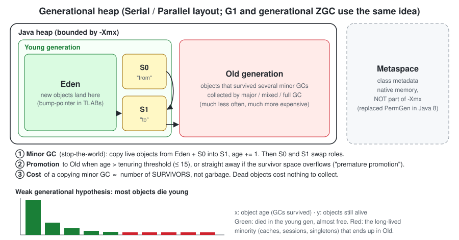
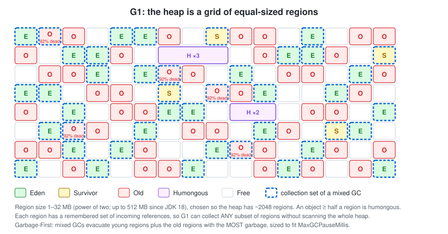
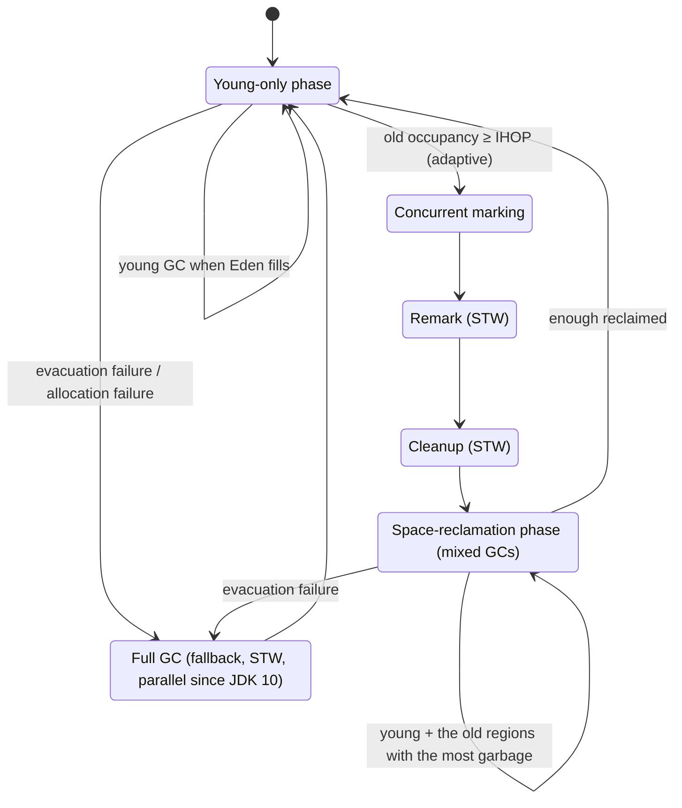
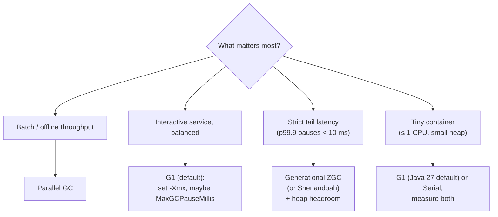
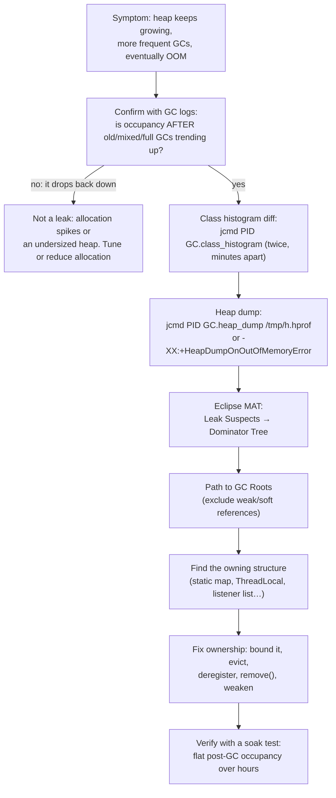

[⬅️ Prev: 09 · JVM Internals](09-jvm-internals.md) · [🏠 Index](README.md) · [Next: 11 · Concurrency Foundations ➡️](11-concurrency-foundations-jmm.md)

# 10 · Memory Management & Garbage Collection

> *Garbage collection is a trade-off between three things: pause time, throughput and memory footprint. You can pick two. Every GC question an interviewer asks is about which two, and why.*

> [!TIP]
> **🧭 Decision guide: which collector, and how much memory**
> - **When it matters:** when GC pauses approach your p99 or p99.9 latency target, when pods run close to their memory limit, or when GC takes more than a few percent of CPU.
> - **Default:** G1 with a right-sized heap for general services, generational ZGC for latency-critical ones (with spare memory and CPU), Parallel for throughput batch jobs. Size the heap from the allocation rate and the live set, and keep heap plus native memory under the container limit.
> - **Alternatives:** ZGC everywhere (a simpler latency story that needs more headroom), Shenandoah where your JDK build ships it, Serial for tiny heaps.
> - **Failure modes:** pods OOMKilled while the heap looks healthy (native memory), pauses that blow the latency budget, the death spiral near a full heap, flags copied from old blog posts.
> - **Evidence that would change it:** GC logs and JFR: pause percentiles against the target, GC CPU share, the post-GC occupancy trend and the allocation rate.
> - **Argued in:** §8–§14 and §17; [Chapter 37](37-case-study-fleet-jdk-upgrade.md) shows a collector change hiding inside a JDK upgrade.

🧪 **Runnable labs:** [the programs behind this chapter's outputs](labs.md#chapter-10--memory-and-gc)

---

## Table of contents
1. [What a garbage collector actually does](#1-what-a-garbage-collector-actually-does-)
2. [Allocation: bump pointers and TLABs](#2-allocation-bump-pointers-and-tlabs-)
3. [GC roots and reachability](#3-gc-roots-and-reachability-)
4. [Reference types: strong, soft, weak, phantom](#4-reference-types-strong-soft-weak-phantom-)
5. [The fundamental algorithms](#5-the-fundamental-algorithms-)
6. [Generational collection](#6-generational-collection-)
7. [Concurrent collection: tri-colour marking & barriers](#7-concurrent-collection-tri-colour-marking--barriers-)
8. [The HotSpot collectors](#8-the-hotspot-collectors-)
9. [G1 in depth](#9-g1-in-depth-)
10. [ZGC & Shenandoah in depth](#10-zgc--shenandoah-in-depth-)
11. [Choosing and tuning a collector](#11-choosing-and-tuning-a-collector-)
12. [Reading GC logs](#12-reading-gc-logs-)
13. [The JVM in containers](#13-the-jvm-in-containers-)
14. [Memory leaks: causes and the diagnosis playbook](#14-memory-leaks-causes-and-the-diagnosis-playbook-)
15. [The `OutOfMemoryError` taxonomy](#15-the-outofmemoryerror-taxonomy-)
16. [Off-heap memory](#16-off-heap-memory-)
17. [Staff lens: GC as a capacity-planning problem](#17-staff-lens-gc-as-a-capacity-planning-problem-)
18. [Interview questions](#18-interview-questions)
19. [References](#19-references)

---

## 1. What a garbage collector actually does 🟢

A tracing garbage collector has three jobs:
1. **Find live objects** by tracing references from a set of *roots*.
2. **Reclaim** the memory of everything it didn't reach.
3. Optionally **compact** the survivors, so free memory is contiguous and allocation stays cheap.

Java doesn't use reference counting. Tracing handles cycles naturally (two objects pointing at each other but unreachable from any root are both garbage), and it doesn't add a counter update to every pointer write.

**The three-way trade-off:**

| Goal | Measured as | Who cares most |
|---|---|---|
| **Latency** | Pause times (p99 / max) | APIs with tight SLOs, trading, games |
| **Throughput** | % of time *not* in GC | Batch jobs, data pipelines |
| **Footprint** | Heap + GC overhead memory | Containers, density, cost |

Low-pause collectors (ZGC, Shenandoah) spend extra CPU and memory to keep pauses tiny. Throughput collectors (Parallel) accept longer pauses to spend the least total CPU on GC. G1 tries to balance the two.

---

## 2. Allocation: bump pointers and TLABs 🟡→🔴

Allocating in Java is **cheaper than `malloc`**. Each thread gets a **TLAB** (thread-local allocation buffer), a private chunk of Eden. Allocating inside it is a **pointer bump**:

```
TLAB:  [ obj | obj | obj |  free ........................ ]
                          ↑ top                        ↑ end
new Foo()  →  if (top + size <= end) { obj = top; top += size; init header; }   // ~10 instructions, no lock
           else slow path: retire this TLAB, grab a new one from Eden (CAS), or GC if Eden is full
```

- There's no free-list search and no synchronization on the fast path.
- Large objects can skip the TLAB and go directly into shared Eden, or into dedicated regions as G1 *humongous* objects (§9).
- **Allocation is cheap. *Survival* is expensive.** A short-lived object costs a pointer bump and nothing more, because a copying collector never touches dead objects. A medium-lived object that survives a few GCs gets copied several times and may be promoted. That's why "allocation rate" and "promotion rate" are the two numbers to measure.

---

## 3. GC roots and reachability 🟡

**GC roots** are references the collector treats as live no matter what:
- local variables and operand-stack slots in every **thread's stack frames**;
- **static fields** of loaded classes;
- **JNI references** (global and local);
- objects used as **monitors** by threads (`synchronized`);
- JVM internals: the system class loader, classes it loaded, resolved constant pools, and the **code cache** (constants embedded in compiled code).

An object is **live** if there's a path to it from a root. Everything else is garbage, whether there's one dead object or a whole cyclic graph of them.

💣 Many memory leaks end at a **static** root, such as a static cache or registry, or at a **long-lived thread** (thread-pool workers holding `ThreadLocal`s). That's why "path to GC roots" is the most useful view in a heap analyser (§14).

---

## 4. Reference types: strong, soft, weak, phantom 🔴

| Type | Cleared when… | `get()` | Typical use |
|---|---|---|---|
| **Strong** (normal reference) | Never, while reachable | — | Everything |
| **`SoftReference`** | The GC decides memory is tight. All are cleared **before** an `OutOfMemoryError` | The object or `null` | Memory-sensitive caches (with caveats) |
| **`WeakReference`** | At the next GC once only weakly reachable | The object or `null` | Canonicalizing maps, `WeakHashMap`, listener registries |
| **`PhantomReference`** | After finalization, when the object is about to be reclaimed | **Always `null`** | Post-mortem cleanup (`Cleaner`) |

```java
// Cleaner: the modern, safe replacement for finalize()
public final class NativeBuffer implements AutoCloseable {
    private static final Cleaner CLEANER = Cleaner.create();
    private final Cleaner.Cleanable cleanable;

    public NativeBuffer(long size) {
        long address = allocateNative(size);
        // The cleanup action must NOT capture `this`, or the object can never become phantom-reachable
        this.cleanable = CLEANER.register(this, () -> freeNative(address));
    }
    @Override public void close() { cleanable.clean(); }   // deterministic path; the Cleaner is only a safety net
    private static native long allocateNative(long size);
    private static native void freeNative(long address);
}
```

💣 **Soft-reference caches are an anti-pattern in servers.** The GC clears them according to a heuristic (roughly `-XX:SoftRefLRUPolicyMSPerMB=1000`: one second of retention per MB of free heap). That has nothing to do with your access patterns. They make heap usage look permanently full, they lengthen GC cycles, and they can cause the "near-OOM thrash" where the cache refills and gets cleared over and over. Use an **explicitly bounded** cache (Caffeine) sized by entries or by weight.

---

## 5. The fundamental algorithms 🔴

| Algorithm | How | Pros | Cons |
|---|---|---|---|
| **Mark–sweep** | Mark live objects, then sweep dead ones onto free lists | No copying | **Fragmentation**; allocation needs free lists |
| **Mark–compact** | Mark, then slide survivors together | No fragmentation, bump-pointer allocation | Multiple passes over the heap; slow on big old generations |
| **Copying (semispace)** | Copy live objects from "from" space to "to" space | Cost ∝ **live** objects; compacts for free | Needs spare space; bad for large long-lived data |
| **Generational** | Split by age and apply the best algorithm per generation | Exploits "most objects die young" | Needs barriers to track old→young references |

**Remembered sets and card tables.** To collect the young generation *without* scanning the whole old generation, the GC must know which old objects point into young. The JVM divides the old generation into **cards** (512 bytes each). A **write barrier**, a few instructions JIT-compiled into every reference store, marks a card dirty when it changes. During a young GC, only dirty cards are scanned as extra roots. G1 extends this with a per-region **remembered set**.

---

## 6. Generational collection 🟡→🔴



**The weak generational hypothesis**: most objects die young. Request objects, iterators, temporary strings and boxed numbers live for microseconds. So:
- **Eden** gets collected often with a **copying** collector, and the cost is proportional to the few survivors.
- Survivors bounce between **S0 and S1**, and their **age** increments on each copy. After `-XX:MaxTenuringThreshold` copies (at most 15, because the age has only 4 bits in the header), they're **promoted** to the old generation.
- The **old generation** is collected rarely, with mark-compact or concurrent algorithms.

💣 **Premature promotion.** When survivors don't fit in the survivor space, they're promoted *early*, even though they're about to die. The old generation then fills with short-lived garbage, which forces expensive old-generation collections. That's a classic tuning problem when young generations are too small or allocation spikes occur. You'll see it in GC logs as old generation growth that shrinks a lot after each major collection.

Most HotSpot collectors are generational: Serial, Parallel, G1, generational ZGC (21+, the only ZGC mode since 24) and generational Shenandoah (product in 25).

---

## 7. Concurrent collection: tri-colour marking & barriers 🔴

To mark while the application (the *mutator*) keeps running, collectors use **tri-colour marking**:
- ⚪ **White**: not yet visited (garbage if still white at the end)
- 🔘 **Grey**: visited, but its references aren't scanned yet
- ⚫ **Black**: visited, and all its references scanned

**The lost-object problem.** While marking runs, the application can (1) store a reference to a white object into a **black** object, and (2) delete the last path from a grey object to that white object. The GC never scans the black object again, so the white object gets freed while it's still in use. That's a catastrophe.

There are two ways to prevent it, both implemented with **barriers** compiled into application code:

| Strategy | Barrier | Idea | Used by |
|---|---|---|---|
| **Incremental update** | Write barrier on *store* | When a reference is stored into a black object, re-grey it | CMS (removed) |
| **Snapshot-at-the-beginning (SATB)** | Write barrier on *overwrite* (pre-write) | Record the *old* value before overwriting, so everything reachable at mark start stays marked | G1, Shenandoah |

**Concurrent compaction** (moving objects while the application runs) needs more than this: every access to a possibly-moved object must find its new location. That's what **load barriers** (ZGC) and **load-reference barriers** (Shenandoah) do (§10).

---

## 8. The HotSpot collectors 🟡→🔴

| Collector | Flag | Pauses | Throughput | Heap sweet spot | Notes |
|---|---|---|---|---|---|
| **Serial** | `-XX:+UseSerialGC` | Long (single-threaded STW) | OK on 1 CPU | < ~100 MB, 1 CPU | Was the default on small machines until **Java 27 made G1 the default everywhere** (JEP 523) |
| **Parallel** | `-XX:+UseParallelGC` | Long, multi-threaded STW | **Highest** | Any; batch jobs | The Java 8 default. Great for batch work |
| **CMS** | — | Short-ish | Medium | — | Deprecated in 9, **removed in 14**. Fragmentation and "concurrent mode failure" |
| **G1** | `-XX:+UseG1GC` | **Target-based** (default `MaxGCPauseMillis=200`) | High | 2 GB – ~100 GB | **Default since Java 9**. Region-based, mostly concurrent marking |
| **ZGC** | `-XX:+UseZGC` | **< 1 ms**, regardless of heap size | Good (generational) | Up to 16 TB | Production in 15, generational in 21, the only mode since 24 |
| **Shenandoah** | `-XX:+UseShenandoahGC` | < 10 ms, typically ~1 ms | Good | Medium – large | Red Hat. Generational mode a product feature in 25 |
| **Epsilon** | `-XX:+UnlockExperimentalVMOptions -XX:+UseEpsilonGC` | None, because it never collects | — | — | For benchmarks, very short-lived jobs and testing allocation budgets |

---

## 9. G1 in depth 🔴



### The model
- The heap is split into **~2048 equal regions** (1–32 MB each, power of two, up to 512 MB since JDK 18). Each region is dynamically **Eden, Survivor, Old, Humongous or Free**. Generations are *logical sets of regions*, not contiguous spaces.
- Every region has a **remembered set** of where incoming references come from, so G1 can evacuate *any* set of regions (the **collection set**) without scanning the whole heap.
- **Pause target:** `-XX:MaxGCPauseMillis` (default 200 ms). G1 sizes the young generation and picks how many old regions to include in each pause using its cost model of past pauses. It's a **target, not a guarantee**.

### The cycle


1. **Young GCs** evacuate live objects out of Eden and Survivor regions in parallel stop-the-world pauses.
2. When old-generation occupancy crosses the **Initiating Heap Occupancy Percent** (IHOP), which is **adaptive** by default because G1 learns how early it must start, G1 piggybacks a **concurrent start** on a young GC and begins **concurrent marking** (using SATB barriers).
3. A short **remark** pause finishes the marking, and a **cleanup** pause reclaims completely empty regions immediately.
4. **Mixed GCs** then collect young regions *plus* the old regions with the most garbage. Most reclaimed space per millisecond of pause: that's the "garbage first" in the name.
5. If G1 can't keep up (no free regions to copy into, an *evacuation failure*), it falls back to a **full GC**. It's parallel since JDK 10, but still a long stop-the-world pause. **A full GC in G1 logs is a red flag to investigate**, not something to tune around.

### Humongous objects 💣
An object of at least **half a region** is *humongous*. It's allocated directly into contiguous free regions in the old generation:
- it can trigger a concurrent cycle early (you'll see `(G1 Humongous Allocation)` in the logs, §12);
- it wastes the tail of its last region;
- it needs *contiguous* free regions, so it can fail and cause a full GC when the heap is fragmented.

Typical sources are large `byte[]` buffers (JSON payloads, file reads), huge `ArrayList` or `HashMap` resizes, and big `StringBuilder`s. Fixes: stream instead of buffering, pool large buffers, or raise `-XX:G1HeapRegionSize` so the objects stop qualifying as humongous.

### Recent G1 improvements worth naming
- **JDK 22, region pinning (JEP 423):** JNI critical regions no longer stall GC.
- **JDK 26, JEP 522:** less synchronization between application and GC threads, for better throughput.
- **JDK 27, JEP 523:** G1 is the default in *all* environments.

---

## 10. ZGC & Shenandoah in depth 🔴

### ZGC: concurrent everything
**Goal:** pause times that **don't grow with heap size or live-set size**, in the sub-millisecond range from megabytes up to terabytes.

**How:**
- **Colored pointers.** ZGC stores metadata bits *in the reference itself* (marking state and remapping state), so the GC can tell a reference's status without touching the object.
- **Load barriers.** Every time the application *loads* a reference from the heap, a small JIT-inserted check verifies those bits. If the reference is stale (the object has moved), the barrier fixes it on the spot by looking up the forwarding table and updating the field: a *self-healing* reference.
- So **marking, relocation (compaction) and reference fixing all run concurrently.** The remaining pauses only scan thread stacks (which handshakes make cheap) and synchronise phases.
- **Generational ZGC** (Java 21, the only mode since 24) adds young and old generations. It collects young objects frequently and cheaply, which greatly improves throughput and cuts the headroom ZGC needs.

**The costs:**
- Barrier overhead on reference loads costs a few percent of throughput, and the GC threads use CPU concurrently.
- **Allocation stalls:** if the application allocates faster than ZGC can reclaim, threads *stall* until memory is freed. In logs that appears as `Allocation Stall`, and it's ZGC's version of "the GC can't keep up". The fix is more headroom, more CPU, or less allocation.
- `-XX:SoftMaxHeapSize` lets ZGC aim for a smaller heap while still allowing growth up to `-Xmx` under pressure.

### Shenandoah
Shenandoah has the same goal (concurrent compaction) with a different mechanism. It started with **Brooks forwarding pointers** (an extra word per object pointing at the current copy) and moved to **load-reference barriers**, which removed the extra word. **Generational Shenandoah** became a product feature in Java 25 (JEP 521). It ships in most OpenJDK builds (Red Hat, Temurin, Corretto, …), but historically not in Oracle's builds.

---

## 11. Choosing and tuning a collector 🔴→🟣



### The tuning methodology (in this order)
1. **Write down the goal.** For example: "p99 GC pause < 50 ms, GC CPU < 5%, heap ≤ 4 GB".
2. **Turn on GC logging** (always on in production; it's cheap): `-Xlog:gc*:file=/var/log/app/gc.log:time,uptime,level,tags:filecount=10,filesize=50m`.
3. **Measure the live-data size** (heap occupancy after a full or mixed GC) and the **allocation rate** (MB/s, from logs or JFR).
4. **Size the heap first.** For G1, a heap of about **3–4× the live set** is a reasonable start. Too small means constant GC. Too large means long or rare collections and wasted RAM. Set `-Xms` equal to `-Xmx` for servers, to avoid resize pauses and to fail fast.
5. **Reduce allocation** before touching GC flags. This is the highest-leverage fix ([Chapter 21](21-performance-engineering-troubleshooting.md)).
6. **Then** adjust collector-specific knobs, **one at a time**, under representative load.

### The flags that matter
| Flag | Purpose |
|---|---|
| `-Xms` / `-Xmx` (or `-XX:InitialRAMPercentage` / `-XX:MaxRAMPercentage`) | Heap bounds |
| `-XX:MaxGCPauseMillis=<ms>` | G1 pause target (lower means more frequent, smaller collections) |
| `-XX:G1HeapRegionSize=<n>m` | Avoid humongous allocations for large buffers |
| `-XX:InitiatingHeapOccupancyPercent` / `-XX:-G1UseAdaptiveIHOP` | Start concurrent marking earlier (rarely needed) |
| `-XX:ParallelGCThreads`, `-XX:ConcGCThreads` | GC worker threads (container CPU limits matter) |
| `-XX:SoftMaxHeapSize` | ZGC soft target |
| `-XX:+AlwaysPreTouch` | Touch all heap pages at startup, so there are no page-fault stalls later (slower startup) |
| `-XX:+HeapDumpOnOutOfMemoryError -XX:HeapDumpPath=…` | **Always set in production** |
| `-XX:+ExitOnOutOfMemoryError` | Fail fast and let the orchestrator restart |
| `-XX:+UseStringDeduplication` | Dedupe long-lived strings |

> [!WARNING]
> **Cargo-cult flags are a smell.** A JVM command line with 40 flags copied from a 2015 blog post (CMS settings, `-XX:+UseCompressedOops` which is already the default, fixed `NewRatio` that fights G1's adaptive sizing) usually performs *worse* than the defaults. When modernising, start from the defaults plus `-Xmx`, and add flags back only with evidence.

---

## 12. Reading GC logs 🟡→🔴

**Real G1 output** (JDK 21, `-Xlog:gc*`), one young collection:
```
[0.057s][info][gc,start    ] GC(3) Pause Young (Normal) (G1 Evacuation Pause)
[0.057s][info][gc,task     ] GC(3) Using 2 workers of 2 for evacuation
[0.058s][info][gc,phases   ] GC(3)   Pre Evacuate Collection Set: 0.21ms
[0.058s][info][gc,phases   ] GC(3)   Merge Heap Roots: 0.01ms
[0.058s][info][gc,phases   ] GC(3)   Evacuate Collection Set: 0.85ms
[0.058s][info][gc,phases   ] GC(3)   Post Evacuate Collection Set: 0.12ms
[0.058s][info][gc,heap     ] GC(3) Eden regions: 37->0(36)
[0.058s][info][gc,heap     ] GC(3) Survivor regions: 1->2(5)
[0.058s][info][gc,heap     ] GC(3) Old regions: 2->2
[0.058s][info][gc,heap     ] GC(3) Humongous regions: 0->0
[0.058s][info][gc          ] GC(3) Pause Young (Normal) (G1 Evacuation Pause) 38M->2M(64M) 1.314ms
[0.058s][info][gc,cpu      ] GC(3) User=0.00s Sys=0.00s Real=0.01s
```
How to read it:
- `Pause Young (Normal)`: a young-only pause. Other kinds are `(Concurrent Start)` (begins marking), `(Prepare Mixed)`, `Pause Young (Mixed)`, `Pause Remark`, `Pause Cleanup` and `Pause Full` 🚩.
- `(G1 Evacuation Pause)` is the **cause**: Eden filled up. Watch for `(G1 Humongous Allocation)` and `(Allocation Failure)`.
- `Eden regions: 37->0(36)`: before → after (the target for the next cycle).
- `38M->2M(64M) 1.314ms`: heap used before → after (committed heap), and **the pause time**.
- `User / Sys / Real`: if `Sys` is high, look at the OS (swapping, transparent huge pages, page faults). If `Real` is much greater than `User/threads`, the GC threads were waiting for CPU (container throttling).

**Humongous allocations triggering cycles** (real output, 600 KB arrays with 1 MB regions):
```
[0.487s][info][gc] GC(2) Pause Young (Concurrent Start) (G1 Humongous Allocation) 32M->4M(64M) 4.257ms
```

**Generational ZGC** (JDK 21 with `-XX:+ZGenerational`; default from 23):
```
[0.154s][info][gc] GC(2) Minor Collection (Allocation Rate)
[0.163s][info][gc] GC(2) Minor Collection (Allocation Rate) 116M(45%)->34M(13%) 0.010s
[0.164s][info][gc] GC(1) Major Collection (Warmup) 100M(39%)->34M(13%) 0.044s
```
💣 The `0.010s` and `0.044s` here are **concurrent cycle durations, not pauses**. ZGC's actual pauses are logged separately under `gc,phases` (`Pause Mark Start`, `Pause Mark End`, `Pause Relocate Start`) and are typically tens of microseconds. Misreading this makes people think ZGC is "slow".

Tools: **GCViewer**, **GCeasy**, and **JDK Mission Control** (with JFR GC events, which carry richer data than the logs).

---

## 13. The JVM in containers 🔴→🟣

Since JDK 10 (backported to 8u191), the JVM reads **cgroup limits** (`-XX:+UseContainerSupport`, on by default). cgroup v2 support arrived in JDK 15 and was backported to 11.0.16 and 8u372.

**Default heap = 25% of the container memory limit** (`MaxRAMPercentage=25`). That's sensible on a shared desktop and wasteful in a container dedicated to one JVM. **Set it explicitly:**
```bash
-XX:MaxRAMPercentage=70        # or 60–75% depending on non-heap needs
```

**The container memory budget:**
```
container limit  ≥  heap (-Xmx)
                 +  Metaspace            (set -XX:MaxMetaspaceSize; it's unbounded by default)
                 +  code cache           (~240 MB reserved; ~50–150 MB typically used)
                 +  threads × -Xss       (200 platform threads × 1 MB = 200 MB of reserve)
                 +  direct buffers       (Netty / NIO; -XX:MaxDirectMemorySize)
                 +  GC data structures   (remembered sets, mark bitmaps: ~5–15% of heap for G1)
                 +  malloc arenas, JIT arenas, symbol tables, …
```

💣 **The classic incident:** the pod gets OOM-killed (**exit code 137**, `OOMKilled` in `kubectl describe`), there's **no Java `OutOfMemoryError`, no heap dump, and nothing in the logs**, while the heap graphs look healthy. The *kernel* killed the process because the total footprint exceeded the cgroup limit. Diagnose with Native Memory Tracking (`-XX:NativeMemoryTracking=summary`, then `jcmd <pid> VM.native_memory summary`) and compare against the container limit. Common culprits are unbounded Metaspace (class generation), thread explosion, direct buffers, and glibc malloc arena fragmentation (try `MALLOC_ARENA_MAX=2`, or jemalloc).

**CPU limits matter too.** The JVM sizes GC threads, JIT compiler threads and the ForkJoin common pool from the CPUs it detects. A limit of `500m` CPU looks like 1 CPU, which means little GC parallelism and slow warmup. CFS **throttling** (exhausting the CPU quota within a 100 ms period) stretches GC pauses and request latency in ways that never show up in GC logs. Watch `container_cpu_cfs_throttled_periods_total`. You can override detection with `-XX:ActiveProcessorCount=N`.

---

## 14. Memory leaks: causes and the diagnosis playbook 🔴

A Java memory leak means **objects stay reachable when they're no longer needed**. The GC is working perfectly. Your references are the problem.

**Common causes:**
| Cause | Example |
|---|---|
| Unbounded static caches and maps | `static Map<String, Session>` that never evicts |
| Listeners and callbacks never deregistered | Event bus subscribers, JMX listeners, observers |
| `ThreadLocal` in thread pools | Pool threads live forever, and so does the value unless you call `remove()` |
| Inner-class or lambda capture | A long-lived callback capturing `this` ([Chapter 02 §10](02-oop-and-object-model.md#10-nested-inner-local--anonymous-classes-)) |
| Class-loader leaks | Redeploying webapps when one reference pins the old loader → Metaspace OOM |
| Mutable `HashMap` keys | Orphaned entries ([Chapter 02 §8](02-oop-and-object-model.md#8-equals--hashcode-the-full-story-)) |
| Views retaining parents | `subList`, `ByteBuffer.slice()`, pre-7u6 `substring` |
| Unclosed resources | Native memory, file descriptors, direct buffers |
| Request-scoped data in long-lived structures | Caches keyed by full request payloads |

### The playbook


**Shallow vs retained size:**
- **Shallow size** is the object's own bytes (header + fields).
- **Retained size** is everything that would be freed if this object were collected: the object plus everything only it keeps alive.
- The **dominator tree** ranks objects by retained size. The leak is almost always one of the top few entries.

> [!CAUTION]
> **Heap dumps contain secrets**: passwords, tokens, PII, all in plain text. Treat them like production databases. Use restricted storage, encryption and retention limits, and never attach them to public tickets.

---

## 15. The `OutOfMemoryError` taxonomy 🔴

| Message | Meaning | First step |
|---|---|---|
| `Java heap space` | Live data exceeds `-Xmx`, or a leak | Heap dump → dominator tree |
| `GC overhead limit exceeded` | (Parallel GC) over 98% of time spent in GC while recovering under 2% of heap | Same as above; the heap is effectively full |
| `Metaspace` | Too many classes, or a class-loader leak | `jcmd VM.metaspace`, class histogram, count loaders |
| `Compressed class space` | Class metadata exceeds `CompressedClassSpaceSize` | As above |
| `Direct buffer memory` | `MaxDirectMemorySize` exceeded | Find who allocates direct buffers (Netty, NIO). Leaks of the small heap-side `ByteBuffer` objects keep the native memory alive |
| `unable to create native thread` | OS limit (threads/PIDs, ulimit) or native memory | Count threads (`jcmd Thread.print`, `/proc/PID/status`). Look for unbounded thread creation |
| `Requested array size exceeds VM limit` | Trying to allocate an array of nearly `Integer.MAX_VALUE` elements | Bug, or growth logic that overflowed |
| `Cannot reserve … bytes of memory` / `Out of swap space` | Native `malloc`/`mmap` failure | Container limits, NMT |
| *(no Java error, exit 137)* | **The kernel OOM killer** | Footprint over the cgroup limit (§13) |

---

## 16. Off-heap memory 🔴

| Mechanism | Lifetime | Use |
|---|---|---|
| `ByteBuffer.allocateDirect` | Freed when the small heap `ByteBuffer` is GC'd (via `Cleaner`) | NIO channels, zero-copy I/O |
| Memory-mapped files (`FileChannel.map`) | Until the buffer is unmapped (GC) or the process exits | Large files, IPC, databases |
| **FFM `Arena` / `MemorySegment`** (Java 22+) | **Deterministic**: freed when the arena closes | The modern way to do off-heap |
| Netty pooled buffers | Reference counted (`release()`) | High-throughput networking |
| Off-heap caches (Chronicle Map, Ehcache off-heap) | Library-managed | Huge caches without GC scanning cost |

💣 **The direct-buffer paradox:** a direct `ByteBuffer`'s native memory is freed only when the *tiny heap object* is collected. If your heap is large and calm, that tiny object may sit in the old generation for hours while gigabytes of native memory stay allocated, until `OOM: Direct buffer memory`. Pool direct buffers, bound them with `-XX:MaxDirectMemorySize`, or use FFM arenas for deterministic release.

**Why go off-heap?** Data that's very large and long-lived (caches, indexes) costs GC marking time on every cycle, even though it rarely changes. Moving it off-heap removes it from the GC's work entirely. The price is manual lifetime management and serialization.

---

## 17. Staff lens: GC as a capacity-planning problem 🟣

1. **Measure the two numbers that drive everything:** *allocation rate* (MB/s) and *live-set size* (post-GC occupancy). Young GC frequency ≈ allocation rate ÷ Eden size. Old-generation pressure ≈ promotion rate. Size from these numbers, not from folklore.
2. **The best GC tuning is less allocation.** Removing a hot-path boxing or copying bug often beats any flag. Use JFR allocation profiling (`jdk.ObjectAllocationSample`) or async-profiler in `alloc` mode.
3. **Choose the collector per service class**, not per team whim. Latency-critical APIs get generational ZGC with headroom. General services get G1 with right-sized heaps. Batch jobs get Parallel. Encode that in the base image and platform defaults.
4. **GC pauses are part of your latency SLO.** A 200 ms G1 target means p99.9 latency includes up to 200 ms of GC. If the SLO is 100 ms at p99.9, the GC choice is an *architectural* decision.
5. **Footprint is cost.** Over-provisioned heaps across 2,000 pods are real money. Right-sizing the heap (and compact object headers, which are default in Java 27) can free a substantial share of cluster memory, but only verify that with measurements.
6. **Make memory observable by default:** GC logs on, heap-dump-on-OOM to a protected volume, NMT summary available, and dashboards for post-GC occupancy, GC CPU %, pause percentiles, allocation rate and container RSS vs limit.

---

## 18. Interview questions

<details>
<summary><b>Q1. 🟢 How does Java decide an object is garbage?</b></summary>

By reachability, not reference counting. The GC traces from roots (thread stacks, static fields, JNI handles, monitors, JVM internals). Anything not reachable through strong references is garbage, including unreachable cycles.
</details>

<details>
<summary><b>Q2. 🟡 Why is object allocation in Java so cheap?</b></summary>

Each thread allocates from its own TLAB (a chunk of Eden) by bumping a pointer: a bounds check and an add, with no locks or free-list search. Copying young collections then reclaim dead objects at zero per-object cost, since only survivors are touched. The expensive part is objects that *survive* (copying and promotion), not allocation itself.
</details>

<details>
<summary><b>Q3. 🟡 Explain the generational heap and the minor GC process.</b></summary>

Young (Eden + two survivor spaces) and Old. New objects go to Eden. A minor GC copies live objects from Eden and the "from" survivor into the "to" survivor, increments their age, and promotes objects older than the tenuring threshold (max 15) or that overflow the survivor space. It's efficient because most objects die young and the cost is proportional to survivors.
</details>

<details>
<summary><b>Q4. 🔴 Soft vs weak vs phantom references?</b></summary>

Soft: cleared at the GC's discretion when memory is tight, guaranteed cleared before OOM. Weak: cleared at the next GC once only weakly reachable (`WeakHashMap`, canonicalizing maps). Phantom: `get()` always returns null. It's enqueued when the object is about to be reclaimed and is used for cleanup (`Cleaner`). Soft-reference caches are discouraged in servers because eviction is driven by GC heuristics rather than access patterns.
</details>

<details>
<summary><b>Q5. 🔴 How does G1 work, and what does "Garbage First" mean?</b></summary>

The heap is divided into equal regions with per-region remembered sets. Young GCs evacuate Eden and Survivor regions. When old occupancy crosses the (adaptive) IHOP, G1 runs concurrent marking with SATB barriers, then remark and cleanup. Mixed GCs then evacuate young regions plus the old regions with the most reclaimable garbage, chosen to fit the pause target. Humongous objects (≥ half a region) get contiguous regions. A full GC is a fallback when evacuation fails.
</details>

<details>
<summary><b>Q6. 🔴 How does ZGC achieve sub-millisecond pauses on huge heaps?</b></summary>

It does marking, relocation (compaction) and reference updating concurrently. Colored pointers carry GC metadata in the references, and JIT-inserted load barriers check every loaded reference, fixing stale ones in place (self-healing) by consulting forwarding tables. The remaining stop-the-world work (stack scanning, phase transitions) doesn't scale with heap size. The costs are barrier overhead, concurrent CPU use, and allocation stalls if the application outpaces the GC. The generational mode (21+) reduces both.
</details>

<details>
<summary><b>Q7. 🔴 What is the tri-colour invariant problem and how do SATB and incremental update solve it?</b></summary>

During concurrent marking, the application could store a reference to a white (unvisited) object into a black (finished) object while removing the last grey path to it, so the object would be wrongly freed. Incremental update (a write barrier on store) re-greys the black object. SATB (a pre-write barrier) records the overwritten reference so everything reachable at the start of marking stays live. G1 and Shenandoah use SATB.
</details>

<details>
<summary><b>Q8. 🔴 What are humongous objects in G1 and why do they matter?</b></summary>

Objects of at least half a region size, allocated directly into contiguous old regions. They can trigger concurrent cycles (`G1 Humongous Allocation` in logs), waste region tails, need contiguous free space (fragmentation can cause full GCs), and are only reclaimed by marking or eager reclaim. Mitigate by streaming large payloads, reusing large buffers, or increasing `G1HeapRegionSize`.
</details>

<details>
<summary><b>Q9. 🔴 A pod is OOM-killed (exit 137) but the heap never exceeded 60% of the limit. What's going on?</b></summary>

The kernel killed the process because the *total* footprint exceeded the cgroup limit. That includes Metaspace, code cache, thread stacks, direct buffers, GC structures and malloc arenas, not just the heap. Diagnose with Native Memory Tracking compared against the limit. Fix by bounding Metaspace and direct memory, controlling thread counts, lowering `MaxRAMPercentage`, tuning malloc (`MALLOC_ARENA_MAX`), or raising the limit.
</details>

<details>
<summary><b>Q10. 🟡 What's the difference between shallow and retained size in a heap dump?</b></summary>

Shallow size is an object's own memory (header + fields). Retained size is the total memory that would be freed if that object became unreachable, meaning everything it exclusively keeps alive. The dominator tree sorts by retained size, which is how you find the structure responsible for a leak.
</details>

<details>
<summary><b>Q11. 🔴 What does "GC overhead limit exceeded" mean?</b></summary>

With Parallel GC (`UseGCOverheadLimit`), the JVM throws it when more than ~98% of time goes to GC while recovering less than ~2% of the heap over several collections. The application is effectively out of memory and thrashing. Treat it like `Java heap space`: find the leak or the oversized live set.
</details>

<details>
<summary><b>Q12. 🔴 How do CPU limits in Kubernetes affect GC?</b></summary>

The JVM sizes GC worker threads, JIT compiler threads and the common pool from detected CPUs, so a low limit means low parallelism. CFS quota throttling can stall GC threads mid-pause, stretching pause times and request latency, which shows up as `Real` time much greater than `User` time in GC logs. Watch throttling metrics and consider higher limits, bursting, or `-XX:ActiveProcessorCount`.
</details>

<details>
<summary><b>Q13. 🟣 How would you choose the GC for a latency-sensitive payment API with an 8 GB heap?</b></summary>

Start from the SLO (say p99.9 < 50 ms end-to-end). G1's default 200 ms target is too loose, and tuning it lower trades throughput for frequency. Generational ZGC gives sub-millisecond pauses independent of heap size, at the cost of a little throughput and some extra headroom (allocation stalls if under-provisioned). I'd load-test both on real traffic: compare p99/p99.9 latency, GC CPU and RSS, then pick ZGC if the tail latency gain is real, with alerting on allocation stalls. Either way, reduce allocation in hot paths first.
</details>

<details>
<summary><b>Q14. 🟣 Your heap "keeps growing". How do you tell a leak from normal behaviour?</b></summary>

Look at occupancy *after* old/mixed/full collections over hours. A sawtooth that returns to a stable floor is normal: collectors happily use available heap. A rising floor across many cycles is a leak, or a growing live set (an unbounded cache). Confirm with class-histogram diffs over time, then a heap dump and MAT's dominator tree and path to GC roots. Verify the fix with a soak test that shows a flat post-GC floor.
</details>

---

## 19. References
- [HotSpot Virtual Machine Garbage Collection Tuning Guide](https://docs.oracle.com/en/java/javase/25/gctuning/)
- Richard Jones, Antony Hosking, Eliot Moss, *The Garbage Collection Handbook* (2nd ed.)
- JEPs: [248 G1 default](https://openjdk.org/jeps/248) · [307 Parallel Full GC for G1](https://openjdk.org/jeps/307) · [333 ZGC](https://openjdk.org/jeps/333) · [439 Generational ZGC](https://openjdk.org/jeps/439) · [474](https://openjdk.org/jeps/474) · [490](https://openjdk.org/jeps/490) · [521 Generational Shenandoah](https://openjdk.org/jeps/521) · [522 G1 throughput](https://openjdk.org/jeps/522) · [523 G1 default everywhere](https://openjdk.org/jeps/523)
- Per Lidén & Stefan Karlsson's ZGC talks; Aleksey Shipilëv's Shenandoah talks and *JVM Anatomy Quarks*
- [Eclipse Memory Analyzer (MAT)](https://eclipse.dev/mat/) documentation

---

[⬅️ Prev: 09 · JVM Internals](09-jvm-internals.md) · [🏠 Index](README.md) · [Next: 11 · Concurrency Foundations ➡️](11-concurrency-foundations-jmm.md)
