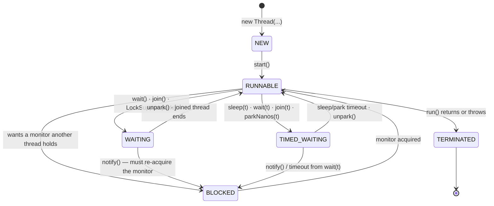
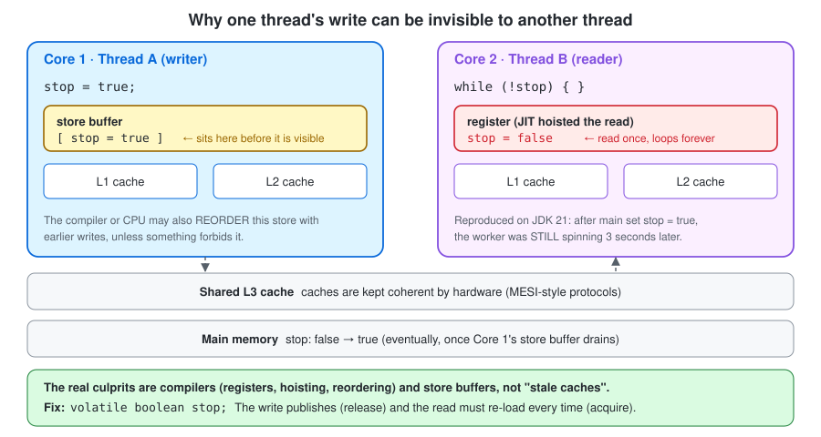

[⬅️ Prev: 10 · Memory & GC](10-memory-and-garbage-collection.md) · [🏠 Index](README.md) · [Next: 12 · Advanced Concurrency ➡️](12-concurrency-advanced-juc-loom.md)

# 11 · Concurrency Foundations & the Java Memory Model

> *Concurrency bugs don't fail in tests. They fail at 2 a.m. under load, once a week, on one host out of a hundred. The only defence is understanding the rules well enough to write code that is correct by construction.*

🧪 **Runnable labs:** [the programs behind this chapter's outputs](labs.md#chapter-11--concurrency-foundations)

---

## Table of contents
1. [The three problems: atomicity, visibility, ordering](#1-the-three-problems-atomicity-visibility-ordering-)
2. [Threads: creation, naming, daemons](#2-threads-creation-naming-daemons-)
3. [Thread states](#3-thread-states-)
4. [Interruption: cooperative cancellation](#4-interruption-cooperative-cancellation-)
5. [Race conditions, demonstrated](#5-race-conditions-demonstrated-)
6. [`synchronized`: semantics and implementation](#6-synchronized-semantics-and-implementation-)
7. [`wait` / `notify` and guarded blocks](#7-wait--notify-and-guarded-blocks-)
8. [The Java Memory Model](#8-the-java-memory-model-)
9. [`volatile` precisely](#9-volatile-precisely-)
10. [`final` fields and safe publication](#10-final-fields-and-safe-publication-)
11. [Double-checked locking: broken, fixed, replaced](#11-double-checked-locking-broken-fixed-replaced-)
12. [Liveness: deadlock, livelock, starvation](#12-liveness-deadlock-livelock-starvation-)
13. [`ThreadLocal`: internals and leaks](#13-threadlocal-internals-and-leaks-)
14. [Strategies for thread safety](#14-strategies-for-thread-safety-)
15. [Staff lens](#15-staff-lens-)
16. [Interview questions](#16-interview-questions)
17. [References](#17-references)

---

## 1. The three problems: atomicity, visibility, ordering 🟢→🟡

Every concurrency bug in Java comes down to one or more of these:

| Problem | Question | Example |
|---|---|---|
| **Atomicity** | Can another thread see or interfere with an operation halfway through? | `count++` is three steps: read, add, write |
| **Visibility** | When does one thread's write become visible to another thread? | A worker never sees `stop = true` |
| **Ordering** | Can operations appear to happen in a different order than written? | A reference is published before the object's constructor has finished |

`synchronized` solves all three for code that uses the same lock. `volatile` solves visibility and ordering but **not** atomicity. Atomic classes solve atomicity for single variables. The rest of this chapter explains why.

---

## 2. Threads: creation, naming, daemons 🟢

```java
// 1. A Runnable passed to a Thread (prefer composition over extending Thread)
Thread t = new Thread(() -> System.out.println("hi from " + Thread.currentThread().getName()), "worker-1");
t.start();                      // ✅ starts a new thread, which then calls run()
t.run();                        // 💣 just a normal method call on the CURRENT thread

// 2. Builders (Java 21)
Thread p = Thread.ofPlatform().name("io-", 0).daemon(true).start(task);   // io-0, io-1, …
Thread v = Thread.ofVirtual().name("req-", 0).start(task);                 // a virtual thread

// 3. In real code: executors, not raw threads (Chapter 12)
try (var executor = Executors.newVirtualThreadPerTaskExecutor()) { executor.submit(task); }
```

- **Name your threads.** `pool-7-thread-23` in a thread dump tells you nothing, while `payment-callback-23` tells you where to look. Use a `ThreadFactory` or the builders.
- **Daemon threads** don't keep the JVM alive. When the last non-daemon thread exits, the JVM stops, and daemon threads are abandoned **without running their `finally` blocks**. Never do I/O that has to finish (flushing files, committing offsets) on a daemon thread.
- A Java **platform thread** maps 1:1 to an OS thread: roughly 1 MB of reserved stack, kernel scheduling, and a context-switch cost of a few microseconds. That cost is why thread-per-request stopped scaling at a few thousand threads, and why virtual threads exist ([Chapter 12](12-concurrency-advanced-juc-loom.md)).

---

## 3. Thread states 🟢→🟡



| State | Means | Seen in a thread dump as |
|---|---|---|
| `NEW` | Created, not started | — |
| `RUNNABLE` | Running **or ready to run, or blocked in native I/O** 💣 | `java.lang.Thread.State: RUNNABLE` |
| `BLOCKED` | Waiting to **enter** a `synchronized` block | `waiting to lock <0x…>` |
| `WAITING` | Waiting indefinitely: `wait()`, `join()`, `park()` | `parking to wait for <0x…>` / `in Object.wait()` |
| `TIMED_WAITING` | The same with a timeout, or `sleep` | `sleeping` / `TIMED_WAITING (parking)` |
| `TERMINATED` | Done | — |

💣 **A thread blocked on a socket read shows as `RUNNABLE`.** From the JVM's point of view, it's executing native code. When a thread dump shows 200 `RUNNABLE` threads all inside `SocketInputStream.socketRead0`, they aren't busy. They're waiting on a slow downstream service. Read the *stack*, not just the state.

🔴 Threads waiting on a `ReentrantLock` show as `WAITING (parking)`, not `BLOCKED`. `BLOCKED` is specific to intrinsic monitors (`synchronized`).

---

## 4. Interruption: cooperative cancellation 🟡

Java has no safe way to *kill* a thread. `Thread.stop()` was deprecated in 1.2 and has thrown `UnsupportedOperationException` since Java 20. Instead, each thread has an **interrupt flag**, and stopping is cooperative: you *ask* a thread to stop, and it decides how.

| Method | Effect |
|---|---|
| `t.interrupt()` | Sets `t`'s flag. If `t` is blocked in `sleep`/`wait`/`join`/a blocking queue operation/an interruptible channel, it wakes up with `InterruptedException` **and the flag is cleared** |
| `t.isInterrupted()` | Reads the flag (doesn't clear it) |
| `Thread.interrupted()` | **Static.** Reads *and clears* the current thread's flag 💣 |

```java
public void run() {
    try {
        while (!Thread.currentThread().isInterrupted()) {    // check the flag in CPU-bound loops
            Task task = queue.take();                        // blocking call: throws when interrupted
            process(task);
        }
    } catch (InterruptedException e) {
        Thread.currentThread().interrupt();                  // restore the flag for code further up
    } finally {
        cleanup();
    }
}
```

**Rules:**
1. Never swallow `InterruptedException`. Either propagate it or restore the flag ([Chapter 04 §7](04-exceptions.md#7-exceptions-and-threads-)).
2. CPU-bound loops must **poll** the flag. Nothing interrupts a pure computation automatically.
3. Classic `java.io` streams **aren't interruptible**. A thread stuck in `InputStream.read()` won't react to `interrupt()`, so close the stream from another thread to unblock it. NIO `InterruptibleChannel`s are interruptible: they close the channel and throw `ClosedByInterruptException`.
4. `ExecutorService.shutdownNow()` and `Future.cancel(true)` work by interrupting, so tasks that ignore interruption can't be cancelled.

---

## 5. Race conditions, demonstrated 🟡

**Read-modify-write** (lost updates). This is real output from JDK 21:
```java
public class LostUpdate {
    static int count = 0;
    public static void main(String[] args) throws InterruptedException {
        Runnable work = () -> { for (int i = 0; i < 1_000_000; i++) count++; };
        Thread t1 = new Thread(work), t2 = new Thread(work);
        t1.start(); t2.start(); t1.join(); t2.join();
        System.out.println("expected 2000000, got " + count);
    }
}
```
```
expected 2000000, got 1792260
expected 2000000, got 2000000      ← "works on my machine" (this time)
expected 2000000, got 1247677
```
`count++` compiles to `getstatic → iconst_1 → iadd → putstatic`. Two threads read the same value, both add one, and both write back, so one increment is lost. Run it ten times and you get ten different answers. That's what "nondeterministic" looks like in practice.

**Check-then-act:**
```java
if (!map.containsKey(key)) {        // check
    map.put(key, compute(key));     // act: another thread may have inserted in between
}
// ✅ map.computeIfAbsent(key, k -> compute(k))  on a ConcurrentHashMap: atomic per key
```

**Fixes for the counter, in increasing scalability:** `synchronized` on a lock → `AtomicInteger.incrementAndGet()` (CAS) → `LongAdder.increment()` (striped cells, best under heavy contention). See [Chapter 12](12-concurrency-advanced-juc-loom.md).

---

## 6. `synchronized`: semantics and implementation 🟡→🔴

### Semantics
```java
public synchronized void deposit(long amt) { ... }        // lock = this
public static synchronized Config load() { ... }          // lock = Config.class
synchronized (lock) { ... }                               // lock = any object you choose
```
1. **Mutual exclusion:** only one thread holds a given monitor at a time.
2. **Visibility and ordering:** *everything* a thread did before releasing a monitor **happens-before** everything another thread does after acquiring the *same* monitor (§8).
3. **Reentrancy:** a thread that holds a monitor can acquire it again (a counter tracks depth), so a `synchronized` method can call another `synchronized` method on the same object.
4. Exiting is guaranteed even on exceptions (javac emits `monitorexit` in an exception handler).

**What to lock on:**
```java
private final Object lock = new Object();   // ✅ private, final, dedicated
synchronized (lock) { ... }

synchronized ("LOCK") { }          // 💣 string literals are interned: shared with every other class using "LOCK"
synchronized (Integer.valueOf(1)) { } // 💣 cached boxes are shared JVM-wide; value-based classes (javac warns)
synchronized (this) { }            // ⚠️ in a public class, outside code can lock your object too and block you
synchronized (getClass()) { }      // ⚠️ in a non-final class, subclasses lock a different Class object
```

### Implementation (HotSpot)
- The **lock state lives in the object header's mark word** ([Chapter 09 §7](09-jvm-internals.md#7-object-layout-in-memory-)).
- **Uncontended:** a *lightweight* lock taken with a CAS on the header. In recent JDKs that uses a small per-thread **lock stack** (replacing the older "stack-locking" design). There's no OS involvement.
- **Contended, or on `wait()`:** the lock **inflates** into a heavyweight `ObjectMonitor` with an *entry list* (threads trying to enter) and a *wait set* (threads in `wait()`). Before parking, threads **spin adaptively** for a short time, betting that the owner will release soon.
- **Biased locking**, an optimisation that made uncontended locking nearly free for a single thread, was **disabled in JDK 15 (JEP 374) and later removed**. It had become rare in modern workloads and its revocation required costly safepoints.
- **JIT optimisations:** *lock elision* (non-escaping lock objects), *lock coarsening* (merging adjacent blocks on the same lock).
- **Virtual threads:** before JDK 24, blocking inside `synchronized` *pinned* the virtual thread to its carrier. JEP 491 (JDK 24) fixed this ([Chapter 12](12-concurrency-advanced-juc-loom.md)).

---

## 7. `wait` / `notify` and guarded blocks 🟡

`wait()`, `notify()` and `notifyAll()` let threads wait for a **condition** that's protected by a monitor.

```java
public final class BoundedBuffer<T> {
    private final Object[] items;
    private int head, tail, count;

    public BoundedBuffer(int capacity) { items = new Object[capacity]; }

    public synchronized void put(T item) throws InterruptedException {
        while (count == items.length) wait();     // ALWAYS a loop, never an if
        items[tail] = item;
        tail = (tail + 1) % items.length;
        count++;
        notifyAll();                              // wake consumers; any woken producers re-check and wait again
    }

    @SuppressWarnings("unchecked")
    public synchronized T take() throws InterruptedException {
        while (count == 0) wait();
        T item = (T) items[head];
        items[head] = null;                       // help the GC
        head = (head + 1) % items.length;
        count--;
        notifyAll();
        return item;
    }
}
```

**The rules interviewers check:**
1. **You must hold the monitor** to call `wait`/`notify`. Otherwise you get `IllegalMonitorStateException`.
2. **`wait()` releases the monitor** while waiting and re-acquires it before returning. That's why a woken thread passes through `BLOCKED`.
3. **Always wait in a `while` loop**, because of:
   - **spurious wakeups** (allowed by the spec);
   - **stolen conditions** (another thread grabbed the item between the `notify` and your re-acquiring the lock);
   - `notifyAll` waking threads waiting on a *different* condition (producers and consumers share one wait set here).
4. **`notify` vs `notifyAll`:** `notify` wakes one arbitrary waiter. If it wakes the wrong *kind* of waiter (a producer when a consumer was needed), the signal is lost and the system can stall. Use `notifyAll` unless every waiter is waiting for the same condition and any one of them can proceed.

> [!TIP]
> In production code, prefer `BlockingQueue` (it *is* this buffer, battle-tested), or `ReentrantLock` with separate `Condition`s (`notFull`, `notEmpty`), which lets you `signal()` exactly the right kind of waiter.

---

## 8. The Java Memory Model 🔴



### Why a memory model exists
Your program runs on layers that all **reorder and cache**:
- **javac and the JIT** reorder instructions, keep values in registers, hoist loads out of loops, and eliminate "redundant" reads.
- **CPUs** execute out of order, buffer stores (**store buffers**), and speculate.
- **Caches** are coherent on mainstream hardware, but coherence doesn't stop the two effects above.

Without rules, nothing would tell you when a write in one thread becomes visible in another. The **JMM (JLS §17)** is a contract: if your program follows its rules, every JVM on every CPU must make it behave as specified.

### The visibility bug, reproduced (JDK 21)
```java
public class StopFlag {
    static boolean stop = false;                           // NOT volatile
    public static void main(String[] args) throws Exception {
        Thread worker = new Thread(() -> {
            long spins = 0;
            while (!stop) { spins++; }                     // the JIT hoists the read: if (!stop) while (true) …
            System.out.println("worker saw stop after " + spins + " spins");
        });
        worker.setDaemon(true);
        worker.start();
        Thread.sleep(1000);
        stop = true;
        System.out.println("main set stop = true");
        worker.join(3000);
        System.out.println(worker.isAlive() ? "worker is STILL running (never saw the write)" : "worker exited");
    }
}
```
```
main set stop = true
worker is STILL running (never saw the write)
```
Once C2 compiles the loop, it legally assumes nothing *in this thread* changes `stop`, so it reads the field once. Declare it `volatile` and the program exits immediately.

### The reordering bug
```java
int x = 0, y = 0;              // shared
// Thread 1          // Thread 2
x = 1;               y = 1;
int r1 = y;          int r2 = x;
// Allowed outcome: r1 == 0 && r2 == 0. That's "impossible" in source order,
// but it really happens, even on x86, because stores sit in store buffers while the loads run.
```
Tools like **jcstress** (the OpenJDK concurrency stress harness) observe these outcomes millions of times.

### Happens-before: the one concept to master
If action **A happens-before B**, then A's effects are **visible to B** and appear **ordered before B**. The rules (JLS §17.4.5):

| Rule | Happens-before edge |
|---|---|
| **Program order** | Each action in a thread → every later action *in that thread* |
| **Monitor lock** | Unlocking a monitor → every *subsequent* lock of **the same** monitor |
| **Volatile** | A write to a volatile field → every *subsequent* read of **that** field |
| **Thread start** | `t.start()` → every action in `t` |
| **Thread termination** | Every action in `t` → another thread detecting that `t` ended (`t.join()` returns, `isAlive()` is false) |
| **Interruption** | `t.interrupt()` → `t` detecting the interrupt |
| **Finalizer** | End of a constructor → start of that object's finalizer |
| **Transitivity** | A hb B and B hb C ⇒ A hb C |

**`java.util.concurrent` adds more** (documented in the package's "Memory Consistency Properties"):
- putting an element into a concurrent collection → a thread that retrieves it;
- submitting a task to an `Executor` → the task's execution;
- a `Future`'s computation → `Future.get()` returning;
- `unlock`/`release`/`countDown` → a later successful `lock`/`acquire`/`await` on the same synchronizer;
- `CyclicBarrier.await` → the barrier action → other threads returning from `await`.

**Piggybacking on transitivity** is how ordinary code becomes safe:
```java
// Thread A                                 // Thread B
config = loadConfig();       // (1)          if (ready) {            // (3) volatile read sees true
ready = true;                // (2) volatile    use(config);         // (4) guaranteed to see the loaded config
                                             }
// (1) hb (2) by program order, (2) hb (3) by the volatile rule, (3) hb (4) by program order ⇒ (1) hb (4)
```

### Data races and the DRF-SC guarantee
A **data race** is two accesses to the same variable, at least one of them a write, from different threads, **not ordered by happens-before**. The JMM's key promise is **DRF-SC**: *if a program has no data races, it behaves as if sequentially consistent.* So you don't need to reason about reorderings at all, as long as every shared variable is accessed under proper happens-before ordering (locks, volatile, j.u.c.). Racy programs only get weak guarantees (no out-of-thin-air values, and that's about it).

---

## 9. `volatile` precisely 🔴

A `volatile` field guarantees:
1. **Visibility.** A read always sees the latest write in the total order of accesses to that field.
2. **Ordering.** A volatile **write** acts as a *release*: earlier reads and writes can't move after it. A volatile **read** acts as an *acquire*: later reads and writes can't move before it. Together they give the piggybacking shown above.
3. **Atomic reads and writes of `long` and `double`.** Non-volatile 64-bit values may *tear* into two 32-bit halves (JLS §17.7). It's rare on 64-bit JVMs, but the spec allows it.

`volatile` does **not** make compound actions atomic:
```java
volatile int count;
count++;            // 💣 still read-modify-write: still loses updates
```

**When `volatile` is the right tool:**
- Status flags (`stop`, `shutdown`).
- Publishing an immutable object that's swapped wholesale: `volatile Config current;`.
- Single-writer counters, when exactly one thread writes and others only read.
- The "cheap read-write lock" trick: a `volatile` field for lock-free reads with `synchronized` writes.

**Cost (x86):** volatile reads are ordinary loads (x86 is already strongly ordered for loads). Volatile writes emit a `lock`-prefixed instruction (a full **StoreLoad** fence), costing tens of cycles. On ARM, both reads and writes need barrier instructions. **Since Java 9, `VarHandle`** exposes finer-grained modes: *plain*, *opaque*, *acquire/release*, *volatile*. They're for library writers who need exactly as much ordering as necessary ([Chapter 12](12-concurrency-advanced-juc-loom.md)).

---

## 10. `final` fields and safe publication 🔴

### `final` field semantics (JLS §17.5)
When a constructor finishes, its `final` fields are **frozen**. Any thread that obtains a reference to the object **after construction** is guaranteed to see the final fields' constructed values, and the state of objects reachable through them as of the freeze, **even if the reference was published through a data race**.

That guarantee comes with one condition: **`this` must not escape during construction.**
```java
public class Listener {
    private final int threshold;
    public Listener(EventBus bus) {
        bus.register(this);            // 💣 `this` escapes: another thread may call onEvent() now…
        this.threshold = 42;           // …and see threshold == 0
    }
    public void onEvent(Event e) { if (e.value() > threshold) { ... } }
}
// ✅ Fix: private constructor + static factory that registers AFTER construction
public static Listener create(EventBus bus) { var l = new Listener(); bus.register(l); return l; }
```
Starting a thread from a constructor is the same mistake.

### Safe publication: the four idioms
An object is **safely published** when both the reference *and* the object's state become visible together:
1. Initialize it from a **static initializer** (class-init guarantees). `public static final Registry R = new Registry();`
2. Store the reference into a **`volatile`** field or an **`AtomicReference`**.
3. Store it into a **`final`** field of a properly constructed object.
4. Store it into a field **guarded by a lock**, including handing it over through a **concurrent collection** or `BlockingQueue`.

**Effectively immutable objects** (mutable in principle, but never modified after publication) are thread-safe *if safely published*. Truly immutable objects (all fields final, no `this` escape) are thread-safe *even if published unsafely*.

---

## 11. Double-checked locking: broken, fixed, replaced 🔴

```java
// ❌ BROKEN (pre-Java-5 classic)
class Singleton {
    private static Singleton instance;                    // not volatile
    static Singleton get() {
        if (instance == null) {                           // check 1: no lock
            synchronized (Singleton.class) {
                if (instance == null) instance = new Singleton();
            }
        }
        return instance;
    }
}
```
**Why it's broken:** `instance = new Singleton()` is (a) allocate, (b) run the constructor, (c) assign the reference. Steps (b) and (c) can be **reordered**, by the JIT or the CPU's store buffer. Thread B does check 1 *without the lock*, so there's no happens-before edge. It can see a non-null `instance` whose fields are still at their defaults.

```java
// ✅ FIXED (Java 5+): volatile adds the release/acquire edge
class Singleton {
    private static volatile Singleton instance;
    static Singleton get() {
        Singleton local = instance;                       // a single volatile read on the fast path
        if (local == null) {
            synchronized (Singleton.class) {
                local = instance;
                if (local == null) instance = local = new Singleton();
            }
        }
        return local;
    }
}
```

**✅ Better: let the JVM do it.**
```java
// Holder idiom: lazy, thread-safe, no volatile read on every call
class Singleton {
    private Singleton() {}
    private static class Holder { static final Singleton INSTANCE = new Singleton(); }
    static Singleton get() { return Holder.INSTANCE; }
}
// or: enum Singleton { INSTANCE; }   (also serialization- and reflection-safe)
// or (preview, Java 26/27): a LazyConstant<Singleton>, which the JIT can even constant-fold
```

🎯 **Interviewer's lens.** "Why is DCL broken without `volatile`?" is a staff-level filter. The answer has to mention **reordering of the constructor writes and the reference publication**, plus the **lack of a happens-before edge on the unsynchronized first read**. Just saying "caching" isn't enough.

---

## 12. Liveness: deadlock, livelock, starvation 🟡→🔴

### Deadlock
Four conditions must **all** hold (Coffman): mutual exclusion, hold-and-wait, no preemption, and **circular wait**. Break any one and deadlock is impossible.

```java
static void transfer(Account from, Account to, long amount) throws InterruptedException {
    synchronized (from) {
        Thread.sleep(50);                  // widen the window (real code has I/O here)
        synchronized (to) {
            from.balance -= amount; to.balance += amount;
        }
    }
}
// thread "transfer-A-to-B": transfer(a, b, 10)   thread "transfer-B-to-A": transfer(b, a, 20)
```

**Real `jcmd <pid> Thread.print` output** from that program on JDK 21. This is exactly what you'll see in production:
```
Found one Java-level deadlock:
=============================
"transfer-A-to-B":
  waiting to lock monitor 0x00007f1f5c040550 (object 0x00000000a5f19088, a Deadlock$Account),
  which is held by "transfer-B-to-A"

"transfer-B-to-A":
  waiting to lock monitor 0x00007f1f58001690 (object 0x00000000a5f19040, a Deadlock$Account),
  which is held by "transfer-A-to-B"

Java stack information for the threads listed above:
===================================================
"transfer-A-to-B":
	at Deadlock.transfer(Deadlock.java:10)
	- waiting to lock <0x00000000a5f19088> (a Deadlock$Account)
	- locked <0x00000000a5f19040> (a Deadlock$Account)
	...
Found 1 deadlock.
```
The JVM detects monitor and `ReentrantLock` deadlock cycles automatically (also via `ThreadMXBean.findDeadlockedThreads()`, which is worth exporting as a health metric). It **can't** detect deadlocks involving other kinds of waits, like two threads each waiting on a queue the other should fill, or thread-pool starvation.

**Prevention:**
1. **Global lock ordering** (breaks circular wait). The standard fix for transfers:
   ```java
   Account first  = from.id().compareTo(to.id()) < 0 ? from : to;
   Account second = first == from ? to : from;
   synchronized (first) { synchronized (second) { /* transfer */ } }
   ```
2. **`tryLock` with a timeout** (breaks no-preemption): back off and retry ([Chapter 12](12-concurrency-advanced-juc-loom.md)).
3. **Don't call alien methods while holding a lock** (listeners, callbacks, overridable methods). You don't know what locks *they* take.
4. **Coarser locking or a single-writer design.** Sometimes one lock, or one owning thread, is simply the right answer.

**Thread-pool (resource) deadlock** 💣: a task running on a bounded pool submits a subtask *to the same pool* and blocks waiting for it. When all workers are doing this, nobody is left to run the subtasks. There's no lock cycle, so the JVM won't detect it. It's common with nested `CompletableFuture.join()` calls on one shared executor.

### Livelock and starvation
- **Livelock:** threads keep changing state in response to each other without making progress (two polite people stepping aside in a corridor forever). Retry loops without randomised backoff cause it. Add **jitter**.
- **Starvation:** a thread never gets the resource: unfair locks under heavy contention, a long-running holder, or priority inversion. Fair locks (`new ReentrantLock(true)`) trade throughput for fairness.

---

## 13. `ThreadLocal`: internals and leaks 🔴

```
Thread
 └─ threadLocals : ThreadLocalMap              (one map per thread, created lazily)
      └─ Entry[] table                         (open addressing, linear probing)
           Entry extends WeakReference<ThreadLocal<?>>   ← key:   WEAK reference to the ThreadLocal object
                 Object value                            ← value: STRONG reference 💣
```

- Each **thread** owns the map, and the `ThreadLocal` object is only the *key*. `get()` looks up `Thread.currentThread().threadLocals`.
- The key is weak, so if your `ThreadLocal` instance becomes unreachable its entry becomes "stale". **The value stays strongly reachable from the thread** until a later `get`/`set`/`remove` happens to expunge stale slots.

💣 **The thread-pool leak.** Pool threads live for the life of the application. A value set during one request and never removed **leaks into the next request handled by that thread**. That causes two problems: a memory leak, and much worse, **data leaking between users** (security context, tenant ID). In app servers it also pins the webapp's class loader, which leads to a Metaspace leak on every redeploy.
```java
private static final ThreadLocal<RequestContext> CTX = new ThreadLocal<>();

void handle(Request req) {
    CTX.set(RequestContext.from(req));
    try {
        service.process(req);
    } finally {
        CTX.remove();                // ✅ non-negotiable in pooled threads
    }
}
```

**Where `ThreadLocal` is used legitimately:** per-thread caches of non-thread-safe objects (historically `SimpleDateFormat`), transaction and security context (Spring's `TransactionSynchronizationManager`, `SecurityContextHolder`), logging MDC.

**`InheritableThreadLocal`** copies values to child threads *at creation time*, which is wrong with pools (the threads are created once, long before your request). **With virtual threads**, `ThreadLocal` works, but millions of threads each carrying copies is expensive. Prefer **`ScopedValue`** (final in Java 25): immutable, bounded lifetime, cheap inheritance ([Chapter 08 §7](08-modern-java-8-to-27.md#7-java-22--25-polishing-and-the-2025-lts-)).

---

## 14. Strategies for thread safety 🟡→🟣

In order of preference:

| Strategy | Idea | Example |
|---|---|---|
| **1. Don't share** | Thread confinement: each thread owns its data | Stack confinement (locals), request-scoped objects, single-threaded event loops |
| **2. Don't mutate** | Immutable objects need no synchronization | Records, `List.copyOf`, value objects |
| **3. Delegate** | Let a thread-safe class own the state | `ConcurrentHashMap`, `AtomicLong`, `BlockingQueue` |
| **4. Synchronize** | Guard shared mutable state with one lock, consistently | `synchronized`, `ReentrantLock` |
| **5. Lock-free** | CAS-based algorithms | Atomics, `ConcurrentLinkedQueue`. Rarely written by hand |

**Bloch's thread-safety levels:** immutable · unconditionally thread-safe · conditionally thread-safe (some sequences need external locking, e.g. iterating a `synchronizedList`) · not thread-safe · thread-hostile. **Document which level your class provides.** JCIP's annotations (`@ThreadSafe`, `@Immutable`, `@GuardedBy("lock")`) are excellent documentation, and static analysers can check `@GuardedBy`.

```java
@ThreadSafe
public final class RateWindow {
    private final Object lock = new Object();
    @GuardedBy("lock") private long windowStart;
    @GuardedBy("lock") private int count;
    // every access to windowStart/count happens inside synchronized (lock)
}
```

---

## 15. Staff lens 🟣

1. **Design out shared mutable state.** The best concurrency code is the code you didn't have to write: immutable messages, owned state, single writers. Architecture choices (event loops, actors, partitioned workers, idempotent consumers) remove whole classes of bugs.
2. **Make concurrency reviewable.** Document invariants, what guards what, and lock ordering. A reviewer should be able to verify thread safety from the code and its annotations without running anything.
3. **Test the way the hardware works.** Unit tests won't find races. Use **jcstress** for low-level primitives, stress and soak tests with randomised timing for components, and thread-safety static analysis (Error Prone, Infer's RacerD) in CI.
4. **Production diagnosis is a skill.** Teams should know how to take and read thread dumps (several, a few seconds apart, to spot what's stuck) and how to spot `BLOCKED` pile-ups and pool starvation ([Chapter 21](21-performance-engineering-troubleshooting.md)).
5. **Amdahl's law caps you.** If 10% of request time is serialized behind a lock, no number of cores gives more than a 10× speedup. Measure contention (JFR `jdk.JavaMonitorEnter`, `jdk.ThreadPark`) before you add threads.

---

## 16. Interview questions

<details>
<summary><b>Q1. 🟢 What's the difference between <code>start()</code> and <code>run()</code>?</b></summary>

`start()` creates a new thread of execution, which then calls `run()`. Calling `run()` directly just executes the method on the current thread. Nothing runs concurrently. Calling `start()` twice throws `IllegalThreadStateException`.
</details>

<details>
<summary><b>Q2. 🟡 What does <code>volatile</code> guarantee and what doesn't it?</b></summary>

It guarantees visibility (reads see the latest write), ordering (a volatile write is a release and a volatile read is an acquire, which creates happens-before edges that carry earlier writes along), and atomic 64-bit reads and writes. It does **not** make compound operations (`count++`, check-then-act) atomic. Use locks or atomic classes for those.
</details>

<details>
<summary><b>Q3. 🔴 Explain happens-before with an example that doesn't involve <code>volatile</code> or locks directly.</b></summary>

Executor submission: everything a thread does before `executor.submit(task)` happens-before the task starts running. So if you fully build a mutable object and then submit a task that reads it, the task sees the built state, even though you never wrote `volatile` or `synchronized` yourself. Similarly, `Future.get()` happens-after the task's work, and `t.join()` happens-after everything `t` did.
</details>

<details>
<summary><b>Q4. 🔴 Why is double-checked locking broken without <code>volatile</code>?</b></summary>

`instance = new Singleton()` involves allocation, constructor writes, and publication of the reference. The constructor writes and the publication can be reordered by the JIT or the CPU. The first check reads `instance` without synchronization, so there's no happens-before edge, and a thread can see a non-null reference to a partially constructed object. `volatile` makes the publication a release and the read an acquire. Better yet, use the holder-class idiom, an enum, or (preview) `LazyConstant`.
</details>

<details>
<summary><b>Q5. 🟡 Why must <code>wait()</code> be called in a loop?</b></summary>

Spurious wakeups are allowed. Another thread may also change the condition between the `notify` and your thread re-acquiring the monitor (a stolen condition). And `notifyAll` may wake threads waiting for different conditions. The loop re-checks the actual condition while holding the lock.
</details>

<details>
<summary><b>Q6. 🟡 <code>notify()</code> vs <code>notifyAll()</code>?</b></summary>

`notify` wakes one arbitrary waiter. If waiters wait for different conditions (producers vs consumers), it may wake the wrong kind and lose the signal, stalling the system. `notifyAll` wakes everyone, and each re-checks its condition. That's safer, at some cost. With `ReentrantLock`, separate `Condition` objects let you `signal` exactly the right kind of waiter.
</details>

<details>
<summary><b>Q7. 🔴 Your thread dump shows 300 threads in RUNNABLE inside <code>socketRead0</code>. Is the CPU busy?</b></summary>

Probably not. Threads blocked in native socket I/O show as `RUNNABLE` because the JVM considers them to be executing native code. This pattern usually means a slow or hung downstream dependency, often combined with missing read timeouts. Check socket timeouts, downstream latency, and connection-pool limits. Use CPU profiling to confirm the CPU is actually idle.
</details>

<details>
<summary><b>Q8. 🔴 How would you prevent deadlock in a money-transfer system?</b></summary>

Acquire locks in a global, consistent order (for example, by account ID) to break circular wait. Alternatively, use `tryLock` with timeouts and backoff, avoid holding locks while calling external code, or redesign: a single-writer per account partition, or database transactions with row-level locks and consistent ordering. Then detect it anyway in production (`findDeadlockedThreads` as a health check).
</details>

<details>
<summary><b>Q9. 🔴 What is safe publication? List the idioms.</b></summary>

Making both the reference and the object's state visible to other threads together. Idioms: initialize from a static initializer; store into a `volatile` field or `AtomicReference`; store into a `final` field of a properly constructed object; store into a lock-guarded field, including hand-off via concurrent collections or blocking queues. Immutable objects (final fields, no `this` escape) are safe even when published unsafely.
</details>

<details>
<summary><b>Q10. 🔴 What's the risk of letting <code>this</code> escape from a constructor?</b></summary>

Other threads can see the object before construction completes. The final-field guarantees don't apply, so they can observe default values and invoke methods on a half-built object. Typical causes: registering listeners, starting threads, or publishing `this` to a static field inside the constructor. Use a private constructor and a static factory that publishes after construction.
</details>

<details>
<summary><b>Q11. 🔴 How does <code>ThreadLocal</code> leak memory, and what's the fix?</b></summary>

Each thread holds a `ThreadLocalMap` whose entries have weak keys (the `ThreadLocal`) but strong values. Pool threads live forever, so values set and never removed stay reachable, and they can also leak to the next request, which is a correctness and security issue. In app servers they can pin class loaders (Metaspace leaks). Always `remove()` in `finally`. With virtual threads, prefer `ScopedValue`.
</details>

<details>
<summary><b>Q12. 🟡 What's wrong with <code>synchronized ("LOCK")</code> or <code>synchronized (someInteger)</code>?</b></summary>

String literals are interned, and small `Integer`s are cached, so those objects are shared across the whole JVM. Unrelated code that locks the "same" literal or cached box contends with you or deadlocks with you. Wrappers are value-based classes (javac warns about synchronizing on them). Lock on a private final dedicated object.
</details>

<details>
<summary><b>Q13. 🔴 What is DRF-SC?</b></summary>

"Data-race-free implies sequential consistency." If every conflicting access to shared variables is ordered by happens-before (that is, the program has no data races), the program behaves as if all operations ran in some single interleaving consistent with program order. You only need to reason about reorderings for racy code, which you should avoid in the first place.
</details>

<details>
<summary><b>Q14. 🔴 What happened to biased locking?</b></summary>

It made the uncontended reacquisition of a lock by the same thread nearly free, by "biasing" the object to that thread. Modern code uses `synchronized` less in hot paths (j.u.c. instead), and revoking a bias required expensive safepoints. It was disabled by default in JDK 15 (JEP 374) and later removed. HotSpot still has lightweight CAS locking and adaptive spinning.
</details>

<details>
<summary><b>Q15. 🟣 How do you make a team's concurrent code reviewable and testable?</b></summary>

Prefer immutability and confinement in the design. Document the thread-safety level and use `@GuardedBy`/`@ThreadSafe` annotations, checked by static analysis (Error Prone). Keep lock scopes small and lock ordering documented. Use high-level j.u.c. primitives instead of `wait`/`notify`. Use jcstress for low-level primitives and stress or soak tests for components. Make thread dumps, deadlock detection and contention metrics (JFR) part of the operational toolkit.
</details>

---

## 17. References
- Brian Goetz et al., *Java Concurrency in Practice*: still the essential book. Chapters 2–5 and 16 map onto this chapter
- [JLS Chapter 17: Threads and Locks](https://docs.oracle.com/javase/specs/jls/se25/html/jls-17.html)
- Aleksey Shipilëv, [*Java Memory Model Pragmatics*](https://shipilev.net/blog/2014/jmm-pragmatics/) and [*Close Encounters of the JMM Kind*](https://shipilev.net/blog/2016/close-encounters-of-jmm-kind/)
- Doug Lea, [*Using JDK 9 Memory Order Modes*](https://gee.cs.oswego.edu/dl/html/j9mm.html)
- [OpenJDK jcstress](https://github.com/openjdk/jcstress)
- `java.util.concurrent` package docs: *Memory Consistency Properties*

---

[⬅️ Prev: 10 · Memory & GC](10-memory-and-garbage-collection.md) · [🏠 Index](README.md) · [Next: 12 · Advanced Concurrency ➡️](12-concurrency-advanced-juc-loom.md)
