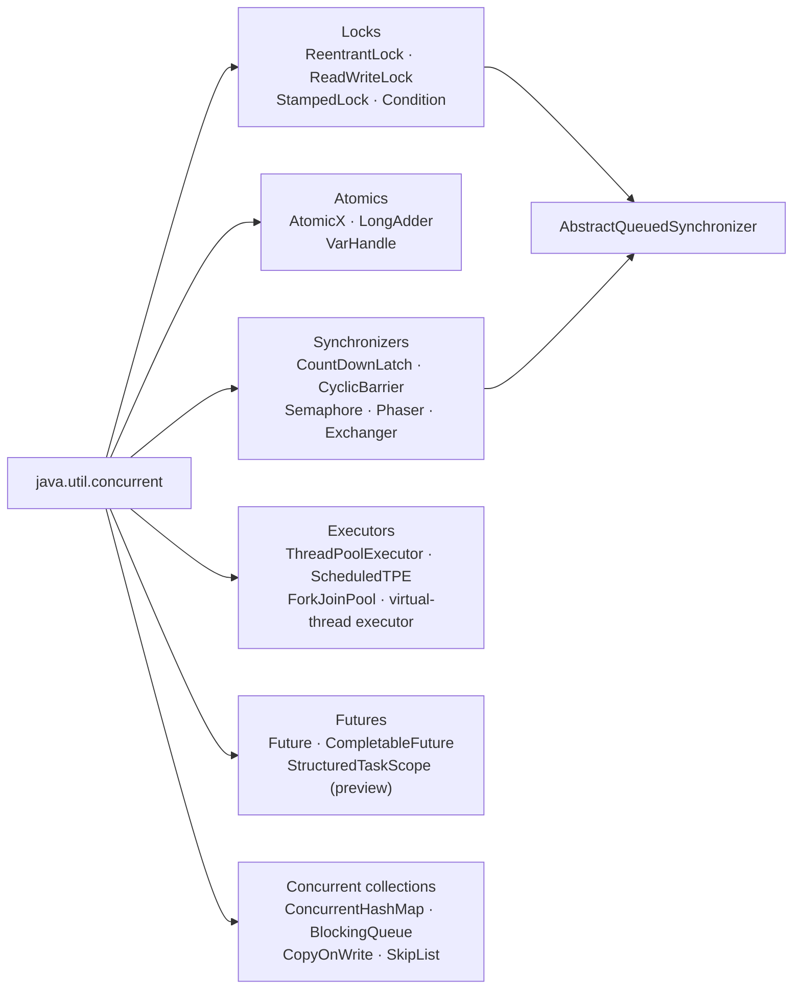
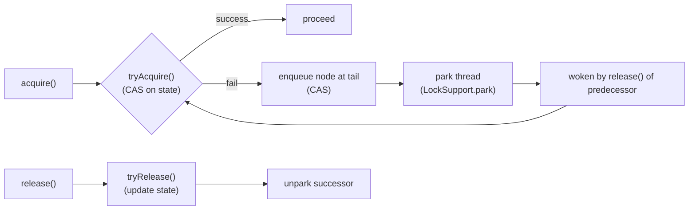
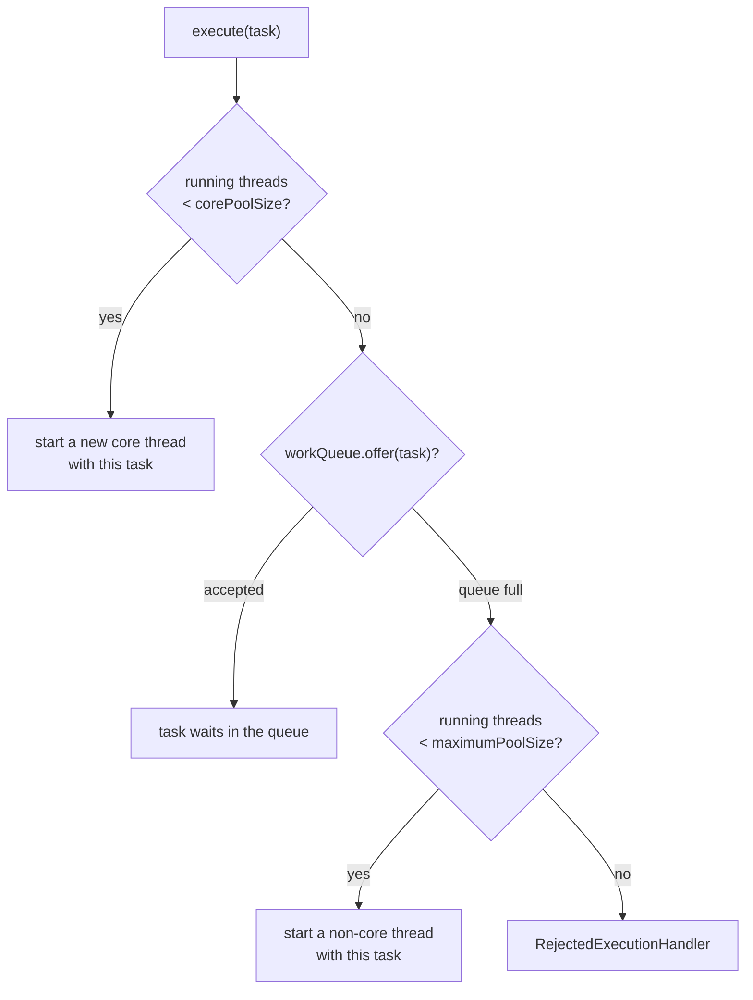
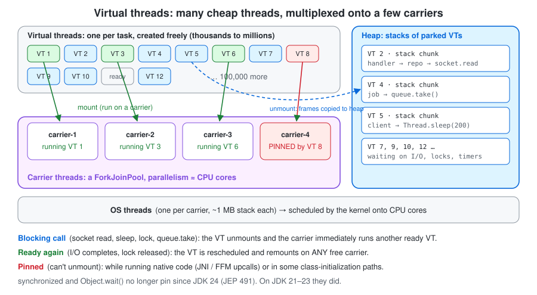

[⬅️ Prev: 11 · Concurrency Foundations](11-concurrency-foundations-jmm.md) · [🏠 Index](README.md) · [Next: 13 · I/O & NIO ➡️](13-io-nio-networking-serialization.md)

# 12 · Advanced Concurrency: `java.util.concurrent` & Project Loom

> *Doug Lea's `java.util.concurrent` gave Java the best concurrency library of its generation. Project Loom then changed what "a thread" costs. A staff engineer has to master both, and know when each one is the wrong tool.*

> [!TIP]
> **🧭 Decision guide: platform-thread pools, virtual threads or reactive**
> - **When it matters:** for I/O-bound services with many concurrent requests or slow dependencies, and every time you size a pool or a queue.
> - **Default**, for request/response services on Java 21+: virtual threads with plain blocking code, a concurrency limit (a semaphore or bulkhead) toward each dependency, and bounded queues with rejection policies chosen on purpose. Structured concurrency suits fan-out, but it's a preview API until JDK 28.
> - **Alternatives:** platform-thread pools for CPU-bound work; reactive for streaming and end-to-end backpressure ([Chapter 29](29-reactive-java-reactor-webflux.md)).
> - **Failure modes:** virtual threads moving the bottleneck to the connection pool, pinning on JDK 21 (fixed for `synchronized` in JDK 24), unbounded queues, thread-starvation deadlock in bounded pools, per-thread caches multiplied by a million threads.
> - **Evidence that would change it:** a load test with slow dependencies showing pool or connection exhaustion, `jdk.VirtualThreadPinned` events, queue wait time.
> - **Argued in:** §8–§9, §12–§14 and §17; [Chapter 39](39-staff-artefact-exercises.md) works this decision through with an experiment.

🧪 **Runnable labs:** [the programs behind this chapter's outputs](labs.md#chapter-12--advanced-concurrency-and-loom)

---

## Table of contents
1. [The map of `java.util.concurrent`](#1-the-map-of-javautilconcurrent-)
2. [`Lock`, `ReentrantLock` & `Condition`](#2-lock-reentrantlock--condition-)
3. [`ReadWriteLock` and `StampedLock`](#3-readwritelock-and-stampedlock-)
4. [AQS: the engine under almost everything](#4-aqs-the-engine-under-almost-everything-)
5. [Atomics, CAS, `LongAdder`, `VarHandle`](#5-atomics-cas-longadder-varhandle-)
6. [False sharing & `@Contended`](#6-false-sharing--contended-)
7. [Synchronizers: latch, barrier, semaphore, phaser](#7-synchronizers-latch-barrier-semaphore-phaser-)
8. [Executors & `ThreadPoolExecutor` internals](#8-executors--threadpoolexecutor-internals-)
9. [Sizing thread pools](#9-sizing-thread-pools-)
10. [`CompletableFuture` mastery](#10-completablefuture-mastery-)
11. [`ForkJoinPool` & work stealing](#11-forkjoinpool--work-stealing-)
12. [Virtual threads (Project Loom)](#12-virtual-threads-project-loom-)
13. [Structured concurrency](#13-structured-concurrency-)
14. [Virtual threads vs reactive programming](#14-virtual-threads-vs-reactive-programming-)
15. [Concurrency patterns that scale](#15-concurrency-patterns-that-scale-)
16. [Testing concurrent code](#16-testing-concurrent-code-)
17. [Staff lens](#17-staff-lens-)
18. [Interview questions](#18-interview-questions)
19. [References](#19-references)

---

## 1. The map of `java.util.concurrent` 🟡



Concurrent collections are covered in [Chapter 06 §15](06-collections.md#15-concurrent-collections--concurrenthashmap-internals-).

---

## 2. `Lock`, `ReentrantLock` & `Condition` 🟡→🔴

```java
private final ReentrantLock lock = new ReentrantLock();

void update() {
    lock.lock();                 // NOT inside the try: if lock() throws, we must not unlock
    try {
        // critical section
    } finally {
        lock.unlock();           // ALWAYS in finally: there's no automatic release like synchronized
    }
}
```

**What `ReentrantLock` adds over `synchronized`:**
| Capability | API | Why it matters |
|---|---|---|
| Try without blocking | `tryLock()` | Back off, avoid deadlock |
| Timed acquisition | `tryLock(100, MILLISECONDS)` | Bounded waiting, deadlock recovery |
| Interruptible acquisition | `lockInterruptibly()` | Cancellable while waiting for the lock |
| Fairness | `new ReentrantLock(true)` | FIFO order; prevents starvation, **costs throughput** |
| Multiple wait conditions | `newCondition()` | Separate `notFull`/`notEmpty` queues |
| Introspection | `isLocked`, `getQueueLength`, `isHeldByCurrentThread` | Monitoring, assertions |

```java
// The bounded buffer from Chapter 11, rewritten with two Conditions
private final ReentrantLock lock = new ReentrantLock();
private final Condition notFull  = lock.newCondition();
private final Condition notEmpty = lock.newCondition();

public void put(T item) throws InterruptedException {
    lock.lock();
    try {
        while (count == items.length) notFull.await();
        enqueue(item);
        notEmpty.signal();       // wake exactly ONE consumer, the right kind of waiter
    } finally { lock.unlock(); }
}
```

**`synchronized` or `ReentrantLock`?** Default to **`synchronized`** for simple critical sections: it's shorter, it's impossible to forget to unlock, and the JIT optimises it well. Use `ReentrantLock` when you need one of the features in the table.

> [!NOTE]
> The old advice "use `ReentrantLock` instead of `synchronized` with virtual threads" was right for **JDK 21–23**, where blocking inside `synchronized` pinned the carrier thread. **Since JDK 24 (JEP 491) it no longer applies.** On Java 25, choose based on features, not on Loom.

---

## 3. `ReadWriteLock` and `StampedLock` 🔴

### `ReentrantReadWriteLock`
Many readers **or** one writer.
```java
private final ReadWriteLock rw = new ReentrantReadWriteLock();
private final Map<String, Rate> rates = new HashMap<>();

Rate get(String ccy) {
    rw.readLock().lock();
    try { return rates.get(ccy); } finally { rw.readLock().unlock(); }
}
void refresh(Map<String, Rate> fresh) {
    rw.writeLock().lock();
    try { rates.clear(); rates.putAll(fresh); } finally { rw.writeLock().unlock(); }
}
```
- 💣 **Upgrading deadlocks.** Holding the read lock and then calling `writeLock().lock()` waits forever, because the write lock waits for *all* readers, including you. *Downgrading* (take write, then read, then release write) is allowed.
- Under read-heavy load, writers can **starve** in non-fair mode.
- It only pays off when read sections are long enough that sharing them beats the lock's bookkeeping cost. For tiny read sections, a plain lock (or `ConcurrentHashMap`, or an immutable snapshot behind a `volatile` reference) is often faster.

🧠 **The usual better answer is a copy-on-write snapshot:**
```java
private volatile Map<String, Rate> rates = Map.of();      // immutable snapshot
Rate get(String ccy) { return rates.get(ccy); }            // lock-free read
void refresh(Map<String, Rate> fresh) { rates = Map.copyOf(fresh); }   // atomic swap
```

### `StampedLock` (Java 8): optimistic reads
```java
class Point {
    private double x, y;
    private final StampedLock sl = new StampedLock();

    void move(double dx, double dy) {
        long stamp = sl.writeLock();
        try { x += dx; y += dy; } finally { sl.unlockWrite(stamp); }
    }

    double distanceFromOrigin() {
        long stamp = sl.tryOptimisticRead();     // no lock at all: just reads a version stamp
        double cx = x, cy = y;                   // copy the fields into locals
        if (!sl.validate(stamp)) {               // a write happened meanwhile → fall back to a real read lock
            stamp = sl.readLock();
            try { cx = x; cy = y; } finally { sl.unlockRead(stamp); }
        }
        return Math.hypot(cx, cy);
    }
}
```
It's very fast for read-mostly data, but **not reentrant**, it has **no `Condition`s**, and the optimistic section must tolerate seeing inconsistent values (it only *uses* them after validation). It's a specialist tool. Reach for it after profiling shows lock contention.

---

## 4. AQS: the engine under almost everything 🔴

`AbstractQueuedSynchronizer` is the framework behind `ReentrantLock`, `ReentrantReadWriteLock`, `Semaphore`, `CountDownLatch` and `ThreadPoolExecutor.Worker`. It provides:
- a single **`volatile int state`** that each synchronizer interprets in its own way;
- a **FIFO wait queue** of parked threads (a variant of the CLH queue);
- `acquire`/`release` in **exclusive** and **shared** modes, plus a `ConditionObject` implementation.

| Synchronizer | `state` means | Mode |
|---|---|---|
| `ReentrantLock` | Hold count (0 = free) | Exclusive |
| `Semaphore` | Permits remaining | Shared |
| `CountDownLatch` | Remaining count (0 = open) | Shared |
| `ReentrantReadWriteLock` | High 16 bits = read holds, low 16 bits = write holds | Both |



Writing your own synchronizer means overriding just `tryAcquire`/`tryRelease` (or the shared variants). Here's a one-shot latch, adapted from *Java Concurrency in Practice*:
```java
final class OneShotLatch {
    private final Sync sync = new Sync();
    public void signal() { sync.releaseShared(0); }
    public void await() throws InterruptedException { sync.acquireSharedInterruptibly(0); }

    private static final class Sync extends AbstractQueuedSynchronizer {
        @Override protected int tryAcquireShared(int ignored) { return getState() == 1 ? 1 : -1; }  // open?
        @Override protected boolean tryReleaseShared(int ignored) { setState(1); return true; }     // open it
    }
}
```

---

## 5. Atomics, CAS, `LongAdder`, `VarHandle` 🔴

### Compare-and-swap
`compareAndSet(expected, new)` atomically sets the value **only if it currently equals `expected`**, and returns whether it succeeded. It maps to one CPU instruction (`lock cmpxchg` on x86, `CAS`/`LDXR`+`STXR` on ARM). Lock-free algorithms are CAS **retry loops**:
```java
static long incrementCapped(AtomicLong value, long cap) {
    while (true) {
        long current = value.get();
        if (current >= cap) return current;
        if (value.compareAndSet(current, current + 1)) return current + 1;
        Thread.onSpinWait();          // lost the race: hint the CPU (PAUSE instruction), then retry
    }
}
// Equivalent, built in: value.updateAndGet(v -> v < cap ? v + 1 : v)
```
💣 The function passed to `updateAndGet`/`accumulateAndGet` **can be applied more than once** under contention, so it must be pure. No side effects.

### The ABA problem
CAS checks the *value*, not whether it *changed*. If a value goes A → B → A between your read and your CAS, the CAS succeeds even though the world changed. That's harmless for counters and dangerous for lock-free *linked structures* that reuse nodes. Fixes: `AtomicStampedReference` (value plus version stamp), `AtomicMarkableReference`, or just relying on GC (Java's GC prevents the classic node-reuse ABA as long as you don't pool nodes).

### `AtomicLong` vs `LongAdder`
| | `AtomicLong` | `LongAdder` |
|---|---|---|
| Write | CAS on **one** variable; contention → retries plus cache-line ping-pong | Thread hashes to a **cell** in a padded `Cell[]`; little contention |
| Read | Exact, atomic | `sum()` adds the cells; **not an atomic snapshot** |
| Use | Sequence numbers, CAS-based state | **High-frequency counters and metrics** |
| Memory | Tiny | Grows with contention (up to about the number of CPUs) |

`LongAccumulator` generalises this to any associative function (max, min). `ConcurrentHashMap.computeIfAbsent(k, x -> new LongAdder()).increment()` is the idiomatic concurrent frequency counter.

### `VarHandle` (Java 9): the supported replacement for `Unsafe` field access
```java
final class Sequence {
    private volatile long value;
    private static final VarHandle VALUE;
    static {
        try { VALUE = MethodHandles.lookup().findVarHandle(Sequence.class, "value", long.class); }
        catch (ReflectiveOperationException e) { throw new ExceptionInInitializerError(e); }
    }
    long next()              { return (long) VALUE.getAndAdd(this, 1L) + 1; }
    boolean cas(long e, long n) { return VALUE.compareAndSet(this, e, n); }
    void publish(long v)     { VALUE.setRelease(this, v); }   // release-only: cheaper than a full volatile write
    long peek()              { return (long) VALUE.getAcquire(this); }
}
```
**Access modes**, weakest to strongest: *plain* → *opaque* (no tearing, eventually visible, no ordering) → *acquire/release* (one-way ordering, ideal for single-producer publication) → *volatile* (sequentially consistent). Library and framework code uses the weaker modes to avoid paying for full fences. Application code should almost never need them.

---

## 6. False sharing & `@Contended` 🔴

CPUs move memory in **64-byte cache lines**. If two threads write *different* variables that happen to share a line, every write invalidates the other core's copy. Throughput collapses, yet a profiler shows no lock contention.

```java
class Counters {                    // 💣 a and b almost certainly share a cache line
    volatile long a;                // written by thread 1
    volatile long b;                // written by thread 2
}
```
**Fixes:** pad fields apart (the JDK uses `@jdk.internal.vm.annotation.Contended` inside `LongAdder.Cell`, `ConcurrentHashMap.CounterCell`, `Thread`'s random fields and `ForkJoinPool`). User code can use `@Contended` only with `-XX:-RestrictContended`. Alternatively, design so each thread writes to its own object, or use `LongAdder`. Disruptor-style libraries pad manually.

---

## 7. Synchronizers: latch, barrier, semaphore, phaser 🟡

| Synchronizer | Semantics | Reusable | Typical use |
|---|---|---|---|
| `CountDownLatch(n)` | `await()` blocks until `countDown()` has been called n times | ❌ one-shot | Wait for N services to start; start N threads at once |
| `CyclicBarrier(n, action)` | n threads wait for each other, then the action runs, then all continue | ✅ | Iterative parallel algorithms (phases) |
| `Semaphore(permits)` | `acquire` takes a permit (blocks if none), `release` returns one | ✅ | **Limit concurrency** (bulkheads), resource pools |
| `Phaser` | A dynamic, reusable barrier: parties can register and deregister | ✅ | Variable-membership phases |
| `Exchanger` | Two threads swap objects | ✅ | Double-buffering pipelines |

```java
// Gate: start all workers at the same moment, wait until they're all done
CountDownLatch startGate = new CountDownLatch(1);
CountDownLatch endGate = new CountDownLatch(nThreads);
for (int i = 0; i < nThreads; i++) {
    Thread.ofPlatform().start(() -> {
        try {
            startGate.await();
            try { task.run(); } finally { endGate.countDown(); }
        } catch (InterruptedException e) { Thread.currentThread().interrupt(); }
    });
}
long t0 = System.nanoTime();
startGate.countDown();          // release them all
endGate.await();
long elapsed = System.nanoTime() - t0;
```

```java
// Bulkhead: never more than 20 concurrent calls to the inventory service
private final Semaphore inventoryPermits = new Semaphore(20);

Stock check(Sku sku) throws InterruptedException {
    if (!inventoryPermits.tryAcquire(50, MILLISECONDS)) throw new BulkheadFullException("inventory");
    try { return inventoryClient.check(sku); }
    finally { inventoryPermits.release(); }
}
```
💣 `Semaphore.release()` doesn't check that you acquired a permit. Releasing in the wrong path (outside the `try`, or twice) silently *inflates* the permit count.

---

## 8. Executors & `ThreadPoolExecutor` internals 🔴

### The constructor, field by field
```java
ThreadPoolExecutor pool = new ThreadPoolExecutor(
        16,                                         // corePoolSize: threads kept alive even when idle
        32,                                         // maximumPoolSize: upper bound
        60, TimeUnit.SECONDS,                       // keepAlive for threads above core
        new ArrayBlockingQueue<>(500),              // a BOUNDED work queue
        Thread.ofPlatform().name("pricing-", 0).factory(),    // named threads (Java 21 builder)
        new ThreadPoolExecutor.CallerRunsPolicy()); // when saturated, the SUBMITTER runs the task (backpressure)
```

### How `execute()` decides, and the counter-intuitive part


> [!IMPORTANT]
> **Threads beyond `corePoolSize` are only created when the queue is FULL.** With an unbounded queue, the queue is *never* full, so `maximumPoolSize` is silently ignored: you get exactly `corePoolSize` threads and an ever-growing queue. This is the most misunderstood behaviour in Java concurrency.

### Rejection policies
| Policy | Behaviour | When |
|---|---|---|
| `AbortPolicy` (default) | Throws `RejectedExecutionException` | You handle overload explicitly |
| `CallerRunsPolicy` | The submitting thread runs the task | **Natural backpressure**: slows producers down |
| `DiscardPolicy` | Silently drops the task 💣 | Rarely; only for truly optional work, with metrics |
| `DiscardOldestPolicy` | Drops the oldest queued task, then retries | Latest-value-wins workloads |

### The `Executors` factory traps
| Factory | What it actually creates | Risk |
|---|---|---|
| `newFixedThreadPool(n)` | core = max = n, **unbounded** `LinkedBlockingQueue` | The queue grows without limit → latency explosion → `OutOfMemoryError` |
| `newCachedThreadPool()` | core 0, max `Integer.MAX_VALUE`, `SynchronousQueue` | **Unbounded threads** under load → `unable to create native thread` |
| `newSingleThreadExecutor()` | 1 thread, unbounded queue | Same as fixed. Good for serialising work, but bound the queue |
| `newScheduledThreadPool(n)` | Fixed core, unbounded delay queue | Same; also, max size is meaningless here |
| `newVirtualThreadPerTaskExecutor()` (21) | A new virtual thread per task | No limit on concurrency: you must bound it yourself (§12) |

**Production rule:** build `ThreadPoolExecutor`s explicitly, with **bounded queues**, **named threads**, a **deliberate rejection policy**, and **metrics** (active count, queue size, rejections, completed tasks; Micrometer's `ExecutorServiceMetrics` binds them all).

### Scheduled executors
- `scheduleAtFixedRate(task, 0, 1, SECONDS)` aims for start times at 0, 1, 2… If a run overruns, the next one starts late (runs never overlap).
- `scheduleWithFixedDelay(task, 0, 1, SECONDS)` waits 1 second *after each run finishes*.
- 💣 **If a periodic task throws, all future runs are silently cancelled.** No log, nothing. Wrap periodic task bodies in try/catch.

### Shutdown, properly
```java
static void shutdownGracefully(ExecutorService pool, Duration timeout) {
    pool.shutdown();                                         // stop accepting; finish queued work
    try {
        if (!pool.awaitTermination(timeout.toMillis(), MILLISECONDS)) {
            pool.shutdownNow();                              // interrupt running tasks, drop queued ones
            if (!pool.awaitTermination(timeout.toMillis(), MILLISECONDS))
                log.error("executor did not terminate");
        }
    } catch (InterruptedException e) {
        pool.shutdownNow();
        Thread.currentThread().interrupt();
    }
}
// Java 19+: ExecutorService is AutoCloseable; try (pool) { … } does shutdown() + await on close.
```

---

## 9. Sizing thread pools 🔴→🟣

**CPU-bound work:** `threads ≈ N_cpu` (or `N_cpu + 1`, to cover the occasional page fault). More threads just add context switches.

**Blocking work** (the formula from *Java Concurrency in Practice*):
```
N_threads = N_cpu × U_target × (1 + W / C)

  N_cpu    = cores available to the JVM (container limits!)
  U_target = target CPU utilisation (0..1)
  W / C    = ratio of wait time to compute time per task
```
Example: 8 cores, 80% target, and tasks that wait 90 ms on I/O for every 10 ms of CPU (W/C = 9) → 8 × 0.8 × 10 = **64 threads**.

**The same thing seen through Little's law** (often the more practical view): `concurrency = throughput × latency`. At 500 requests/s with 120 ms average latency, about **60 requests are in flight** at any moment. A request-handling pool smaller than that queues up, and one much larger adds nothing.

**The real-world constraints that override the formulas:**
- **Downstream capacity.** A pool of 200 threads calling a database with a 20-connection pool means 180 threads waiting on the pool. Size to the bottleneck.
- **Bulkheads.** Use **separate pools (or semaphores) per dependency**, so a slow payment provider can't consume every thread and take down unrelated endpoints.
- **Bounded queues give fast failure.** A queue that holds 10 minutes of work is a latency bug, not a buffer. Size queues in terms of *time*: queue length ≈ throughput × acceptable queueing delay.

---

## 10. `CompletableFuture` mastery 🔴

### Composition vocabulary
| Method | Analogy | Use |
|---|---|---|
| `supplyAsync(supplier, executor)` | Start | Kick off async work. **Always pass an executor** |
| `thenApply(fn)` | `map` | Transform the result synchronously |
| `thenCompose(fn)` | `flatMap` | Chain another async call that returns a CF |
| `thenCombine(other, fn)` | `zip` | Combine two independent results |
| `thenAccept` / `thenRun` | `forEach` | Side effect at the end |
| `allOf(cfs...)` | Join all | `CompletableFuture<Void>`. Collect results afterwards with `join()` |
| `anyOf(cfs...)` | Race | The first to complete (success or failure!) |
| `exceptionally(fn)` | `recover` | Failure → fallback value |
| `handle(fn)` | `fold` | (result, error) → new result, always called |
| `whenComplete(action)` | `tap` | Side effect on both paths. The result passes through unchanged |
| `orTimeout(t)` (9) | Timeout | Completes exceptionally with `TimeoutException` |
| `completeOnTimeout(v, t)` (9) | Default on timeout | Completes with a fallback value |
| `exceptionallyCompose(fn)` (12) | Async recover | Fallback that is itself async |

### Which thread runs my callback? 🔴
- **Non-async** (`thenApply`): runs on **the thread that completes the previous stage**. If the stage is *already complete* when you attach the callback, it runs **immediately on the calling thread**.
- **Async** (`thenApplyAsync(fn)`): submitted to the **default executor**, `ForkJoinPool.commonPool()` (unless its parallelism is below 2), **or the executor you pass**.

💣 **That's why passing your own executor matters.** The common pool is shared JVM-wide with parallel streams, and it has only `cores − 1` threads. Blocking I/O in `supplyAsync(…)` without an executor starves everything else that uses it.

### A real fan-out with timeouts and graceful degradation
```java
ExecutorService io = Executors.newVirtualThreadPerTaskExecutor();   // or a bounded platform pool

CompletableFuture<User> user = CompletableFuture
        .supplyAsync(() -> userClient.fetch(id), io)
        .orTimeout(300, MILLISECONDS);                                  // the user is mandatory: fail if slow

CompletableFuture<List<Order>> orders = CompletableFuture
        .supplyAsync(() -> orderClient.recent(id), io)
        .completeOnTimeout(List.of(), 300, MILLISECONDS);               // optional: degrade to empty

CompletableFuture<Prefs> prefs = CompletableFuture
        .supplyAsync(() -> prefsClient.get(id), io)
        .exceptionally(ex -> Prefs.defaults());                         // optional: degrade on failure

Dashboard dashboard = user
        .thenCombine(orders, Dashboard::new)
        .thenCombine(prefs, Dashboard::withPrefs)
        .join();                                                        // CompletionException if user failed
```

### Gathering N results
```java
List<CompletableFuture<Quote>> futures = vendors.stream()
        .map(v -> CompletableFuture.supplyAsync(() -> v.quote(item), io))
        .toList();
CompletableFuture.allOf(futures.toArray(CompletableFuture[]::new)).join();
List<Quote> quotes = futures.stream().map(CompletableFuture::join).toList();
```

### The traps
- **`cancel(true)` does not interrupt the running task.** The CF completes as cancelled, but the supplier keeps running. Cancellation doesn't propagate to upstream stages either. (Structured concurrency fixes this, see §13.)
- **Exceptions get wrapped:** `join()` throws `CompletionException`, `get()` throws `ExecutionException`. Inside `exceptionally`/`handle` the throwable may or may not be wrapped. Unwrap with `ex instanceof CompletionException ce ? ce.getCause() : ex`.
- **Forgotten futures swallow errors.** A CF nobody observes fails silently. Attach `whenComplete` logging or use structured concurrency.
- **Blocking `join()` inside a pool's tasks can deadlock the pool** (pool starvation, [Chapter 11 §12](11-concurrency-foundations-jmm.md#12-liveness-deadlock-livelock-starvation-)). Compose instead of joining in the middle of a pipeline.
- **`anyOf` returns the first *completed* future**, which might be a failure. To get the first *success*, use structured concurrency's `anySuccessful` joiner or a custom combinator.

---

## 11. `ForkJoinPool` & work stealing 🔴

`ForkJoinPool` is built for **divide-and-conquer** and many small tasks:
- Each worker has its own **deque**. It pushes and pops its own tasks at the **head (LIFO)**, which is cache-friendly because the most recent subtask's data is still hot.
- Idle workers **steal** from the **tail (FIFO)** of other workers' deques. They take the *oldest*, usually largest, chunk of work, which minimises how often they need to steal.

```java
final class SumTask extends RecursiveTask<Long> {
    private static final int THRESHOLD = 10_000;
    private final long[] data; private final int lo, hi;
    SumTask(long[] data, int lo, int hi) { this.data = data; this.lo = lo; this.hi = hi; }

    @Override protected Long compute() {
        if (hi - lo <= THRESHOLD) {                         // small enough: do it directly
            long sum = 0;
            for (int i = lo; i < hi; i++) sum += data[i];
            return sum;
        }
        int mid = (lo + hi) >>> 1;
        SumTask left = new SumTask(data, lo, mid);
        left.fork();                                        // push onto my deque (others may steal it)
        long right = new SumTask(data, mid, hi).compute();  // work on the other half myself
        return right + left.join();                         // join: run it myself if nobody stole it
    }
}
long total = ForkJoinPool.commonPool().invoke(new SumTask(data, 0, data.length));
```
- **Common pool:** parallelism = cores − 1. It's used by parallel streams and by default async `CompletableFuture`s.
- **Blocking inside a ForkJoin task** stalls a worker. `ForkJoinPool.managedBlock` lets the pool add a compensating thread.
- **The virtual-thread scheduler is a ForkJoinPool** running in FIFO (*async*) mode.

---

## 12. Virtual threads (Project Loom) 🔴→🟣



### What they are
A **virtual thread** is a `java.lang.Thread` implemented by the JVM rather than the OS. Virtual threads are **multiplexed (M:N)** onto a small pool of **carrier** platform threads (a ForkJoinPool whose parallelism defaults to the core count). When a virtual thread performs a blocking operation (socket I/O, `sleep`, `BlockingQueue.take`, `Lock` waits and, since JDK 24, `synchronized` waits), the JVM **unmounts** it: its stack frames are saved to the heap as *stack chunk* objects, and the carrier is freed to run another virtual thread. When the operation completes, the virtual thread is scheduled again and **remounts on any free carrier**.

### Why it matters: measured on a 2-core box (JDK 21)
```java
try (var executor = Executors.newVirtualThreadPerTaskExecutor()) {
    IntStream.range(0, 100_000).forEach(i -> executor.submit(() -> {
        Thread.sleep(Duration.ofSeconds(1));        // stands in for a blocking I/O call
        return i;
    }));
}   // close() waits for all tasks
```
```
10,000 virtual threads each sleeping 1s:  1151 ms
100,000 virtual threads each sleeping 1s: 1250 ms
2,000 tasks on 200 platform threads:      10035 ms
```
Virtual threads don't make any single task faster. They let you have **far more tasks in flight** for the same hardware. Little's law does the rest: throughput = concurrency ÷ latency.

### Using them
```java
Thread.startVirtualThread(task);
Thread.ofVirtual().name("order-", 0).start(task);
ExecutorService perTask = Executors.newVirtualThreadPerTaskExecutor();   // one new VT per task
// Spring Boot 3.2+: spring.threads.virtual.enabled=true  (Tomcat/Jetty request handling, @Async, scheduling, …)
```

### The rules
1. **Never pool virtual threads.** They're cheap to create, and pooling them reintroduces the limit they were designed to remove.
2. **Limit concurrency with semaphores, not pool sizes.** If the database can handle 20 concurrent queries, guard database access with a `Semaphore(20)` (or rely on the connection pool's own limit and timeout). Otherwise 10,000 virtual threads will queue up on 20 connections and time out.
3. **They're for I/O-bound work.** CPU-bound tasks gain nothing: there are still only N cores. Use a platform pool or a `ForkJoinPool` for computation.
4. **Watch out for pinning.** A virtual thread is *pinned* (it can't unmount, so it blocks its carrier) while it's running **native code** (JNI, FFM upcalls) and in some class-initialization paths. On **JDK 21–23**, `synchronized` blocks and `Object.wait()` also pinned it. That's fixed in **JDK 24** (JEP 491). Detect pinning with the JFR event `jdk.VirtualThreadPinned`.
5. **Go easy on `ThreadLocal`.** It works, but a million threads each holding a copy of a cache is a memory problem. Prefer `ScopedValue` (Java 25) for context.
6. **File I/O doesn't truly unmount** on most operating systems. The scheduler *compensates* by temporarily adding carriers. That works, but it's less efficient than network I/O.
7. **Rethink observability.** Thread counts stop meaning much. Use `jcmd <pid> Thread.dump_to_file -format=json <file>` for thread dumps that include virtual threads.

🧠 **The production migration checklist** for moving a fleet to virtual threads:
- Target **Java 25 LTS** (it has the JEP 491 pinning fix) or newer.
- Inventory native and JNI-heavy libraries, and heavy `ThreadLocal` users.
- **Re-size every downstream limit** (DB pools, HTTP client connection pools, semaphores). Concurrency will rise, and the bottleneck moves downstream.
- Load-test and compare p99 latency, throughput, heap (stack chunks live on the heap) and CPU.
- Roll out behind a flag, one service tier at a time.

---

## 13. Structured concurrency 🔴

Unstructured async code (`CompletableFuture`, `ExecutorService.submit`) lets subtasks **outlive** the code that started them: failures get lost, cancellation doesn't propagate, and thread dumps show orphaned work. **Structured concurrency** treats a group of subtasks as **one unit of work with a lexical scope**, just like structured programming did for `goto`.

*(Preview. The API shown is Java 25's (JEP 505). Names and joiners have shifted between previews, and it's still in preview in 26 and 27; JDK 27's seventh preview (JEP 533) throws `ExecutionException` from `join` instead of `FailedException`. JEP 543 finalises the API, unchanged from JDK 27, in JDK 28, due in March 2027.)*

```java
// All must succeed; if one fails, cancel the others and propagate the failure
Response handle(String userId) throws InterruptedException {
    try (var scope = StructuredTaskScope.open()) {              // default joiner: awaitAllSuccessfulOrThrow
        Subtask<User>        user   = scope.fork(() -> users.fetch(userId));
        Subtask<List<Order>> orders = scope.fork(() -> orderApi.recent(userId));
        scope.join();                                           // throws FailedException if any subtask failed
        return new Response(user.get(), orders.get());
    }                                                           // no subtask can outlive this block
}

// Hedged requests: first success wins, the loser is cancelled (interrupted)
String fastestReplica(String key) throws InterruptedException {
    try (var scope = StructuredTaskScope.open(StructuredTaskScope.Joiner.<String>anySuccessfulResultOrThrow())) {
        scope.fork(() -> replicaEu.get(key));
        scope.fork(() -> replicaUs.get(key));
        return scope.join();
    }
}

// With a deadline for the whole unit of work
try (var scope = StructuredTaskScope.open(
        StructuredTaskScope.Joiner.awaitAllSuccessfulOrThrow(),
        cfg -> cfg.withTimeout(Duration.ofMillis(500)))) { ... }
```

**What you get:**
- **Error propagation:** a failure shuts down the scope and cancels the sibling subtasks.
- **Cancellation propagation:** interrupting the owner thread cancels every subtask.
- **No leaks:** when the `try` block exits, every subtask has finished.
- **Observability:** thread dumps show the task hierarchy, and `ScopedValue`s are inherited by the subtasks.

---

## 14. Virtual threads vs reactive programming 🟣

| Aspect | Virtual threads (+ structured concurrency) | Reactive (Reactor / WebFlux / RxJava) |
|---|---|---|
| Code style | Plain sequential blocking code | Declarative operator pipelines |
| Stack traces & debugging | Normal, readable traces and thread dumps | Fragmented across operators; needs special tooling |
| Learning curve | Low: it's just Java | Steep (operators, schedulers, `subscribeOn`/`publishOn`) |
| Ecosystem | **Every blocking library works** (JDBC, existing SDKs) | Needs non-blocking drivers end to end (R2DBC, reactive clients) |
| Backpressure | Implicit (blocking) plus explicit limits (semaphores, bounded queues) | **Built into the protocol** (`request(n)`) |
| Streaming & event processing | Possible, but manual | Excellent: windowing, buffering, merging, retries as operators |
| I/O-bound throughput | Comparable | Comparable |

🧠 **The position I'd defend:** for **request/response services** (the large majority of business microservices), virtual threads with structured concurrency give reactive-level scalability with far simpler code. Make them the default for new services on Java 25+. Keep reactive for **streaming-heavy workloads** (event streams, WebSocket fan-out, complex backpressured pipelines) and where an existing reactive codebase works fine. **Don't rewrite working reactive services just because virtual threads exist.** Rewrites carry their own risk.

---

## 15. Concurrency patterns that scale 🟣

| Pattern | Idea | Java building blocks |
|---|---|---|
| **Producer–consumer** | Decouple production rate from consumption rate | `BlockingQueue` (bounded!) |
| **Bulkhead** | Isolate dependencies so one can't exhaust shared resources | A separate executor or `Semaphore` per dependency |
| **Fan-out / fan-in** | Parallel calls, then combine | `StructuredTaskScope`, `CompletableFuture.allOf` |
| **Per-key serialisation** | Process events for the same key in order, in parallel across keys | Hash the key to one of N single-thread executors (or N queues) |
| **Pipeline** | Stages connected by queues, each with its own concurrency | Executors + bounded queues; `Flow` / reactive streams |
| **Request hedging** | Send a backup request after the p95 latency elapses, take the first reply | `anySuccessful` joiner, with care for idempotency |
| **Single writer** | Only one thread mutates a structure; others read immutable snapshots | `volatile` snapshot swap, actor-style mailbox |
| **Backpressure** | Slow producers down when consumers fall behind | Bounded queues + `CallerRunsPolicy`, semaphores, reactive `request(n)` |

```java
// Per-key ordering with parallelism across keys: e.g., events for the same accountId stay in order
final class KeyedExecutor {
    private final ExecutorService[] lanes;
    KeyedExecutor(int n) {
        lanes = new ExecutorService[n];
        for (int i = 0; i < n; i++)
            lanes[i] = new ThreadPoolExecutor(1, 1, 0, SECONDS, new ArrayBlockingQueue<>(10_000),
                    Thread.ofPlatform().name("lane-" + i).factory(), new ThreadPoolExecutor.CallerRunsPolicy());
    }
    void submit(Object key, Runnable task) {
        lanes[Math.floorMod(key.hashCode(), lanes.length)].execute(task);
    }
}
```
💣 Careful: `CallerRunsPolicy` on a full lane runs the task on the caller's thread, which can break per-key ordering. Pick the rejection policy to match the guarantee you need.

---

## 16. Testing concurrent code 🔴

- **Make tests deterministic** where you can: control timing with latches and barriers rather than `sleep`. Use **Awaitility** for asynchronous assertions (`await().atMost(2, SECONDS).until(() -> queue.isEmpty())`).
- **Stress it:** run the operation millions of times across many threads and check invariants (totals conserved, no duplicates).
- **jcstress** for low-level primitives: it explores interleavings and reports outcome frequencies, including ones that are "acceptable", "forbidden" and "interesting".
- **Lincheck** (JetBrains) checks the linearizability of concurrent data structures against a sequential specification.
- **Static analysis:** Error Prone's `@GuardedBy` checks, SpotBugs' multithreading detectors.
- **Production-like soak tests** with fault injection (slow dependencies, timeouts) reveal pool starvation and backpressure bugs that unit tests can't.

---

## 17. Staff lens 🟣

1. **Concurrency architecture is a platform decision.** Decide the default model for the org (for example, virtual threads plus structured concurrency on Java 25+ for request/response services, reactive for streaming), the pool topology (bulkheads per dependency), and the standard metrics. Then make the right thing the easy thing with shared libraries.
2. **Backpressure is a requirement, not an optimisation.** Every queue is bounded. Every pool has a rejection policy you chose on purpose. Every dependency has a concurrency limit and a timeout. Unbounded anything is an outage waiting for traffic.
3. **Moving to virtual threads moves the bottleneck.** Thread exhaustion disappears, and database connection exhaustion takes its place. Capacity-plan the downstream before flipping the switch.
4. **Observe executors like databases.** Active threads, queue depth, queue wait time, rejection rate and task latency belong on dashboards, with alerts on queue growth and rejections.
5. **Simplicity wins reviews and incidents.** `synchronized` plus an immutable snapshot often beats a clever `StampedLock`. Use the fancy tools when a profiler shows you need them.

---

## 18. Interview questions

<details>
<summary><b>Q1. 🟡 <code>synchronized</code> vs <code>ReentrantLock</code>?</b></summary>

Both are reentrant mutual-exclusion locks with the same memory semantics. `ReentrantLock` adds `tryLock` (optionally timed), interruptible acquisition, optional fairness, multiple `Condition`s and introspection, but you have to unlock in `finally`. Default to `synchronized` for simplicity and use `ReentrantLock` when you need those features. On JDK 21–23, `ReentrantLock` also avoided virtual-thread pinning, but JDK 24 removed that difference.
</details>

<details>
<summary><b>Q2. 🔴 Explain how <code>ThreadPoolExecutor</code> handles a new task. Why might <code>maximumPoolSize</code> never be reached?</b></summary>

If fewer than core threads are running, it starts a new thread. Otherwise it tries to queue the task. Only if the queue is full does it start threads up to max, and beyond that it rejects. With an unbounded queue (`Executors.newFixedThreadPool` uses `LinkedBlockingQueue`), the queue never fills, so max is never used and the queue grows without bound.
</details>

<details>
<summary><b>Q3. 🔴 Why are <code>Executors.newFixedThreadPool</code> and <code>newCachedThreadPool</code> risky in production?</b></summary>

Fixed: an unbounded work queue, so under overload tasks pile up, latency explodes and memory runs out. Cached: unbounded thread creation (max = `Integer.MAX_VALUE` with a `SynchronousQueue`), so under load you get thousands of threads and `OutOfMemoryError: unable to create native thread`. Use explicit `ThreadPoolExecutor`s with bounded queues, named threads, a deliberate rejection policy and metrics.
</details>

<details>
<summary><b>Q4. 🔴 How do you size a thread pool for I/O-bound work?</b></summary>

`N_cpu × U_target × (1 + W/C)`, or by Little's law: required concurrency = throughput × latency. Then cap it by downstream capacity (DB or HTTP connection pools), isolate per dependency (bulkheads), and bound the queue by acceptable waiting time. Validate under load: CPU utilisation, queue wait and p99 latency.
</details>

<details>
<summary><b>Q5. 🔴 <code>AtomicLong</code> vs <code>LongAdder</code>?</b></summary>

`AtomicLong` CASes a single variable: exact and atomic reads, but under heavy write contention it suffers CAS retries and cache-line bouncing. `LongAdder` spreads increments across padded cells per contending thread and sums on read. It's far more scalable for write-heavy counters, but `sum()` isn't an atomic snapshot. Use `LongAdder` for metrics and frequency counts, and `AtomicLong` for sequences and CAS-based state.
</details>

<details>
<summary><b>Q6. 🔴 What is the ABA problem?</b></summary>

CAS checks only that the current value equals the expected one. If it changed from A to B and back to A in between, the CAS succeeds even though the state changed. That's harmful in lock-free linked structures that reuse nodes. Mitigations: versioned references (`AtomicStampedReference`), avoiding node reuse (GC helps in Java), or locking.
</details>

<details>
<summary><b>Q7. 🔴 In <code>CompletableFuture</code>, which thread executes <code>thenApply</code>?</b></summary>

The thread that completes the previous stage, or the calling thread if that stage is already complete when `thenApply` is attached. `thenApplyAsync` runs on the default executor (the common ForkJoinPool) or a supplied executor. That's why blocking work in non-async callbacks can stall I/O threads, and why you should pass an explicit executor for blocking work.
</details>

<details>
<summary><b>Q8. 🔴 Does <code>CompletableFuture.cancel(true)</code> stop the running computation?</b></summary>

No. The future completes exceptionally with `CancellationException`, but the supplier keeps running, because CF doesn't use interrupts to control execution, and cancellation doesn't propagate to upstream stages. If you need real cancellation, use structured concurrency (which interrupts subtasks), `FutureTask` with an executor, or cooperative cancellation checks.
</details>

<details>
<summary><b>Q9. 🔴 How do virtual threads work, and what is pinning?</b></summary>

Virtual threads are JVM-scheduled threads multiplexed onto a small pool of carrier threads. On a blocking operation, the JVM unmounts the virtual thread (its stack is saved to the heap) and the carrier runs other virtual threads. When the operation completes, the virtual thread remounts on any carrier. Pinning is when it can't unmount and blocks its carrier: during native or FFM calls and some class-init paths, and, before JDK 24, inside `synchronized` or `Object.wait()`. Detect it with the JFR `jdk.VirtualThreadPinned` event.
</details>

<details>
<summary><b>Q10. 🔴 Should you pool virtual threads? How do you limit concurrency then?</b></summary>

No. They're cheap and designed to be created per task, and pooling them reintroduces the scalability limit. Limit concurrency to protected resources explicitly: semaphores, connection-pool limits with timeouts, rate limiters. The bottleneck moves to downstream resources, so size those deliberately.
</details>

<details>
<summary><b>Q11. 🔴 What problem does structured concurrency solve?</b></summary>

In unstructured async code (CF, `submit`), subtasks can outlive their caller, failures go unobserved, cancellation doesn't propagate, and observability suffers. Structured concurrency (`StructuredTaskScope`, preview) scopes subtasks to a block. Failure policies (joiners) cancel siblings and propagate errors, interrupting the owner cancels all subtasks, nothing leaks past the block, and thread dumps show the hierarchy.
</details>

<details>
<summary><b>Q12. 🟡 <code>CountDownLatch</code> vs <code>CyclicBarrier</code> vs <code>Semaphore</code>?</b></summary>

Latch: one-shot. Waiters block until the count reaches zero (for example, waiting for N services to start). Barrier: reusable. N threads wait for each other at a point, with an optional action at each trip (phased parallel algorithms). Semaphore: N permits that bound concurrent access (bulkheads, resource limits).
</details>

<details>
<summary><b>Q13. 🔴 What is false sharing and how do you fix it?</b></summary>

Independent variables written by different threads that sit on the same 64-byte cache line. Every write invalidates the line in the other cores, which destroys throughput with no visible lock contention. Fix it by padding (`@Contended`, inside the JDK or with `-XX:-RestrictContended`), by spreading state per thread, or with structures like `LongAdder` that already pad their cells.
</details>

<details>
<summary><b>Q14. 🟣 Virtual threads or reactive for a new set of microservices?</b></summary>

For request/response services on Java 25+: virtual threads with structured concurrency. You get comparable I/O scalability, plain sequential code, normal debugging, and every blocking library (JDBC) still works. Choose reactive for streaming-heavy work (event streams, WebSocket fan-out, complex backpressured pipelines) or where an existing reactive stack is mature. Either way, design explicit backpressure and downstream limits, and validate with load tests. Don't rewrite working reactive services just to switch.
</details>

<details>
<summary><b>Q15. 🟣 After enabling virtual threads, error rates went up with DB connection timeouts. Why, and what do you do?</b></summary>

The thread pool used to cap concurrency, effectively protecting the database. With virtual threads, far more requests reach the connection pool at once, exceed its size, and time out waiting. Fixes: add explicit concurrency limits (a semaphore matched to pool size) or admission control at the edge, tune the pool size and acquisition timeout to what the DB can actually handle, add load shedding (429/503) instead of queueing indefinitely, and capacity-test the downstream before rolling out.
</details>

---

## 19. References
- Brian Goetz et al., *Java Concurrency in Practice*: chapters 6–8 (executors), 13–15 (locks, AQS, atomics)
- Doug Lea, *Concurrent Programming in Java* and the `java.util.concurrent` source code and Javadoc
- JEPs: [444 Virtual Threads](https://openjdk.org/jeps/444) · [491 Synchronize Virtual Threads without Pinning](https://openjdk.org/jeps/491) · [505 Structured Concurrency (5th preview)](https://openjdk.org/jeps/505) · [506 Scoped Values](https://openjdk.org/jeps/506)
- Ron Pressler, *Virtual Threads: State of Loom* and the Loom design talks
- Martin Thompson, *Mechanical Sympathy* blog (false sharing, the Disruptor)

---

[⬅️ Prev: 11 · Concurrency Foundations](11-concurrency-foundations-jmm.md) · [🏠 Index](README.md) · [Next: 13 · I/O & NIO ➡️](13-io-nio-networking-serialization.md)
