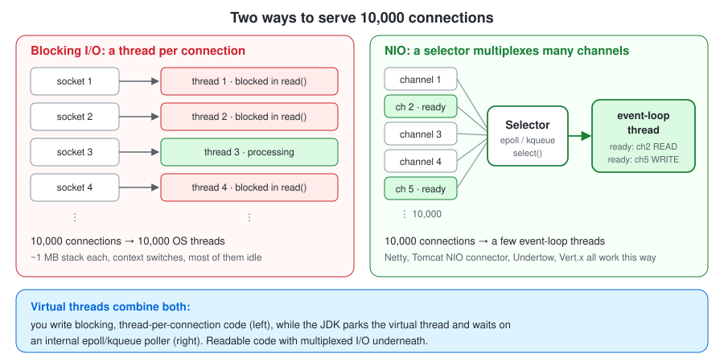

[⬅️ Prev: 12 · Advanced Concurrency](12-concurrency-advanced-juc-loom.md) · [🏠 Index](README.md) · [Next: 14 · Reflection & Proxies ➡️](14-reflection-annotations-proxies.md)

# 13 · I/O, NIO, Networking & Serialization

> *Most production incidents involving Java I/O come down to four things: a missing timeout, an unbounded buffer, a wrong charset, or deserializing something you shouldn't trust. This chapter covers the machinery and those four failure modes.*

---

## Table of contents
1. [The I/O landscape](#1-the-io-landscape-)
2. [Classic `java.io`: streams and decorators](#2-classic-javaio-streams-and-decorators-)
3. [NIO buffers](#3-nio-buffers-)
4. [Channels, scatter/gather, file locking](#4-channels-scattergather-file-locking-)
5. [Selectors & non-blocking servers](#5-selectors--non-blocking-servers-)
6. [I/O models compared (and where virtual threads fit)](#6-io-models-compared-and-where-virtual-threads-fit-)
7. [Zero-copy & memory-mapped files](#7-zero-copy--memory-mapped-files-)
8. [NIO.2: `Path` and `Files`](#8-nio2-path-and-files-)
9. [Networking: sockets, timeouts, `HttpClient`](#9-networking-sockets-timeouts-httpclient-)
10. [Java serialization and why it's dangerous](#10-java-serialization-and-why-its-dangerous-)
11. [Data formats for services: JSON, Protobuf, Avro](#11-data-formats-for-services-json-protobuf-avro-)
12. [Staff lens](#12-staff-lens-)
13. [Interview questions](#13-interview-questions)
14. [References](#14-references)

---

## 1. The I/O landscape 🟢

| API | Since | Model | Use today |
|---|---|---|---|
| `java.io` (streams, readers) | 1.0 | Blocking, byte/char streams | Simple file and stream processing; fine with virtual threads |
| **NIO** (buffers, channels, selectors) | 1.4 | Non-blocking, multiplexed | Network frameworks (Netty), high-performance file I/O |
| **NIO.2** (`Path`, `Files`, async channels) | 7 | File system API and async I/O | **Default for files** |
| `HttpClient` | 11 | Sync and async HTTP/1.1, HTTP/2, HTTP/3 (26) | **Default HTTP client** in plain Java |
| Virtual threads | 21 | Blocking API on a non-blocking implementation | **Default concurrency model for blocking I/O** |

---

## 2. Classic `java.io`: streams and decorators 🟢→🟡

- **Byte streams** (`InputStream`/`OutputStream`) carry raw bytes. **Character streams** (`Reader`/`Writer`) carry decoded text, and need a charset.
- The API is a textbook **Decorator pattern** ([Chapter 17](17-design-patterns.md)): wrap a stream to add behaviour.

```java
try (var in = new DataInputStream(                    // adds readInt(), readUTF()…
               new BufferedInputStream(               // adds an 8 KB buffer: far fewer syscalls
                   new FileInputStream("data.bin")))) {
    int version = in.readInt();
}

try (BufferedReader reader = Files.newBufferedReader(path, StandardCharsets.UTF_8)) {
    String line;
    while ((line = reader.readLine()) != null) process(line);
}
```

**Why buffering matters:** an unbuffered `FileInputStream.read()` is a **system call per byte**, which costs microseconds each. Buffering turns a million syscalls into about 120.

**Modern conveniences:** `InputStream.transferTo(out)` (9), `readAllBytes()` (9), `readNBytes(n)` (11), `Files.readString`/`writeString` (11), `Reader.transferTo` (10).

💣 `System.out.println` is **synchronized and unbuffered per line**. Calling it from many threads in a hot path serialises them and makes a lot of syscalls. That's one reason logging frameworks use async appenders.

---

## 3. NIO buffers 🟡→🔴

A `ByteBuffer` is a fixed-capacity array with three cursors: **capacity** (fixed size), **limit** (the end of readable or writable data), and **position** (the next index to read or write).

```
allocate(16):          position=0  limit=16  capacity=16
  [ ][ ][ ][ ][ ][ ][ ][ ][ ][ ][ ][ ][ ][ ][ ][ ]
   ^pos                                            ^lim/cap

put("HELLO"):          position=5  limit=16
  [H][E][L][L][O][ ][ ][ ][ ][ ][ ][ ][ ][ ][ ][ ]
                  ^pos                             ^lim

flip():                position=0  limit=5      ← switch from WRITING into the buffer to READING from it
  [H][E][L][L][O][ ][ ][ ][ ][ ][ ][ ][ ][ ][ ][ ]
   ^pos           ^lim

get() × 2 → "HE"; then compact():  copies the unread "LLO" to the front, position=3, limit=16 (ready to write again)
clear():               position=0  limit=16     ← "forget" the contents (the data isn't zeroed)
```

💣 **Forgetting `flip()`** is the classic NIO bug: you write data into a buffer, then hand it to `channel.write()` without flipping, so the channel writes from the current position to the limit, which is the empty part.

**Heap vs direct buffers:**
| | `allocate` (heap) | `allocateDirect` (off-heap) |
|---|---|---|
| Backing memory | A `byte[]` on the Java heap | Native memory |
| I/O | The JDK copies to a temporary direct buffer for syscalls | Passed straight to the OS: **no copy** |
| Allocation cost | Cheap | Expensive (zeroed native memory, `Cleaner` registration) → **pool them** |
| Freed when | The GC collects it | The small heap object is collected ([Chapter 10 §16](10-memory-and-garbage-collection.md#16-off-heap-memory-)) |

---

## 4. Channels, scatter/gather, file locking 🟡

A **channel** is a connection to an I/O entity (file, socket) that reads into and writes from buffers. Unlike streams, many channels are **bidirectional**, and network channels can be **non-blocking**.

```java
try (FileChannel ch = FileChannel.open(path, StandardOpenOption.READ)) {
    ByteBuffer buf = ByteBuffer.allocateDirect(64 * 1024);
    while (ch.read(buf) != -1) {
        buf.flip();
        consume(buf);
        buf.clear();
    }
}
```

- **Positional I/O:** `ch.read(buf, position)` is thread-safe for concurrent readers of the same file.
- **Scatter/gather:** `ch.read(ByteBuffer[])` fills a header buffer then a body buffer in one call. `write(ByteBuffer[])` sends them together (`writev`), which is useful for protocol framing.
- **`force(true)`** is `fsync`: it flushes data and metadata to the device. Without it, "written" data can be lost on power failure.
- **File locks:** `ch.lock()` / `tryLock()` are **process-level advisory locks**. They coordinate between *processes*, not threads in the same JVM (overlapping locks from the same JVM throw `OverlappingFileLockException`), and on many OSes other processes can ignore them.

---

## 5. Selectors & non-blocking servers 🔴



A **selector** lets one thread watch many channels and react only to the ones that are ready. It's backed by `epoll` (Linux), `kqueue` (macOS/BSD) or IOCP-style mechanisms (Windows).

```java
public class EchoServer {
    public static void main(String[] args) throws IOException {
        try (Selector selector = Selector.open();
             ServerSocketChannel server = ServerSocketChannel.open()) {
            server.bind(new InetSocketAddress(9000));
            server.configureBlocking(false);
            server.register(selector, SelectionKey.OP_ACCEPT);

            while (true) {
                selector.select();                                   // block until something is ready
                Iterator<SelectionKey> it = selector.selectedKeys().iterator();
                while (it.hasNext()) {
                    SelectionKey key = it.next();
                    it.remove();                                     // 💣 forget this and you reprocess stale keys forever
                    if (key.isAcceptable()) {
                        SocketChannel client = server.accept();
                        client.configureBlocking(false);
                        client.register(selector, SelectionKey.OP_READ, ByteBuffer.allocate(4096));
                    } else if (key.isReadable()) {
                        SocketChannel client = (SocketChannel) key.channel();
                        ByteBuffer buf = (ByteBuffer) key.attachment();
                        int n = client.read(buf);
                        if (n == -1) { key.cancel(); client.close(); continue; }
                        buf.flip();
                        client.write(buf);       // may write only PART of the buffer: production code
                        buf.compact();           // registers OP_WRITE and finishes the write later
                    }
                }
            }
        }
    }
}
```

**This is the Reactor pattern.** Event-loop threads demultiplex readiness events and dispatch them to handlers. The golden rule: **never block an event-loop thread.** One slow handler stalls every connection on that loop.

**Netty** turns this into a production framework:
- **Event loop groups**: a "boss" group accepts connections, and "worker" loops (by default 2 × cores) each own a selector and many channels.
- **`ChannelPipeline`**: a chain of handlers (decoders, business logic, encoders). It's a Chain of Responsibility.
- **`ByteBuf`**: pooled, reference-counted buffers with separate reader and writer indices, so there's no `flip()`. 💣 Forgetting `release()` leaks pooled memory. Netty's leak detector (`-Dio.netty.leakDetection.level=paranoid` in tests) catches it.
- It powers gRPC-Java, Spring WebFlux (Reactor Netty), Vert.x, Cassandra and Elasticsearch clients, and many more.

---

## 6. I/O models compared (and where virtual threads fit) 🔴→🟣

| Model | How it waits | Threads per 10k connections | Code style | Examples |
|---|---|---|---|---|
| **Blocking (BIO)** | Thread blocks in a syscall | 10,000 platform threads | Simple | Classic Tomcat BIO, JDBC |
| **Non-blocking + multiplexing** | Selector/epoll tells you who's ready | A handful | Callbacks or reactive | Netty, NIO connectors, WebFlux |
| **Asynchronous (AIO / completion)** | The OS completes the operation and notifies you | A handful | Completion handlers | `AsynchronousSocketChannel`, io_uring-based libraries |
| **Virtual threads** | The VT parks; the JDK uses an internal poller | 10,000 *virtual* threads on a few carriers | **Simple blocking code** | Java 21+ servers and clients |

🔴 **How virtual-thread socket I/O works:** since JDK 13 (JEP 353), even the legacy `Socket` API is implemented on top of NIO. When a *virtual* thread reads from a socket that has no data, the JDK registers the socket with an internal **poller** (epoll/kqueue), **parks** the virtual thread, and frees the carrier. When data arrives, the poller unparks it. You get the left side of the diagram as code and the right side as runtime behaviour.

---

## 7. Zero-copy & memory-mapped files 🔴

### `transferTo`: sending a file without touching it
```java
try (FileChannel file = FileChannel.open(path, StandardOpenOption.READ)) {
    long pos = 0, size = file.size();
    while (pos < size) pos += file.transferTo(pos, size - pos, socketChannel);   // may transfer less than asked
}
```
On Linux this becomes **`sendfile(2)`**: the kernel moves data from the page cache straight to the socket. The bytes never enter user space or the Java heap. A naive read/write loop copies the data **four** times (disk → page cache → user buffer → socket buffer → NIC), while `sendfile` cuts that to roughly two DMA copies. **Kafka's consumer throughput** comes largely from this, combined with relying on the OS page cache.

### Memory-mapped files
```java
try (FileChannel ch = FileChannel.open(path, StandardOpenOption.READ)) {
    MappedByteBuffer map = ch.map(FileChannel.MapMode.READ_ONLY, 0, ch.size());
    // the file is now addressable memory; the OS pages it in on demand
}
```
- **Pros:** random access at memory speed once pages are cached; the OS manages paging; several processes can share the mapping.
- **Cons:** a `MappedByteBuffer` is limited to **2 GB** (int indexing). It's **unmapped only when GC'd**, so there's no explicit unmap and the file stays locked on Windows. Page faults show up as unpredictable latency.
- **The modern way:** FFM `FileChannel.map(mode, offset, size, arena)` returns a `MemorySegment` with **64-bit** sizes and **deterministic unmapping** when the `Arena` closes (Java 22+).
- Users: Lucene and Elasticsearch (index files), Chronicle Queue and Map, databases, and memory-mapped logs.

---

## 8. NIO.2: `Path` and `Files` 🟢→🟡

```java
Path p = Path.of("/var/data", "orders.csv");          // Java 11; Paths.get is the older equivalent
String content = Files.readString(p);                  // UTF-8 by default
List<String> lines = Files.readAllLines(p);            // loads everything: fine for small files only
try (Stream<String> s = Files.lines(p)) { ... }        // streaming: MUST be closed
Files.writeString(p, "text", StandardOpenOption.CREATE, StandardOpenOption.APPEND);
try (Stream<Path> tree = Files.walk(root, 3)) { ... }   // also must be closed
Files.copy(src, dst, StandardCopyOption.REPLACE_EXISTING);
BasicFileAttributes attrs = Files.readAttributes(p, BasicFileAttributes.class);
```

### Writing a file safely (atomically and durably)
```java
static void writeAtomically(Path target, byte[] content) throws IOException {
    Path tmp = Files.createTempFile(target.getParent(), target.getFileName().toString(), ".tmp");
    try (FileChannel ch = FileChannel.open(tmp, StandardOpenOption.WRITE)) {
        ByteBuffer buf = ByteBuffer.wrap(content);
        while (buf.hasRemaining()) ch.write(buf);
        ch.force(true);                                   // fsync the data
    }
    Files.move(tmp, target, StandardCopyOption.ATOMIC_MOVE, StandardCopyOption.REPLACE_EXISTING);
    // For full crash-safety on Linux, also fsync the parent DIRECTORY so the rename itself is durable.
}
```
Readers see either the old file or the new one, never a half-written file. Config reloaders, checkpoint files and local state stores all need this pattern.

- **`WatchService`** reports file-system changes. It's native on Linux (inotify) and Windows, but **falls back to polling** on macOS, and events can be dropped (`OVERFLOW`). Treat events as hints and re-scan.
- 💣 **Path traversal:** `baseDir.resolve(userInput)` with `../../etc/passwd` escapes the base directory. Normalise and check: `Path resolved = base.resolve(input).normalize(); if (!resolved.startsWith(base)) reject();` ([Chapter 25](25-security-for-java-engineers.md)).

---

## 9. Networking: sockets, timeouts, `HttpClient` 🟡→🔴

### Timeouts: the most important line of networking code you'll write
**The JDK's defaults are infinite.** `Socket` connect and read timeouts default to 0, which means "wait forever". One hung downstream service, a client without timeouts, and your threads block until the pool is exhausted, and then the whole service is down. That one missing setting has caused a large share of real-world cascading failures.

| Timeout | What it bounds | Typical value |
|---|---|---|
| **Connect** | TCP handshake (plus TLS, depending on the client) | 0.5–2 s |
| **Read / socket / response** | Waiting for bytes, or the whole response | Based on the downstream p99.9 plus margin |
| **Connection-pool acquire** | Waiting for a free pooled connection | Short (fail fast under overload) |
| **Overall / deadline** | The whole operation including retries | From the caller's latency budget |

### `java.net.http.HttpClient` (Java 11+)
```java
HttpClient client = HttpClient.newBuilder()               // build ONCE and share: it owns the connection pool
        .connectTimeout(Duration.ofSeconds(2))
        .version(HttpClient.Version.HTTP_2)               // falls back to HTTP/1.1 if the server can't do 2
        .executor(Executors.newVirtualThreadPerTaskExecutor())
        .build();

HttpRequest request = HttpRequest.newBuilder(URI.create("https://api.example.com/orders/42"))
        .timeout(Duration.ofSeconds(3))                    // response timeout for THIS request
        .header("Accept", "application/json")
        .GET()
        .build();

HttpResponse<String> response = client.send(request, HttpResponse.BodyHandlers.ofString());          // blocking
CompletableFuture<HttpResponse<String>> future =
        client.sendAsync(request, HttpResponse.BodyHandlers.ofString());                              // async
```
- **HTTP/2** multiplexes many requests over one TCP connection, which removes head-of-line blocking at the HTTP layer (TCP-level blocking remains).
- **HTTP/3** (QUIC over UDP, which removes TCP head-of-line blocking) arrived in **Java 26 (JEP 517)** as an opt-in version.
- `HttpClient` has implemented `AutoCloseable` since Java 21. Creating one per request wastes connections and threads 💣.

**In the Spring world** ([Chapter 18](18-spring-internals.md)), `RestClient` (synchronous, Spring 6.1+) and `WebClient` (reactive), plus declarative **HTTP interface clients**, sit on top of the JDK client, Apache HttpClient 5, Jetty or Reactor Netty.

### Other networking facts interviewers like
- **`TCP_NODELAY`** disables Nagle's algorithm (which batches small writes). Turn it on for latency-sensitive request/response protocols. Most HTTP clients already do.
- **DNS caching:** the JVM caches successful lookups (`networkaddress.cache.ttl`, **30 s** by default without a security manager). In Kubernetes and cloud environments with changing IPs, a JVM that caches too long, or a connection pool that never reconnects, keeps sending traffic to dead endpoints. Set reasonable TTLs and a maximum connection lifetime.
- **`SO_KEEPALIVE`** detects dead peers, but only after hours with OS defaults. Application-level heartbeats or idle timeouts are more practical.
- **Connection pools need a max lifetime.** Load balancers and NATs silently drop idle connections, which produces "connection reset" on the first request after an idle period.

---

## 10. Java serialization and why it's dangerous 🔴

### Mechanics
```java
public class Order implements Serializable {
    @Serial private static final long serialVersionUID = 1L;   // ALWAYS declare it explicitly
    private final String id;
    private transient Cache cache;                             // not serialized; null after deserialization
}
```
- **`serialVersionUID`:** if you don't declare one, it's computed from the class's structure (fields, methods, interfaces). Add a method and old serialized data fails with `InvalidClassException: local class incompatible: stream classdesc serialVersionUID = …, local class serialVersionUID = …` 💣.
- **Deserialization doesn't call your constructor** for `Serializable` classes. Fields are set reflectively, which bypasses your validation. (Records are the exception: they deserialize *through the canonical constructor*.)
- Hooks: `writeObject`/`readObject` (custom formats), `readResolve` (substitute an instance, as singletons do), `writeReplace` (the **serialization proxy pattern**, *Effective Java* Item 90), and `Externalizable` (full manual control).

### The security problem
`ObjectInputStream.readObject()` **instantiates whatever classes the byte stream names**, provided they're on the classpath, and runs their `readObject` methods. Attackers chain together existing library classes ("gadgets") whose deserialization side effects add up to **remote code execution**. The 2015 Apache Commons Collections gadget chain hit WebLogic, WebSphere, JBoss, Jenkins and many others. The Java architects themselves describe serialization as a "horrible mistake" that caused a large fraction of Java's security vulnerabilities.

**Defences, in priority order:**
1. **Don't deserialize untrusted data with Java serialization.** Use JSON, Protobuf or Avro with explicit schemas.
2. If you must, use **deserialization filters** (JEP 290, Java 9; JEP 415 context-specific filters, Java 17):
   ```java
   ObjectInputFilter filter = ObjectInputFilter.Config.createFilter(
           "com.acme.dto.*;java.base/*;!*;maxdepth=10;maxrefs=1000;maxbytes=1048576");
   try (var in = new ObjectInputStream(input)) {
       in.setObjectInputFilter(filter);           // allow-list; everything else (!*) is rejected
       return (OrderDto) in.readObject();
   }
   // JVM-wide: -Djdk.serialFilter="com.acme.dto.*;java.base/*;!*"
   ```
3. Remove known gadget libraries from the classpath, and keep dependencies patched.

---

## 11. Data formats for services: JSON, Protobuf, Avro 🟡→🟣

| | JSON (Jackson) | Protocol Buffers | Avro |
|---|---|---|---|
| Schema | Optional (JSON Schema, OpenAPI) | **Required** (`.proto`) | **Required** (JSON schema, usually in a registry) |
| Encoding | Text, self-describing | Binary, tag-numbered fields | Binary, schema-resolved |
| Size and speed | Largest and slowest | Small and fast | Small and fast |
| Evolution | Convention-based (ignore unknown fields) | Field numbers; add-only rules | Reader/writer schema resolution |
| Typical use | Public REST APIs, configs | gRPC, internal RPC | Kafka and data pipelines |

**Jackson essentials:**
- `ObjectMapper` is **thread-safe after configuration** and expensive to create. Build it once and share it (or derive `ObjectReader`/`ObjectWriter` instances).
- Configure `FAIL_ON_UNKNOWN_PROPERTIES = false` for **forward compatibility** (tolerant readers).
- 💣 **Polymorphic deserialization** with global default typing (`activateDefaultTyping` with a permissive validator) re-creates the gadget problem from §10: the JSON names a class and Jackson instantiates it. If you need polymorphism, use `@JsonTypeInfo` with logical type names (`@JsonSubTypes`) or an explicit `PolymorphicTypeValidator` allow-list.
- **Jackson 3** (adopted by Spring Boot 4) moved to the `tools.jackson` packages and Maven group. The annotations stayed in `com.fasterxml.jackson.annotation` for compatibility. Plan that migration explicitly.

**Protobuf evolution rules (they come up in staff interviews):**
- **Never reuse or renumber a field tag.** Mark removed fields as `reserved` (both the number and the name).
- Adding optional fields is backward and forward compatible: old readers skip unknown tags.
- Changing a field's type is mostly incompatible. Proto3 has no `required`, deliberately, because `required` fields made evolution impossible.

🧠 **The real staff topic is schema evolution policy**, not format choice. Decide org-wide: which compatibility mode to enforce (backward, forward or full), CI checks against the schema registry or `buf breaking`, deprecation windows, and how consumers and producers deploy independently ([Chapter 23](23-distributed-systems-microservices.md)).

---

## 12. Staff lens 🟣

1. **Timeouts are a design requirement.** Every network call has connect, read and overall deadlines derived from the caller's latency budget. Make "no timeout" fail code review, and make the shared client libraries set sane defaults.
2. **Stream, don't buffer.** Reading a 500 MB payload into a `byte[]` means a humongous allocation, GC pressure and OOM risk. Use streaming parsers (Jackson's streaming API, `InputStream` pipelines) and backpressured HTTP bodies.
3. **Choose the I/O model at the platform level.** On Java 21+ the default for services is blocking code on virtual threads. Netty and reactive are deliberate choices for streaming and protocol work, not a reflex.
4. **Ban Java serialization for untrusted input across the org** (set a global `jdk.serialFilter`, add static analysis rules), and pick a data contract format per interface type, with automated compatibility checks.
5. **Durability needs `fsync`.** "We wrote the file" and "the file survives a power loss" are different statements. Know which one your system needs.

---

## 13. Interview questions

<details>
<summary><b>Q1. 🟢 What's the difference between <code>InputStream</code> and <code>Reader</code>?</b></summary>

`InputStream` reads raw bytes. `Reader` reads characters, decoding bytes with a charset (`InputStreamReader` bridges the two). Always specify the charset explicitly (UTF-8 is the default since Java 18) when converting between bytes and characters.
</details>

<details>
<summary><b>Q2. 🟡 Explain <code>flip()</code>, <code>clear()</code> and <code>compact()</code> on a <code>ByteBuffer</code>.</b></summary>

`flip()` switches from writing to reading: limit = position, position = 0. `clear()` prepares for writing from scratch: position = 0, limit = capacity (the data isn't erased). `compact()` moves unread bytes to the start and positions after them, so you can keep writing without losing unread data. Forgetting `flip()` before draining is the classic bug.
</details>

<details>
<summary><b>Q3. 🔴 How does a selector-based server handle 10,000 connections with a few threads?</b></summary>

Channels are non-blocking and registered with a `Selector` for interest operations (accept, read, write). The selector (backed by epoll/kqueue) blocks until some channels are ready and returns only those keys. An event-loop thread handles each ready channel briefly and moves on. Threads never wait on idle connections, so a few event loops serve thousands of sockets, as long as handlers never block.
</details>

<details>
<summary><b>Q4. 🔴 How do virtual threads make blocking socket code scalable?</b></summary>

Since JDK 13 the `Socket` API is implemented on NIO. When a virtual thread performs a blocking socket read with no data available, the JDK registers the socket with an internal poller, parks the virtual thread, and releases its carrier. When the socket becomes readable, the poller unparks the virtual thread, which resumes on any carrier. You write simple blocking code and get multiplexed I/O underneath.
</details>

<details>
<summary><b>Q5. 🔴 What is zero-copy and how does Java use it?</b></summary>

Moving data between I/O endpoints without copying it through user space. `FileChannel.transferTo` to a socket maps to `sendfile(2)` on Linux: the kernel sends page-cache data directly to the network stack. It avoids user-space copies and context switches, and it's central to Kafka's consumer throughput.
</details>

<details>
<summary><b>Q6. 🔴 What are the pitfalls of <code>MappedByteBuffer</code>?</b></summary>

A 2 GB size limit per mapping (int indexing). No explicit unmap: the mapping is released when the buffer is garbage-collected, which keeps files locked (on Windows especially) and holds address space. Page faults cause latency spikes. Java 22's FFM API (`FileChannel.map(…, arena)` returning a `MemorySegment`) supports 64-bit sizes and deterministic unmapping when the arena closes.
</details>

<details>
<summary><b>Q7. 🟡 How do you write a file atomically?</b></summary>

Write to a temporary file in the same directory, `force(true)` (fsync) it, then `Files.move` with `ATOMIC_MOVE` (and `REPLACE_EXISTING`) onto the target. For full crash durability on Linux, also fsync the parent directory. Readers then see either the old or the new complete file, never a partial one.
</details>

<details>
<summary><b>Q8. 🟡 What are the default socket timeouts in Java and why does it matter?</b></summary>

Infinite (0) for connect and read on `Socket` and many older clients. A hung downstream service can block threads forever, exhaust the pools, and cascade into a full outage. Always set connect, read and overall timeouts derived from latency budgets, plus a connection-pool acquire timeout.
</details>

<details>
<summary><b>Q9. 🔴 Why is Java deserialization of untrusted data dangerous, and how do you defend against it?</b></summary>

`readObject` instantiates any serializable class named in the stream and runs its deserialization hooks. Attackers chain existing classes ("gadgets") into remote code execution (the Commons Collections chain in 2015, for example). Defences: don't use Java serialization for untrusted input (use schema'd formats like JSON or Protobuf); if unavoidable, use allow-list `ObjectInputFilter`s (JEP 290/415) with depth and size limits; keep gadget libraries off the classpath and patch dependencies.
</details>

<details>
<summary><b>Q10. 🟡 What happens if you don't declare <code>serialVersionUID</code>?</b></summary>

The JVM computes one from the class structure. Almost any change (adding a method or field, changing an interface) changes the computed value, so deserializing previously stored data fails with `InvalidClassException`. Declare it explicitly and manage compatible changes deliberately.
</details>

<details>
<summary><b>Q11. 🔴 What makes Protobuf schemas evolvable? What must you never do?</b></summary>

Fields are identified by numeric tags, and unknown tags are skipped, so adding optional fields is compatible in both directions. Never reuse or change a field number, or change a field's type incompatibly. Mark removed fields `reserved`. Avoid `required` (proto3 removed it). Enforce the rules automatically with breaking-change checks in CI (`buf breaking`, registry compatibility modes).
</details>

<details>
<summary><b>Q12. 🟣 A service occasionally sends traffic to terminated instances for minutes after a deploy. What do you check?</b></summary>

Client-side caching of endpoints. The JVM DNS cache TTL (`networkaddress.cache.ttl`, possibly set to infinite somewhere), connection pools without a max lifetime or idle eviction holding sockets to old IPs, client-side load balancers with stale membership, and missing retry or health-check logic for connection resets. Fix it with sensible DNS TTLs, a pool max lifetime and validation, service-discovery-aware clients, and graceful shutdown on the server side (stop accepting, drain, then exit).
</details>

---

## 14. References
- [`java.nio` package documentation](https://docs.oracle.com/en/java/javase/25/docs/api/java.base/java/nio/package-summary.html) and `java.net.http` documentation
- JEPs: [353 Reimplement the Legacy Socket API](https://openjdk.org/jeps/353) · [321 HTTP Client](https://openjdk.org/jeps/321) · [517 HTTP/3](https://openjdk.org/jeps/517) · [290 Filter Incoming Serialization Data](https://openjdk.org/jeps/290) · [415 Context-Specific Deserialization Filters](https://openjdk.org/jeps/415)
- Norman Maurer & Marvin Allen Wolfthal, *Netty in Action*
- Joshua Bloch, *Effective Java*: Chapter 12 (serialization), especially Items 85–90
- Brian Goetz, *Towards Better Serialization* (OpenJDK design notes)

---

[⬅️ Prev: 12 · Advanced Concurrency](12-concurrency-advanced-juc-loom.md) · [🏠 Index](README.md) · [Next: 14 · Reflection & Proxies ➡️](14-reflection-annotations-proxies.md)
