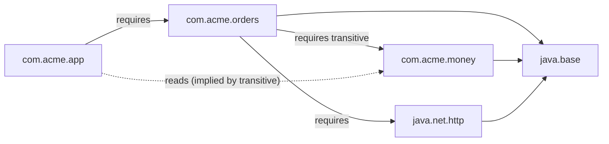
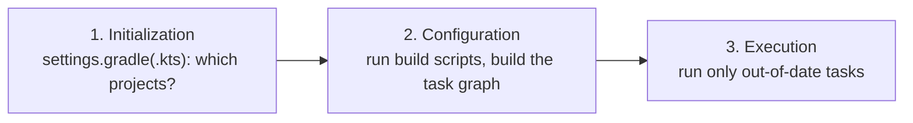

[⬅️ Prev: 14 · Reflection & Proxies](14-reflection-annotations-proxies.md) · [🏠 Index](README.md) · [Next: 16 · Design Principles ➡️](16-design-principles-clean-architecture.md)

# 15 · Modules & Build Tools

> *Nobody gets promoted for their `pom.xml`. Plenty of outages start in one, though: a transitive version flip, a shaded copy of a vulnerable library, a build that isn't reproducible. At staff level, the build is architecture.*

> [!TIP]
> **🧭 Decision guide: build tooling, module boundaries and dependency policy**
> - **When it matters:** once you have more than a handful of services or libraries, slow builds, painful upgrades, or supply-chain requirements.
> - **Default:** whichever of Maven and Gradle your organisation already standardises on; an organisation-wide BOM with convention plugins or a parent POM; `--release` set; dependency convergence enforced; an SBOM per artifact; module boundaries enforced with build modules or ArchUnit rather than JPMS in applications.
> - **Alternatives:** JPMS for libraries and `jlink` runtimes; Gradle with a remote build cache for very large builds; Bazel for polyglot monorepos.
> - **Failure modes:** version conflicts that surface at runtime as `NoSuchMethodError`, split packages, unpinned versions, yearly "upgrade projects" instead of a monthly rhythm.
> - **Evidence that would change it:** build times and cache hit rates, dependency-conflict incidents, and how long it takes to ship a CVE fix to every service.
> - **Argued in:** §3 and §6–§11; [Chapter 37](37-case-study-fleet-jdk-upgrade.md) applies it to a fleet-wide JDK upgrade.

---

## Table of contents
1. [Classpath hell: the problem modules were meant to solve](#1-classpath-hell-the-problem-modules-were-meant-to-solve-)
2. [JPMS: the Java Platform Module System](#2-jpms-the-java-platform-module-system-)
3. [`jdeps`, `jlink`, `jpackage`](#3-jdeps-jlink-jpackage-)
4. [Maven in depth](#4-maven-in-depth-)
5. [Gradle in depth](#5-gradle-in-depth-)
6. [Maven vs Gradle](#6-maven-vs-gradle-)
7. [Diagnosing dependency conflicts](#7-diagnosing-dependency-conflicts-)
8. [Packaging: fat JARs, Boot JARs, layers, multi-release JARs](#8-packaging-fat-jars-boot-jars-layers-multi-release-jars-)
9. [Reproducible, verifiable, secure builds](#9-reproducible-verifiable-secure-builds-)
10. [Modularity beyond JPMS](#10-modularity-beyond-jpms-)
11. [Staff lens](#11-staff-lens-)
12. [Interview questions](#12-interview-questions)
13. [References](#13-references)

---

## 1. Classpath hell: the problem modules were meant to solve 🟡

The classpath is a **flat, ordered list of JARs**. When the JVM needs a class, it takes the **first** match and never looks further. That design causes four classic failures:

| Failure | Cause | Symptom |
|---|---|---|
| **Version conflict** | Two versions of the same library on the classpath | `NoSuchMethodError` / `NoClassDefFoundError` at runtime, depending on JAR order |
| **Duplicate classes** | The same class in two different artifacts (shaded copies, renamed artifacts) | Behaviour depends on classpath order, which can differ between IDE, tests and production |
| **Split packages** | One package spread across several JARs | Package-private access that works by accident; seal violations |
| **Missing dependency** | Not on the runtime classpath, but present at compile time | `NoClassDefFoundError` the first time the code runs, possibly hours into production |

None of these are caught at **startup**. They surface the first time the affected code path runs.

---

## 2. JPMS: the Java Platform Module System 🟡→🔴

Java 9's module system (Project Jigsaw) adds two guarantees:
- **Reliable configuration:** every required module must be present, and no two modules may export the same package. Both are checked **at startup**.
- **Strong encapsulation:** only **exported** packages are accessible to other modules, and only **opened** packages allow deep reflection.

```java
// src/main/java/module-info.java
module com.acme.orders {
    requires java.net.http;                                   // a dependency
    requires transitive com.acme.money;                       // our API exposes Money → our consumers read it too
    requires static org.jspecify;                             // compile-time only (annotations)

    exports com.acme.orders.api;                              // the public API
    exports com.acme.orders.spi to com.acme.orders.plugins;   // qualified export: only to that module

    opens com.acme.orders.model to com.fasterxml.jackson.databind;   // deep reflection, for JSON binding only

    uses com.acme.orders.spi.PricingRule;                     // ServiceLoader consumer
    provides com.acme.orders.spi.PricingRule
        with com.acme.orders.internal.DefaultPricing;         // ServiceLoader provider
}
```



### Three kinds of modules
| Kind | How it arises | Reads | Exports |
|---|---|---|---|
| **Named (explicit)** | A JAR with `module-info.class` on the **module path** | Only what it `requires` | Only what it `exports` |
| **Automatic** | A plain JAR on the **module path**. Its name comes from the `Automatic-Module-Name` manifest entry or the filename | Every module | **Every package** |
| **Unnamed** | Everything on the **classpath** | Every module | Everything, but named modules **can't `require` it** |

Automatic modules are the migration bridge. Library authors should at least publish an `Automatic-Module-Name` so consumers get a stable name.

### `exports` vs `opens`
- `exports p`: public types in `p` are accessible at **compile time and runtime** (normal access).
- `opens p`: types in `p` (including private members) are accessible to **deep reflection at runtime only**, which is what frameworks need for field injection and JSON binding.
- `open module m { … }` opens every package. It's convenient for applications and a smell in libraries.

### Reality check 🧠
- **The JDK itself is fully modular** (`java --list-modules`), and that's where JPMS delivered the most: strong encapsulation of internals, and `jlink` custom runtimes.
- **Application adoption is low.** Most Spring Boot apps run on the classpath, as one big unnamed module. Frameworks rely on reflection, many libraries ship without real descriptors, and split packages are common in older ecosystems.
- **Where it pays off:** libraries with a strict public API, plugin systems (module layers), and `jlink`-based distribution.
- **Interview-safe framing:** "I'd use JPMS when I need *enforced* API boundaries or jlink images. For application-level modularity I usually get more from build modules plus ArchUnit or Spring Modulith (§10), which enforce the same boundaries with less friction."

---

## 3. `jdeps`, `jlink`, `jpackage` 🟡→🔴

```bash
# 1. Which JDK modules does my app actually need?
jdeps --ignore-missing-deps --print-module-deps --multi-release 25 \
      --class-path 'build/libs/lib/*' build/libs/app.jar
# → java.base,java.logging,java.management,java.naming,java.net.http,java.sql

# 2. Build a minimal runtime with only those modules
jlink --add-modules java.base,java.logging,java.management,java.naming,java.net.http,java.sql \
      --strip-debug --no-man-pages --no-header-files --compress zip-6 \
      --output build/jre
# a few tens of MB instead of a full JDK of 300+ MB

# 3. Find use of JDK internals (migration landmines)
jdeps --jdk-internals build/libs/app.jar

# 4. Native installers (.deb, .rpm, .msi, .dmg) with an embedded runtime
jpackage --name orders --input build/libs --main-jar app.jar --runtime-image build/jre
```

**Container images:** a multi-stage Dockerfile that runs `jdeps` → `jlink` in the build stage and copies only `build/jre` plus the app into a slim base image. That gives smaller images, faster pulls and scale-ups, and **fewer components to patch for CVEs**. The trade-off is that diagnostics like `jcmd` and `jfr` aren't included unless you add `jdk.jcmd` and `jdk.jfr`. Add them; you'll need them in production ([Chapter 21](21-performance-engineering-troubleshooting.md)).

---

## 4. Maven in depth 🟡→🔴

### Coordinates and lifecycle
An artifact is identified by `groupId:artifactId:version` (plus packaging and classifier). The **default lifecycle** runs phases in order, and each phase runs the plugin goals **bound** to it:

```
validate → compile → test-compile → test → package → verify → install → deploy
                                    (surefire)  (jar)  (failsafe ITs) (~/.m2)  (remote repo)
```
`mvn verify` runs everything up to and including `verify`. You rarely need `install` in CI (it writes to the local repository), and `clean` is a separate lifecycle.

### Dependency scopes
| Scope | Compile classpath | Test classpath | Runtime / packaged | Transitive | Example |
|---|---|---|---|---|---|
| `compile` (default) | ✅ | ✅ | ✅ | ✅ | Most libraries |
| `provided` | ✅ | ✅ | ❌ (the container supplies it) | ❌ | Servlet API on an app server, Lombok |
| `runtime` | ❌ | ✅ | ✅ | ✅ | JDBC drivers, SLF4J backends |
| `test` | ❌ | ✅ | ❌ | ❌ | JUnit, Mockito, Testcontainers |
| `import` (in `dependencyManagement`, type `pom`) | — | — | — | — | **BOMs** |

### Version mediation: "nearest wins" 💣
When the dependency graph contains several versions of one artifact, Maven picks the **nearest** to your project in the tree. If depths are equal, the **first declared** wins. It does *not* pick the highest version.
```
your-app
├── lib-a:1.0
│   └── guava:31.0          ← depth 2: NEAREST → selected
└── lib-b:1.0
    └── lib-c:1.0
        └── guava:33.0      ← depth 3: omitted ("omitted for conflict with 31.0")
```
If `lib-c` calls an API that only exists in Guava 33, you get `NoSuchMethodError` **at runtime**, in whichever code path first touches it.

**Controlling versions:**
```xml
<dependencyManagement>
  <dependencies>
    <!-- Import a BOM: aligned versions for a whole ecosystem -->
    <dependency>
      <groupId>org.springframework.boot</groupId>
      <artifactId>spring-boot-dependencies</artifactId>
      <version>4.0.0</version>
      <type>pom</type>
      <scope>import</scope>
    </dependency>
    <!-- Pin one artifact explicitly (overrides mediation everywhere in the graph) -->
    <dependency>
      <groupId>com.google.guava</groupId>
      <artifactId>guava</artifactId>
      <version>33.4.0-jre</version>
    </dependency>
  </dependencies>
</dependencyManagement>
```
- **`dependencyManagement`** *declares* versions without adding dependencies. **`dependencies`** actually adds them.
- **Parent POM vs BOM:** a parent gives you inheritance (plugins, properties, versions), but you can only have one. A BOM is composable: import as many as you like. Prefer an org BOM plus a lean parent.
- **`<exclusions>`** cut a transitive dependency off at a specific edge.
- **Maven Enforcer** turns conflicts into build failures: `dependencyConvergence` (every path must resolve to the same version), `requireUpperBoundDeps` (the selected version must be ≥ what any library asked for), `banDuplicateClasses` (from extra-enforcer-rules), and `requireJavaVersion`.

### Diagnosing
```bash
mvn dependency:tree -Dverbose -Dincludes=com.google.guava    # see every path and the "omitted for conflict" lines
mvn dependency:analyze                                        # used-but-undeclared and declared-but-unused dependencies
mvn help:effective-pom                                        # what Maven actually sees after inheritance and profiles
```

### Multi-module builds
A parent `pom.xml` with `<modules>` builds everything in **reactor order** (computed from inter-module dependencies). `mvn -pl orders-service -am verify` builds one module plus the modules it depends on. That's the key to fast CI in large repositories.

---

## 5. Gradle in depth 🟡→🔴

### The model
Gradle builds a **directed acyclic graph of tasks**, then runs only the tasks whose **inputs or outputs changed**.



- **Configuration avoidance:** use `tasks.register` (lazy) instead of `tasks.create` (eager), so unneeded tasks are never configured.
- **The configuration cache** caches the result of phase 2 entirely, so later builds skip straight to execution.
- **Incremental builds:** tasks declare inputs and outputs, and unchanged tasks are `UP-TO-DATE`.
- **The build cache** (local or remote) reuses task outputs keyed by a hash of their inputs, even across machines. A shared remote cache can cut CI time dramatically.

### Configurations: `api` vs `implementation`, the key distinction
```kotlin
// orders/build.gradle.kts
plugins { `java-library` }

java { toolchain { languageVersion = JavaLanguageVersion.of(25) } }   // auto-provisioned JDK

dependencies {
    api(project(":money"))                     // part of OUR public API: consumers see it at compile time
    implementation(libs.jackson.databind)      // internal detail: NOT on consumers' compile classpath
    implementation(platform("org.springframework.boot:spring-boot-dependencies:4.0.0"))  // BOM as a platform
    compileOnly(libs.jspecify)                 // annotations: compile time only
    runtimeOnly(libs.postgresql)               // runtime only (driver)
    annotationProcessor(libs.mapstruct.processor)
    testImplementation(libs.junit.jupiter)
}
```
Why `implementation` matters:
1. **Encapsulation:** consumers can't accidentally compile against your internal dependencies.
2. **Compile avoidance:** changing an `implementation` dependency doesn't force consumers to recompile. In large multi-project builds this is huge.

### Version resolution: highest wins (unlike Maven)
Gradle picks the **highest** requested version by default, then lets you refine:
- `platform(...)` (a BOM as recommendations) vs `enforcedPlatform(...)` (forced).
- `constraints { implementation("com.google.guava:guava:33.4.0-jre") }`.
- **Rich versions:** `strictly`, `require`, `prefer`, `reject`.
- **Dependency locking** (`gradle dependencies --write-locks`) for reproducible resolution with dynamic versions.
- **Version catalogs** (`gradle/libs.versions.toml`): one source of truth for coordinates and versions across all subprojects.

```bash
./gradlew dependencies --configuration runtimeClasspath
./gradlew dependencyInsight --dependency guava --configuration runtimeClasspath   # why this version?
./gradlew build --scan                                                            # a shareable build scan
```

**Always commit and use the Gradle Wrapper** (`gradlew`, with `distributionSha256Sum` pinned), so every machine and CI agent uses the same Gradle version.

---

## 6. Maven vs Gradle 🟡

| | Maven | Gradle |
|---|---|---|
| Model | Declarative XML, fixed lifecycle | Programmable DSL (Kotlin/Groovy), task DAG |
| Conflict resolution | **Nearest wins** | **Highest wins** (with rich constraints) |
| Incremental and cache | Limited (extensions exist) | First-class: incremental tasks, build and configuration caches |
| Large multi-project builds | Fine with `-pl -am` and parallelism | Usually much faster (compile avoidance, caching) |
| Learning curve | Low; very uniform across projects | Higher; flexibility can turn into snowflake builds |
| Ecosystem | The standard for libraries and enterprises | Android, Kotlin, large monorepos |

🧠 Both are fine. **Consistency across the org matters more than the choice itself.** Standardise on one, provide shared conventions (a parent POM or Gradle convention plugins), and keep build logic out of individual service repositories.

---

## 7. Diagnosing dependency conflicts 🔴

**The symptoms:** `NoSuchMethodError`, `NoSuchFieldError`, `NoClassDefFoundError`, `AbstractMethodError`, `IncompatibleClassChangeError`, `ClassCastException: X cannot be cast to X` ([Chapter 04 §6](04-exceptions.md#6-errors-you-must-be-able-to-diagnose-), [Chapter 09 §4](09-jvm-internals.md#4-class-loaders-hierarchy-delegation-identity-)).

**The playbook:**
1. **Which JAR did the class come from?**
   ```bash
   java -verbose:class -jar app.jar | grep 'com.google.common.collect.ImmutableList'
   # [Loaded com.google.common.collect.ImmutableList from file:/app/lib/guava-31.0-jre.jar]
   ```
   Or in code: `ImmutableList.class.getProtectionDomain().getCodeSource().getLocation()`.
2. **Who brought that version in?** `mvn dependency:tree -Dverbose` / `gradle dependencyInsight`.
3. **Who needs which version?** Look at the "omitted for conflict" edges.
4. **Fix it**, in order of preference: align with a BOM or platform → pin in `dependencyManagement`/constraints → upgrade the library that's lagging → exclusion → (last resort) **shading**.
5. **Prevent it:** enforcer and convergence rules in CI, plus automated update PRs (Renovate/Dependabot) gated by tests.

### Shading (relocation): a sharp tool
`maven-shade-plugin` / Gradle Shadow copy a dependency **into your JAR** and **rename its packages** (`com.google.common` → `com.acme.shaded.guava`), so your copy can't conflict with anyone else's.
- ✅ Libraries with heavy dependencies (Elasticsearch clients, Hadoop) use it to avoid forcing versions on their users.
- ❌ Bigger JARs. Duplicated classes in memory. **CVE scanners may not see the shaded copy** 💣, and you have to re-release to pick up its security fixes.

---

## 8. Packaging: fat JARs, Boot JARs, layers, multi-release JARs 🟡

| Format | Structure | Notes |
|---|---|---|
| Thin JAR + `lib/` | App JAR plus a separate dependency directory and a manifest `Class-Path` | Simple; good for jlink and Docker layering |
| Uber/fat JAR (shade) | Every class merged into one JAR | Resource conflicts (`META-INF/services` must be *merged* with transformers) |
| **Spring Boot executable JAR** | `BOOT-INF/classes` + `BOOT-INF/lib/*.jar` (**nested JARs**) + a custom launcher/class loader | `java -jar app.jar` just works. Nested JARs stay intact (no merge conflicts) |
| **Layered** | Dependencies, Spring Boot loader, snapshot dependencies and application code in separate layers | **Docker layer caching**: only the small app layer changes per release |

```dockerfile
# Extract Spring Boot layers so dependencies get their own cached Docker layer
FROM eclipse-temurin:25-jre AS extract
WORKDIR /app
COPY build/libs/app.jar app.jar
RUN java -Djarmode=tools -jar app.jar extract --layers --launcher --destination extracted

FROM eclipse-temurin:25-jre
WORKDIR /app
COPY --from=extract /app/extracted/dependencies/ ./
COPY --from=extract /app/extracted/spring-boot-loader/ ./
COPY --from=extract /app/extracted/snapshot-dependencies/ ./
COPY --from=extract /app/extracted/application/ ./
ENTRYPOINT ["java", "-XX:MaxRAMPercentage=70", "org.springframework.boot.loader.launch.JarLauncher"]
```
(Jib and Cloud Native Buildpacks build layered images without a Dockerfile.)

**Multi-release JARs** (Java 9, `Multi-Release: true`) put version-specific class variants under `META-INF/versions/N/`, so a library can use newer APIs on newer JDKs while keeping a baseline for older ones.

---

## 9. Reproducible, verifiable, secure builds 🔴→🟣

| Practice | How |
|---|---|
| **Reproducible output** | Same sources → byte-identical artifacts. Maven: `project.build.outputTimestamp`; Gradle: `isPreserveFileTimestamps = false`, `isReproducibleFileOrder = true` |
| **Pinned tooling** | Maven Wrapper or Gradle Wrapper with checksums; Java toolchains |
| **Pinned dependencies** | No dynamic or `LATEST` versions in production builds; lockfiles where dynamic versions exist |
| **Checksum and signature verification** | Gradle dependency verification (`verification-metadata.xml`); Maven checksum policy |
| **Single artifact source** | All dependencies through an internal repository proxy (Nexus, Artifactory), which gives audit, caching and resilience against public outages or removals |
| **SBOM** | Generate CycloneDX or SPDX in the build. Store it with the artifact |
| **Provenance and signing** | SLSA-style provenance; Sigstore/cosign signatures for images and artifacts |
| **Vulnerability scanning** | Fail on critical CVEs, with an exception process ([Chapter 25](25-security-for-java-engineers.md)) |
| **Automated updates** | Renovate/Dependabot with grouped PRs, gated by tests |

🧠 **Log4Shell (December 2021) was a build-system question as much as a code question.** The organisations that patched in hours could answer "which of our 1,500 deployables contain `log4j-core` 2.x, *including shaded and transitive copies*?" from their SBOMs. Everyone else spent weeks grepping JARs.

---

## 10. Modularity beyond JPMS 🟣

Most of the value of modularity comes from **enforced boundaries inside the application**, and you don't need JPMS for that:

- **Build modules** (Maven modules, Gradle subprojects) with `implementation` edges. Boundaries are enforced by the compile classpath.
- **ArchUnit** tests make architecture executable:
  ```java
  @ArchTest
  static final ArchRule domainIsIndependent = noClasses()
          .that().resideInAPackage("..domain..")
          .should().dependOnClassesThat().resideInAnyPackage("..infrastructure..", "org.springframework..");

  @ArchTest
  static final ArchRule noCycles = slices().matching("com.acme.(*)..").should().beFreeOfCycles();
  ```
- **Spring Modulith**: application modules defined as top-level packages, with verified dependencies, module integration tests, event-based module interaction, and generated documentation. It's a pragmatic path to a **modular monolith** ([Chapter 16](16-design-principles-clean-architecture.md), [Chapter 23](23-distributed-systems-microservices.md)).

---

## 11. Staff lens 🟣

1. **Own the "golden path."** Provide an org-wide BOM or platform (framework plus approved library versions), convention plugins or a parent POM (compiler flags, `--release`, enforcer rules, test setup, SBOM), and a base container image. Teams that stay on the path get upgrades almost for free.
2. **Measure build health.** Build time, cache hit rate and flaky-test rate feed straight into developer productivity and DORA lead-time metrics. Slow builds are an organisational tax worth a staff engineer's attention.
3. **Keep a dependency budget.** Every dependency is code you run without reviewing, and an upgrade obligation forever. Prefer the JDK (`HttpClient`, `java.time`, records, `ServiceLoader`) over small utility libraries.
4. **Make upgrades boring.** Automated update PRs, convergence rules, compatibility checks (japicmp for your own libraries), and a monthly upgrade rhythm beat a yearly "dependency upgrade project".
5. **Supply-chain readiness is non-negotiable:** an SBOM per artifact, provenance, a single internal registry, and fast rebuild-and-redeploy across the fleet.

---

## 12. Interview questions

<details>
<summary><b>Q1. 🟡 What problems does JPMS solve, and why haven't most applications adopted it?</b></summary>

It provides reliable configuration (missing modules and split packages are detected at startup) and strong encapsulation (only exported packages are accessible, and only opened packages allow deep reflection). It also enabled the JDK's own modularization and `jlink`. Adoption is low because frameworks rely heavily on reflection, many libraries lack proper descriptors, split packages exist in older ecosystems, and build-level modules plus architecture tests give most of the boundary benefits with less friction.
</details>

<details>
<summary><b>Q2. 🟡 <code>exports</code> vs <code>opens</code>? <code>requires transitive</code> vs <code>requires static</code>?</b></summary>

`exports` grants compile-time and runtime access to public types. `opens` grants runtime deep-reflective access (including private members), which frameworks need. `requires transitive` makes your consumers also read the dependency (use it when your API exposes its types). `requires static` is required at compile time but optional at runtime (annotations, optional integrations).
</details>

<details>
<summary><b>Q3. 🔴 How does Maven resolve conflicting dependency versions? How does Gradle?</b></summary>

Maven uses "nearest wins": the version closest to the root of the dependency tree, with first declaration breaking ties, regardless of which is higher. Gradle picks the highest requested version by default and supports rich constraints (`strictly`, `reject`), platforms and locking. In both, the robust approach is explicit alignment via BOMs or platforms plus convergence checks in CI.
</details>

<details>
<summary><b>Q4. 🟡 What's the difference between <code>dependencyManagement</code> and <code>dependencies</code>?</b></summary>

`dependencyManagement` declares versions (and scopes or exclusions) without adding dependencies. It governs the version wherever that artifact appears, including transitively. `dependencies` actually adds artifacts to the project. BOMs are imported into `dependencyManagement` with `scope=import`.
</details>

<details>
<summary><b>Q5. 🔴 Explain Gradle's <code>api</code> vs <code>implementation</code>.</b></summary>

`api` dependencies are part of the library's public API and leak onto consumers' compile classpath. `implementation` dependencies are internal: consumers don't see them at compile time (they're still on the runtime classpath). `implementation` improves encapsulation and enables compile avoidance: changing it doesn't force downstream projects to recompile.
</details>

<details>
<summary><b>Q6. 🔴 You see <code>NoSuchMethodError</code> in production after a dependency bump. How do you diagnose and fix it?</b></summary>

Identify the class and method in the error, find which JAR the class was loaded from (`-verbose:class` or `getCodeSource()`), and find which artifact needs the missing method and which version won mediation (`dependency:tree -Dverbose` / `dependencyInsight`). Fix by aligning versions (BOM or platform, `dependencyManagement` pin, upgrading the lagging library). Prevent recurrence with enforcer convergence and upper-bound rules plus test coverage of integration paths.
</details>

<details>
<summary><b>Q7. 🔴 What is shading and when is it appropriate?</b></summary>

Copying a dependency's classes into your artifact and relocating their packages so they can't conflict with other versions on the classpath. It's appropriate for libraries with heavy or conflict-prone dependencies, or for tools distributed as a single JAR. Downsides: larger artifacts, duplicate classes, CVE scanners potentially missing shaded copies, and the need to re-release to pick up security fixes. For applications, prefer version alignment.
</details>

<details>
<summary><b>Q8. 🟡 How does a Spring Boot executable JAR work?</b></summary>

It contains the app's classes in `BOOT-INF/classes`, dependencies as nested JARs in `BOOT-INF/lib`, and Spring Boot's launcher as the manifest `Main-Class`. The launcher creates a class loader that can read nested JARs directly, then invokes the real `Start-Class`. Layered extraction (via `-Djarmode=tools`) splits it into Docker-friendly layers so dependency layers are cached across releases.
</details>

<details>
<summary><b>Q9. 🔴 How would you use <code>jlink</code> in a container build, and what's the trade-off?</b></summary>

Use `jdeps --print-module-deps` to compute the required JDK modules, `jlink` them (`--strip-debug --no-man-pages --no-header-files --compress`) into a minimal runtime in a build stage, and copy it into a slim base image. The benefits are smaller images, faster pulls and fewer packages to patch. The trade-off is missing modules (reflection-only uses can be missed by `jdeps`, so test thoroughly) and missing diagnostics unless you add `jdk.jcmd` and `jdk.jfr` explicitly.
</details>

<details>
<summary><b>Q10. 🔵 How do you make builds reproducible and supply-chain-safe across an organisation?</b></summary>

Pinned tool versions (wrappers with checksums, toolchains), pinned dependencies (no dynamic versions; lockfiles), reproducible archive settings, a single internal artifact proxy, dependency checksum and signature verification, SBOM generation per artifact, provenance and signing (SLSA, Sigstore), vulnerability scanning with policy gates, and automated update PRs. Pair this with the ability to rebuild and redeploy the whole fleet quickly when a critical CVE lands.
</details>

<details>
<summary><b>Q11. 🟣 How would you enforce module boundaries in a large Spring Boot monolith without JPMS?</b></summary>

Split it into build modules (Maven modules or Gradle subprojects) with `implementation` edges so internal dependencies can't leak, add ArchUnit rules (layer dependencies, no cycles, domain independent of frameworks), and consider Spring Modulith for package-based application modules with verification, event-based interaction between modules and generated documentation. Make the rules part of CI so violations fail the build rather than relying on reviews.
</details>

---

## 13. References
- Nicolai Parlog, *The Java Module System*; Sander Mak & Paul Bakker, *Java 9 Modularity*
- [JEP 261: Module System](https://openjdk.org/jeps/261) · [JEP 282: jlink](https://openjdk.org/jeps/282) · [JEP 392: jpackage](https://openjdk.org/jeps/392)
- [Maven: Introduction to the Dependency Mechanism](https://maven.apache.org/guides/introduction/introduction-to-dependency-mechanism.html)
- [Gradle User Manual](https://docs.gradle.org/current/userguide/userguide.html): dependency management, build cache, configuration cache
- [ArchUnit User Guide](https://www.archunit.org/userguide/html/000_Index.html) · [Spring Modulith reference](https://docs.spring.io/spring-modulith/reference/)
- [SLSA framework](https://slsa.dev/) · [CycloneDX](https://cyclonedx.org/)

---

[⬅️ Prev: 14 · Reflection & Proxies](14-reflection-annotations-proxies.md) · [🏠 Index](README.md) · [Next: 16 · Design Principles ➡️](16-design-principles-clean-architecture.md)
