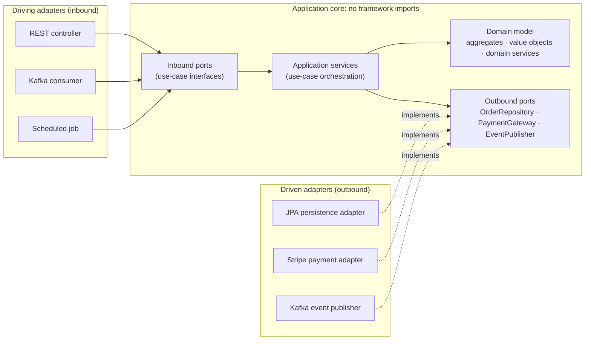

[⬅️ Prev: 15 · Modules & Build Tools](15-modules-and-build-tools.md) · [🏠 Index](README.md) · [Next: 17 · Design Patterns ➡️](17-design-patterns.md)

# 16 · Design Principles, Clean Architecture & DDD

> *Good design is the art of keeping change cheap. Every principle in this chapter is a heuristic for one question: when the requirement changes next quarter, how much code do I have to touch, and how scared will I be to touch it?*

---

## Table of contents
1. [The two metrics behind every principle](#1-the-two-metrics-behind-every-principle-)
2. [SOLID, done properly](#2-solid-done-properly-)
3. [The other principles that matter](#3-the-other-principles-that-matter-)
4. [API design](#4-api-design-)
5. [From layers to hexagons: architecture styles](#5-from-layers-to-hexagons-architecture-styles-)
6. [A hexagonal service in Java](#6-a-hexagonal-service-in-java-)
7. [DDD tactical patterns](#7-ddd-tactical-patterns-)
8. [DDD strategic design (a primer)](#8-ddd-strategic-design-a-primer-)
9. [Designing for testability](#9-designing-for-testability-)
10. [Changing legacy code safely](#10-changing-legacy-code-safely-)
11. [Staff lens: decisions, trade-offs, ADRs](#11-staff-lens-decisions-trade-offs-adrs-)
12. [Interview questions](#12-interview-questions)
13. [References](#13-references)

---

## 1. The two metrics behind every principle 🟢→🟡

- **Cohesion:** how strongly the things *inside* a module belong together. High cohesion means a change touches one place.
- **Coupling:** how much modules depend on each other's details. Low coupling means a change in one doesn't ripple into others.

Nearly every principle below is a way to **raise cohesion or lower coupling**. When two principles seem to conflict (DRY vs decoupling, say), go back to these two metrics and ask which choice makes the *likely* changes cheaper.

**Forms of coupling, from worst to most tolerable:**
| Coupling | Example |
|---|---|
| Content | A module reaches into another's internals (reflection into private fields, a shared mutable static) |
| Common | Modules share global mutable state (a static config map everyone writes to) |
| Temporal / ordering | `init()` must be called before `start()`; deploy A before B |
| Control | Passing a flag that tells the callee *what to do* (`process(order, true, false)`) |
| Stamp | Passing a whole object when only one field is needed |
| Data | Passing just the data needed, through a narrow interface ✅ |

---

## 2. SOLID, done properly 🟡→🔴

### S: Single Responsibility Principle
> *A module should be responsible to one, and only one, actor.* (Robert C. Martin's refined wording)

"Does one thing" is vague. "Has one **reason to change**", meaning one *stakeholder group* whose requests change it, is testable.

```java
// ❌ Three actors change this class: Finance (pay), Operations (hours), DBAs (persistence)
class Employee {
    Money calculatePay() { ... }      // CFO's rules
    Hours reportHours() { ... }       // COO's rules
    void save() { ... }               // CTO's schema
}
// A change to overtime rules for payroll can silently break the hours report if both share a helper.

// ✅ Separate by actor
record Employee(EmployeeId id, String name, PayGrade grade) {}
class PayCalculator   { Money calculatePay(Employee e, Timesheet t) { ... } }
class HoursReporter   { Report reportHours(Employee e, Timesheet t) { ... } }
class EmployeeRepository { void save(Employee e) { ... } }
```
**Nuance:** SRP pushed too far gives you a hundred single-method classes and *low* cohesion. Split along *actual* axes of change, not imagined ones.

### O: Open/Closed Principle
> *Open for extension, closed for modification.* Add behaviour by adding code, not by editing working code.

```java
// ❌ Every new discount type edits this method (and risks breaking the old ones)
Money discount(Order o) {
    return switch (o.customerType()) {
        case "VIP" -> ...;
        case "EMPLOYEE" -> ...;
        default -> Money.ZERO;
    };
}

// ✅ Extension point: new rules are new classes, registered (e.g., as Spring beans)
interface DiscountRule { boolean applies(Order o); Money discount(Order o); }

final class DiscountEngine {
    private final List<DiscountRule> rules;
    DiscountEngine(List<DiscountRule> rules) { this.rules = List.copyOf(rules); }
    Money discount(Order o) {
        return rules.stream().filter(r -> r.applies(o)).map(r -> r.discount(o))
                    .reduce(Money.ZERO, Money::plus);
    }
}
```
🔴 **The nuance interviewers love: the expression problem.** OCP via polymorphism makes adding *new types* easy and adding *new operations* hard (every implementation needs the new method). Sealed types plus pattern matching ([Chapter 08 §6](08-modern-java-8-to-27.md#6-pattern-matching-the-full-picture-)) are the opposite: adding operations is easy, and adding types touches every switch, though the compiler tells you where. **Choose based on which axis changes more often in your domain.**

### L: Liskov Substitution Principle
Subtypes must be usable through the base type **without surprising the caller**: no stronger preconditions, no weaker postconditions, preserved invariants. See [Chapter 02 §15](02-oop-and-object-model.md#15-composition-over-inheritance--liskov-) (Rectangle/Square). Java's own collections compromise here deliberately: `List.add` is an "optional operation", so `List.of(...).add(x)` throws. That's a documented, conscious LSP trade-off for the sake of a single interface hierarchy.

### I: Interface Segregation Principle
> *Clients shouldn't depend on methods they don't use.*

```java
// ❌ A fat interface: the reporting job depends on (and must mock) write methods it never calls
interface OrderRepository {
    Optional<Order> findById(OrderId id);
    List<Order> findByCustomer(CustomerId id);
    Page<Order> search(OrderQuery q);
    void save(Order o);
    void delete(OrderId id);
    void archiveOlderThan(Instant cutoff);
}

// ✅ Role interfaces shaped by their clients
interface OrderReader  { Optional<Order> findById(OrderId id); List<Order> findByCustomer(CustomerId id); }
interface OrderWriter  { void save(Order o); }
interface OrderArchiver { void archiveOlderThan(Instant cutoff); }
// One adapter class can implement all three, while each client depends only on the role it needs.
```

### D: Dependency Inversion Principle
> *High-level policy shouldn't depend on low-level details. Both should depend on abstractions, **and the abstraction belongs to the high-level side**.*

```java
// The domain/application layer DEFINES the port it needs…
package com.acme.orders.application.port.out;
public interface PaymentGateway { PaymentResult charge(OrderId id, Money amount, PaymentToken token); }

// …and infrastructure IMPLEMENTS it. The source-code dependency points INWARD, against the flow of control.
package com.acme.orders.adapter.out.payment;
final class StripePaymentGateway implements PaymentGateway { ... }
```
**DIP ≠ DI.** Dependency *injection* is a technique for wiring objects (constructor injection, Spring). Dependency *inversion* is about **which way source-code dependencies point**. You can inject a concrete `StripeClient` into your domain (DI without DIP) and still have your domain coupled to Stripe.

---

## 3. The other principles that matter 🟡

| Principle | The real meaning | Watch out for |
|---|---|---|
| **DRY** | Every piece of *knowledge* has one authoritative representation | Merging code that only *looks* alike. *"Duplication is far cheaper than the wrong abstraction"* (Sandi Metz) |
| **KISS** | Prefer the simplest design that works | "Simple" isn't "easy". Simple means few interleaved concepts |
| **YAGNI** | Don't build for speculative requirements | Not an excuse to skip *cheap-now, expensive-later* decisions (IDs, timestamps in UTC, idempotency keys) |
| **Law of Demeter** | Talk to your immediate collaborators only | `order.getCustomer().getAddress().getCity()` couples you to three classes' structure |
| **Tell, don't ask** | Push behaviour to the data ([Chapter 02 §2](02-oop-and-object-model.md#2-encapsulation-is-about-invariants-not-getters-)) | Anaemic models where services poke at getters |
| **Composition over inheritance** | Assemble behaviour from parts | [Chapter 02 §3](02-oop-and-object-model.md#3-inheritance-and-the-fragile-base-class-) |
| **Fail fast** | Detect invalid state at the boundary, loudly | Silent defaults that corrupt data downstream |
| **Principle of least astonishment** | APIs behave the way their names suggest | `getX()` that does I/O; `isValid()` that mutates |
| **Make illegal states unrepresentable** | Encode rules in types | [Chapter 02 §13](02-oop-and-object-model.md#13-sealed-types--algebraic-data-types-) |

**Law of Demeter, fixed:**
```java
String city = order.getCustomer().getAddress().getCity();     // ❌ a train wreck
String city = order.shippingCity();                           // ✅ Order knows how to answer
// or pass what's actually needed: ShippingLabel label = labels.forDestination(order.destination());
```

---

## 4. API design 🔴

*"APIs are forever."* Once other teams depend on an API, every mistake becomes permanent or turns into a migration project. Guidelines that hold up, many from Joshua Bloch's *How to Design a Good API and Why It Matters*:

1. **Small surface area.** *When in doubt, leave it out.* You can always add, but you can never remove.
2. **Names are the documentation.** Consistent verbs (`find` returns `Optional`, `get` throws if absent, `list`/`search` return collections).
3. **Minimise mutability.** Immutable value types, defensive copies, unmodifiable return values.
4. **Static factories over constructors** where they help: descriptive names (`Duration.ofSeconds`), caching (`Boolean.valueOf`), returning subtypes (`List.of`).
5. **Builders for many parameters.** Telescoping constructors and boolean soup are bugs waiting for a transposed argument:
   ```java
   // ❌ What do true/false/true mean? Swap two arguments and it still compiles.
   client.send(msg, true, false, true, 3);

   // ✅ Self-describing, order-independent, extensible without breaking callers
   client.send(msg, SendOptions.builder().priority(HIGH).retries(3).encrypted(true).build());
   // and replace booleans with enums: DeliveryMode.AT_LEAST_ONCE instead of `true`
   ```
6. **Never return `null` for "nothing".** Return an empty collection, an `Optional`, or a sealed result type.
7. **Declare nullness.** Spring Framework 7 adopted **JSpecify** (`@NullMarked`, `@Nullable`) across its APIs. Doing the same in your libraries lets IDEs, NullAway and Kotlin enforce it.
8. **Make misuse hard.** Use types for units (`Duration` instead of `long timeoutMillis`), validate early, keep invalid states unrepresentable.
9. **Document the contract:** preconditions, postconditions, thread safety, nullness, exceptions, performance characteristics.
10. **Plan evolution.** Use default methods and overloads for additive changes, `@Deprecated(since = "3.2", forRemoval = true)` with a migration path, semantic versioning, and **binary compatibility checks in CI** ([Chapter 01 §19](01-java-platform-fundamentals.md#19-binary-compatibility--class-file-versions-)).

---

## 5. From layers to hexagons: architecture styles 🟡→🟣

### Classic layered architecture
```
Presentation (controllers)  →  Business (services)  →  Persistence (DAOs / repositories)  →  Database
```
It's simple and familiar. Its failure mode: **the domain depends on persistence** (services import JPA entities and repositories), so the database schema drives the design, and business logic leaks into controllers and DAOs.

### Hexagonal architecture (Ports & Adapters, Alistair Cockburn)
The **application core** (domain plus use cases) sits in the middle and talks to the outside world only through **ports** (interfaces it owns). **Adapters** connect ports to technology.



**Clean Architecture** (Robert Martin) and **Onion Architecture** (Jeffrey Palermo) are the same idea drawn as concentric circles, with the same rule: **source-code dependencies point inward only.** Entities don't know use cases, use cases don't know controllers or databases, and frameworks are details at the edge.

| | Layered | Hexagonal / Clean |
|---|---|---|
| Domain depends on | Persistence | Nothing (only its own ports) |
| Swap DB / messaging | Painful | Write a new adapter |
| Test the business logic | Needs a DB or mocks of repositories | Plain unit tests with in-memory fakes of the ports |
| Cost | Low ceremony | More interfaces and mapping. **Overkill for CRUD** |

🧠 **When *not* to go hexagonal:** thin CRUD services, admin back-offices, and prototypes. Mapping between web DTO, domain object and JPA entity triples the code with no domain logic to protect. Use the style where **the business rules are the valuable, changing part**.

---

## 6. A hexagonal service in Java 🔴

```
com.acme.orders
├── domain                         ← pure Java: Order, OrderLine, Money, OrderPolicy (no Spring, no JPA)
├── application
│   ├── PlaceOrderService          ← implements the use case, orchestrates the domain + ports
│   └── port
│       ├── in   └── PlaceOrderUseCase
│       └── out  ├── OrderRepository
│                ├── PaymentGateway
│                └── EventPublisher
└── adapter
    ├── in.web            └── OrderController (Spring MVC) + request/response DTOs
    ├── in.messaging      └── CartCheckedOutListener
    ├── out.persistence   ├── JpaOrderRepositoryAdapter, OrderEntity, OrderMapper
    └── out.payment       └── StripePaymentGateway
```

```java
// application/port/in
public interface PlaceOrderUseCase {
    OrderId placeOrder(PlaceOrderCommand command);
    record PlaceOrderCommand(CustomerId customer, List<Line> lines, PaymentToken payment) {
        public PlaceOrderCommand { lines = List.copyOf(lines); }
        public record Line(Sku sku, int quantity) {}
    }
}

// application
public final class PlaceOrderService implements PlaceOrderUseCase {
    private final OrderRepository orders;          // outbound ports: interfaces owned by the core
    private final PricingPolicy pricing;
    private final PaymentGateway payments;
    private final EventPublisher events;

    public PlaceOrderService(OrderRepository orders, PricingPolicy pricing,
                             PaymentGateway payments, EventPublisher events) {
        this.orders = orders; this.pricing = pricing; this.payments = payments; this.events = events;
    }

    @Override
    public OrderId placeOrder(PlaceOrderCommand cmd) {
        Order order = Order.draft(orders.nextId(), cmd.customer());
        cmd.lines().forEach(l -> order.addLine(l.sku(), l.quantity(), pricing.priceOf(l.sku())));
        order.submit();                                               // domain enforces its invariants

        PaymentResult result = payments.charge(order.id(), order.total(), cmd.payment());
        if (!(result instanceof PaymentResult.Approved approved)) throw new PaymentDeclinedException(order.id(), result);
        order.markPaid(approved.authCode());

        orders.save(order);
        events.publish(order.pullEvents());                           // see Chapter 23: transactional outbox!
        return order.id();
    }
}
```
The domain and application layers compile and unit-test **with no Spring, JPA or HTTP on the classpath**. Spring wires the adapters at the edge (`@Configuration` or component scanning in the adapter packages). An ArchUnit rule ([Chapter 15 §10](15-modules-and-build-tools.md#10-modularity-beyond-jpms-)) keeps it that way.

---

## 7. DDD tactical patterns 🔴

| Building block | What it is | Java shape |
|---|---|---|
| **Entity** | Has identity and a lifecycle; equality by ID | A class with an `id` field and behaviour |
| **Value object** | Defined by its attributes; immutable; replaceable | `record Money(BigDecimal amount, Currency currency)` |
| **Aggregate** | A cluster of entities and values with **one root** that enforces invariants; the **transactional consistency boundary** | Root class; children reachable only through the root |
| **Domain event** | Something that happened that domain experts care about | `record OrderSubmitted(OrderId id, Money total, Instant at)` |
| **Repository** | Collection-like access to aggregates (one per aggregate root) | An interface in the domain or application layer; adapter in infrastructure |
| **Domain service** | Domain logic that doesn't belong to one entity | `TransferService.transfer(from, to, amount)` |
| **Factory** | Complex creation logic | Static factory on the root, or a dedicated factory |
| **Application service** | Orchestrates a use case: load, act, save, publish | `PlaceOrderService` above. **No business rules in here** |

### An aggregate that protects its invariants
```java
public final class Order {                                   // aggregate root
    private final OrderId id;
    private final CustomerId customerId;                     // OTHER aggregates are referenced by ID only
    private final List<OrderLine> lines = new ArrayList<>();
    private OrderStatus status = OrderStatus.DRAFT;
    private String paymentAuthCode;
    private final List<DomainEvent> pendingEvents = new ArrayList<>();

    private Order(OrderId id, CustomerId customerId) { this.id = id; this.customerId = customerId; }
    public static Order draft(OrderId id, CustomerId customer) { return new Order(id, customer); }

    public void addLine(Sku sku, int quantity, Money unitPrice) {
        requireStatus(OrderStatus.DRAFT);
        if (quantity <= 0) throw new IllegalArgumentException("quantity must be positive: " + quantity);
        if (lines.size() >= 100) throw new OrderTooLargeException(id);
        lines.add(new OrderLine(sku, quantity, unitPrice));
    }

    public void submit() {
        requireStatus(OrderStatus.DRAFT);
        if (lines.isEmpty()) throw new IllegalStateException("cannot submit an empty order " + id);
        status = OrderStatus.SUBMITTED;
        pendingEvents.add(new OrderSubmitted(id, customerId, total(), Instant.now()));
    }

    public void markPaid(String authCode) {
        requireStatus(OrderStatus.SUBMITTED);
        this.paymentAuthCode = Objects.requireNonNull(authCode);
        status = OrderStatus.PAID;
        pendingEvents.add(new OrderPaid(id, authCode));
    }

    public Money total() {
        return lines.stream().map(OrderLine::subtotal).reduce(Money.zero("USD"), Money::plus);
    }
    public List<OrderLine> lines() { return List.copyOf(lines); }          // no mutable leaks
    public List<DomainEvent> pullEvents() {
        var events = List.copyOf(pendingEvents);
        pendingEvents.clear();
        return events;
    }
    private void requireStatus(OrderStatus expected) {
        if (status != expected) throw new IllegalStateException("order " + id + " is " + status + ", expected " + expected);
    }
}
```

**Aggregate design rules (Vaughn Vernon):**
1. **Protect true invariants inside the boundary.** Only rules that must be *immediately* consistent belong inside one aggregate.
2. **Design small aggregates.** Large ones cause lock contention and bloated loads.
3. **Reference other aggregates by identity**, not by object reference.
4. **Use eventual consistency between aggregates**, via domain events. Modify **one aggregate per transaction** as a rule of thumb ([Chapter 23](23-distributed-systems-microservices.md)).

💣 **The anaemic domain model** (Martin Fowler's term): entities with only getters and setters, and every rule in "service" classes. It looks like OO but it's procedural code with extra steps. Invariants get duplicated across services, and nothing stops invalid states.

---

## 8. DDD strategic design (a primer) 🟣

- **Ubiquitous language:** one precise vocabulary shared by domain experts and code *within a context*. If the business says "policy" and the code says `Contract`, you're paying a translation tax on every conversation.
- **Bounded context:** the boundary inside which a model and its language are consistent. A "Customer" in Billing (payment methods, credit) is a different model from a "Customer" in Shipping (addresses, delivery windows). **Don't force a single enterprise-wide `Customer` class.**
- **Context mapping:** how contexts relate. *Customer/Supplier*, *Conformist*, **Anti-Corruption Layer** (translate a legacy or external model at the boundary so it doesn't leak in), *Shared Kernel*, *Open Host Service* / *Published Language* (a stable API or schema for many consumers).
- **Event Storming** is a workshop technique to discover domain events, commands, aggregates and context boundaries with domain experts.
- Bounded contexts are the best starting candidates for **module boundaries**, and later, maybe, **service boundaries** ([Chapter 23](23-distributed-systems-microservices.md)).

---

## 9. Designing for testability 🟡

Testable code and well-designed code are mostly the same thing:
- **Inject time, randomness and identity:** `Clock`, `RandomGenerator`, an `IdGenerator`. Never `Instant.now()` or `UUID.randomUUID()` deep inside domain logic.
- **Keep business logic pure:** inputs → outputs, with side effects behind ports. Pure functions need no mocks.
- **Prefer fakes to mocks for ports:** an `InMemoryOrderRepository` tests behaviour, while mocks test interactions and couple tests to implementation details ([Chapter 20](20-testing-and-quality.md)).
- **Constructor injection only:** all dependencies visible, final fields, and you can instantiate the class in a test with `new`.
- **Hard to test is a design smell:** too many dependencies (an SRP violation), hidden statics, or logic tangled with I/O.

---

## 10. Changing legacy code safely 🔴→🟣

Michael Feathers' definition: **legacy code is code without tests.** The safe way to change it:
1. **Characterization tests:** pin the *current* behaviour (even if it's wrong) before you change anything.
2. **Find seams:** places where you can change behaviour without editing code there (an injectable dependency, an overridable method, a configurable implementation).
3. **Break dependencies** (extract interface, parameterize constructor, extract and override) to get the code under test.
4. **Refactor in small, reversible steps,** with the tests passing after each.

**Techniques for large changes:**
- **Branch by abstraction:** introduce an abstraction over the old implementation, build the new one behind it, switch via a flag, delete the old one. No long-lived branches.
- **Expand–contract (parallel change)** for APIs and schemas: *expand* (add the new field or column and write both), *migrate* consumers and data, *contract* (remove the old). Every step is backward compatible.
- **Strangler fig** for systems: route traffic piece by piece from the legacy system to the new one ([Chapter 24](24-system-design-for-java-architects.md)).
- **The Mikado method:** try the change, note what breaks, revert, fix the prerequisites first, and repeat. It works well for dependency-tangled refactorings.

> *"Make the change easy (warning: this may be hard), then make the easy change."* — Kent Beck

---

## 11. Staff lens: decisions, trade-offs, ADRs 🟣

**1. Every design choice is a trade-off. Say it out loud.** A staff-level answer names what you *give up*: "Hexagonal gives us testable, swappable infrastructure at the cost of mapping boilerplate. For this CRUD admin service the cost isn't worth it, but for pricing it's essential."

**2. Separate reversible from irreversible decisions** (two-way vs one-way doors). Library choices inside a module are reversible, so move fast. Public API shapes, data models, service boundaries and event schemas are expensive to reverse, so slow down and write it down.

**3. Architecture Decision Records** keep the *why* alive after the people who decided have moved on:
```markdown
# ADR-017: Publish order events via a transactional outbox
- Status: Accepted (2026-11-03) · Supersedes: ADR-009
- Context: Orders must emit events to Kafka. Dual writes (DB commit + Kafka send) lose or duplicate
  events on partial failure; we saw 0.3% missing events during the October incident.
- Decision: Write events to an `outbox` table in the same DB transaction; a relay publishes them
  (Debezium CDC). Consumers must be idempotent (event ID dedup).
- Consequences: (+) atomic state change + event; replayable. (−) extra table and relay to operate;
  end-to-end latency +50–200 ms; ordering only per aggregate.
- Alternatives considered: Kafka transactions (doesn't cover the DB), event sourcing (too large a change now).
```

**4. Fitness functions** make architectural intent executable: ArchUnit rules, latency budgets in load tests, dependency-freshness checks, API compatibility checks. If a principle matters, a build should fail when it's violated.

**5. Technical debt is a portfolio.** Track it, put a price on it in terms of the cost of change and incident risk, and pay it down where change is *frequent*. Debt in code nobody touches is cheap. Debt in your hottest module costs money every sprint.

---

## 12. Interview questions

<details>
<summary><b>Q1. 🟡 Explain SRP. Isn't "a class should do one thing" enough?</b></summary>

"One thing" is subjective. The useful definition is "one reason to change", meaning one actor or stakeholder whose requirements drive changes. Mixing logic owned by different actors (payroll rules vs reporting rules vs persistence) means one group's change can break another's. Over-applied, SRP fragments code into tiny classes and *lowers* cohesion. Split along real axes of change.
</details>

<details>
<summary><b>Q2. 🔴 How does OCP relate to sealed types and pattern matching?</b></summary>

Polymorphic OCP (interface plus implementations) makes adding new *types* easy but adding new *operations* hard. Sealed hierarchies plus exhaustive switches make adding *operations* easy, while adding a *type* requires updating every switch (with the compiler pointing to each one). This is the expression problem. Choose based on which axis changes more often in the domain.
</details>

<details>
<summary><b>Q3. 🔴 What's the difference between Dependency Inversion and Dependency Injection?</b></summary>

Injection is a wiring technique: dependencies are supplied from outside (constructor injection, a DI container). Inversion is a structural principle: high-level policy owns the abstractions it needs (ports), and low-level details implement them, so source-code dependencies point toward the policy. You can use DI with concrete infrastructure types and still violate DIP.
</details>

<details>
<summary><b>Q4. 🟡 Give a real example of an ISP violation and its fix.</b></summary>

A 15-method `OrderRepository` used by a read-only reporting job forces it to depend on, and mock, write and archive methods. Split it into role interfaces (`OrderReader`, `OrderWriter`, `OrderArchiver`) shaped by their clients. One adapter can implement all of them. In the JDK, `List`'s "optional operations" are an acknowledged compromise in the same area.
</details>

<details>
<summary><b>Q5. 🔴 When does DRY hurt?</b></summary>

When it merges code that looks similar but represents different knowledge that will change for different reasons. The shared abstraction then grows flags and special cases until it couples unrelated features (the "wrong abstraction"). DRY is about not duplicating *knowledge* (business rules, schemas), not about de-duplicating similar-looking code. Tolerate some duplication until the true abstraction is clear.
</details>

<details>
<summary><b>Q6. 🔴 Explain hexagonal architecture and when you wouldn't use it.</b></summary>

The application core (domain plus use cases) depends only on ports it defines. Inbound adapters (REST, messaging) call inbound ports, and outbound adapters (DB, payment, Kafka) implement outbound ports, so dependencies point inward. The benefits are framework-independent business logic, swappable infrastructure and fast tests. It's overkill for thin CRUD services, where the mapping layers add cost without protecting meaningful domain logic.
</details>

<details>
<summary><b>Q7. 🔴 What is an aggregate, and how big should it be?</b></summary>

A cluster of domain objects treated as one consistency boundary, with a root that enforces invariants and is the only entry point. Changes inside it are transactionally consistent. Keep aggregates small (only what must be immediately consistent), reference other aggregates by ID, use domain events for eventual consistency between aggregates, and modify one aggregate per transaction as a rule of thumb. Large aggregates cause contention and expensive loads.
</details>

<details>
<summary><b>Q8. 🟡 Entity vs value object?</b></summary>

An entity has a stable identity and a lifecycle, and equality is by identity (an `Order` with ID 42 stays the same order as its lines change). A value object has no identity and is defined entirely by its attributes; it's immutable and replaceable (`Money`, `Address`, `DateRange`). In Java, records are the natural fit for value objects.
</details>

<details>
<summary><b>Q9. 🔴 What is an anti-corruption layer?</b></summary>

A translation layer at the boundary between your bounded context and an external or legacy system. It converts their models and semantics into your own, so foreign concepts don't leak into your domain. Typical implementation: an adapter behind an outbound port that calls the legacy API and maps its responses into your domain types, including mapping or normalising errors.
</details>

<details>
<summary><b>Q10. 🟣 How do you approach changing a critical legacy module with no tests?</b></summary>

Write characterization tests around the behaviour you're about to change, find or create seams to get the code under test, and refactor in small steps. For bigger changes, use branch by abstraction or a strangler approach behind feature flags, expand–contract for interface and data changes, and observability to compare the old and new paths (shadow traffic, diffing outputs) before switching over. Record the decision and the rollback plan.
</details>

<details>
<summary><b>Q11. 🟣 What makes a good API, in your opinion?</b></summary>

Easy to use correctly and hard to misuse: small surface, consistent names, immutable values, typed parameters instead of primitive or boolean soup, no nulls in return values, documented contracts (nullness, thread safety, exceptions), and a planned evolution path (additive changes, deprecation windows, compatibility checks in CI). Above all, design it from real client use cases, ideally by writing client code first.
</details>

---

## 13. References
- Robert C. Martin, *Clean Architecture* and *Agile Software Development, Principles, Patterns, and Practices*
- Eric Evans, *Domain-Driven Design*; Vaughn Vernon, *Implementing Domain-Driven Design* and *Effective Aggregate Design* (essay series)
- Alistair Cockburn, [*Hexagonal Architecture*](https://alistair.cockburn.us/hexagonal-architecture/)
- Joshua Bloch, *How to Design a Good API and Why It Matters* (talk); *Effective Java*
- Michael Feathers, *Working Effectively with Legacy Code*
- Neal Ford, Rebecca Parsons, Patrick Kua, *Building Evolutionary Architectures* (fitness functions)
- Sandi Metz, *The Wrong Abstraction* (blog post)

---

[⬅️ Prev: 15 · Modules & Build Tools](15-modules-and-build-tools.md) · [🏠 Index](README.md) · [Next: 17 · Design Patterns ➡️](17-design-patterns.md)
