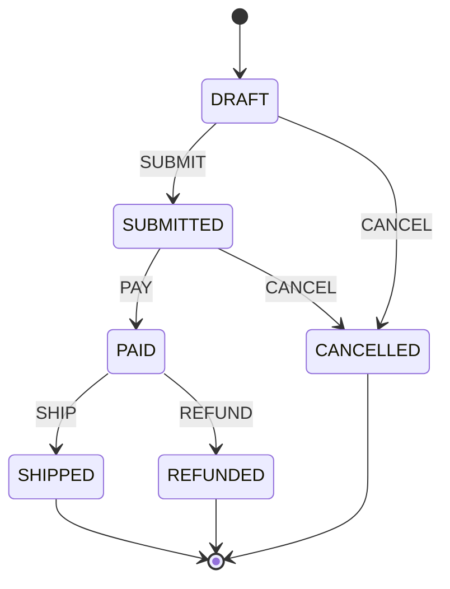

[⬅️ Prev: 16 · Design Principles](16-design-principles-clean-architecture.md) · [🏠 Index](README.md) · [Next: 18 · Spring Internals ➡️](18-spring-internals.md)

# 17 · Design Patterns

> *Patterns are vocabulary, not goals. Saying "it's a decorator" saves ten minutes of explanation in a design review. Forcing a decorator where a lambda would do costs ten hours of maintenance. Modern Java has made several classic patterns nearly invisible, and knowing which ones is part of the answer.*

> [!TIP]
> **🧭 Decision guide: whether to introduce a pattern**
> - **When it matters:** when code has a real axis of change, or when you need to explain a structure in one sentence of a design document.
> - **Default:** start with the simplest code and refactor towards a pattern when change pressure shows up; reach for modern Java (records, sealed types, lambdas, pattern matching) before class hierarchies.
> - **Alternatives:** architecture-level patterns (outbox, circuit breaker, strangler fig, CQRS), which have organisation-wide blast radius and deserve an ADR.
> - **Failure modes:** indirection with no axis of change, singletons hiding global state, decorators and proxies that confuse identity.
> - **Evidence that would change it:** the third change that touches the same conditional, or tests you can't write without a seam.
> - **Argued in:** §1 and §7–§8.

🧪 **Runnable labs:** [the programs behind this chapter's outputs](labs.md#chapter-17--design-patterns)

---

## Table of contents
1. [How to think about patterns in 2026](#1-how-to-think-about-patterns-in-2026-)
2. [Creational patterns](#2-creational-patterns-)
3. [Structural patterns](#3-structural-patterns-)
4. [Behavioural patterns](#4-behavioural-patterns-)
5. [Patterns you already use: the JDK & Spring](#5-patterns-you-already-use-the-jdk--spring-)
6. [Enterprise & persistence patterns](#6-enterprise--persistence-patterns-)
7. [Anti-patterns](#7-anti-patterns-)
8. [Staff lens](#8-staff-lens-)
9. [Interview questions](#9-interview-questions)
10. [References](#10-references)

---

## 1. How to think about patterns in 2026 🟡

A pattern is a **named, reusable solution to a recurring design problem in a context**. The GoF book (1994) catalogued 23, written for C++ and Smalltalk *before* lambdas, generics, records or sealed types existed in mainstream languages. Several of them were really workarounds for missing language features:

| Pattern | Modern Java equivalent |
|---|---|
| Strategy | A lambda / functional interface |
| Command | `Runnable`, `Callable`, `Supplier` |
| Template Method (for behaviour) | A higher-order function taking the varying step as a lambda |
| Visitor | **Sealed interfaces + pattern-matching `switch`** |
| Iterator | `Iterable`, `Stream`, `Spliterator` |
| Singleton | DI container scope (`@Component`), or an `enum` |
| Value objects / immutability boilerplate | `record` |
| Observer | Event buses, `Flow`, reactive streams, Spring application events |

🎯 **Interviewer's lens.** At senior and staff level the question isn't "draw the UML for Observer". It's "*when* would you use it, *what does it cost*, and *what would you use instead in modern Java*?"

---

## 2. Creational patterns 🟡

### Singleton: five implementations and one warning
```java
// 1. Eager: thread-safe through class initialization; created even if never used
public final class Eager { public static final Eager INSTANCE = new Eager(); private Eager() {} }

// 2. Lazy, synchronized: correct, but locks on every call
public final class LazySync {
    private static LazySync instance;
    private LazySync() {}
    public static synchronized LazySync get() { if (instance == null) instance = new LazySync(); return instance; }
}

// 3. Double-checked locking: needs volatile (Chapter 11 §11 explains why)
// 4. Initialization-on-demand holder: lazy, thread-safe, lock-free. The best class-based option
public final class Holder {
    private Holder() {}
    private static final class Lazy { static final Holder INSTANCE = new Holder(); }
    public static Holder get() { return Lazy.INSTANCE; }
}

// 5. Enum: also immune to reflection and serialization attacks (Effective Java Item 3)
public enum Registry { INSTANCE; public void register(String k) { ... } }
```
⚠️ **The warning:** a static singleton is **global mutable state**. It hides dependencies (nothing in your constructor reveals it), makes tests order-dependent, and can't be swapped for a fake. In modern applications, let the **DI container** manage a single instance (Spring beans are singletons by default) and inject it. You get one instance with explicit dependencies.

### Factory Method & static factories
- **GoF Factory Method:** a superclass defines `createX()`, and subclasses decide the concrete type. `Collection.iterator()` is one (each collection returns its own iterator).
- **Static factory methods** (*Effective Java* Item 1, a different idea with a similar name): `List.of`, `Optional.of`, `Duration.ofSeconds`, `EnumSet.noneOf`. They have names, can cache, can return subtypes, and can reduce verbosity.

### Abstract Factory
Creates **families** of related objects without naming concrete classes. In the JDK: `DocumentBuilderFactory`, `XPathFactory`, `TransformerFactory`. In practice: a `CloudClients` factory returning AWS or GCP implementations of `BlobStore`, `Queue` and `Secrets` that are guaranteed to belong together.

### Builder
For objects with many optional parameters. It reads well and is order-independent ([Chapter 16 §4](16-design-principles-clean-architecture.md#4-api-design-)).
```java
public record HttpConfig(Duration connectTimeout, Duration readTimeout, int maxConnections, boolean http2) {
    public static Builder builder() { return new Builder(); }
    public static final class Builder {
        private Duration connectTimeout = Duration.ofSeconds(2);   // sensible defaults live here
        private Duration readTimeout = Duration.ofSeconds(5);
        private int maxConnections = 50;
        private boolean http2 = true;
        public Builder connectTimeout(Duration d) { this.connectTimeout = d; return this; }
        public Builder readTimeout(Duration d)    { this.readTimeout = d; return this; }
        public Builder maxConnections(int n)      { this.maxConnections = n; return this; }
        public Builder http2(boolean b)           { this.http2 = b; return this; }
        public HttpConfig build() {
            if (maxConnections <= 0) throw new IllegalArgumentException("maxConnections must be > 0");
            return new HttpConfig(connectTimeout, readTimeout, maxConnections, http2);
        }
    }
}
HttpConfig cfg = HttpConfig.builder().readTimeout(Duration.ofSeconds(3)).maxConnections(200).build();
```
A **step builder** (an interface per required step) turns "you forgot a required field" into a *compile error*. Use it for APIs where that's worth the extra types.

### Prototype
Create new objects by copying an existing one. Java's `clone()` is broken by design ([Chapter 02 §9](02-oop-and-object-model.md#9-clone-finalize-and-why-theyre-discouraged-)). Use **copy constructors or factories**, or `withX(...)` methods on records.

### Object Pool
Reuse **expensive** objects: database connections (HikariCP), threads (executors), direct buffers (Netty). 💣 Don't pool *cheap* objects. Allocation in Java is a pointer bump ([Chapter 10 §2](10-memory-and-garbage-collection.md#2-allocation-bump-pointers-and-tlabs-)), while pooling adds synchronization, leaks and stale-state bugs.

---

## 3. Structural patterns 🟡→🔴

### Adapter
Converts one interface into another that clients expect.
- JDK: `InputStreamReader` (bytes → chars), `Arrays.asList` (array → `List`), `Collections.enumeration`.
- Architecture: **every hexagonal adapter** is one ([Chapter 16 §5](16-design-principles-clean-architecture.md#5-from-layers-to-hexagons-architecture-styles-)). `StripePaymentGateway` adapts Stripe's SDK to your `PaymentGateway` port.

### Decorator
Adds responsibilities to an object **dynamically, by wrapping it** behind the same interface. The wrappers stack.
```java
interface PriceService { Money priceOf(Sku sku); }

final class CachingPriceService implements PriceService {
    private final PriceService delegate;
    private final Cache<Sku, Money> cache = Caffeine.newBuilder()
            .maximumSize(10_000).expireAfterWrite(Duration.ofMinutes(5)).build();
    CachingPriceService(PriceService delegate) { this.delegate = delegate; }
    @Override public Money priceOf(Sku sku) { return cache.get(sku, delegate::priceOf); }
}

final class TimedPriceService implements PriceService {
    private final PriceService delegate; private final Timer timer;
    TimedPriceService(PriceService delegate, Timer timer) { this.delegate = delegate; this.timer = timer; }
    @Override public Money priceOf(Sku sku) { return timer.record(() -> delegate.priceOf(sku)); }
}

PriceService service = new TimedPriceService(new CachingPriceService(new RemotePriceService(client)), timer);
```
JDK: `java.io` streams (`BufferedInputStream(new FileInputStream(...))`), `Collections.unmodifiableList` and `synchronizedList`.

### Proxy
A stand-in that **controls access** to the real object: lazy creation (a **virtual proxy**, like Hibernate lazy loading), access control (a **protection proxy**), remote calls (a **remote proxy**, like gRPC stubs), or cross-cutting concerns (Spring AOP). See [Chapter 14 §5](14-reflection-annotations-proxies.md#5-dynamic-proxies-jdk-vs-subclass-proxies-).

> **Decorator vs Proxy:** they're structurally identical (both wrap and share the interface). The difference is **intent**. A decorator *adds behaviour* and is usually composed explicitly by the client. A proxy *controls access* and is usually inserted transparently by infrastructure.

### Facade
A simplified interface to a complex subsystem. **SLF4J** is a facade over logging backends. `JdbcTemplate` hides the `Connection`/`PreparedStatement`/`ResultSet`/exception-translation ceremony. An application service is a facade over domain objects and ports.

### Composite
Treat individual objects and compositions uniformly in a tree. File systems, UI component trees, org charts, and expression trees:
```java
sealed interface Node permits FileNode, DirNode {}
record FileNode(String name, long bytes) implements Node {}
record DirNode(String name, List<Node> children) implements Node {}

static long size(Node n) {
    return switch (n) {
        case FileNode f -> f.bytes();
        case DirNode d  -> d.children().stream().mapToLong(c -> size(c)).sum();
    };
}
```

### Bridge
Decouples an **abstraction** from its **implementation** so both can vary independently. JDBC is the textbook case: your code uses the `java.sql` API (the abstraction), and drivers (implementations) plug in underneath. SLF4J's API plus pluggable providers is another.

### Flyweight
Share fine-grained objects to save memory, separating **intrinsic** (shared, immutable) state from **extrinsic** (per-use, passed in) state. JDK: the `Integer` cache −128…127, interned strings, enum constants, `Boolean.TRUE`. It's also why those objects **must** be immutable.

---

## 4. Behavioural patterns 🟡→🔴

### Strategy
A family of interchangeable algorithms behind one interface. In modern Java, **a strategy is usually a lambda**:
```java
enum ShippingMethod { STANDARD, EXPRESS, DRONE }

private static final Map<ShippingMethod, Function<Parcel, Money>> PRICING = new EnumMap<>(Map.of(
        ShippingMethod.STANDARD, p -> Money.usd("4.99"),
        ShippingMethod.EXPRESS,  p -> Money.usd("9.99").plus(p.weightKg() > 5 ? Money.usd("5.00") : Money.usd("0.00")),
        ShippingMethod.DRONE,    p -> Money.usd("14.99")));

Money cost = PRICING.get(method).apply(parcel);
```
Keep a full class hierarchy when strategies carry **state, configuration or dependencies** (each one a Spring bean, say), or when they need several methods.

### Template Method
The superclass defines the algorithm's skeleton, and subclasses override specific steps (*hooks*). JDK: `AbstractList` (implement `get` and `size`, inherit the rest), `HttpServlet.service` dispatching to `doGet`/`doPost`. The modern alternative avoids inheritance by **passing the varying steps as functions**:
```java
<T> T inTransaction(Function<Connection, T> work) {            // the skeleton: begin, work, commit/rollback, close
    try (Connection c = dataSource.getConnection()) {
        c.setAutoCommit(false);
        try { T result = work.apply(c); c.commit(); return result; }
        catch (RuntimeException e) { c.rollback(); throw e; }
    } catch (SQLException e) { throw new DataAccessFailure(e); }
}
```
Spring's `JdbcTemplate`, `RestTemplate` and `TransactionTemplate` are this callback style. The name is historical.

### Observer
Subjects notify registered observers of changes. It lives on as listeners, Spring `ApplicationEvent`s, the `Flow` API and reactive streams (`java.util.Observer` was deprecated in Java 9).

**Pitfalls that show up in production:**
- **Memory leaks:** observers registered on long-lived subjects and never removed ([Chapter 10 §14](10-memory-and-garbage-collection.md#14-memory-leaks-causes-and-the-diagnosis-playbook-)).
- **Synchronous by default:** a slow listener slows the publisher. In Spring, a listener exception propagates back into the publisher's transaction.
- **Ordering and re-entrancy:** observers that trigger further events can recurse in surprising ways.
- **No delivery guarantees across process boundaries.** In-memory events vanish on a crash. Use an outbox for anything that must survive ([Chapter 23](23-distributed-systems-microservices.md)).

### Command
Encapsulate a request as an object, so you can queue it, log it, retry it or undo it. `Runnable`/`Callable` submitted to executors are commands. Undo/redo stacks, job queues, and CQRS *commands* (`PlaceOrderCommand`) all use the same idea.

### Chain of Responsibility
Pass a request along a chain of handlers. Each one handles it, modifies it, or passes it on.
```java
public final class CorrelationIdFilter implements Filter {
    @Override public void doFilter(ServletRequest req, ServletResponse res, FilterChain chain)
            throws IOException, ServletException {
        String id = Optional.ofNullable(((HttpServletRequest) req).getHeader("X-Correlation-Id"))
                            .orElseGet(() -> UUID.randomUUID().toString());
        MDC.put("correlationId", id);
        try { chain.doFilter(req, res); }          // pass along the chain
        finally { MDC.remove("correlationId"); }
    }
}
```
Servlet filters, **the Spring Security filter chain**, Netty's `ChannelPipeline`, OkHttp interceptors and logging handlers all work this way.

### State
An object changes its behaviour when its internal state changes, without a giant `if (status == …)` scattered around the code.



```java
public enum OrderState {
    DRAFT     { public OrderState on(Event e) { return switch (e) { case SUBMIT -> SUBMITTED; case CANCEL -> CANCELLED; default -> reject(e); }; } },
    SUBMITTED { public OrderState on(Event e) { return switch (e) { case PAY -> PAID; case CANCEL -> CANCELLED; default -> reject(e); }; } },
    PAID      { public OrderState on(Event e) { return switch (e) { case SHIP -> SHIPPED; case REFUND -> REFUNDED; default -> reject(e); }; } },
    SHIPPED   { public OrderState on(Event e) { return reject(e); } },
    CANCELLED { public OrderState on(Event e) { return reject(e); } },
    REFUNDED  { public OrderState on(Event e) { return reject(e); } };

    public enum Event { SUBMIT, PAY, SHIP, CANCEL, REFUND }
    public abstract OrderState on(Event e);
    OrderState reject(Event e) { throw new IllegalStateException(e + " is not allowed in state " + this); }
}
```
The transition table *is* the code, and illegal transitions fail loudly. When states carry **different data** (a `Paid` state has an auth code, a `Shipped` state has a tracking number), model them as **sealed records** instead.

### Visitor, and why sealed types mostly replaced it
Visitor adds operations to a fixed class hierarchy through **double dispatch**:
```java
// Classic Visitor: an accept/visit ceremony on every class
interface Shape { <R> R accept(ShapeVisitor<R> v); }
interface ShapeVisitor<R> { R visitCircle(Circle c); R visitSquare(Square s); }
final class Circle implements Shape {
    final double r; Circle(double r) { this.r = r; }
    public <R> R accept(ShapeVisitor<R> v) { return v.visitCircle(this); }
}
```
```java
// Modern Java (21+): the same capability, exhaustiveness checked by the compiler
sealed interface Shape permits Circle, Square {}
record Circle(double r) implements Shape {}
record Square(double side) implements Shape {}

static double area(Shape s) {
    return switch (s) {
        case Circle c -> Math.PI * c.r() * c.r();
        case Square q -> q.side() * q.side();
    };
}
```
Visitor is still useful when the hierarchy is **open** (third parties add types) or you're working with a library's AST that already exposes visitors (`javax.lang.model`, ASM's `ClassVisitor`).

### The rest, briefly
| Pattern | Idea | Java examples |
|---|---|---|
| **Iterator** | Sequential access without exposing the structure | `Iterator`, `Spliterator`, `Stream` |
| **Mediator** | Objects communicate through a hub instead of directly | Spring `ApplicationEventPublisher`, message brokers, a chat-room coordinator |
| **Memento** | Capture and restore state without breaking encapsulation | Undo stacks, event-sourcing snapshots |
| **Interpreter** | Evaluate sentences of a small language | `java.util.regex.Pattern`, Spring Expression Language (SpEL), rule engines |
| **Null Object** | A do-nothing implementation instead of `null` checks | `Collections.emptyList()`, a `NoOpMeterRegistry`, `OutputStream.nullOutputStream()` (11) |

---

## 5. Patterns you already use: the JDK & Spring 🟡

| Pattern | JDK | Spring |
|---|---|---|
| Singleton | `Runtime.getRuntime()` | Singleton-scoped beans |
| Factory Method / static factory | `List.of`, `Calendar.getInstance`, `NumberFormat.getInstance` | `FactoryBean`, `@Bean` methods |
| Abstract Factory | `DocumentBuilderFactory` | `BeanFactory` |
| Builder | `StringBuilder`, `HttpRequest.newBuilder`, `Thread.ofVirtual()` | `UriComponentsBuilder`, `RestClient.builder()` |
| Adapter | `InputStreamReader`, `Arrays.asList` | `HandlerAdapter` (MVC) |
| Decorator | `java.io` streams, `Collections.synchronizedX` | `BeanPostProcessor` wrapping beans |
| Proxy | `java.lang.reflect.Proxy` | AOP proxies (`@Transactional`, `@Cacheable`, `@Async`) |
| Facade | — | `JdbcTemplate`, `RestClient` |
| Composite | `java.awt.Container` | `CompositeCacheManager`, composite property sources |
| Flyweight | `Integer.valueOf` cache, string pool | — |
| Strategy | `Comparator`, `ThreadPoolExecutor.RejectedExecutionHandler` | `ResourceLoader`, `PlatformTransactionManager` implementations |
| Template Method | `AbstractList`, `HttpServlet` | `JdbcTemplate` (callback style), `AbstractRoutingDataSource` |
| Observer | `PropertyChangeListener`, `Flow` | `ApplicationEvent` / `@EventListener` |
| Chain of Responsibility | `java.util.logging.Handler` chains | Security `FilterChain`, `HandlerInterceptor`s |
| Command | `Runnable`, `Callable` | `TaskExecutor` tasks |
| Iterator | `Iterator`, `Spliterator` | — |

---

## 6. Enterprise & persistence patterns 🔴

From Fowler's *Patterns of Enterprise Application Architecture*, plus the ones distributed systems added:

| Pattern | Meaning | Where you meet it |
|---|---|---|
| **Repository** | A collection-like interface for aggregates | Spring Data repositories, DDD ports |
| **Data Mapper** | Separate object model from the DB schema, with a mapper in between | Hibernate/JPA |
| **Active Record** | The object saves itself (`order.save()`) | Rails style; rare in Java (some frameworks support it) |
| **Unit of Work** | Track changes and flush them in one transaction | **The JPA persistence context** (dirty checking) ([Chapter 19](19-persistence-jdbc-jpa-hibernate.md)) |
| **Identity Map** | One in-memory object per DB row within a unit of work | The JPA first-level cache |
| **Lazy Load** | Load associated data on first access | Hibernate proxies (and the N+1 problem) |
| **DTO** | A data carrier across process boundaries | Records as request and response bodies |
| **Specification** | Composable business predicates | Spring Data `Specification`, the Criteria API |
| **Service Layer** | Application boundary that coordinates use cases and transactions | `@Service` + `@Transactional` |
| **Outbox, Saga, CQRS, Event Sourcing** | Consistency patterns across services | [Chapter 23](23-distributed-systems-microservices.md) |
| **Circuit Breaker, Bulkhead, Retry, Timeout** | Resilience patterns | [Chapter 22](22-production-readiness-observability-resilience.md) |

---

## 7. Anti-patterns 🟡→🟣

| Anti-pattern | Symptom | Remedy |
|---|---|---|
| **God object** | A 5,000-line `OrderManager` that everything depends on | Split by responsibility and actor (SRP), extract aggregates |
| **Anaemic domain model** | Entities are bags of getters; rules live in services | Move behaviour to where the data is ([Chapter 16 §7](16-design-principles-clean-architecture.md#7-ddd-tactical-patterns-)) |
| **Singleton abuse / global state** | Static registries and caches everywhere; tests interfere with each other | DI-managed scopes, explicit dependencies |
| **Service Locator** | `ServiceRegistry.get(PaymentService.class)` inside business code | Constructor injection (dependencies become visible) |
| **Golden hammer** | "We use Kafka/reactive/microservices for everything" | Fit the tool to the problem |
| **Premature abstraction** | `AbstractGenericBaseServiceFactoryImpl<T, ID, DTO>` with one implementation | Wait for the second or third use case (rule of three) |
| **Lava flow** | Dead code nobody dares delete | Tests plus usage telemetry, then delete |
| **Big ball of mud** | No discernible structure; everything depends on everything | Enforced module boundaries, strangler refactoring |
| **Distributed monolith** | Microservices that must be deployed together and call each other synchronously in chains | Re-draw boundaries by bounded context; async integration ([Chapter 23](23-distributed-systems-microservices.md)) |
| **Pattern-itis** | Patterns used to demonstrate knowledge, not to solve problems | Start with the simplest code; refactor *towards* patterns when duress appears |

---

## 8. Staff lens 🟣

1. **Patterns are for communication first.** In a design doc, "the gateway is an adapter behind a port, with a caching decorator and a circuit-breaking proxy" conveys a whole structure in one sentence. That's their main value.
2. **Refactor *towards* patterns, don't start from them.** Joshua Kerievsky's *Refactoring to Patterns* has the right mindset: introduce a pattern when the code's growing pains call for it.
3. **Modern Java shrinks the catalogue.** Records, lambdas, sealed types and pattern matching make Strategy, Command, Visitor and much of Builder either trivial or unnecessary. Code reviews should reward the simpler modern form.
4. **Architecture-level patterns matter more at staff level** than GoF: hexagonal, CQRS, outbox, saga, circuit breaker, bulkhead, strangler fig, backends-for-frontends. Those decisions have organisation-wide blast radius.
5. **Name the cost.** Every indirection (interface, factory, proxy) costs navigation, debugging and onboarding. Justify it with a real axis of change.

---

## 9. Interview questions

<details>
<summary><b>Q1. 🟢 What is the best way to implement a singleton in Java?</b></summary>

A single-element enum (thread-safe, and immune to reflection and serialization attacks) or the initialization-on-demand holder idiom (lazy and lock-free). In application code, prefer letting a DI container manage single instances, because static singletons are global state that hides dependencies and hurts testability.
</details>

<details>
<summary><b>Q2. 🟡 Decorator vs Proxy vs Adapter?</b></summary>

All three wrap an object. An adapter changes the *interface* (makes A look like B). A decorator keeps the interface and *adds behaviour* (caching, metrics, buffering), and is usually stacked deliberately. A proxy keeps the interface and *controls access* (lazy loading, security, remoting, transactions), and is usually inserted transparently by infrastructure. Decorator and proxy are structurally identical and differ in intent.
</details>

<details>
<summary><b>Q3. 🟡 Strategy vs State?</b></summary>

Both delegate behaviour to interchangeable objects. In Strategy the *client* picks the algorithm (pricing by shipping method), and strategies don't know about each other. In State, the *object's internal state* determines behaviour, and states typically trigger transitions to other states (an order lifecycle). In modern Java, strategies are often lambdas, and state machines are often enums or sealed records with transition functions.
</details>

<details>
<summary><b>Q4. 🔴 Why has the Visitor pattern become less common in modern Java?</b></summary>

Visitor existed to add operations to a fixed hierarchy without modifying the classes, using double dispatch. Sealed interfaces plus pattern-matching `switch` (Java 21) give the same capability with far less ceremony and compiler-checked exhaustiveness. Visitor still makes sense for open hierarchies or existing APIs (`javax.lang.model`, ASM).
</details>

<details>
<summary><b>Q5. 🟡 Name patterns used in the <code>java.io</code> package.</b></summary>

Decorator (buffering, data and object streams wrapping other streams), Adapter (`InputStreamReader`/`OutputStreamWriter` bridging bytes and characters), and Template Method in the abstract base classes (`InputStream.read(byte[])` built on the abstract `read()`). Factory methods appear in NIO.2 (`Files.newBufferedReader`).
</details>

<details>
<summary><b>Q6. 🔴 What patterns does Spring's <code>@Transactional</code> rely on?</b></summary>

Proxy (an AOP proxy around the bean intercepts calls), Template Method or callback (`TransactionTemplate`/`TransactionInterceptor` define begin, invoke, commit or rollback), Strategy (`PlatformTransactionManager` implementations for JDBC, JPA, JTA, reactive), and thread-bound context through `ThreadLocal` resources (`TransactionSynchronizationManager`). The proxy explains the self-invocation pitfall.
</details>

<details>
<summary><b>Q7. 🟡 What's wrong with the Service Locator pattern?</b></summary>

Dependencies are fetched from a global registry inside methods, so they're invisible in the class's API, tests must configure global state, and missing dependencies fail at runtime instead of at construction. Constructor injection makes dependencies explicit, verified at startup, and trivially replaceable in tests.
</details>

<details>
<summary><b>Q8. 🔴 Where does the Observer pattern cause production issues?</b></summary>

Leaks from listeners that are never deregistered. Latency coupling when synchronous listeners block the publisher. Exceptions in listeners propagating into the publisher (and its transaction). Unpredictable ordering and re-entrancy. Lost events on crash for in-memory events. For cross-service or must-not-lose events, use durable messaging with an outbox. In-process, make async boundaries and error handling explicit.
</details>

<details>
<summary><b>Q9. 🟣 How do you decide whether to introduce a pattern?</b></summary>

Start from a concrete pain: duplicated conditionals across the codebase, a class changing for several reasons, a need to vary behaviour at runtime, cross-cutting concerns leaking into business code. Pick the simplest construct that removes the pain (often a lambda, an enum or a sealed type in modern Java). Weigh the indirection cost (navigation, debugging, onboarding) against the expected change frequency, and refactor towards the pattern when evidence appears rather than designing for speculative flexibility.
</details>

---

## 10. References
- Gamma, Helm, Johnson, Vlissides, *Design Patterns: Elements of Reusable Object-Oriented Software*
- Martin Fowler, *Patterns of Enterprise Application Architecture*
- Joshua Kerievsky, *Refactoring to Patterns*
- Joshua Bloch, *Effective Java*: Items 1–3 (creation), 18 (composition), 42–44 (lambdas replacing patterns)
- Brian Goetz, *Data-Oriented Programming in Java* (sealed types and records vs Visitor)

---

[⬅️ Prev: 16 · Design Principles](16-design-principles-clean-architecture.md) · [🏠 Index](README.md) · [Next: 18 · Spring Internals ➡️](18-spring-internals.md)
