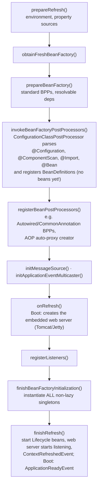
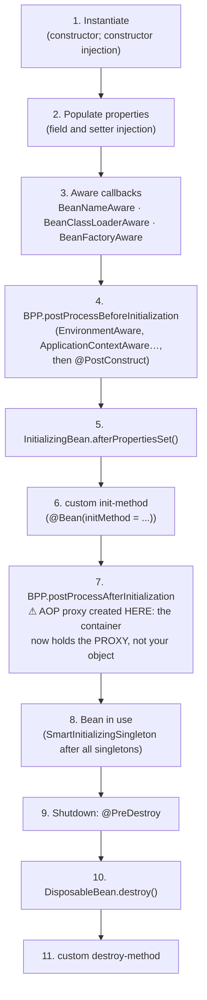
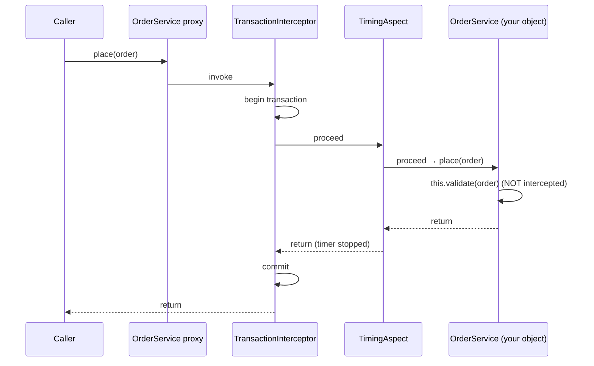
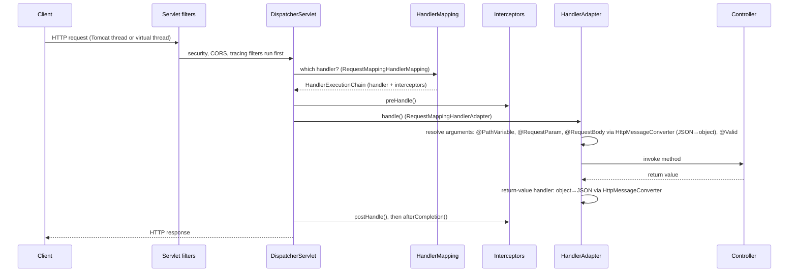
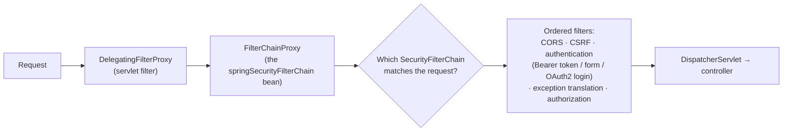

[⬅️ Prev: 17 · Design Patterns](17-design-patterns.md) · [🏠 Index](README.md) · [Next: 19 · Persistence ➡️](19-persistence-jdbc-jpa-hibernate.md)

# 18 · Spring Internals

> *Spring is the most widely used Java framework in the world and also the most misunderstood one. Nearly every "Spring bug" an interviewer asks about comes down to three mechanisms: the bean lifecycle, proxies, and thread-bound context. This chapter covers all three in depth.*

> [!TIP]
> **🧭 Decision guide: how much to rely on Spring's proxies and thread-bound context**
> - **When it matters:** for transactions, security, caching, `@Async`, and anything else Spring implements with a proxy or a thread-local.
> - **Default:** annotations at the edges (web, persistence, `@Transactional` on application services), plain Java in the domain, typed and validated `@ConfigurationProperties`, Open Session in View off, and internal starters for cross-cutting defaults.
> - **Alternatives:** programmatic transactions (`TransactionTemplate`) where boundaries must be explicit; Spring AOT and native images for startup-sensitive apps.
> - **Failure modes:** self-invocation that skips the proxy, private or final methods that aren't advised, context that doesn't follow work onto other threads, Open Session in View holding a connection for the whole request.
> - **Evidence that would change it:** incidents traced to proxy semantics, or a startup budget the default runtime can't meet.
> - **Argued in:** §7–§8, §10 and §16–§17.

---

## Table of contents
1. [IoC, DI and the container](#1-ioc-di-and-the-container-)
2. [How the context starts: `refresh()` step by step](#2-how-the-context-starts-refresh-step-by-step-)
3. [The bean lifecycle, exactly](#3-the-bean-lifecycle-exactly-)
4. [Scopes and the prototype-in-singleton problem](#4-scopes-and-the-prototype-in-singleton-problem-)
5. [Circular dependencies and the three-level cache](#5-circular-dependencies-and-the-three-level-cache-)
6. [`@Configuration`: full vs lite mode](#6-configuration-full-vs-lite-mode-)
7. [AOP: how proxies add behaviour](#7-aop-how-proxies-add-behaviour-)
8. [`@Transactional` in depth](#8-transactional-in-depth-)
9. [Spring Boot auto-configuration](#9-spring-boot-auto-configuration-)
10. [Externalized configuration](#10-externalized-configuration-)
11. [The Spring MVC request lifecycle](#11-the-spring-mvc-request-lifecycle-)
12. [WebFlux and the reactive stack](#12-webflux-and-the-reactive-stack-)
13. [Events](#13-events-)
14. [Spring Security architecture (overview)](#14-spring-security-architecture-overview-)
15. [Spring Framework 7 & Boot 4: what changed](#15-spring-framework-7--boot-4-what-changed-)
16. [Startup, AOT and native](#16-startup-aot-and-native-)
17. [Staff lens](#17-staff-lens-)
18. [Interview questions](#18-interview-questions)
19. [References](#19-references)

---

## 1. IoC, DI and the container 🟢→🟡

**Inversion of Control:** your objects don't create or look up their dependencies. The **container** constructs them and wires them together from **bean definitions**.

```java
@Service
public class OrderService {
    private final OrderRepository orders;
    private final PaymentGateway payments;

    public OrderService(OrderRepository orders, PaymentGateway payments) {   // ✅ constructor injection
        this.orders = orders;                                                // (a single constructor needs no @Autowired)
        this.payments = payments;
    }
}
```

| Injection style | Verdict | Why |
|---|---|---|
| **Constructor** | ✅ Default | Dependencies are explicit and `final`; the object is never half-built; testable with `new`; cycles fail fast |
| Setter | For truly *optional* dependencies | Allows reconfiguration; object can be partially initialized |
| Field (`@Autowired` on a field) | ❌ Avoid | Hidden dependencies, no `final`, needs reflection or Spring in tests, hides "too many dependencies" smells |

**How a dependency is resolved:** by **type** first. If several beans match: `@Qualifier("name")` → `@Primary` → parameter name as a fallback → otherwise `NoUniqueBeanDefinitionException`.
```java
public PricingService(List<DiscountRule> rules,            // ALL beans of that type (ordered by @Order)
                      Map<String, PaymentGateway> gateways, // bean name → bean
                      Optional<FraudCheck> fraud,           // an optional dependency
                      ObjectProvider<AuditLog> audit) {     // lazy, optional, or a fresh prototype on demand
    ...
}
```

**`BeanFactory` vs `ApplicationContext`:** `BeanFactory` is the core DI container (lazy, minimal). `ApplicationContext` extends it with eager singleton creation, events, i18n (`MessageSource`), resource loading, environment and profiles, and automatic registration of post-processors. Applications always use an `ApplicationContext`.

---

## 2. How the context starts: `refresh()` step by step 🔴

`AbstractApplicationContext.refresh()` is the heart of Spring. Spring Boot's `SpringApplication.run()` prepares the environment, then calls it:



**The two extension hooks, which are often confused:**
| | `BeanFactoryPostProcessor` | `BeanPostProcessor` |
|---|---|---|
| Operates on | **Bean definitions** (metadata) | **Bean instances** |
| When | Before any (regular) bean is created | Around each bean's initialization |
| Examples | `ConfigurationClassPostProcessor`, `PropertySourcesPlaceholderConfigurer` | `AutowiredAnnotationBeanPostProcessor` (injection), `CommonAnnotationBeanPostProcessor` (`@PostConstruct`), **`AnnotationAwareAspectJAutoProxyCreator` (creates AOP proxies)** |

---

## 3. The bean lifecycle, exactly 🔴



```java
@Component
class LifecycleDemo implements BeanNameAware, ApplicationContextAware, InitializingBean, DisposableBean {
    LifecycleDemo(Clock clock)                            { log("1 constructor"); }
    @Autowired void setRepo(OrderRepository repo)         { log("2 setter injection"); }
    @Override public void setBeanName(String name)        { log("3 BeanNameAware"); }
    @Override public void setApplicationContext(ApplicationContext ctx) { log("4a ApplicationContextAware"); }
    @PostConstruct void postConstruct()                   { log("4b @PostConstruct"); }
    @Override public void afterPropertiesSet()            { log("5 afterPropertiesSet"); }
    @PreDestroy void preDestroy()                         { log("9 @PreDestroy"); }
    @Override public void destroy()                       { log("10 DisposableBean.destroy"); }
}
```

**Why step 7 matters so much.** If any aspect applies (`@Transactional`, `@Cacheable`, `@Async`, `@Retryable`, `@PreAuthorize`, your own `@Aspect`), the bean registered in the context **is a proxy wrapping your object**. Everything in §7–8 follows from that.

💣 **Don't do heavy work or call out to other beans' proxied methods in `@PostConstruct`.** Your *own* proxy doesn't exist yet at step 4, so `@Transactional` methods called from `@PostConstruct` run **without a transaction**. Use `ApplicationReadyEvent` or `SmartInitializingSingleton` for startup work.

---

## 4. Scopes and the prototype-in-singleton problem 🟡→🔴

| Scope | Instances | Destruction callbacks? |
|---|---|---|
| `singleton` (default) | One per container | ✅ |
| `prototype` | New on every lookup or injection | ❌ **The container does NOT manage destruction** |
| `request` | One per HTTP request | ✅ |
| `session` | One per HTTP session | ✅ |
| `application` | One per `ServletContext` | ✅ |
| `websocket` | One per WebSocket session | ✅ |

⚠️ **Singletons are shared across all request threads, so they must be stateless or thread-safe.** A mutable field in a `@Service` is a race condition ([Chapter 11](11-concurrency-foundations-jmm.md)).

**The prototype-in-singleton problem:**
```java
@Component @Scope("prototype") class ReportBuilder { ... }          // meant to be fresh per use

@Service class ReportService {
    private final ReportBuilder builder;                             // 💣 injected ONCE: the same instance forever
    ReportService(ReportBuilder builder) { this.builder = builder; }
}
```
**Fixes:**
```java
@Service class ReportService {
    private final ObjectProvider<ReportBuilder> builders;            // ✅ ask for a new one each time
    ReportService(ObjectProvider<ReportBuilder> builders) { this.builders = builders; }
    Report build() { return builders.getObject().build(); }
}
// or a @Lookup method, or a scoped proxy: @Scope(value = "prototype", proxyMode = ScopedProxyMode.TARGET_CLASS)
```
The same mechanism (a **scoped proxy**) is what lets you inject a `request`-scoped bean into a singleton. The singleton holds a proxy that resolves the *current request's* instance on every call.

---

## 5. Circular dependencies and the three-level cache 🔴

```java
@Service class A { @Autowired B b; }
@Service class B { @Autowired A a; }       // A needs B, B needs A
```

For **field or setter injection**, Spring can resolve this by exposing an **early reference** to a partially created bean, through three maps in `DefaultSingletonBeanRegistry`:

| Level | Map | Holds |
|---|---|---|
| 1 | `singletonObjects` | Fully initialized beans |
| 2 | `earlySingletonObjects` | Early references already handed out |
| 3 | `singletonFactories` | `ObjectFactory` lambdas that *create* an early reference on demand |

Sequence: create A (instantiate) → register a factory for A in level 3 → populate A → needs B → create B → populate B → needs A → finds A's factory in level 3, calls it, and moves the result to level 2 → B completes → A completes → A moves to level 1.

**Why a *factory* (level 3) and not just the raw object?** Because A might need an **AOP proxy**. The factory calls `getEarlyBeanReference()` on `SmartInstantiationAwareBeanPostProcessor`s, so B receives *A's proxy*, not raw A, and the proxy is created once.

**Constructor-injection cycles can't be resolved.** No instance exists yet to expose early, so you get `BeanCurrentlyInCreationException`.

> [!IMPORTANT]
> **Since Spring Boot 2.6, circular references are prohibited by default** (`spring.main.allow-circular-references=false`). A cycle is a design smell: two classes that can't exist without each other are really one responsibility split badly, or they need an abstraction or an event between them. Fix the design rather than flipping the flag. `@Lazy` on one side is a stopgap.

---

## 6. `@Configuration`: full vs lite mode 🔴

```java
@Configuration                                    // "full" mode: proxyBeanMethods = true (the default)
class AppConfig {
    @Bean Clock clock() { return Clock.systemUTC(); }
    @Bean TokenService tokens() { return new TokenService(clock()); }   // returns the SINGLETON Clock bean
    @Bean AuditService audit()  { return new AuditService(clock()); }   // the same instance again
}
```
In full mode, Spring creates a **CGLIB subclass of your configuration class**. Calls to `@Bean` methods are intercepted: if the bean already exists, the container returns it instead of running your method again. That's how `clock()` called twice still yields one singleton.

```java
@Configuration(proxyBeanMethods = false)          // "lite" mode: no CGLIB subclass
class LiteConfig {
    @Bean Clock clock() { return Clock.systemUTC(); }
    @Bean TokenService tokens() { return new TokenService(clock()); }   // 💣 a plain Java call: a NEW Clock, not the bean
    @Bean AuditService audit(Clock clock) { return new AuditService(clock); }   // ✅ inject via parameters instead
}
```
**Lite mode** (also what you get with `@Bean` methods in a `@Component` class) starts faster and works with native images. Spring Boot's own auto-configurations all use `proxyBeanMethods = false`. **Rule:** in lite mode, never call `@Bean` methods directly. Take dependencies as method parameters.

---

## 7. AOP: how proxies add behaviour 🔴

**Vocabulary:**
- **Join point:** a point in execution. In Spring AOP that's only **method execution on a Spring bean**.
- **Pointcut:** an expression that selects join points (`execution(* com.acme..*Service.*(..))`, `@annotation(com.acme.Timed)`).
- **Advice:** code to run: `@Before`, `@AfterReturning`, `@AfterThrowing`, `@After` (finally), `@Around`.
- **Aspect:** pointcuts plus advice.
- **Weaving:** applying aspects. Spring AOP weaves at **runtime with proxies**. AspectJ weaves at compile or load time by **modifying bytecode**.

```java
@Target(ElementType.METHOD) @Retention(RetentionPolicy.RUNTIME)
public @interface Timed { String value(); }

@Aspect
@Component
class TimingAspect {
    private final MeterRegistry registry;
    TimingAspect(MeterRegistry registry) { this.registry = registry; }

    @Around("@annotation(timed)")
    Object time(ProceedingJoinPoint pjp, Timed timed) throws Throwable {
        Timer.Sample sample = Timer.start(registry);
        try {
            return pjp.proceed();                                   // call the next advice or the target method
        } finally {
            sample.stop(registry.timer(timed.value(), "method", pjp.getSignature().getName()));
        }
    }
}
```



**Every infrastructure annotation is an aspect:** `@Transactional` (`TransactionInterceptor`), `@Cacheable` (`CacheInterceptor`), `@Async` (`AsyncExecutionInterceptor`), `@PreAuthorize` (method security interceptors), `@Retryable` and `@ConcurrencyLimit` (Spring Framework 7 resilience), `@Validated` (`MethodValidationInterceptor`).

**The proxy limitations** (all from [Chapter 14 §5](14-reflection-annotations-proxies.md#5-dynamic-proxies-jdk-vs-subclass-proxies-)):
1. **Self-invocation isn't intercepted** (`this.method()` bypasses the proxy).
2. **`private` methods are never intercepted.** `final` methods can't be overridden by CGLIB, so they're silently not intercepted either.
3. Only **Spring-managed beans** are proxied. Objects you create with `new` aren't.
4. The order between several aspects follows `@Order`/`Ordered` (lower value = outer). The relative order of transactions vs retries vs caching **changes behaviour**. Retries *outside* the transaction get a fresh transaction per attempt; retries *inside* reuse one that may already be rollback-only.

---

## 8. `@Transactional` in depth 🔴

### How it works
`TransactionInterceptor` (an around advice) asks the `PlatformTransactionManager` (`JpaTransactionManager`, `DataSourceTransactionManager`, …) to begin a transaction. That binds a **connection or EntityManager to the current thread** through `TransactionSynchronizationManager` (`ThreadLocal`s). Your repositories pick up that thread-bound resource. On return the interceptor commits; on an exception that matches the rollback rules it rolls back.

### Propagation
| Propagation | If a transaction exists | If none exists | Notes |
|---|---|---|---|
| `REQUIRED` (default) | **Join it** | Create one | Inner failures mark the *shared* transaction rollback-only |
| `REQUIRES_NEW` | **Suspend** it, create an independent one | Create one | ⚠️ Holds **two connections** per thread |
| `NESTED` | Savepoint inside the existing one | Create one | JDBC savepoints; not supported by JPA's transaction manager for nested JPA work |
| `SUPPORTS` | Join | Run without | |
| `NOT_SUPPORTED` | Suspend it, run without | Run without | |
| `MANDATORY` | Join | **Throw** | Asserts the caller has a transaction |
| `NEVER` | **Throw** | Run without | |

### Rollback rules 💣
By default, a transaction rolls back on **`RuntimeException` and `Error` only**. **Checked exceptions COMMIT.**
```java
@Transactional
public void importFile(Path p) throws IOException {
    repo.save(header);
    parseLines(p);          // throws IOException (checked) → the transaction COMMITS the header anyway!
}

@Transactional(rollbackFor = Exception.class)   // ✅ roll back on checked exceptions too
```

### The traps interviewers ask about
**1. Self-invocation:** `@Transactional` on a method called via `this` does nothing ([§7](#7-aop-how-proxies-add-behaviour-)).

**2. `UnexpectedRollbackException`:**
```java
@Service class CheckoutService {
    private final InventoryService inventory;                // another bean, so its proxy applies
    @Transactional
    public void checkout(Order o) {
        orders.save(o);
        try {
            inventory.reserve(o);                           // REQUIRED: joins; throws OutOfStockException (runtime)
        } catch (OutOfStockException e) {
            log.warn("backordering {}", o.id());            // "handled"… but the SHARED tx is already rollback-only
        }
    }   // commit → UnexpectedRollbackException: Transaction silently rolled back because it has been marked as rollback-only
}
```
The inner participant's interceptor marked the *shared* transaction rollback-only before your `catch` ever ran. Fixes: make `reserve` `REQUIRES_NEW` (independent), use `noRollbackFor` on the inner method, or don't throw for an expected outcome (return a result type).

**3. The transaction is bound to the thread:**
```java
@Transactional
public void process(Order o) {
    repo.save(o);
    CompletableFuture.runAsync(() -> repo.updateStats(o));   // 💣 a different thread: NOT in this transaction
}
```
`@Async` methods, executors, `CompletableFuture`, parallel streams and virtual threads you start yourself **don't inherit the transaction**. Run the work inside the transaction on the same thread, or give it its own transaction.

**4. Long transactions holding connections:**
```java
@Transactional
public void placeOrder(Order o) {
    repo.save(o);
    paymentClient.charge(o);       // 💣 a 2-second remote call while holding a DB connection (and row locks)
    repo.markPaid(o);
}
```
Under load, the connection pool drains and everything stalls. **Keep remote calls out of transactions.** Split the work into: transaction (create order) → remote call → transaction (update status), with idempotency and compensation ([Chapter 23](23-distributed-systems-microservices.md)).

**5. `REQUIRES_NEW` pool deadlock:** each request holds connection #1 (outer transaction) and waits for connection #2 (inner). With a pool of 10 and 10 concurrent requests, every request holds one connection and waits forever for a second. Size the pool for it, or avoid the pattern.

**6. `readOnly = true`** is a *hint*: Hibernate skips dirty checking and flushing (a real performance win for large reads), and drivers or routing data sources may send the query to a replica. It's not a security mechanism.

**7. Side effects after commit:** sending emails or Kafka messages from inside a transaction that later rolls back means telling the world about something that never happened. Use `@TransactionalEventListener(phase = AFTER_COMMIT)`, or better, the outbox pattern.

```java
@TransactionalEventListener(phase = TransactionPhase.AFTER_COMMIT)
void onOrderPlaced(OrderPlaced event) { mailer.sendConfirmation(event.orderId()); }   // runs only if the tx committed
```

**8. Programmatic control** when annotations get awkward:
```java
transactionTemplate.executeWithoutResult(status -> {
    repo.save(order);
    if (!valid(order)) status.setRollbackOnly();
});
```

---

## 9. Spring Boot auto-configuration 🔴

`@SpringBootApplication` = `@SpringBootConfiguration` + `@ComponentScan` + **`@EnableAutoConfiguration`**.

**How auto-configuration works:**
1. `@EnableAutoConfiguration` imports `AutoConfigurationImportSelector`.
2. It reads candidate classes from **`META-INF/spring/org.springframework.boot.autoconfigure.AutoConfiguration.imports`** in every JAR. (Before Boot 2.7, that list lived in `spring.factories`.) **Boot 4** split the big auto-configure JAR into many focused modules, each with its own list.
3. Each candidate is a `@AutoConfiguration` class guarded by **conditions**, evaluated in a defined order (`@AutoConfiguration(after = DataSourceAutoConfiguration.class)`).

```java
@AutoConfiguration
@ConditionalOnClass(DataSource.class)                     // only if JDBC is on the classpath
@ConditionalOnProperty(prefix = "acme.audit", name = "enabled", havingValue = "true", matchIfMissing = true)
@EnableConfigurationProperties(AuditProperties.class)
public class AuditAutoConfiguration {
    @Bean
    @ConditionalOnMissingBean                             // back off if the user defined their own
    AuditLog auditLog(DataSource ds, AuditProperties props) { return new JdbcAuditLog(ds, props.table()); }
}
```

**The principle is "back off":** auto-configuration provides a default bean *only when you haven't defined one* (`@ConditionalOnMissingBean`). To customise, define your own bean, set properties, or exclude: `@SpringBootApplication(exclude = DataSourceAutoConfiguration.class)`.

**Debugging "why is (or isn't) this bean here?"**
- Run with `--debug` (or `debug=true`) to get the **condition evaluation report** (positive and negative matches, and why).
- `/actuator/conditions` shows the same at runtime, and `/actuator/beans` lists every bean and its dependencies.

**Writing an internal starter** (the platform team's tool): an `-autoconfigure` module (auto-configuration plus `AutoConfiguration.imports`) and a `-starter` module (dependencies only). Teams add one dependency and get your company's logging, tracing, security and client defaults.

---

## 10. Externalized configuration 🟡→🔴

**Precedence, simplified (higher wins):**
1. Command-line arguments (`--server.port=9090`)
2. `SPRING_APPLICATION_JSON`
3. Java system properties (`-Dserver.port=9090`)
4. OS environment variables (`SERVER_PORT=9090`, via relaxed binding)
5. Profile-specific files **outside** the JAR (`./config/application-prod.yml`)
6. Profile-specific files **inside** the JAR (`application-prod.yml`)
7. `application.yml` / `.properties` outside, then inside the JAR
8. `@PropertySource` on configuration classes, then defaults

**Type-safe configuration** (prefer it over scattered `@Value`s):
```java
@ConfigurationProperties(prefix = "payments.client")
@Validated
public record PaymentClientProperties(
        @NotNull URI baseUrl,
        @NotNull Duration connectTimeout,
        @NotNull Duration readTimeout,
        @Min(1) int maxConnections) {}
// payments.client.base-url, PAYMENTS_CLIENT_READTIMEOUT=2s and --payments.client.read-timeout=2s all bind (relaxed binding)
```
Validated at startup, so a bad configuration **fails fast** instead of failing at first use. It documents itself (with the configuration processor, IDEs autocomplete it) and it's immutable as a record.

**Kubernetes:** mount secrets as files and use `spring.config.import=configtree:/etc/secrets/`. Prefer that to environment variables, which leak into process listings and crash dumps.

---

## 11. The Spring MVC request lifecycle 🔴



**On an exception:** the `DispatcherServlet` asks its `HandlerExceptionResolver`s. `ExceptionHandlerExceptionResolver` finds a matching `@ExceptionHandler` in the controller or in a `@ControllerAdvice` and renders, for example, an RFC 9457 `ProblemDetail` ([Chapter 04 §9](04-exceptions.md#9-designing-exceptions-for-an-api-)).

**Filters vs interceptors vs aspects:**
| | Servlet `Filter` | `HandlerInterceptor` | AOP aspect |
|---|---|---|---|
| Level | Servlet container, before Spring MVC | Spring MVC, around handler execution | Any Spring bean method |
| Knows the handler? | ❌ | ✅ (`HandlerMethod`) | ✅ (method signature) |
| Use for | Security, CORS, compression, tracing headers | Locale, auditing per endpoint, timing per handler | Transactions, caching, metrics on services |

**Threading:** one request maps to one thread (from Tomcat's pool), or to a **virtual thread** with `spring.threads.virtual.enabled=true` (Boot 3.2+) ([Chapter 12 §12](12-concurrency-advanced-juc-loom.md#12-virtual-threads-project-loom-)).

---

## 12. WebFlux and the reactive stack 🔴

Spring WebFlux runs on **Reactor** (`Mono<T>` = 0..1 item, `Flux<T>` = 0..N items) over **non-blocking servers** (Netty by default), with a few **event-loop threads** ([Chapter 13 §5](13-io-nio-networking-serialization.md#5-selectors--non-blocking-servers-)).

```java
@GetMapping("/users/{id}/dashboard")
Mono<Dashboard> dashboard(@PathVariable String id) {
    return Mono.zip(userClient.get(id), orderClient.recent(id), prefsClient.get(id).onErrorReturn(Prefs.defaults()))
               .map(t -> new Dashboard(t.getT1(), t.getT2(), t.getT3()))
               .timeout(Duration.ofMillis(800));
}
```

**Rules and pitfalls:**
- **Never block an event-loop thread** (JDBC, `Thread.sleep`, `.block()`). One blocking call stalls every connection on that loop. BlockHound detects it in tests. If you must call blocking code, `subscribeOn(Schedulers.boundedElastic())`.
- **Nothing happens until you subscribe.** A `Mono` you build but never return or subscribe to does nothing at all.
- **Context propagation:** `ThreadLocal`-based MDC and security don't follow operators across threads. Use Reactor `Context` and Micrometer's context propagation.
- **Debugging:** stack traces are full of operator internals. Use `checkpoint()` and `Hooks.onOperatorDebug()` in development.

**When to choose WebFlux vs MVC with virtual threads:** see [Chapter 12 §14](12-concurrency-advanced-juc-loom.md#14-virtual-threads-vs-reactive-programming-). In short, use WebFlux for streaming and backpressure-heavy workloads, and MVC on virtual threads for typical request/response services.

---

## 13. Events 🟡

```java
public record OrderPlaced(OrderId orderId, CustomerId customerId) {}

@Service class OrderService {
    private final ApplicationEventPublisher events;
    @Transactional public void place(Order o) { repo.save(o); events.publishEvent(new OrderPlaced(o.id(), o.customerId())); }
}

@Component class LoyaltyListener {
    @EventListener void on(OrderPlaced e) { ... }                                  // synchronous, same thread, same transaction
    @Async @EventListener void onAsync(OrderPlaced e) { ... }                      // another thread, no transaction
    @TransactionalEventListener(phase = TransactionPhase.AFTER_COMMIT)
    void afterCommit(OrderPlaced e) { ... }                                        // only if the publisher's tx commits
}
```
💣 Plain `@EventListener`s are **synchronous**. An exception in a listener propagates to the publisher and can roll back its transaction. In-process events are **lost on a crash**: use them for decoupling *inside* a module, and an **outbox** for anything that must reach another service.

---

## 14. Spring Security architecture (overview) 🔴


- **Authentication** produces an `Authentication` stored in the **`SecurityContextHolder`**, which is thread-bound by default (`ThreadLocal`). Propagation to async work needs `DelegatingSecurityContextExecutor` or equivalents.
- **Authorization:** request rules (`authorizeHttpRequests`) and **method security** (`@PreAuthorize("hasRole('ADMIN')")`, an AOP proxy again, with the same self-invocation caveat).
- Several `SecurityFilterChain` beans can coexist (for example, `/api/**` with stateless JWT and `/admin/**` with session login).
- **Spring Security 7** (paired with Boot 4) added first-class multi-factor authentication support. Details on OAuth2, JWT and common mistakes are in [Chapter 25](25-security-for-java-engineers.md).

---

## 15. Spring Framework 7 & Boot 4: what changed 🟣

Spring Boot 4.0 (November 2025) is built on Spring Framework 7. The highlights to know:

| Area | Change |
|---|---|
| **Baselines** | Java 17 minimum (Java 25 recommended), **Jakarta EE 11**, Kotlin 2.2 |
| **Null safety** | The portfolio adopted **JSpecify** annotations (`@NullMarked`, `@Nullable`) |
| **API versioning** | A first-class `version` attribute on `@RequestMapping` and its variants, with configurable resolution (header, path, query parameter, media type) |
| **Resilience in core** | `@Retryable` (backoff, jitter) and `@ConcurrencyLimit` moved into Spring Framework from Spring Retry |
| **HTTP clients** | Declarative **HTTP service clients** (`@HttpExchange` interfaces) with grouping and Boot auto-configuration |
| **JSON** | **Jackson 3** by default (`tools.jackson` packages); Jackson 2 support deprecated |
| **Modularity** | The monolithic `spring-boot-autoconfigure` JAR split into focused modules |
| **Observability** | An OpenTelemetry starter; Micrometer 1.16 baseline |
| **Servers** | Tomcat 11 / Jetty 12; **Undertow support dropped** |
| **Data / persistence** | Hibernate 7.x |

```java
// API versioning (Spring Framework 7)
@RestController
@RequestMapping("/orders")
class OrderController {
    @GetMapping(path = "/{id}", version = "1")   OrderV1 getV1(@PathVariable long id) { ... }
    @GetMapping(path = "/{id}", version = "2+")  OrderV2 getV2(@PathVariable long id) { ... }   // 2 and later
}
// configure how the version is read, e.g. from a request header, via spring.mvc.apiversion.* properties

// Declarative HTTP client
@HttpExchange("/orders")
interface OrderClient {
    @GetExchange("/{id}") Order get(@PathVariable long id);
    @PostExchange Order create(@RequestBody NewOrder order);
}
```

🧠 **Upgrade notes for a 3.x → 4.x migration:** Jackson 3 is the biggest code-level change (package renames, some behaviour differences). The modularized auto-configuration can change which starters you need. Undertow users must switch servers. Hibernate 7 and Jakarta EE 11 bring their own migration notes. Spring Boot 3.5 was the last 3.x line, and its open-source support ended in mid-2026, so plan accordingly.

---

## 16. Startup, AOT and native 🔴

- **Lazy initialization** (`spring.main.lazy-initialization=true`) speeds up startup but moves failures and latency to the first request. It's good for development and risky in production.
- **Spring AOT** (Boot 3+) runs at build time: it evaluates conditions and generates **Java code for bean definitions**, replacing reflection-heavy runtime processing. That's required for **GraalVM native images** and also usable on the JVM.
- **CDS and Leyden AOT cache:** Boot supports extracting the app for class-data sharing and works with the JDK's AOT cache ([Chapter 09 §12](09-jvm-internals.md#12-startup--warmup-cds-leyden-aot-crac-native-image-)) for significantly faster JVM startup.
- **Measure** with `BufferingApplicationStartup` plus `/actuator/startup`, which shows the slowest bean initializations.

---

## 17. Staff lens 🟣

1. **Spring is a platform, so treat it like one.** Maintain internal starters (observability, security, clients, error handling), a BOM, and paved-road templates. Upgrades (2→3 for Jakarta, 3→4 for Jackson 3 and modules) become a few platform PRs instead of 200 team projects.
2. **Teach the three mechanisms:** the lifecycle (what happens at startup, and when a proxy exists), proxies (self-invocation, finality, ordering), and thread-bound context (transactions, security, MDC, and how they *don't* cross threads). Most Spring incidents trace back to one of these.
3. **Audit the dangerous defaults:** **Open Session in View** (`spring.jpa.open-in-view` is `true` by default, so lazy loading happens in the view layer and holds a connection for the whole request; [Chapter 19](19-persistence-jdbc-jpa-hibernate.md)), Actuator exposure, connection-pool sizes, and timeouts on HTTP clients.
4. **Keep business logic framework-light.** Annotations at the edges (web, persistence, transactions on application services), plain Java in the domain ([Chapter 16](16-design-principles-clean-architecture.md)). That makes Spring upgrades cheaper and tests faster.
5. **Use configuration as code reviewable by others:** typed `@ConfigurationProperties`, validated at startup, documented, and environment-specific values outside the artifact.

---

## 18. Interview questions

<details>
<summary><b>Q1. 🟢 Why is constructor injection preferred?</b></summary>

Dependencies are explicit and can be `final`, the object is fully initialized after construction, it's trivially testable with `new` (no Spring or reflection), too many constructor parameters surface SRP smells, and circular dependencies fail fast at startup instead of being papered over.
</details>

<details>
<summary><b>Q2. 🔴 Walk through the Spring bean lifecycle.</b></summary>

Instantiate (constructor) → populate (field and setter injection) → Aware callbacks (`BeanNameAware`, `BeanFactoryAware`…) → `BeanPostProcessor.postProcessBeforeInitialization` (including `ApplicationContextAware` and `@PostConstruct`) → `InitializingBean.afterPropertiesSet` → custom init method → `postProcessAfterInitialization` (where AOP proxies are created) → in use → on shutdown: `@PreDestroy` → `DisposableBean.destroy` → custom destroy method. Prototype beans don't get destruction callbacks.
</details>

<details>
<summary><b>Q3. 🔴 <code>BeanFactoryPostProcessor</code> vs <code>BeanPostProcessor</code>?</b></summary>

A `BeanFactoryPostProcessor` modifies bean *definitions* before any regular bean is instantiated (`ConfigurationClassPostProcessor` registers definitions from `@Configuration` classes; the placeholder configurer resolves `${…}`). A `BeanPostProcessor` works on bean *instances* around initialization: injection, `@PostConstruct`, and wrapping beans in AOP proxies.
</details>

<details>
<summary><b>Q4. 🔴 How does Spring resolve circular dependencies, and why can't it for constructor injection?</b></summary>

For field or setter injection, it registers an `ObjectFactory` for a bean right after instantiation (third-level cache). When a dependent bean needs it during population, the factory produces an early reference (possibly an early AOP proxy via `getEarlyBeanReference`), cached in the second level. Once complete, the bean moves to the first level. With constructor injection, no instance exists before the dependencies are resolved, so there's nothing to expose: `BeanCurrentlyInCreationException`. Since Boot 2.6 cycles are prohibited by default. Fix the design.
</details>

<details>
<summary><b>Q5. 🔴 What's the difference between <code>@Configuration</code> full and lite mode?</b></summary>

Full mode (`proxyBeanMethods = true`) subclasses the configuration class with CGLIB, so calls between `@Bean` methods return the container's singleton. Lite mode (`proxyBeanMethods = false`, or `@Bean` methods in a `@Component`) has no proxy, so calling a `@Bean` method directly creates a new object. Lite mode starts faster and suits native images; inject dependencies as `@Bean` method parameters instead of calling the methods.
</details>

<details>
<summary><b>Q6. 🔴 Name five situations where <code>@Transactional</code> doesn't do what people expect.</b></summary>

(1) Self-invocation bypasses the proxy. (2) `private` (and, for CGLIB, `final`) methods aren't intercepted. (3) Checked exceptions commit by default unless you set `rollbackFor`. (4) Work on other threads (`@Async`, `CompletableFuture`, executors) isn't in the transaction. (5) A caught exception from an inner `REQUIRED` participant still leaves the shared transaction rollback-only, causing `UnexpectedRollbackException` at commit. Bonus: calling `@Transactional` methods from `@PostConstruct` runs without a transaction, because the proxy doesn't exist yet.
</details>

<details>
<summary><b>Q7. 🔴 <code>REQUIRED</code> vs <code>REQUIRES_NEW</code> vs <code>NESTED</code>?</b></summary>

`REQUIRED` joins the existing transaction or creates one, and failures affect the whole shared transaction. `REQUIRES_NEW` suspends the current transaction and runs in an independent one that commits or rolls back on its own, using a second connection (watch pool sizing). `NESTED` uses a savepoint in the existing transaction, so an inner rollback only reverts to the savepoint. It needs a JDBC transaction manager with savepoint support.
</details>

<details>
<summary><b>Q8. 🟡 How does Spring Boot auto-configuration work, and how do you override it?</b></summary>

`@EnableAutoConfiguration` loads candidate classes listed in `META-INF/spring/…AutoConfiguration.imports` across the classpath. Each is guarded by conditions (`@ConditionalOnClass`, `@ConditionalOnMissingBean`, `@ConditionalOnProperty`…) and ordered with `after`/`before`. They back off when you define your own beans. Override by defining the bean yourself, setting properties, or excluding the auto-configuration. Debug with `--debug` (the condition evaluation report) or `/actuator/conditions`.
</details>

<details>
<summary><b>Q9. 🟡 How do you inject a prototype bean into a singleton correctly?</b></summary>

Injecting it directly gives the singleton one instance forever. Use `ObjectProvider<T>` (call `getObject()` each time), a `@Lookup` method, or a scoped proxy (`proxyMode = TARGET_CLASS`), which resolves a fresh instance per call. The scoped-proxy mechanism also makes request- and session-scoped beans injectable into singletons.
</details>

<details>
<summary><b>Q10. 🔴 Describe the Spring MVC request flow.</b></summary>

Servlet filters (security, CORS, tracing) → `DispatcherServlet` → `HandlerMapping` finds the handler and interceptors → interceptors' `preHandle` → `HandlerAdapter` resolves arguments (path variables, request params, `@RequestBody` via `HttpMessageConverter`, validation) and invokes the controller → the return-value handler serialises the result → `postHandle`/`afterCompletion`. Exceptions go to `HandlerExceptionResolver`s (`@ExceptionHandler`/`@ControllerAdvice`), which often render `ProblemDetail`.
</details>

<details>
<summary><b>Q11. 🔴 Why is a remote call inside a <code>@Transactional</code> method dangerous?</b></summary>

The transaction holds a database connection (and possibly row locks) for the whole duration of the remote call. Under load or when the remote service is slow, the connection pool exhausts and the service stalls, and locks block other transactions. Also, if the transaction rolls back after the remote call succeeded, the systems disagree. Keep remote calls outside transactions and coordinate with idempotency, an outbox, or sagas.
</details>

<details>
<summary><b>Q12. 🟣 What did Spring Boot 4 / Spring Framework 7 change that affects a large codebase upgrade?</b></summary>

Jakarta EE 11 baseline, Jackson 3 by default (package renames: the largest code impact), modularized auto-configuration (starter changes), JSpecify null annotations (Kotlin and IDE nullness changes), Hibernate 7, Tomcat 11/Jetty 12 with Undertow dropped, and new first-class features (API versioning, `@Retryable`/`@ConcurrencyLimit` in core, HTTP service clients, an OpenTelemetry starter). I'd plan it platform-first: upgrade the internal starters and BOM, run OpenRewrite recipes, fix Jackson-related serialization tests, then roll out by service tier.
</details>

<details>
<summary><b>Q13. 🟣 Your team reports intermittent <code>LazyInitializationException</code> after disabling Open Session in View. What's your guidance?</b></summary>

That's OSIV doing its job: it had been hiding lazy loading in the web layer, outside service transactions. The fix is to fetch what each use case needs inside the transaction (JOIN FETCH, entity graphs, DTO projections) and return DTOs from the service layer, not entities. Keep OSIV off. It holds connections for the whole request and hides N+1 queries ([Chapter 19](19-persistence-jdbc-jpa-hibernate.md)).
</details>

---

## 19. References
- [Spring Framework Reference Documentation](https://docs.spring.io/spring-framework/reference/): Core (IoC, AOP), Data Access (transactions), Web MVC
- [Spring Boot Reference Documentation](https://docs.spring.io/spring-boot/): auto-configuration, externalized configuration
- [Spring Boot 4.0 release announcement](https://spring.io/blog/2025/11/20/spring-boot-4-0-0-available-now/) and the Spring Framework 7 release notes and migration guide
- Juergen Hoeller and Spring team talks on Framework 7; *Spring in Action* (Craig Walls)
- Vlad Mihalcea's blog on Spring transactions and Hibernate interplay

---

[⬅️ Prev: 17 · Design Patterns](17-design-patterns.md) · [🏠 Index](README.md) · [Next: 19 · Persistence ➡️](19-persistence-jdbc-jpa-hibernate.md)
