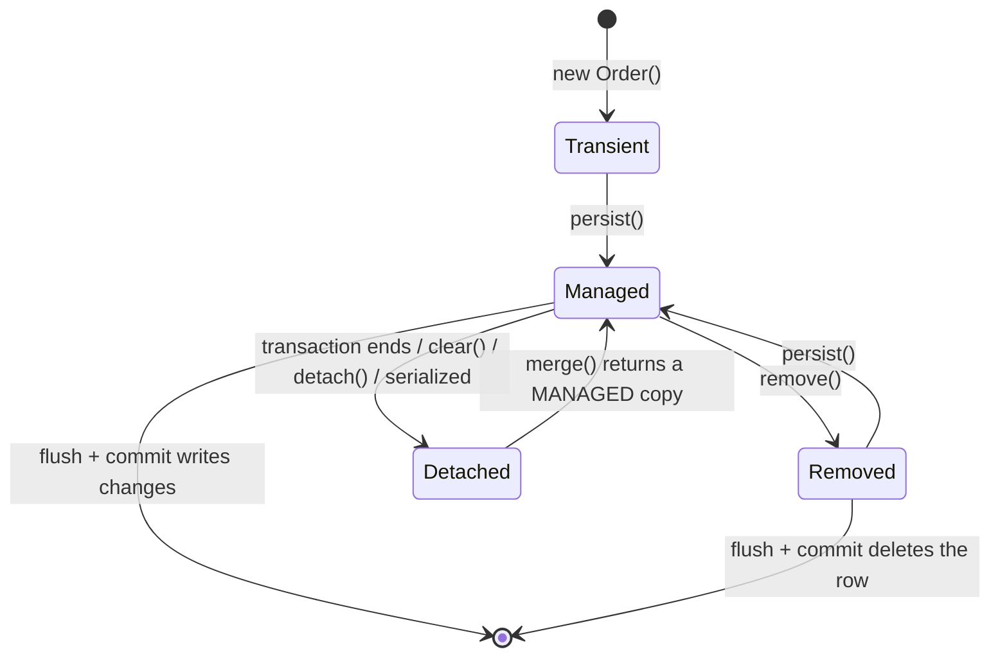

[⬅️ Prev: 18 · Spring Internals](18-spring-internals.md) · [🏠 Index](README.md) · [Next: 20 · Testing ➡️](20-testing-and-quality.md)

# 19 · Persistence: JDBC, Transactions, JPA & Hibernate

> *The database outlives every service built on top of it. The most expensive bugs I know of are data bugs: lost updates, phantom double-bookings, an N+1 query that only shows up at month-end volume. This chapter is about the rules that prevent them.*

---

## Table of contents
1. [JDBC done right](#1-jdbc-done-right-)
2. [Connection pooling & sizing](#2-connection-pooling--sizing-)
3. [Transactions, isolation & anomalies](#3-transactions-isolation--anomalies-)
4. [MVCC: how modern databases actually isolate](#4-mvcc-how-modern-databases-actually-isolate-)
5. [Locking: optimistic, pessimistic, `SKIP LOCKED`](#5-locking-optimistic-pessimistic-skip-locked-)
6. [JPA/Hibernate architecture & the persistence context](#6-jpahibernate-architecture--the-persistence-context-)
7. [Mapping: IDs, associations, equality](#7-mapping-ids-associations-equality-)
8. [Fetching and the N+1 problem](#8-fetching-and-the-n1-problem-)
9. [Batching & bulk operations](#9-batching--bulk-operations-)
10. [Caching in the persistence layer](#10-caching-in-the-persistence-layer-)
11. [Spring Data JPA: power and pitfalls](#11-spring-data-jpa-power-and-pitfalls-)
12. [When not to use an ORM](#12-when-not-to-use-an-orm-)
13. [Schema migrations without downtime](#13-schema-migrations-without-downtime-)
14. [Scaling the data tier](#14-scaling-the-data-tier-)
15. [Staff lens](#15-staff-lens-)
16. [Interview questions](#16-interview-questions)
17. [References](#17-references)

---

## 1. JDBC done right 🟢→🟡

```java
public Optional<Account> findAccount(DataSource ds, long id) throws SQLException {
    String sql = "SELECT id, owner, balance FROM accounts WHERE id = ?";
    try (Connection c = ds.getConnection();                          // from the pool
         PreparedStatement ps = c.prepareStatement(sql)) {
        ps.setLong(1, id);                                            // a BIND parameter, never string concatenation
        try (ResultSet rs = ps.executeQuery()) {
            if (!rs.next()) return Optional.empty();
            return Optional.of(new Account(rs.getLong("id"), rs.getString("owner"), rs.getBigDecimal("balance")));
        }
    }                                                                 // closes rs, ps, then returns the connection to the pool
}
```

**Why `PreparedStatement`, always:**
1. **SQL injection is impossible** for bound values: they're sent separately from the SQL text ([Chapter 25](25-security-for-java-engineers.md)).
2. **Plan reuse:** the database (and the driver's statement cache) can reuse parsed and planned statements.
3. Correct type handling for dates, decimals and binary data.

**Batching** sends many statements in one round trip:
```java
try (Connection c = ds.getConnection()) {
    c.setAutoCommit(false);
    try (PreparedStatement ps = c.prepareStatement("INSERT INTO events(id, type, payload) VALUES (?, ?, ?)")) {
        for (Event e : events) {
            ps.setObject(1, e.id()); ps.setString(2, e.type()); ps.setString(3, e.json());
            ps.addBatch();
            if (++n % 500 == 0) ps.executeBatch();               // flush every 500 rows
        }
        ps.executeBatch();
    }
    c.commit();
}
```
Driver flags make batching *really* fast by rewriting it into multi-row inserts: PostgreSQL `reWriteBatchedInserts=true`, MySQL `rewriteBatchedStatements=true`.

**Fetch size:** `ps.setFetchSize(1000)` streams large result sets instead of loading everything into memory. 💣 The PostgreSQL driver only streams when **auto-commit is off**. Otherwise it reads the whole result into the heap.

**Spring's modern JDBC API (`JdbcClient`, Spring 6.1+)** removes the ceremony:
```java
List<OrderSummary> recent = jdbcClient.sql("""
        SELECT o.id, o.total, c.name AS customer
        FROM orders o JOIN customers c ON c.id = o.customer_id
        WHERE o.created_at > :since
        ORDER BY o.created_at DESC
        LIMIT :limit""")
    .param("since", since)
    .param("limit", 100)
    .query(OrderSummary.class)          // maps columns onto a record
    .list();
```

---

## 2. Connection pooling & sizing 🟡→🔴

Opening a connection means TCP + TLS + authentication + session setup, which takes milliseconds to tens of milliseconds. Pools keep connections open and lend them out. **HikariCP** is Spring Boot's default.

| Setting | Meaning | Guidance |
|---|---|---|
| `maximumPoolSize` | Max connections | **Small** (see below). Default 10 |
| `minimumIdle` | Idle connections kept | Set **equal to max** for a fixed-size pool (predictable, no churn) |
| `connectionTimeout` | Max wait to *borrow* a connection | Default 30 s is too long for request paths. Use 1–5 s so overload fails fast |
| `maxLifetime` | Retire connections after this | **Shorter** than any database, proxy or firewall idle timeout (e.g. 30 min vs a 60-min LB timeout) |
| `keepaliveTime` | Ping idle connections | Keeps NAT and firewall state alive |
| `leakDetectionThreshold` | Log a stack trace if a connection is held longer than this | Enable in staging (for example 20 s) to find leaks |

### How big should the pool be?
A widely cited starting point (from the PostgreSQL community, popularised by HikariCP's "About Pool Sizing" wiki page):
```
connections ≈ (core_count × 2) + effective_spindle_count
```
On a 4-core database server with SSDs, that's roughly **10**. This surprises people. **Smaller pools are often faster:** a database can only run about as many queries in parallel as it has cores, and beyond that it context-switches, contends on locks and thrashes caches. Queueing in the *application's* pool is cheaper than queueing inside the database.

💣 **Multiply by instances.** 60 pods × 20 connections = **1,200 connections** against a database tuned for 300. Each Postgres connection is a process using several MB of RAM. The fix is a fleet-wide budget: smaller per-pod pools, or a server-side pooler (**PgBouncer** in transaction mode, which has prepared-statement caveats; RDS Proxy), or fewer, larger instances.

**Monitor:** active/idle/pending connections, **acquire time** (the leading indicator of saturation), timeouts and usage time. With virtual threads, pool limits become *the* concurrency control for the database ([Chapter 12 §12](12-concurrency-advanced-juc-loom.md#12-virtual-threads-project-loom-)).

---

## 3. Transactions, isolation & anomalies 🔴

**ACID:** **A**tomicity (all or nothing), **C**onsistency (constraints hold), **I**solation (concurrent transactions don't interfere, *to the degree configured*), **D**urability (committed means it survives a crash).

### The anomalies
| Anomaly | What happens | Example |
|---|---|---|
| **Dirty read** | You read another transaction's **uncommitted** write | You see a balance from a transfer that then rolls back |
| **Non-repeatable read** | Reading the same row twice gives different values | The price changes between two reads in your transaction |
| **Phantom read** | Re-running a range query returns new or removed rows | `COUNT(*) WHERE status='OPEN'` changes mid-transaction |
| **Lost update** | Two read-modify-write cycles overwrite each other | Both read stock = 10, both write 9: one sale is lost |
| **Read skew** | You read related rows at inconsistent points in time | Account A before a transfer, account B after it, so the total looks wrong |
| **Write skew** | Two transactions read overlapping data, write *different* rows, and together violate a constraint | Two on-call doctors each check "someone else is on call", and both go off call |

### Isolation levels (SQL standard)
| Level | Dirty read | Non-repeatable | Phantom | Typical default |
|---|---|---|---|---|
| Read Uncommitted | possible | possible | possible | — |
| **Read Committed** | ❌ | possible | possible | **PostgreSQL, Oracle, SQL Server** |
| **Repeatable Read** | ❌ | ❌ | possible (standard) | **MySQL InnoDB** |
| **Serializable** | ❌ | ❌ | ❌ | — |

**What real databases do differs from the standard:**
- **PostgreSQL:** Read Uncommitted behaves like Read Committed. Repeatable Read is **snapshot isolation** (no phantoms, but **write skew is possible**). Serializable is **SSI** (Serializable Snapshot Isolation): it detects dangerous patterns and aborts one transaction with `40001 serialization_failure`, **which your code must retry**.
- **MySQL InnoDB:** Repeatable Read with consistent snapshots for plain reads, plus **next-key/gap locks** for locking reads, which prevent many phantoms but cause surprising lock waits.
- **Oracle:** Read Committed by default. Its "Serializable" is snapshot isolation.

### The lost update, and four fixes
```java
// ❌ Read-modify-write in application code: two concurrent requests both read 10 and both write 9
Product p = repo.findById(id).orElseThrow();
p.setStock(p.getStock() - 1);
repo.save(p);
```
```sql
-- ✅ 1. Atomic, conditional update: the database does the read-modify-write
UPDATE products SET stock = stock - 1 WHERE id = ? AND stock >= 1;     -- check "rows affected == 1"

-- ✅ 2. Pessimistic lock: block others until we commit
SELECT stock FROM products WHERE id = ? FOR UPDATE;
```
```java
// ✅ 3. Optimistic locking: detect the conflict at write time (JPA @Version, §5)
// ✅ 4. SERIALIZABLE isolation + retry on serialization failure
```

### Write skew: the one people miss
```sql
-- Rule: at least one doctor must be on call. Alice and Bob are both on call.
-- T1 (Alice)                                   T2 (Bob)
SELECT count(*) FROM doctors WHERE on_call;     SELECT count(*) FROM doctors WHERE on_call;   -- both see 2
UPDATE doctors SET on_call=false WHERE name='Alice';
                                                UPDATE doctors SET on_call=false WHERE name='Bob';
COMMIT;                                         COMMIT;     -- zero doctors on call; the invariant is broken
```
Under snapshot isolation (PostgreSQL Repeatable Read, Oracle "Serializable"), **both commit**. The two transactions wrote *different* rows, so there's no write-write conflict to detect. Fixes: `SERIALIZABLE` (true serializability via SSI, with retries), `SELECT … FOR UPDATE` on the rows the decision depends on, or materialising the constraint (a single row or counter that both transactions update).

---

## 4. MVCC: how modern databases actually isolate 🔴

**Multi-Version Concurrency Control:** instead of locking rows for reads, the database keeps **several versions** of each row, each tagged with the transaction that created it (and the one that deleted or replaced it).

```
row id=7, versions:
  v1 balance=100  created_by=tx 1001  replaced_by=tx 1050
  v2 balance= 80  created_by=tx 1050  replaced_by=—

tx 1040's snapshot (started before 1050 committed) → sees v1 (100)
tx 1060's snapshot (started after 1050 committed)  → sees v2 (80)
```
- **Readers don't block writers, and writers don't block readers.** Each transaction reads from its snapshot.
- **Writers still block writers** on the same row (row locks), and the second writer either waits or, under snapshot isolation, fails with a serialization error.
- The cost is **old versions**. PostgreSQL keeps them in the table and **VACUUM** cleans them up. **Long-running transactions prevent cleanup** (table and index bloat), which is another reason to keep transactions short. InnoDB and Oracle keep old versions in undo logs and fail long readers with "snapshot too old" once undo space runs out.

---

## 5. Locking: optimistic, pessimistic, `SKIP LOCKED` 🔴

### Optimistic locking (JPA `@Version`)
```java
@Entity
class Product {
    @Id Long id;
    int stock;
    @Version long version;                      // incremented on every update
}
```
```sql
UPDATE product SET stock=?, version=8 WHERE id=? AND version=7   -- 0 rows updated ⇒ someone else changed it
```
Hibernate throws `OptimisticLockException`. Then you either **retry** (re-read, re-apply the change) or **surface the conflict** (HTTP 409 with the latest state, "someone else edited this document").
✅ No locks held, scales well, ideal when conflicts are **rare**.
❌ Under high contention on the same rows (a hot product during a flash sale), retries snowball.

### Pessimistic locking
```java
@Lock(LockModeType.PESSIMISTIC_WRITE)                         // SELECT ... FOR UPDATE
@Query("select p from Product p where p.id = :id")
Optional<Product> findForUpdate(@Param("id") long id);
```
✅ Correct under heavy contention: transactions queue up instead of retrying.
❌ Holds locks: keep the transaction **short**, set **lock timeouts**, and acquire locks in a **consistent order** to avoid database deadlocks (PostgreSQL aborts one victim with `40P01`, and you retry).

### `SKIP LOCKED`: a job queue in plain SQL
```sql
-- Each worker claims up to 10 pending jobs that no other worker has locked
SELECT id, payload FROM jobs
WHERE status = 'PENDING'
ORDER BY created_at
LIMIT 10
FOR UPDATE SKIP LOCKED;
-- … process them, set status = 'DONE', commit
```
Competing workers never block each other and never take the same job. That makes a reliable job queue on PostgreSQL or MySQL 8+ without a message broker (used by libraries like db-scheduler and JobRunr), and it's a good pattern for outbox relays ([Chapter 23](23-distributed-systems-microservices.md)).

---

## 6. JPA/Hibernate architecture & the persistence context 🔴

| Object | Lifetime | Thread-safe |
|---|---|---|
| `EntityManagerFactory` / `SessionFactory` | Application | ✅ (expensive to build: metadata, caches) |
| `EntityManager` / `Session` | One unit of work (usually one transaction) | ❌ |
| **Persistence context** | Inside the `EntityManager` | — |

**The persistence context is three patterns in one:**
- **Identity map:** within one context, a given database row is represented by **exactly one** Java object. `em.find(Order.class, 1) == em.find(Order.class, 1)`.
- **First-level cache:** the second `find` doesn't hit the database.
- **Unit of work:** it tracks changes to managed entities and writes them at **flush** time.

### Entity states


### Dirty checking and write-behind
```java
@Transactional
public void rename(long id, String name) {
    Customer c = em.find(Customer.class, id);    // managed, and Hibernate keeps a snapshot of its loaded state
    c.setName(name);                             // no save() call needed…
}                                                // …at flush (before commit) Hibernate compares to the snapshot → UPDATE
```
- **Flush** happens before commit, and (in `AUTO` flush mode) **before queries** that might read affected tables, so that queries see your pending changes.
- **Write-behind** 💣: `persist()` usually doesn't run SQL immediately. Constraint violations (a duplicate key) surface **at flush or commit**, not at the line that caused them. In tests, call `em.flush()` explicitly to surface them where they belong.
- **Cost:** dirty checking compares **every managed entity** at flush. Loading 50,000 entities "just to read them" makes flushes slow and memory heavy. Use read-only queries (`@Transactional(readOnly = true)` sets Hibernate's flush mode to manual and skips snapshots), **DTO projections**, or `clear()` periodically in batch jobs.

**`merge` vs `persist`:** `persist` makes a *new* instance managed. `merge` **copies** the state of a detached object onto a managed instance (loading it with a SELECT if necessary) and **returns that managed instance**. The argument you passed stays detached 💣.

**`find` vs `getReference`:** `find` hits the database (or the cache). `getReference` returns an **uninitialized proxy** without a query, which is ideal for setting a foreign key (`order.setCustomer(em.getReference(Customer.class, id))`).

---

## 7. Mapping: IDs, associations, equality 🔴

### ID generation strategies
| Strategy | How | Batching inserts? | Verdict |
|---|---|---|---|
| `IDENTITY` | Auto-increment column | ❌ **Hibernate can't batch inserts**: it must execute each INSERT to learn the ID | Simple, but slow for bulk inserts |
| **`SEQUENCE`** (pooled optimizer, e.g. `allocationSize = 50`) | One sequence call reserves 50 IDs | ✅ | **Recommended** on databases with sequences |
| `TABLE` | Emulated sequence in a table | ✅ but contended | Avoid |
| UUID (random v4) | Generated in the application | ✅ | Random keys **fragment B-tree indexes** (page splits, cache misses) |
| UUID (time-ordered, v7) | App-generated, time-prefixed | ✅ | Good for distributed ID generation with index locality |

### Associations: the rules that prevent most ORM pain
```java
@Entity
class Order {
    @Id @GeneratedValue(strategy = GenerationType.SEQUENCE) Long id;

    @ManyToOne(fetch = FetchType.LAZY, optional = false)      // 💣 the default for @ManyToOne is EAGER: always override
    @JoinColumn(name = "customer_id")
    Customer customer;                                        // the OWNING side (it holds the foreign key)

    @OneToMany(mappedBy = "order", cascade = CascadeType.ALL, orphanRemoval = true)
    List<OrderLine> lines = new ArrayList<>();                // the INVERSE side (mappedBy)

    void addLine(OrderLine line) { lines.add(line); line.order = this; }      // keep BOTH sides in sync
    void removeLine(OrderLine line) { lines.remove(line); line.order = null; }
}
```
1. **Make everything `LAZY`.** `@ManyToOne` and `@OneToOne` default to **EAGER**, which silently loads object graphs everywhere. Then fetch explicitly per use case (§8).
2. **The owning side** is the one with the foreign key (usually `@ManyToOne`). Only changes on the owning side are written to the database. Updating only `order.lines` without setting `line.order` does nothing.
3. **Prefer an explicit join entity over `@ManyToMany`.** You'll eventually need attributes on the relationship (a role, a timestamp).
4. **Cascade from parent to child only** (an aggregate root to its parts). Never `cascade = REMOVE` on a `@ManyToOne` (deleting an order line would delete the customer).
5. **Collections:** `List` without an index column is a "bag". Fetching **two bags** in one query throws `MultipleBagFetchException`. Use `Set` for one of them, or fetch in two queries.

### `equals`/`hashCode` for entities 💣
Entities are tricky: the ID is `null` until persisted, proxies are subclasses, and the same row must equal itself across states. A safe pattern (popularised by Vlad Mihalcea):
```java
@Override public boolean equals(Object o) {
    if (this == o) return true;
    if (!(o instanceof Order other)) return false;            // instanceof works with Hibernate proxies (subclasses)
    return id != null && id.equals(other.getId());            // transient entities are equal only to themselves
}
@Override public int hashCode() { return getClass().hashCode(); }   // constant: stable across the transient → persistent change
```
Or use an immutable **natural/business key** (ISBN, email) when one exists. **Never** use Lombok's `@Data` or `@EqualsAndHashCode` on entities: it hashes mutable fields (broken `HashSet`s), and `@ToString` triggers lazy loading, or infinite recursion through bidirectional associations.

---

## 8. Fetching and the N+1 problem 🔴

### The problem
```java
List<Order> orders = em.createQuery("select o from Order o where o.status = :s", Order.class)
        .setParameter("s", OrderStatus.OPEN).getResultList();        // 1 query
for (Order o : orders) {
    total += o.getLines().size();                                     // +1 query PER order
}
```
```
select o1_0.id, ... from orders o1_0 where o1_0.status=?             -- 1
select l1_0.order_id, ... from order_lines l1_0 where l1_0.order_id=?   -- N times
select l1_0.order_id, ... from order_lines l1_0 where l1_0.order_id=?
...
```
With 200 orders that's 201 queries, each a network round trip. It's fine on a laptop with 5 rows, and at production volume it's suddenly 3 seconds. It's the **most common ORM performance bug**, and it usually shows up as "the endpoint got slow as data grew".

### Detection
- Log SQL in tests (`spring.jpa.show-sql`, or better, datasource-proxy/p6spy with query counting).
- **Assert query counts in integration tests**, so the regression can't sneak back in.
- Hibernate statistics (`hibernate.generate_statistics`), or APM traces that show hundreds of identical spans.

### Fixes (choose per use case)
```java
// 1. JOIN FETCH: one query for the whole graph
List<Order> orders = em.createQuery(
        "select o from Order o join fetch o.lines where o.status = :s", Order.class)   // Hibernate 6 de-duplicates roots
        .setParameter("s", OrderStatus.OPEN).getResultList();

// 2. Entity graph (Spring Data)
@EntityGraph(attributePaths = {"lines", "customer"})
List<Order> findByStatus(OrderStatus status);

// 3. Batch fetching: N+1 becomes 1 + N/batchSize queries (with IN clauses)
//    spring.jpa.properties.hibernate.default_batch_fetch_size=50

// 4. DTO projection: the best option for read-only views. Only the needed columns, no entities, no dirty checking
record OrderSummary(long id, BigDecimal total, long lineCount) {}
List<OrderSummary> summaries = em.createQuery("""
        select new com.acme.OrderSummary(o.id, o.total, count(l))
        from Order o left join o.lines l
        where o.status = :s
        group by o.id, o.total""", OrderSummary.class)
        .setParameter("s", OrderStatus.OPEN).getResultList();
```

💣 **JOIN FETCH plus pagination:** `join fetch` on a collection combined with `setMaxResults` makes Hibernate warn *"firstResult/maxResults specified with collection fetch; applying in memory"*. It loads **every** matching row and paginates in the JVM. Fix: page the **IDs** first (`select o.id … order by … limit`), then fetch those orders with their collections in a second query.

### `LazyInitializationException` & Open Session in View
Accessing a lazy association **after the persistence context has closed** (outside the transaction) throws `LazyInitializationException`. Spring Boot's **Open Session in View** (`spring.jpa.open-in-view=true` **by default**, with a startup warning) "fixes" that by keeping the persistence context open for the whole HTTP request, including view rendering and JSON serialization:
- it holds a **database connection for the whole request**, including slow serialization and network writes;
- it **hides N+1 queries** that now happen during JSON serialization, far from the service code;
- it blurs the transaction boundary.

**Turn it off** (`spring.jpa.open-in-view=false`), fetch what each use case needs inside the service, and return DTOs ([Chapter 18 Q13](18-spring-internals.md#18-interview-questions)).

---

## 9. Batching & bulk operations 🔴

```properties
spring.jpa.properties.hibernate.jdbc.batch_size=50
spring.jpa.properties.hibernate.order_inserts=true     # group inserts per table so batches stay large
spring.jpa.properties.hibernate.order_updates=true
```
```java
@Transactional
public void importCustomers(List<CustomerRow> rows) {
    for (int i = 0; i < rows.size(); i++) {
        em.persist(toEntity(rows.get(i)));
        if (i % 50 == 49) {          // match the batch size
            em.flush();              // send the batch
            em.clear();              // detach everything: keeps the persistence context (and memory) small
        }
    }
}
```
- **`IDENTITY` IDs disable insert batching** in Hibernate. Use `SEQUENCE` with a pooled optimizer.
- **Bulk JPQL** (`update Order o set o.status = :s where o.createdAt < :t`) runs **one SQL statement** and **bypasses the persistence context**: managed entities in memory become stale 💣. Run it in its own transaction, or `clear()` afterwards (`@Modifying(clearAutomatically = true)` in Spring Data).
- For truly large loads (millions of rows), skip the ORM: JDBC batches, PostgreSQL `COPY`, MySQL `LOAD DATA`, or Hibernate's `StatelessSession`.

---

## 10. Caching in the persistence layer 🔴

| Cache | Scope | Notes |
|---|---|---|
| **First-level** | One persistence context | Always on, and the source of the identity guarantee |
| **Second-level (L2)** | The `EntityManagerFactory` (process-wide) | Opt-in per entity (`@Cache`), with providers like Ehcache, Infinispan or JCache/Caffeine. Concurrency strategies: `READ_ONLY`, `NONSTRICT_READ_WRITE`, `READ_WRITE`, `TRANSACTIONAL` |
| **Query cache** | Query results (IDs) by query and parameters | Invalidated on **any** write to the involved tables, so rarely worth it |

**Good L2 candidates:** reference data that is read constantly and rarely written (countries, currencies, product categories).
**Bad candidates:** frequently updated entities, or any multi-instance deployment without a **clustered or invalidating** cache provider (each node's local L2 cache diverges).

🧠 Often the better tool is an **application-level cache** at the service boundary (`@Cacheable` with Caffeine or Redis), caching *DTOs for a use case* with explicit TTLs and invalidation. It's simpler to reason about than entity-level caching ([Chapter 23](23-distributed-systems-microservices.md)).

---

## 11. Spring Data JPA: power and pitfalls 🟡→🔴

```java
public interface OrderRepository extends JpaRepository<Order, Long>, JpaSpecificationExecutor<Order> {
    List<Order> findByCustomerIdAndStatusOrderByCreatedAtDesc(long customerId, OrderStatus status);  // derived query
    @Query("select o from Order o join fetch o.lines where o.id = :id")
    Optional<Order> findWithLines(@Param("id") long id);
    <T> List<T> findByStatus(OrderStatus status, Class<T> type);                                    // dynamic projection
    @Modifying(clearAutomatically = true)
    @Query("update Order o set o.status = 'EXPIRED' where o.createdAt < :cutoff")
    int expireOlderThan(@Param("cutoff") Instant cutoff);
}
```
Repository interfaces are implemented at runtime by a **JDK dynamic proxy** that dispatches to `SimpleJpaRepository` or generated query logic ([Chapter 14](14-reflection-annotations-proxies.md#5-dynamic-proxies-jdk-vs-subclass-proxies-)).

**Pitfalls:**
- 💣 **`save()` on an entity with an assigned ID** (a UUID set in the constructor): `isNew()` decides between `persist` and `merge`. By default an entity is "new" only if its ID (or `@Version`) is `null`. With an assigned ID, `save()` calls **`merge`, which issues a SELECT before every INSERT**. Fix: implement `Persistable<ID>` with an explicit `isNew()`, or use a `@Version` field.
- **`Page` vs `Slice`:** `Page` runs an extra **`COUNT(*)` query**, which is expensive on big tables. Use `Slice` (just "is there a next page?") or keyset pagination for infinite scroll.
- **Offset pagination degrades with depth.** `OFFSET 100000` scans and discards 100k rows. Use **keyset (seek) pagination** for deep lists: `WHERE (created_at, id) < (:lastCreated, :lastId) ORDER BY created_at DESC, id DESC LIMIT 50`.
- **Derived query names** that need a scroll bar to read should be `@Query`s or Specifications.
- `Stream<T>` return types need an **open transaction** and must be closed (try-with-resources).

---

## 12. When not to use an ORM 🟣

JPA shines for **aggregate-oriented write models**: load an aggregate, change it with business rules, let the unit of work write it. It struggles with:
- **Reporting, analytics and complex SQL** (window functions, CTEs, lateral joins);
- **Bulk data processing**;
- **Read-heavy endpoints** that want flat projections, not object graphs.

| Tool | Style | Sweet spot |
|---|---|---|
| `JdbcClient` / `JdbcTemplate` | Plain SQL, light mapping | Simple queries, bulk work |
| **jOOQ** | Type-safe SQL DSL generated from the schema | Complex SQL with compile-time checks |
| MyBatis | SQL in XML or annotations, mapped results | SQL-centric teams |
| Spring Data JDBC | Simpler aggregate persistence, **no lazy loading, no dirty checking** | DDD aggregates without JPA's magic |

🧠 **CQRS-lite:** use JPA for commands (writes through aggregates) and SQL projections for queries (reads). One codebase, one database, the right tool on each side.

---

## 13. Schema migrations without downtime 🔴→🟣

Use **Flyway** or **Liquibase**: versioned, repeatable, reviewed, run in CI against a real database (Testcontainers), and applied automatically at deploy.

**Rolling deploys mean old and new code run *at the same time*.** Every migration has to be compatible with both. The **expand–contract** sequence for renaming a column `name` → `full_name`:
1. **Expand:** add `full_name` (nullable). Deploy code that **writes both** columns and still reads `name`.
2. **Backfill** `full_name` from `name` **in batches** (not one giant `UPDATE` that locks the table and bloats the WAL).
3. Deploy code that **reads `full_name`** (and still writes both).
4. **Contract:** stop writing `name`, then drop the column in a later release.

**Lock hazards** 💣:
- `CREATE INDEX` locks writes on PostgreSQL. Use **`CREATE INDEX CONCURRENTLY`** (outside a transaction).
- Some `ALTER TABLE` forms rewrite the whole table (type changes, and before PG 11, adding a column with a default).
- Even a fast DDL statement waits for an `ACCESS EXCLUSIVE` lock **behind long-running queries**, and every query after it queues behind the DDL. Set `lock_timeout` in migrations so they fail fast instead of freezing production.

---

## 14. Scaling the data tier 🟣

1. **Indexes first.** Read `EXPLAIN (ANALYZE, BUFFERS)`. Know that composite index column order matters (equality columns first, then range), that **covering indexes** (`INCLUDE`) avoid table lookups, and that every index costs write throughput.
2. **Connection pooling and query hygiene:** kill N+1 queries, add projections, put timeouts on statements (`statement_timeout`).
3. **Caching** in front of hot reads ([Chapter 23](23-distributed-systems-microservices.md)).
4. **Read replicas** for read scaling. 💣 Replication lag means **read-your-writes** breaks if a user writes to the primary and immediately reads from a replica. Route by consistency need (`@Transactional(readOnly = true)` plus a routing `DataSource`, or explicit primary reads after writes).
5. **Partitioning** (by time or tenant) for large tables: partition pruning, cheap archival (drop a partition instead of deleting rows).
6. **Sharding** when one primary can't take the write load: choose a shard key, design for cross-shard queries, and plan resharding ([Chapter 24](24-system-design-for-java-architects.md)).

---

## 15. Staff lens 🟣

1. **The data model is the hardest thing to change.** Spend design time there: aggregates, ownership, how data is identified and keyed, retention, and **which consistency guarantees each operation needs**.
2. **Transaction boundaries are consistency boundaries.** One aggregate per transaction, no remote calls inside transactions, and explicit eventual consistency everywhere else, with outboxes, sagas and idempotent consumers ([Chapter 23](23-distributed-systems-microservices.md)). Avoid distributed transactions (XA/2PC) in service architectures.
3. **Set ORM governance rules:** OSIV off, everything `LAZY`, DTO projections for reads, query-count assertions in integration tests, `SEQUENCE` IDs, no Lombok `@Data` on entities, and migrations reviewed for locking behaviour.
4. **Database observability is part of the service:** pool metrics (acquire time!), slow-query logs, `pg_stat_statements`, lock waits, replication lag, and connection counts against the fleet budget.
5. **Know the isolation level you're actually running at,** and what your database *really* gives you there. "We're on Repeatable Read so we're safe" is wrong on PostgreSQL for write skew, and wrong in different ways on MySQL.

---

## 16. Interview questions

<details>
<summary><b>Q1. 🟡 Why use <code>PreparedStatement</code> instead of <code>Statement</code>?</b></summary>

Bound parameters are sent separately from the SQL text, which prevents SQL injection. Statements can be parsed and planned once and reused (plus driver and server caching). Typed setters handle dates, decimals and binary data correctly. Combined with `addBatch`, they enable efficient bulk operations.
</details>

<details>
<summary><b>Q2. 🔴 How do you size a database connection pool?</b></summary>

Start small. A common heuristic is `(DB cores × 2) + effective spindles`, because the database can only run about core-count queries in parallel, and more connections add contention. Multiply by the number of application instances and keep the total under the database's limits (or use PgBouncer or RDS Proxy). Set a short acquire timeout so overload fails fast, and `maxLifetime` below network idle timeouts. Tune using acquire-time and pending-connection metrics under load.
</details>

<details>
<summary><b>Q3. 🔴 Explain the isolation levels and the anomalies each prevents. What does PostgreSQL actually do?</b></summary>

Read Uncommitted allows dirty reads. Read Committed prevents dirty reads. Repeatable Read prevents non-repeatable reads. Serializable prevents phantoms and all other anomalies. PostgreSQL never allows dirty reads, its Repeatable Read is snapshot isolation (no phantoms, but write skew is possible), and its Serializable is SSI, which aborts conflicting transactions with serialization failures that the application must retry. MySQL InnoDB defaults to Repeatable Read with next-key locking for locking reads.
</details>

<details>
<summary><b>Q4. 🔴 What is write skew? Give an example and a fix.</b></summary>

Two transactions read overlapping data, each makes a decision based on it, and they write *different* rows, so no write-write conflict is detected, but together they violate an invariant. Example: two on-call doctors both see "two doctors on call" and both go off call. Snapshot isolation allows it. Fixes: Serializable isolation (SSI) with retries, `SELECT … FOR UPDATE` on the rows the decision depends on, or materialising the constraint in a single row that both transactions must update.
</details>

<details>
<summary><b>Q5. 🔴 Optimistic vs pessimistic locking: when do you use each?</b></summary>

Optimistic (`@Version`): no locks, and conflicts are detected at update time (`WHERE version = ?`, zero rows means conflict), followed by a retry or a 409. Best when conflicts are rare and you want high concurrency. Pessimistic (`SELECT … FOR UPDATE`): locks rows so contenders wait. Better under high contention on the same rows, but you must keep transactions short, set lock timeouts and order lock acquisition to avoid deadlocks.
</details>

<details>
<summary><b>Q6. 🔴 What is the persistence context and what does it give you?</b></summary>

A per-`EntityManager` (per-transaction) set of managed entities that acts as an identity map (one object per row), a first-level cache, and a unit of work: changes to managed entities are tracked by dirty checking against loaded snapshots and written in a batch at flush (before commit and before relevant queries). The cost: memory and flush time grow with the number of managed entities.
</details>

<details>
<summary><b>Q7. 🔴 What is the N+1 problem and how do you fix it?</b></summary>

Loading N parent entities with one query, then triggering one extra query per parent when accessing a lazy association, so N+1 round trips. Fix it per use case with JOIN FETCH or entity graphs (one query), batch fetching (`default_batch_fetch_size`, turning N into N/batch), or DTO projections for read-only views. Detect it with query-count assertions in tests and APM traces. Beware JOIN FETCH of collections combined with pagination (in-memory paging), and fetch IDs first.
</details>

<details>
<summary><b>Q8. 🟡 Why does Hibernate not batch inserts with <code>IDENTITY</code> IDs?</b></summary>

With `IDENTITY`, the database generates the ID during the INSERT, and Hibernate needs the ID immediately to manage the entity in the persistence context. So it executes each INSERT right away instead of buffering it into a JDBC batch. `SEQUENCE` with a pooled optimizer pre-allocates IDs, so inserts can be batched.
</details>

<details>
<summary><b>Q9. 🔴 Why is Open Session in View considered an anti-pattern?</b></summary>

It keeps the persistence context, and a database connection, open for the whole HTTP request, including view rendering and JSON serialization. That lengthens connection hold times (pool exhaustion under load), hides lazy-loading N+1 queries in the web layer, and blurs transaction boundaries. Disable it, fetch what each use case needs in the service layer, and return DTOs.
</details>

<details>
<summary><b>Q10. 🔴 What's the problem with <code>save()</code> in Spring Data JPA for entities with application-assigned IDs?</b></summary>

`save()` decides between `persist` and `merge` using `isNew()`, which by default checks for a null ID (or null version). Assigned IDs look "not new", so `merge` is used, and it issues a SELECT before the INSERT (doubling round trips). Fix: implement `Persistable` with a correct `isNew()` (for example, a transient flag set after load or persist), or use a `@Version` field.
</details>

<details>
<summary><b>Q11. 🟡 <code>merge()</code> vs <code>persist()</code>?</b></summary>

`persist` makes a new (transient) instance managed, and that instance itself becomes managed. `merge` copies the state of a detached (or new) instance onto a managed instance, loading it if necessary, and *returns* the managed instance. The argument stays detached, so keep using the returned object.
</details>

<details>
<summary><b>Q12. 🔴 How do you rename a column with zero downtime?</b></summary>

Expand–contract. Add the new column, deploy code that writes both and reads the old, backfill in batches, deploy code that reads the new column, stop writing the old one, then drop it in a later release. Every step is compatible with the code versions running side by side during a rolling deploy. Use concurrent index creation and lock timeouts to avoid blocking production traffic.
</details>

<details>
<summary><b>Q13. 🟣 Read replicas were added and users complain that their changes "disappear" right after saving. Why, and what do you do?</b></summary>

Replication lag. The write goes to the primary, and the immediate read is routed to a replica that hasn't applied it yet. That breaks read-your-writes consistency. Options: route reads that follow a write (in the same session, or for N seconds after it) to the primary; use session tokens or LSN-based "read at least this position" routing where supported; return the written state directly from the write response; and monitor replication lag with alerting and automatic fallback to the primary when lag exceeds a threshold.
</details>

<details>
<summary><b>Q14. 🟣 How would you build a reliable job queue without a message broker?</b></summary>

A jobs table with status, attempts, next-run time and a payload. Workers claim jobs with `SELECT … FOR UPDATE SKIP LOCKED LIMIT n` inside a short transaction, mark them in progress (with a lease or heartbeat timestamp), process them, then mark them done or schedule a retry with backoff. Stuck jobs are recovered by lease expiry, and processing must be idempotent. Index the status and time columns, and archive or partition completed jobs. Libraries like db-scheduler and JobRunr implement this pattern.
</details>

---

## 17. References
- Martin Kleppmann, *Designing Data-Intensive Applications*: ch. 7 (Transactions) is the best explanation of isolation anomalies anywhere
- Vlad Mihalcea, *High-Performance Java Persistence* and [vladmihalcea.com](https://vladmihalcea.com/)
- [Hibernate ORM User Guide](https://docs.jboss.org/hibernate/orm/current/userguide/html_single/Hibernate_User_Guide.html) · [Spring Data JPA reference](https://docs.spring.io/spring-data/jpa/reference/)
- [HikariCP wiki: About Pool Sizing](https://github.com/brettwooldridge/HikariCP/wiki/About-Pool-Sizing)
- [PostgreSQL docs: Transaction Isolation](https://www.postgresql.org/docs/current/transaction-iso.html)
- Markus Winand, [*Use The Index, Luke*](https://use-the-index-luke.com/)

---

[⬅️ Prev: 18 · Spring Internals](18-spring-internals.md) · [🏠 Index](README.md) · [Next: 20 · Testing ➡️](20-testing-and-quality.md)
