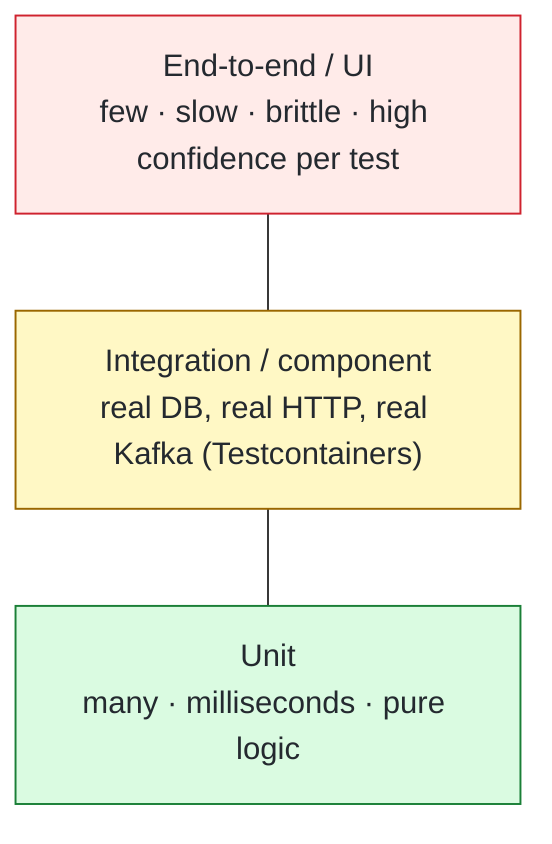

[⬅️ Prev: 19 · Persistence](19-persistence-jdbc-jpa-hibernate.md) · [🏠 Index](README.md) · [Next: 21 · Performance ➡️](21-performance-engineering-troubleshooting.md)

# 20 · Testing & Quality

> *Tests are the only documentation that fails when it goes out of date. At staff level, the question isn't "do you write tests?" but "what's your test strategy, what does it cost, and how much confidence does it buy per minute of CI?"*

> [!TIP]
> **🧭 Decision guide: the mix of tests for a service and a platform**
> - **When it matters:** always, and urgently when CI gets slow or flaky, or teams start deploying independently.
> - **Default:** many fast unit tests of domain logic, integration tests against real dependencies with Testcontainers, contract tests between services, a few end-to-end journeys; PR builds under ten minutes; flaky tests quarantined with an owner and a deadline.
> - **Alternatives:** more integration than unit tests (the "trophy") for thin CRUD services; mutation testing on critical modules; property-based tests for parsers and calculations.
> - **Failure modes:** H2 standing in for PostgreSQL, a shared end-to-end environment as the main safety net, `Thread.sleep` in tests, coverage targets that get gamed.
> - **Evidence that would change it:** escaped defects by layer, change-failure rate, CI duration and flaky-test rate.
> - **Argued in:** §1, §5–§7, §12 and §14.

---

## Table of contents
1. [Test strategy: pyramid, trophy, honeycomb](#1-test-strategy-pyramid-trophy-honeycomb-)
2. [JUnit (Jupiter) essentials](#2-junit-jupiter-essentials-)
3. [Assertions that explain failures: AssertJ](#3-assertions-that-explain-failures-assertj-)
4. [Test doubles & Mockito internals](#4-test-doubles--mockito-internals-)
5. [Spring Boot testing: slices, context caching, `@MockitoBean`](#5-spring-boot-testing-slices-context-caching-mockitobean-)
6. [Testcontainers: real dependencies in tests](#6-testcontainers-real-dependencies-in-tests-)
7. [Contract testing between services](#7-contract-testing-between-services-)
8. [Property-based testing](#8-property-based-testing-)
9. [Mutation testing: testing your tests](#9-mutation-testing-testing-your-tests-)
10. [Microbenchmarking with JMH](#10-microbenchmarking-with-jmh-)
11. [Static analysis & architecture tests](#11-static-analysis--architecture-tests-)
12. [Writing good tests & killing flaky ones](#12-writing-good-tests--killing-flaky-ones-)
13. [Testing in production](#13-testing-in-production-)
14. [Staff lens](#14-staff-lens-)
15. [Interview questions](#15-interview-questions)
16. [References](#16-references)

---

## 1. Test strategy: pyramid, trophy, honeycomb 🟡→🟣



| Model | Shape | Best fit |
|---|---|---|
| **Test pyramid** (Mike Cohn) | Mostly unit, some integration, few E2E | Logic-heavy code, libraries, domain models |
| **Testing trophy** (Kent C. Dodds) | Emphasises integration tests | UI and frontend apps |
| **Honeycomb** (Spotify) | Mostly **integration tests of one service**, few unit and few cross-service tests | **Microservices**: most bugs live in the wiring (SQL, serialization, HTTP mapping, configuration) |

🧠 **The right shape follows where your bugs come from.** A pricing engine with complex rules wants many unit tests. A CRUD-ish microservice wants **service-level integration tests** against real infrastructure (Testcontainers), because the logic *is* the SQL, the JSON mapping and the HTTP contract. Cross-service confidence comes from **contract tests**, not from a big shared E2E environment.

---

## 2. JUnit (Jupiter) essentials 🟢→🟡

JUnit 5 introduced the **Jupiter** programming model on the **JUnit Platform**. **JUnit 6** (GA September 2025) keeps the same model (`org.junit.jupiter.api`), raises the baseline to Java 17, unifies version numbers across Platform, Jupiter and Vintage, adds JSpecify nullness annotations, and adds a cancellation API.

```java
@DisplayName("Money")
class MoneyTest {

    @Test
    void addsAmountsInSameCurrency() {
        var total = Money.of("10.50", "USD").plus(Money.of("4.50", "USD"));
        assertThat(total).isEqualTo(Money.of("15.00", "USD"));
    }

    @Test
    void rejectsCurrencyMismatch() {
        var usd = Money.of("1.00", "USD");
        var eur = Money.of("1.00", "EUR");
        assertThatThrownBy(() -> usd.plus(eur))
                .isInstanceOf(IllegalArgumentException.class)
                .hasMessageContaining("currency mismatch");
    }

    @ParameterizedTest(name = "{0} + {1} = {2}")
    @CsvSource({ "0.10, 0.20, 0.30", "1.00, 2.00, 3.00", "999.99, 0.01, 1000.00" })
    void addsExactly(String a, String b, String expected) {
        assertThat(Money.of(a, "USD").plus(Money.of(b, "USD"))).isEqualTo(Money.of(expected, "USD"));
    }

    @Nested
    class WhenAllocating {
        @Test void splitsRemainderDeterministically() {
            assertThat(Money.of("100.00", "USD").allocate(3))
                    .containsExactly(Money.of("33.34", "USD"), Money.of("33.33", "USD"), Money.of("33.33", "USD"));
        }
    }
}
```

**Lifecycle:** `@BeforeAll` / `@BeforeEach` / `@AfterEach` / `@AfterAll`. By default, **a new test-class instance is created per test method**, so instance fields are never shared between tests. `@TestInstance(PER_CLASS)` changes that, and lets `@BeforeAll` be non-static.

**Extensions** replaced JUnit 4's runners and rules. They hook into the lifecycle and can resolve parameters: `@ExtendWith(MockitoExtension.class)`, `SpringExtension`, `@TempDir Path dir`, Testcontainers' `@Testcontainers`. You can write your own by implementing `BeforeEachCallback`, `ParameterResolver`, `TestExecutionExceptionHandler` and so on.

**Other useful features:** `@Tag("slow")` for build filtering, `@Timeout`, `@RepeatedTest`, `@EnabledOnOs`/`@EnabledForJreRange`, `@MethodSource` for complex parameters, `assertAll` (report all failures, not just the first), and **parallel execution** (`junit.jupiter.execution.parallel.enabled=true`), which only works if your tests are truly isolated.

---

## 3. Assertions that explain failures: AssertJ 🟢

Good assertions make a failing test tell you what's wrong without a debugger:
```java
assertThat(order.lines())
        .hasSize(3)
        .extracting(OrderLine::sku, OrderLine::quantity)
        .containsExactlyInAnyOrder(tuple("A-1", 2), tuple("B-7", 1), tuple("C-3", 5));

assertThat(response.status()).isEqualTo(422);
assertThat(problem.getProperties()).containsEntry("code", "PAYMENT_DECLINED");
assertThat(events).filteredOn(e -> e instanceof OrderSubmitted).singleElement()
        .satisfies(e -> assertThat(((OrderSubmitted) e).total()).isEqualTo(Money.of("30.00", "USD")));
```
Prefer **AssertJ** over bare `assertEquals`/`assertTrue`. `assertTrue(list.contains(x))` fails with "expected true", while AssertJ prints the list and the missing element.

---

## 4. Test doubles & Mockito internals 🟡→🔴

**Gerard Meszaros' taxonomy** (interviewers like precise terms):
| Double | Purpose |
|---|---|
| **Dummy** | Passed but never used (fills a parameter) |
| **Stub** | Returns canned answers (`when(repo.find(1)).thenReturn(order)`) |
| **Spy** | A real object that also records how it was called |
| **Mock** | Pre-programmed with **expectations** about calls; verified afterwards |
| **Fake** | A working, lightweight implementation (an in-memory repository, a fake clock) |

```java
@ExtendWith(MockitoExtension.class)                         // strict stubs: unused stubbing fails the test
class CheckoutServiceTest {
    @Mock PaymentGateway payments;
    @Mock OrderRepository orders;
    @InjectMocks CheckoutService checkout;
    @Captor ArgumentCaptor<Order> saved;

    @Test
    void chargesAndSavesPaidOrder() {
        given(payments.charge(any(), eq(Money.of("30.00", "USD")), any()))       // BDDMockito style
                .willReturn(new PaymentResult.Approved("AUTH-42"));

        checkout.placeOrder(command());

        then(orders).should().save(saved.capture());
        assertThat(saved.getValue().status()).isEqualTo(OrderStatus.PAID);
        then(payments).shouldHaveNoMoreInteractions();
    }
}
```

**How Mockito works:**
- It generates mock classes with **ByteBuddy**. Since **Mockito 5**, the default *inline* mock maker uses the JVM's **instrumentation API** to retransform classes, which is how it can mock **final classes and methods** and, with `mockStatic`, static methods.
- Since JDK 21, a library attaching an agent *dynamically* prints a warning (JEP 451), and future JDKs will forbid it by default ([Chapter 14 §7](14-reflection-annotations-proxies.md#7-java-agents--instrumentation-)). The recommended setup is to configure Mockito as a `-javaagent` in Surefire/Gradle test JVM arguments.
- **Strict stubs** (the default with `MockitoExtension`) fail tests with unused stubbings (`UnnecessaryStubbingException`). That keeps tests honest.

**Mocking guidelines:**
- **Mock roles, not values.** Don't mock records, value objects or collections. Construct them.
- **Don't mock what you don't own.** Mocking `RestTemplate`, `KafkaTemplate` or a vendor SDK encodes *your assumptions* about their behaviour. Wrap them in your own port (adapter) and integration-test the adapter against the real thing (Testcontainers, WireMock).
- **Prefer fakes for your own ports.** An `InMemoryOrderRepository` lets you assert on **state** ("the order is saved and paid") instead of **interactions** ("`save` was called once with…"). Interaction-heavy tests break on every refactoring that preserves behaviour.
- **Too many mocks** in one test is a design smell: the class has too many dependencies (an SRP violation).

---

## 5. Spring Boot testing: slices, context caching, `@MockitoBean` 🔴

| Annotation | Loads | Speed | Use for |
|---|---|---|---|
| `@SpringBootTest` | The whole application context (optionally a real server on a random port) | Slowest | End-to-end within one service |
| `@WebMvcTest(OrderController.class)` | MVC infrastructure plus the given controllers | Fast | Request mapping, validation, JSON, error handling |
| `@DataJpaTest` | JPA, repositories, a datasource (embedded by default; use Testcontainers for realism) | Medium | Queries, mappings, constraints |
| `@JsonTest` | Jackson configuration | Fast | Serialization contracts |
| `@RestClientTest` | `RestClient`/`RestTemplate` plus a mock server | Fast | HTTP client adapters |

```java
@WebMvcTest(OrderController.class)
class OrderControllerTest {
    @Autowired MockMvcTester mvc;                       // AssertJ-friendly MockMvc API (Spring Framework 6.2+)
    @MockitoBean PlaceOrderUseCase placeOrder;          // replaces the bean in the context with a Mockito mock

    @Test
    void returns422WithProblemDetailWhenPaymentDeclined() {
        given(placeOrder.placeOrder(any())).willThrow(new PaymentDeclinedException(new OrderId(7), declined()));

        assertThat(mvc.post().uri("/orders").contentType(APPLICATION_JSON).content(validOrderJson()))
                .hasStatus(422)
                .bodyJson().extractingPath("$.code").isEqualTo("PAYMENT_DECLINED");
    }
}
```

**`@MockitoBean` / `@MockitoSpyBean`** (Spring Framework 6.2) replaced Spring Boot's older `@MockBean`/`@SpyBean`, which were deprecated in Boot 3.4.

### Context caching: the hidden reason test suites get slow 💣
The Spring TestContext framework **caches application contexts** across test classes, keyed by their configuration: active profiles, properties, `@MockitoBean` set, `@Import`s, and so on. **Every unique combination creates a new context**, which means another 5–30 s of startup and more memory.
- Ten test classes, each with a slightly different set of `@MockitoBean`s, means **ten contexts**.
- **Fixes:** share a small number of base test configurations, keep the mocked beans consistent, prefer slices over full contexts, and avoid `@DirtiesContext` (which throws the cached context away).
- Enable `logging.level.org.springframework.test.context.cache=DEBUG` to see hit and miss statistics.

---

## 6. Testcontainers: real dependencies in tests 🔴

In-memory substitutes (H2 instead of PostgreSQL, an embedded broker instead of Kafka) **lie**: different SQL dialect, different locking, different JSON operators, different constraint behaviour. **Testcontainers** starts real dependencies in Docker for the duration of the tests.

```java
@SpringBootTest
@Testcontainers
class OrderRepositoryIT {

    @Container
    @ServiceConnection                       // Spring Boot wires the datasource URL, user and password automatically
    static PostgreSQLContainer<?> postgres = new PostgreSQLContainer<>("postgres:17-alpine");

    @Autowired OrderRepository orders;

    @Test
    void findsOpenOrdersWithLinesInOneQuery() {
        orders.saveAll(sampleOrders());
        var open = orders.findOpenWithLines();
        assertThat(open).allSatisfy(o -> assertThat(o.getLines()).isNotEmpty());
        // + assert the query count with datasource-proxy to keep the N+1 fix in place (Chapter 19 §8)
    }
}
```
- **`@ServiceConnection`** (Boot 3.1+) replaces hand-written `@DynamicPropertySource` wiring for supported containers.
- Use **one container per JVM run** (static, or a shared base class or singleton pattern) instead of one per test class. That's the biggest single speed-up.
- Pin image versions to what production runs (`postgres:17-alpine`, not `latest`).
- Available modules include Kafka, Redis, LocalStack (AWS), Elasticsearch, MongoDB, WireMock, Keycloak, and more.

---

## 7. Contract testing between services 🔴→🟣

**The problem:** Service A calls Service B. A's tests mock B, and B's tests don't know A exists. B renames a JSON field, both test suites pass, and production breaks. Shared E2E environments catch it, but slowly, flakily, and late.

**Consumer-driven contracts:**
1. The **consumer** (A) writes a contract describing exactly the requests it sends and the response fields it *uses* (Pact, Spring Cloud Contract).
2. The contract is published to a broker.
3. The **provider** (B) verifies every consumer's contract in *its own* CI. A breaking change fails B's build **before deploy**, and the provider knows exactly which consumers it would break.

**Schema-level compatibility** complements this: OpenAPI diff checks for REST, `buf breaking` for Protobuf, and schema-registry compatibility modes for Avro/Kafka ([Chapter 13 §11](13-io-nio-networking-serialization.md#11-data-formats-for-services-json-protobuf-avro-)).

🧠 Contract tests are an **organisational** tool: they let teams deploy independently with confidence, which is the whole point of having services.

---

## 8. Property-based testing 🔴

Instead of hand-picking examples, state a **property that must hold for all inputs**, and let the framework generate hundreds of cases. When it finds a failure, it **shrinks** it to the smallest reproduction.

```java
// jqwik
class MoneyProperties {
    @Property
    void allocationNeverLosesOrCreatesMoney(@ForAll @BigRange(min = "0.00", max = "1000000.00") BigDecimal amount,
                                            @ForAll @IntRange(min = 1, max = 50) int parts) {
        Money total = Money.of(amount.setScale(2, RoundingMode.DOWN), "USD");
        List<Money> shares = total.allocate(parts);
        assertThat(shares).hasSize(parts);
        assertThat(shares.stream().reduce(Money.zero("USD"), Money::plus)).isEqualTo(total);     // conservation
        assertThat(maxMinusMin(shares)).isLessThanOrEqualTo(Money.of("0.01", "USD"));            // fairness
    }
}
```
**Good properties to look for:** round-trips (`decode(encode(x)) == x`), invariants (totals are conserved, sorted output is a permutation of the input), idempotence (`f(f(x)) == f(x)`), equivalence with a simple reference implementation, and "never throws on valid input". Property tests are great at finding edge cases (empty, zero, boundaries, Unicode, huge values) that example-based tests miss.

---

## 9. Mutation testing: testing your tests 🔴

**Line coverage measures what *ran*, not what was *checked*.** A test that calls a method and asserts nothing gives 100% coverage and catches 0 bugs.

**Mutation testing** (**PIT / pitest** for Java) makes small changes to your code, called *mutants*: flip `>` to `>=`, replace `return x` with `return 0`, remove a method call. It then runs the tests. If the tests still pass, the mutant **survived**, which means no test would notice that bug.

```
>> Generated 412 mutations Killed 371 (90%)
>> Ran 2,904 tests (7.05 tests per mutation)
   src/main/java/com/acme/pricing/DiscountEngine.java
     line 42: changed conditional boundary → SURVIVED     ← no test checks the exact threshold
```
Run it on **critical modules** (pricing, money, authorization), or incrementally on changed code in pull requests. Across a whole large codebase it's slow.

---

## 10. Microbenchmarking with JMH 🔴

`long t0 = System.nanoTime(); for (…) work(); long t = System.nanoTime() - t0;` is not a benchmark. The JIT ([Chapter 09](09-jvm-internals.md)) will mislead you through:
- **Dead-code elimination:** results that are never used get computed away entirely.
- **Constant folding:** inputs known at compile time are precomputed.
- **Warmup and OSR:** the first iterations are interpreted, and later ones run compiled code.
- **Loop optimisations** that only exist in the benchmark loop, plus GC noise and CPU frequency scaling.

**JMH** (from the OpenJDK team) handles forking, warmup, measurement and result-consumption properly:
```java
@BenchmarkMode(Mode.AverageTime)
@OutputTimeUnit(TimeUnit.NANOSECONDS)
@Warmup(iterations = 5, time = 1)
@Measurement(iterations = 5, time = 1)
@Fork(2)
@State(Scope.Thread)
public class ConcatBenchmark {
    @Param({"10", "1000"}) int n;
    String[] parts;

    @Setup public void setup() { parts = IntStream.range(0, n).mapToObj(Integer::toString).toArray(String[]::new); }

    @Benchmark public String plusInLoop() { String s = ""; for (String p : parts) s += p; return s; }   // returned → consumed
    @Benchmark public String builder()    { var sb = new StringBuilder(); for (String p : parts) sb.append(p); return sb.toString(); }
    @Benchmark public void join(Blackhole bh) { bh.consume(String.join("", parts)); }                      // explicit sink
}
```
**Rules:** return results or feed them to a `Blackhole`; keep inputs in `@State` (not `final` constants that can be folded); use `@Fork` so JIT profiles don't leak between benchmarks; report **error margins**; run on quiet, representative hardware; and use profilers (`-prof gc`, `-prof perfasm`) to explain *why*, not just *how fast*.

> [!CAUTION]
> A microbenchmark answers "is A faster than B *in isolation*?" It doesn't say whether that matters for your system. Profile production first ([Chapter 21](21-performance-engineering-troubleshooting.md)), and microbenchmark only the hotspot you found.

---

## 11. Static analysis & architecture tests 🟡

| Tool | Catches |
|---|---|
| **Error Prone** (javac plugin) | Real bugs at compile time: wrong `equals`, ignored return values, `@GuardedBy` violations |
| **NullAway** + JSpecify | Null-pointer bugs at compile time (`@NullMarked` packages) |
| SpotBugs, PMD | Bug patterns, concurrency issues, code smells |
| Sonar | Aggregated quality gates, duplication, security hotspots |
| **ArchUnit** | Architecture rules as tests: layers, cycles, naming ([Chapter 15 §10](15-modules-and-build-tools.md#10-modularity-beyond-jpms-)) |
| OpenRewrite | Automated refactoring and migrations (Spring Boot upgrades, JUnit 4→5, Java version bumps) |

Make the important ones **build-breaking** (null safety, Error Prone errors, architecture rules), and keep the rest advisory, so the signal doesn't drown in noise.

---

## 12. Writing good tests & killing flaky ones 🟡→🔴

**F.I.R.S.T.:** Fast · Isolated (no order dependence) · Repeatable (same result every time, everywhere) · Self-validating (pass/fail, no manual inspection) · Timely (written with the code).

**Structure:** *Arrange – Act – Assert* (or *Given – When – Then*). One behaviour per test, and a name that states it: `rejectsOrderWhenCreditLimitExceeded`, not `testOrder2`.

**Test data:** use **test data builders** (`anOrder().withLines(3).paidBy(card()).build()`) with sensible defaults, so each test spells out only what matters to it.

### Why tests flake, and the fixes
| Cause | Fix |
|---|---|
| **Time** (`Instant.now()`, time zones, DST, midnight) | Inject a `Clock`; fixed clocks in tests ([Chapter 08 §3](08-modern-java-8-to-27.md#3-javatime-getting-dates-right-)) |
| **Async waits with `Thread.sleep`** | Awaitility (`await().atMost(…).untilAsserted(…)`), latches, or test hooks |
| **Shared state between tests** (static caches, DB rows, files) | Fresh data per test, transactions rolled back per test, unique IDs, `@TempDir` |
| **Order dependence** | Run in random order in CI to expose it, and remove the coupling |
| **Unordered collections** (`HashMap`/`Set.of` iteration order) | Assert with `containsExactlyInAnyOrder`, or sort first |
| **Real external services** | WireMock, Testcontainers, contracts |
| **Resource contention in parallel runs** (ports, shared containers) | Random ports, isolated schemas or databases per test fork |
| **Randomness** | Fixed seeds, logged on failure |

**Policy:** a flaky test is a **bug**. Quarantine it immediately (so it doesn't train everyone to hit "re-run"), assign an owner, and fix it or delete it within a set time. A suite that "usually passes" provides almost no signal.

---

## 13. Testing in production 🟣

Pre-production tests can't reproduce production's data, traffic mix and failures. Mature teams **verify in production, safely**:
- **Canary releases** and progressive delivery: ship to 1% → 10% → 100%, with automated rollback on SLO regression ([Chapter 22](22-production-readiness-observability-resilience.md)).
- **Feature flags:** decouple deploy from release; enable per tenant or cohort; use kill switches.
- **Shadow traffic / dark launches:** send copies of real requests to the new version and compare responses without serving them.
- **Synthetic monitoring:** scripted user journeys running continuously against production.
- **Chaos engineering:** inject failures deliberately (latency, dependency outages, instance loss) to verify that resilience mechanisms actually work.

---

## 14. Staff lens 🟣

1. **Own the test strategy, not just the tests.** Define what each layer is for, which tools to use (JUnit + AssertJ + Testcontainers + contracts), and what *not* to do (shared E2E environments as the main safety net, H2 standing in for PostgreSQL).
2. **CI time is a product metric.** Set budgets (for example, PR builds under 10 minutes), parallelise, cache, share Testcontainers, and keep Spring contexts few. Slow feedback loops cost far more than test infrastructure does.
3. **Measure quality honestly.** Coverage is a *floor* indicator, not a target. Mutation score on critical modules, escaped-defect rate, change-failure rate and mean time to restore (the DORA metrics) say more about quality.
4. **Use contract tests to scale teams.** They're what makes independent deployability real.
5. **Zero tolerance for flakiness** keeps the suite trustworthy. Make quarantine, ownership and fix deadlines policy, not etiquette.

---

## 15. Interview questions

<details>
<summary><b>Q1. 🟢 What's the difference between a mock, a stub, a spy and a fake?</b></summary>

A stub returns canned answers. A mock is set up with expectations about calls and verified afterwards (interaction testing). A spy wraps a real object and records calls. A fake is a lightweight working implementation (an in-memory repository). A dummy only fills a parameter. Prefer fakes and state verification for your own ports, and mocks for collaborators where the interaction itself is the behaviour.
</details>

<details>
<summary><b>Q2. 🟡 How does Mockito mock final classes, and why does JDK 21+ print a warning about it?</b></summary>

Mockito 5's default inline mock maker uses ByteBuddy plus the JVM instrumentation API to retransform classes at runtime, which allows mocking final classes and methods and, with `mockStatic`, static methods. Obtaining instrumentation by dynamically attaching an agent triggers JEP 451's warning, and future JDKs will block it by default. Configure Mockito as a `-javaagent` in the test JVM.
</details>

<details>
<summary><b>Q3. 🔴 Why are Spring Boot test suites often slow, and how do you fix them?</b></summary>

Every distinct test context configuration (profiles, properties, `@MockitoBean` sets, imports) creates and caches a new application context, and many unique combinations mean many slow context startups. Others: a new container per test class, overuse of `@SpringBootTest`, and `@DirtiesContext`. Fixes: standardise a few shared test configurations, use slices, reuse singleton Testcontainers, avoid `@DirtiesContext`, run tests in parallel where they're isolated, and monitor context-cache statistics.
</details>

<details>
<summary><b>Q4. 🟡 Why use Testcontainers instead of H2 for repository tests?</b></summary>

H2 isn't your production database: SQL dialects, functions, locking, isolation semantics, JSON support, constraint behaviour and query plans all differ, so tests can pass against H2 and fail in production (or the other way round). Testcontainers runs the same database engine and version as production in Docker, so tests exercise real SQL, migrations and constraints.
</details>

<details>
<summary><b>Q5. 🔴 What problem do consumer-driven contract tests solve?</b></summary>

They catch breaking API changes between services before deployment, without a shared E2E environment. Consumers publish contracts describing the interactions and fields they actually use, and providers verify all consumer contracts in their own CI, so a provider change that breaks a consumer fails the provider's build. That enables independent deployability.
</details>

<details>
<summary><b>Q6. 🔴 Why is line coverage a weak quality metric? What's better?</b></summary>

Coverage shows which lines executed, not whether behaviour was verified. Tests without meaningful assertions still score 100%. Mutation testing (PIT) checks whether tests fail when the code is deliberately broken, so the mutation score measures assertion strength. Combine it with outcome metrics such as escaped defects and change-failure rate.
</details>

<details>
<summary><b>Q7. 🔴 What are the main pitfalls of hand-written Java microbenchmarks, and how does JMH help?</b></summary>

Dead-code elimination (results that aren't used get optimised away), constant folding, warmup and OSR effects, JIT profile pollution between benchmarks, loop-specific optimisations, GC noise and CPU scaling. JMH forks JVMs, runs proper warmup and measurement iterations, provides `Blackhole` and `@State` to defeat elimination and folding, and reports statistics with error bounds. It also integrates profilers to explain results.
</details>

<details>
<summary><b>Q8. 🟡 What is property-based testing? Give an example property.</b></summary>

You state invariants that must hold for all inputs, and the framework (jqwik in Java) generates many random inputs and shrinks failures to minimal cases. Example: allocating money into N parts returns N shares whose sum equals the original amount and whose values differ by at most one cent. Other classics are encode/decode round-trips and idempotence.
</details>

<details>
<summary><b>Q9. 🟣 How do you deal with a test suite that has become flaky and slow?</b></summary>

Measure first: flake rate per test, duration per test, context-cache statistics, container start times. Quarantine flaky tests with owners and deadlines, and fix root causes (time injection, Awaitility instead of sleeps, isolated data, deterministic ordering). For speed: share containers and contexts, move logic tests down to fast unit tests, use slices, parallelise isolated tests, split the CI stages (fast PR checks, deeper nightly runs). Track CI time and flake rate as team-level metrics with budgets.
</details>

<details>
<summary><b>Q10. 🟣 What test strategy would you propose for a 40-service platform?</b></summary>

Per service: unit tests for domain logic, plus the bulk as service-level integration tests with Testcontainers (real DB and broker) and WireMock for external APIs. Between services: consumer-driven contracts and schema compatibility checks in CI, instead of a large shared E2E environment. A thin layer of critical-journey E2E and synthetic tests. In production: canaries with automated rollback, feature flags and chaos experiments. Platform support through shared test starters, Testcontainers images, contract broker infrastructure and CI time budgets.
</details>

---

## 16. References
- [JUnit User Guide](https://docs.junit.org/current/user-guide/) and the JUnit 6 release notes
- [Mockito documentation](https://javadoc.io/doc/org.mockito/mockito-core/latest/org/mockito/Mockito.html) · [AssertJ](https://assertj.github.io/doc/) · [Testcontainers for Java](https://java.testcontainers.org/)
- [Spring Framework Testing reference](https://docs.spring.io/spring-framework/reference/testing.html) (context caching, `@MockitoBean`)
- [OpenJDK JMH](https://github.com/openjdk/jmh) and Aleksey Shipilëv's JMH samples
- Gerard Meszaros, *xUnit Test Patterns*; Steve Freeman & Nat Pryce, *Growing Object-Oriented Software, Guided by Tests*
- [Pact documentation](https://docs.pact.io/) · [PIT mutation testing](https://pitest.org/)

---

[⬅️ Prev: 19 · Persistence](19-persistence-jdbc-jpa-hibernate.md) · [🏠 Index](README.md) · [Next: 21 · Performance ➡️](21-performance-engineering-troubleshooting.md)
