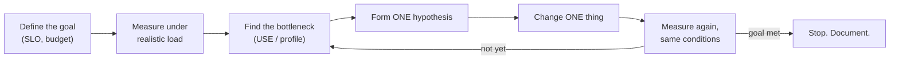

[⬅️ Prev: 20 · Testing](20-testing-and-quality.md) · [🏠 Index](README.md) · [Next: 22 · Production Readiness ➡️](22-production-readiness-observability-resilience.md)

# 21 · Performance Engineering & Troubleshooting

> *Performance work has one rule that beats every other: **measure, don't guess.** Even engineers with years of profiling behind them usually guess the hotspot wrong. The difference with experience is that they know it, and they reach for a profiler first.*

🧪 **Runnable labs:** [the programs behind this chapter's outputs](labs.md#chapter-21--performance-and-troubleshooting)

---

## Table of contents
1. [Methodology: USE, RED, and one change at a time](#1-methodology-use-red-and-one-change-at-a-time-)
2. [The laws: Little, Amdahl, and the queueing knee](#2-the-laws-little-amdahl-and-the-queueing-knee-)
3. [Latency: percentiles, tails, fan-out](#3-latency-percentiles-tails-fan-out-)
4. [Load testing without lying to yourself](#4-load-testing-without-lying-to-yourself-)
5. [Profiling: JFR, async-profiler, flame graphs](#5-profiling-jfr-async-profiler-flame-graphs-)
6. [A real profiling session](#6-a-real-profiling-session-)
7. [The JDK diagnostic toolbox](#7-the-jdk-diagnostic-toolbox-)
8. [Reading thread dumps](#8-reading-thread-dumps-)
9. [Troubleshooting playbooks](#9-troubleshooting-playbooks-)
10. [Java performance anti-patterns](#10-java-performance-anti-patterns-)
11. [Mechanical sympathy](#11-mechanical-sympathy-)
12. [Capacity planning](#12-capacity-planning-)
13. [Staff lens](#13-staff-lens-)
14. [Interview questions](#14-interview-questions)
15. [References](#15-references)

---

## 1. Methodology: USE, RED, and one change at a time 🟡

**Start with a goal, not a vibe:** "p99 < 200 ms at 2,000 RPS with CPU < 70%", or "the nightly batch finishes in under 40 minutes". Without a target, optimisation never ends and never ships.

**USE method (Brendan Gregg), for every *resource***: CPU, memory, disk, network, thread pools, connection pools, locks.
- **U**tilization: how busy is it (% of time)?
- **S**aturation: how much work is *waiting* for it (queue length, run-queue, pool pending)?
- **E**rrors: is it failing (timeouts, rejections, retransmits)?

**RED method (Tom Wilkie), for every *service***:
- **R**ate (requests/s) · **E**rrors (failed requests/s) · **D**uration (latency distribution).

**The loop:**

Change one thing at a time. If you change three, you'll never know which one helped and which one hurt.

---

## 2. The laws: Little, Amdahl, and the queueing knee 🔴

### Little's law: `L = λ × W`
*Average items in the system = arrival rate × average time in the system.* It holds for any stable system, with no assumptions about distributions.
- 500 requests/s × 0.2 s average latency = **100 requests in flight**. Your thread pool, connection pool and memory need to handle that ([Chapter 12 §9](12-concurrency-advanced-juc-loom.md#9-sizing-thread-pools-)).
- The inverse: with a pool of 50 workers and 0.25 s per request, maximum throughput = 50 ÷ 0.25 = **200 requests/s**. Beyond that, requests queue up.

### Amdahl's law: the serial fraction caps speedup
```
speedup(N) = 1 / ((1 − p) + p / N)        p = parallelizable fraction, N = processors
```
| Parallel fraction p | 8 cores | 64 cores | ∞ cores |
|---|---|---|---|
| 50% | 1.8× | 1.97× | **2×** |
| 90% | 4.7× | 8.8× | **10×** |
| 99% | 7.5× | 39× | **100×** |

A single `synchronized` block that serializes 10% of request time caps you at a 10× speedup, however many cores you add. The **Universal Scalability Law** adds a *coherence* term (cross-node coordination such as cache-line bouncing and distributed locks), which explains why some systems get **slower** as you add capacity.

### The queueing knee: why latency explodes near 100% utilization
For a simple single-server queue (M/M/1), time spent **waiting** in the queue, as a multiple of the service time S:
```
wait = S × ρ / (1 − ρ)          ρ = utilization
```
| Utilization ρ | 50% | 70% | 80% | 90% | 95% | 99% |
|---|---|---|---|---|---|---|
| Queue wait (× service time) | 1× | 2.3× | 4× | **9×** | **19×** | **99×** |

This is why "the service is only at 85% CPU but latency is terrible" happens, and why autoscaling targets of **60–70%** are normal. Running "efficiently" near 100% means latency spikes the moment traffic wobbles. Real systems have more servers and different distributions, but the shape of the curve, flat and then a cliff, is universal.

---

## 3. Latency: percentiles, tails, fan-out 🔴

**Averages lie.** A service with a 50 ms average can have a p99 of 2 seconds. And **one in a hundred requests** is not rare: a user who loads a page with 30 resources hits the p99 on a large share of page views.

| Statistic | Use |
|---|---|
| p50 (median) | The typical experience |
| p90 / p95 | The common bad experience |
| **p99 / p99.9** | Tail latency. SLOs usually live here |
| max | Outliers: GC pauses, timeouts, retries |

**The fan-out amplification:** if a request calls 100 backends in parallel and *each* has a 1% chance of being slow, then
```
P(at least one slow) = 1 − 0.99^100 ≈ 63%
```
Most user requests end up hitting at least one backend's p99. This is "The Tail at Scale" (Dean & Barroso). The more you fan out, the more your **backend's tail becomes your median**. Mitigations: hedged requests, tighter per-call timeouts, fewer calls (batching, caching), and fixing the tail at its source.

💣 **You can't average percentiles.** The mean of ten instances' p99s isn't the fleet p99. Aggregate **histograms** (HdrHistogram, Prometheus histograms, Micrometer's percentile histograms) and compute percentiles from the merged distribution.

---

## 4. Load testing without lying to yourself 🔴

| Test | Question it answers |
|---|---|
| **Load** | Do we meet the SLO at expected peak traffic? |
| **Stress / breakpoint** | Where's the knee, and how do we fail past it (gracefully or catastrophically)? |
| **Soak** | Does anything degrade over hours (leaks, fragmentation, growing caches, connection churn)? |
| **Spike** | What happens with 10× traffic in 30 seconds (autoscaling lag, cold caches, JIT warmup)? |

### Coordinated omission (Gil Tene) 💣
Most naive load generators are **closed-loop**: each virtual user sends a request, *waits* for the response, then sends the next. When the server stalls for 2 seconds, the generator *stops sending* during the stall, so the requests that *would* have arrived and suffered aren't recorded at all. The reported p99 can be wrong by orders of magnitude.

**Fix:** use an **open-model, constant-arrival-rate** generator, which sends at the target rate regardless of responses and measures latency from the *intended* send time. wrk2, Gatling's open injection profiles, and k6's `constant-arrival-rate` executor all do this. Real users don't politely wait for your server to recover before clicking.

**Checklist for credible results:** a production-like environment (CPU limits, data volume, network), realistic data and request mix, JIT **warmup** before measuring, measurement on both client and server side, enough duration to cover GC cycles, and identical conditions between runs.

---

## 5. Profiling: JFR, async-profiler, flame graphs 🔴

### Sampling vs instrumentation
- **Sampling profilers** periodically capture stack traces. Their overhead is low enough for production, and they're statistical.
- **Instrumenting profilers** add code at method entry and exit. They're exact, but the overhead **distorts** the measurement (small methods look expensive, and inlining is defeated). Avoid them for performance work.

### Safepoint bias 💣
Older JVM sampling profilers (via `Thread.getAllStackTraces`/JVMTI) could only sample threads **at safepoints** ([Chapter 09 §11](09-jvm-internals.md#11-safepoints--handshakes-)). Hot counted loops without safepoint polls never show up, and samples pile onto the nearest poll. The profile blames the wrong code.

### JDK Flight Recorder (JFR)
Built into the JVM, with low overhead (about 1% with default settings), so you can keep it **on in production**. It records:
- **CPU:** `jdk.ExecutionSample` (it doesn't suffer the classic safepoint bias), plus **CPU-time profiling on Linux** (JDK 25, JEP 509, experimental).
- **Allocation:** `jdk.ObjectAllocationSample` (by type and stack).
- **Locks and waits:** `jdk.JavaMonitorEnter`, `jdk.JavaMonitorWait`, `jdk.ThreadPark`, `jdk.VirtualThreadPinned`.
- **GC, JIT compilation, safepoints, class loading, exceptions, socket and file I/O, container metrics.**
- **Method timing and tracing** (JDK 25, JEP 520), and **in-process data redaction** of sensitive values (JDK 27, JEP 536).

```bash
# record from startup
java -XX:StartFlightRecording=duration=120s,filename=/tmp/app.jfr,settings=profile -jar app.jar
# or attach to a running JVM
jcmd <pid> JFR.start name=perf settings=profile duration=60s filename=/tmp/perf.jfr
# analyse: JDK Mission Control (GUI), or the jfr CLI's built-in views (JDK 21+)
jfr view hot-methods /tmp/perf.jfr
jfr view allocation-by-site /tmp/perf.jfr
jfr view gc-pauses /tmp/perf.jfr
jfr summary /tmp/perf.jfr
```

### async-profiler
An open-source profiler that combines `perf_events` and HotSpot-specific APIs. **No safepoint bias**, and it shows native, kernel and JIT frames too.
```bash
asprof -d 30 -e cpu   -f /tmp/cpu.html   <pid>    # where CPU time goes
asprof -d 30 -e alloc -f /tmp/alloc.html <pid>    # who allocates
asprof -d 30 -e lock  -f /tmp/lock.html  <pid>    # lock contention
asprof -d 30 -e wall -t -f /tmp/wall.html <pid>   # WALL-CLOCK per thread: finds time spent BLOCKED or WAITING
```
**Wall-clock mode** is the secret weapon for "slow but low CPU" problems: it shows where threads *wait* (I/O, locks, pool acquisition), which CPU profiles can't show.

### Reading a flame graph
- Each box is a stack frame, and its **width** is the share of samples it appears in, including its children.
- **The x-axis is NOT time.** Frames are sorted alphabetically to merge identical stacks.
- The y-axis is stack depth. The **top edge** is what was actually running.
- Look for **wide plateaus at the top** (self time) and wide towers you didn't expect (a whole subtree doing something surprising, like regex compilation under a "validation" frame).
- **Differential flame graphs** (before vs after) are the fastest way to explain a regression.

**Continuous profiling** (Pyroscope, Parca, Datadog, or JFR streaming into a backend) keeps low-frequency profiles running all the time, so you can profile *the incident that already happened*.

---

## 6. A real profiling session 🔴

A deliberately flawed "request handler" (validates emails with `String.matches`, and renders a list by concatenating in a loop):
```java
static boolean isValidEmail(String s) { return s.matches("^[\\w.+-]+@[\\w-]+\\.[\\w.]+$"); }
static String render(List<String> items) { String out = ""; for (String i : items) out += i + ","; return out; }
```
Recorded with `-XX:StartFlightRecording=…,settings=profile`. This is **real JDK 21 output**:
```
$ jfr view hot-methods /tmp/hot.jfr
                               Java Methods that Executes the Most
Method                                                                           Samples Percent
-------------------------------------------------------------------------------- ------- -------
java.lang.StringConcatHelper.newString(byte[], long)                                  84  22.28%
java.util.regex.Pattern.compile()                                                     61  16.18%
java.util.regex.Pattern.sequence(Pattern$Node)                                        41  10.88%
java.util.regex.Pattern.expr(Pattern$Node)                                            30   7.96%
java.util.regex.Pattern.clazz(boolean)                                                25   6.63%
java.util.regex.Pattern.range(Pattern$BitClass)                                       23   6.10%
java.util.regex.Pattern$Begin.match(Matcher, int, CharSequence)                       22   5.84%
Hot.render(List)                                                                      18   4.77%

$ jfr view allocation-by-site /tmp/hot.jfr
Method                                                             Allocation Pressure
------------------------------------------------------------------ -------------------
jdk.internal.misc.Unsafe.allocateUninitializedArray(Class, int)                 80.90%
java.util.regex.Pattern$BitClass.<init>()                                        6.52%
java.util.regex.Pattern.compile(String)                                          4.13%
```
**Reading it:**
1. About **48% of CPU samples** are in `Pattern.compile`/`sequence`/`expr`/`clazz`/`range`: *compiling* the regex on every call. Matching itself (`Pattern$Begin.match`) is under 6%. **Fix:** a `static final Pattern`.
2. `StringConcatHelper.newString` plus **81% of allocation** come from growing string copies in `render`: `+=` in a loop is O(n²) copying ([Chapter 03 §5](03-strings.md#5-concatenation-from-stringbuilder-to-invokedynamic-)). **Fix:** `String.join(",", items)` or a `StringBuilder`.
3. Neither problem is visible in the code as "slow". Both are obvious in the profile. That's the whole argument for profiling before optimising.

> [!NOTE]
> **Profiles depend on the JDK version.** The same program on JDK 25 put `Hot.render(List)` at the top with 61% of samples. JDK 24 changed how string concatenation is linked: it now generates hidden classes such as `java.lang.String$$StringConcat`, which the JIT inlines into the caller. So the copying cost moved *into* `render` instead of showing up as `StringConcatHelper.newString`. Same bug, same fix, different-looking profile. Read the frames, not just the top line. (Runnable: [`Hot.java`](labs.md#chapter-21--performance-and-troubleshooting).)

---

## 7. The JDK diagnostic toolbox 🟡→🔴

| Need | Command |
|---|---|
| List JVMs | `jcmd` (no args) or `jps -lv` |
| Thread dump | `jcmd <pid> Thread.print -l` (or `jstack -l <pid>`) |
| Thread dump incl. **virtual threads** | `jcmd <pid> Thread.dump_to_file -format=json /tmp/threads.json` |
| Heap summary | `jcmd <pid> GC.heap_info` |
| Class histogram (live objects) | `jcmd <pid> GC.class_histogram` (triggers a full GC) |
| Heap dump | `jcmd <pid> GC.heap_dump /tmp/heap.hprof` |
| Effective flags | `jcmd <pid> VM.flags -all` / `java -XX:+PrintFlagsFinal -version` |
| System properties / uptime | `jcmd <pid> VM.system_properties` / `VM.uptime` |
| Native memory breakdown | `jcmd <pid> VM.native_memory summary` (needs `-XX:NativeMemoryTracking=summary`) |
| JFR control | `jcmd <pid> JFR.start / JFR.dump / JFR.stop` |
| Code cache | `jcmd <pid> Compiler.codecache` |
| GC stats every second | `jstat -gcutil <pid> 1000` |
| Post-mortem core dumps | `jhsdb jstack --core core.1234 --exe $(which java)` |

> [!TIP]
> In containers, ship a runtime that *includes* these tools (`jdk.jcmd`, `jdk.jfr` in your jlink image), and run them as the **same user** as the JVM. "We can't get a thread dump in production" is an observability gap. Fix it before the incident, not during.

---

## 8. Reading thread dumps 🔴

**Take three dumps, about 5 seconds apart.** One dump is a snapshot. Three show you what's *stuck* (the same stack in all three) versus what's moving.

**Pattern 1: lock contention (one holder, many waiters)**
```
"http-nio-8080-exec-17" #63 daemon prio=5 ... java.lang.Thread.State: BLOCKED (on object monitor)
	at com.acme.pricing.RateCache.get(RateCache.java:41)
	- waiting to lock <0x00000006c5a1e2d8> (a com.acme.pricing.RateCache)
... (40 more threads like this)
"http-nio-8080-exec-3" #49 ... java.lang.Thread.State: RUNNABLE
	at com.acme.pricing.RateCache.refreshFromDatabase(RateCache.java:77)
	- locked <0x00000006c5a1e2d8> (a com.acme.pricing.RateCache)     ← doing I/O while holding the lock
```
**Fix:** never do I/O under a lock. Refresh outside the lock and swap an immutable snapshot ([Chapter 12 §3](12-concurrency-advanced-juc-loom.md#3-readwritelock-and-stampedlock-)).

**Pattern 2: connection-pool exhaustion**
```
"http-nio-8080-exec-88" ... java.lang.Thread.State: TIMED_WAITING (parking)
	at jdk.internal.misc.Unsafe.park(Native Method)
	at java.util.concurrent.SynchronousQueue.poll(SynchronousQueue.java:…)
	at com.zaxxer.hikari.util.ConcurrentBag.borrow(ConcurrentBag.java:…)
	at com.zaxxer.hikari.pool.HikariPool.getConnection(HikariPool.java:…)
... (all request threads here)
```
Every thread is waiting for a DB connection. Find out who *holds* the connections: long transactions, remote calls inside `@Transactional` ([Chapter 18 §8](18-spring-internals.md#8-transactional-in-depth-)), leaks, or a slow database.

**Pattern 3: pool starvation / nested waits**
```
"order-pool-1" ... WAITING (parking)
	at java.util.concurrent.CompletableFuture.join(CompletableFuture.java:…)
	at com.acme.OrderService.lambda$enrich$2(OrderService.java:58)     ← a task waiting for a subtask
... all 8 workers of order-pool look like this, and the subtasks sit in the same pool's queue
```
That's a deadlock without locks ([Chapter 11 §12](11-concurrency-foundations-jmm.md#12-liveness-deadlock-livelock-starvation-)). Use separate pools, or compose asynchronously instead of joining.

**Pattern 4: slow downstream**
Hundreds of threads `RUNNABLE` in `socketRead0` / `NioSocketImpl.park`, all in the same client: a downstream service is slow and **read timeouts are missing or too long**.

**Correlating CPU with threads:** `top -H -p <pid>` shows hot OS thread IDs. On JDK 21 the thread dump prints that ID in decimal, as `[12345]` and `nid=12345`, so search for it directly. Older JDKs (17 and earlier) print `nid` in hex, so convert first: `printf '%x' 12345` gives `3039`, so look for `nid=0x3039`. Or skip that dance and run async-profiler.

---

## 9. Troubleshooting playbooks 🔴→🟣

### A. High CPU
1. **Is it GC?** Check GC logs and JFR (`jfr view gc-pauses`, GC CPU time). If GC is burning CPU, this is a memory problem (Playbook C).
2. **Is it the JIT?** Compiler threads busy right after a deploy point to a recompilation or deopt storm ([Chapter 09 §10](09-jvm-internals.md#10-deoptimization-)).
3. **Application code:** CPU flame graph (async-profiler `-e cpu` or JFR). The usual suspects are regex (compilation or backtracking), serialization (JSON/XML), logging and formatting, hashing and crypto, inefficient algorithms (O(n²) over growing data), exceptions as control flow, and busy-spin loops.
4. **Container throttling:** CPU usage pinned at the limit with high latency means CFS throttling ([Chapter 10 §13](10-memory-and-garbage-collection.md#13-the-jvm-in-containers-)).

### B. High latency, normal CPU
1. **Where's the time?** Use distributed tracing ([Chapter 22](22-production-readiness-observability-resilience.md)) to find which span or dependency is slow.
2. **Waiting, not working:** wall-clock profile plus three thread dumps. Look for lock contention, pool starvation, connection-pool waits and slow dependencies.
3. **GC pauses?** Pause times in GC logs aligned with latency spikes.
4. **Queueing?** Check executor queue depths and request queue time (Little's law: has concurrency grown?).
5. **The usual hidden ones:** DNS lookups, TLS handshakes without connection reuse, synchronous logging to slow disks or network appenders, `SecureRandom` blocking on entropy (rare now), cold caches after a deploy.

### C. Memory growth / OOM
See the full playbook in [Chapter 10 §14](10-memory-and-garbage-collection.md#14-memory-leaks-causes-and-the-diagnosis-playbook-): check the **post-GC floor** trend → class-histogram diffs → heap dump → MAT dominator tree → path to GC roots. If the heap is fine but RSS grows, it's native memory: NMT, direct buffers, thread count, Metaspace.

### D. The application "hangs"
Three thread dumps, then look for deadlocks (the JVM reports them), every thread of a pool parked in the same place, threads stuck in I/O without timeouts, and GC stuck in back-to-back full GCs (check the GC log).

### E. A regression after a deploy
Compare **before and after**: differential flame graphs, GC behaviour, allocation rate, query counts per request (an N+1 regression!), dependency changes (`mvn dependency:tree` diff), configuration diffs, and JIT deoptimization. Roll back first if the SLO is burning, and investigate afterwards.

---

## 10. Java performance anti-patterns 🟡→🔴

| Anti-pattern | Why it hurts | Fix |
|---|---|---|
| `Pattern`/`String.matches` compiled per call | Regex compilation is expensive (see §6) | `static final Pattern` |
| `+=` on strings in loops | O(n²) copying, allocation pressure | `StringBuilder`, `String.join`, `Collectors.joining` |
| Boxing in hot loops (`Long sum`, `Map<Long, Long>`) | Allocation, pointer chasing | Primitives, primitive collections |
| Exceptions for control flow | Stack-trace capture is costly | Return values, `Optional`, pre-checks |
| `new ObjectMapper()` / `HttpClient` / `SimpleDateFormat` per request | Expensive construction; lost caches and pools | Build once and share (they're thread-safe), except `SimpleDateFormat`: use `DateTimeFormatter` |
| Logging with string building at disabled levels | Wasted CPU and allocation | Parameterised logging, guards, async appenders |
| N+1 queries and chatty remote calls | Round-trip latency × N | Batch, JOIN FETCH, bulk APIs ([Chapter 19 §8](19-persistence-jdbc-jpa-hibernate.md#8-fetching-and-the-n1-problem-)) |
| I/O under locks | Serializes everyone behind the slowest call | Do I/O outside the lock, then swap snapshots |
| Unbounded caches and queues | Memory growth, GC, latency explosions | Bounded Caffeine caches, bounded queues |
| `LinkedList`, `List.contains` in loops | Cache misses, O(n²) | `ArrayList`/`ArrayDeque`, `HashSet` |
| Reflection or `getDeclaredMethods` in hot paths | Slow lookups, array copies | Cache `MethodHandle`s |
| Blocking calls in `parallelStream`/common pool | Starves the JVM-wide pool | Dedicated executors, virtual threads |
| Oversized thread or connection pools | Contention, context switching, database overload | Size by Little's law and the bottleneck |

---

## 11. Mechanical sympathy 🔴

*"You don't have to be an engineer to be a racing driver, but you do have to have mechanical sympathy"* — Jackie Stewart, as quoted by Martin Thompson. Know roughly what the hardware does:

| Operation | Approximate latency | Relative |
|---|---|---|
| L1 cache hit | ~1 ns | 1× |
| Branch mispredict | ~3–5 ns | ~4× |
| L2 cache hit | ~4 ns | ~4× |
| L3 cache hit | ~10–20 ns | ~15× |
| Uncontended lock/CAS | ~10–25 ns | ~20× |
| **Main memory (DRAM) access** | **~80–100 ns** | **~100×** |
| Read 4 KB at random from NVMe SSD | ~20–100 µs | ~50,000× |
| Round trip within a datacenter | ~0.2–0.5 ms | ~300,000× |
| Read 1 MB sequentially from SSD | ~0.5–1 ms | — |
| Round trip across a continent | ~30–80 ms | ~50,000,000× |

*(Orders of magnitude only. Exact numbers vary by hardware generation.)*

**What follows from the table:**
- **Data locality beats Big-O at small and medium N.** Arrays (contiguous, prefetched) beat linked structures (pointer chasing). That's why `ArrayList` beats `LinkedList` ([Chapter 06 §4](06-collections.md#4-linkedlist-why-it-almost-never-wins-)), and why compact object headers and Valhalla matter.
- **Branch prediction:** the classic experiment of summing elements above a threshold in a *sorted* vs *unsorted* array can show a several-fold difference from branch prediction alone (the JIT can sometimes remove it with conditional moves).
- **False sharing** ([Chapter 12 §6](12-concurrency-advanced-juc-loom.md#6-false-sharing--contended-)) and **contended CAS** turn cores against each other.
- **The network dominates everything in a distributed system.** One avoided round trip saves more than any CPU micro-optimisation. Batch, cache, and co-locate data and compute.
- **SIMD:** the JIT auto-vectorises simple loops. The **Vector API** (incubating, the 12th incubator in Java 27) gives explicit SIMD for numeric kernels.

---

## 12. Capacity planning 🟣

1. **Find the per-instance knee.** Ramp load on one instance until p99 breaches the SLO or errors appear. The throughput just before that knee is the **safe capacity** per instance.
2. **Add headroom** for spikes, failover (N+1 or N+2 zones), deploys (instances draining), and noisy neighbours. Run at **60–70% of safe capacity** at peak.
3. **Model growth.** Requests/s × the cost per request (CPU-ms, DB queries, cache hits) projected forward gives capacity per quarter. **Watch the shared dependencies** (database, cache, Kafka), not just the stateless tier you can autoscale.
4. **Autoscale on the right signal.** CPU is fine for CPU-bound services. For I/O-bound services, scale on concurrency, queue depth or latency, plus **predictive or scheduled scaling** before known peaks, because JVM warmup makes reactive scaling late ([Chapter 09 §12](09-jvm-internals.md#12-startup--warmup-cds-leyden-aot-crac-native-image-)).
5. **Cost per request** is an architecture metric. Track it, and remember that right-sizing heaps and instances often saves more than code optimisation.

---

## 13. Staff lens 🟣

1. **Performance is a requirement with a budget.** Set latency budgets per hop: if an API's SLO is 300 ms p99 and it calls three services, each gets an explicit budget and timeout. That turns "it's slow" into an engineering contract.
2. **Build a profiling culture.** Continuous profiling in production, flame graphs in incident reviews, and a "show me the profile" norm before anyone merges a performance PR.
3. **Guard against regressions automatically:** JMH benchmarks for critical libraries, nightly load tests with trend dashboards, query-count assertions, and allocation budgets for hot paths.
4. **Optimise the architecture before the code.** Fewer round trips, the right data model and indexes, caching at the right boundary, async where latency isn't user-facing. A 10× win almost never comes from micro-tuning Java.
5. **Teach the laws.** Teams that understand Little, Amdahl and the queueing knee size pools correctly, set realistic autoscaling targets, and don't run databases at 95% CPU and then wonder why.

---

## 14. Interview questions

<details>
<summary><b>Q1. 🟡 What's Little's law and how do you use it?</b></summary>

L = λ × W: average concurrency equals arrival rate times average time in the system, for any stable system. Use it to size pools (500 RPS × 0.2 s = 100 concurrent requests in flight), derive maximum throughput from concurrency limits (50 workers ÷ 0.25 s = 200 RPS), and spot hidden queueing (if measured concurrency rises at the same RPS, latency rose).
</details>

<details>
<summary><b>Q2. 🔴 Why does latency explode as utilization approaches 100%?</b></summary>

Queueing: random arrivals sometimes cluster, and when the server is almost always busy, clusters can't drain, so waiting time grows non-linearly. In an M/M/1 model, queue wait = service time × ρ/(1−ρ): 1× at 50%, 9× at 90%, 99× at 99%. That's why services and databases need headroom and autoscaling targets of 60–70%.
</details>

<details>
<summary><b>Q3. 🔴 Why are averages bad for latency, and why can't you average p99s across instances?</b></summary>

Averages hide tails: a small fraction of very slow requests barely moves the mean but defines user experience, especially with fan-out where one slow dependency slows the whole request. Percentiles aren't additive: the mean of per-instance p99s isn't the fleet p99, since it depends on each instance's full distribution and traffic share. Merge histograms (HdrHistogram, Prometheus buckets) and compute percentiles from the combined distribution.
</details>

<details>
<summary><b>Q4. 🔴 What is coordinated omission?</b></summary>

Closed-loop load generators wait for each response before sending the next request, so during a server stall they stop sending, and the latency that requests *would* have experienced is never measured. Reported tails can be understated by orders of magnitude. Use open-model, constant-arrival-rate generators (wrk2, Gatling open injection, k6 arrival-rate executors) that measure from the intended send time.
</details>

<details>
<summary><b>Q5. 🔴 What is safepoint bias and which profilers avoid it?</b></summary>

Profilers that can only sample threads at safepoints attribute time to code near safepoint polls, so hot code without polls (counted loops) is under- or mis-reported. JFR's execution sampler and async-profiler (using `AsyncGetCallTrace` and `perf_events`) sample at arbitrary points and avoid it.
</details>

<details>
<summary><b>Q6. 🟡 How do you read a flame graph?</b></summary>

Each box is a function; its width is the fraction of samples that include it, and stacks grow upward with the running code at the top edge. The x-axis is sorted alphabetically, *not* time. Look for wide top edges (self time) and unexpectedly wide subtrees. Use differential flame graphs to compare before and after.
</details>

<details>
<summary><b>Q7. 🔴 CPU is low but latency is high. How do you investigate?</b></summary>

The time is spent waiting, not computing. Use distributed traces to find the slow span or dependency; wall-clock profiling and several thread dumps to find where threads wait (locks, pool acquisition, socket reads, `Future.join`); GC logs for pauses that line up with spikes; queue metrics for executors and connection pools; and CPU throttling metrics. Common causes are missing timeouts on a slow downstream service, connection-pool exhaustion, lock contention with I/O under a lock, and pool starvation from nested blocking.
</details>

<details>
<summary><b>Q8. 🔴 How do you map a hot OS thread to a Java stack?</b></summary>

`top -H -p <pid>` shows per-thread CPU and the native thread ID. Find that ID in a `jcmd <pid> Thread.print` dump: recent JDKs (21 included) print it in decimal as `[tid]` and `nid=tid`, while JDK 17 and earlier print `nid` in hex, so convert first (`printf '%x' <tid>`). A CPU profiler (async-profiler or JFR) gives the same answer aggregated over time, which is usually more reliable than a single snapshot.
</details>

<details>
<summary><b>Q9. 🟡 Explain Amdahl's law with a practical example.</b></summary>

Speedup is limited by the serial fraction: 1/((1−p) + p/N). If 10% of each request is serialized behind a global lock (or a single-threaded dependency), the maximum speedup is 10× no matter how many cores or instances you add. So removing serialization points (locks, single-writer bottlenecks, centralized coordinators) often matters more than adding hardware.
</details>

<details>
<summary><b>Q10. 🟣 How would you set up performance guardrails for a large engineering organisation?</b></summary>

SLOs with per-hop latency budgets and timeouts. Continuous profiling and JFR on in production. Dashboards built on USE and RED. Nightly or pre-release load tests with an open workload model and trend tracking. JMH for performance-critical libraries. Query-count and allocation assertions in integration tests. Capacity models per service with known per-instance knees. Cost per request as a tracked metric. And a norm that performance work starts with a profile and ends with a measured, documented result.
</details>

---

## 15. References
- Brendan Gregg, *Systems Performance* (2nd ed.) and [brendangregg.com](https://www.brendangregg.com/) (USE method, flame graphs)
- Scott Oaks, *Java Performance* (2nd ed.)
- Gil Tene, *How NOT to Measure Latency* (talk), and [HdrHistogram](https://hdrhistogram.github.io/HdrHistogram/)
- Jeffrey Dean & Luiz André Barroso, *The Tail at Scale* (CACM 2013)
- [async-profiler](https://github.com/async-profiler/async-profiler) · [JDK Mission Control](https://jdk.java.net/jmc/) · [JFR `jfr` tool docs](https://docs.oracle.com/en/java/javase/25/docs/specs/man/jfr.html)
- Neil Gunther, *Guerrilla Capacity Planning* (Universal Scalability Law)

---

[⬅️ Prev: 20 · Testing](20-testing-and-quality.md) · [🏠 Index](README.md) · [Next: 22 · Production Readiness ➡️](22-production-readiness-observability-resilience.md)
