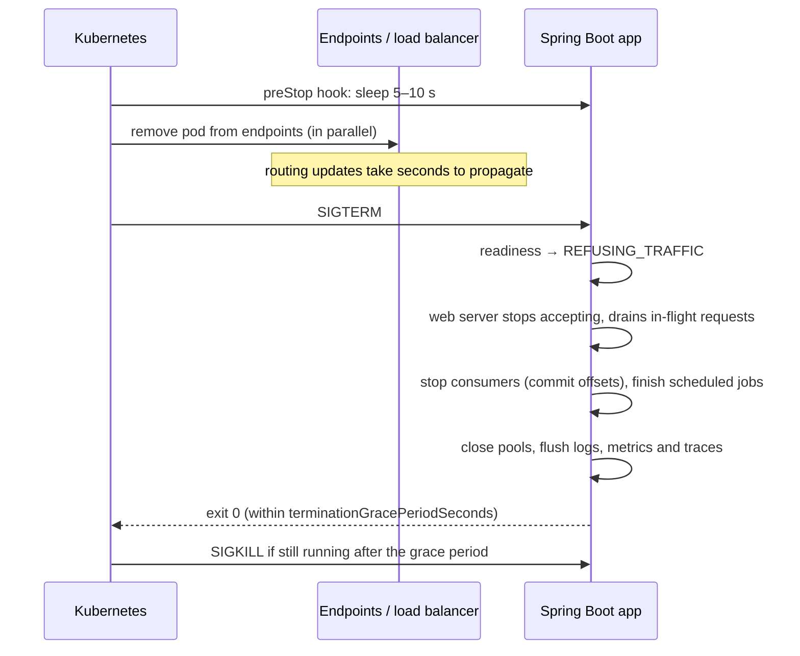
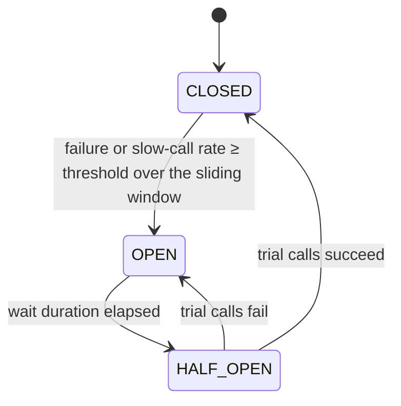

[⬅️ Prev: 21 · Performance](21-performance-engineering-troubleshooting.md) · [🏠 Index](README.md) · [Next: 23 · Distributed Systems ➡️](23-distributed-systems-microservices.md)

# 22 · Production Readiness, Observability & Resilience

> *"It works on my machine" was never the bar. The bar is: it degrades gracefully when its dependencies don't, it tells you what's wrong before customers do, and it can be deployed, rolled back and shut down without anyone noticing.*

---

## Table of contents
1. [What "production ready" means](#1-what-production-ready-means-)
2. [Observability: logs, metrics, traces, profiles](#2-observability-logs-metrics-traces-profiles-)
3. [Logging that helps at 3 a.m.](#3-logging-that-helps-at-3-am-)
4. [Metrics with Micrometer](#4-metrics-with-micrometer-)
5. [Distributed tracing & OpenTelemetry](#5-distributed-tracing--opentelemetry-)
6. [Health checks & Kubernetes probes](#6-health-checks--kubernetes-probes-)
7. [Graceful shutdown](#7-graceful-shutdown-)
8. [Resilience patterns](#8-resilience-patterns-)
9. [SLIs, SLOs, error budgets & alerting](#9-slis-slos-error-budgets--alerting-)
10. [Deployment strategies](#10-deployment-strategies-)
11. [The JVM-on-Kubernetes checklist](#11-the-jvm-on-kubernetes-checklist-)
12. [Incidents, postmortems & chaos engineering](#12-incidents-postmortems--chaos-engineering-)
13. [Staff lens](#13-staff-lens-)
14. [Interview questions](#14-interview-questions)
15. [References](#15-references)

---

## 1. What "production ready" means 🟡→🟣

A production-readiness review asks these questions before launch, not after the first incident:

| Area | Must be true |
|---|---|
| **Observability** | Structured logs with trace IDs; RED metrics per endpoint; JVM, pool and GC metrics; traces across services; dashboards exist |
| **Alerting** | SLO-based alerts that page on symptoms, with **runbooks** linked |
| **Resilience** | Timeouts on every outbound call; bounded retries with backoff; circuit breakers and bulkheads on critical dependencies; load shedding |
| **Lifecycle** | Liveness, readiness and startup probes done right; graceful shutdown; zero-downtime deploys; tested rollback |
| **Capacity** | Load-tested to the known knee; autoscaling configured; resource requests and limits set deliberately |
| **Data** | Backups **with tested restores**; migrations compatible with rolling deploys; retention defined |
| **Security** | Secrets in a vault (not env files in git); least-privilege IAM; dependency scanning; TLS everywhere ([Chapter 25](25-security-for-java-engineers.md)) |
| **Ownership** | An on-call rotation, an escalation path, and a service catalogue entry |

---

## 2. Observability: logs, metrics, traces, profiles 🟡

| Signal | Answers | Cost profile | Java tooling |
|---|---|---|---|
| **Metrics** | *Is* something wrong? How much, how often? | Cheap, aggregatable, low cardinality | Micrometer → Prometheus / OTLP |
| **Traces** | *Where* in the request path is the problem? | Medium; sampled | OpenTelemetry (agent or SDK), Micrometer Tracing |
| **Logs** | *What exactly* happened in this case? | Expensive at volume | SLF4J + Logback/Log4j2, structured JSON |
| **Profiles** | *Which code* burns the CPU or allocates? | Low with continuous sampling | JFR, async-profiler, Pyroscope ([Chapter 21](21-performance-engineering-troubleshooting.md)) |

**OpenTelemetry (OTel)** is the vendor-neutral standard for generating, propagating and exporting all of these. Instrument once, then send the data to any backend (Grafana stack, Datadog, Honeycomb, New Relic, Elastic, …). The glue between signals is **correlation**: every log line carries `trace_id`/`span_id`, metrics carry **exemplars** linking a latency bucket to an example trace, and traces link to profiles.

---

## 3. Logging that helps at 3 a.m. 🟡→🔴

**Structured (JSON) logs**, not prose, so they're machine-parseable, queryable and consistent:
```json
{"@timestamp":"2026-11-15T10:42:17.311Z","level":"WARN","logger":"c.a.o.CheckoutService",
 "message":"payment declined","trace_id":"4bf92f3577b34da6a3ce929d0e0e4736","span_id":"00f067aa0ba902b7",
 "order_id":"ord_8f2c","error.code":"PAYMENT_DECLINED","retryable":false,"service.version":"2026.11.3"}
```
Spring Boot 3.4+ supports structured logging out of the box (`logging.structured.format.console=ecs` or `logstash`/`gelf`).

```java
private static final Logger log = LoggerFactory.getLogger(CheckoutService.class);

log.warn("payment declined orderId={} code={}", orderId, result.code());     // ✅ parameterised: no work if WARN is off
log.debug("cart contents: " + cart.describe());                              // ❌ builds the string even when DEBUG is off
log.atDebug().setMessage("cart contents: {}").addArgument(cart::describe).log();   // ✅ SLF4J 2 fluent API, lazy argument
```

**MDC (Mapped Diagnostic Context)** puts request-scoped fields (trace ID, tenant, request ID) on every log line automatically. It's `ThreadLocal`-based, so it must be **set and cleared** around each request, and **propagated** across thread hops (Micrometer context propagation does this for you, including for virtual threads and Reactor) ([Chapter 11 §13](11-concurrency-foundations-jmm.md#13-threadlocal-internals-and-leaks-)).

**Level policy:**
| Level | Meaning |
|---|---|
| `ERROR` | Something failed that needs a human's attention (and probably a metric and an alert) |
| `WARN` | Unexpected but handled. Watch for trends |
| `INFO` | Significant business or lifecycle events (startup, config, deploy markers). **Not** per-request chatter in hot paths |
| `DEBUG`/`TRACE` | Diagnostic detail, off in production by default and toggleable at runtime (`/actuator/loggers`) |

**Rules:**
- **Never log secrets or PII:** passwords, tokens, card numbers, full request bodies. Mask at the source, and add log-scrubbing as a safety net.
- **Log once, where the error is handled** ([Chapter 04 §10](04-exceptions.md#10-anti-patterns-that-show-up-in-code-review-)).
- **Async appenders** keep logging I/O off request threads, but buffered logs can be **lost on a crash**. Size the queue and decide what happens when it's full (block or drop).
- **Log volume is money.** Sample noisy logs, and turn repetitive per-request logs into metrics.
- 💣 **Log4Shell (CVE-2021-44228)** was a logging library evaluating `${jndi:ldap://…}` lookups *inside logged data*, which gave remote code execution from any logged user input. The lessons: keep logging libraries patched, never interpret data as code, and keep an SBOM so you know where every library is ([Chapter 15 §9](15-modules-and-build-tools.md#9-reproducible-verifiable-secure-builds-)).

---

## 4. Metrics with Micrometer 🔴

Micrometer is to metrics what SLF4J is to logging: a **facade** over Prometheus, OTLP, Datadog, CloudWatch and others. Spring Boot Actuator auto-configures it, with JVM, GC, thread, HTTP server and client, HikariCP and executor metrics.

| Type | Use | Example |
|---|---|---|
| `Counter` | Things that happen | `orders.placed`, `payments.failed` |
| `Gauge` | A current value (sampled) | Queue depth, cache size, pool active connections |
| `Timer` | Latency **and** count | `http.server.requests`, `inventory.check` |
| `DistributionSummary` | Distribution of non-time values | Payload sizes, batch sizes |
| `LongTaskTimer` | Duration of *in-flight* long tasks | A running report job |

```java
@Component
class InventoryClient {
    private final Timer checkTimer;
    private final Counter fallbacks;

    InventoryClient(MeterRegistry registry) {
        this.checkTimer = Timer.builder("inventory.check")
                .description("Latency of inventory availability checks")
                .publishPercentileHistogram()                         // histogram buckets → percentiles server-side
                .serviceLevelObjectives(Duration.ofMillis(100), Duration.ofMillis(300))
                .register(registry);
        this.fallbacks = Counter.builder("inventory.fallback").register(registry);
    }

    Stock check(Sku sku) { return checkTimer.record(() -> callRemote(sku)); }
}
```

### Cardinality: the way metrics systems die 💣
Every unique combination of tag values is a separate **time series**. Tags must have a **small, bounded** set of values:
```java
registry.counter("orders.placed", "channel", "web", "country", "DE");        // ✅ bounded (channels × ~200 countries)
registry.counter("orders.placed", "userId", userId);                          // ❌ one series per user: millions
registry.timer("http.requests", "uri", request.getRequestURI());             // ❌ /orders/1, /orders/2, … unbounded
```
Spring's instrumentation tags `uri` with the **route template** (`/orders/{id}`), not the raw path, for exactly this reason. Put high-cardinality identifiers in **traces and logs**, never in metric tags.

### Percentiles: aggregatable or not
- `publishPercentiles(0.99)` computes p99 **in the application**. It's cheap, but **it can't be aggregated** across instances ([Chapter 21 §3](21-performance-engineering-troubleshooting.md#3-latency-percentiles-tails-fan-out-)).
- `publishPercentileHistogram()` exports **histogram buckets**, so the backend computes fleet-wide percentiles (`histogram_quantile` in PromQL). Prefer this for SLOs.

**The Observation API** (Micrometer 1.10+, used across Spring 6/7) instruments code **once** and produces metrics *and* trace spans from the same observation, through `@Observed` or `Observation.createNotStarted(...).observe(...)`.

**The four golden signals** (Google SRE) for every service: **latency, traffic, errors, saturation**. RED covers the first three, and saturation comes from USE (pools, queues, CPU, memory) ([Chapter 21 §1](21-performance-engineering-troubleshooting.md#1-methodology-use-red-and-one-change-at-a-time-)).

---

## 5. Distributed tracing & OpenTelemetry 🔴

A **trace** is the whole journey of one request. It's a tree of **spans** (timed operations), with each span carrying its parent's ID.

```
trace 4bf92f35…  POST /checkout                                  ████████████████████████  412 ms
├─ span  CheckoutService.place                                   ███████████████████████   405 ms
│  ├─ span  SELECT orders … (JDBC)                               █                          12 ms
│  ├─ span  POST inventory-svc /reserve                          ███████                   130 ms
│  │  └─ span (inventory-svc) UPDATE stock …                     ██                         35 ms
│  ├─ span  POST payment-svc /charge                             ██████████████            240 ms  ← here
│  └─ span  kafka.send order-events                              █                           6 ms
```

**Context propagation** passes the trace context across process boundaries in a standard header (**W3C Trace Context**):
```
traceparent: 00-4bf92f3577b34da6a3ce929d0e0e4736-00f067aa0ba902b7-01
             │  └──────────── trace-id ─────────┘ └─ parent span ─┘ └ flags (sampled)
```
…and across **messaging**, in Kafka record headers. Inside the JVM, the context lives in thread-bound storage, so **thread hops need propagation**: executors, `CompletableFuture`, Reactor, virtual threads. Use the context-propagation library's wrappers, or rely on the agent's instrumentation.

**Ways to instrument a Java service:**
| Approach | Effort | Notes |
|---|---|---|
| **OpenTelemetry Java agent** (`-javaagent:opentelemetry-javaagent.jar`) | Zero code | Bytecode instrumentation of hundreds of libraries (JDBC, HTTP clients, Kafka, Spring…). Watch agent overhead and JDK-compatibility for upgrades ([Chapter 14 §7](14-reflection-annotations-proxies.md#7-java-agents--instrumentation-)) |
| **Micrometer Tracing / Observation** (Spring Boot) | Low | Native Spring integration. Boot 4 ships an OpenTelemetry starter |
| **OTel SDK by hand** | Medium | Full control. Use it for custom spans in business-critical paths |

**Sampling:**
- **Head-based** (decide at the start, for example 10%) is cheap and simple, but it may drop the rare slow or failed request you actually care about.
- **Tail-based** (the OTel Collector decides *after* seeing the whole trace: keep all errors and slow traces plus a sample of the rest) gives better data, but the collector has to buffer traces.

**Cardinality applies to spans too.** Put IDs in span *attributes* (fine for traces), but keep span *names* low-cardinality (`GET /orders/{id}`, not `GET /orders/8f2c`).

---

## 6. Health checks & Kubernetes probes 🔴

| Probe | Question | On failure | Should check |
|---|---|---|---|
| **Liveness** | Is this process **broken beyond self-repair**? | Kubernetes **restarts** the container | Internal state only (a deadlocked event loop, a corrupted state flag). **NOT dependencies** |
| **Readiness** | Can this instance **serve traffic right now**? | Removed from load balancing (not restarted) | Warmed up, critical dependencies reachable, not shutting down |
| **Startup** | Has it finished starting? | Liveness and readiness held off until it passes | Slow JVM startup or migrations |

💣 **The cascading-restart anti-pattern:** a liveness probe that checks the database. The database has a 30-second hiccup, so **every pod fails liveness at once, the entire fleet restarts**, and then all pods hit the database with cold caches and connection storms at the same time. A minor blip becomes a major outage. **Liveness must never depend on anything external.**

```properties
# Spring Boot: dedicated probe endpoints backed by ApplicationAvailability
management.endpoint.health.probes.enabled=true
management.endpoint.health.group.readiness.include=readinessState,db,redis
management.endpoint.health.group.liveness.include=livenessState
# → /actuator/health/liveness  and  /actuator/health/readiness
```
```yaml
livenessProbe:  { httpGet: { path: /actuator/health/liveness,  port: 8081 }, periodSeconds: 10, failureThreshold: 3 }
readinessProbe: { httpGet: { path: /actuator/health/readiness, port: 8081 }, periodSeconds: 5,  failureThreshold: 3 }
startupProbe:   { httpGet: { path: /actuator/health/liveness,  port: 8081 }, periodSeconds: 5,  failureThreshold: 30 }
```
Run Actuator on a **separate management port** that isn't exposed publicly, and expose only the endpoints you need.

---

## 7. Graceful shutdown 🔴

Rolling deploys and autoscaling stop pods constantly. Every stop must **finish in-flight work** and **never drop requests**.



```properties
server.shutdown=graceful                                   # the default in recent Spring Boot versions
spring.lifecycle.timeout-per-shutdown-phase=30s
```
```yaml
lifecycle:
  preStop: { exec: { command: ["sh", "-c", "sleep 8"] } }   # let endpoint removal propagate BEFORE draining
terminationGracePeriodSeconds: 45                           # > preStop + drain timeout
```

**Why the `preStop` sleep?** Removing a pod from Service endpoints and sending SIGTERM happen **concurrently**. Without the delay, the app stops accepting connections while load balancers and kube-proxy are *still sending it traffic*, so clients see connection-refused errors during every deploy.

**Message consumers:** stop polling, finish the current batch, **commit offsets**, then close. Otherwise a rebalance re-delivers work, and your consumers must be idempotent anyway ([Chapter 23](23-distributed-systems-microservices.md)).

---

## 8. Resilience patterns 🔴→🟣

Failures in distributed systems are **partial and constant**: slow dependencies, dropped connections, overloaded databases. Resilience patterns contain the blast radius.

### 8.1 Timeouts: the foundation
- **Every** outbound call gets connect and read (or overall) timeouts ([Chapter 13 §9](13-io-nio-networking-serialization.md#9-networking-sockets-timeouts-httpclient-)).
- **Deadline propagation:** if the caller gives you 800 ms, downstream calls get the *remaining* budget, not a fresh 2 s each. gRPC propagates deadlines natively, and HTTP needs a convention (a header).
- **A callee's timeout must be shorter than its caller's.** Otherwise the caller gives up while the callee keeps working on a result nobody will read.

### 8.2 Retries: helpful, until they become the outage
Retry **only** transient failures (timeouts, 503, connection resets) and **only** idempotent operations (or ones protected by an idempotency key).
```
attempt n delay = random(0, min(cap, base × 2ⁿ))          ← exponential backoff with FULL JITTER (AWS architecture blog)
```
Jitter **decorrelates** clients. Without it, every client that failed together retries together, which produces synchronized retry waves (thundering herd).

**Retry amplification** 💣: three layers (gateway → service → client library), each retrying 3 times, turns **1** failing request into **3³ = 27** calls at the bottom, exactly when the bottom is struggling. Rules:
1. Retry at **one** layer (usually the one closest to the failing dependency).
2. Cap attempts, and use a **retry budget** (for example, retries may add at most 10% extra load).
3. Honour `Retry-After` and don't retry on 4xx (except 429, after the indicated delay).
4. Stop retrying when the circuit is open.

### 8.3 Circuit breaker
When a dependency is failing, **stop calling it for a while**. Fail fast, save threads and connections, and give it room to recover.


**Resilience4j** (the standard library; Spring Cloud Circuit Breaker wraps it):
```java
CircuitBreaker breaker = CircuitBreaker.of("inventory", CircuitBreakerConfig.custom()
        .failureRateThreshold(50)                                  // open at ≥ 50% failures…
        .slowCallRateThreshold(50)                                 // …or ≥ 50% slow calls
        .slowCallDurationThreshold(Duration.ofMillis(500))
        .slidingWindowType(CircuitBreakerConfig.SlidingWindowType.COUNT_BASED)
        .slidingWindowSize(50)
        .minimumNumberOfCalls(20)                                  // don't judge on 3 calls
        .waitDurationInOpenState(Duration.ofSeconds(10))
        .permittedNumberOfCallsInHalfOpenState(5)
        .build());

Retry retry = Retry.of("inventory", RetryConfig.custom()
        .maxAttempts(3)
        .intervalFunction(IntervalFunction.ofExponentialRandomBackoff(Duration.ofMillis(100), 2.0, 0.5))
        .retryOnException(e -> e instanceof IOException)          // transient only
        .build());

Supplier<Stock> resilientCheck = Decorators.ofSupplier(() -> inventoryClient.check(sku))
        .withCircuitBreaker(breaker)                               // inner: each attempt goes through the breaker
        .withRetry(retry)                                          // outer: retries respect the breaker's state
        .withFallback(List.of(CallNotPermittedException.class, IOException.class), e -> Stock.unknown(sku))
        .decorate();
```
**Spring Framework 7** also offers `@Retryable` (with backoff and jitter) and `@ConcurrencyLimit` in core ([Chapter 18 §15](18-spring-internals.md#15-spring-framework-7--boot-4-what-changed-)). Use whichever your platform standardises on, but put **per-dependency** settings in configuration.

### 8.4 Bulkheads
Isolate resources **per dependency**, so one slow dependency can't consume every thread or connection. Use semaphores (cheap, and they work with virtual threads) or dedicated bounded executors ([Chapter 12 §7](12-concurrency-advanced-juc-loom.md#7-synchronizers-latch-barrier-semaphore-phaser-)). The name comes from ship hulls: one flooded compartment doesn't sink the ship.

### 8.5 Rate limiting & load shedding
- **Rate limiting** (per client or tenant) protects you from abuse and noisy neighbours. The algorithms are in [Chapter 24](24-system-design-for-java-architects.md).
- **Load shedding** protects you from **overload in general**. When you're past capacity, **reject early** (429/503 with `Retry-After`) instead of queueing. A request that waits 20 s and then times out wastes resources *and* still fails, while a fast rejection lets clients back off or fail over.
- **Adaptive concurrency limits** (Netflix's concurrency-limits library, TCP-Vegas-style algorithms) adjust the allowed in-flight count dynamically from observed latency, with no hand-tuned magic numbers.
- **Prioritise:** shed low-priority traffic (batch, analytics, prefetch) before checkout.

### 8.6 Fallbacks & graceful degradation
Serve **stale cached data**, defaults, or a reduced feature ("recommendations unavailable") instead of failing the whole page.
💣 A fallback that silently masks an outage for hours is a monitoring failure. **Count and alert on fallbacks.** And never fall back in ways that compromise correctness (for example, approving payments when the fraud service is down) without an explicit business decision.

### 8.7 Putting it together
```
caller budget 800 ms
└── timeout 300 ms ─► bulkhead (20 permits) ─► circuit breaker ─► retry ×2 (jittered, idempotent only) ─► call
                                                                   └── fallback: stale cache + metric + log
```

---

## 9. SLIs, SLOs, error budgets & alerting 🟣

- **SLI** (indicator): a measurement of user experience. *"Proportion of `POST /checkout` requests that succeed in < 300 ms."*
- **SLO** (objective): a target for the SLI over a window. *"99.9% over 28 days."*
- **SLA** (agreement): a contractual promise with penalties. It's usually looser than the internal SLO.
- **Error budget** = 1 − SLO. At 99.9% over 28 days, about **40 minutes** of complete failure (or the equivalent in partial failures).

**Error budgets turn reliability into a negotiation tool.** When there's budget left, ship faster and take risks. When it's exhausted, prioritise reliability work and slow down risky changes. That's an objective, pre-agreed rule instead of an argument.

**Alerting on SLOs: multi-window, multi-burn-rate** (from the Google SRE Workbook):
| Severity | Burn rate | Long window | Short window | Budget consumed |
|---|---|---|---|---|
| Page | 14.4× | 1 h | 5 min | 2% in an hour |
| Page | 6× | 6 h | 30 min | 5% in six hours |
| Ticket | 1× | 3 days | 6 h | 10% in three days |

The short window makes the alert **reset quickly** once the problem is fixed. The long window keeps it from firing on brief blips.

**Alerting principles:** page on **symptoms users feel** (SLO burn, error rate, latency), not on causes (CPU at 80% is a dashboard, not a page). **Every page is actionable** and links a runbook. Alerts that nobody acts on get deleted.

---

## 10. Deployment strategies 🔴

| Strategy | How | Rollback | Cost / risk |
|---|---|---|---|
| **Rolling** | Replace instances gradually | Roll forward or back gradually | Default; old and new versions run **simultaneously** (compatibility required) |
| **Blue/green** | A full parallel environment, then switch traffic | Instant switch back | Double capacity during deploys. Databases are shared, so schema compatibility still matters |
| **Canary** | Send 1% → 5% → 25% → 100% of traffic to the new version, comparing SLIs | Automatic on SLO regression | Needs good metrics and automated analysis (Argo Rollouts, Flagger) |
| **Feature flags** | Deploy dark, release by flag (per tenant or cohort) | Flip the flag | Flag debt, so clean up old flags |
| **Shadow / dark launch** | Mirror traffic to the new version without serving its responses | — | Watch side effects (mirrored writes!) |

**Database changes** must be compatible with **both** versions running together: expand–contract ([Chapter 19 §13](19-persistence-jdbc-jpa-hibernate.md#13-schema-migrations-without-downtime-)). **Deploy ≠ release:** separating them with flags is what makes high deploy frequency safe.

---

## 11. The JVM-on-Kubernetes checklist 🔴

```dockerfile
FROM eclipse-temurin:25-jre                       # or a jlink'd minimal runtime (Chapter 15 §3)
RUN useradd --uid 10001 app
USER 10001                                        # never run as root
ENV JAVA_TOOL_OPTIONS="\
 -XX:MaxRAMPercentage=70 \
 -XX:+ExitOnOutOfMemoryError \
 -XX:+HeapDumpOnOutOfMemoryError -XX:HeapDumpPath=/dumps \
 -Xlog:gc*:file=/logs/gc.log:time,uptime,level,tags:filecount=5,filesize=20m \
 -XX:StartFlightRecording=disk=true,maxage=6h,maxsize=512m,dumponexit=true,filename=/dumps/"
```
- **Memory:** set `requests == limits` for memory (Guaranteed QoS, no surprise eviction). `MaxRAMPercentage` around 60–75%, with headroom for Metaspace, threads, direct buffers and code cache ([Chapter 10 §13](10-memory-and-garbage-collection.md#13-the-jvm-in-containers-)).
- **CPU:** be careful with CPU *limits* (CFS throttling spikes latency). Many teams set requests but generous or no limits for latency-sensitive JVMs. If you do limit, consider `-XX:ActiveProcessorCount`.
- **Probes and shutdown** as in §6–7.
- **Diagnostics ready before the incident:** GC logs, heap dumps to a **mounted volume** (treat them as secrets), continuous JFR, and `jcmd` available in the image.
- **Fail fast on OOM** (`ExitOnOutOfMemoryError`), so the orchestrator replaces the pod rather than leaving a zombie JVM.
- **Warmup:** readiness passes only after warmup if cold JIT hurts latency. Consider Leyden AOT caches or CRaC ([Chapter 09 §12](09-jvm-internals.md#12-startup--warmup-cds-leyden-aot-crac-native-image-)).
- **PodDisruptionBudgets and anti-affinity**, so a node drain or zone loss can't take all replicas down.

---

## 12. Incidents, postmortems & chaos engineering 🟣

**During an incident:**
1. **Mitigate first, diagnose later.** Roll back, flip the flag, shed load, fail over. Root-causing can wait until customers are fine.
2. **Clear roles:** an incident commander (coordinates and decides), a communications lead (status page, stakeholders), and operators (hands on keyboard).
3. **Capture evidence before it vanishes:** thread dumps, heap dumps, JFR dumps (`jcmd JFR.dump`), logs and a timeline.

**After it: blameless postmortems.** Cover the timeline, impact, **contributing factors** (rarely just one "root cause"), what went well, what was lucky, and action items **with owners and dates**. Blamelessness isn't softness: people only share the truth about what happened when they aren't punished for it, and without the truth you can't fix the system.

**Chaos engineering** (Netflix's practice, now mainstream):
1. Define **steady state** (SLIs).
2. Hypothesise that steady state continues under a real-world fault (a dependency adds 500 ms of latency, a zone fails, a pod is killed).
3. Inject the fault with a **minimised blast radius** (one instance, a small slice of traffic).
4. Learn, fix, automate, and expand.

Tools include Toxiproxy (network faults in tests), Chaos Monkey for Spring Boot, LitmusChaos, and cloud fault-injection services. **GameDays** rehearse incidents with the people who'll handle the real ones.

---

## 13. Staff lens 🟣

1. **Operability is a design input**, not a pre-launch checklist. Timeouts, idempotency, backpressure and observability shape the architecture. Bolting them on later is expensive.
2. **Make the right thing the default.** Platform starters give every service timeouts, circuit breakers, structured logging, tracing, correct probes and graceful shutdown out of the box. Teams that get these for free don't have to remember them.
3. **Use SLOs to arbitrate priorities.** Error budgets replace opinion ("we should spend time on reliability") with policy ("budget exhausted, so reliability work comes first").
4. **Reduce toil and alert fatigue.** Track pages per on-call shift, delete non-actionable alerts, and automate runbook steps that are performed more than twice.
5. **Learning organisations outperform blaming organisations.** Postmortem quality, and follow-through on action items, is a leading indicator of future reliability.

---

## 14. Interview questions

<details>
<summary><b>Q1. 🟡 What's the difference between liveness and readiness probes, and what's the classic mistake?</b></summary>

Liveness asks "is this process irreparably broken?", and failing it restarts the container. Readiness asks "can it serve traffic now?", and failing it only removes the pod from load balancing. The classic mistake is putting dependency checks (like the database) in liveness: a dependency blip then restarts the whole fleet at once, causing a cascading outage. Dependencies belong in readiness (carefully); liveness checks internal health only.
</details>

<details>
<summary><b>Q2. 🔴 How do you implement zero-downtime graceful shutdown for a Spring Boot service on Kubernetes?</b></summary>

A `preStop` sleep (5–10 s) so endpoint removal propagates before draining. On SIGTERM: mark readiness as refusing traffic, stop accepting new requests and drain in-flight ones (`server.shutdown=graceful`, a per-phase timeout), stop message consumers and commit offsets, finish or hand off scheduled work, close pools and flush telemetry, then exit before `terminationGracePeriodSeconds` (set it longer than preStop plus the drain time). Consumers must be idempotent in case of redelivery.
</details>

<details>
<summary><b>Q3. 🔴 Explain the circuit breaker pattern and its states.</b></summary>

It wraps calls to a dependency and tracks failure and slow-call rates over a sliding window. CLOSED: calls pass through. When the rate crosses a threshold (after a minimum number of calls), it goes OPEN: calls fail immediately (fail fast, saving resources and giving the dependency room to recover). After a wait, HALF_OPEN lets a few trial calls through. Success closes it, failure reopens it. Combine it with timeouts, fallbacks and per-dependency configuration.
</details>

<details>
<summary><b>Q4. 🔴 Why can retries make an outage worse, and how do you retry safely?</b></summary>

Retries multiply load exactly when a dependency is struggling: nested retries across layers multiply (3 layers × 3 attempts = 27×), and synchronized retries create thundering herds. Retry safely by retrying only transient errors on idempotent operations (or with idempotency keys), at one layer, with capped attempts, exponential backoff with full jitter, retry budgets, `Retry-After` respected, and a circuit breaker to stop retrying a dead dependency.
</details>

<details>
<summary><b>Q5. 🔴 What is metric cardinality and why does it matter?</b></summary>

Each unique combination of metric name and tag values is a separate time series. Unbounded tags (user IDs, order IDs, raw URIs) create millions of series, which blows up memory and cost in the metrics backend and slows queries, sometimes taking monitoring down. Keep tags bounded (route templates, status classes, regions) and put high-cardinality identifiers in traces and logs.
</details>

<details>
<summary><b>Q6. 🟡 Why should latency SLOs use histograms rather than client-side percentiles?</b></summary>

Client-side (per-instance) percentiles can't be aggregated: averaging p99s across instances is mathematically wrong. Histogram buckets can be summed across instances and time, and the backend computes accurate fleet-wide percentiles and SLO compliance (the proportion of requests under a threshold) from them.
</details>

<details>
<summary><b>Q7. 🔴 How does trace context propagate, and where does it commonly break in Java?</b></summary>

Across processes, the W3C `traceparent` header (HTTP, gRPC metadata, Kafka record headers) carries the trace ID, parent span ID and flags. Inside the JVM, the context is thread-bound, so it breaks at thread hops: custom executors, `CompletableFuture` async stages, Reactor schedulers, manually created threads (virtual threads included), and messaging libraries without instrumentation. Fix it with context-propagation-aware executors and wrappers, the OTel agent's instrumentation, or Micrometer's context propagation.
</details>

<details>
<summary><b>Q8. 🟣 Explain error budgets and burn-rate alerting.</b></summary>

The error budget is the allowed unreliability implied by an SLO (99.9% over 28 days ≈ 40 minutes of full outage equivalent). Teams spend it on risk (releases, experiments), and when it runs out, reliability work takes priority by policy. Burn-rate alerts page when the budget is being consumed much faster than sustainable (for example 14.4× over 1 h, confirmed by a 5-minute window), which catches real incidents quickly without paging on blips. Slower burns create tickets.
</details>

<details>
<summary><b>Q9. 🔴 What's load shedding and why is it better than queueing under overload?</b></summary>

Rejecting excess requests early (429/503 with `Retry-After`) when the service is beyond capacity. Queueing past capacity just adds latency until requests time out, consuming resources for work that fails anyway and pushing tail latency up for everyone. Shedding keeps latency healthy for the requests you accept, lets clients back off or fail over, and can prioritise important traffic. Adaptive concurrency limits automate where the cutoff is.
</details>

<details>
<summary><b>Q10. 🟣 You're the incident commander: checkout error rate jumped to 20% right after a deploy. What do you do?</b></summary>

Mitigate first: halt the rollout and roll back (or disable the feature flag), given the timing correlation. Assign roles (comms posts status updates, someone captures evidence: dumps, JFR, logs, traces of failing requests). Confirm recovery via the SLIs. Then investigate with the evidence: the deploy diff, config changes, dependency versions, error logs by code, traces. Afterwards, a blameless postmortem: why canary analysis didn't catch it, why the change reached 100%, plus action items with owners.
</details>

---

## 15. References
- Google, [*Site Reliability Engineering*](https://sre.google/sre-book/table-of-contents/) and [*The Site Reliability Workbook*](https://sre.google/workbook/table-of-contents/) (SLOs, burn-rate alerting, postmortems)
- Michael Nygard, *Release It!* (2nd ed.): circuit breakers, bulkheads, timeouts, stability anti-patterns
- [OpenTelemetry Java documentation](https://opentelemetry.io/docs/languages/java/) · [W3C Trace Context](https://www.w3.org/TR/trace-context/)
- [Micrometer documentation](https://docs.micrometer.io/micrometer/reference/) · [Resilience4j](https://resilience4j.readme.io/)
- Marc Brooker, *Exponential Backoff and Jitter* (AWS Architecture Blog)
- [Spring Boot Actuator reference](https://docs.spring.io/spring-boot/reference/actuator/index.html): probes, graceful shutdown, observability

---

[⬅️ Prev: 21 · Performance](21-performance-engineering-troubleshooting.md) · [🏠 Index](README.md) · [Next: 23 · Distributed Systems ➡️](23-distributed-systems-microservices.md)
