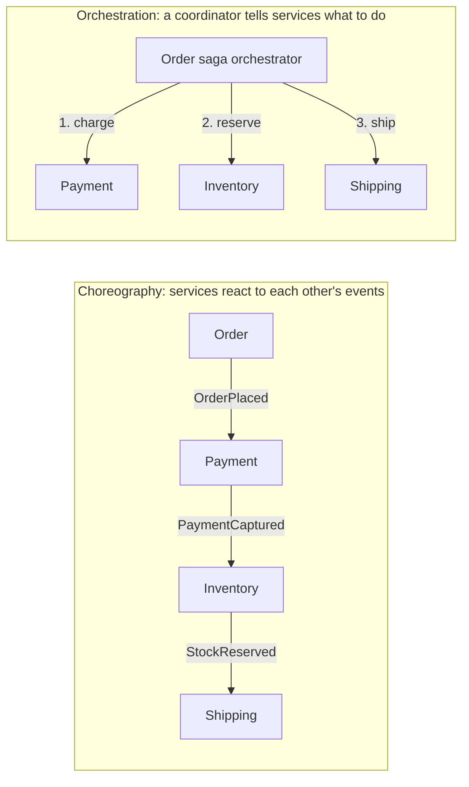
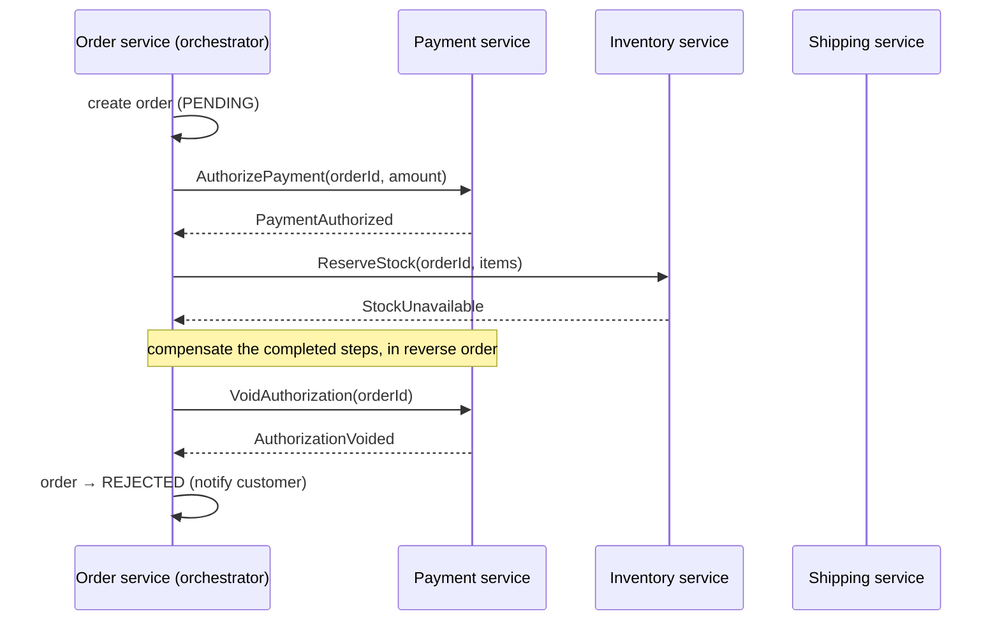
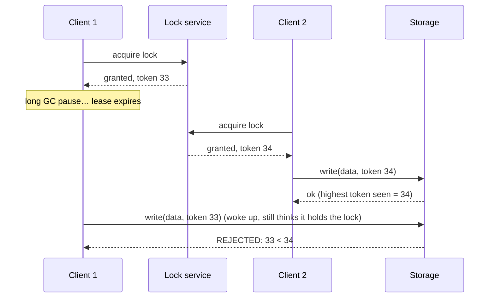

[⬅️ Prev: 22 · Production Readiness](22-production-readiness-observability-resilience.md) · [🏠 Index](README.md) · [Next: 24 · System Design ➡️](24-system-design-for-java-architects.md)

# 23 · Distributed Systems & Microservices

> *A distributed system is one where a machine you've never heard of can make your service fail (Leslie Lamport said roughly that, decades ago). Every pattern in this chapter is a way of living with that fact: partial failure, unreliable clocks, duplicated messages, and data that's only eventually consistent.*

> [!TIP]
> **🧭 Decision guide: whether to distribute, and how services talk**
> - **When it matters:** when a module needs independent scaling, deployment or ownership, or when data must flow between services.
> - **Default:** a modular monolith until there's a concrete reason to extract; events through an outbox for facts other services need; synchronous calls with timeouts for queries; idempotent consumers and idempotency keys (§7); sagas with compensations instead of two-phase commit; reconciliation jobs as the safety net.
> - **Alternatives:** microservices when teams and load profiles really diverge; orchestration or choreography for sagas; event sourcing where the history is the product.
> - **Failure modes:** the distributed monolith, dual writes, duplicate side effects from retries, ordering events by timestamps from different machines.
> - **Evidence that would change it:** services that must release together, on-call load, and load profiles that differ by an order of magnitude.
> - **Argued in:** §2–§8 and §16; [Chapter 36](36-case-study-payments.md) takes the payment parts through a full design review.

🧪 **Runnable labs:** [the programs behind this chapter's outputs](labs.md#chapter-23--distributed-systems)

---

## Table of contents
1. [Why distribute, and what it costs](#1-why-distribute-and-what-it-costs-)
2. [Monolith, modular monolith, microservices](#2-monolith-modular-monolith-microservices-)
3. [Drawing service boundaries](#3-drawing-service-boundaries-)
4. [Communication: sync, async, choreography, orchestration](#4-communication-sync-async-choreography-orchestration-)
5. [CAP, PACELC and consistency models](#5-cap-pacelc-and-consistency-models-)
6. [The dual-write problem & the transactional outbox](#6-the-dual-write-problem--the-transactional-outbox-)
7. [Idempotency: the property that makes retries safe](#7-idempotency-the-property-that-makes-retries-safe-)
8. [Sagas: transactions without 2PC](#8-sagas-transactions-without-2pc-)
9. [Event sourcing & CQRS](#9-event-sourcing--cqrs-)
10. [Kafka for Java engineers](#10-kafka-for-java-engineers-)
11. [Caching in distributed systems](#11-caching-in-distributed-systems-)
12. [Coordination: consensus, leader election, locks & fencing](#12-coordination-consensus-leader-election-locks--fencing-)
13. [Time and ordering](#13-time-and-ordering-)
14. [Gateways, discovery & service mesh](#14-gateways-discovery--service-mesh-)
15. [API evolution across services](#15-api-evolution-across-services-)
16. [Staff lens](#16-staff-lens-)
17. [Interview questions](#17-interview-questions)
18. [References](#18-references)

---

## 1. Why distribute, and what it costs 🟡

**Reasons to distribute:** scale beyond one machine, availability across failures (zones, regions), and **organisational scale**: letting many teams deploy independently.

**The eight fallacies of distributed computing** (L. Peter Deutsch and others at Sun). Each one has caused real outages:
1. The network is reliable.
2. Latency is zero.
3. Bandwidth is infinite.
4. The network is secure.
5. Topology doesn't change.
6. There is one administrator.
7. Transport cost is zero.
8. The network is homogeneous.

**What you pay for distributing:** a local method call (nanoseconds, always succeeds or throws) becomes a network call (milliseconds, **can fail, time out, or succeed while you think it failed**). A local transaction becomes distributed consistency. A stack trace becomes a distributed trace. That's why "should this be a separate service?" is a big decision.

---

## 2. Monolith, modular monolith, microservices 🔴→🟣

| | Monolith | **Modular monolith** | Microservices |
|---|---|---|---|
| Deployment | One unit | One unit | Many independent units |
| Module boundaries | Often none (a ball of mud) | **Enforced** (build modules, ArchUnit, Spring Modulith) | Enforced by the network |
| Data | One database, shared freely | One database, **schema-per-module ownership** | **Database per service** |
| Consistency | Local ACID transactions | Local ACID transactions | Eventual consistency, sagas |
| Team scaling | Painful beyond ~2–3 teams | Good to ~10 teams | Scales to many teams |
| Operational cost | Low | Low | **High**: platform, observability, on-call, network |
| Failure modes | All or nothing | All or nothing | Partial failure everywhere |

🧠 **The position I'd defend:** *start with a modular monolith* unless you have a concrete reason not to. Extract a service when a module needs **independent scaling** (very different load profile), **independent deployability** (a different team with a different release cadence), **different reliability or security requirements** (PCI scope, isolation), or **a different technology**. "Microservices because they're modern" leads to the **distributed monolith**: services that must deploy together, share databases, and call each other in synchronous chains. You get every cost of distribution and none of the benefits.

**Conway's law:** systems mirror the communication structure of the organisations that build them. Service boundaries and team boundaries have to be designed **together** (the "inverse Conway manoeuvre"). A service owned by three teams belongs to nobody.

---

## 3. Drawing service boundaries 🟣

1. **Bounded contexts first** ([Chapter 16 §8](16-design-principles-clean-architecture.md#8-ddd-strategic-design-a-primer-)). A service should own a coherent business capability (Payments, Catalogue, Fulfilment), not a technical layer ("the database service") or a single entity ("the Customer service" that everyone calls for everything).
2. **Each service owns its data.** No other service reads its tables. Sharing happens through **APIs or events**. A shared database is a hidden, untyped, unversioned API.
3. **Minimise synchronous dependencies on the critical path.** If checkout synchronously calls six services, checkout's availability is the *product* of theirs (0.999⁶ ≈ 99.4%).
4. **High cohesion, low coupling, applied at the service level:** changes to one business capability should usually touch **one** service. If every feature needs coordinated changes to four services, the boundaries are wrong.
5. **Replicate data you only read** via events, instead of calling the owner on every request (a local, eventually consistent copy of product names in the Order service, for example).

---

## 4. Communication: sync, async, choreography, orchestration 🔴

| | Synchronous (REST, gRPC) | Asynchronous (Kafka, RabbitMQ, SQS) |
|---|---|---|
| Coupling | **Temporal**: both must be up at the same time | Decoupled in time; the broker buffers |
| Latency | The caller waits | Fire and continue; eventual effect |
| Failure handling | Timeouts, retries, circuit breakers | Retries, DLQs, idempotent consumers |
| Best for | Queries, commands needing an immediate answer | Events, workflows, fan-out, load levelling |

**REST vs gRPC:** REST/JSON is universal, human-readable, and cache-friendly. gRPC (HTTP/2 + Protobuf) brings strong contracts, codegen, streaming, **deadline propagation** and compact payloads. It's often the choice for internal service-to-service calls, with REST at the public edge.

**Queues vs logs:**
- **Queue** (RabbitMQ, SQS): a message is consumed and removed. Competing consumers. Good for **work distribution**.
- **Log** (Kafka, Pulsar, Kinesis): messages are retained, and consumers track **offsets**. Many independent consumer groups can each read everything, and you can replay history. Good for **event streams** and integration.

**Choreography vs orchestration:**

| | Choreography | Orchestration |
|---|---|---|
| Coupling | Loose: services only know events | The orchestrator knows every participant |
| Visibility | The flow is **implicit**, spread across services | The flow is **explicit** in one place |
| Good for | Simple flows, many independent reactions | Complex, multi-step business processes with compensation |
| Risk | "Event spaghetti": nobody can draw the process anymore | A central "god service" if overused |

---

## 5. CAP, PACELC and consistency models 🔴→🟣

**CAP (Brewer):** in the presence of a network **P**artition, a system must choose between **C**onsistency (linearizability: every read sees the latest write) and **A**vailability (every request to a non-failed node gets a non-error response). Since partitions *will* happen, the real choice is **CP or AP during a partition**.

**PACELC (Abadi)** completes the picture: **if P**artition, choose **A** or **C**; **E**lse (normal operation), choose **L**atency or **C**onsistency. Even without failures, stronger consistency costs latency (cross-replica coordination).
| System (typical configuration) | PACELC |
|---|---|
| Single-leader RDBMS with sync replication | PC/EC |
| DynamoDB, Cassandra (tunable) | PA/EL by default, tunable towards C |
| Spanner, CockroachDB | PC/EC (latency paid for global consistency) |
| MongoDB (majority read/write concerns) | PC/EC-ish |

**The consistency spectrum**, from strongest to weakest:
| Model | Guarantee |
|---|---|
| **Linearizable** | Behaves like a single copy; reads see the latest completed write |
| **Sequential** | Everyone sees the same order of operations (not necessarily real-time order) |
| **Causal** | Causally related operations are seen in order (a reply never appears before its question) |
| **Read-your-writes** | You always see your own writes |
| **Monotonic reads** | You never see time go backwards |
| **Eventual** | If writes stop, replicas converge… eventually |

**Quorums:** with N replicas, writes acknowledged by W and reads querying R, **R + W > N** guarantees that read and write sets overlap, so a read contacts at least one replica with the latest write. With N=3, W=2, R=2, you tolerate one replica failure for both reads and writes. (Sloppy quorums, hinted handoff and clock-based conflict resolution all weaken this in practice.)

🎯 **Interviewer's lens.** Staff candidates don't say "we'll use eventual consistency". They say *which* guarantee each operation needs: "account balance reads need read-your-writes, the product catalogue can be minutes stale, the payment ledger needs linearizable writes."

---

## 6. The dual-write problem & the transactional outbox 🔴

**The bug that hides in almost every event-driven service:**
```java
@Transactional
public void placeOrder(Order o) {
    orders.save(o);                                   // 1. database
    kafka.send("order-events", new OrderPlaced(o));   // 2. broker: NOT part of the DB transaction
}
```
- If the Kafka send succeeds and the transaction **rolls back** → you've announced an order that doesn't exist.
- If the transaction commits and the send **fails** (or the process crashes in between) → the order exists, but nobody downstream ever hears about it.
- Moving the send *after* commit just changes which failure you get.

**The transactional outbox:** write the event **into the same database, in the same transaction**, and publish it asynchronously.
```java
@Transactional
public OrderId placeOrder(PlaceOrderCommand cmd) {
    Order order = Order.place(cmd);
    orders.save(order);
    outbox.save(new OutboxEvent(
            UUID.randomUUID(),               // event ID: consumers deduplicate on it
            "Order", order.id().value(),     // aggregate type and ID: the Kafka key (ordering per aggregate)
            "OrderPlaced",
            json.write(new OrderPlaced(order.id(), order.total())),
            Instant.now()));                 // SAME transaction: both rows commit, or neither
    return order.id();
}
```
**Relaying the outbox to the broker:**
- **Polling publisher:** `SELECT … FROM outbox WHERE published_at IS NULL ORDER BY id LIMIT 100 FOR UPDATE SKIP LOCKED` → send → mark published ([Chapter 19 §5](19-persistence-jdbc-jpa-hibernate.md#5-locking-optimistic-pessimistic-skip-locked-)). It's simple, and adds a little latency.
- **Change Data Capture (CDC):** **Debezium** tails the database's write-ahead log and streams outbox inserts to Kafka. Lower latency, no polling load, but more infrastructure.

**The guarantee is at-least-once delivery.** The relay can crash *after* sending and *before* marking the row published, so it sends again. **Consumers must be idempotent** (§7). The mirror-image pattern on the consumer side is the **inbox**: record processed event IDs in the consumer's database, in the same transaction as the side effect.

---

## 7. Idempotency: the property that makes retries safe 🔴

An operation is **idempotent** if doing it twice has the same effect as doing it once. In a world of timeouts and redeliveries, the client often *can't know* whether its request succeeded, so it retries. Without idempotency, retries create duplicate charges, duplicate orders and duplicate emails.

**Natural idempotency:** `SET status = 'SHIPPED'` is idempotent, while `balance = balance - 10` isn't. `PUT` (replace) and `DELETE` are idempotent by definition; `POST` usually isn't.

**Idempotency keys** (the standard pattern for payment APIs):
```
POST /payments
Idempotency-Key: 6f1c2a7e-9a51-4c8e-b8f0-2f2d1c0e9a77      ← generated by the CLIENT, once per logical operation
```
💣 **The obvious implementation has two holes.** Look for a saved response, charge the card, then save:
```java
@Transactional                                                         // ✗ the order to avoid
public PaymentResponse charge(String idempotencyKey, ChargeRequest req) {
    Optional<StoredResponse> previous = idempotency.find(idempotencyKey);
    if (previous.isPresent()) return previous.get().response();
    PaymentResponse response = gateway.charge(req);                     // the money moves here...
    idempotency.save(idempotencyKey, hash(req), response);              // ...and the key is claimed only here
    return response;
}
```
- **Concurrent duplicates both charge.** Two requests with the same key both find nothing and both call the gateway; the unique constraint rejects the second *save*, after the money has moved.
- **A crash between the charge and the save** leaves no record, so the client's retry charges again.
- And `@Transactional` holds a connection and a transaction open across a slow network call, which drains the pool under load ([Chapter 32, case 7](32-production-troubleshooting-scenarios.md#case-7-pool-timeouts-while-the-database-is-idle-)).

**Claim the key first, call the processor with a key that belongs to the operation, record the outcome, and reconcile whatever stays unknown:**
```java
public Response pay(String idempotencyKey, ChargeRequest req) {
    // 1. Claim the key in a short transaction of its own, committed BEFORE any side effect:
    //    INSERT INTO payment_operation (id, merchant_id, idempotency_key, request_hash, state, created_at)
    //    VALUES (?, ?, ?, ?, 'PENDING', now()) ON CONFLICT (merchant_id, idempotency_key) DO NOTHING
    //    (fine with a random ID; if the ID is derived from the key, as in Chapter 36, omit the conflict target)
    Operation op = Operation.pending(newOperationId(), merchantId, idempotencyKey, hash(req), req.amount());
    Optional<Operation> existing = operations.claim(op);
    if (existing.isPresent()) return answer(existing.get(), req);      // replay, 409, 422 or 202 (table below)

    // 2. No transaction is open during the call. The processor's idempotency key is the OPERATION's ID,
    //    so every re-send of this operation, by this request or by the reconciler, uses the same key.
    try {
        Charge charge = psp.charge(op.id() /* PSP idempotency key */, op.id() /* our reference */, req.amount());
        // 3. One transaction: UPDATE payment_operation SET state = 'SUCCEEDED', charge_id = ?
        //    WHERE id = ? AND state IN ('PENDING', 'UNKNOWN'), plus the ledger rows and an outbox row.
        return operations.recordSuccess(op, charge);
    } catch (PspTimeout | PspServerError e) {
        operations.markUnknown(op);                                     // unknown is NOT failed: the card may be charged
        return Response.accepted("processing");                         // 202; the reconciler settles it (rule 3)
    }
}
```
| Stored operation | Retry with the same payload | Same key, different payload |
|---|---|---|
| `SUCCEEDED`, or a definite decline | Replay the original status and body | `422 idempotency_key_reused`: a client bug, never retried |
| `PENDING` (the first request is still running) | `409 idempotency_key_in_use` with `Retry-After`: retry the **same** request later | `422` |
| `UNKNOWN` (the processor's answer was lost) | `202 processing` with `Retry-After`, or the final result once reconciled | `422` |

**The rules that make it safe:**
1. **Claim before acting.** The unique constraint decides which request owns the operation *before* money moves, and the claim commits on its own so concurrent duplicates see it. Everyone else gets a 409 and retries later.
2. **One processor key per operation, reused on every re-send.** After a timeout the outcome is *unknown*: the card may have been charged. Re-sending with the same key lets the processor replay its first result; a fresh key per attempt charges twice. A new key is right only for a genuinely new operation after a *definite* failure (a decline, then the customer tries another card).
3. **A reconciler settles what's stuck:** `UNKNOWN` operations, and `PENDING` ones older than a lease, whose caller crashed. While the processor still remembers the key (Stripe may prune keys once they're 24 hours old), it re-sends with the same key. After that it never re-sends: it **looks the charge up by your reference**. A hit settles it; **an empty result doesn't**, because search indexes lag behind charges (Stripe's search is eventually consistent), so the operation stays `UNKNOWN` until an authoritative source, such as the settlement report, says there was no charge. Daily settlement-file reconciliation is the last net.
4. **Store the response**, scope keys per client or merchant, and keep records longer than any client retries. A guarded update (`WHERE state IN (…)`) makes exactly one writer record the outcome.

The lab runs both versions against a simulated processor that deduplicates its own keys for 24 hours (excerpt; run on JDK 25). Part 1 varies a little from run to run:
```
1. Four identical requests at once, for each of 1,000 payments (same Idempotency-Key)
   handler                    PSP charges   charged 2+ times   first responses
   check, charge, then save         3,997                999   1,000 x 201 charged, 3 x 201 replayed, 2,997 x 500 duplicate key
   claim the key first              1,000                  0   1,000 x 201 charged, 9 x 201 replayed, 2,991 x 409 in progress
   2,991 clients that got 409 retried after Retry-After: 2,991 x 201 replayed
```
The other parts are deterministic:
<!-- lab-output: PaymentIdempotency.java -->
```
3. The PSP charges the card but the response is lost (a timeout), so the service retries the PSP call
   PSP key on the retry                            PSP charges
   a new key per attempt (op-6e3fae65-attempt-2)             2   client got 201 charged ch_4002
   the operation's key again (op-6e3fae65)                   1   client got 201 charged ch_4001

5. An outcome still unknown 26 hours later (say the reconciler was down); the PSP keeps keys for 24 hours
   reconciler                               PSP charges
   re-sends with the same key                         2   client had 202 processing, Retry-After: 5; now SUCCEEDED ch_4002
   looks the charge up by our reference               1   client had 202 processing, Retry-After: 5; now SUCCEEDED ch_4001

6. A PSP without idempotency keys: after a timeout, look the charge up before charging again
   (its search lags up to 5 minutes behind its charges)
   when the search finds nothing                     PSP charges
   take it as "not charged" and charge again                   2   client got 201 charged ch_4002; the first charge is now a double charge
   keep it UNKNOWN until an answer is authoritative            1   client got 202 processing, Retry-After: 5; 10 min later the search found it: SUCCEEDED ch_4001
```
The first order charged 999 of 1,000 payments more than once, and its "500 duplicate key" responses came *after* the charges. Claiming first charged each payment once and turned the duplicates into 409s that later replayed. Part 6 is rule 3's warning in action: treating an empty search as "not charged" made a double charge. The lab also crashes the process between charge and save, sends a different amount under the same key (422), loses the payment's row in a failover, moves a merchant from the old handler to the new one mid-retry, and checks four invariants on every correct run: no checkout charged twice, one charge per successful payment, no charge without a payment, and a balanced ledger. [Chapter 36](36-case-study-payments.md) takes this design through a full review: state machine, ledger, reconciliation, what survives a failover, and a migration tested in both directions against PostgreSQL.

**Idempotent consumers** for messages:
```java
@Transactional
public void on(OrderPlaced event) {
    if (!processedEvents.insertIfAbsent(event.eventId())) return;   // INSERT … ON CONFLICT DO NOTHING; 0 rows = duplicate
    loyalty.awardPoints(event.customerId(), pointsFor(event.total()));
}
```

---

## 8. Sagas: transactions without 2PC 🔴→🟣

**Why not distributed transactions (2PC/XA)?** Two-phase commit blocks: if the coordinator dies after "prepare", participants hold locks *indefinitely*. It couples the availability of every participant, performs poorly, and isn't supported by most modern infrastructure (Kafka, most NoSQL stores, SaaS APIs). In microservices it's the wrong tool.

**A saga** is a sequence of **local transactions**, each publishing an event or a reply that triggers the next step. If a step fails, earlier steps are undone by **compensating transactions**.



**Designing sagas well:**
- **Compensations are semantic, not rollbacks.** You can't un-send an email. You send a correction. You can't un-capture money. You issue a refund. Design each step's compensation explicitly with the business.
- **Order the steps by reversibility.** Put steps that are hard to compensate (shipping, external payouts) **last**, after a **pivot** transaction beyond which the saga only moves forward.
- **Sagas lack isolation.** Other transactions can see intermediate states ("payment authorised, stock not yet reserved"). Countermeasures: **semantic locks** (status `PENDING_STOCK`), commutative updates, re-reading values before acting.
- **Every step must be idempotent**, because messages are retried.
- **Make sagas durable and observable.** Persist the saga state, handle timeouts ("no reply from Inventory in 30 s"), and give operators a way to see stuck instances. Workflow engines like **Temporal** or **Camunda** provide this durability, plus retries and timers, as infrastructure.

---

## 9. Event sourcing & CQRS 🟣

**CQRS (Command Query Responsibility Segregation):** separate the model you **write** through (commands, aggregates, invariants) from the models you **read** from (denormalised projections optimised per query). That can be as light as JPA for writes and SQL projections for reads in the same database ([Chapter 19 §12](19-persistence-jdbc-jpa-hibernate.md#12-when-not-to-use-an-orm-)), or as heavy as separate read stores (Elasticsearch, Redis) fed by events.

**Event sourcing:** store the **sequence of events** (`OrderPlaced`, `LineAdded`, `OrderPaid`) as the source of truth, instead of the current state. Current state is a **fold** over the events:
```java
Order rehydrate(List<OrderEvent> history) {
    Order state = Order.empty();
    for (OrderEvent e : history) state = state.apply(e);     // pure function: (state, event) → state
    return state;
}
```
| Gains | Costs |
|---|---|
| A complete **audit trail** by construction | **Event schema evolution forever** (upcasters, versioning) |
| Temporal queries ("what did we know at 10:03?") | Rebuilding projections can take hours on large stores |
| Replay to build new read models or fix bugs | Eventual consistency between writes and read models |
| Natural fit with event-driven integration | Harder GDPR deletes (crypto-shredding: encrypt per subject, delete the key) |
| | A steep learning curve for the team |

🧠 Use event sourcing where the **history is the business** (ledgers, trading, compliance-heavy workflows), not as a default architecture. Most systems are better served by state storage plus an outbox of integration events.

---

## 10. Kafka for Java engineers 🔴

### The model
- A **topic** is split into **partitions**. Each partition is an **ordered, append-only log**, replicated to several brokers (a leader plus followers in the **ISR**, the in-sync replicas).
- **Ordering is guaranteed only within a partition.** The **record key** picks the partition (`hash(key) % partitions`), so events for the same entity (key = `orderId`) stay in order.
- A **consumer group** shares the partitions among its members: **one partition → one consumer in the group**, so **parallelism ≤ partition count**. Different groups consume independently.
- Consumers track their position with **offsets**, committed to Kafka. Retention is time- or size-based. **Log compaction** keeps the latest value per key (changelogs, state).
- Kafka 4.0 removed ZooKeeper entirely. Cluster metadata now uses Kafka's own Raft-based **KRaft** mode.

### Delivery semantics
| Semantics | How | Risk |
|---|---|---|
| At-most-once | Commit offsets **before** processing | Messages lost on a crash |
| **At-least-once** (the usual) | Process, **then** commit | **Duplicates** on a crash or rebalance, so consumers must be idempotent |
| Exactly-once (in Kafka) | **Idempotent producer + transactions** (`read → process → write → commit offsets` atomically), consumers using `read_committed` | Only covers effects **inside Kafka**. External side effects (DB, email, HTTP) still need idempotency |

### Producer essentials
```java
props.put(ProducerConfig.ACKS_CONFIG, "all");                     // wait for all in-sync replicas
props.put(ProducerConfig.ENABLE_IDEMPOTENCE_CONFIG, true);        // no duplicates from producer retries (default since Kafka 3.0)
props.put(ProducerConfig.LINGER_MS_CONFIG, 10);                   // small batching delay → much higher throughput
props.put(ProducerConfig.COMPRESSION_TYPE_CONFIG, "zstd");
producer.send(new ProducerRecord<>("order-events", order.id().toString(), payload), (meta, ex) -> {
    if (ex != null) log.error("send failed for order {}", order.id(), ex);   // callbacks run on the producer I/O thread: keep them fast
});
```

### Consumer essentials
```java
props.put(ConsumerConfig.GROUP_ID_CONFIG, "loyalty-service");
props.put(ConsumerConfig.ENABLE_AUTO_COMMIT_CONFIG, false);         // commit only after processing
props.put(ConsumerConfig.ISOLATION_LEVEL_CONFIG, "read_committed");
props.put(ConsumerConfig.MAX_POLL_RECORDS_CONFIG, 200);

try (var consumer = new KafkaConsumer<String, String>(props)) {
    consumer.subscribe(List.of("order-events"));
    while (running) {
        ConsumerRecords<String, String> records = consumer.poll(Duration.ofMillis(500));
        for (ConsumerRecord<String, String> r : records) handleIdempotently(r);
        consumer.commitSync();                                       // at-least-once
    }
}
```

**Production pitfalls:**
- 💣 **Slow processing causes rebalance storms.** If processing a batch takes longer than `max.poll.interval.ms`, the consumer is considered dead, its partitions are reassigned, and the same records get processed again by someone else. Lower `max.poll.records`, speed up processing, or hand work off carefully (while preserving per-key order). Use **cooperative sticky assignment** and **static membership** to reduce rebalance disruption.
- **Poison pills:** a message that always fails blocks its partition forever. Retry a bounded number of times, then send it to a **dead-letter topic** with the error details, and alert.
- **Partition count is hard to change** for keyed topics (changing it reshuffles keys, which breaks ordering). Size for future parallelism up front.
- **Hot partitions:** a single huge key (one giant tenant) overloads one partition. Use compound keys or a separate topic for that tenant.
- **Consumer lag** is *the* health metric for consumers. Alert on lag growth and time-lag, not just on errors.

---

## 11. Caching in distributed systems 🔴

### Patterns
| Pattern | Read | Write | Notes |
|---|---|---|---|
| **Cache-aside** (lazy loading) | App checks the cache; on a miss, reads the DB and populates the cache | App writes the DB, then **invalidates** the cache | The most common; the app controls everything |
| Read-through | The cache loads from the DB itself | — | Cache library or provider does the loading |
| Write-through | — | Write to cache **and** DB synchronously | Fresh cache, slower writes |
| Write-behind | — | Write to cache; flush to DB asynchronously | Fast writes, **risk of loss** |
| Refresh-ahead | Refresh popular entries before they expire | — | Avoids miss latency for hot keys (Caffeine's `refreshAfterWrite`) |

### The cache-aside race 💣
```
T1: cache miss → read DB (old value v1) ──────────────────────────► set cache = v1   ← stale, possibly forever
T2:                    write DB (v2) → delete cache key ────►
```
Mitigations: **TTLs on everything** (they bound how long staleness lasts), delete-on-write (rather than update-on-write), versioned values (only set the cache if the version is newer), or invalidation from the DB's change stream (CDC).

### Stampedes, avalanches, penetration
| Problem | What happens | Fix |
|---|---|---|
| **Stampede / thundering herd** | A hot key expires and 5,000 requests hit the DB at once | **Request coalescing** (single-flight: one loader, everyone else waits for its result; Caffeine's `get(key, loader)` does this per key), probabilistic early refresh, per-key locks |
| **Avalanche** | Many keys expire together (they were loaded at the same time) | **Jitter the TTLs** (e.g. 10 min ± 20%) |
| **Penetration** | Requests for **non-existent** keys always miss and hit the DB (often an attack) | Cache negative results briefly; Bloom filter of existing keys |
| **Hot key** | One key gets a huge share of traffic (one Redis shard melts) | Local near-cache in front of Redis, key replication, splitting the key |

### Local vs distributed
- **Local (Caffeine):** nanoseconds, no network, W-TinyLFU eviction with an excellent hit rate. But each instance has its own copy, so staleness differs per instance, and memory is multiplied by the instance count.
- **Distributed (Redis, Memcached):** shared across instances and survives deploys. But it adds a network hop, it's a dependency that can fail (plan for cache-down: does the DB survive a cold-cache stampede?), and serialization costs.
- **Two-level (near-cache + Redis):** the best of both for read-heavy hot data, with invalidation via pub/sub or short local TTLs.

---

## 12. Coordination: consensus, leader election, locks & fencing 🟣

### Consensus (Raft, in one paragraph)
Nodes elect a **leader** for a numbered **term** by majority vote. The leader appends client commands to its log and replicates them. An entry is **committed** once a **majority** has stored it, and then every node applies committed entries in order. If the leader fails, a node with an up-to-date log wins a new election in a higher term. With 2f+1 nodes, the cluster tolerates f failures. That's why clusters have 3 or 5 nodes. etcd (Kubernetes), Consul and Kafka's KRaft use Raft. ZooKeeper uses the similar ZAB protocol.

**Rule of thumb: don't implement consensus yourself.** Use etcd, ZooKeeper or Consul (or the database) for leader election and configuration.

### Distributed locks, and why they're dangerous
```java
// "Lock" with Redis: SET lock:report-job <token> NX PX 30000
```
The fundamental problem: **a lock holder can't know it still holds the lock.** A **GC pause** ([Chapter 10](10-memory-and-garbage-collection.md)), a VM stall or a network delay longer than the lease, and the lock expires and is granted to someone else, while the first holder *wakes up and keeps writing*. Martin Kleppmann's well-known critique of Redlock makes exactly this point: lease-based locks without fencing aren't safe for correctness. [Chapter 34 §8](34-data-stores-redis-cassandra-dynamodb.md#8-redis-patterns-caches-locks-rate-limits-streams-measured-) reproduces it against a real Redis server.

**Fencing tokens fix it at the resource:**

The storage rejects writes carrying an older token. Monotonic tokens come from the consensus system (an etcd revision, a ZooKeeper zxid) or from a database sequence.

🧠 **Better still, avoid locks:** partition the work so each key has a **single writer** (a Kafka partition per key, a leader per shard), or use the database's own concurrency control (conditional updates, optimistic versions, `SKIP LOCKED` queues). Use distributed locks for **efficiency** (avoid duplicate work) rather than **correctness** whenever you can.

---

## 13. Time and ordering 🔴

- **Wall clocks lie:** NTP skew (milliseconds to seconds), jumps backward after corrections, leap seconds, VM pauses. **Never order distributed events by wall-clock timestamps** from different machines when correctness matters.
- **`System.nanoTime()`** is monotonic but only meaningful *within one JVM*: use it for measuring durations. **`Instant.now()`** is wall-clock: use it for display and logging.
- **Lamport clocks:** a counter incremented on each event and on message receipt (`max(local, received) + 1`). They give a total order consistent with causality, but can't detect concurrency.
- **Vector clocks:** one counter per node. They *can* tell "happened-before" from "concurrent", which is what you need to detect conflicting updates (the approach of Dynamo-style stores).
- **Hybrid logical clocks** (CockroachDB, MongoDB) combine physical time with logical counters.
- **The practical answer in most systems:** get ordering from a **single sequencer per key**: a database sequence, a Kafka partition offset, or an aggregate version number.

---

## 14. Gateways, discovery & service mesh 🔴

| Component | Responsibilities |
|---|---|
| **API gateway** | Edge routing, TLS termination, authentication (token validation), rate limiting, request shaping. **Backends-for-frontends** (BFF): one gateway or aggregator per client type (web, mobile) |
| **Service discovery** | Find healthy instances: Kubernetes Services and DNS (server-side), or client-side registries (Consul, Eureka) with client load balancing |
| **Service mesh** (Istio, Linkerd; sidecar or "ambient") | **mTLS** between services, retries and timeouts, traffic shifting (canaries), outlier detection, uniform telemetry, without application code |

💣 **Double resilience:** if the mesh retries 3 times **and** the application retries 3 times, you get 9× amplification ([Chapter 22 §8](22-production-readiness-observability-resilience.md#8-resilience-patterns-)). Decide which layer owns retries and timeouts, and configure the other one accordingly.

---

## 15. API evolution across services 🔴

Services deploy independently, so **every API change must be compatible with the consumers already in production.**
- **Additive changes are safe:** new optional fields, new endpoints, new event types (if consumers ignore unknown types).
- **Breaking changes:** removing or renaming fields, changing types or semantics, making optional fields required, tightening validation.
- **Tolerant readers:** consumers ignore unknown fields (`FAIL_ON_UNKNOWN_PROPERTIES = false`), and producers never remove fields that someone still reads.
- **Versioning when you must break:** a new version (`/v2/…`, the media type, or Spring Framework 7's API-versioning support, [Chapter 18 §15](18-spring-internals.md#15-spring-framework-7--boot-4-what-changed-)), run both, migrate consumers, then deprecate with telemetry showing who still calls v1.
- **Events are APIs too**, with longer lifetimes (retention, replay). Version event schemas, use a schema registry with compatibility checks ([Chapter 13 §11](13-io-nio-networking-serialization.md#11-data-formats-for-services-json-protobuf-avro-)), and keep consumer-driven contract tests ([Chapter 20 §7](20-testing-and-quality.md#7-contract-testing-between-services-)).

---

## 16. Staff lens 🟣

1. **Distribution is a cost you pay for organisational or scaling benefits.** Make the trade explicit in an ADR, including the operational budget: platform, observability, on-call, and the expertise needed.
2. **Consistency requirements are business decisions.** Facilitate the conversation: "If the stock count is up to 2 seconds stale, what's the business impact? An oversell rate of x% handled by backorders, or a hard constraint?" Then pick the mechanism (reservation, saga, single writer).
3. **Standardise the hard parts in the platform:** the outbox and relay, idempotency-key middleware, consumer dedup, saga or workflow tooling, schema registry and compatibility checks, tracing across messaging. Each team reinventing these gets them subtly wrong.
4. **Design for partial failure at every boundary:** timeouts, bulkheads, idempotency, DLQs and reconciliation jobs. **Reconciliation** (periodic comparison of systems' views, such as ledger vs payment provider) is the safety net that catches what everything else missed.
5. **Watch for the distributed monolith:** synchronous call chains, shared databases, lockstep deploys, and a "core" service everybody calls. Measure deploy coupling (how often do services have to release together?) and fix the boundaries.

---

## 17. Interview questions

<details>
<summary><b>Q1. 🟡 When would you NOT use microservices?</b></summary>

With a small team or a product still finding its domain boundaries, when you lack platform maturity (CI/CD, observability, on-call), or when strong cross-entity transactions are central to the domain. A well-structured modular monolith gives enforced boundaries and simple ACID consistency at a fraction of the operational cost. Extract services when there's a concrete need for independent scaling, deployability, isolation or technology.
</details>

<details>
<summary><b>Q2. 🔴 Explain CAP and PACELC with examples.</b></summary>

CAP: during a network partition, a replicated system must sacrifice either linearizable consistency or availability. PACELC adds that even without partitions there's a trade-off between latency and consistency. A single-leader RDBMS with synchronous replication is PC/EC. Cassandra or DynamoDB with default settings are PA/EL (tunable). Spanner pays latency for global consistency (PC/EC). The useful framing is per operation: which reads need which guarantee.
</details>

<details>
<summary><b>Q3. 🔴 What is the dual-write problem and how does the outbox pattern solve it?</b></summary>

Writing to the database and publishing to a broker are two separate operations without a shared transaction, so a crash or partial failure leaves them inconsistent (an event for a rolled-back change, or a change without its event). The outbox writes the event into an outbox table in the same local transaction as the state change, and a relay (a poller with `SKIP LOCKED`, or CDC like Debezium) publishes it afterwards. That gives at-least-once delivery, so consumers deduplicate by event ID.
</details>

<details>
<summary><b>Q4. 🔴 How do you implement idempotency for a payment API?</b></summary>

The client sends an `Idempotency-Key` per logical operation. The server **claims** the key first: it inserts a `PENDING` operation (key, request hash) under a unique constraint and commits *before* charging, so concurrent duplicates lose the insert and get `409` with `Retry-After`. Then it calls the processor with no transaction open, using a processor idempotency key that belongs to the operation, and records the outcome with a guarded update, plus ledger and outbox rows, in one transaction. Retries replay the stored response; the same key with a different payload gets `422`. A timeout leaves the operation `UNKNOWN`, never "failed": a reconciler re-sends with the *same* processor key while the processor remembers it, then looks the charge up by reference (an empty search keeps it `UNKNOWN`), and daily settlement reconciliation catches the rest. Checking for a saved response, charging, then saving is the classic bug: in the lab it charged 999 of 1,000 payments more than once under concurrent retries.
</details>

<details>
<summary><b>Q5. 🔴 Saga vs 2PC: why do microservices prefer sagas?</b></summary>

2PC blocks: participants hold locks while waiting for a coordinator that may fail. It couples everyone's availability, scales poorly, and isn't supported by brokers, most NoSQL stores or third-party APIs. A saga is a sequence of local transactions with compensating actions on failure: available and loosely coupled, but without isolation (intermediate states are visible, needing semantic locks), with compensations designed per step, idempotent steps, and durable saga state with timeouts.
</details>

<details>
<summary><b>Q6. 🔴 Orchestration vs choreography?</b></summary>

Choreography: services publish and react to events with no central coordinator. It's loosely coupled, but the flow is implicit and hard to trace as processes grow. Orchestration: a coordinator (an orchestrator service or workflow engine like Temporal) explicitly commands each step and handles compensation. The flow is visible and testable, at the cost of coupling to a coordinator. Choose orchestration for complex multi-step processes with compensation, and choreography for simple, independent reactions.
</details>

<details>
<summary><b>Q7. 🔴 What delivery guarantees does Kafka give, and what does "exactly-once" actually cover?</b></summary>

Ordering per partition. With commit-after-processing, consumers get at-least-once delivery (duplicates on crashes and rebalances). Exactly-once semantics use idempotent producers plus transactions to make a read-process-write cycle atomic *within Kafka* (output records and consumer offsets committed together, consumers reading `read_committed`). Side effects outside Kafka (databases, emails, HTTP calls) aren't covered and still need idempotent handling.
</details>

<details>
<summary><b>Q8. 🔴 Your Kafka consumers keep rebalancing and reprocessing messages. Why?</b></summary>

Most likely processing takes longer than `max.poll.interval.ms`, so the broker thinks the consumer died and reassigns its partitions. Others: session timeouts from GC pauses, frequent deploys without static membership, eager rebalancing. Fixes: smaller `max.poll.records`, faster or async processing that preserves per-key order, tuned intervals, cooperative sticky assignment, static group membership, and idempotent processing to make the remaining redeliveries harmless.
</details>

<details>
<summary><b>Q9. 🔴 How do you prevent a cache stampede?</b></summary>

Coalesce concurrent misses for the same key so only one loader hits the database while the others wait for its result (single-flight; Caffeine's `get(key, loader)` does this per key). Refresh hot keys ahead of expiry (`refreshAfterWrite` or probabilistic early expiration), jitter TTLs to avoid synchronized expiry, and protect the database with bulkheads and rate limits for cold-cache scenarios.
</details>

<details>
<summary><b>Q10. 🟣 Is a Redis lock safe for protecting a critical section across services?</b></summary>

Not for correctness on its own. A holder can pause (GC, VM stall) past the lease expiry while another client acquires the lock, so both act. Clock drift adds more failure modes (the core of Kleppmann's Redlock critique). For correctness, use fencing tokens checked by the protected resource, consensus-backed locks (etcd, ZooKeeper) with fencing, or redesign to avoid locks (single writer per key, conditional updates in the database). Lease locks are fine for efficiency, such as avoiding duplicate work that's itself idempotent.
</details>

<details>
<summary><b>Q11. 🟣 Why shouldn't you order events by timestamps from different services?</b></summary>

Wall clocks across machines drift and jump (NTP corrections, leap seconds, VM pauses), so timestamps can invert real causal order. Use a single sequencer per key (a database sequence, Kafka partition offsets, aggregate versions), logical clocks (Lamport, vector) when you need causality, or hybrid logical clocks in systems that support them.
</details>

<details>
<summary><b>Q12. 🟣 How do you spot and fix a distributed monolith?</b></summary>

Symptoms: services that must be deployed together, shared databases or tables, long synchronous call chains on critical paths, a "core" service that every request touches, and features that always need changes across several services. Fixes: realign boundaries to bounded contexts, give each service its own data, replace synchronous queries with event-carried state or local read models, move workflows to explicit sagas, and track deploy coupling as a metric. Merging services back together is also a legitimate outcome.
</details>

---

## 18. References
- Martin Kleppmann, *Designing Data-Intensive Applications*: replication, partitioning, consistency, consensus
- Chris Richardson, *Microservices Patterns* and [microservices.io](https://microservices.io/) (saga, outbox, CQRS)
- Sam Newman, *Building Microservices* (2nd ed.) and *Monolith to Microservices*
- Diego Ongaro & John Ousterhout, *In Search of an Understandable Consensus Algorithm* (Raft)
- Martin Kleppmann, *How to do distributed locking* (2016)
- Daniel Abadi, *Consistency Tradeoffs in Modern Distributed Database System Design* (PACELC)
- [Apache Kafka documentation](https://kafka.apache.org/documentation/): delivery semantics, consumer configuration

---

[⬅️ Prev: 22 · Production Readiness](22-production-readiness-observability-resilience.md) · [🏠 Index](README.md) · [Next: 24 · System Design ➡️](24-system-design-for-java-architects.md)
