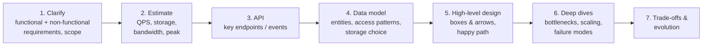
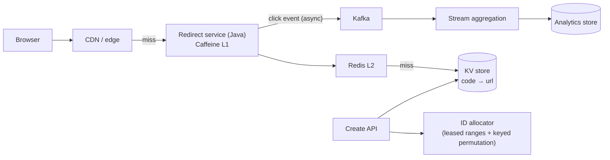
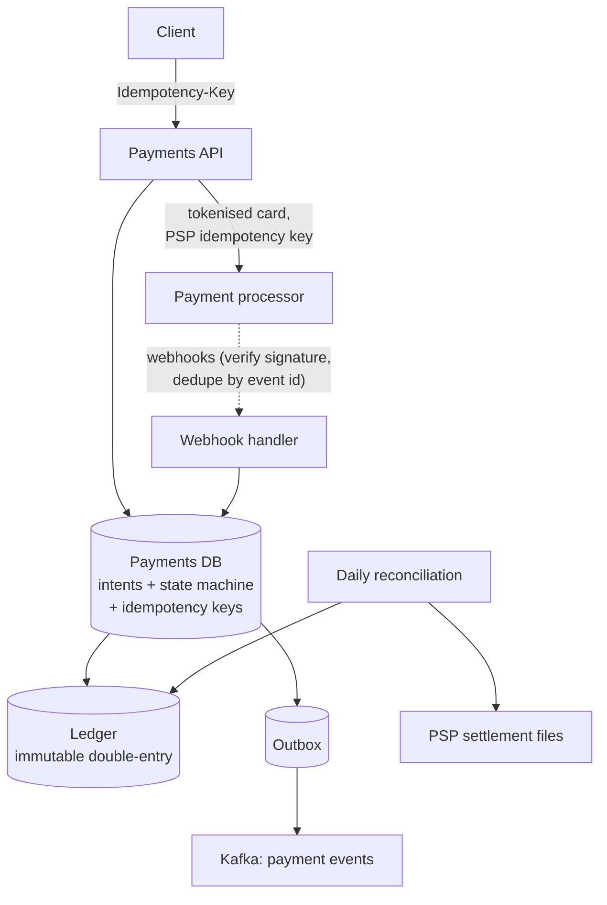
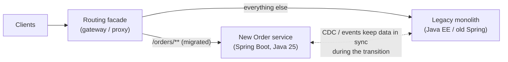

[⬅️ Prev: 23 · Distributed Systems](23-distributed-systems-microservices.md) · [🏠 Index](README.md) · [Next: 25 · Security ➡️](25-security-for-java-engineers.md)

# 24 · System Design for Java Architects

> *A design interview isn't a quiz with one right answer. It's a simulation of how you'd lead a real design discussion: you clarify ambiguity, put numbers on the problem, make trade-offs out loud, and still have a plan when the interviewer breaks your favourite component.*

> [!TIP]
> **🧭 Decision guide: which store, what consistency, and how to scale**
> - **When it matters:** for new systems, and for existing ones that hit a scaling or reliability wall.
> - **Default:** requirements and numbers first; one relational system of record with read replicas and caches; strong consistency where money or stock is involved, and stated staleness elsewhere; partition by the dominant access key only when one node isn't enough.
> - **Alternatives:** wide-column or key-value stores for partition-shaped, write-heavy data ([Chapter 34](34-data-stores-redis-cassandra-dynamodb.md)); cells to contain the blast radius; active-active across regions only with a conflict strategy.
> - **Failure modes:** designs without numbers, hot partitions, cache stampedes, one global sequence or lock, rollback plans that ignore data the new path has written.
> - **Evidence that would change it:** estimates beyond one node's limits, measured hot keys, an availability target one region can't meet.
> - **Argued in:** §1–§4 and §7–§13; full case studies in [36](36-case-study-payments.md), [37](37-case-study-fleet-jdk-upgrade.md) and [38](38-case-study-webhook-delivery.md).

🧪 **Runnable labs:** [the programs behind this chapter's outputs](labs.md#chapter-24--system-design)

---

## Table of contents
1. [A framework for any design interview](#1-a-framework-for-any-design-interview-)
2. [Back-of-the-envelope estimation](#2-back-of-the-envelope-estimation-)
3. [Building blocks you must be fluent in](#3-building-blocks-you-must-be-fluent-in-)
4. [Sharding & consistent hashing (with measurements)](#4-sharding--consistent-hashing-with-measurements-)
5. [ID generation](#5-id-generation-)
6. [Rate limiting: algorithms and a Java token bucket](#6-rate-limiting-algorithms-and-a-java-token-bucket-)
7. [Design 1: URL shortener](#7-design-1-url-shortener-)
8. [Design 2: payments & a double-entry ledger](#8-design-2-payments--a-double-entry-ledger-)
9. [Design 3: distributed job scheduler](#9-design-3-distributed-job-scheduler-)
10. [Design 4: real-time chat & notifications](#10-design-4-real-time-chat--notifications-)
11. [More prompts & their key ideas](#11-more-prompts--their-key-ideas-)
12. [Migrating legacy systems](#12-migrating-legacy-systems-)
13. [Multi-region, disaster recovery & cells](#13-multi-region-disaster-recovery--cells-)
14. [Communicating architecture: C4, design docs, ADRs](#14-communicating-architecture-c4-design-docs-adrs-)
15. [Staff lens: what the interviewer is scoring](#15-staff-lens-what-the-interviewer-is-scoring-)
16. [Interview questions](#16-interview-questions)
17. [References](#17-references)

---

## 1. A framework for any design interview 🟣



| Step | ~Minutes (of 45–60) | What good looks like |
|---|---|---|
| Clarify | 5 | *Which* users, *which* features are in scope, latency and availability targets, consistency needs, read/write ratio, growth |
| Estimate | 3–5 | Rough numbers that **drive decisions** ("40K reads/s means we need a cache tier") |
| API & data model | 5–10 | Access patterns first, then storage. The data model is where designs usually succeed or fail |
| High-level design | 10 | A simple, complete happy path before any optimisation |
| Deep dives | 15–20 | **You** pick the riskiest parts. The interviewer will push on failures |
| Trade-offs | 5 | What you'd change at 10× scale, what you deliberately left out, and why |

**Non-functional requirements to always ask about:** scale (DAU, QPS, data size), latency targets (p99), availability (99.9 vs 99.99), consistency (strong vs eventual, per operation), durability, geography (single or multi-region), security and compliance (PII, PCI), cost constraints.

---

## 2. Back-of-the-envelope estimation 🟡→🔴

**Numbers to carry in your head:**
| Quantity | Approximation |
|---|---|
| Seconds per day | 86,400 ≈ **10⁵** |
| 1 million requests/day | ≈ **12 QPS** average |
| 1 billion requests/day | ≈ **12K QPS** average |
| Peak / average | **2–5×** (consumer apps can spike far higher) |
| 2¹⁰ / 2²⁰ / 2³⁰ / 2⁴⁰ | ~10³ (KB) / 10⁶ (MB) / 10⁹ (GB) / 10¹² (TB) |
| A good single PostgreSQL primary | thousands to tens of thousands of simple writes/s (hardware and workload dependent) |
| Redis (single shard) | ~100K+ simple ops/s |
| A well-tuned Java service instance | thousands of simple requests/s per few cores (it depends entirely on the work per request) |
| Latency hierarchy | See [Chapter 21 §11](21-performance-engineering-troubleshooting.md#11-mechanical-sympathy-) |

**Worked example:** a photo-sharing feature, 100M DAU.
```
Uploads:  100M users × 2 photos/day    = 2×10⁸/day  → ~2,300 writes/s avg, ~10K/s peak
Views:    100M users × 50 views/day    = 5×10⁹/day  → ~58K reads/s avg, ~250K/s peak  → read-heavy: CDN + cache
Storage:  2×10⁸ photos × 2 MB          = 400 TB/day of originals (!) → object storage, tiering, thumbnails
Metadata: 2×10⁸ × 500 B                = 100 GB/day → ~36 TB/year → sharded metadata store
Bandwidth (views): 5×10⁹ × 200 KB (thumbnails) / 10⁵ s ≈ 10 GB/s → CDN is not optional
```
The point isn't precision. It's that the numbers **force architecture decisions** (CDN, object storage, sharding) and show you can reason quantitatively.

---

## 3. Building blocks you must be fluent in 🔴

| Block | Know |
|---|---|
| **Load balancer** | L4 (TCP) vs L7 (HTTP: routing by path or header, TLS termination). Algorithms: round robin, least connections, **power-of-two-choices**, consistent hashing for stickiness. Health checks |
| **CDN** | Static and media at the edge, cache keys, TTLs and invalidation, signed URLs, origin shielding |
| **Cache** | Cache-aside, TTLs, stampede protection, local vs distributed ([Chapter 23 §11](23-distributed-systems-microservices.md#11-caching-in-distributed-systems-)) |
| **Relational DB** | Transactions, joins, constraints, secondary indexes, read replicas, partitioning ([Chapter 19](19-persistence-jdbc-jpa-hibernate.md)) |
| **Wide-column / KV** (Cassandra, DynamoDB) | Partition-key-first modelling (one table per query pattern), linear write scaling, tunable consistency, **no ad-hoc queries** ([Chapter 34](34-data-stores-redis-cassandra-dynamodb.md)) |
| **Document** (MongoDB) | Flexible schemas, aggregate-shaped documents |
| **Search** (Elasticsearch/OpenSearch) | Inverted indexes, full-text search, faceting. **Not a source of truth**: feed it from events or CDC |
| **Object storage** (S3 and similar) | Blobs, very high durability, lifecycle tiers, pre-signed upload URLs |
| **Message broker / log** | Queues vs logs, ordering per partition, consumer groups ([Chapter 23 §10](23-distributed-systems-microservices.md#10-kafka-for-java-engineers-)) |
| **Stream processing** | Kafka Streams, Flink: windowing, state stores, exactly-once within the pipeline |

**B-tree vs LSM-tree storage engines:**
| | B-tree (PostgreSQL, MySQL InnoDB) | LSM-tree (Cassandra, RocksDB, ScyllaDB) |
|---|---|---|
| Writes | In place (random I/O plus a WAL) | Append to a memtable, then flush to sorted files (**sequential I/O**) |
| Reads | Predictable: one tree traversal | May check several files (Bloom filters help) |
| Best at | Read-heavy, transactional, range queries | **Write-heavy**, time series, high ingest |
| Costs | Write amplification from page updates | **Compaction** (background I/O, space amplification) |

---

## 4. Sharding & consistent hashing (with measurements) 🔴

**Sharding strategies:**
| Strategy | How | Pros | Cons |
|---|---|---|---|
| **Range** | Key ranges per shard (A–F, G–M…) | Efficient range scans | Hot spots (sequential keys, popular ranges) |
| **Hash** | `hash(key) % N` | Even spread | Range queries hit every shard; **resharding moves almost everything** |
| **Consistent hashing** | Keys and nodes on a hash ring | Adding a node moves only ~1/N of keys | Needs virtual nodes for balance |
| **Directory / lookup** | A mapping service: key → shard | Full flexibility (move tenants individually) | The directory is a critical dependency |
| **Geo / tenant** | By region or customer | Data locality, compliance, isolation | Uneven tenant sizes |

### Consistent hashing in Java
```java
public final class ConsistentHashRing<N> {
    private final NavigableMap<Long, N> ring = new TreeMap<>();
    private final int virtualNodes;
    private final Function<String, Long> hash;

    public ConsistentHashRing(int virtualNodes, Function<String, Long> hash) {
        this.virtualNodes = virtualNodes;
        this.hash = hash;
    }
    public void add(N node)    { for (int i = 0; i < virtualNodes; i++) ring.put(hash.apply(node + "#" + i), node); }
    public void remove(N node) { for (int i = 0; i < virtualNodes; i++) ring.remove(hash.apply(node + "#" + i)); }

    public N nodeFor(String key) {
        if (ring.isEmpty()) throw new IllegalStateException("empty ring");
        Map.Entry<Long, N> e = ring.ceilingEntry(hash.apply(key));   // first node clockwise from the key
        return (e != null ? e : ring.firstEntry()).getValue();      // wrap around the ring
    }
}

static long sha256Long(String s) {                                  // any well-distributed 64-bit hash works (Murmur3, xxHash)
    try {
        byte[] d = MessageDigest.getInstance("SHA-256").digest(s.getBytes(StandardCharsets.UTF_8));
        return ByteBuffer.wrap(d).getLong();
    } catch (NoSuchAlgorithmException e) { throw new IllegalStateException(e); }
}
```
The `TreeMap` *is* the ring: `ceilingEntry` is the "walk clockwise" step, in O(log n) ([Chapter 06 §7](06-collections.md#7-treemap--navigable-collections-)).

**Measured** with 100,000 keys, 3 nodes, then adding a 4th:
<!-- lab-output: Ring.java -->
```
vnodes=  1  3-node split={node-A=40034, node-B=47372, node-C=12594}  keys moved after adding node-D=45.2%
vnodes= 10  3-node split={node-A=46029, node-B=25695, node-C=28276}  keys moved after adding node-D=20.7%
vnodes=100  3-node split={node-A=28454, node-B=34254, node-C=37292}  keys moved after adding node-D=26.0%
vnodes=200  3-node split={node-A=31916, node-B=30834, node-C=37250}  keys moved after adding node-D=26.4%
naive hash % N: keys moved going from 3 to 4 nodes=75.1%
```
**What this shows:**
1. **Naive modulo moved 75% of keys** when going from 3 to 4 nodes. For a cache, that's an instant miss storm. For a database, it's a massive migration.
2. Consistent hashing moved **~26%**, close to the ideal 1/4.
3. **Without virtual nodes the balance is terrible** (one node got 12.6% of keys, another 47.4%). With 100–200 virtual nodes it's much better, though still not perfect (31–37%). Real systems add weighting, bounded-load variants, or rely on many more partitions than nodes.

**Production practice:** pre-split into **many more logical partitions than physical nodes** (Kafka partitions, Cassandra token ranges, DynamoDB's internal partitions), and move whole partitions between nodes. Resharding becomes partition reassignment.

---

## 5. ID generation 🔴

| Approach | Properties | Watch out for |
|---|---|---|
| DB auto-increment / sequence | Simple, compact, ordered | Single point of contention, leaks business volume to outsiders, hard across shards |
| UUID v4 | Generated anywhere, no coordination | 128 bits, **random**: B-tree index locality suffers ([Chapter 19 §7](19-persistence-jdbc-jpa-hibernate.md#7-mapping-ids-associations-equality-)) |
| **UUID v7** | Time-ordered prefix plus randomness | Good default for distributed IDs. Reveals creation time |
| **Snowflake-style** (64-bit) | `41 bits ms timestamp │ 10 bits worker │ 12 bits sequence` → ~4K IDs/ms per worker, k-sorted | Worker-ID assignment, **clock going backwards** (wait or refuse) |
| Ticket server / range allocation | A service hands out ID blocks (1,000 at a time) | Gaps on crash; the allocator is a dependency |

For **public identifiers**, don't expose sequential integers: they leak volume and invite enumeration attacks ([Chapter 25](25-security-for-java-engineers.md)). **Encoding isn't hiding:** base62 or hex of a counter or a Snowflake ID is still ordered and guessable near any ID an attacker has seen. Use IDs with enough randomness (a UUIDv7 has up to 74 random bits after its timestamp), or a keyed permutation of the internal ID (§7). Authorisation checks are still required either way.

---

## 6. Rate limiting: algorithms and a Java token bucket 🔴

| Algorithm | How | Bursts | Memory | Notes |
|---|---|---|---|---|
| **Fixed window** | Count per calendar window (e.g. per minute) | 2× burst at window edges | O(1) | Simplest |
| **Sliding log** | Store a timestamp per request; count those inside the window | Exact | O(requests) | Memory-heavy |
| **Sliding window counter** | Weighted current + previous window counts | Smooth approximation | O(1) | Good general choice |
| **Token bucket** | Tokens refill at rate r up to capacity b; a request consumes one | **Allows bursts up to b**, then sustains r | O(1) | The most common for APIs |
| **Leaky bucket** | A queue drained at a constant rate | Smooths output | O(queue) | Traffic shaping |

```java
/** Thread-safe token bucket with lazy refill. Inject the clock for deterministic tests. */
public final class TokenBucket {
    private final long capacity;
    private final double refillPerNano;
    private final LongSupplier nanoClock;
    private double tokens;
    private long lastRefill;

    public TokenBucket(long capacity, double refillPerSecond, LongSupplier nanoClock) {
        this.capacity = capacity;
        this.refillPerNano = refillPerSecond / 1_000_000_000.0;
        this.nanoClock = nanoClock;
        this.tokens = capacity;                       // start full: allows an initial burst
        this.lastRefill = nanoClock.getAsLong();
    }

    public synchronized boolean tryAcquire() {
        long now = nanoClock.getAsLong();
        tokens = Math.min(capacity, tokens + (now - lastRefill) * refillPerNano);
        lastRefill = now;
        if (tokens >= 1.0) { tokens -= 1.0; return true; }
        return false;                                  // caller responds 429 with Retry-After
    }
}
// new TokenBucket(100, 10, System::nanoTime): bursts of 100, sustained 10 req/s
```

**Distributed rate limiting:**
- **Centralised counter** in Redis, with an atomic **Lua script** implementing token bucket or sliding window per key (`tenant:{id}`). It's accurate, but every request pays a network hop, and Redis becomes a dependency.
- **Local limits** (total limit ÷ instance count) need no coordination but are approximate, and they skew when traffic is uneven.
- **Hybrid:** local buckets that periodically sync with or lease tokens from a central store.
- **Failure policy:** if the limiter's store is down, **fail open** (allow, and protect the backend another way) or **fail closed** (reject). Decide per use case: login abuse protection might fail closed, while a product catalogue fails open.
- Return **`429 Too Many Requests`** with `Retry-After` (and `RateLimit-*` headers), so well-behaved clients back off.

---

## 7. Design 1: URL shortener 🔴

**Requirements:** create short links (optionally custom aliases), redirect fast, optional expiry, click analytics. Read-heavy (about 100:1). Target ~10K creates/s and ~1M redirects/s at peak, p99 redirect latency under 20 ms at the edge.

**API:**
```
POST /links { "url": "...", "alias": "optional", "expiresAt": "..." } → 201 { "code": "aZ3k9Qx" }
GET  /{code} → 301/302 Location: <url>
```

**Key decisions:**
1. **Code generation: size the ID space first.** Seven base62 characters hold 62⁷ ≈ 3.5 × 10¹² codes, but a 64-bit ID needs **11** (62¹¹ ≈ 5.2 × 10¹⁹ > 2⁶³). A Snowflake ID minted in 2026 against a 2020 epoch is already about 9.1 × 10¹⁷, which is 11 characters. So pick one and say it out loud:
   - **7-character codes from a range allocator:** each instance leases blocks of IDs from a sequence that's capped below 62⁷. At a *sustained* 10K creates/s the space lasts about 11 years, at 1K/s about 112. Plan the move to 8 characters (62⁸ ≈ 2.2 × 10¹⁴) as a format change: clients treat codes as opaque strings of any length.
   - **11-character codes from 64-bit IDs** (Snowflake), if shorter links don't matter.

   **Encoding doesn't stop enumeration.** Base62 of a counter is still a counter: neighbouring IDs differ in the last character. If links mustn't be enumerable, either generate **random codes** and insert under a uniqueness constraint, retrying on conflict (at a billion stored links a new 7-character code collides 0.03% of the time), or pass the counter through a **keyed permutation** of [0, 62⁷), a format-preserving cipher such as NIST FF1, so codes look random, stay unique and need no collision check. Neither makes a link *secret*: private links need long random tokens (128 bits is 22 characters) and access checks. Custom aliases go through a conditional insert under a uniqueness constraint. The lab computes these numbers and runs a small Feistel permutation:
   ```
   2. Base62 of a counter is still a counter: neighbours are one character apart
      id 1,000,000,000 -> 015ftgG
      id 1,000,000,001 -> 015ftgH
   3. The same counter through a keyed permutation of [0, 62^7) (Feistel, 6 rounds, cycle-walking)
      id 1,000,000,000 -> ZAs8mLT
      id 1,000,000,001 -> ySU7MFq
      200,000 consecutive ids -> 200,000 distinct 7-character codes; every code decodes to its id: yes
   ```
2. **Storage:** a KV access pattern (`code → url, expiry`). DynamoDB, Cassandra, or PostgreSQL partitioned by code. Writes are modest. Reads are served almost entirely from cache.
3. **Read path:** CDN or edge cache → in-process Caffeine → Redis → database. Popular links follow a power-law distribution, so cache hit rates are very high. Negative-cache unknown codes.
4. **301 vs 302:** 301 (permanent) is cached by browsers, which reduces load but means **analytics miss repeat clicks**. 302/307 send every click to you. That's a business trade-off.
5. **Analytics:** never synchronously on the redirect path. Emit click events to Kafka and aggregate in a stream processor.
6. **Abuse:** URL scanning (malware, phishing), rate limits on creation *and* on lookups of unknown codes, and random or permuted codes (decision 1) where enumeration matters.



---

## 8. Design 2: payments & a double-entry ledger 🟣

**Requirements:** accept payments through external processors (PSPs), never double-charge, keep an auditable ledger of balances, reconcile with processors, PCI compliance, high availability, and **correctness over latency**.

**Core principles:**
1. **Idempotency everywhere** ([Chapter 23 §7](23-distributed-systems-microservices.md#7-idempotency-the-property-that-makes-retries-safe-)): the client's `Idempotency-Key` is claimed as a payment operation *before* anything is charged. Outbound calls to the PSP carry *their own* idempotency key, which belongs to that operation: every re-send of it (after a timeout, by a retry or by the reconciler) uses the **same** key. A new key comes only with a new attempt after a *definite* failure, such as a decline followed by another card.
2. **An explicit state machine** for payments (`CREATED → AUTHORIZING → AUTHORIZED → CAPTURING → CAPTURED / FAILED / REFUNDED`), persisted, with **transitions as guarded updates** (`UPDATE … SET state = 'CAPTURED' WHERE id = ? AND state = 'CAPTURING'`).
3. **Double-entry ledger:** every movement is a set of **immutable** entries whose debits and credits sum to zero. Balances are *derived* (summed or snapshotted), never edited in place.
   ```
   transfer_id  | account            | amount (minor units) | direction
   tx_81a       | customer:42:wallet | 2500                 | DEBIT
   tx_81a       | merchant:7:payable | 2500                 | CREDIT
   ```
   Corrections are **new reversing entries**, never updates. That gives auditability by construction.
4. **Money representation:** `long` minor units plus a currency, or `BigDecimal` with a fixed scale and explicit rounding ([Chapter 01 §8](01-java-platform-fundamentals.md#8-floating-point-ieee-754-and-money-)). Never `double`.
5. **Consistency:** ledger writes for one account need serialisability. Options include a single writer per account (partition by account ID), `SERIALIZABLE` transactions with retry, or conditional balance updates. Cross-account transfers are **one local transaction** when both accounts are in the same database, and a **saga with reserve/commit** semantics when they aren't.
6. **Unknown outcomes:** a PSP call that times out is in an *unknown* state, not a failed one. Never assume failure, and never retry with a new key. **Re-send with the same key** while the PSP still keeps it (the PSP replays its first answer), after that **look the payment up by your own reference**, and let reconciliation settle the rest. [Chapter 36](36-case-study-payments.md) works through this design as a full case study.
7. **Reconciliation:** compare internal ledger and payment records against PSP settlement reports daily (and more often for high volumes). Mismatches create cases for ops. This is the safety net that catches everything the other mechanisms miss.
8. **PCI scope minimisation:** tokenise card data at the edge (PSP-hosted fields or a vault), so raw PANs never touch your services or logs.
9. **Events through an outbox** (`PaymentCaptured`) feed the order, notification and accounting systems.



---

## 9. Design 3: distributed job scheduler 🟣

**Requirements:** millions of scheduled jobs (one-off and cron), at-least-once execution within ±1 s of the scheduled time, no lost jobs on node failure, horizontal scaling, retries with backoff, visibility (what ran, what failed).

**Design:**
1. **Storage:** `jobs(id, tenant, schedule, next_run_at, status, attempts, lease_owner, lease_expires_at, payload)` with an index on `(status, next_run_at)`. Partition by time bucket or tenant at very large scale.
2. **Claiming due work without double execution:**
   ```sql
   UPDATE jobs SET status = 'RUNNING', lease_owner = :worker, lease_expires_at = now() + interval '60 seconds'
   WHERE id IN (
       SELECT id FROM jobs
       WHERE status = 'SCHEDULED' AND next_run_at <= now()
       ORDER BY next_run_at
       LIMIT 100
       FOR UPDATE SKIP LOCKED)
   RETURNING id, payload;
   ```
   Workers compete without blocking each other ([Chapter 19 §5](19-persistence-jdbc-jpa-hibernate.md#5-locking-optimistic-pessimistic-skip-locked-)).
3. **Leases plus heartbeats:** a worker extends its lease while running. A **reaper** resets jobs whose lease expired (the worker died), so they get re-executed. That's at-least-once, so **jobs must be idempotent**, or carry fencing tokens (the lease version) for side effects ([Chapter 23 §12](23-distributed-systems-microservices.md#12-coordination-consensus-leader-election-locks--fencing-)).
4. **Cron rescheduling:** on completion, compute `next_run_at` from the cron expression in the **job's time zone** (DST-aware, [Chapter 08 §3](08-modern-java-8-to-27.md#3-javatime-getting-dates-right-)). Decide the **misfire policy** for jobs that should have run during an outage: run once, run all missed occurrences, or skip.
5. **Scale:** shard by `hash(job_id)` across database partitions or use separate queues per priority. Execution runs on worker pools (virtual threads for I/O-bound jobs), with per-tenant concurrency limits so one tenant's 1M jobs don't starve everyone else.
6. **Observability:** metrics for lag (now − next_run_at of the oldest due job, *the* SLI), success and failure rates, attempts, and a DLQ table after max attempts with an operator UI.

---

## 10. Design 4: real-time chat & notifications 🟣

**Requirements:** 1:1 and group chats, online delivery under 200 ms, offline push notifications, message history, ordering within a conversation, read receipts, 50M concurrent connections at peak.

**Key decisions:**
1. **Connections:** clients hold **WebSocket** connections to a stateful **gateway tier**. A Java gateway on Netty or virtual threads can hold hundreds of thousands of mostly-idle connections per node, if memory per connection is kept small ([Chapter 13 §5](13-io-nio-networking-serialization.md#5-selectors--non-blocking-servers-)). A **connection registry** (Redis: `user → gateway node`, with TTL heartbeats) tracks who's connected where.
2. **Send path:** client → gateway → chat service, which **persists first** (the durable source of truth), assigns a **per-conversation sequence number**, then fans out.
3. **Storage:** a wide-column store partitioned by `conversation_id`, clustered by sequence, which makes "fetch the last 50 messages" a single-partition range read. Large groups may need time-bucketed partitions to avoid huge partitions.
4. **Ordering:** a sequence per conversation (a single writer per conversation via Kafka partitioning by `conversation_id`, or an atomic counter). Clients render by sequence and detect gaps, then fetch the missing messages.
5. **Fan-out:** for each recipient, look up their gateway in the registry and push to that node (via Kafka topics per gateway node, or pub/sub). **Offline** recipients get push notifications (APNs/FCM) through a notification service, rate-limited and collapsed.
6. **Huge groups** (100K members) use pull for large audiences instead of pushing to everyone (clients fetch when they open the chat), or tiered fan-out.
7. **Delivery semantics:** at-least-once with client-side **dedup by message ID**. Acknowledgements drive delivered/read receipts.
8. **Presence** is eventually consistent, with heartbeats and TTLs. Never make it a strongly consistent global state.

---

## 11. More prompts & their key ideas 🔴

| Prompt | The ideas that matter |
|---|---|
| **News feed / timeline** | Fan-out-on-write (precompute timelines) vs fan-out-on-read; **hybrid for celebrities**; ranking service; cache timelines; pagination by cursor |
| **Top-K / trending** | Streaming counts with time windows; count-min sketch plus heap for approximate heavy hitters; per-partition top-K merged |
| **Distributed cache** | Consistent hashing, replication, eviction (LRU vs LFU/W-TinyLFU), hot keys, consistency on writes |
| **Search autocomplete** | A trie or prefix index built offline; top-N suggestions per prefix; cached aggressively; updated from query logs |
| **File storage / Dropbox** | Chunking plus content hashing (dedup), metadata DB, sync protocol with versions, conflict resolution, object storage |
| **Ticket booking / flash sale** | Inventory reservation with TTL holds, preventing oversell (conditional decrement, single-writer partitions), queueing users (a waiting room), idempotent checkout |
| **Metrics / logging platform** | High-ingest pipeline (Kafka), time-series storage (LSM, downsampling), cardinality control, retention tiers |
| **Web crawler** | URL frontier with politeness per host, dedup (Bloom filters), distributed workers, robots.txt, recrawl scheduling |

---

## 12. Migrating legacy systems 🟣

**Strangler fig** (Martin Fowler): put a routing facade in front of the legacy system and move capabilities to new services **one at a time**, until the legacy core can be retired.


**Data migration playbook:**
1. **Dual write or CDC** from the old store into the new one (prefer CDC: one source of truth, no dual-write bugs).
2. **Backfill** history in batches.
3. **Verify continuously:** compare counts, checksums and sampled records. **Shadow reads**: serve from the old system, read from the new one too, and log any differences.
4. **Cut over reads** gradually (by tenant or percentage) behind flags.
5. **Cut over writes** (with the ability to sync back if rollback is needed).
6. Decommission the old system only after a stable period.

**Principles:** every step is reversible, value is delivered incrementally (no big-bang rewrite), the business keeps shipping features, and you measure progress by capabilities migrated and traffic served.

---

## 13. Multi-region, disaster recovery & cells 🟣

**RPO** (Recovery Point Objective) is how much data you can afford to lose. **RTO** (Recovery Time Objective) is how long you can afford to be down.

| Topology | RPO | RTO | Complexity | Notes |
|---|---|---|---|---|
| Backups only | Hours | Hours to days | Low | **Test restores**. Untested backups are hope, not a plan |
| **Active–passive** (async replication) | Seconds to minutes (lag) | Minutes | Medium | Failover drills; DNS and traffic switching |
| **Active–active** | ~0 for partitioned data | ~0 | **High** | Conflict resolution or data partitioning by region (home region per user) |

**Active–active isn't free.** Writes to the same data in two regions need either synchronous cross-region consensus (latency: tens to hundreds of ms per write) or conflict resolution (last-writer-wins loses data; CRDTs suit some data types). Most systems **partition by home region** (each user's data has a primary region) and fail over per partition.

**Cell-based architecture:** split the system into many identical, independent **cells** (each a full stack serving a subset of customers), routed by a thin, highly available layer. A bad deploy, a poison request or an overload then affects **one cell's customers, not everyone**. Hyperscalers and many large SaaS platforms use this to limit blast radius.

---

## 14. Communicating architecture: C4, design docs, ADRs 🟣

**The C4 model** (Simon Brown) gives four zoom levels, so each diagram answers one question for one audience:
1. **System context:** your system, its users, and the external systems it talks to.
2. **Containers:** deployable units (services, databases, brokers) and how they communicate.
3. **Components:** the major parts inside one container.
4. **Code:** usually unnecessary; the code itself is that diagram.

**A design-doc template that works:**
```markdown
# Title · Author · Status · Reviewers
## Context & problem        — why now, what's broken or missing, with data
## Goals / non-goals        — explicit scope boundaries
## Proposal                 — architecture, data model, APIs, diagrams (C4 L1–L2)
## Alternatives considered  — at least two, with honest trade-offs
## Risks & mitigations      — failure modes, security, migration risks
## Rollout & rollback       — phases, flags, verification, kill switch
## Observability & SLOs     — how we'll know it works
## Open questions
```
**ADRs** record individual decisions and their rationale ([Chapter 16 §11](16-design-principles-clean-architecture.md#11-staff-lens-decisions-trade-offs-adrs-)). Design docs propose; ADRs remember.

---

## 15. Staff lens: what the interviewer is scoring 🟣

| Signal | Strong candidate | Weak candidate |
|---|---|---|
| **Problem framing** | Clarifies requirements and states assumptions explicitly | Jumps to "we'll use Kafka and Kubernetes" |
| **Quantitative reasoning** | Estimates that change the design | No numbers, or numbers that are never used |
| **Data modelling** | Access patterns → schema → store choice | "Put it in a database" |
| **Trade-offs** | Names what each choice costs | Presents choices as obviously correct |
| **Failure thinking** | Raises failure modes before being asked (timeouts, retries, idempotency, partial failure, recovery) | Happy path only |
| **Depth on demand** | Goes deep into Java and JVM details when relevant (GC on a latency path, pools, virtual threads, serialization costs) | Stays at buzzword level |
| **Evolution** | "Here's v1, and here's what changes at 10× scale" | Designs for Google scale on day one, or never thinks about growth |
| **Communication** | Drives the session, checks in, adapts to hints | Monologue, or waits to be led |

> [!TIP]
> When the interviewer pushes back ("what if Redis goes down?"), it's not a trap. It's an invitation to show failure-mode thinking. Say what happens (a cache-miss storm on the database), how you'd detect it (latency and error SLIs), how you'd mitigate it (request coalescing, a database bulkhead, serving stale data, load shedding), and what you'd change in the design.

---

## 16. Interview questions

<details>
<summary><b>Q1. 🟣 Design a rate limiter for a public API (key points).</b></summary>

Clarify: per API key or tenant limits, burst tolerance, global vs per-region. Use a token bucket (bursts plus a sustained rate) or a sliding-window counter. Place it at the gateway (or as a library or sidecar). State lives in Redis with atomic Lua scripts per key, optionally with local pre-checks to reduce the hot path. Return 429 with `Retry-After` and `RateLimit-*` headers. Decide fail-open vs fail-closed when Redis is unavailable. Handle hot tenants (shard keys) and multiple regions (local limits plus approximate global sync). Monitor rejections per tenant.
</details>

<details>
<summary><b>Q2. 🔴 Why does naive <code>hash(key) % N</code> sharding hurt when you add a node, and how does consistent hashing help?</b></summary>

Changing N changes the result for most keys. In our measurement, going from 3 to 4 nodes moved 75% of 100K keys, which means a cache-miss storm or a massive data migration. Consistent hashing places nodes and keys on a ring, and a key belongs to the next node clockwise, so adding a node only takes keys from its neighbours (about 1/N, 26% measured). Virtual nodes are needed for balance: with one vnode per node the split was 13% to 47%.
</details>

<details>
<summary><b>Q3. 🟣 How do you guarantee a customer is never charged twice?</b></summary>

Client idempotency keys claimed as a payment operation, under a unique constraint, *before* anything is charged. A persisted state machine with guarded transitions. One processor idempotency key per operation, reused on every re-send. Treating timeouts as *unknown*: re-send with the same key, or look the charge up by reference once the processor may have forgotten the key; never retry with a new key. Idempotent webhook processing (dedupe by event ID, verify signatures). Daily reconciliation against processor settlement reports to catch anything that slipped through.
</details>

<details>
<summary><b>Q4. 🟣 Fan-out on write vs fan-out on read for a news feed?</b></summary>

Fan-out on write precomputes each follower's timeline when a post is created: fast reads, expensive writes for accounts with millions of followers. Fan-out on read assembles the timeline at read time: cheap writes, expensive reads. Use a hybrid: fan-out on write for normal accounts, fan-out on read (merged at read time) for celebrity accounts, with cached timelines and cursor pagination.
</details>

<details>
<summary><b>Q5. 🟣 How would you migrate a monolith's Orders module to a separate service without downtime?</b></summary>

Strangler fig. Put a routing facade in front, build the new service, sync data from the legacy database via CDC, backfill history, verify with shadow reads and comparison, move reads gradually behind flags (by tenant or percentage), then move writes with a rollback path (sync back), then retire the legacy module. Keep APIs compatible throughout, record decisions in ADRs, and measure progress by traffic migrated and incidents avoided.
</details>

<details>
<summary><b>Q6. 🟣 Active-active multi-region: what's hard?</b></summary>

Concurrent writes to the same data in different regions. You need either synchronous cross-region coordination (high write latency) or conflict resolution (last-writer-wins loses updates; CRDTs only fit certain data types). Most systems assign each user or tenant a home region (partitioned active-active) and fail over per partition. Also hard: global uniqueness (IDs, usernames), cache invalidation across regions, data residency laws, and actually testing failover regularly.
</details>

<details>
<summary><b>Q7. 🔴 How do you prevent overselling in a flash sale with 1M users and 1,000 items?</b></summary>

Put a waiting room or queue in front to meter users in. Decrement inventory atomically (a conditional `UPDATE … WHERE stock > 0`, or a single-writer partition or Redis `DECR` with a check) to create a time-limited reservation, and confirm on payment or release on expiry. Make checkout idempotent. Serve the product page from CDN and cache, and keep only the reservation path transactional. Load-test it, and have a kill switch.
</details>

<details>
<summary><b>Q8. 🟣 What's a cell-based architecture and why use it?</b></summary>

The system is split into many independent, identical cells, each a complete stack serving a subset of customers, with a thin routing layer mapping customers to cells. Failures, bad deploys, poison requests and noisy neighbours are contained to one cell's customers, which limits the blast radius. Deploys roll cell by cell. The costs are more infrastructure, routing complexity, and cross-cell operations (migrating customers between cells, global features).
</details>

---

## 17. References
- Martin Kleppmann, *Designing Data-Intensive Applications*
- Alex Xu, *System Design Interview* (Vols 1 & 2): worked prompts
- Simon Brown, [*The C4 Model*](https://c4model.com/)
- Martin Fowler, [*StranglerFigApplication*](https://martinfowler.com/bliki/StranglerFigApplication.html)
- David Karger et al., *Consistent Hashing and Random Trees* (1997); Google's *Consistent Hashing with Bounded Loads* (2017)
- AWS Builders' Library: articles on timeouts, retries, shuffle sharding, and cell-based architectures
- Stripe engineering blog: *Designing robust and predictable APIs with idempotency*

---

[⬅️ Prev: 23 · Distributed Systems](23-distributed-systems-microservices.md) · [🏠 Index](README.md) · [Next: 25 · Security ➡️](25-security-for-java-engineers.md)
