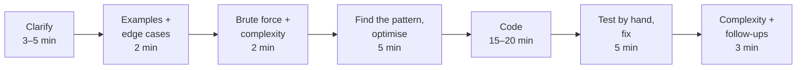
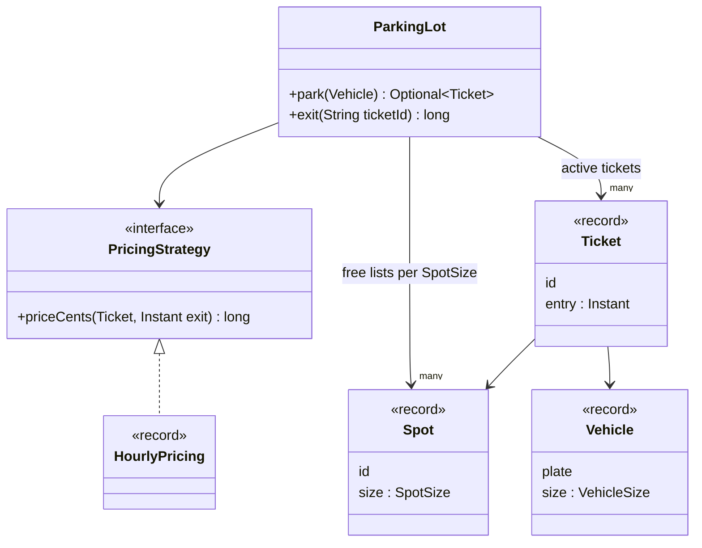
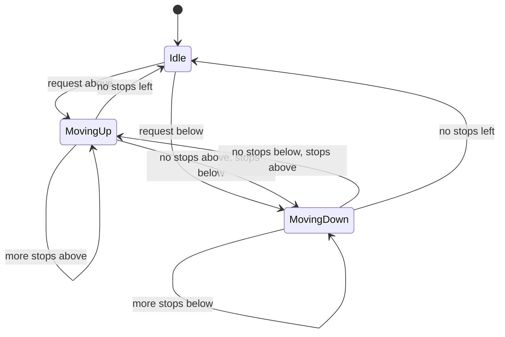

[⬅️ Prev: 25 · Security](25-security-for-java-engineers.md) · [🏠 Index](README.md) · [Next: 27 · Staff & Architect Playbook ➡️](27-staff-architect-interview-playbook.md)

# 26 · Coding & LLD Interview Patterns

> *Seniority doesn't exempt you from the coding round. It raises the bar on how you code: you clarify before typing, you pick the right structure on purpose, you name your invariants, you test without being asked, and you know which Java detail will quietly break an otherwise correct solution.*

Every code sample in this chapter was compiled and run on JDK 21. Where you see output, it's real.

🧪 **Runnable labs:** [the programs behind this chapter's outputs](labs.md#chapter-26--coding-and-lld)

---

## Table of contents
1. [How coding rounds are scored at senior+ levels](#1-how-coding-rounds-are-scored-at-senior-levels-)
2. [The Java toolkit for DSA](#2-the-java-toolkit-for-dsa-)
3. [Java traps that fail correct algorithms (measured)](#3-java-traps-that-fail-correct-algorithms-measured-)
4. [Fifteen patterns, with tested templates](#4-fifteen-patterns-with-tested-templates-)
5. [Concurrency coding problems](#5-concurrency-coding-problems-)
6. [Machine-coding / LLD rounds: the approach](#6-machine-coding--lld-rounds-the-approach-)
7. [LLD 1: LRU cache from scratch](#7-lld-1-lru-cache-from-scratch-)
8. [LLD 2: key-value store with TTL](#8-lld-2-key-value-store-with-ttl-)
9. [LLD 3: parking lot](#9-lld-3-parking-lot-)
10. [LLD 4: elevator controller](#10-lld-4-elevator-controller-)
11. [LLD 5: in-memory pub-sub broker](#11-lld-5-in-memory-pub-sub-broker-)
12. [More LLD prompts and what they test](#12-more-lld-prompts-and-what-they-test-)
13. [Staff lens](#13-staff-lens-)
14. [Interview questions](#14-interview-questions)
15. [References](#15-references)

---

## 1. How coding rounds are scored at senior+ levels 🟡

| Signal | What the interviewer writes down |
|---|---|
| **Problem solving** | Clarified inputs, sizes and edge cases. Started from brute force, then found the pattern |
| **Correctness** | Handles empty input, duplicates, negatives, overflow. Walks through an example without prompting |
| **Complexity** | States time *and* space, including Java-specific costs (boxing, copying, recursion depth) |
| **Code quality** | Names that explain intent, small helpers, no dead code, idiomatic collections |
| **Communication** | Thinks aloud, explains the choices that matter, takes hints well |
| **Testing** | Picks test cases deliberately (happy path, boundary, adversarial) and runs them mentally or for real |

**A 45-minute script that works:**


**Constraints tell you the target complexity.** At roughly 10⁸ simple operations per second:

| Input size n | Feasible complexity | Typical technique |
|---|---|---|
| ≤ 10 | O(n!) | Permutations, brute force |
| ≤ 20 | O(2ⁿ · n) | Subsets, bitmask DP |
| ≤ 500 | O(n³) | Floyd–Warshall, interval DP |
| ≤ 5,000 | O(n²) | 2-D DP, pairwise checks |
| ≤ 10⁶ | O(n log n) or O(n) | Sorting, heaps, two pointers, hashing |
| ≥ 10⁹ | O(log n) or O(1) | Binary search on the answer, math |

> [!TIP]
> If the interviewer says n can be 10⁵ and your plan is O(n²), say so before coding: "That's 10¹⁰ operations, too slow. I need O(n log n)." Catching it yourself is a signal in its own right.

---

## 2. The Java toolkit for DSA 🟢→🟡

| Need | Use | Avoid | Why |
|---|---|---|---|
| Stack | `ArrayDeque` (`push`/`pop`/`peek`) | `java.util.Stack` | `Stack` extends `Vector`: synchronized on every call, legacy API |
| Queue / BFS | `ArrayDeque` (`offer`/`poll`) | `LinkedList` | One node object per element, poor cache locality |
| Min/max heap | `PriorityQueue` (+ `Comparator.reverseOrder()`) | Sorting repeatedly | O(log n) insert and remove-min |
| Floor/ceiling lookups | `TreeMap` / `TreeSet` | Linear scans | O(log n) `floorKey`, `ceilingEntry`, `pollFirst` |
| Character counts | `int[26]` / `int[128]` | `HashMap<Character, Integer>` | No boxing, no hashing |
| Visited grid | `boolean[][]` or a `BitSet` | `Set<String>` of `"r,c"` | String keys allocate and hash on every step |
| Coordinates in a queue | `int[]{r, c}` or `r * cols + c` | `Pair<Integer, Integer>` | Fewer objects |

**Complexity of the structures you'll actually use:**
| Structure | Operation costs | Notes |
|---|---|---|
| `ArrayList` | get/set O(1); add at end amortised O(1); add/remove at an index O(n) | `getLast()`/`removeLast()` (Java 21) are O(1) |
| `ArrayDeque` | push/pop/offer/poll/peek at either end O(1) | No nulls, no indexed access |
| `HashMap` / `HashSet` | O(1) average | Bins treeify under heavy collisions (O(log n) for `Comparable` keys). Iteration order is unspecified |
| `LinkedHashMap` | Same as `HashMap`, with predictable order | Access-order mode is a ready-made LRU ([Chapter 06](06-collections.md)) |
| `TreeMap` / `TreeSet` | O(log n) get/put/floor/ceiling/pollFirst | `subMap`/`headMap`/`tailMap` are live views |
| `PriorityQueue` | offer/poll O(log n), peek O(1), `remove(Object)`/`contains` O(n). Building from a collection is O(n) | **Iteration order is not sorted** |
| `Arrays.sort(int[])` | O(n log n) dual-pivot quicksort | Not stable, which doesn't matter for primitives |
| `Arrays.sort(T[])` / `List.sort` | O(n log n) TimSort, **stable** | Close to O(n) on nearly sorted input |
| `String` `+` in a loop, `substring` | O(n) copy each time | Use `StringBuilder`. `substring` has copied since JDK 7u6 |

**Idioms worth having in your fingers:**
```java
// Counting
Map<String, Integer> freq = new HashMap<>();
for (String w : words) freq.merge(w, 1, Integer::sum);

int[] letters = new int[26];
for (int i = 0; i < s.length(); i++) letters[s.charAt(i) - 'a']++;

// Grouping (anagrams)
Map<String, List<String>> groups = new HashMap<>();
for (String w : words) {
    char[] key = w.toCharArray();
    Arrays.sort(key);
    groups.computeIfAbsent(new String(key), k -> new ArrayList<>()).add(w);
}

// Heaps
PriorityQueue<Integer> maxHeap = new PriorityQueue<>(Comparator.reverseOrder());
PriorityQueue<int[]> closest = new PriorityQueue<>(Comparator.comparingInt(p -> p[0] * p[0] + p[1] * p[1]));

// Sorting arrays of arrays and records
Arrays.sort(intervals, Comparator.comparingInt(iv -> iv[0]));
people.sort(Comparator.comparing(Person::lastName).thenComparing(Person::age, Comparator.reverseOrder()));

// Ordered lookups
TreeMap<Integer, String> schedule = new TreeMap<>();
Map.Entry<Integer, String> current = schedule.floorEntry(time);     // null if nothing at or before 'time'
Integer next = schedule.higherKey(time);

// Streams for setup, loops for hot paths
int max = Arrays.stream(nums).max().orElseThrow();
List<Integer> boxed = Arrays.stream(nums).boxed().toList();
int[] unboxed = boxed.stream().mapToInt(Integer::intValue).toArray();
```

---

## 3. Java traps that fail correct algorithms (measured) 🟡

All of these come from one small program, run on JDK 21:
```
(a, b) -> a - b   : [0, 3, 2147483647, -2147483648, -5]
Integer::compare  : [-2147483648, -5, 0, 3, 2147483647]
127 == 127   : true
1000 == 1000 : false
Math.abs(Integer.MIN_VALUE) = -2147483648
-7 % 3 = -1,  Math.floorMod(-7, 3) = 2
remove(1) on [10, 20, 30] -> [10, 30]
remove(Integer.valueOf(10)) -> [30]
Arrays.asList(new int[]{1, 2, 3}).size() = 1
(lo + hi) / 2 = -397483648,  (lo + hi) >>> 1 = 1750000000
HashSet<int[]> contains {1, 2}? false
recursive computeIfAbsent -> java.util.ConcurrentModificationException
default stack: StackOverflowError at depth ~20953
256 MB stack:  StackOverflowError at depth ~6708280
```

| Trap | What happened | Fix |
|---|---|---|
| **Subtraction comparator** | `1 - Integer.MIN_VALUE` overflows, so the "sorted" output is garbage | `Integer.compare`, `Comparator.comparingInt` |
| **`==` on boxed counts** | `Integer` caches only −128..127, so `map.get(a) == map.get(b)` is `false` for 1000 | `.equals()`, or unbox to `int` first |
| **`Math.abs(MIN_VALUE)`** | Still negative, so `abs(hash) % n` can produce a negative index | `Math.floorMod(hash, n)` |
| **Negative `%`** | `-7 % 3 == -1` in Java | `Math.floorMod` for "wrap-around" indices |
| **`List<Integer>.remove(1)`** | Removes the element *at index 1*, not the value 1 | `remove(Integer.valueOf(1))` |
| **`Arrays.asList(int[])`** | A `List<int[]>` with one element | `Arrays.stream(a).boxed().toList()` |
| **Midpoint overflow** | `(lo + hi) / 2` goes negative for large indices | `lo + (hi - lo) / 2` or `(lo + hi) >>> 1` |
| **Arrays as keys** | Arrays use identity `equals`/`hashCode` | `List.of(...)`, `Arrays.toString`, or pack into a `long` |
| **Recursive `computeIfAbsent`** | Memoised recursion that modifies the same `HashMap` from inside the mapping function throws `ConcurrentModificationException` (detected since Java 9). `ConcurrentHashMap` throws `IllegalStateException: Recursive update` | Check `get`, compute, then `put`, or use an array memo |
| **Recursion depth** | About 21K frames for a trivial method on the default 1 MB stack. Real DFS frames are bigger, so the limit is lower | Iterative DFS with an explicit stack, or `new Thread(null, task, "dfs", 256L << 20)` |

---

## 4. Fifteen patterns, with tested templates 🟡→🔴

**Recognising the pattern is most of the work:**
| If the problem says… | Reach for |
|---|---|
| Sorted array, pair or triplet, in place | Two pointers |
| Contiguous subarray or substring with a constraint | Sliding window |
| Subarray sum equals k, **negatives allowed** | Prefix sums + hash map |
| Sorted input, or "the minimum X such that…" | Binary search (on the answer) |
| Next greater/smaller, spans, histogram | Monotonic stack |
| Max/min of every window of size k | Monotonic deque |
| k largest, k most frequent, merge k sorted lists, running median | Heap |
| Overlapping meetings, merging ranges | Sort + sweep |
| Fewest steps, unweighted shortest path, level order | BFS |
| "Generate all" combinations, permutations, partitions | Backtracking |
| Prerequisites, build order, dependencies | Topological sort |
| Connectivity, grouping, cycles in an undirected graph | Union-Find |
| Shortest path with non-negative weights | Dijkstra |
| Count the ways, minimum cost, overlapping subproblems | Dynamic programming |
| Prefix search, autocomplete, word dictionary | Trie |
| Linked-list cycle or middle, O(1) extra space | Fast & slow pointers |

### 4.1 Two pointers, and fast & slow pointers
```java
static int[] pairWithSum(int[] sorted, int target) {
    int i = 0, j = sorted.length - 1;
    while (i < j) {
        int sum = sorted[i] + sorted[j];                 // use long if values can approach Integer.MAX_VALUE
        if (sum == target) return new int[]{i, j};
        if (sum < target) i++; else j--;                 // sortedness tells us which pointer to move
    }
    return null;
}

static ListNode cycleStart(ListNode head) {              // Floyd: O(n) time, O(1) space
    ListNode slow = head, fast = head;
    while (fast != null && fast.next != null) {
        slow = slow.next;
        fast = fast.next.next;
        if (slow == fast) {                              // they met inside the cycle
            ListNode p = head;
            while (p != slow) { p = p.next; slow = slow.next; }
            return p;                                    // distance math: they meet at the cycle's entry
        }
    }
    return null;
}
```
O(n) time, O(1) space. Classic problems: 3Sum, container with most water, remove duplicates, linked-list cycle II, find the duplicate number.

### 4.2 Sliding window
```java
/** Longest substring with at most k distinct characters (ASCII). */
static int longestWithAtMostKDistinct(String s, int k) {
    int[] count = new int[128];
    int distinct = 0, best = 0;
    for (int left = 0, right = 0; right < s.length(); right++) {
        if (count[s.charAt(right)]++ == 0) distinct++;           // expand
        while (distinct > k) {                                    // shrink until the window is valid again
            if (--count[s.charAt(left++)] == 0) distinct--;
        }
        best = Math.max(best, right - left + 1);                  // [left, right] is valid here
    }
    return best;
}
```
Each index enters and leaves the window once, so it's O(n). The invariant ("the window is valid after the while loop") is what you say out loud. Classic problems: longest substring without repeats, minimum window substring, max consecutive ones with k flips.

### 4.3 Prefix sums + hash map
```java
static int subarraysWithSum(int[] nums, int k) {
    Map<Integer, Integer> seen = new HashMap<>(Map.of(0, 1));   // the empty prefix has sum 0
    int prefix = 0, count = 0;
    for (int x : nums) {
        prefix += x;
        count += seen.getOrDefault(prefix - k, 0);              // earlier prefixes that leave exactly k
        seen.merge(prefix, 1, Integer::sum);
    }
    return count;
}
// subarraysWithSum({1, 2, 3, -3, 3}, 3) == 5
```
Sliding windows fail when negatives are allowed, because shrinking no longer reduces the sum monotonically. Prefix sums don't care. Classic problems: subarray sum equals k, continuous subarray sum (use mod k as the key), longest balanced 0/1 subarray (map 0 to −1).

### 4.4 Binary search, and binary search on the answer
```java
/** First index with a[i] >= target; a.length if none. Search space is [lo, hi). */
static int lowerBound(int[] a, int target) {
    int lo = 0, hi = a.length;
    while (lo < hi) {
        int mid = (lo + hi) >>> 1;
        if (a[mid] < target) lo = mid + 1; else hi = mid;
    }
    return lo;
}

/** Minimum ship capacity to deliver all weights within 'days' days. */
static int minCapacity(int[] weights, int days) {
    int lo = Arrays.stream(weights).max().orElseThrow(), hi = Arrays.stream(weights).sum();
    while (lo < hi) {
        int mid = (lo + hi) >>> 1;
        if (daysNeeded(weights, mid) <= days) hi = mid;          // feasible: try smaller
        else lo = mid + 1;                                      // infeasible: need more capacity
    }
    return lo;
}
static int daysNeeded(int[] weights, int capacity) {
    int days = 1, load = 0;
    for (int w : weights) {
        if (load + w > capacity) { days++; load = 0; }
        load += w;
    }
    return days;
}
// minCapacity({1..10}, 5) == 15
```
**Binary search on the answer** works whenever `feasible(x)` is monotonic (once true, it stays true). Classic problems: Koko eating bananas, split array largest sum, minimum days to make bouquets.

💣 `Arrays.binarySearch` returns `-(insertionPoint) - 1` when the key is absent, and an **arbitrary** matching index when there are duplicates. Use your own lower or upper bound when you need the first or last occurrence.

### 4.5 Monotonic stack
```java
static int[] nextGreater(int[] a) {
    int[] result = new int[a.length];
    Arrays.fill(result, -1);
    Deque<Integer> stack = new ArrayDeque<>();      // indices whose values never increase from bottom to top
    for (int i = 0; i < a.length; i++) {
        while (!stack.isEmpty() && a[stack.peek()] < a[i]) result[stack.pop()] = a[i];
        stack.push(i);
    }
    return result;
}
// nextGreater({2, 1, 2, 4, 3}) == {4, 2, 4, -1, -1}
```
Every index is pushed and popped at most once, so it's O(n). For hot paths, an `int[]` plus a top pointer avoids boxing. Classic problems: daily temperatures, largest rectangle in histogram, stock span, trapping rain water.

### 4.6 Monotonic deque
```java
static int[] windowMax(int[] a, int k) {
    int[] out = new int[a.length - k + 1];
    Deque<Integer> dq = new ArrayDeque<>();                                   // indices, values decreasing front → back
    for (int i = 0; i < a.length; i++) {
        if (!dq.isEmpty() && dq.peekFirst() <= i - k) dq.pollFirst();        // slid out of the window
        while (!dq.isEmpty() && a[dq.peekLast()] <= a[i]) dq.pollLast();     // can never be a max again
        dq.offerLast(i);
        if (i >= k - 1) out[i - k + 1] = a[dq.peekFirst()];
    }
    return out;
}
// windowMax({1, 3, -1, -3, 5, 3, 6, 7}, 3) == {3, 3, 5, 5, 6, 7}
```
O(n), versus O(n log k) with a heap.

### 4.7 Heaps & top-K
```java
static List<String> topKFrequent(List<String> words, int k) {
    Map<String, Integer> freq = new HashMap<>();
    for (String w : words) freq.merge(w, 1, Integer::sum);
    Comparator<Map.Entry<String, Integer>> evictFirst =                 // lowest count first; for ties, the alphabetically later word
            Map.Entry.<String, Integer>comparingByValue()
                    .thenComparing(Map.Entry.comparingByKey(Comparator.reverseOrder()));
    PriorityQueue<Map.Entry<String, Integer>> heap = new PriorityQueue<>(evictFirst);   // MIN-heap holding at most k
    for (Map.Entry<String, Integer> e : freq.entrySet()) {
        heap.offer(e);
        if (heap.size() > k) heap.poll();
    }
    List<String> result = new ArrayList<>(k);
    while (!heap.isEmpty()) result.add(heap.poll().getKey());
    return result.reversed();                                            // most frequent first (Java 21)
}
// ["the","day","is","sunny","the","the","the","sunny","is","is"], k=4 → [the, is, sunny, day]
```
**Why a min-heap for the k *largest*?** The heap's root is the weakest of your current top k, so each new candidate is compared against it in O(1) and replaces it in O(log k). Total O(n log k) time and O(k) space, versus O(n log n) to sort. Alternatives: Quickselect (O(n) average), and bucket sort by frequency (O(n)). Classic problems: kth largest, merge k sorted lists, k closest points, running median (two heaps).

### 4.8 Intervals & sweep line
```java
static int[][] merge(int[][] intervals) {
    int[][] sorted = intervals.clone();
    Arrays.sort(sorted, Comparator.comparingInt(iv -> iv[0]));
    List<int[]> merged = new ArrayList<>();
    for (int[] iv : sorted) {
        if (merged.isEmpty() || merged.getLast()[1] < iv[0]) merged.add(iv.clone());   // gap: start a new interval
        else merged.getLast()[1] = Math.max(merged.getLast()[1], iv[1]);              // overlap: extend
    }
    return merged.toArray(int[][]::new);
}

static int minMeetingRooms(int[][] meetings) {
    int[][] sorted = meetings.clone();
    Arrays.sort(sorted, Comparator.comparingInt(m -> m[0]));
    PriorityQueue<Integer> endTimes = new PriorityQueue<>();                 // one entry per room in use
    for (int[] m : sorted) {
        if (!endTimes.isEmpty() && endTimes.peek() <= m[0]) endTimes.poll(); // reuse the room that frees up first
        endTimes.offer(m[1]);
    }
    return endTimes.size();
}
// merge({{8,10},{1,3},{2,6},{15,18}}) == {{1,6},{8,10},{15,18}};  minMeetingRooms({{0,30},{5,10},{15,20}}) == 2
```
Clone before sorting or mutating. Interviewers notice when you scribble on the caller's input.

### 4.9 BFS
```java
static int shortestPath(char[][] grid, int sr, int sc, int tr, int tc) {
    int rows = grid.length, cols = grid[0].length;
    int[][] dist = new int[rows][cols];
    for (int[] row : dist) Arrays.fill(row, -1);                       // -1 = not visited
    Deque<int[]> queue = new ArrayDeque<>();
    queue.offer(new int[]{sr, sc});
    dist[sr][sc] = 0;
    int[][] dirs = {{1, 0}, {-1, 0}, {0, 1}, {0, -1}};
    while (!queue.isEmpty()) {
        int[] cur = queue.poll();
        if (cur[0] == tr && cur[1] == tc) return dist[tr][tc];
        for (int[] d : dirs) {
            int r = cur[0] + d[0], c = cur[1] + d[1];
            if (r >= 0 && r < rows && c >= 0 && c < cols && grid[r][c] != '#' && dist[r][c] == -1) {
                dist[r][c] = dist[cur[0]][cur[1]] + 1;                   // mark when ENQUEUED
                queue.offer(new int[]{r, c});
            }
        }
    }
    return -1;
}
```
💣 Marking nodes visited when they're *dequeued* lets the same node be enqueued many times. On dense graphs that blows up time and memory. Mark on enqueue. Variants: multi-source BFS (rotting oranges), 0-1 BFS with a deque, BFS over states (word ladder, open the lock).

### 4.10 DFS & backtracking
```java
static List<List<Integer>> combinationSum(int[] candidates, int target) {
    int[] sorted = candidates.clone();
    Arrays.sort(sorted);                                                   // enables early pruning
    List<List<Integer>> out = new ArrayList<>();
    backtrack(sorted, target, 0, new ArrayList<>(), out);
    return out;
}
private static void backtrack(int[] c, int remaining, int start, List<Integer> path, List<List<Integer>> out) {
    if (remaining == 0) { out.add(List.copyOf(path)); return; }            // COPY: 'path' keeps mutating
    for (int i = start; i < c.length && c[i] <= remaining; i++) {
        path.addLast(c[i]);                                                // choose
        backtrack(c, remaining - c[i], i, path, out);                      // explore (i, not i + 1: reuse allowed)
        path.removeLast();                                                 // un-choose
    }
}
// combinationSum({2, 3, 6, 7}, 7) == [[2, 2, 3], [7]]
```
The three moves are choose, explore, un-choose. The classic bug is adding `path` itself instead of a copy, which leaves every result pointing at the same, eventually empty, list. To skip duplicates among sorted candidates, use `if (i > start && c[i] == c[i - 1]) continue;`.

### 4.11 Topological sort (Kahn's algorithm)
```java
static List<Integer> topoOrder(int n, int[][] edges) {          // edge {a, b}: a must come before b
    List<List<Integer>> adj = new ArrayList<>(n);
    for (int i = 0; i < n; i++) adj.add(new ArrayList<>());
    int[] indegree = new int[n];
    for (int[] e : edges) { adj.get(e[0]).add(e[1]); indegree[e[1]]++; }
    Deque<Integer> ready = new ArrayDeque<>();
    for (int i = 0; i < n; i++) if (indegree[i] == 0) ready.offer(i);
    List<Integer> order = new ArrayList<>(n);
    while (!ready.isEmpty()) {
        int node = ready.poll();
        order.add(node);
        for (int next : adj.get(node)) if (--indegree[next] == 0) ready.offer(next);
    }
    return order.size() == n ? order : List.of();                // fewer than n means there's a cycle
}
```
O(V + E). The same algorithm orders build modules, database migrations and dependent bean initialisation.

### 4.12 Union-Find (disjoint set union)
```java
static final class DisjointSet {
    private final int[] parent, rank;
    private int components;
    DisjointSet(int n) {
        parent = new int[n]; rank = new int[n]; components = n;
        for (int i = 0; i < n; i++) parent[i] = i;
    }
    int find(int x) {                                       // iterative path halving: no recursion depth risk
        while (parent[x] != x) { parent[x] = parent[parent[x]]; x = parent[x]; }
        return x;
    }
    boolean union(int a, int b) {
        int ra = find(a), rb = find(b);
        if (ra == rb) return false;                         // already connected: this edge would close a cycle
        if (rank[ra] < rank[rb]) { int t = ra; ra = rb; rb = t; }
        parent[rb] = ra;                                    // attach the shorter tree under the taller one
        if (rank[ra] == rank[rb]) rank[ra]++;
        components--;
        return true;
    }
    int components() { return components; }
}
```
Amortised near-O(1) per operation (inverse Ackermann). Classic problems: number of provinces, redundant connection, accounts merge, Kruskal's MST.

### 4.13 Dijkstra
```java
record Edge(int to, int weight) {}

static long[] dijkstra(List<List<Edge>> graph, int source) {
    long[] dist = new long[graph.size()];
    Arrays.fill(dist, Long.MAX_VALUE);
    dist[source] = 0;
    PriorityQueue<long[]> pq = new PriorityQueue<>(Comparator.comparingLong(entry -> entry[1]));  // {node, distance}
    pq.offer(new long[]{source, 0});
    while (!pq.isEmpty()) {
        long[] top = pq.poll();
        int node = (int) top[0];
        if (top[1] > dist[node]) continue;               // stale entry: "lazy deletion" instead of decrease-key
        for (Edge e : graph.get(node)) {
            long candidate = dist[node] + e.weight();
            if (candidate < dist[e.to()]) {
                dist[e.to()] = candidate;
                pq.offer(new long[]{e.to(), candidate});
            }
        }
    }
    return dist;
}
```
`PriorityQueue` has no decrease-key (`remove(Object)` is O(n)), so you push duplicates and skip stale ones. That's O((V + E) log V). Non-negative weights only; negative edges need Bellman–Ford. Using `long` avoids overflow when summing weights.

### 4.14 Dynamic programming
```java
/** 0/1 knapsack in O(capacity) space. */
static int knapsack(int[] weight, int[] value, int capacity) {
    int[] best = new int[capacity + 1];                  // best[c] = max value with capacity c
    for (int i = 0; i < weight.length; i++)
        for (int c = capacity; c >= weight[i]; c--)      // BACKWARDS, so each item is used at most once
            best[c] = Math.max(best[c], best[c - weight[i]] + value[i]);
    return best[capacity];
}

/** Longest strictly increasing subsequence in O(n log n). */
static int lengthOfLIS(int[] nums) {
    int[] tails = new int[nums.length];                  // tails[k] = smallest tail of any increasing run of length k+1
    int size = 0;
    for (int x : nums) {
        int i = Arrays.binarySearch(tails, 0, size, x);
        if (i < 0) i = -(i + 1);                         // insertion point
        tails[i] = x;
        if (i == size) size++;
    }
    return size;
}

/** Edit distance with two rolling rows. */
static int editDistance(String a, String b) {
    int[] prev = new int[b.length() + 1], cur = new int[b.length() + 1];
    for (int j = 0; j <= b.length(); j++) prev[j] = j;
    for (int i = 1; i <= a.length(); i++) {
        cur[0] = i;
        for (int j = 1; j <= b.length(); j++) {
            int replace = prev[j - 1] + (a.charAt(i - 1) == b.charAt(j - 1) ? 0 : 1);
            cur[j] = Math.min(replace, 1 + Math.min(prev[j], cur[j - 1]));    // delete, insert
        }
        int[] t = prev; prev = cur; cur = t;
    }
    return prev[b.length()];
}
// knapsack({1,3,4,5}, {1,4,5,7}, 7) == 9;  lengthOfLIS({10,9,2,5,3,7,101,18}) == 4;  editDistance("horse","ros") == 3
```
**Working method:** (1) define the state in words ("`best[c]` is the max value with capacity c"); (2) write the recurrence; (3) set the base cases; (4) choose the iteration order so dependencies are computed first; (5) compress space if rows only depend on the previous row. Say the state definition out loud. It's the part interviewers grade.

### 4.15 Trie
```java
static final class Trie {
    private static final class Node { final Node[] next = new Node[26]; boolean word; }
    private final Node root = new Node();

    void insert(String w) {
        Node n = root;
        for (int i = 0; i < w.length(); i++) {
            int c = w.charAt(i) - 'a';
            if (n.next[c] == null) n.next[c] = new Node();
            n = n.next[c];
        }
        n.word = true;
    }
    boolean contains(String w)        { Node n = walk(w); return n != null && n.word; }
    boolean startsWith(String prefix) { return walk(prefix) != null; }

    private Node walk(String s) {
        Node n = root;
        for (int i = 0; i < s.length() && n != null; i++) n = n.next[s.charAt(i) - 'a'];
        return n;
    }
}
```
O(L) per operation. Memory is the trade-off: each node carries a 26-slot array (~120 bytes with compressed oops). For large alphabets, use `HashMap<Character, Node>` children, or a ternary search tree.

---

## 5. Concurrency coding problems 🔴

Java interviews love these because they show quickly whether you understand monitors, memory visibility and liveness, or have only memorised `synchronized`.

### 5.1 Turn-taking: N threads printing in order
```java
static final class RoundRobinPrinter {
    private final int threads, max;
    private int next = 1;                                    // guarded by 'this'

    RoundRobinPrinter(int threads, int max) { this.threads = threads; this.max = max; }

    void run(int id) throws InterruptedException {          // thread 'id' prints numbers n where (n - 1) % threads == id
        while (true) {
            synchronized (this) {
                while (next <= max && (next - 1) % threads != id) wait();   // ALWAYS wait in a loop
                if (next > max) { notifyAll(); return; }
                System.out.println(Thread.currentThread().getName() + ":" + next);
                next++;
                notifyAll();                                 // notify() might wake a thread whose turn it isn't
            }
        }
    }
}
```
```
[T0:1, T1:2, T2:3, T0:4, T1:5, T2:6, T0:7, T1:8, T2:9, T0:10]
```
**Why `while`, not `if`?** Spurious wakeups, plus `notifyAll` waking threads whose turn it isn't. **Why `notifyAll`?** With three or more threads, `notify()` can wake the wrong one, which goes back to waiting, and now nobody runs: a lost wake-up. For two strictly alternating threads, a pair of semaphores is the cleanest version:
```java
static final class OddEvenPrinter {
    private final Semaphore oddTurn = new Semaphore(1), evenTurn = new Semaphore(0);
    private final int max;
    OddEvenPrinter(int max) { this.max = max; }

    void printOdds() throws InterruptedException {
        for (int i = 1; i <= max; i += 2) { oddTurn.acquire(); System.out.println(i); evenTurn.release(); }
    }
    void printEvens() throws InterruptedException {
        for (int i = 2; i <= max; i += 2) { evenTurn.acquire(); System.out.println(i); oddTurn.release(); }
    }
}
```

### 5.2 Bounded blocking queue
```java
static final class BoundedBuffer<E> {
    private final Object[] items;
    private int head, tail, count;                                       // guarded by lock
    private final ReentrantLock lock = new ReentrantLock();
    private final Condition notFull = lock.newCondition(), notEmpty = lock.newCondition();

    BoundedBuffer(int capacity) { items = new Object[capacity]; }

    void put(E e) throws InterruptedException {
        lock.lockInterruptibly();
        try {
            while (count == items.length) notFull.await();
            items[tail] = e;
            tail = (tail + 1) % items.length;                            // circular buffer
            count++;
            notEmpty.signal();                                           // only takers wait on notEmpty
        } finally { lock.unlock(); }
    }

    @SuppressWarnings("unchecked")
    E take() throws InterruptedException {
        lock.lockInterruptibly();
        try {
            while (count == 0) notEmpty.await();
            E e = (E) items[head];
            items[head] = null;                                          // don't retain references: let GC reclaim
            head = (head + 1) % items.length;
            count--;
            notFull.signal();
            return e;
        } finally { lock.unlock(); }
    }
}
```
Tested with 4 producers × 50,000 puts and 4 consumers on a capacity-8 buffer: the consumed sum was exactly `5000100000`. **Two conditions** mean producers and consumers wait in separate queues, so `signal()` always wakes a thread that can make progress. With a single monitor you'd need `notifyAll`. In production you'd use `ArrayBlockingQueue`, which is built the same way: one lock, two conditions and a circular array ([Chapter 12](12-concurrency-advanced-juc-loom.md)).

### 5.3 Building H₂O
Threads arrive as hydrogen or oxygen atoms. Release them only in complete groups of 2 H + 1 O:
```java
static final class H2O {
    private final Semaphore hydrogen = new Semaphore(2), oxygen = new Semaphore(1);   // admission: at most 2 H + 1 O
    private final CyclicBarrier molecule = new CyclicBarrier(3);                      // all three bond together

    void hydrogen(Runnable releaseHydrogen) throws InterruptedException {
        hydrogen.acquire();
        try { awaitMolecule(); releaseHydrogen.run(); } finally { hydrogen.release(); }
    }
    void oxygen(Runnable releaseOxygen) throws InterruptedException {
        oxygen.acquire();
        try { awaitMolecule(); releaseOxygen.run(); } finally { oxygen.release(); }
    }
    private void awaitMolecule() throws InterruptedException {
        try { molecule.await(); } catch (BrokenBarrierException e) { throw new IllegalStateException(e); }
    }
}
```
```
H2O: 200 molecules, every group of 3 = 2H+1O: true  first 12: OHHOHHOHHOHH
```
(That's 600 shuffled atoms, one virtual thread each.) Semaphores **admit** the right mix, and the barrier makes the three **leave together**. Permits are only released after a member has printed, so the next molecule can't start until the current one is complete.

### 5.4 Dining philosophers
```java
static void dine(int philosophers, int meals) {
    ReentrantLock[] forks = new ReentrantLock[philosophers];
    Arrays.setAll(forks, i -> new ReentrantLock());
    try (ExecutorService table = Executors.newFixedThreadPool(philosophers)) {
        for (int p = 0; p < philosophers; p++) {
            int left = p, right = (p + 1) % philosophers;
            ReentrantLock first = forks[Math.min(left, right)];          // global order: lower-numbered fork first
            ReentrantLock second = forks[Math.max(left, right)];
            table.submit(() -> {
                for (int m = 0; m < meals; m++) {
                    first.lock();
                    try {
                        second.lock();
                        try { eat(); } finally { second.unlock(); }
                    } finally { first.unlock(); }
                }
            });
        }
    }
}
```
**Measured**, with 5 philosophers × 1,000,000 meals, deadlocks detected with `ThreadMXBean.findDeadlockedThreads()`:
```
naive:    finished=false meals eaten=124,976  deadlocked threads=5
ordered:  finished=true  meals eaten=5,000,000  deadlocked threads=0
```
The naive version (everyone takes the left fork first) deadlocked after 124,976, 57,619 and 231,895 meals in three runs. **A different point every time** is why deadlocks slip through tests. The four Coffman conditions are mutual exclusion, hold-and-wait, no preemption and circular wait; break any one of them. **Lock ordering** breaks circular wait. Other fixes: a `Semaphore(n − 1)` "waiter" (at most n − 1 philosophers may reach for forks), or `tryLock(timeout)` with back-off (a philosopher who can't get the second fork puts the first one down, which breaks no preemption, at the risk of livelock).

### 5.5 Implement a thread pool
```java
static final class SimpleThreadPool implements AutoCloseable {
    private final BlockingQueue<Runnable> queue;
    private final List<Thread> workers = new ArrayList<>();
    private volatile boolean shutdown;

    SimpleThreadPool(int threads, int queueCapacity) {
        queue = new ArrayBlockingQueue<>(queueCapacity);                        // bounded: backpressure, not OOM
        for (int i = 0; i < threads; i++)
            workers.add(Thread.ofPlatform().name("pool-worker-" + i).start(this::workLoop));
    }

    synchronized void submit(Runnable task) {                                   // atomic with respect to shutdown()
        Objects.requireNonNull(task);
        if (shutdown) throw new RejectedExecutionException("pool is shut down");
        if (!queue.offer(task)) throw new RejectedExecutionException("queue is full");
    }

    private void workLoop() {
        while (true) {
            Runnable task;
            try { task = queue.poll(50, TimeUnit.MILLISECONDS); }
            catch (InterruptedException e) { return; }                         // shutdownNow()
            if (task != null) runSafely(task);
            else if (shutdown && queue.isEmpty()) return;                       // drained, and nothing more can arrive
        }
    }

    private static void runSafely(Runnable task) {
        try { task.run(); } catch (RuntimeException e) { System.err.println("task failed: " + e); }  // a bad task must not kill the worker
    }

    synchronized void shutdown() { shutdown = true; }

    synchronized List<Runnable> shutdownNow() {
        shutdown = true;
        List<Runnable> pending = new ArrayList<>();
        queue.drainTo(pending);
        workers.forEach(Thread::interrupt);
        return pending;
    }

    boolean awaitTermination(long timeout, TimeUnit unit) throws InterruptedException {
        long deadline = System.nanoTime() + unit.toNanos(timeout);
        for (Thread w : workers) {
            long remainingMs = TimeUnit.NANOSECONDS.toMillis(deadline - System.nanoTime());
            if (remainingMs <= 0) return false;
            w.join(remainingMs);
            if (w.isAlive()) return false;
        }
        return true;
    }

    @Override public void close() throws InterruptedException { shutdown(); awaitTermination(1, TimeUnit.MINUTES); }
}
```
```
thread pool ran 1000 of 1000 tasks
full queue -> queue is full
tiny pool terminated: true
```
**The subtle part is shutdown.** `submit` and `shutdown` are synchronised, so once a worker sees `shutdown == true`, every accepted task is already in the queue (the happens-before chain runs from the monitor to the volatile write to the volatile read). "Shutdown and the queue is empty" is therefore a stable exit condition, and no task is stranded. Follow-ups to expect: futures (wrap in `FutureTask`), growing between core and max sizes, rejection policies, and naming threads ([Chapter 12 §8](12-concurrency-advanced-juc-loom.md#8-executors--threadpoolexecutor-internals-)).

### 5.6 Multithreaded web crawler (virtual threads)
```java
interface HtmlParser { List<String> getUrls(String url); }      // blocking I/O in real life

static List<String> crawl(String startUrl, HtmlParser parser) {
    String host = URI.create(startUrl).getHost();
    Set<String> seen = ConcurrentHashMap.newKeySet();
    seen.add(startUrl);
    AtomicInteger pending = new AtomicInteger();
    CompletableFuture<Void> done = new CompletableFuture<>();
    try (ExecutorService exec = Executors.newVirtualThreadPerTaskExecutor()) {
        submit(startUrl, host, parser, seen, pending, done, exec);
        done.join();                                             // wait for the whole graph BEFORE close()
    }
    return List.copyOf(seen);
}

private static void submit(String url, String host, HtmlParser parser, Set<String> seen,
                           AtomicInteger pending, CompletableFuture<Void> done, ExecutorService exec) {
    pending.incrementAndGet();                                   // a child registers before its parent finishes
    exec.submit(() -> {
        try {
            for (String next : parser.getUrls(url)) {
                if (host.equals(URI.create(next).getHost()) && seen.add(next)) {    // add() is the atomic "claim"
                    submit(next, host, parser, seen, pending, done, exec);
                }
            }
        } catch (RuntimeException e) {
            done.completeExceptionally(e);
        } finally {
            if (pending.decrementAndGet() == 0) done.complete(null);   // the last task out turns off the lights
        }
    });
}
```
```
crawler: 2000 pages on news.example.com in 321 ms (each fetch sleeps 20 ms; sequential would be ~40000 ms)
```
💣 **Don't rely on `close()` to wait.** `ExecutorService.close()` calls `shutdown()` first, so tasks that try to submit children would get `RejectedExecutionException`. The pending counter can't reach zero early, because each child increments before its parent decrements. In production, add per-host politeness (a `Semaphore` per host), timeouts, and a depth limit.

### 5.7 Which primitive for which problem
| Problem shape | Primitive |
|---|---|
| Strict turn-taking between threads | Monitor with `wait`/`notifyAll` in a `while` loop, or a semaphore per turn |
| "B must run after A" (print in order) | `CountDownLatch`, `CompletableFuture` |
| Bounded producer–consumer | `ArrayBlockingQueue` (or `Lock` + two `Condition`s, to show you understand it) |
| Fixed combinations of threads (H₂O, rendezvous) | Semaphores for admission + `CyclicBarrier` |
| At most N concurrent operations | `Semaphore` |
| Wait for N tasks | `CountDownLatch`, `invokeAll`, `StructuredTaskScope` |
| Several locks at once | Global lock ordering, or `tryLock` with timeout and back-off |
| Hot counter | `LongAdder` |
| Recursive fan-out | Virtual threads + a pending counter |
| Delayed or periodic work | `ScheduledExecutorService`, `DelayQueue` |

---

## 6. Machine-coding / LLD rounds: the approach 🔴

1. **Clarify scope.** Which features are in or out? Single process or distributed? Concurrent callers? Persistence? Write the agreed list down.
2. **Model the domain.** Nouns become types; verbs become methods. Use **records** for values, **enums** for closed sets, and **sealed** hierarchies for closed variants, so illegal states can't be represented ([Chapter 02](02-oop-and-object-model.md)).
3. **Define the API first:** the public methods and their failure behaviour (exceptions vs `Optional` vs result types).
4. **Use patterns where variation is real:** Strategy (pricing), State (elevator, vending machine), Observer (notifications), Command (undo). Name the pattern only after the need is clear ([Chapter 17](17-design-patterns.md)).
5. **Concurrency:** what's shared, what's the invariant, and where is it enforced (one lock, an atomic operation, a concurrent collection)?
6. **Testability:** inject `Clock` or `LongSupplier` and ID generators, so tests are deterministic.
7. **Write it, then run it:** a `main` method or a couple of JUnit tests, with output you can show.

| Graded on | Looks like |
|---|---|
| Modelling | Right entities, clear responsibilities, no god class |
| Correctness | Edge cases and concurrency handled, invariants stated |
| Extensibility | New vehicle type or pricing rule = new class, not edits everywhere |
| Readability | Small methods, intention-revealing names, no cleverness |
| Testability | Time and randomness injected; demo or tests included |
| Pragmatism | No interface-per-class ceremony, no speculative generality |

---

## 7. LLD 1: LRU cache from scratch 🔴

O(1) `get` and `put`: a `HashMap` for lookup, plus a doubly linked list for recency order. **Sentinel** head and tail nodes remove every null check.
```java
public final class LruCache<K, V> {
    private static final class Node<K, V> {
        final K key; V value; Node<K, V> prev, next;
        Node(K key, V value) { this.key = key; this.value = value; }
    }

    private final int capacity;
    private final Map<K, Node<K, V>> index;
    private final Node<K, V> head = new Node<>(null, null), tail = new Node<>(null, null);   // sentinels

    public LruCache(int capacity) {
        if (capacity <= 0) throw new IllegalArgumentException("capacity must be positive");
        this.capacity = capacity;
        this.index = HashMap.newHashMap(capacity);                 // JDK 19+: sized for 'capacity' entries without resizing
        head.next = tail;
        tail.prev = head;
    }

    public V get(K key) {
        Node<K, V> n = index.get(key);
        if (n == null) return null;
        moveToFront(n);
        return n.value;
    }

    public void put(K key, V value) {
        Node<K, V> n = index.get(key);
        if (n != null) { n.value = value; moveToFront(n); return; }
        if (index.size() == capacity) {                            // evict the least recently used
            Node<K, V> lru = tail.prev;
            unlink(lru);
            index.remove(lru.key);                                 // this is why nodes store their key
        }
        n = new Node<>(key, value);
        index.put(key, n);
        linkAfterHead(n);
    }

    private void moveToFront(Node<K, V> n) { unlink(n); linkAfterHead(n); }
    private void unlink(Node<K, V> n)       { n.prev.next = n.next; n.next.prev = n.prev; }
    private void linkAfterHead(Node<K, V> n) {
        n.next = head.next; n.prev = head;
        head.next.prev = n; head.next = n;
    }
}
```
```
LRU after get(a), put(d): [d, a, c]  get(b)=null
```
(Capacity 3: put a, b, c; get a; put d evicts b, the least recently used.)

**Follow-ups:**
- *"Use the JDK."* `LinkedHashMap` with `accessOrder = true` and `removeEldestEntry` ([Chapter 06](06-collections.md)).
- *"Make it thread-safe."* The simplest correct answer is one lock around `get` and `put`. 💣 **A `ReadWriteLock` doesn't work.** In an access-ordered cache, `get` *mutates* the recency list, so readers would corrupt it concurrently. At scale: lock striping (segments by key hash, each with its own LRU, giving approximate global LRU), or **Caffeine**, which records reads in lock-free buffers and replays them in batches with a W-TinyLFU policy.
- *"LFU instead?"* A map from frequency to an insertion-ordered list, plus a tracked `minFreq`, gives O(1) LFU.

---

## 8. LLD 2: key-value store with TTL 🔴

```java
public final class TtlCache<K, V> {
    private record Entry<V>(V value, long expiresAtNanos) {}

    private final ConcurrentHashMap<K, Entry<V>> map = new ConcurrentHashMap<>();
    private final LongSupplier nanoClock;                         // System::nanoTime in production, a fake in tests

    public TtlCache(LongSupplier nanoClock) { this.nanoClock = nanoClock; }

    public void put(K key, V value, Duration ttl) {
        map.put(key, new Entry<>(value, nanoClock.getAsLong() + ttl.toNanos()));
    }

    public Optional<V> get(K key) {
        Entry<V> e = map.get(key);
        if (e == null) return Optional.empty();
        if (nanoClock.getAsLong() - e.expiresAtNanos() >= 0) {     // overflow-safe nanoTime comparison
            map.remove(key, e);                                   // CONDITIONAL: don't delete a fresh value written meanwhile
            return Optional.empty();
        }
        return Optional.of(e.value());
    }

    /** Called periodically, e.g. by a ScheduledExecutorService, so unread expired keys don't leak. */
    public int sweep() {
        long now = nanoClock.getAsLong();
        int before = map.size();
        map.entrySet().removeIf(en -> now - en.getValue().expiresAtNanos() >= 0);
        return before - map.size();
    }
}
```
```
TTL t=31s: session:1=Optional.empty session:2=Optional[bob]
TTL t=91s: swept=1 size=0
```
**Design points to say out loud:**
1. **Lazy plus active expiry.** Lazy checks on read keep reads correct. The periodic sweep bounds memory for keys that are never read again (Redis combines both the same way).
2. **`remove(key, expectedEntry)`** is the concurrency detail. A plain `remove(key)` could delete a value another thread `put` between your read and your delete.
3. **Monotonic time.** Use `nanoTime` for durations (wall clocks jump), and compare with subtraction, never `a < b`.
4. **An injected clock** makes TTL tests instant and deterministic.
5. **Bounded size?** Combine with LRU eviction. **Variable TTL at scale?** A hierarchical timer wheel (Caffeine's `expireAfter`) or a `DelayQueue` of expiry entries. **Durability?** An append-only log plus periodic snapshots.

---

## 9. LLD 3: parking lot 🔴

**Scope agreed:** multiple spot sizes, vehicles parking in the smallest spot that fits, tickets, pricing that can change, and many entry and exit gates operating concurrently.



```java
enum VehicleSize { MOTORCYCLE, CAR, TRUCK }
enum SpotSize { SMALL, MEDIUM, LARGE }
record Vehicle(String plate, VehicleSize size) {}
record Spot(String id, SpotSize size) {}
record Ticket(String id, Vehicle vehicle, Spot spot, Instant entry) {}

interface PricingStrategy { long priceCents(Ticket ticket, Instant exit); }

record HourlyPricing(Map<SpotSize, Long> centsPerHour, Duration gracePeriod) implements PricingStrategy {
    public long priceCents(Ticket t, Instant exit) {
        Duration stay = Duration.between(t.entry(), exit);
        if (stay.compareTo(gracePeriod) <= 0) return 0;
        long startedHours = (stay.toSeconds() + 3599) / 3600;           // every started hour is charged
        return startedHours * centsPerHour.get(t.spot().size());
    }
}

final class ParkingLot {
    private final Map<SpotSize, Queue<Spot>> free = new EnumMap<>(SpotSize.class);   // filled once, read-only after
    private final Map<String, Ticket> active = new ConcurrentHashMap<>();
    private final PricingStrategy pricing;
    private final Clock clock;

    ParkingLot(Collection<Spot> spots, PricingStrategy pricing, Clock clock) {
        for (SpotSize s : SpotSize.values()) free.put(s, new ConcurrentLinkedQueue<>());
        for (Spot s : spots) free.get(s.size()).offer(s);
        this.pricing = pricing;
        this.clock = clock;
    }

    Optional<Ticket> park(Vehicle v) {
        for (SpotSize size : fits(v.size())) {                          // smallest fitting spot first
            Spot spot = free.get(size).poll();                          // atomic: no two gates get the same spot
            if (spot != null) {
                Ticket t = new Ticket(UUID.randomUUID().toString(), v, spot, clock.instant());
                active.put(t.id(), t);
                return Optional.of(t);
            }
        }
        return Optional.empty();                                        // full for this vehicle size
    }

    long exit(String ticketId) {
        Ticket t = active.remove(ticketId);                             // atomic: a ticket can be closed only once
        if (t == null) throw new IllegalArgumentException("unknown or already closed ticket: " + ticketId);
        free.get(t.spot().size()).offer(t.spot());
        return pricing.priceCents(t, clock.instant());
    }

    private static List<SpotSize> fits(VehicleSize v) {
        return switch (v) {                                              // exhaustive: a new VehicleSize won't compile until handled
            case MOTORCYCLE -> List.of(SpotSize.SMALL, SpotSize.MEDIUM, SpotSize.LARGE);
            case CAR        -> List.of(SpotSize.MEDIUM, SpotSize.LARGE);
            case TRUCK      -> List.of(SpotSize.LARGE);
        };
    }
}
```
Tested with 1,000 cars parked concurrently from 8 threads into 300 medium + 200 large spots, plus a fake clock for pricing:
```
parking: issued=500 turnedAway=500 duplicateSpots=0
61 minutes in a MEDIUM spot -> 800 cents
second exit -> unknown or already closed ticket: <id>
```
**Why this design holds up:** there are **no explicit locks**. Spot allocation is `ConcurrentLinkedQueue.poll()` (atomic hand-off), and ticket closing is `ConcurrentHashMap.remove()` (exactly one caller wins). Pricing is a Strategy, so weekend rates or EV charging fees are new classes. The `switch` over the enum is exhaustive, so the compiler finds every place a new vehicle type needs handling. **Follow-ups:** reservations (a spot state machine with time-boxed holds), multiple floors (free lists per floor, preferring the nearest), payments (idempotent exit, [Chapter 24 §8](24-system-design-for-java-architects.md#8-design-2-payments--a-double-entry-ledger-)), and persistence (a ticket table with a unique constraint on the active spot).

---

## 10. LLD 4: elevator controller 🔴



The **LOOK** algorithm keeps going in the current direction while there are stops ahead, then reverses. Two `TreeSet`s make the "stops ahead" question cheap:
```java
public final class Elevator {
    enum Direction { UP, DOWN, IDLE }

    private final NavigableSet<Integer> upStops = new TreeSet<>(), downStops = new TreeSet<>();
    private int floor;
    private Direction direction = Direction.IDLE;

    public synchronized void request(int target) {
        if (target > floor) upStops.add(target);
        else if (target < floor) downStops.add(target);
        // target == floor: open the doors (omitted)
    }

    /** Moves one floor. Returns the floor if the doors open there. */
    public synchronized OptionalInt step() {
        if (direction == Direction.IDLE) {
            if (!upStops.isEmpty()) direction = Direction.UP;
            else if (!downStops.isEmpty()) direction = Direction.DOWN;
            else return OptionalInt.empty();
        }
        floor += direction == Direction.UP ? 1 : -1;
        boolean stopHere = (direction == Direction.UP ? upStops : downStops).remove(floor);
        if (direction == Direction.UP && upStops.isEmpty())
            direction = downStops.isEmpty() ? Direction.IDLE : Direction.DOWN;      // LOOK: reverse only when nothing is ahead
        else if (direction == Direction.DOWN && downStops.isEmpty())
            direction = upStops.isEmpty() ? Direction.IDLE : Direction.UP;
        return stopHere ? OptionalInt.of(floor) : OptionalInt.empty();
    }
}
```
Requests 5, 2, 8 from floor 0, then 3 and 10 from floor 8:
```
elevator stops: [2, 5, 8, 10, 3]
```
**Discussion points:** FCFS is simple but wasteful; SCAN goes all the way to the end before reversing; LOOK reverses at the last request. **Multiple elevators:** a dispatcher scores each car (distance, plus a penalty if it's moving away or has to reverse) and assigns the request. Peak modes include lobby parking in the morning and zoning for skyscrapers. **Safety:** door-open timeouts, overweight, emergency stop. These are states and guards, and a natural place to use an explicit State pattern.

---

## 11. LLD 5: in-memory pub-sub broker 🔴

**Scope agreed:** topics, multiple subscribers per topic, asynchronous delivery, and **a slow subscriber must not slow down publishers or other subscribers**.
```java
public final class InMemoryBroker implements AutoCloseable {
    public interface Subscriber { void onMessage(String topic, String payload) throws Exception; }

    public final class Subscription {
        private final String topic;
        private final Subscriber subscriber;
        private final BlockingQueue<String> buffer;                       // one bounded buffer PER subscriber
        private final LongAdder dropped = new LongAdder(), failed = new LongAdder();
        private volatile Future<?> worker;

        Subscription(String topic, Subscriber subscriber, int bufferSize) {
            this.topic = topic; this.subscriber = subscriber; this.buffer = new ArrayBlockingQueue<>(bufferSize);
        }

        private void deliverLoop() {                                     // one virtual thread per subscription → per-subscriber ordering
            try {
                while (!Thread.currentThread().isInterrupted()) {
                    String msg = buffer.take();
                    try { subscriber.onMessage(topic, msg); }
                    catch (Exception e) { failed.increment(); }           // retry/dead-letter policy goes here
                }
            } catch (InterruptedException e) {
                Thread.currentThread().interrupt();
            }
        }
        public long dropped() { return dropped.sum(); }
        public void cancel() { topics.getOrDefault(topic, List.of()).remove(this); if (worker != null) worker.cancel(true); }
    }

    private final Map<String, List<Subscription>> topics = new ConcurrentHashMap<>();
    private final ExecutorService deliveryThreads = Executors.newVirtualThreadPerTaskExecutor();

    public Subscription subscribe(String topic, Subscriber subscriber, int bufferSize) {
        Subscription sub = new Subscription(topic, subscriber, bufferSize);
        topics.computeIfAbsent(topic, t -> new CopyOnWriteArrayList<>()).add(sub);   // subscribe is rare, publish is hot
        sub.worker = deliveryThreads.submit(sub::deliverLoop);
        return sub;
    }

    public int publish(String topic, String payload) {
        int accepted = 0;
        for (Subscription sub : topics.getOrDefault(topic, List.of())) {
            if (sub.buffer.offer(payload)) accepted++;                    // never blocks the publisher
            else sub.dropped.increment();                                 // policy for slow consumers: drop and count
        }
        return accepted;
    }

    @Override public void close() { deliveryThreads.shutdownNow(); }
}
```
With 1,000 messages published, a fast subscriber (buffer 2,048) and a slow one (5 ms per message, buffer 10):
```
broker: fast received=1000  slow received=11  slow dropped=989
```
**This is the conversation the interviewer wants:**
- **Isolation:** each subscriber has its own buffer and its own (virtual) thread, so the slow one lost messages while the fast one got everything.
- **The overflow policy is a product decision.** Drop newest (shown, and counted, so it's observable), drop oldest (latest-value semantics such as prices), block the publisher (backpressure for internal pipelines), or disconnect the subscriber.
- **Delivery semantics:** this is *at-most-once*. For **at-least-once**, persist an append-only log per topic, let each consumer group track an **offset**, commit offsets only after processing, and make handlers idempotent. That's Kafka's model ([Chapter 23 §10](23-distributed-systems-microservices.md#10-kafka-for-java-engineers-)).
- **Ordering:** guaranteed per subscriber, because a single thread drains each buffer. Parallelising delivery would need partitioning by key.
- **`CopyOnWriteArrayList`** suits read-mostly subscriber lists: publishing iterates a stable snapshot without locking.

---

## 12. More LLD prompts and what they test 🔴

| Prompt | What it really tests |
|---|---|
| **Vending machine** | State pattern (idle → has money → dispensing), inventory, change-making, refunds |
| **Rate limiter** | Token bucket per key, injected clock, thread safety ([Chapter 24 §6](24-system-design-for-java-architects.md#6-rate-limiting-algorithms-and-a-java-token-bucket-)) |
| **Splitwise** | Balance graph, debt simplification with two heaps (creditors and debtors), `BigDecimal` money |
| **Movie or ticket booking** | Seat holds with TTL, preventing double booking (atomic claims), idempotent confirmation |
| **Logging framework** | Levels, appenders (Strategy), filters (Chain of Responsibility), async appender with a bounded queue and drop policy |
| **Text editor with undo/redo** | Command pattern or Memento, two stacks, a cursor model |
| **File system** | Composite (files and directories), path resolution, permissions |
| **Chess or tic-tac-toe** | Board representation, move validation, sealed piece hierarchy vs enum-plus-strategy, win detection in O(1) |
| **Cab or ride matching** | Geo indexing (grid or geohash buckets), matching strategy, driver state machine, concurrency of assignment |
| **Library or hotel management** | Entity modelling, reservations, fines, search, the many-to-many relationships |
| **Cache with pluggable eviction** | Strategy for LRU/LFU/FIFO, O(1) structures for each |
| **Snake & ladder** | Clean OOP, injected dice (for tests), game loop |

---

## 13. Staff lens 🟣

1. **Finish, then polish.** A working, readable solution with tests beats an unfinished "optimal" one. Get to correct first, then improve.
2. **Talk about production, briefly and unprompted:** thread safety, memory (boxing, object counts), input validation, observability ("I'd count dropped messages"). One sentence each. Don't derail the round.
3. **Don't over-engineer LLD.** Add interfaces where variation is real (pricing, eviction policy), not around every class. YAGNI is a senior skill, and interviewers notice ceremony.
4. **State your invariants and where they're enforced.** "A spot is in exactly one place: a free list or an active ticket. Moves happen through atomic `poll` and `remove`." Sentences like that are what separate staff answers.
5. **Make time testable.** Injecting `Clock` or `LongSupplier` is the single most common difference between "it works on my machine" and production-grade LLD.
6. **When stuck, narrate.** Solve a smaller version, draw the state, or try a brute force out loud. Interviewers can help someone who's thinking visibly. They can't help silence.

---

## 14. Interview questions

<details>
<summary><b>Q1. 🟡 Why <code>ArrayDeque</code> instead of <code>Stack</code> or <code>LinkedList</code>?</b></summary>

`Stack` extends `Vector`, so every operation is synchronized, and it carries a legacy API (its iteration order is bottom-to-top, the opposite of `ArrayDeque`'s). `LinkedList` allocates a node per element and has poor cache locality. `ArrayDeque` is a resizable circular array with O(1) operations at both ends. Its one restriction is no `null` elements.
</details>

<details>
<summary><b>Q2. 🟡 What's wrong with <code>(a, b) -> a - b</code> as a comparator?</b></summary>

Integer subtraction overflows. For example, `1 - Integer.MIN_VALUE` wraps to a negative number, so the comparator claims 1 is less than `MIN_VALUE`. Sorting `[3, MIN_VALUE, -5, MAX_VALUE, 0]` with it produced `[0, 3, 2147483647, -2147483648, -5]`. Use `Integer.compare(a, b)` or `Comparator.comparingInt(...)`.
</details>

<details>
<summary><b>Q3. 🟡 Two counts in a <code>HashMap&lt;String, Integer&gt;</code> are both 1000, but <code>map.get(a) == map.get(b)</code> is false. Why?</b></summary>

`==` compares `Integer` references. Autoboxing caches only the values −128 to 127 (by default), so two boxed 1000s are different objects. 127 compared equal and 1000 didn't in our run. Compare with `equals`, or unbox to `int` first.
</details>

<details>
<summary><b>Q4. 🔴 Why mark BFS nodes visited when enqueuing rather than when dequeuing?</b></summary>

If you mark on dequeue, a node can be enqueued once by every neighbour that discovers it before it's processed. On dense graphs or grids, the queue then holds many duplicates, inflating time and memory, and sometimes pushing correct code past the time limit. Marking on enqueue guarantees each node enters the queue once, and the recorded distance is still the shortest, because BFS discovers nodes in nondecreasing distance order.
</details>

<details>
<summary><b>Q5. 🔴 How do you implement Dijkstra in Java without decrease-key?</b></summary>

Push a new `(node, distance)` entry whenever you find a shorter distance, and when polling, skip entries whose distance is greater than the best known (`if (d > dist[node]) continue;`). That's lazy deletion. `PriorityQueue.remove(Object)` is O(n), so removing stale entries eagerly would ruin the complexity. The result is O((V + E) log V), with a heap that may hold up to E entries.
</details>

<details>
<summary><b>Q6. 🔴 Memoised Fibonacci with <code>memo.computeIfAbsent(n, k -> fib(k-1) + fib(k-2))</code> throws. Why, and what's the fix?</b></summary>

The mapping function recursively calls `computeIfAbsent` on the same `HashMap`, which modifies the map during the outer computation. Since Java 9, `HashMap` detects this and throws `ConcurrentModificationException`. `ConcurrentHashMap` is no escape: on JDK 21 the same code threw `IllegalStateException: Recursive update`, and on Java 8 it could hang forever. Fix it with explicit get-compute-put (`Long v = memo.get(n); if (v == null) { v = fib(n-1) + fib(n-2); memo.put(n, v); }`), or use an array memo or bottom-up DP.
</details>

<details>
<summary><b>Q7. 🔴 In a bounded blocking queue, why <code>while</code> instead of <code>if</code> around <code>await()</code>, and why two conditions?</b></summary>

`while`: a waiting thread can wake spuriously, or wake after another thread has already consumed the state change, so the condition must be rechecked after waking. Two conditions: producers wait on `notFull` and consumers on `notEmpty`, so a `signal()` always wakes a thread that can make progress. With a single wait set you'd need `notifyAll()` to avoid waking the wrong kind of thread and losing the wake-up.
</details>

<details>
<summary><b>Q8. 🔴 Three threads print 1..N in turn using <code>wait</code>/<code>notify</code>. What goes wrong with <code>notify()</code>?</b></summary>

`notify()` wakes one arbitrary waiting thread. If it wakes a thread whose turn it isn't, that thread rechecks its condition and goes back to waiting, while the thread that should run is never woken. Everyone ends up waiting: a lost wake-up and a liveness failure. `notifyAll()` wakes everyone, and each rechecks in its `while` loop. Alternatives are one `Condition` or `Semaphore` per thread, signalled explicitly.
</details>

<details>
<summary><b>Q9. 🔴 How do you prevent deadlock in dining philosophers? Give three approaches.</b></summary>

Break one of the Coffman conditions. (1) **Lock ordering:** always acquire the lower-numbered fork first, which breaks circular wait. Our measured run finished all 5,000,000 meals, while the naive version deadlocked after somewhere between 57K and 232K meals. (2) **A waiter:** a `Semaphore(n − 1)` allows at most n − 1 philosophers to reach for forks, so at least one can always eat. (3) **`tryLock` with timeout and randomised back-off:** a philosopher who can't get the second fork releases the first, which breaks no preemption, at the risk of livelock or starvation.
</details>

<details>
<summary><b>Q10. 🔴 In your thread pool, how do you guarantee no task is stranded in the queue at shutdown?</b></summary>

Make `submit` (check the flag, then offer) and `shutdown` (set the flag) mutually exclusive with the same monitor, so after `shutdown` no new task can enter. A worker exits only when it observes `shutdown == true` **and** the queue is empty. Because every accepted offer happened-before the shutdown write, which happened-before the worker's volatile read, that condition is stable: once true, nothing can arrive later. `shutdownNow` instead drains the queue, returns the pending tasks, and interrupts the workers.
</details>

<details>
<summary><b>Q11. 🔴 Why can't the crawler simply rely on <code>try (var exec = Executors.newVirtualThreadPerTaskExecutor())</code> to wait for all pages?</b></summary>

`close()` calls `shutdown()` before waiting. Tasks still running at that point would try to submit child tasks and get `RejectedExecutionException`, so the crawl would be cut short. You need your own completion signal: a pending counter incremented before each submit and decremented in `finally`, completing a future when it hits zero. Because children increment before their parent decrements, the counter can't reach zero early.
</details>

<details>
<summary><b>Q12. 🔴 Why can't you protect an access-ordered <code>LinkedHashMap</code> LRU with a <code>ReadWriteLock</code>?</b></summary>

In access-order mode, `get()` is a structural modification: it moves the entry to the end of the linked list. Concurrent "readers" holding a shared read lock would mutate the list simultaneously and corrupt it (lost nodes, cycles, or exceptions). Every operation needs exclusive access, so use a single lock, or a design that defers recency updates, as Caffeine does with read buffers drained under a lock.
</details>

<details>
<summary><b>Q13. 🟣 In the TTL cache, why <code>map.remove(key, expiredEntry)</code> instead of <code>map.remove(key)</code>?</b></summary>

Between reading the expired entry and removing it, another thread may `put` a fresh value for the same key. An unconditional `remove(key)` would delete that fresh value, silently losing a write. The two-argument `remove` is an atomic compare-and-remove: it deletes only if the key still maps to the exact entry we saw expire. It's the same check-then-act race as in any concurrent map code, solved with the map's atomic operations.
</details>

<details>
<summary><b>Q14. 🔴 How would you extend the parking lot with reservations and multiple entry gates?</b></summary>

Gates already work concurrently, because allocation is an atomic `poll` from concurrent free lists and exit is an atomic `remove` of the ticket. For reservations, give spots a state machine (FREE → HELD(until) → OCCUPIED → FREE), and make the hold a timed claim that a sweeper releases on expiry (or check lazily on arrival). Reserved spots are removed from the free list at hold time. Pricing for reservations is another strategy. For a multi-lot or distributed version, move the state to a database with atomic conditional updates (`UPDATE spot SET state = 'HELD' WHERE id = ? AND state = 'FREE'`) or `SKIP LOCKED` allocation.
</details>

<details>
<summary><b>Q15. 🟣 How would you evolve the in-memory broker to at-least-once delivery that survives restarts?</b></summary>

Replace the per-subscriber queues with a durable, append-only log per topic (or per partition) and have each consumer group track a committed offset. Deliver from the offset, and commit only after the handler succeeds, so a crash means redelivery, not loss. Handlers must be idempotent (dedupe by message ID). Add retries with back-off and a dead-letter topic for poison messages, retention by time or size, and partitioning by key for parallelism with per-key ordering. That's the Kafka model, and saying so, with the trade-offs, is the expected finish.
</details>

---

## 15. References
- *Cracking the Coding Interview* (Gayle Laakmann McDowell): process and fundamentals
- *Elements of Programming Interviews in Java* (Aziz, Lee, Prakash)
- *Java Concurrency in Practice* (Goetz et al.): chapters 5, 8, 10 and 14 for the problems in §5
- The JDK source for `ArrayBlockingQueue`, `ThreadPoolExecutor` and `LinkedHashMap`: the best reference implementations you'll find
- [Caffeine design notes](https://github.com/ben-manes/caffeine/wiki/Design): how a production cache avoids the locking problems in §7
- LeetCode problem families referenced: 1114–1117 (concurrency), 1242 (crawler), 146 (LRU), 460 (LFU), 1011 (ship capacity), 692 (top-K words)

---

[⬅️ Prev: 25 · Security](25-security-for-java-engineers.md) · [🏠 Index](README.md) · [Next: 27 · Staff & Architect Playbook ➡️](27-staff-architect-interview-playbook.md)
