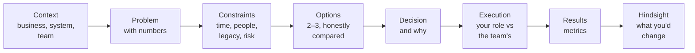
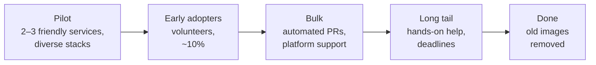

[⬅️ Prev: 26 · Coding & LLD](26-coding-and-lld-interview-patterns.md) · [🏠 Index](README.md) · [Next: 28 · Question Bank ➡️](28-question-bank.md)

# 27 · The Staff & Architect Interview Playbook

> *At staff level, the question behind every question is the same: can we trust this person with ambiguity, with other teams' time, and with decisions that will outlive the quarter? The technical depth from the other 26 chapters gets you into the room. This chapter is about showing judgment once you're there.*

---

## Table of contents
1. [What changes at staff and architect level](#1-what-changes-at-staff-and-architect-level-)
2. [The interview loop and what each round measures](#2-the-interview-loop-and-what-each-round-measures-)
3. [The project deep-dive](#3-the-project-deep-dive-)
4. [Behavioural rounds: STAR+L and a story bank](#4-behavioural-rounds-starl-and-a-story-bank-)
5. [Talking about trade-offs and decisions](#5-talking-about-trade-offs-and-decisions-)
6. [Technical strategy and influence](#6-technical-strategy-and-influence-)
7. [Leading a fleet-wide Java upgrade](#7-leading-a-fleet-wide-java-upgrade-)
8. [Virtual threads vs reactive: a decision framework](#8-virtual-threads-vs-reactive-a-decision-framework-)
9. [Other architect prompts and the shape of a strong answer](#9-other-architect-prompts-and-the-shape-of-a-strong-answer-)
10. [Failure modes that sink staff candidates](#10-failure-modes-that-sink-staff-candidates-)
11. [Questions to ask your interviewers](#11-questions-to-ask-your-interviewers-)
12. [Your first 90 days](#12-your-first-90-days-)
13. [Interview questions](#13-interview-questions)
14. [References](#14-references)

---

## 1. What changes at staff and architect level 🔵

| Dimension | Senior | Staff | Principal |
|---|---|---|---|
| **Scope** | A team's systems | Several teams or a whole domain | An organisation's technical direction |
| **Time horizon** | Weeks to a quarter | 2–4 quarters | Multi-year |
| **Primary output** | Code and designs | Decisions, alignment, unblocked teams, technical direction | Strategy, architecture principles, organisational capability |
| **Relationship to ambiguity** | Solves well-defined problems | Finds and *frames* the problem | Decides which problems matter |
| **Influence** | Within the team | Across teams, without authority | Across the organisation and with executives |
| **Measured by** | Features shipped well | Outcomes of the teams around them | Business outcomes, durable platforms |

Will Larson describes four common **staff archetypes**:
- **Tech Lead:** guides one team's approach and execution.
- **Architect:** owns direction and quality across a domain.
- **Solver:** goes deep on the hardest problems, wherever they are.
- **Right Hand:** extends an executive's reach across the organisation.

Know which one(s) your experience matches, and tell your stories in that shape. A Solver who presents as an Architect, or the reverse, sounds unconvincing.

**Where "architect" fits.** The table is an individual-contributor ladder; "architect" is a role, not the rung after staff. Some companies hire architects at staff level, some at principal level, and some have no architect title, with staff and principal engineers doing the work. The roles overlap, but the emphasis differs:

| | Staff engineer emphasis | Architect emphasis |
|---|---|---|
| The core of the job | Delivering a difficult change across teams | Setting boundaries and direction across systems |
| Making it stick | Adoption made practical: tools, defaults, migration support | Standards made practical: clear ownership and an exceptions process |
| Evidence you'll be asked for | Reliability, delivery and adoption outcomes | Lifecycle cost, interoperability, and how designs evolved |
| Where depth shows | Connecting technical depth to a concrete problem | Connecting business constraints to technical choices |

Find out which emphasis the role you're interviewing for has (ask the recruiter what the last person in it shipped), and pick your stories to match. The README has [reading paths for each](README.md#-paths-by-role).

> [!IMPORTANT]
> Staff interviews don't relax the technical bar; they add a second one. You still have to code cleanly (Chapter 26) and design soundly (Chapter 24). On top of that, you have to show that your technical judgment changed outcomes beyond your own keyboard.

---

## 2. The interview loop and what each round measures 🔵

| Round | What they're really measuring | Prepare with |
|---|---|---|
| **Coding** (1–2) | Fluency, clean code, testing, communication under time pressure | [Chapter 26](26-coding-and-lld-interview-patterns.md) |
| **System design** (1–2) | Framing, quantitative reasoning, trade-offs, failure thinking | [Chapter 24](24-system-design-for-java-architects.md) |
| **Project / architecture deep-dive** | Real depth, ownership, honesty about trade-offs and mistakes | §3 below |
| **Behavioural / leadership** | Influence, conflict, mentoring, judgment, self-awareness | §4–6 below |
| **Domain deep-dive** (Java/JVM) | Whether your depth is real: JMM, GC, performance, Spring internals | Chapters [09](09-jvm-internals.md)–[12](12-concurrency-advanced-juc-loom.md), [18](18-spring-internals.md), [21](21-performance-engineering-troubleshooting.md) |
| **Sometimes:** a written strategy exercise, a cross-functional round (product or EM), or a "bar raiser" | Clarity of writing, partnership, consistency with the company's bar | §6 |

**How decisions get made:** each interviewer writes evidence against a levelling rubric, and a calibration group weighs it. Interviewers can only score what you *said*. "Staff signal" means evidence of **scope** (how far your work reached), **impact** (what measurably changed), and **how** (the judgment and influence that got it there). Make those three things explicit in every answer. Don't leave them to inference.

---

## 3. The project deep-dive 🔵

Often the most heavily weighted round. You present one or two projects, and an interviewer drills until they find the edge of your knowledge.

**Choose a portfolio of 2–3 projects:**
1. **Technical depth:** a hard problem you personally solved (performance, correctness, scale).
2. **Breadth and influence:** something that required aligning several teams (a migration, a platform, a standard).
3. **Recovery:** a failure, incident or course correction, and what changed because of it.

**A 10-minute narrative structure:**


**A preparation template** (fill one in per project):
```markdown
Project:                    One-line description a non-expert understands
Why it mattered:            Business impact in money, risk, customer experience or speed
Numbers:                    Scale (QPS, data, services, teams), before → after metrics, timeline, team size
Architecture:               A C4 container diagram you can draw from memory in 2 minutes
The hard part:              The one technical problem that made this non-trivial
Options rejected and why:   At least two, with real trade-offs
My role:                    What *I* decided, built, wrote, convinced, unblocked
What went wrong:            At least one real setback and how it was handled
Hindsight:                  What I'd do differently, and what I learned
Likely drill-downs:         "Why not X?", "How did you test it?", "What broke in production?",
                            "How did you get team Y to agree?", "What would 10× scale break?"
```

> [!TIP]
> **Be precise about "I" and "we".** Say "the team built X. I designed the consistency model and wrote the migration plan." Overclaiming falls apart after two follow-up questions, and underclaiming hides exactly the signal you're there to show.

---

## 4. Behavioural rounds: STAR+L and a story bank 🔵

**STAR+L:** **S**ituation (2 sentences), **T**ask (your responsibility), **A**ction (most of the answer: what *you* did and why), **R**esult (measured), **L**earning (what you'd do differently, and what you now do by default). Aim for 2–3 minutes, then let them drill.

**Build a story bank.** Map 8–10 real stories onto the themes interviewers probe, so each theme has at least two candidates:
| Theme | Typical prompt |
|---|---|
| Influence without authority | "Tell me about getting other teams to adopt something." |
| Technical disagreement | "Describe a time you disagreed with an architectural decision." |
| Failure / incident ownership | "Tell me about a significant mistake you made." |
| Framing ambiguity | "Tell me about a problem nobody had defined yet." |
| Raising the bar | "How did you improve quality or reliability beyond your own team?" |
| Growing others | "How have you helped someone grow into a bigger role?" |
| Saying no / prioritisation | "Tell me about pushing back on a senior stakeholder." |
| Driving a long migration | "Describe a multi-quarter effort you led." |
| Speed vs quality | "When did you deliberately take on technical debt?" |
| Changing your mind | "When did data prove you wrong?" |

**The shape of a strong answer.** This is an illustrative composite, written to show the structure. It isn't anyone's real company story:
> **S:** After a partial outage, our post-incident analysis showed retries at three layers (client library, service mesh and application code) multiplying load on a struggling dependency roughly 27-fold. Recovery took 47 minutes.
> **T:** As the platform staff engineer, I owned preventing a repeat across about 40 services owned by 8 teams, none of which reported to me.
> **A:** I wrote a short RFC with the incident data and proposed one rule: retry at exactly one layer, with a retry budget. I prototyped it in two services and measured the latency impact on a canary, because the main objection I expected was "this will hurt our p99". I met each team's tech lead before the review, and adjusted the design when two of them pointed out a streaming use case I'd missed. Then I made adoption cheap: a starter with safe defaults, automated PRs, and a dashboard showing each service's retry configuration.
> **R:** 38 of 40 services adopted it within two quarters. In the next comparable incident, load amplification stayed under 1.2×, and recovery took 6 minutes.
> **L:** I'd involve the most sceptical teams even earlier. Their objections made the design better. I now do pre-reads with likely dissenters by default.

Why it works: it has numbers, a clear "I", influence without authority, a design that changed because of feedback, adoption made easy, measured results, and a learning that changed behaviour.

---

## 5. Talking about trade-offs and decisions 🟣

**Phrases that signal judgment:**
- "The constraint that dominates here is ___, so I'm optimising for ___ at the cost of ___."
- "This is a **two-way door** (cheap to reverse), so I'd decide quickly and measure." / "This is a **one-way door**, so it's worth a design review and a prototype." (The framing comes from Amazon.)
- "What would change my mind is ___."
- "We don't need to decide this now. The last responsible moment is when ___."

**A lightweight decision matrix.** This illustrative example compares stores for an order-history service with 50K writes/s, simple key-based reads, and a team fluent in PostgreSQL:
| Criterion (weight) | PostgreSQL, partitioned | Cassandra | DynamoDB |
|---|---|---|---|
| Write throughput at target scale (3) | 2 (needs sharding work) | 3 | 3 |
| Query flexibility (2) | 3 | 1 | 1 |
| Team expertise and operability (3) | 3 | 1 | 2 |
| Cost at target scale (2) | 2 | 2 | 2 |
| Lock-in / portability (1) | 3 | 3 | 1 |
| **Weighted total** | **28** | **21** | **22** |

The matrix doesn't make the decision. It **makes the reasoning reviewable**. Weights are where the real disagreement lives, so agree on them first. Record the outcome in an ADR ([Chapter 16 §11](16-design-principles-clean-architecture.md#11-staff-lens-decisions-trade-offs-adrs-)), with a date to revisit it.

---

## 6. Technical strategy and influence 🔵

**A strategy that's actually a strategy** follows Rumelt's "kernel": **diagnosis → guiding policy → coherent actions**. A list of goals isn't a strategy.

> **An illustrative mini-strategy: "Java platform, next 18 months"**
> **Diagnosis:** 140 services spread over Java 11, 17 and 21 and three Spring Boot major versions. The median time to patch a critical CVE is 19 days. Each team spends about 3 weeks per year on upgrades, and our two worst incidents last year involved version-specific library bugs.
> **Guiding policy:** one supported runtime line (the current LTS, now JDK 25) and one framework line (Spring Boot 4.x). Upgrades are a **platform responsibility, delivered as automation**, not a recurring tax on every team.
> **Coherent actions:** (1) a platform BOM and golden base images; (2) OpenRewrite recipes and Renovate PRs generated centrally; (3) a nightly CI build of every service on the next JDK; (4) a fleet version dashboard; (5) a published support calendar with executive backing; (6) patch SLAs tracked as an engineering metric.

**Influence without authority:**
1. **Earn credibility first** by delivering, especially by helping other teams with their problems.
2. **Understand incentives.** Teams resist work that serves you and costs them, so make the right thing the easy thing (paved roads, automation, starters).
3. **Bring data:** incident analysis, cost, latency. Opinions invite debate; measurements invite action.
4. **Pre-wire decisions.** Talk to key people one-on-one before the big meeting. Surprises in meetings create opposition.
5. **Write it down.** A clear RFC scales your thinking to people you'll never meet.
6. **Disagree and commit, visibly.** Once a decision is made, support it, or reopen it explicitly with new data. Never relitigate it in hallways.
7. **Give credit away.** People follow those who make them successful.

**With executives:** translate technical risk into business terms (money, risk, speed, customer impact). Bring options with a recommendation, not problems. Keep it short: one page, plus an appendix.

---

## 7. Leading a fleet-wide Java upgrade 🔵

*"How would you move 200 services from Java 8/11/17 to Java 25?"* is a favourite architect question because it's technical, organisational and risk-management all at once.

### Phase 0: Inventory
- What each service runs: JDK version, framework versions, base image. Get it from build files, SBOMs and runtime info (`java.version` exposed through Actuator `info` or metrics).
- What will break, using the target JDK's own tools:
```bash
jdeps --jdk-internals --multi-release 25 --class-path 'lib/*' target/app.jar   # uses of JDK internal APIs
jdeprscan --release 25 --for-removal --class-path 'lib/*' target/app.jar      # APIs deprecated for removal
```
- **High-risk dependencies:** anything that manipulates bytecode or reflects into the JDK (ASM, Byte Buddy, Lombok, Mockito, APM agents, old Hibernate/Groovy/Spring versions). Upgrade these first; they lag new JDKs.

### Known breaking points along the way
| From → to | What bites | Reference |
|---|---|---|
| 8 → 11 | Java EE and CORBA modules removed (JAXB, JAX-WS, `javax.activation`): add them as dependencies. Encapsulation warnings. Nashorn deprecated (removed in 15) | JEP 320, 372 |
| 11 → 17 | **Strong encapsulation**: `--illegal-access` is gone, and deep reflection into JDK internals needs `--add-opens` or a library upgrade. CMS GC removed in 14 (retune for G1 or ZGC) | JEP 396, 403, 363 |
| 17 → 21 | **UTF-8 by default** (JDK 18): file and locale encoding behaviour changes on hosts that weren't UTF-8. Finalization deprecated for removal. Warnings on dynamic agent loading | JEP 400, 421, 451 |
| 21 → 25 | Security Manager permanently disabled. `sun.misc.Unsafe` memory-access methods warn. JNI use warns. 32-bit x86 port removed | JEP 486, 471/498, 472, 503 |
| Spring Boot 2 → 3 → 4 | Boot 3: Java 17 baseline, `javax.*` → `jakarta.*`. Boot 4: Jackson 3, modular auto-configuration, Spring Framework 7 | [Chapter 18](18-spring-internals.md) |

### Phase 1: Pave the road
Provide golden base images per JDK, a platform BOM, and a **nightly CI job that builds and tests every service on the target JDK**, so you see breakage before teams do. Ship automated refactoring:
```bash
mvn -U org.openrewrite.maven:rewrite-maven-plugin:run \
  -Drewrite.recipeArtifactCoordinates=org.openrewrite.recipe:rewrite-migrate-java:RELEASE \
  -Drewrite.activeRecipes=org.openrewrite.java.migrate.UpgradeToJava25
# Spring: org.openrewrite.java.spring.boot3.UpgradeSpringBoot_3_5, then
#         org.openrewrite.java.spring.boot4.UpgradeSpringBoot_4_0   (from rewrite-spring)
```
`UpgradeToJava25` chains the earlier Java upgrade recipes, so a Java 8 codebase can start there.

### Phase 2: Decouple the risk
Each step is a separate, independently reversible deploy:
1. **Build** with the new JDK, still targeting the old release (`--release 17`).
2. **Run** on the new JDK (the runtime change: GC behaviour, defaults, container ergonomics).
3. **Bump** the bytecode target.
4. **Adopt** new language and library features gradually.

### Phase 3: Waves with canaries

Every service canaries the new runtime and compares p99 latency, GC pauses, CPU, RSS memory and error rate against the baseline before promoting it. Publish the playbook, the known issues and the fixes as you go, so wave N+1 is cheaper than wave N.

### Phase 4: Make it stick
A fleet dashboard. A CI gate that blocks unsupported runtimes after the deadline. A written support policy ("current LTS, plus the previous LTS for at most 12 months"). Most important of all: **automate the next upgrade** (Renovate plus recipes, plus the nightly next-JDK build), so JDK 29 is a non-event.

**Measure success** by the percentage of the fleet on target, median upgrade effort per service, incidents caused (aim for zero severe), CVE patch latency before and after, and resource cost changes. Newer JDKs often bring cheap wins, such as compact object headers (opt-in in JDK 25, the default from JDK 27) and AOT caching.

> [!TIP]
> **Worked through:** [Chapter 37](37-case-study-fleet-jdk-upgrade.md) takes this playbook to a design review: an inventory from real tools, the flags and locale data that break rollbacks, canary gates that count requests, owners and exceptions, and an ADR.

---

## 8. Virtual threads vs reactive: a decision framework 🟣

| Criterion | Virtual threads (Spring MVC, JDBC) | Reactive (WebFlux, Reactor, R2DBC) |
|---|---|---|
| Programming model | Plain blocking, imperative code. Ordinary stack traces | Operator pipelines, asynchronous composition |
| I/O-bound throughput | High: blocking is cheap | High |
| **Backpressure** | Not built in: bound concurrency yourself (semaphores, bounded pools, rate limits) | **First-class** (Reactive Streams) |
| Streaming (SSE, WebSocket, unbounded streams) | Possible, but manual | A natural fit |
| Debugging and profiling | Thread dumps, debuggers and profilers just work | Async stack traces are hard; needs checkpoints and tooling |
| Ecosystem | Existing blocking libraries, JDBC, most SDKs | Needs non-blocking drivers end to end. One blocking call on an event loop hurts everyone |
| Main pitfalls | Pinning (largely fixed for `synchronized` in JDK 24, JEP 491), ThreadLocal-heavy libraries, unbounded concurrency overwhelming downstream pools | Blocking on event loops, steep learning curve, operator misuse, harder onboarding |
| Team skills needed | Any Java developer | Specialists |

> [!NOTE]
> **The position I'd defend:** for new request/response services on JDK 21+ (preferably 24+), default to **virtual threads with plain Spring MVC**, and bound concurrency explicitly toward every downstream dependency. Use reactive where you genuinely need **streaming or end-to-end backpressure**, or where a codebase is already fully reactive and the team is fluent. Don't rewrite working reactive code to follow fashion. Either way, **load-test with realistic downstream latency**, compare p99 and resource use, and check pinning with the JFR `jdk.VirtualThreadPinned` event ([Chapter 12 §12–14](12-concurrency-advanced-juc-loom.md#12-virtual-threads-project-loom-)).

---

## 9. Other architect prompts and the shape of a strong answer 🟣

| Prompt | The shape of a strong answer |
|---|---|
| **"How do you choose a GC?"** | Start from the requirement (latency, throughput or footprint) and the heap size. G1 is the default and the right place to start; JDK 27 makes it the default even on small machines (JEP 523). Generational ZGC for low-latency, large heaps. Parallel for batch throughput. Then **measure**: GC logs, JFR, p99 under load ([Chapter 10](10-memory-and-garbage-collection.md)) |
| **"Cut the Java fleet's cloud bill by 30%."** | Measure cost per service first. Right-size containers (heap vs RSS, [Chapter 22](22-production-readiness-observability-resilience.md)). Profile the top spenders (async-profiler). Compact object headers and AOT caching on newer JDKs. Consider ARM instances. Autoscale on the right signal. Consolidate low-traffic services. Decommission zombie services |
| **"Monolith or microservices for a new product?"** | A modular monolith with enforced boundaries, and explicit criteria for extracting a service later (independent scaling, deployment cadence, team ownership) ([Chapter 23](23-distributed-systems-microservices.md)) |
| **"Our platform has too many incidents."** | Analyse incident data and cluster the causes. Introduce SLOs and error budgets. Fix the top 3 systemic causes (not the 30 symptoms). Make postmortems blameless and action items tracked. Sharpen ownership and on-call |
| **"Build vs buy?"** | Core vs context. Total cost of ownership (including operating it for 5 years). Lock-in and the exit strategy. Team capacity. Time to value. Decide it in a written ADR |
| **"A team wants a new language for a new service."** | Neither dogmatic yes nor no. Weigh hiring, ecosystem fit, the cost of the paved road (observability, security tooling, libraries), the polyglot tax on on-call and mobility, and the problem fit. Allow it with explicit conditions and a review date |
| **"How do you manage technical debt?"** | Make it visible (a debt register tied to incidents, cost or velocity). Budget capacity continuously (e.g. a fixed percentage). Prioritise by interest paid, not by how ugly the code is. Tie paydown to roadmap work where possible |

---

## 10. Failure modes that sink staff candidates 🔵

| Failure mode | What it sounds like | Fix |
|---|---|---|
| Technology without impact | "We used Kafka, Kubernetes and gRPC…" | Lead with the problem and the measured outcome |
| No numbers | "It got a lot faster." | "p99 went from 840 ms to 120 ms. Cost fell 35%." |
| Hidden "I" | Every sentence is "we" | Name your own decisions and actions |
| Credit-taking | Every sentence is "I" | Credit the team, and be precise about your part |
| Decisions presented as obvious | "Obviously we used X." | Name the alternatives you rejected, and why |
| One hammer | Every answer is microservices, or event sourcing, or rewriting | Show range, and say when *not* to use your favourite tool |
| Blaming others | "The other team broke it." | Own your part; describe the systemic fix |
| Rambling | 10-minute answers with no structure | Give a 2-minute structured answer, then "I can go deeper on X or Y" |
| Shallow on your own project | Can't explain why a key choice was made | Rehearse the drill-downs in §3 |
| Neglecting the coding round | "I don't code much anymore." | Practise. It's often a hard gate at staff level |

---

## 11. Questions to ask your interviewers 🔵

Good questions are evaluated too: they show what you care about.
- "What are the biggest technical challenges this organisation will face in the next 12–18 months?"
- "How are staff engineers' scopes defined here: by team, by domain, or by problem?"
- "Tell me about a recent contentious technical decision. How was it made, and how was it documented?"
- "How do staff engineers and engineering managers divide responsibilities?"
- "What would make someone in this role clearly successful after one year?"
- "What does the Java platform look like today: versions, frameworks, the paved road, the upgrade cadence?"
- "What's the incident and on-call culture like? What changed after the last major incident?"

---

## 12. Your first 90 days 🔵

| Days | Focus | Concrete outputs |
|---|---|---|
| **1–30: Listen** | One-on-ones with tech leads, EMs and product. Read postmortems, ADRs and design docs. Shadow on-call. Map the systems | A C4 map of the domain. A list of pain points. One small shipped change (credibility, and you learn the toolchain) |
| **31–60: Diagnose** | Validate your observations with stakeholders. Find the 1–2 problems with the highest leverage | A short "state of the architecture" note: top risks and opportunities, with evidence. Explicit sponsorship for your chosen focus |
| **61–90: Deliver and set direction** | Early wins on the chosen problems. Draft a strategy. Establish rhythms (design reviews, an architecture forum) | Visible results. A strategy draft in review. Measurable goals for the next two quarters |

---

## 13. Interview questions

<details>
<summary><b>Q1. 🔵 "Walk me through the most complex system you've designed." How do you structure it?</b></summary>

Use the deep-dive arc: context → problem (with numbers) → constraints → options considered → decision and rationale → execution (your role) → measured results → hindsight. Draw a C4 container diagram early, name the one hard part explicitly, and pre-empt drill-downs with the alternatives you rejected. Keep the first pass to about 10 minutes, then let the interviewer steer into depth.
</details>

<details>
<summary><b>Q2. 🔵 "Tell me about a time you disagreed with a technical decision."</b></summary>

Strong answers show that you (1) understood the other side's goals and constraints, (2) argued with evidence (data, a prototype, risk analysis) through the proper channel (an RFC or design review), (3) accepted the outcome, whether that meant changing your mind or disagreeing and committing, and (4) followed up on results. Avoid stories where you were simply right and others were foolish. Interviewers look for respect, rigour and the ability to move forward.
</details>

<details>
<summary><b>Q3. 🔵 "How do you influence teams that don't report to you?"</b></summary>

Build credibility by delivering and by helping. Understand their incentives and constraints. Make the desired path the easiest one (paved roads, automation, starters). Bring data instead of opinions. Pre-wire decisions in one-on-ones. Write clear RFCs. Give credit generously. Escalate rarely, and with options. Illustrate it with a real story with measured adoption.
</details>

<details>
<summary><b>Q4. 🔵 "How would you upgrade 200 services from Java 11 to Java 25?"</b></summary>

Inventory first (versions, `jdeps --jdk-internals`, `jdeprscan --for-removal`, high-risk bytecode and reflection libraries). Pave the road (base images, a BOM, a nightly next-JDK CI build, OpenRewrite `UpgradeToJava25` plus the Spring Boot recipes). Decouple the risk: build on the new JDK → run on it → bump the target → adopt features. Roll out in waves (pilot → early adopters → automated bulk → long tail) with canaries comparing p99, GC, CPU and RSS. Make it stick with a dashboard, a CI gate, a support policy and automation, so the next upgrade is trivial. Measure fleet coverage, effort, incidents and CVE patch latency.
</details>

<details>
<summary><b>Q5. 🟣 "Virtual threads or WebFlux for our new service?"</b></summary>

Ask about the workload first: request/response or streaming, the downstream dependencies (JDBC? blocking SDKs?), the team's skills, the JDK version. For request/response on JDK 21+ (ideally 24+, where `synchronized` pinning is fixed), default to virtual threads with Spring MVC, plus explicit concurrency limits toward downstreams. Choose reactive for streaming and end-to-end backpressure, or for an existing reactive estate. Validate with a load test under realistic latency, and check pinning with JFR.
</details>

<details>
<summary><b>Q6. 🔵 "Tell me about a significant failure."</b></summary>

Pick a real failure with real consequences, not a humble-brag. Own your part plainly, describe what you did during the incident, the systemic fixes (not just "we were more careful"), and how your behaviour changed afterwards. Blameless framing about others, accountable framing about yourself. Interviewers are testing self-awareness and whether failures make you better.
</details>

<details>
<summary><b>Q7. 🔵 "How do you balance technical debt against feature work?"</b></summary>

Make debt visible and quantified: tie it to incidents, lead time, cost or onboarding time. Then prioritise by the "interest" it charges, not by aesthetics. Reserve continuous capacity rather than holding occasional "debt sprints". Bundle paydown with roadmap work that touches the same code. Use ADRs to record debt taken on deliberately, with exit criteria. Talk in business terms with product partners.
</details>

<details>
<summary><b>Q8. 🟣 "How do you know your architecture is working?"</b></summary>

Use outcome metrics: SLOs and error budgets, the DORA metrics (deployment frequency, lead time for changes, change failure rate, time to restore), cost per unit of business volume, and developer-experience signals (build times, onboarding time, surveys). Add **fitness functions**, automated checks that guard architectural properties (ArchUnit rules, latency budgets in CI, dependency rules). Review them periodically, and treat a regression as an architectural signal.
</details>

<details>
<summary><b>Q9. 🟣 "How do you decide with incomplete data?"</b></summary>

Classify reversibility. Two-way doors get decided quickly, with a measurement plan and a review date. One-way doors earn more investigation (prototypes, spikes, expert review). Make your assumptions explicit, define what evidence would change the decision, and time-box the analysis. A good decision now usually beats a perfect one later. Document it in an ADR so the reasoning survives.
</details>

<details>
<summary><b>Q10. 🔵 "What would you do in your first 90 days here?"</b></summary>

Listen (one-on-ones, postmortems, ADRs, on-call shadowing, a system map, one small shipped change). Then diagnose (a state-of-the-architecture note with evidence, validated with stakeholders, with sponsorship for 1–2 high-leverage problems). Then deliver and set direction (early wins, a strategy draft, review rhythms, measurable goals). Avoid arriving with a prescription before you understand the context.
</details>

<details>
<summary><b>Q11. 🔵 "How do you grow senior engineers toward staff?"</b></summary>

Give them scope with support: delegate real, ambiguous problems instead of tasks, and coach on framing, writing and influence (review their RFCs, pre-wire with them, let them present). Sponsor them: put their names on the work in rooms they aren't in. Give specific, timely feedback against the staff rubric. Measure success by their promotions and by the problems they now solve without you.
</details>

<details>
<summary><b>Q12. 🔵 "Tell me about saying no to a senior stakeholder."</b></summary>

Show that you understood the underlying goal, quantified the cost or risk of the request (with data), offered alternatives that met the real need (a smaller scope, phasing, a different approach), and reached a decision together. Escalate respectfully if needed. Close with the outcome and how the relationship stayed intact or improved. "No, but here's how we get you what you actually need" is the pattern.
</details>

---

## 14. References
- Will Larson, *Staff Engineer: Leadership Beyond the Management Track* (2021), and [staffeng.com](https://staffeng.com/)
- Tanya Reilly, *The Staff Engineer's Path* (O'Reilly, 2022)
- Gregor Hohpe, *The Software Architect Elevator* (O'Reilly, 2020)
- Richard Rumelt, *Good Strategy/Bad Strategy* (2011): the diagnosis, guiding policy and coherent actions kernel
- Neal Ford, Rebecca Parsons, Patrick Kua, *Building Evolutionary Architectures* (2nd ed., 2023): fitness functions
- Nicole Forsgren, Jez Humble, Gene Kim, *Accelerate* (2018): the DORA metrics
- Michael Nygard, [*Documenting Architecture Decisions*](https://cognitect.com/blog/2011/11/15/documenting-architecture-decisions) (the ADR format)
- OpenRewrite: [Migrate to Java 25](https://docs.openrewrite.org/recipes/java/migrate/upgradetojava25) and [Migrate to Spring Boot 4.0](https://docs.openrewrite.org/recipes/java/spring/boot4/upgradespringboot_4_0-community-edition)
- JEPs: [320](https://openjdk.org/jeps/320) · [363](https://openjdk.org/jeps/363) · [400](https://openjdk.org/jeps/400) · [403](https://openjdk.org/jeps/403) · [486](https://openjdk.org/jeps/486) · [491](https://openjdk.org/jeps/491) · [523](https://openjdk.org/jeps/523)

---

[⬅️ Prev: 26 · Coding & LLD](26-coding-and-lld-interview-patterns.md) · [🏠 Index](README.md) · [Next: 28 · Question Bank ➡️](28-question-bank.md)
