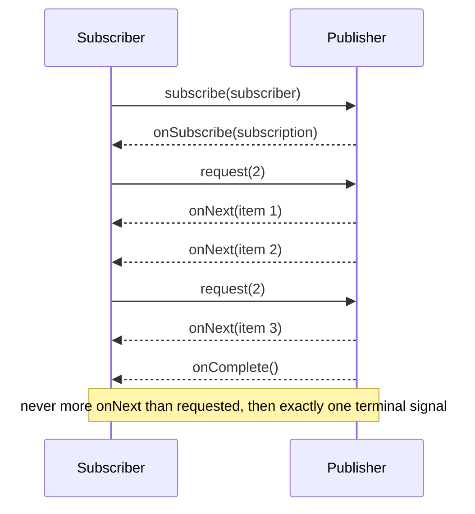
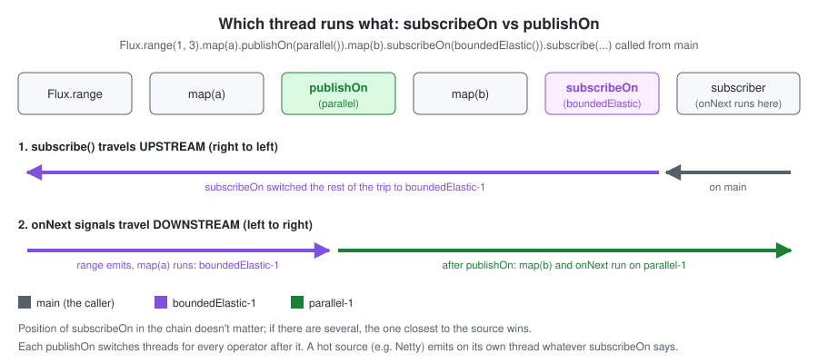
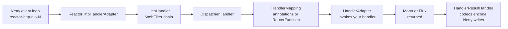
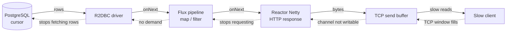

[⬅️ Prev: 28 · Question Bank](28-question-bank.md) · [🏠 Index](README.md) · [Next: 30 · Startup & Footprint ➡️](30-startup-footprint-aot-native-image.md)

# 29 · Reactive Java: Reactor & WebFlux

> *Reactive programming isn't "async with extra steps". It's a contract for moving data between components at the pace the slowest one can sustain, plus a library of operators for composing that safely. Once you understand the contract, Reactor's hundreds of operators stop being intimidating.*

The `java.util.concurrent.Flow` programs in §2–§4 and §8 were run on JDK 25, and their output is real. Reactor snippets target Reactor 3.8 (the 2025.0 release train that Spring Boot 4 uses).

🧪 **Runnable labs:** [the programs behind this chapter's outputs](labs.md#chapter-29--reactive-java)

---

## Table of contents
1. [Why reactive exists, and when it's worth it](#1-why-reactive-exists-and-when-its-worth-it-)
2. [The Reactive Streams contract, traced](#2-the-reactive-streams-contract-traced-)
3. [Backpressure, measured](#3-backpressure-measured-)
4. [Cold vs hot publishers](#4-cold-vs-hot-publishers-)
5. [Reactor in one page: Mono, Flux, assembly vs subscription](#5-reactor-in-one-page-mono-flux-assembly-vs-subscription-)
6. [The operators that matter](#6-the-operators-that-matter-)
7. [Threading: schedulers, publishOn and subscribeOn](#7-threading-schedulers-publishon-and-subscribeon-)
8. [Never block the event loop (measured)](#8-never-block-the-event-loop-measured-)
9. [Errors, retries and timeouts](#9-errors-retries-and-timeouts-)
10. [Context propagation: Reactor Context, MDC, tracing](#10-context-propagation-reactor-context-mdc-tracing-)
11. [WebFlux internals: Reactor Netty, WebClient, R2DBC](#11-webflux-internals-reactor-netty-webclient-r2dbc-)
12. [Backpressure end to end, and where it breaks](#12-backpressure-end-to-end-and-where-it-breaks-)
13. [Testing and debugging reactive code](#13-testing-and-debugging-reactive-code-)
14. [Pitfalls checklist](#14-pitfalls-checklist-)
15. [Reactive vs virtual threads in 2026](#15-reactive-vs-virtual-threads-in-2026-)
16. [Interview questions](#16-interview-questions)
17. [References](#17-references)

---

## 1. Why reactive exists, and when it's worth it 🟡

Classic servers dedicate a thread to each request. While that request waits on a database or a remote service, its thread sits idle, holding a stack and a scheduler slot. Platform threads are expensive, so the thread count becomes the concurrency ceiling. **Event loops** flip this: a handful of threads multiplex thousands of connections with non-blocking I/O ([Chapter 13](13-io-nio-networking-serialization.md)). Reactive libraries add two things on top: **composition** (operators to combine asynchronous results without callback hell) and **backpressure** (consumers tell producers how much they can take).

| Reactive is a strong fit | Reactive is a poor fit |
|---|---|
| Streaming: server-sent events, WebSockets, Kafka-to-client feeds | CRUD services on JDBC/JPA (blocking all the way down) |
| Gateways and proxies with huge numbers of mostly idle connections | CPU-bound work: there's nothing to wait on |
| Fan-out aggregation with per-call timeouts and fallbacks | Teams without reactive experience, on a deadline |
| Producers that must be slowed down or shed load (backpressure) | Code where stack traces and debuggers matter more than throughput |

> [!NOTE]
> Since JDK 21, virtual threads make blocking cheap, which removes most of the *scalability* argument for reactive in request/response services. Reactive keeps its edge in **streaming and backpressure**. §15 has the decision framework.

---

## 2. The Reactive Streams contract, traced 🟡→🔴

The contract is four interfaces, standardised by the Reactive Streams initiative and included in the JDK since Java 9 as `java.util.concurrent.Flow`: `Publisher`, `Subscriber`, `Subscription` and `Processor`. Reactor implements the same contract (`org.reactivestreams` types, with adapters to `Flow`).



**The rules interviewers care about:**
- `onSubscribe` is called once, then `onNext` zero or more times (never more than requested), then **at most one** terminal signal: `onError` or `onComplete`.
- Signals to a subscriber must be **serial**: never two `onNext` calls at the same time.
- Demand is **cumulative**. `request(Long.MAX_VALUE)` means "unbounded". `request(0)` or a negative value must produce `onError(IllegalArgumentException)`.
- `onNext(null)` is illegal. Reactive Streams has no nulls; "no value" is an empty sequence.

To make the contract concrete, here's a hand-written publisher, a `map` operator and a subscriber that requests two items at a time:
```java
final class Range implements Publisher<Integer> {
    private final int start, end;
    Range(int start, int count) { this.start = start; this.end = start + count; }

    @Override public void subscribe(Subscriber<? super Integer> s) {
        log("Range: subscribed, handing out a Subscription");
        s.onSubscribe(new Subscription() {
            private final AtomicLong requested = new AtomicLong();
            private final AtomicInteger wip = new AtomicInteger();   // "work in progress": guards against re-entrant emission
            private int next = start;
            private volatile boolean done;

            @Override public void request(long n) {
                log("Range: request(" + n + ")");
                if (n <= 0) { cancel(); s.onError(new IllegalArgumentException("Rule 3.9: request(n) needs n > 0")); return; }
                requested.getAndUpdate(r -> r + n < 0 ? Long.MAX_VALUE : r + n);    // cap at "unbounded"
                if (wip.getAndIncrement() != 0) return;   // already emitting (we're inside onNext): the loop below will see the new demand
                int missed = 1;
                for (;;) {
                    long r = requested.get(), emitted = 0;
                    while (emitted != r && next < end) {
                        if (done) return;
                        s.onNext(next++);
                        emitted++;
                    }
                    if (next == end) { if (!done) { done = true; s.onComplete(); } return; }
                    if (r != Long.MAX_VALUE) requested.addAndGet(-emitted);
                    missed = wip.addAndGet(-missed);
                    if (missed == 0) return;
                }
            }
            @Override public void cancel() { done = true; }
        });
    }
}

final class MapOp<T, R> implements Publisher<R> {
    private final Publisher<T> upstream; private final Function<T, R> fn; private final String name;
    MapOp(Publisher<T> upstream, Function<T, R> fn, String name) { this.upstream = upstream; this.fn = fn; this.name = name; }

    @Override public void subscribe(Subscriber<? super R> downstream) {
        log(name + ": subscribed, subscribing to upstream");
        upstream.subscribe(new Subscriber<T>() {
            @Override public void onSubscribe(Subscription s) { log(name + ": onSubscribe passes downstream"); downstream.onSubscribe(s); }
            @Override public void onNext(T item)      { downstream.onNext(fn.apply(item)); }
            @Override public void onError(Throwable t) { downstream.onError(t); }
            @Override public void onComplete()         { downstream.onComplete(); }
        });
    }
}

final class Printer implements Subscriber<String> {
    private Subscription s; private int received;
    @Override public void onSubscribe(Subscription s) { this.s = s; log("Printer: onSubscribe, request(2)"); s.request(2); }
    @Override public void onNext(String item) {
        log("Printer: onNext(" + item + ")");
        if (++received % 2 == 0) { log("Printer: request(2)"); s.request(2); }
    }
    @Override public void onError(Throwable t) { log("Printer: onError " + t); }
    @Override public void onComplete() { log("Printer: onComplete"); }
}

// main:
log("assembling Range(1..5) -> map1(x * 10) -> map2(\"#\" + x)");
Publisher<String> pipeline = new MapOp<>(new MapOp<>(new Range(1, 5), x -> x * 10, "map1"), x -> "#" + x, "map2");
log("assembled: nothing has executed yet");
pipeline.subscribe(new Printer());
```
```
main   assembling Range(1..5) -> map1(x * 10) -> map2("#" + x)
main   assembled: nothing has executed yet
main   map2: subscribed, subscribing to upstream
main   map1: subscribed, subscribing to upstream
main   Range: subscribed, handing out a Subscription
main   map1: onSubscribe passes downstream
main   map2: onSubscribe passes downstream
main   Printer: onSubscribe, request(2)
main   Range: request(2)
main   Printer: onNext(#10)
main   Printer: onNext(#20)
main   Printer: request(2)
main   Range: request(2)
main   Printer: onNext(#30)
main   Printer: onNext(#40)
main   Printer: request(2)
main   Range: request(2)
main   Printer: onNext(#50)
main   Printer: onComplete
```
**Four things this trace teaches:**
1. **Assembly builds objects; nothing runs until `subscribe()`.** This is the single most important reactive idea, and the source of most beginner bugs ("my save never happened": nothing subscribed to it).
2. **Signals travel in both directions.** `subscribe` goes *upstream* (map2 → map1 → Range), `onSubscribe` comes back *downstream*, `request(n)` goes *upstream*, and data flows *downstream*.
3. **Everything ran on `main`.** Reactive doesn't mean multithreaded. Threads only appear when a scheduler or an asynchronous source (a Netty socket) introduces them.
4. **Writing operators correctly is hard.** The subscriber calls `request(2)` from inside `onNext`, which re-enters `request()` mid-emission. The `wip` counter "trampolines" that call so the stack doesn't grow and signals stay serial. Reactor's operators handle this and more (cancellation races, fusion), and are tested against the Reactive Streams TCK. Use them; don't write your own.

---

## 3. Backpressure, measured 🔴

`SubmissionPublisher` is the JDK's ready-made publisher. Here, a subscriber takes 5 ms per item and requests one at a time, with a per-subscriber buffer of 8:
```java
static final class SlowSubscriber implements Subscriber<Integer> {
    final CountDownLatch done = new CountDownLatch(1);
    final AtomicInteger received = new AtomicInteger();
    private Subscription s;
    public void onSubscribe(Subscription s) { this.s = s; s.request(1); }
    public void onNext(Integer item) { sleep(5); received.incrementAndGet(); s.request(1); }   // slow consumer, asks for one more
    public void onError(Throwable t) { done.countDown(); }
    public void onComplete() { done.countDown(); }
}

// 1) offer(): never blocks the producer; overflow goes to a drop handler
try (var pub = new SubmissionPublisher<Integer>(consumerThread, 8)) {
    var sub = new SlowSubscriber();
    pub.subscribe(sub);
    for (int i = 0; i < 500; i++) pub.offer(i, (subscriber, item) -> { dropped.incrementAndGet(); return false; });
    ...
}
// 2) submit(): blocks the producer while the subscriber's buffer is full
try (var pub = new SubmissionPublisher<Integer>(consumerThread, 8)) {
    ...
    for (int i = 0; i < 200; i++) pub.submit(i);
}
```
```
offer():  producer finished in 1 ms; consumer received 8, dropped 492
submit(): producer needed 989 ms to hand off 200 items; consumer received 200, dropped 0
```
That's backpressure in two lines. With `submit`, the producer was slowed to the consumer's pace (200 × ~5 ms). With `offer`, the producer kept its speed and the overflow had to go somewhere: here, 492 items were dropped. **Backpressure is a demand signal, not magic.** When the producer *can't* slow down (user clicks, market ticks, sensor readings), you must pick an **overflow strategy**:

| Strategy | Reactor operator | Use when |
|---|---|---|
| Bounded buffer | `onBackpressureBuffer(maxSize, onOverflow, BufferOverflowStrategy.DROP_OLDEST)` | Short bursts; you can afford some memory |
| Drop newest | `onBackpressureDrop(dropped -> droppedCounter.increment())` | Samples, metrics, telemetry |
| Keep latest | `onBackpressureLatest()` | Prices, positions, "current state" values |
| Fail | `onBackpressureError()` | Overflow means a bug, so fail loudly |
| Batch requests | `limitRate(100)` | Requests upstream in batches (replenishing at 75%), instead of one-by-one or unbounded |

💣 `Flux.create(sink -> …)` defaults to `OverflowStrategy.BUFFER`, an **unbounded** buffer. A fast callback-based source wrapped this way can quietly eat the heap. Choose the strategy explicitly.

---

## 4. Cold vs hot publishers 🔴

```
cold: A=[1, 2, 3] B=[1, 2, 3]   (each subscriber gets its own run from the start)
hot:  early=[1, 2, 3, 4, 5, 6, 7, 8] late=[6, 7, 8]   (a late subscriber only sees what's emitted after it joins)
```
- **Cold** publishers start work **per subscriber**: `Flux.range`, `Mono.fromCallable`, `Flux.defer`, and every `WebClient` call. 💣 Subscribing twice to a `WebClient` `Mono` sends **two HTTP requests**. Retries rely on exactly this: a retry is a re-subscription.
- **Hot** publishers emit whether or not anyone is listening, and late subscribers miss earlier items: UI events, `Sinks.many().multicast()`, and a Kafka topic seen by a live consumer.
- **Turning cold into hot:** `share()` (multicast while there are subscribers), `publish().autoConnect(n)` (start once n subscribers have joined), `replay(n)` (late subscribers get the last n items), and `cache()` (replay everything, *including errors*, forever, unless you use the variant with separate value, error and empty TTLs).
- **Sinks** are the programmatic bridge into a hot publisher: `Sinks.many().multicast().onBackpressureBuffer()`. `tryEmitNext` returns an `EmitResult`, so check `isFailure()`. Concurrent emission is reported as a failure (`FAIL_NON_SERIALIZED`), not silently fixed.

---

## 5. Reactor in one page: Mono, Flux, assembly vs subscription 🟡

`Mono<T>` emits 0 or 1 item; `Flux<T>` emits 0..N. Both are cold by default and lazy until subscribed.

```java
Mono<User> bad  = Mono.just(userClient.fetchBlocking(id));                 // ❌ the call runs NOW, at assembly, even if nobody subscribes
Mono<User> good = Mono.fromCallable(() -> userClient.fetchBlocking(id));   // ✅ runs per subscription
Mono<User> lazy = Mono.defer(() -> userCache.lookup(id));                  // ✅ builds the Mono per subscription

Mono<Order> order = orderRepository.findById(id)
        .switchIfEmpty(Mono.error(() -> new NotFoundException("Order", id)))   // empty is not an error until you say so
        .filter(o -> o.isVisibleTo(caller))
        .map(OrderDto::from);

Mono<Void> saved = repository.save(order).then();     // nothing is saved until something subscribes to 'saved'
```
- **Empty vs error:** an empty `Mono` completes without a value, and many bugs come from forgetting that `map` simply never runs on an empty source. Use `switchIfEmpty` and `defaultIfEmpty` explicitly.
- **`block()` belongs only at the edges** (`main` methods and tests). Reactor refuses to block on its own non-blocking threads and throws: `block()/blockFirst()/blockLast() are blocking, which is not supported in thread reactor-http-nio-3`.
- In WebFlux, **return the publisher** from your controller. The framework subscribes and handles cancellation, errors and backpressure. Calling `subscribe()` yourself inside a handler creates a detached, fire-and-forget pipeline that loses context, errors and backpressure.

---

## 6. The operators that matter 🟡→🔴

| Category | Operators |
|---|---|
| Transform | `map`, `flatMap`, `concatMap`, `flatMapSequential`, `switchMap`, `handle` |
| Filter | `filter`, `take`, `skip`, `distinct`, `distinctUntilChanged` |
| Combine | `zip`, `zipWith`, `merge`, `concat`, `combineLatest` |
| Errors | `onErrorReturn`, `onErrorResume`, `onErrorMap`, `retryWhen`, `timeout` |
| Batching | `buffer`, `window`, `groupBy`, `bufferTimeout` |
| Side effects | `doOnNext`, `doOnError`, `doFinally`, `tap` |
| Aggregate | `collectList`, `collectMap`, `reduce`, `count`, `then` |

**The four flavours of "for each element, call something asynchronous":**
```java
Flux<Order> fast = Flux.fromIterable(orderIds)
        .flatMap(id -> orderClient.fetch(id), 8);            // up to 8 in flight; results in COMPLETION order
Flux<Order> ordered = Flux.fromIterable(orderIds)
        .flatMapSequential(id -> orderClient.fetch(id), 8);  // 8 in flight; results in SOURCE order (buffers early arrivals)
Flux<Order> oneByOne = Flux.fromIterable(orderIds)
        .concatMap(id -> orderClient.fetch(id));             // one at a time, in order
Flux<Result> latest = searchTerms
        .switchMap(term -> searchClient.search(term));      // a new term CANCELS the previous search
```
💣 `flatMap` without a concurrency argument allows **256** concurrent inner subscriptions by default (with a prefetch of 32 for each). Iterating 10,000 IDs means 256 simultaneous calls to some downstream service. Always pass an explicit concurrency when the inner publisher hits a shared resource.

**Parallel aggregation with per-call budgets:**
```java
Mono<Dashboard> dashboard = Mono.zip(
                profileClient.get(userId),
                ordersClient.recent(userId).collectList(),
                recommendations.top(userId)
                        .timeout(Duration.ofMillis(300))
                        .onErrorReturn(List.of()))                     // optional data degrades gracefully
        .map(t -> new Dashboard(t.getT1(), t.getT2(), t.getT3()));
```
💣 If any source in `zip` completes **empty**, the whole `zip` completes empty, and the other sources are cancelled. Give optional parts a `defaultIfEmpty`.

---

## 7. Threading: schedulers, publishOn and subscribeOn 🔴

| Scheduler | Threads | Use for |
|---|---|---|
| `Schedulers.parallel()` | One per CPU core | Short, CPU-bound, **non-blocking** work |
| `Schedulers.boundedElastic()` | Up to 10 × cores, with up to 100,000 queued tasks per thread | Wrapping **blocking** calls you can't remove |
| `Schedulers.single()` | 1 | Low-volume work that must be ordered |
| `Schedulers.immediate()` | The caller's thread | No switch |
| `Schedulers.fromExecutorService(…)` | Yours | Integrating an existing pool |

Since Reactor 3.6 on Java 21+, `boundedElastic()` can run on **virtual threads** with `-Dreactor.schedulers.defaultBoundedElasticOnVirtualThreads=true`. Spring Boot sets that for you when `spring.threads.virtual.enabled=true`.



```java
Flux.range(1, 3)
    .map(i -> trace("map(a)", i))                 // boundedElastic-1: subscribeOn moved the subscription, and range emits on it
    .publishOn(Schedulers.parallel())             // everything BELOW this line runs on parallel-1
    .map(i -> trace("map(b)", i))                 // parallel-1
    .subscribeOn(Schedulers.boundedElastic())     // position doesn't matter: it affects the subscription and the source
    .subscribe(i -> trace("onNext", i));          // parallel-1
```
- **`subscribeOn`** changes the thread on which the *subscription* travels upstream. For a cold source that emits when subscribed, that's also where the data starts. Its position in the chain doesn't matter, and if there are several, the one **closest to the source** wins.
- **`publishOn`** changes the thread for every signal *after* it, until the next `publishOn`. It sits on a queue (prefetch 256 by default), so it's also a buffer.
- **Hot or asynchronous sources ignore `subscribeOn` for emission.** `WebClient` responses arrive on Netty's event-loop threads (`reactor-http-nio-N`, or `reactor-http-epoll-N` with the native transport), whatever you subscribe on.

---

## 8. Never block the event loop (measured) 🔴

A single-threaded "event loop" handles one request per millisecond, each doing a few microseconds of real work. Request #100 makes a 200 ms blocking call, first *on* the loop, then offloaded to another pool:
```java
if (id == 100 && mode.contains("ON"))        loop.execute(() -> sleep(200));                              // e.g. a JDBC call
if (id == 100 && mode.contains("offloaded")) loop.execute(() -> elastic.execute(() -> sleep(200)));       // hand off, return at once
loop.execute(() -> { doSmallAmountOfWork(); latency[id] = System.nanoTime() - arrived; done.countDown(); });
```
```
all non-blocking               p50=  0.06 ms  p99=   1.10 ms  max=   7.14 ms  requests delayed >10 ms: 0
one blocking call ON the loop  p50=  0.07 ms  p99= 190.00 ms  max= 201.23 ms  requests delayed >10 ms: 166
same call offloaded            p50=  0.06 ms  p99=   0.16 ms  max=   2.20 ms  requests delayed >10 ms: 0
```
**One** blocking call delayed **166 unrelated requests** by up to 200 ms. In a thread-per-request server, a slow call hurts only its own request. On an event loop, it hurts every request that shares that thread. Reactor Netty runs one event-loop thread per core (minimum 4), shared by the server and `WebClient` by default. A few blocking calls can stall the whole service.

**The idiom for blocking code you can't remove:**
```java
Mono<Customer> customer = Mono.fromCallable(() -> legacyJdbcDao.findCustomer(id))   // deferred: runs per subscription
        .subscribeOn(Schedulers.boundedElastic());                                     // runs on a pool built for blocking
```
**Catch violations before production with BlockHound**, a Java agent that throws when a blocking call (`Thread.sleep`, socket reads, `FileInputStream.read`…) runs on a thread marked non-blocking. Install it in tests: `BlockHound.install()`. On JDK 13+ it needs `-XX:+AllowRedefinitionToAddDeleteMethods`; JDK 25 still accepts that flag, with a deprecation warning.

---

## 9. Errors, retries and timeouts 🔴

An error is a **terminal** signal: after `onError`, the sequence is over. Recovering means *switching to another publisher*.
```java
Mono<Price> price = pricingClient.quote(sku)
        .timeout(Duration.ofMillis(400))                                     // per attempt; cancels the HTTP call
        .retryWhen(Retry.backoff(3, Duration.ofMillis(100))
                .maxBackoff(Duration.ofSeconds(1))
                .jitter(0.5)
                .filter(ex -> ex instanceof TimeoutException || isRetryable5xx(ex))    // never retry 4xx or validation errors
                .onRetryExhaustedThrow((spec, signal) -> signal.failure()))
        .onErrorResume(ex -> lastKnownPrice(sku))                             // a fallback publisher
        .timeout(Duration.ofSeconds(2));                                      // overall deadline across all attempts
```
- `onErrorReturn(value)` falls back to a value; `onErrorResume(fn)` to another publisher; `onErrorMap` translates exceptions (into domain errors); `doOnError` only logs.
- **Retry re-subscribes**, so for cold publishers it re-executes the call. That's only safe for **idempotent** operations ([Chapter 23 §7](23-distributed-systems-microservices.md#7-idempotency-the-property-that-makes-retries-safe-)). Add jitter and a retry budget ([Chapter 22](22-production-readiness-observability-resilience.md)).
- **Isolate per-element failures** inside `flatMap`, so one bad element doesn't kill the stream:
```java
Flux.fromIterable(ids)
    .flatMap(id -> client.fetch(id)
            .timeout(Duration.ofMillis(500))
            .onErrorResume(ex -> { metrics.failed(id, ex); return Mono.empty(); }), 16);
```
💣 Avoid `onErrorContinue`. It only works with operators that explicitly support it, and its behaviour surprises even experienced Reactor users. Handle errors inside the inner publisher instead.

---

## 10. Context propagation: Reactor Context, MDC, tracing 🔴

`ThreadLocal`s break in reactive code because one request hops across threads (event loop → `boundedElastic` → `parallel`) and each thread interleaves many requests. Reactor's answer is the **`Context`**: an immutable map attached to the *subscription*, which flows from the subscriber **upstream** to the source.
```java
@Component
class TenantFilter implements WebFilter {
    @Override
    public Mono<Void> filter(ServerWebExchange exchange, WebFilterChain chain) {
        String tenant = exchange.getRequest().getHeaders().getFirst("X-Tenant");
        return chain.filter(exchange)
                .contextWrite(Context.of("tenant", tenant));    // visible to everything UPSTREAM: the whole handler chain
    }
}

Mono<Order> find(String orderId) {
    return Mono.deferContextual(ctx -> repository.find(ctx.get("tenant"), orderId));
}
```
- `contextWrite` affects operators **above** it in the chain (closer to the source), not below it. That direction surprises everyone the first time.
- **MDC, tracing and security context:** the Micrometer *context-propagation* library bridges `ThreadLocal`s and the Reactor `Context`, restoring them around operators automatically. Enable it in Spring Boot with `spring.reactor.context-propagation=auto` (the replacement for calling `Hooks.enableAutomaticContextPropagation()` yourself). Spring Security's `ReactiveSecurityContextHolder` keeps authentication in the Reactor `Context`.

---

## 11. WebFlux internals: Reactor Netty, WebClient, R2DBC 🔴


- **Server:** Reactor Netty by default, with one event-loop thread per core (minimum 4). WebFlux can also run on Servlet containers through non-blocking Servlet I/O.
- **Programming models:** annotated controllers (`@RestController` returning `Mono`/`Flux`) or functional endpoints (`RouterFunction` + `HandlerFunction`). The same engine runs both.
- **Streaming:** return a `Flux` as `text/event-stream` (server-sent events) or `application/x-ndjson`, and each element is written as it's produced. As JSON (`application/json`), a `Flux` is serialised as an array.
- **WebClient** sits on Reactor Netty's `HttpClient`. Configure it deliberately:
```java
ConnectionProvider pool = ConnectionProvider.builder("pricing")
        .maxConnections(200)                                  // cap concurrent connections to this dependency
        .pendingAcquireMaxCount(500)                          // bounded wait queue, not unbounded
        .pendingAcquireTimeout(Duration.ofSeconds(2))
        .maxIdleTime(Duration.ofSeconds(20))                  // below the server's keep-alive timeout
        .build();
HttpClient http = HttpClient.create(pool)
        .option(ChannelOption.CONNECT_TIMEOUT_MILLIS, 1_000)
        .responseTimeout(Duration.ofSeconds(2));
WebClient pricing = WebClient.builder()
        .baseUrl("https://pricing.internal")
        .clientConnector(new ReactorClientHttpConnector(http))
        .build();
```
- **R2DBC** provides reactive SQL drivers (PostgreSQL, MySQL, SQL Server, Oracle and others). Spring Data R2DBC offers `ReactiveCrudRepository` with simple mapping: **no JPA, no lazy loading, no persistence context**. JPA/Hibernate is blocking, so using it from WebFlux means offloading every call to `boundedElastic`, which throws away most of the benefit. Transactions use a `ReactiveTransactionManager`, through `@Transactional` or `TransactionalOperator`.

---

## 12. Backpressure end to end, and where it breaks 🟣


When it works, a slow client slows the database cursor, and memory stays flat whatever the result size. **Where the chain breaks:**
- **Sources that can't be slowed:** hot sources, sinks with unbounded buffers, `Flux.create` with the default `BUFFER` strategy, `onBackpressureBuffer()` without a size.
- **Hidden buffers:** each `publishOn` has a queue (prefetch 256), and `flatMap` multiplies concurrency × prefetch. They're bounded, but they add up.
- **Network boundaries:** HTTP request/response carries no Reactive Streams demand beyond what TCP flow control provides. RSocket was designed to carry `request(n)` across the network; with HTTP, you rely on TCP, bounded pages, or streaming with flow control.
- **Fire-and-forget subscriptions:** a `subscribe()` inside a handler is detached from the client's demand entirely.

---

## 13. Testing and debugging reactive code 🔴

```java
@Test
void emitsActiveOrdersThenCompletes() {
    StepVerifier.create(service.activeOrders("acme"))
            .expectNextMatches(o -> o.status() == Status.ACTIVE)
            .expectNextCount(2)
            .verifyComplete();
}

@Test
void hourlyPollingWithoutWaitingHours() {
    StepVerifier.withVirtualTime(() -> Flux.interval(Duration.ofHours(1)).take(3))   // create the publisher INSIDE the supplier
            .expectSubscription()
            .thenAwait(Duration.ofHours(3))
            .expectNext(0L, 1L, 2L)
            .verifyComplete();
}
```
- **`StepVerifier`** asserts each signal: values, errors and completion. `withVirtualTime` makes delays, intervals and timeouts instant (the publisher must be created inside the supplier so it picks up the virtual-time scheduler).
- **`TestPublisher`** simulates misbehaving sources. **`WebTestClient`** tests endpoints. **BlockHound** in the test suite catches blocking calls.
- **Debugging:** stack traces show Reactor's internals, not the place where you *assembled* the failing operator. Use `.checkpoint("fetch-prices")` on important paths (cheap); `Hooks.onOperatorDebug()` for full assembly traces in development (expensive); or `ReactorDebugAgent.init()` from `reactor-tools`, which instruments bytecode at load time, cheaply enough to consider in production. `.log()` prints every signal. `.name("orders").tap(Micrometer.metrics(registry))` publishes metrics for a sequence.

---

## 14. Pitfalls checklist 🔴

| Pitfall | Symptom | Fix |
|---|---|---|
| Nothing subscribes | "The save never happened" | Return the publisher, or compose it with `then()` |
| `Mono.just(expensiveCall())` | The call runs at assembly, even when not needed | `Mono.fromCallable` / `Mono.defer` |
| Blocking on the event loop | Latency spikes across unrelated requests (§8) | `fromCallable` + `subscribeOn(boundedElastic())`; BlockHound in tests |
| `subscribe()` inside a handler | Lost errors, lost context, no backpressure | Return the publisher; let the framework subscribe |
| Default `flatMap` concurrency | 256 parallel calls hammer a dependency | `flatMap(fn, concurrency)` |
| Unbounded buffers | Heap growth under load | Bounded `onBackpressureBuffer`, explicit `Flux.create` strategy |
| Double subscription to a cold HTTP `Mono` | Duplicate remote calls | `cache()` deliberately, or restructure |
| `zip` with an empty source | The whole result is empty | `defaultIfEmpty` on optional parts |
| `ThreadLocal` / MDC loss | Logs without trace IDs, missing tenant | Reactor `Context` + context-propagation |
| JPA inside WebFlux | Thread starvation, little benefit | R2DBC, or switch the service to MVC + virtual threads |
| Ignoring `EmitResult` from sinks | Silently dropped events | Check `tryEmitNext` results, or use a serialized emission strategy |

---

## 15. Reactive vs virtual threads in 2026 🟣

The full framework is in [Chapter 27 §8](27-staff-architect-interview-playbook.md#8-virtual-threads-vs-reactive-a-decision-framework-) and [Chapter 12 §14](12-concurrency-advanced-juc-loom.md#14-virtual-threads-vs-reactive-programming-). The short version:

> [!NOTE]
> **The position I'd defend:** for new request/response services, use virtual threads with plain blocking code, and bound concurrency toward each dependency. Keep reactive where it earns its keep: **streaming, end-to-end backpressure, gateways with huge connection counts**, and codebases where the team is already fluent. Don't rewrite working reactive services just to follow fashion, and don't introduce reactive into a JPA-based CRUD service. Even gateways now have a choice: Spring Cloud Gateway offers both a reactive (WebFlux) and a Servlet (MVC) server.

---

## 16. Interview questions

<details>
<summary><b>Q1. 🟢 What does "nothing happens until you subscribe" mean?</b></summary>

Building a `Flux`/`Mono` chain (assembly) only creates objects that describe the pipeline. Work starts when a subscriber subscribes: the subscription travels upstream to the source, which then emits as demand arrives. That's why `repository.save(x)` without returning or subscribing to the result does nothing, and why a cold publisher re-executes for every subscriber.
</details>

<details>
<summary><b>Q2. 🟡 Explain the Reactive Streams protocol and backpressure.</b></summary>

A `Subscriber` subscribes to a `Publisher` and receives a `Subscription` in `onSubscribe`. It then signals demand with `request(n)`, and the publisher may send at most that many `onNext` signals, followed by at most one terminal `onComplete` or `onError`. Signals are serial, demand is cumulative, and `request(n <= 0)` is a protocol error. Backpressure is this demand signal: a slow subscriber requests less, so the producer must slow down, buffer within limits, or drop according to an explicit strategy.
</details>

<details>
<summary><b>Q3. 🟡 <code>map</code> vs <code>flatMap</code> vs <code>concatMap</code> vs <code>flatMapSequential</code>?</b></summary>

`map` is a synchronous 1:1 transformation. `flatMap` maps each element to a publisher and subscribes to them concurrently (256 by default), emitting results in completion order. `concatMap` subscribes one at a time, preserving order. `flatMapSequential` runs concurrently but reorders the results back into source order, buffering early arrivals. `switchMap` cancels the previous inner publisher when a new element arrives, which suits search-as-you-type.
</details>

<details>
<summary><b>Q4. 🔴 <code>publishOn</code> vs <code>subscribeOn</code>?</b></summary>

`subscribeOn` changes the thread on which the subscription travels upstream, and therefore where a cold source emits. Its position in the chain doesn't matter, and the one closest to the source wins. `publishOn` changes the thread for all downstream signals after it, through a queue. Asynchronous sources such as Netty emit on their own threads regardless of `subscribeOn`.
</details>

<details>
<summary><b>Q5. 🔴 How do you call a blocking library from a WebFlux application?</b></summary>

Wrap it lazily and move it off the event loop: `Mono.fromCallable(() -> blockingCall()).subscribeOn(Schedulers.boundedElastic())`. `boundedElastic` is capped (10 × cores threads by default, optionally virtual threads on Java 21+), so blocking work can't exhaust the system. Verify with BlockHound in tests. If most of the service is blocking (JPA, legacy SDKs), the honest answer is to use Spring MVC with virtual threads instead.
</details>

<details>
<summary><b>Q6. 🔴 Cold vs hot publishers, and how do <code>share</code>, <code>cache</code> and <code>replay</code> differ?</b></summary>

Cold publishers do their work per subscriber: each `WebClient` subscription is a new HTTP call. Hot publishers emit independently of subscribers, and late subscribers miss earlier items. `share()` multicasts one upstream subscription to current subscribers. `replay(n)` multicasts and replays the last n items to late subscribers. `cache()` replays everything, including a terminal error, indefinitely unless you use the TTL variant. Choose deliberately: caching an error can turn a blip into an outage.
</details>

<details>
<summary><b>Q7. 🔴 How do you implement retries with a timeout correctly in Reactor?</b></summary>

Put `timeout` *before* `retryWhen`, so each attempt has its own timeout (the timeout cancels the in-flight call). Use `Retry.backoff` with a cap, jitter, and a `filter` that only retries transient errors (timeouts, 5xx, connection resets, never 4xx). Add an overall `timeout` after the retry for a total deadline, and a fallback with `onErrorResume` if a degraded answer is acceptable. Retries re-subscribe, so only retry idempotent operations.
</details>

<details>
<summary><b>Q8. 🔴 Why do MDC and ThreadLocals break in reactive code, and what's the fix?</b></summary>

One request's processing hops between threads (event loop, `boundedElastic`, `parallel`), and each thread serves many requests interleaved, so a `ThreadLocal` set at the start of a request isn't there later, or belongs to someone else. Reactor's `Context` is attached to the subscription instead: write it with `contextWrite` (it applies upstream), and read it with `deferContextual`. For MDC, tracing and security, the Micrometer context-propagation library restores `ThreadLocal`s around operators automatically. In Spring Boot, set `spring.reactor.context-propagation=auto`.
</details>

<details>
<summary><b>Q9. 🔴 Why does one blocking call on a Netty event loop hurt so much?</b></summary>

Event-loop threads are few (one per core, minimum 4, in Reactor Netty) and each multiplexes many connections. A blocking call stalls every request that shares that thread, not just its own. In our measurement, a single 200 ms block delayed 166 unrelated requests, and p99 went from about 1 ms to 190 ms. With thread-per-request, the same call would only have slowed its own request.
</details>

<details>
<summary><b>Q10. 🟣 A client downloads a 10-million-row report as an NDJSON stream from WebFlux over R2DBC. Does memory stay flat? Where could it break?</b></summary>

Ideally yes: TCP flow control makes the Netty channel non-writable when the client reads slowly. Reactor Netty then stops requesting, demand stops propagating upstream, and R2DBC stops fetching rows from the cursor. It breaks wherever demand is ignored: an unbounded buffer (`onBackpressureBuffer()` without a size, `Flux.create` with the default `BUFFER`), `collectList()` somewhere in the pipeline, a hot source that can't be slowed, or a detached `subscribe()`. Also watch the database side: a long-open cursor holds a connection and a snapshot for the whole download.
</details>

<details>
<summary><b>Q11. 🔴 How do you test code that uses <code>delayElements</code> or hourly intervals?</b></summary>

`StepVerifier.withVirtualTime(() -> publisher)` replaces time-based schedulers with a virtual clock. Then `thenAwait(Duration.ofHours(3))` advances time instantly. The publisher must be created inside the supplier, so its operators pick up the virtual scheduler. Combine with `expectNoEvent(duration)` to assert silence.
</details>

<details>
<summary><b>Q12. 🟣 Would you choose WebFlux for a new service today?</b></summary>

It depends on the workload. For request/response APIs on JDK 21+, I'd choose Spring MVC with virtual threads: simpler code, normal stack traces, the full blocking ecosystem, with explicit concurrency limits toward dependencies. I'd choose WebFlux for streaming (SSE, WebSockets), for end-to-end backpressure needs, for gateways with very high connection counts, or when the organisation already runs a mature reactive stack. Either way, I'd validate with a load test that uses realistic downstream latency.
</details>

---

## 17. References
- [Reactive Streams specification](https://github.com/reactive-streams/reactive-streams-jvm): the rules and the TCK
- [Reactor reference guide](https://projectreactor.io/docs/core/release/reference/) and the *Flight of the Flux* blog series by Simon Baslé (spring.io): assembly vs subscription, schedulers, fusion
- [Spring WebFlux reference](https://docs.spring.io/spring-framework/reference/web/webflux.html) and the [Reactor Netty reference](https://projectreactor.io/docs/netty/release/reference/)
- *What's new in reactor-core 3.6.0* (spring.io blog): virtual-thread support for `boundedElastic`
- [Micrometer context-propagation](https://docs.micrometer.io/context-propagation/reference/) and Reactor's context-propagation documentation
- [BlockHound](https://github.com/reactor/BlockHound): blocking-call detection
- JDK [`java.util.concurrent.Flow`](https://docs.oracle.com/en/java/javase/25/docs/api/java.base/java/util/concurrent/Flow.html) and `SubmissionPublisher` Javadoc

---

[⬅️ Prev: 28 · Question Bank](28-question-bank.md) · [🏠 Index](README.md) · [Next: 30 · Startup & Footprint ➡️](30-startup-footprint-aot-native-image.md)
