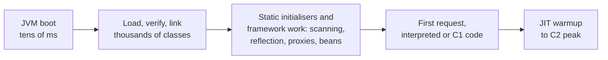
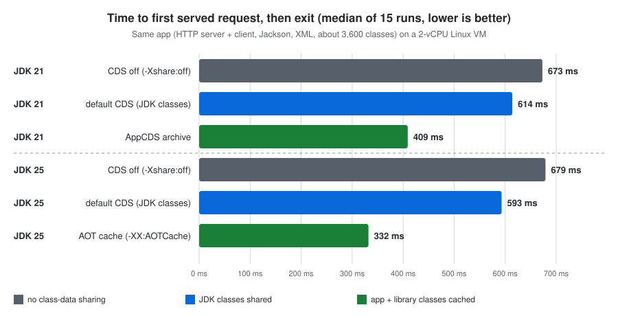

[⬅️ Prev: 29 · Reactive Java](29-reactive-java-reactor-webflux.md) · [🏠 Index](README.md) · [Next: 31 · API Design Between Services ➡️](31-api-design-between-services.md)

# 30 · Startup & Footprint: AOT Cache, Native Image & CRaC

> *Startup time used to be JVM trivia. With autoscaling, scale-to-zero and per-second billing, it's an architecture decision with money attached, and Java now offers several very different ways to buy it. Each one trades away something different.*

**How the numbers here were produced:** a small service-shaped app (an HTTP server and client, Jackson JSON, XML processing, regex, about 3,600 classes) on a 2-vCPU Linux VM, with OpenJDK 21 and OpenJDK 25.0.5. Each figure is the median of 15 interleaved runs. GraalVM Native Image and CRaC need special JDK builds, so for those I cite published sources rather than measuring.

🧪 **Runnable labs:** [the programs behind this chapter's outputs](labs.md#chapter-30--startup-and-footprint)

---

## Table of contents
1. [Startup, warmup and footprint are different problems](#1-startup-warmup-and-footprint-are-different-problems-)
2. [Where JVM startup time goes](#2-where-jvm-startup-time-goes-)
3. [From CDS to the AOT cache (measured)](#3-from-cds-to-the-aot-cache-measured-)
4. [The AOT cache with Spring Boot and containers](#4-the-aot-cache-with-spring-boot-and-containers-)
5. [Where JVM memory goes (measured with NMT)](#5-where-jvm-memory-goes-measured-with-nmt-)
6. [Compact object headers (measured)](#6-compact-object-headers-measured-)
7. [GraalVM Native Image](#7-graalvm-native-image-)
8. [CRaC: checkpoint and restore a warm JVM](#8-crac-checkpoint-and-restore-a-warm-jvm-)
9. [Choosing: a decision framework](#9-choosing-a-decision-framework-)
10. [Footprint checklist for containers](#10-footprint-checklist-for-containers-)
11. [Staff lens](#11-staff-lens-)
12. [Interview questions](#12-interview-questions)
13. [References](#13-references)

---

## 1. Startup, warmup and footprint are different problems 🟡

| Metric | Question it answers | Who cares |
|---|---|---|
| **Startup** | How long until the first request is served? | Autoscaling during spikes, scale-to-zero, serverless cold starts, rolling deploys |
| **Warmup** | How long until the JIT has produced peak-performance code? | Latency SLOs right after deploys or scale-out |
| **Footprint** | How much memory (RSS) does each instance need? | Cost: GB × instances × hours. Also density per node |

Every technique below improves a *different mix* of these three, and costs something different: build complexity, compatibility, peak performance, or operational constraints. Interviewers at staff level listen for whether you separate them.

---

## 2. Where JVM startup time goes 🔴



| Phase | What helps |
|---|---|
| Class loading and linking | CDS / AppCDS / **AOT cache** (§3) |
| Framework initialisation | Fewer beans and less scanning; **Spring AOT** processing (generates bean definitions at build time); lazy initialisation |
| JIT warmup | AOT cache **method profiles** (JDK 25+), CRaC (restores already-compiled code) |
| Everything at once | **CRaC** (skips startup entirely) or **Native Image** (moves the work to build time) |

---

## 3. From CDS to the AOT cache (measured) 🔴

**Class-data sharing** stores parsed class metadata in a memory-mapped archive, so the JVM skips reading, parsing and verifying classes at startup. It has evolved in steps:

| Step | JDK | What it caches |
|---|---|---|
| Default CDS archive | 12 (JEP 341) | JDK classes only, on by default |
| AppCDS | 10 (JEP 310), dynamic archives in 13 (JEP 350) | Application and library classes too, from a training run |
| **AOT cache** (Project Leyden) | 24 (JEP 483) | Classes **loaded and linked**, so they're ready the moment the JVM starts |
| One-step training | 25 (JEP 514) | `-XX:AOTCacheOutput` creates the cache in a single training run |
| Method profiles | 25 (JEP 515) | JIT profiling data, so the compiler starts optimising sooner (shorter warmup) |
| Cached objects with any GC | 26 (JEP 516) | Archived heap objects no longer tied to specific collectors |

**Commands:**
```bash
# JDK 21: AppCDS with a dynamic archive. Training run first, then production.
java -XX:ArchiveClassesAtExit=app.jsa -cp app.jar:jackson-databind.jar:jackson-core.jar:jackson-annotations.jar StartupApp
java -XX:SharedArchiveFile=app.jsa   -cp app.jar:jackson-databind.jar:jackson-core.jar:jackson-annotations.jar StartupApp

# JDK 25: AOT cache. One-step training run (JEP 514), then production.
java -XX:AOTCacheOutput=app.aot -cp app.jar:jackson-databind.jar:jackson-core.jar:jackson-annotations.jar StartupApp
java -XX:AOTCache=app.aot      -cp app.jar:jackson-databind.jar:jackson-core.jar:jackson-annotations.jar StartupApp

# JDK 24 needs two steps (record a configuration, then create the cache):
java -XX:AOTMode=record -XX:AOTConfiguration=app.aotconf -cp ... StartupApp
java -XX:AOTMode=create -XX:AOTConfiguration=app.aotconf -XX:AOTCache=app.aot -cp ...
```

**Measured:**



| JDK | Configuration | Wall time (p50) | Time in `main` (p50) | Peak RSS (p50) | Classes loaded | …from the archive |
|---|---|---|---|---|---|---|
| 21 | CDS off (`-Xshare:off`) | 673 ms | 582 ms | 87 MB | 3,664 | 0 |
| 21 | Default CDS (JDK classes) | 614 ms | 554 ms | 93 MB | 3,656 | 1,221 |
| 21 | **AppCDS archive** | **409 ms** | **345 ms** | **78 MB** | 3,581 | 3,468 |
| 25 | CDS off (`-Xshare:off`) | 679 ms | 606 ms | 89 MB | 3,622 | 0 |
| 25 | Default CDS (JDK classes) | 593 ms | 549 ms | 98 MB | 3,614 | 1,375 |
| 25 | **AOT cache** | **332 ms** | **261 ms** | **89 MB** | 3,706 | 3,663 |

**What the numbers say:**
- On JDK 25, the AOT cache cut total time from 593 ms to 332 ms (−44%), and the time spent inside `main` by more than half (549 ms → 261 ms). On JDK 21, AppCDS got −33%.
- Almost every class (3,663 of 3,706) came from the cache, versus about a third with only the default JDK archive.
- The archives cost disk space: 16.8 MB for the JDK 21 AppCDS archive and 32.3 MB for the JDK 25 AOT cache, which stores more (linked state and method profiles).
- This app only loads about 3,600 classes. A typical Spring Boot service loads several times more, so class loading is a larger share of its startup, and the benefit is usually larger too. Measure your own.

**The rules, with real failure output.** A cache is only valid for the **same JDK build** and the **same classpath** (Spring's docs add: JARs only, no directories or `*` wildcards, and JAR timestamps preserved). Here's what JDK 25 did when the same JARs were listed in a different order:
```
[0.013s][warning][aot] The name of app classpath [2] does not match: expected '/usr/share/java/jackson-databind.jar', got '/usr/share/java/jackson-core.jar'
[0.014s][error  ][aot] An error has occurred while processing the AOT cache. Run with -Xlog:aot for details.
[0.014s][error  ][aot] shared class paths mismatch (hint: enable -Xlog:class+path=info to diagnose the failure)
[0.015s][error  ][aot] Unable to map shared spaces
ready: first request served in 627 ms (total=3097, valid=true, xml=89 chars)
```
💣 **It started anyway, without the cache, and was slow again.** Nothing failed except a few log lines that nobody reads. With `-XX:AOTMode=on`, the same mismatch stops the JVM instead (`Error occurred during initialization of VM`). Use that in a CI smoke test so a broken cache fails the build rather than silently costing you startup time in production. A JDK 21 archive used on JDK 25 is rejected with `The shared archive file has the wrong version`.

**Training-run quality matters.** The cache holds what the training run loaded and (on JDK 25) what it profiled. A run that exits right after startup captures startup classes, but not the request-path classes or realistic profiles. If warmup matters, exercise representative traffic during training.

---

## 4. The AOT cache with Spring Boot and containers 🔴

Spring Boot (Java 25+) documents this workflow: extract the executable JAR, do a training run that exits once the application context has refreshed, then start with the cache:
```bash
java -Djarmode=tools -jar my-app.jar extract --destination application
cd application
java -XX:AOTCacheOutput=app.aot -Dspring.context.exit=onRefresh -jar my-app.jar    # training run
java -XX:AOTCache=app.aot -jar my-app.jar                                          # production
```
The cache only works with the **extracted** form of the application, not the fat JAR. On Java 17–24, use CDS with `-XX:ArchiveClassesAtExit` the same way.

**In a container**, generate the cache in the *final* image stage, so the JDK and the files are byte-for-byte what production runs:
```dockerfile
FROM eclipse-temurin:25-jre AS extract
WORKDIR /build
COPY target/app.jar app.jar
RUN java -Djarmode=tools -jar app.jar extract --destination extracted

FROM eclipse-temurin:25-jre
WORKDIR /app
COPY --from=extract /build/extracted/ ./
# The training run must start without reaching real dependencies (no production DB, brokers or secrets)
RUN java -XX:AOTCacheOutput=app.aot -Dspring.context.exit=onRefresh -Dspring.profiles.active=aot-training -jar app.jar
ENTRYPOINT ["java", "-XX:AOTCache=app.aot", "-jar", "app.jar"]
```
💣 With `spring.context.exit=onRefresh`, every non-lazy singleton is created during the training run. Connection pools, Flyway migrations or Kafka consumers will try to connect at build time. Give the training run a profile that stubs or disables them, or run it in CI with Testcontainers.

---

## 5. Where JVM memory goes (measured with NMT) 🔴

Native Memory Tracking breaks down the JVM's own memory. From the same app on JDK 25 (`-XX:NativeMemoryTracking=summary -XX:+UnlockDiagnosticVMOptions -XX:+PrintNMTStatistics`), committed memory by area:

| Area | Committed | What it is |
|---|---|---|
| Java heap | 98.0 MB | Your objects. Committed, but not necessarily touched |
| GC | 38.5 MB | G1's own structures (card table, remembered sets, mark bitmaps), which scale with the **maximum** heap |
| Shared class space | 13.6 MB | The memory-mapped CDS archive |
| Metaspace | 13.1 MB | Class metadata not in the archive |
| Code | 8.5 MB | JIT-compiled code (243 MB reserved) |
| Arena chunks | 4.9 MB | Compiler and runtime scratch memory |
| Symbol | 3.4 MB | Interned names and signatures |
| Compiler | 2.5 MB | JIT compiler threads' memory |
| Thread | 0.7 MB | Thread stacks actually used (15 MB reserved) |
| **Total committed** | **186.7 MB** | |

…yet the process's peak **RSS** was about 98 MB. **Committed is not resident.** The JVM commits address space eagerly, but RSS (and the container's memory accounting) only counts pages that have actually been touched. Two consequences:
- `-Xmx64m` didn't change RSS at all for this small app (98 MB either way): the untouched part of a large heap costs nothing until it's used.
- The GC's 38.5 MB is driven by the *maximum* heap (here, the default fraction of a 7.8 GB machine). Right-sizing `-Xmx` / `MaxRAMPercentage` for small services trims that overhead as the heap fills.

For live processes: `jcmd <pid> VM.native_memory summary` (with NMT enabled at startup). Pair it with the container's working-set metric. Chapter [10](10-memory-and-garbage-collection.md) and Chapter [22](22-production-readiness-observability-resilience.md) cover sizing the heap against the container limit.

---

## 6. Compact object headers (measured) 🔴

Every object starts with a header: an 8-byte mark word plus a 4-byte compressed class pointer, 12 bytes in total ([Chapter 09](09-jvm-internals.md)). **Compact object headers** fold the class pointer into the mark word, for an **8-byte** header. In JDK 25 they're a production option (`-XX:+UseCompactObjectHeaders`, JEP 519), and they become the default in JDK 27 (JEP 534).

5 million instances of each record type, heap measured after GC on JDK 25:
```
== JDK 25 -XX:-UseCompactObjectHeaders
Point(int,int):           24.3 bytes/object
OrderLine(String,int,long):  32.2 bytes/object
total heap used: 307 MB
== JDK 25 -XX:+UseCompactObjectHeaders
Point(int,int):           16.2 bytes/object
OrderLine(String,int,long):  24.2 bytes/object
total heap used: 230 MB
```
That's −33% for `Point`, −25% for `OrderLine`, and −25% for the whole heap. **Savings vary by class because of 8-byte alignment.** `Point` was 12 + 8 = 20, padded to 24; it's now 8 + 8 = 16 exactly. A class whose 4 saved bytes don't cross an alignment boundary gains nothing: an `Integer` is 12 + 4 = 16 bytes before and 8 + 4 = 12, padded to 16, after. Heaps dominated by many small objects benefit most, and smaller heaps also mean less GC work. Test before enabling it on JDK 25, especially with agents or tools that inspect object layout.

---

## 7. GraalVM Native Image 🔴

**How it works:** at build time, a static *points-to analysis* starts from `main` and finds every class, method and field that's reachable (the **closed-world assumption**). Only that code is compiled ahead of time into a native executable, together with a small runtime (Substrate VM: GC, threads). Classes can even be initialised at build time, with their heap state snapshotted into the binary.

| Strengths | Costs |
|---|---|
| Startup in milliseconds, no JIT warmup | Builds take minutes and several GB of RAM, per platform |
| Low RSS and small images | **Closed world:** reflection, dynamic proxies, resources, JNI and serialisation need *reachability metadata* (from libraries, the shared metadata repository, or the tracing agent `-agentlib:native-image-agent`) |
| Small attack surface (no class loading at runtime) | No runtime class loading, no `-javaagent` (APM agents need native-specific integrations), different profiling and debugging |
| | Peak throughput is usually below the C2 JIT; profile-guided optimisation helps, but it's an Oracle GraalVM feature |
| | Fewer GC choices in Community Edition |

**Frameworks:** Spring Boot, Quarkus and Micronaut all support native images. Spring's **AOT processing** generates bean-definition code and runtime hints at build time, and this has a consequence interviewers like: **the bean graph is fixed at build time.** Configuration that decides *which beans exist* (for example `@Profile` or `@ConditionalOnProperty`) is evaluated during the build, not at runtime.

**Know the support landscape.** In September 2025 Oracle announced that GraalVM for JDK 24 was the last GraalVM release licensed and supported as part of Oracle Java SE products. Native Image is being discontinued for Java SE product customers, and the startup and footprint goals are being pursued in OpenJDK's Project Leyden instead. GraalVM itself continues on its own release schedule (Community Edition, and Oracle GraalVM under the GraalVM Free Terms and Conditions licence), now focused increasingly on non-Java languages. For an architect, that means native image remains usable, but standard Java's long-term startup story is Leyden (§3). Choose with your support model in mind.

---

## 8. CRaC: checkpoint and restore a warm JVM 🔴

**Coordinated Restore at Checkpoint** (an OpenJDK project started by Azul) takes a snapshot of a running, *already warmed-up* JVM process and restores it later. Startup becomes the time to map the snapshot back into memory, and the restored process already has its classes loaded and its code JIT-compiled. Azul reported time to first operation for a Spring Boot app falling from 4 seconds to 38 milliseconds.

**What it takes:**
- A JDK with CRaC built in: Azul Zulu with CRaC, or BellSoft Liberica with CRaC. CRaC is Linux-only and uses CRIU, which needs extra privileges in containers.
- **Coordination:** open files, sockets and pools must be closed before the checkpoint and reopened after restore, through `org.crac.Resource` (`beforeCheckpoint` / `afterRestore`). Spring Framework 6.1+ / Boot 3.2+ wires this into the bean lifecycle. It supports an automatic checkpoint at startup (`-Dspring.context.checkpoint=onRefresh`) and on-demand checkpoints of a running application.

💣 **Snapshot hygiene is the real risk.** The checkpoint contains the heap: tokens, keys, cached secrets, and the state of random number generators. Every instance restored from the same image starts with identical state, so it can generate the same "random" IDs, nonces or session tokens. Reseed `SecureRandom` and regenerate instance identity after restore. Don't bake long-lived secrets into checkpoints. Refresh time-dependent caches, DNS and connection state. **AWS Lambda SnapStart** applies the same idea as a managed service and supports CRaC runtime hooks.

---

## 9. Choosing: a decision framework 🟣

| Option | Startup | Peak and warmup | Footprint | Constraints |
|---|---|---|---|---|
| Plain JVM | Slowest | Best peak, after warmup | Highest | None |
| **AOT cache** (JDK 24+) / AppCDS | ~40–50% faster (§3) | Same JIT; JDK 25 profiles shorten warmup | Lower (shared, mapped metadata) | Training run; same JDK and classpath |
| **CRaC** | Tens of ms | Already warm | Similar to the JVM | CRaC JDK, Linux/CRIU privileges, snapshot hygiene |
| **Native Image** | Tens of ms | No warmup, lower peak | Lowest | Closed world, long builds, limited tooling, support model |

> [!NOTE]
> **The position I'd defend:** make the **AOT cache on JDK 25** the fleet default. It's standard OpenJDK, close to free (one extra build step), and compatible with everything: agents, JFR, all frameworks, dynamic code. Choose **native image** where cold start dominates the economics (CLIs, scale-to-zero functions, sidecars) *and* the dependency stack is native-friendly. Choose **CRaC** (or SnapStart) for latency-critical autoscaling when you also need warm peak performance and you control the platform. Whatever you pick, measure three things: time to first useful request, time to steady-state p99, and RSS, then put a cost figure on each.

---

## 10. Footprint checklist for containers 🔴

- **Heap:** size from the measured live set. Use `-XX:MaxRAMPercentage` instead of guessing `-Xmx`, and leave room for non-heap memory.
- **Non-heap:** Metaspace (`MaxMetaspaceSize` as a safety net against classloader leaks), code cache, thread stacks × thread count (virtual threads cut platform-thread counts), direct buffers (`MaxDirectMemorySize`), and GC structures (which scale with maximum heap).
- **Compact object headers** on JDK 25+ for heaps full of small objects (§6).
- **The AOT cache** also reduces Metaspace usage, and its mapped pages can be shared between JVMs on the same host.
- **GC choice:** G1 is the default (and from JDK 27 the default everywhere, JEP 523). Small, latency-tolerant containers can use Serial for less GC overhead. ZGC trades memory headroom for very short pauses.
- **`jlink`** runtime images shrink the container image (disk and pull time) more than RSS.
- **Measure:** NMT for the JVM's view, container working-set metrics for the kernel's view, and load tests for both.

---

## 11. Staff lens 🟣

1. **Price it.** "Startup takes 30 s, so autoscaling lags spikes by 30 s, so we run 25% extra capacity all day" is an architecture argument a CFO understands. "Native is cool" isn't.
2. **Make the default cheap.** Put the AOT-cache training step into the paved-road base image and build pipeline, with an `-XX:AOTMode=on` smoke test, and every team gets the benefit for free.
3. **Don't follow fashion.** Native image is excellent for specific workloads and a burden for others (builds, metadata, agents, support). Decide per workload class, with measurements.
4. **Watch the support model.** Vendor roadmaps change (as GraalVM's did in 2025). Prefer standard OpenJDK mechanisms for fleet-wide defaults, and isolate the exceptions.
5. **Startup includes your code.** Many "slow JVM" startups are really slow frameworks: classpath scanning, eager connection pools, synchronous remote calls during boot. Profile startup (JFR works) before buying technology.

---

## 12. Interview questions

<details>
<summary><b>Q1. 🟡 Startup vs warmup vs footprint: which techniques address which?</b></summary>

Startup is the time to the first request. CDS, AppCDS and the AOT cache reduce class-loading time; Spring AOT and fewer beans reduce framework time; CRaC and native images remove most of it. Warmup is the time to peak JIT performance: JDK 25's AOT cache stores method profiles, and CRaC restores already-compiled code (native images have no warmup, but a lower peak). Footprint is RSS: compact object headers, right-sized heaps, fewer threads and shared CDS/AOT archives, with native images lowest of all.
</details>

<details>
<summary><b>Q2. 🟡 What is CDS, and how did it become the AOT cache?</b></summary>

Class-data sharing stores parsed class metadata in a memory-mapped archive, so the JVM skips parsing and verification. The default archive (JDK 12) covers JDK classes. AppCDS (JDK 10) and dynamic archives (JDK 13) add application classes from a training run. Project Leyden's AOT cache (JDK 24) also stores classes in a loaded and *linked* state. JDK 25 adds one-step creation (`-XX:AOTCacheOutput`) and JIT method profiles, and JDK 26 extends cached heap objects to any GC. In our measurement, the AOT cache cut startup by 44%, and time in `main` by over half.
</details>

<details>
<summary><b>Q3. 🔴 What are the rules for using an AOT cache, and what happens if you break them?</b></summary>

Use the same JDK build and the same classpath as the training run: JARs only, no directories or wildcards, same order, timestamps preserved. In default mode, a mismatch logs errors and the JVM starts **without** the cache. In our test, reordering two JARs silently brought startup back to 627 ms. With `-XX:AOTMode=on`, the JVM refuses to start instead, which makes a good CI check. Archives from a different JDK version are rejected as the wrong version.
</details>

<details>
<summary><b>Q4. 🔴 How would you add the AOT cache to a Spring Boot service's container build?</b></summary>

Extract the executable JAR (`java -Djarmode=tools -jar app.jar extract`). In the final image stage, run a training run: `java -XX:AOTCacheOutput=app.aot -Dspring.context.exit=onRefresh -jar app.jar`, with a profile that keeps it from connecting to real dependencies. Start production with `-XX:AOTCache=app.aot`. Add a smoke test with `-XX:AOTMode=on`. If warmup matters, consider training with representative traffic so the cached profiles are useful.
</details>

<details>
<summary><b>Q5. 🔴 NMT shows 187 MB committed, but RSS is 98 MB. Why the difference, and what counts against the container limit?</b></summary>

Committed memory is address space the JVM has reserved backing for. RSS counts only pages actually touched. The heap is committed eagerly but filled gradually, and other areas behave similarly. The kernel's memory accounting (and therefore the OOM killer) works on resident and charged pages, not on NMT's committed figures. That's why `-Xmx64m` didn't change this small app's RSS. Plan the container limit around RSS under realistic load: heap, plus metaspace, code cache, GC structures, thread stacks, direct buffers and native libraries.
</details>

<details>
<summary><b>Q6. 🔴 What do compact object headers do, and why do the savings differ between classes?</b></summary>

They shrink the header from 12 bytes (an 8-byte mark word plus a 4-byte class pointer) to 8, by encoding the class pointer in the mark word. They're opt-in in JDK 25 and the default in JDK 27. Objects are padded to 8 bytes, so the 4 saved bytes only shrink an object if they cross an alignment boundary. `Point(int, int)` went from 24 to 16 bytes, `OrderLine` from 32 to 24, but `Integer` stays at 16. Heaps full of small objects gain the most: −25% in our test.
</details>

<details>
<summary><b>Q7. 🔴 How does GraalVM Native Image work, and what typically breaks when you adopt it?</b></summary>

A build-time points-to analysis finds all reachable code from `main` (a closed world), compiles it ahead of time with a small runtime, and can initialise classes at build time. What breaks: reflection, proxies, resources, JNI and serialisation without metadata; runtime class loading; Java agents (APM); libraries that generate bytecode at runtime; build times and memory; and, in Spring, any assumption that a property can change *which* beans exist at runtime, since the bean graph is fixed by AOT processing.
</details>

<details>
<summary><b>Q8. 🟣 A scale-to-zero service needs sub-second cold starts. AOT cache, CRaC or native image?</b></summary>

Start from the requirements. If "sub-second" means under about 300 ms and the dependency stack is native-friendly, a native image fits, at the cost of builds, metadata, a lower peak and the support model. If you also need warm peak performance immediately and you control the platform (or use Lambda SnapStart), CRaC gives tens of milliseconds with JIT-warm code, but you take on snapshot hygiene. If roughly a halving of startup is enough, the AOT cache is the cheapest and most compatible option. I'd measure all three on the real service and compare first-request time, steady-state p99, RSS and operational cost.
</details>

<details>
<summary><b>Q9. 🔴 What are the main risks of CRaC?</b></summary>

Snapshot contents. The heap may contain secrets, tokens and keys, and every restored instance shares the same random-generator state and instance identity. You must reseed and regenerate after restore, and avoid baking long-lived secrets into checkpoints. Resources (sockets, files, pools) must be closed before the checkpoint and reopened after it, through `Resource` callbacks. CRaC also needs a CRaC-enabled JDK, Linux and CRIU privileges, and time-sensitive caches and DNS need refreshing after restore.
</details>

<details>
<summary><b>Q10. 🟣 How did GraalVM's position change in 2025, and how does that affect a Java platform strategy?</b></summary>

Oracle announced that GraalVM for JDK 24 was the last release licensed and supported as part of Oracle Java SE products. Native Image is being discontinued for Java SE product customers, and startup and footprint work moves to OpenJDK's Project Leyden. GraalVM continues independently (Community Edition, and Oracle GraalVM under its free licence). For strategy: make standard Leyden features (the AOT cache) the fleet default, keep native images for the workloads where they clearly pay off, and review the support arrangements for those.
</details>

<details>
<summary><b>Q11. 🔴 Why can't a Spring Boot native image switch beans with a property at runtime?</b></summary>

Spring's AOT processing runs at build time. It evaluates the configuration, decides which beans exist, and generates code and reachability hints for exactly that bean graph. Conditions that determine bean existence (`@Profile`, `@ConditionalOnProperty`) are therefore fixed in the binary. You can still change ordinary property *values* at runtime, but not which beans are defined. Build separate images, or design configuration so variability lives in values rather than in bean selection.
</details>

---

## 13. References
- JEPs: [310 Application CDS](https://openjdk.org/jeps/310) · [341 Default CDS Archives](https://openjdk.org/jeps/341) · [350 Dynamic CDS Archives](https://openjdk.org/jeps/350) · [483 AOT Class Loading & Linking](https://openjdk.org/jeps/483) · [514 AOT Command-Line Ergonomics](https://openjdk.org/jeps/514) · [515 AOT Method Profiling](https://openjdk.org/jeps/515) · [516 AOT Object Caching with Any GC](https://openjdk.org/jeps/516) · [519 Compact Object Headers](https://openjdk.org/jeps/519)
- Spring Boot reference: [AOT Cache](https://docs.spring.io/spring-boot/reference/packaging/aot-cache.html) and [Checkpoint and Restore](https://docs.spring.io/spring-boot/reference/packaging/checkpoint-restore.html); Spring Framework reference: [JVM AOT Cache](https://docs.spring.io/spring-framework/reference/integration/aot-cache.html)
- Oracle, [*Detaching GraalVM from the Java Ecosystem Train*](https://blogs.oracle.com/java/post/detaching-graalvm-from-the-java-ecosystem-train) (September 2025)
- [GraalVM Native Image documentation](https://www.graalvm.org/latest/reference-manual/native-image/) and reachability metadata
- [OpenJDK CRaC project](https://openjdk.org/projects/crac/) and Azul's CRaC documentation
- JDK documentation: Native Memory Tracking (`jcmd VM.native_memory`)

---

[⬅️ Prev: 29 · Reactive Java](29-reactive-java-reactor-webflux.md) · [🏠 Index](README.md) · [Next: 31 · API Design Between Services ➡️](31-api-design-between-services.md)
