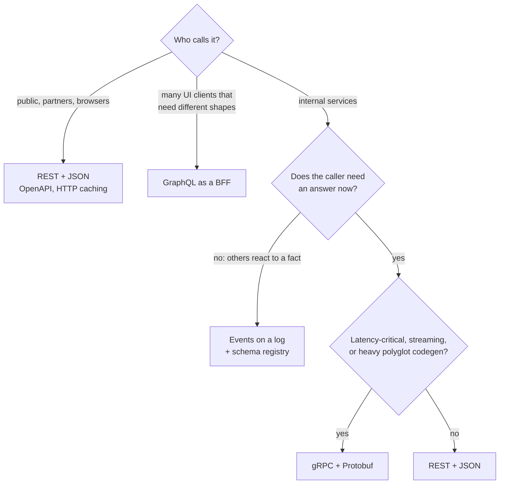
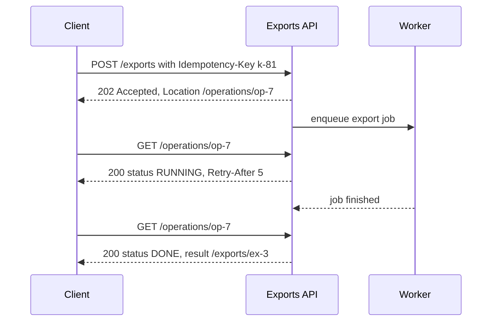

[⬅️ Prev: 30 · Startup & Footprint](30-startup-footprint-aot-native-image.md) · [🏠 Index](README.md) · [Next: 32 · Troubleshooting Scenarios ➡️](32-production-troubleshooting-scenarios.md)

# 31 · API Design Between Services

> *Inside a service, a bad interface costs you a refactoring. Between services, it costs a migration across teams that don't report to you, repeated for every consumer, for years. API design is where architecture meets organisational politics. Get the mechanics right and the politics get much easier.*

> [!TIP]
> **🧭 Decision guide: the API style and the evolution rules between services**
> - **When it matters:** for every interface another team depends on.
> - **Default:** REST and JSON with problem details at the edge, gRPC for internal low-latency or streaming calls, events for facts; cursor pagination, ETags for concurrent updates, additive changes with tolerant readers, contract checks in CI; retries decided by the operation and the error code (§4).
> - **Alternatives:** GraphQL where many clients need different shapes (a backend for frontend); asynchronous request-reply for long operations.
> - **Failure modes:** database models leaking into APIs, breaking changes found by customers, offset pagination skipping rows, non-idempotent calls retried blindly.
> - **Evidence that would change it:** client diversity, payload and latency budgets, and contract-break incidents.
> - **Argued in:** §2, §4–§10 and §13.

The demos in §5, §6, §8 and §10 were run on JDK 25, using the JDK's own HTTP server and client, Jackson 2.14, and protobuf-java 3.21 with `protoc`. The output shown is real.

🧪 **Runnable labs:** [the programs behind this chapter's outputs](labs.md#chapter-31--api-design-between-services)

---

## Table of contents
1. [What "good" means for an API between services](#1-what-good-means-for-an-api-between-services-)
2. [Choosing a style: REST, gRPC, GraphQL or messaging](#2-choosing-a-style-rest-grpc-graphql-or-messaging-)
3. [HTTP semantics that matter](#3-http-semantics-that-matter-)
4. [Idempotency and retries over HTTP](#4-idempotency-and-retries-over-http-)
5. [Pagination: offset vs cursor (demonstrated)](#5-pagination-offset-vs-cursor-demonstrated-)
6. [Conditional requests with ETags (demonstrated)](#6-conditional-requests-with-etags-demonstrated-)
7. [Errors: RFC 9457 problem details](#7-errors-rfc-9457-problem-details-)
8. [Evolving JSON APIs without breaking clients (demonstrated)](#8-evolving-json-apis-without-breaking-clients-demonstrated-)
9. [Versioning and deprecation, with Spring Framework 7](#9-versioning-and-deprecation-with-spring-framework-7-)
10. [Protobuf and gRPC: evolution rules (demonstrated) and operations](#10-protobuf-and-grpc-evolution-rules-demonstrated-and-operations-)
11. [GraphQL: where it fits and what bites](#11-graphql-where-it-fits-and-what-bites-)
12. [Asynchronous APIs: events, schemas and compatibility](#12-asynchronous-apis-events-schemas-and-compatibility-)
13. [Contract-first, governance and breaking-change detection](#13-contract-first-governance-and-breaking-change-detection-)
14. [Staff lens](#14-staff-lens-)
15. [Interview questions](#15-interview-questions)
16. [References](#16-references)

---

## 1. What "good" means for an API between services 🟡

- **Designed from the consumer's use cases**, not exported from your database schema. An API that mirrors your tables locks your storage model into everyone else's code.
- **Consistent conventions** across the organisation: naming, IDs, timestamps (ISO-8601, UTC), money (minor units plus currency, or decimal strings, never floats), errors, pagination.
- **An explicit contract** (OpenAPI, `.proto`, GraphQL SDL, AsyncAPI) that is reviewed, versioned and tested.
- **Evolvable:** additive changes by default, breaking changes rare, announced and measured.
- **Safe to retry:** idempotency designed in, not bolted on (§4).
- **Bounded:** every list paginated, every payload size-limited, every operation with a timeout.
- **Observable:** correlation and trace IDs (`traceparent`), per-consumer metrics.

> [!WARNING]
> **Hyrum's law:** with enough consumers, every observable behaviour (field order, timing, error message text, undocumented defaults) ends up as part of the contract, whatever the documentation says. Expose less, and document what may change.

---

## 2. Choosing a style: REST, gRPC, GraphQL or messaging 🔴

| | REST + JSON | gRPC (HTTP/2 + Protobuf) | GraphQL | Async messaging (Kafka and similar) |
|---|---|---|---|---|
| **Best for** | Public and partner APIs, resource-oriented CRUD, cacheable reads | Internal low-latency calls, streaming, polyglot code generation | Many clients needing different shapes of the same data (a BFF) | Reacting to facts, decoupled workflows, fan-out, buffering |
| **Contract** | OpenAPI | `.proto` | SDL schema | AsyncAPI + schema registry |
| **Strengths** | Universal tooling, HTTP caching, human-readable | Compact binary, generated stubs, deadlines, bidirectional streams | Exactly the fields needed, one round trip, strongly typed | Temporal decoupling, replay, consumers set their own pace |
| **Weaknesses** | Over- and under-fetching, chattiness, loose typing without a schema | Browsers need a proxy (gRPC-Web), needs L7 load balancing, harder to inspect | HTTP caching mostly gone, N+1 resolvers, query-cost attacks, errors inside 200 responses | Eventual consistency, ordering and duplicates, harder debugging |
| **Java** | Spring MVC / WebFlux, `RestClient`, HTTP interface clients | grpc-java (Netty) | Spring for GraphQL | Spring for Apache Kafka, Spring Cloud Stream |


Mixing styles is normal and healthy: REST at the edge, gRPC or REST inside, events for state changes, GraphQL where client diversity justifies it. Choose a style per interaction, not one style for the whole company.

---

## 3. HTTP semantics that matter 🟡

| Method | Safe | Idempotent | Typical use |
|---|---|---|---|
| `GET`, `HEAD` | ✅ | ✅ | Read |
| `PUT` | ❌ | ✅ | Create or replace at a known URI |
| `DELETE` | ❌ | ✅ | Remove (repeating it leaves the same state) |
| `PATCH` | ❌ | Not necessarily | Partial update (JSON Merge Patch, RFC 7396; JSON Patch, RFC 6902) |
| `POST` | ❌ | ❌ | Create under a collection, or trigger an action |

| Status | Means | Common misuse |
|---|---|---|
| `201 Created` + `Location` | Created; here's where | Returning 200 with no location |
| `202 Accepted` | Accepted for asynchronous processing | Returning 200 for work that hasn't happened yet |
| `304 Not Modified` | Your cached copy is still valid (§6) | — |
| `400` / `422` | Malformed request / well-formed but semantically invalid | Using 500 for validation failures |
| `401` / `403` | Not authenticated / authenticated but not allowed | Swapping the two |
| `404` | Not found, or deliberately hidden ([Chapter 25 §8](25-security-for-java-engineers.md#8-authorization-the-1-web-risk-)) | — |
| `409` / `412` | Conflicts with current state / a precondition (`If-Match`) failed | Using 409 for everything |
| `429` + `Retry-After` | Rate-limited; come back later | No `Retry-After` header |
| `503` + `Retry-After` / `504` | Temporarily unavailable / upstream timeout | Retrying non-idempotent calls blindly |

**Long-running operations** shouldn't hold a request open for minutes. Accept the work, and give the client somewhere to check on it:

For server-to-server integrations, a webhook on completion avoids polling, as long as the webhook is signed and delivered at least once (with deduplication by event ID).

---

## 4. Idempotency and retries over HTTP 🔴

Networks fail *after* the server has done the work, so clients retry, and duplicate side effects follow unless the API is idempotent ([Chapter 23 §7](23-distributed-systems-microservices.md#7-idempotency-the-property-that-makes-retries-safe-)).
- **Natural idempotency:** prefer `PUT /orders/{clientGeneratedId}` over `POST /orders` when clients can generate IDs (UUIDv7).
- **Idempotency keys for `POST`:** the client sends `Idempotency-Key: <uuid>` (popularised by payment APIs, and being standardised in an IETF draft). The server claims the key *before* doing the work, stores a fingerprint of the request and the response it produced, and answers a repeat according to the state it finds ([Chapter 23 §7](23-distributed-systems-microservices.md#7-idempotency-the-property-that-makes-retries-safe-)):
  - same key, same payload, finished → replay the stored response (status and body);
  - same key, first request still in flight → `409` with a problem `type` such as `idempotency-key-in-use` and a `Retry-After`: the client sends **the same request with the same key** again later;
  - same key, **different** payload → `422` with a `type` such as `idempotency-key-reused`: a client bug, never retried;
  - keys expire after a documented window (for example 24 hours) that's longer than any client keeps retrying.
- **Decide retries by the operation and the error code, not by the status code alone.** The same `409` can mean "try again in a second" or "never send this again", so the contract must say which, with a stable problem `type` ([§7](#7-errors-rfc-9457-problem-details-)):

| Response | What it means | What the client does |
|---|---|---|
| Connection failure, `408`, `502`, `503`, `504` | Transient; the outcome may be unknown | Resend only if the operation is idempotent or carries an idempotency key, with backoff, jitter, a retry budget and `Retry-After` |
| `429` | Rate-limited | Wait for `Retry-After`, then resend |
| `500` | A fault on the server; the outcome is unknown | Resend only if the operation is idempotent or keyed |
| `409` `idempotency-key-in-use` | Your earlier request with this key is still running | Resend the **same** request with the same key after `Retry-After` |
| `409` `version-conflict`, or `412` | The resource changed since you read it | Don't resend: re-read, decide again, then send a **new** request with the new version (`If-Match`) |
| `409` for a business conflict (`already-exists`, an invalid state transition) | Permanent for this request | Don't retry: show it to the user or fix the input |
| `422` `idempotency-key-reused` | The same key with a different payload | Never retry: fix the client |
| `400`, `401`, `403`, `404`, other `422`s | The request itself is wrong | Don't resend it unchanged (a `401` may succeed once after refreshing the token) |

Resilience mechanics (backoff, jitter, budgets, one retrying layer) are in [Chapter 22](22-production-readiness-observability-resilience.md).

---

## 5. Pagination: offset vs cursor (demonstrated) 🔴

Ten orders sorted newest first, pages of three. Between fetching page 1 and page 2, another request inserts (or deletes) an order:
```java
// Offset: ORDER BY created_at DESC, id DESC LIMIT 3 OFFSET 3
static List<Long> offsetPage(int offset, int size) { return sorted().stream().skip(offset).limit(size).map(Order::id).toList(); }

// Keyset (cursor): WHERE (created_at, id) < (:createdAt, :id) ORDER BY created_at DESC, id DESC LIMIT 3
static List<Order> keysetPage(Order after, int size) {
    return sorted().stream()
            .filter(o -> after == null || o.createdAt() < after.createdAt()
                    || (o.createdAt() == after.createdAt() && o.id() < after.id()))
            .limit(size).toList();
}

static String encodeCursor(Order last) {                     // opaque to clients
    return Base64.getUrlEncoder().withoutPadding()
            .encodeToString((last.createdAt() + ":" + last.id()).getBytes(StandardCharsets.UTF_8));
}
```
<!-- lab-output: ApiDemos.java -->
```
insert between pages | offset: page1=[10, 9, 8] page2=[8, 7, 6] | keyset: page1=[10, 9, 8] page2=[7, 6, 5] (cursor MTAwODo4)
delete between pages | offset: page1=[10, 9, 8] page2=[6, 5, 4] | keyset: page1=[10, 9, 8] page2=[7, 6, 5] (cursor MTAwODo4)
```
With offsets, an insert made order 8 appear **twice**, and a delete made order 7 **vanish** without anyone noticing. A sync job paging through orders would double-process or skip records. Keyset pagination was correct in both cases, because it says "after this row", not "skip N rows".

| | Offset | Cursor (keyset) |
|---|---|---|
| Consistency under writes | Duplicates and gaps | Stable |
| Deep pages | Slow: the database reads and discards `OFFSET` rows | Constant time with an index on the sort key |
| Jump to page 47 | Easy | Not possible (next and previous only) |
| Requirements | Any sort | A **total** order: always add a unique tie-breaker such as `id` |

**Cursor practices:** keep cursors opaque (base64url of the last sort key; sign or encrypt them if tampering matters), cap page size on the server, return a `next` link or cursor, and avoid exact total counts on large tables (`COUNT(*)` is expensive). Offer an estimate, or nothing at all.

---

## 6. Conditional requests with ETags (demonstrated) 🔴

An ETag identifies a version of a resource. Here it's derived from a version column, which is cheap:
```java
static String etag(Product p) { return "\"v" + p.version() + "\""; }

case "GET" -> {
    ex.getResponseHeaders().add("ETag", etag(product));
    if (etag(product).equals(ex.getRequestHeaders().getFirst("If-None-Match"))) { ex.sendResponseHeaders(304, -1); return; }
    ...                                                                          // 200 with the body
}
case "PUT" -> {
    String ifMatch = ex.getRequestHeaders().getFirst("If-Match");
    if (ifMatch == null) { ex.sendResponseHeaders(428, -1); return; }                  // Precondition Required
    if (!etag(product).equals(ifMatch)) { ex.sendResponseHeaders(412, -1); return; }   // someone changed it first
    ...                                                                          // update, bump version, 204 + new ETag
}
```
<!-- lab-output: ApiDemos.java -->
```
GET, no validator                            -> 200  ETag "v1"  body 66 bytes
GET, If-None-Match: "v1"                     -> 304  ETag "v1"  body 0 bytes
PUT 9900, If-Match: "v1" (client A)          -> 204  ETag "v2"  body 0 bytes
PUT 7900, If-Match: "v1" (client B, stale)   -> 412  ETag -     body 0 bytes
PUT 7900, no If-Match                        -> 428  ETag -     body 0 bytes
GET, If-None-Match: "v1"                     -> 200  ETag "v2"  body 66 bytes
```
- **`If-None-Match` → 304** saves bandwidth, and server work too when the ETag is cheap to compute (a version column, not a hash of the whole body).
- **`If-Match` → 412** is **optimistic locking over HTTP**. Client B's stale write was rejected instead of silently overwriting client A's price. It maps naturally onto a JPA `@Version` column ([Chapter 19](19-persistence-jdbc-jpa-hibernate.md)). **428** forces clients to send a precondition at all.
- `Cache-Control: no-cache` means "you may store it, but revalidate before reuse", not "don't cache". Use `max-age`, `private` and `immutable` deliberately.
- **In Spring:** `ResponseEntity.ok().eTag(version)...`, `WebRequest.checkNotModified(etag)` in handlers, or `ShallowEtagHeaderFilter`. The filter hashes the rendered body, which saves bandwidth but not server work.

---

## 7. Errors: RFC 9457 problem details 🟡

```json
{
  "type": "https://errors.acme.com/insufficient-funds",
  "title": "Insufficient funds",
  "status": 422,
  "detail": "Account acc-81 has 12.40 EUR available; 30.00 EUR is required.",
  "instance": "/payments/pay-7",
  "traceId": "4bf92f3577b34da6a3ce929d0e0e4736",
  "balanceMinor": 1240
}
```
- **`type`** is a stable, machine-readable identifier that clients branch on. Never make clients parse `detail` text.
- **`detail`** is written for humans and must be safe to show. No stack traces, no SQL.
- **Extension members** (`traceId`, field-level `errors`, domain data) are allowed and useful.
- Spring supports this natively with `ProblemDetail` and `ErrorResponse`, and `spring.mvc.problemdetails.enabled=true` ([Chapter 04](04-exceptions.md)). The real win is **one error format across every service**, shipped in a shared starter.

---

## 8. Evolving JSON APIs without breaking clients (demonstrated) 🔴

A producer adds a `currency` field and a new payment status. Here are two consumers, one using a default `ObjectMapper`:
```java
record OrderV1(String id, long totalCents) {}                       // the consumer's view
enum Status { PENDING, PAID, @JsonEnumDefaultValue UNKNOWN }

new ObjectMapper().readValue("{\"id\":\"o-1\",\"totalCents\":1299,\"currency\":\"EUR\"}", OrderV1.class);
new ObjectMapper().configure(DeserializationFeature.FAIL_ON_UNKNOWN_PROPERTIES, false).readValue(..., OrderV1.class);
new ObjectMapper().readValue("{\"id\":\"pay-1\",\"status\":\"REFUNDED\"}", Payment.class);
new ObjectMapper().configure(DeserializationFeature.READ_UNKNOWN_ENUM_VALUES_USING_DEFAULT_VALUE, true).readValue(..., Payment.class);
```
<!-- lab-output: ApiDemos.java -->
```
strict reader : Unrecognized field "currency" (class ApiDemos$OrderV1), not marked as ignorable (2 known properties: "id", "totalCents"])
tolerant reader: OrderV1[id=o-1, totalCents=1299]
new enum value: Cannot deserialize value of type `ApiDemos$Status` from String "REFUNDED": not one of the values accepted for Enum class: [UNKNOWN, PAID, PENDING]
with @JsonEnumDefaultValue: Payment[id=pay-1, status=UNKNOWN]
```
A plain `new ObjectMapper()` **rejects unknown fields by default**, so a purely additive change on the producer side broke the consumer. Frameworks often configure a tolerant mapper for you, but hand-built mappers in client libraries, batch jobs and tests frequently aren't. **Be a tolerant reader:** ignore unknown fields, and map unknown enum values to an explicit `UNKNOWN`.

| Change | Safe? | How to do it safely |
|---|---|---|
| Add an optional response field | ✅ for tolerant readers | Make tolerant reading part of your client guidelines |
| Add an optional request field | ✅ | The server must default it |
| Add a **required** request field | ❌ | Make it optional with a default, or introduce a new operation |
| Remove or rename a field | ❌ | Expand–contract: add the new field, migrate consumers, remove the old one later |
| Change a type, format or unit | ❌ | Add a new field (`amountMinor` next to `amount`) |
| Add an enum value in responses | ⚠️ | Declare enums extensible from day one; consumers map unknown values to `UNKNOWN` |
| Tighten validation | ❌ | Old requests start failing: announce it, measure, then enforce |
| Change defaults, ordering or error text | ⚠️ | Hyrum's law: treat as breaking if anyone could depend on it |

---

## 9. Versioning and deprecation, with Spring Framework 7 🔴

**Evolve without versions as long as you can.** Additive changes need none. When a breaking change is truly needed, run the versions side by side, migrate consumers, then retire the old one.

| Strategy | Example | Trade-offs |
|---|---|---|
| URI path | `/v2/orders/42` | Visible and easy to route and cache. Clutters resource identity |
| Header | `API-Version: 2.0` | Clean URIs. Less visible; caches must vary on the header |
| Media type | `Accept: application/vnd.acme.order+json;version=2` | Most "correct" for HTTP. The least convenient for clients |
| Query parameter | `/orders/42?version=2` | Easy to use. Easy to forget, and mixes with filters |

Spring Framework 7 (Spring Boot 4) adds first-class API versioning: a `version` attribute on request mappings, a configurable way to resolve the version, and client-side inserters:
```java
@RestController
@RequestMapping("/orders")
class OrderController {
    @GetMapping(path = "/{id}", version = "1.0")
    OrderV1 getV1(@PathVariable String id) { return orders.findV1(id); }

    @GetMapping(path = "/{id}", version = "2.0")
    OrderV2 getV2(@PathVariable String id) { return orders.findV2(id); }
}

@Configuration
class ApiVersioningConfig implements WebMvcConfigurer {
    @Override
    public void configureApiVersioning(ApiVersionConfigurer configurer) {
        configurer.useRequestHeader("API-Version");          // Spring Boot: spring.mvc.apiversion.use.header=API-Version
    }
}

RestClient orders = RestClient.builder()
        .baseUrl("https://orders.internal")
        .apiVersionInserter(ApiVersionInserter.useHeader("API-Version"))
        .build();
OrderV2 order = orders.get().uri("/orders/{id}", id).apiVersion("2.0").retrieve().body(OrderV2.class);
```
**Deprecating properly:** announce a date, emit the `Deprecation` (RFC 9745) and `Sunset` (RFC 8594) response headers (Spring 7 can emit them for deprecated versions), **measure usage per consumer and version** before switching anything off, and contact the remaining callers directly. "Nobody should be using v1 any more" is a guess. A dashboard is evidence.

---

## 10. Protobuf and gRPC: evolution rules (demonstrated) and operations 🔴

Protobuf's wire format identifies fields **by number**, not by name. That gives it excellent compatibility, if you follow the rules. Three schema versions:
```proto
// v1                                  // v2: a compatible change             // v3: two breaking changes
message Order {                        message Order {                        message Order {
  string id = 1;                         string id = 1;                         string id = 1;
  string customer_email = 2;             string customer_email = 2;             int64 customer_email = 2;    // type changed
  int32 quantity = 3;                    int32 quantity = 3;                    int32 discount_percent = 3;  // number reused!
}                                        string currency = 4;                 }
                                       }
```
```java
byte[] v2bytes = demo.v2.OrderV2Proto.Order.newBuilder()
        .setId("o-1").setCustomerEmail("ana@example.com").setQuantity(2).setCurrency("EUR").build().toByteArray();
demo.v1.OrderV1Proto.Order seenByOldService = demo.v1.OrderV1Proto.Order.parseFrom(v2bytes);
byte[] forwardedByOldService = seenByOldService.toByteArray();         // an old service passes the message on
...
demo.v1.OrderV1Proto.Order misread = demo.v1.OrderV1Proto.Order.parseFrom(v3bytes);
```
<!-- lab-output: ProtoDemo.java -->
```
v1 reads v2 bytes   : id=o-1 quantity=2 unknown fields kept=[4]
v2 reads it back    : currency=EUR
v1 reads v3 bytes   : quantity=15   (v3 meant: discount_percent=15)
                      customer_email=""   (wire type changed: value moved to unknown fields [2])
```
- **Adding a field is safe, even through old services.** The v1 service didn't know field 4, kept it as an unknown field, and forwarded it intact: the v2 reader still saw `currency=EUR`.
- **Reusing a number is silent data corruption.** The old service read a 15% discount as `quantity=15`. No exception, no log line: just wrong orders.
- **Changing a type made the value disappear** (`customer_email=""`): the wire type no longer matched, so the parser set the value aside as an unknown field.

**The rules:**
- Never change a field's number or type, and **never reuse a number**. Retire fields with `reserved`:
```proto
message Order {
  reserved 3;
  reserved "quantity";
  string id = 1;
  string customer_email = 2;
  int32 discount_percent = 5;
}
```
- Enums: the first value must be zero and should mean "unspecified" (`STATUS_UNSPECIFIED = 0`). Consumers must handle values they don't recognise.
- Renaming a field is wire-compatible but breaks generated code and Protobuf's JSON mapping, which uses field names.
- Enforce the rules in CI with a breaking-change checker such as `buf breaking`.

> [!NOTE]
> Running this demo on JDK 25 also printed `WARNING: A terminally deprecated method in sun.misc.Unsafe has been called … by com.google.protobuf.UnsafeUtil$MemoryAccessor`. That's JEP 498 at work: libraries still using `Unsafe`'s memory-access methods produce warnings on JDK 24+. It's exactly the kind of finding the fleet-upgrade inventory in [Chapter 27 §7](27-staff-architect-interview-playbook.md#7-leading-a-fleet-wide-java-upgrade-) should surface, so check for a newer library version.

**gRPC in operation:**
```java
OrderServiceGrpc.OrderServiceBlockingStub stub = OrderServiceGrpc.newBlockingStub(channel)
        .withDeadlineAfter(300, TimeUnit.MILLISECONDS);            // a deadline on EVERY call
try {
    Order order = stub.getOrder(GetOrderRequest.newBuilder().setId(id).build());
} catch (StatusRuntimeException e) {
    switch (e.getStatus().getCode()) {
        case DEADLINE_EXCEEDED, UNAVAILABLE -> fallback(id);         // transient: retry if idempotent, or degrade
        case NOT_FOUND -> throw new OrderNotFoundException(id);
        default -> throw e;
    }
}
```
- **Deadlines, not timeouts.** gRPC propagates the remaining deadline to downstream calls, so a chain of services shares one time budget.
- **Status codes are the error contract:** `INVALID_ARGUMENT`, `NOT_FOUND`, `ALREADY_EXISTS`, `FAILED_PRECONDITION`, `RESOURCE_EXHAUSTED`, `UNAVAILABLE` (the canonical retryable one), `DEADLINE_EXCEEDED`. Configure retries in the service config, for idempotent methods only.
- 💣 **Load balancing:** HTTP/2 multiplexes many calls over one long-lived connection, so an L4 (TCP) load balancer pins all of a client's traffic to a single backend. Use L7 balancing (Envoy or a service mesh) or client-side balancing, and cap connection age on the server so clients reconnect and rebalance.
- **Browsers** need gRPC-Web or a transcoding gateway. Inbound message size is capped by default (4 MB in grpc-java), so large payloads should be streamed.

---

## 11. GraphQL: where it fits and what bites 🔴

GraphQL fits when **many clients** (web, iOS, Android, partners) need **different shapes** of the same domain graph, typically as a backend-for-frontend that aggregates internal services.
```java
@Controller
class OrderGraphQlController {
    private final OrderService orders;
    private final CustomerClient customers;
    OrderGraphQlController(OrderService orders, CustomerClient customers) { this.orders = orders; this.customers = customers; }

    @QueryMapping
    Order order(@Argument String id) { return orders.find(id); }

    @BatchMapping                                                // ONE call for all orders in the response: no N+1
    Map<Order, Customer> customer(List<Order> orderList) {
        Map<String, Customer> byId = customers.findByIds(orderList.stream().map(Order::customerId).distinct().toList());
        return orderList.stream().collect(Collectors.toMap(o -> o, o -> byId.get(o.customerId())));
    }
}
```
| Trap | Mitigation |
|---|---|
| **N+1 resolvers** (a customer lookup per order) | DataLoader batching: `@BatchMapping` in Spring for GraphQL |
| **Expensive or malicious queries** (deep nesting, huge lists) | Depth and complexity limits, timeouts, pagination on every list, persisted queries (trusted documents) for public APIs |
| **Caching** (one POST endpoint) | Persisted queries over GET, response caching per operation, entity caches in resolvers |
| **Errors arrive with HTTP 200** and an `errors` array | Monitoring and clients must inspect the body; add error classification extensions |
| **Authorisation** | Enforce per field or type, not just per endpoint: one query can reach the whole graph |
| **Evolution** | Additive changes plus `@deprecated` on fields, with usage tracking per field; no URL versions |

---

## 12. Asynchronous APIs: events, schemas and compatibility 🔴

- **Events vs commands:** an *event* is a fact in the past (`OrderPlaced`): many consumers, and the producer doesn't care who listens. A *command* is a request for action (`ChargePayment`): one handler, and an outcome is expected. Mixing the two up creates hidden coupling.
- **Thin vs fat events:** thin events ("order 42 changed") make consumers call back for details, adding load on the producer and possibly reading newer state. Fat events (event-carried state transfer) are self-contained but become a contract on more fields. Choose per event, deliberately.
- **Envelope:** a consistent envelope such as CloudEvents (`id`, `source`, `type`, `time`, `subject`). The `id` doubles as the deduplication key for idempotent consumers ([Chapter 23](23-distributed-systems-microservices.md)).
- **Keys and ordering:** partition by aggregate ID, for per-entity ordering.
- **Schema registry compatibility modes:**

| Mode | Guarantee | Deploy order |
|---|---|---|
| `BACKWARD` | Consumers on the new schema can read data written with the previous one | Upgrade **consumers** first |
| `FORWARD` | Consumers on the previous schema can read data written with the new one | Upgrade **producers** first |
| `FULL` | Both | Either order |
| `*_TRANSITIVE` | Checked against **all** previous versions, not just the last | Needed when topics are retained or replayed for a long time |

- **Breaking change to an event?** Publish a new event type (or topic), dual-publish during the migration, and retire the old one when its consumers are gone. Document channels and messages with **AsyncAPI**.

---

## 13. Contract-first, governance and breaking-change detection 🟣→🔵

- **Contract-first** (write and review the OpenAPI, `.proto` or AsyncAPI first, then generate code on both sides) suits cross-team and public APIs. **Code-first** (annotations generate the spec, for example with springdoc) is fine for fast-moving internal APIs, **if** the generated spec is committed and diffed in CI.
- **Automated gates in CI:**
  - lint against the style guide (Spectral rulesets for OpenAPI);
  - breaking-change detection (oasdiff for OpenAPI, `buf breaking` for Protobuf, registry compatibility checks for events);
  - consumer-driven contract tests (Pact or Spring Cloud Contract, [Chapter 20](20-testing-and-quality.md)).
- **Lightweight governance that scales:**
  - a short API style guide (naming, errors, pagination, IDs, dates, money);
  - a shared starter that implements it (problem details, pagination helpers, tracing, an idempotency filter);
  - design review only for public or high-fan-out APIs;
  - an API catalogue with owners;
  - a deprecation policy with minimum support windows and usage telemetry.

---

## 14. Staff lens 🟣

1. **Treat APIs as products:** an owner, documentation, SLOs, a versioning policy and deprecation windows. Consumers are customers, even internal ones.
2. **The expensive mistakes are structural:** leaking database models, chatty APIs (twelve calls to render one page), missing idempotency, unbounded lists, inconsistent errors. All of them are cheap to prevent at design time and painful to fix later.
3. **Synchronous chains multiply failure.** Five services at 99.9% each give at most about 99.5% end to end, and their latencies add up. Prefer events for things that don't need an answer now, and aggregate near the caller.
4. **Additive evolution is a culture.** Teach tolerant reading, enforce breaking-change checks in CI, and version rarely.
5. **Paved roads beat committees.** One shared library and a linter make a hundred services consistent. A review board makes them slow.

---

## 15. Interview questions

<details>
<summary><b>Q1. 🟡 PUT vs PATCH vs POST: which are idempotent, and why does it matter?</b></summary>

`PUT` replaces the resource at a known URI, so repeating it yields the same state: idempotent. `PATCH` applies a change that may or may not be idempotent ("set price to 10" is; "increment stock by 1" isn't). `POST` creates or triggers actions, and isn't idempotent. It matters because clients and proxies retry after timeouts: idempotent operations can be retried safely, while `POST` needs idempotency keys or client-generated IDs.
</details>

<details>
<summary><b>Q2. 🟡 401 vs 403; 400 vs 422; 409 vs 412?</b></summary>

401: not authenticated (send credentials). 403: authenticated, but not allowed. 400: malformed request (bad JSON, wrong types). 422: well-formed but semantically invalid (business validation failed). 409: conflicts with the current state of the resource (a duplicate, an invalid state transition). 412: a precondition the client sent (`If-Match`) failed, which is how optimistic concurrency over HTTP reports a lost-update attempt.
</details>

<details>
<summary><b>Q3. 🔴 How do you make <code>POST /payments</code> safe to retry?</b></summary>

Require an `Idempotency-Key` header. Claim the key *before* doing the work (insert it with a fingerprint of the request under a unique constraint, and commit), then store the final response against it. On replay with the same payload, return the stored response. With a different payload, return 422, which the client must never retry. While the first request is still in flight, return 409 with an error type such as `idempotency-key-in-use` and `Retry-After`, which the client *should* retry with the same key. Expire keys after a documented window. Downstream calls (to the payment processor) get their own deterministic keys, and timeouts are treated as unknown outcomes to reconcile, never as failures to blindly retry.
</details>

<details>
<summary><b>Q4. 🔴 What goes wrong with offset pagination, and what do you use instead?</b></summary>

Under concurrent writes, offsets shift: in our demo, an insert between pages made an item appear twice, and a delete made one silently disappear. Deep offsets are also slow, because the database reads and discards the skipped rows. Keyset (cursor) pagination asks for rows *after* the last seen sort key (with a unique tie-breaker), which is stable under writes and constant-time with the right index. The trade-off is that you can't jump to an arbitrary page number.
</details>

<details>
<summary><b>Q5. 🔴 How do ETags prevent lost updates? Walk through the exchange.</b></summary>

A client reads the resource and receives `ETag: "v1"`. It sends its update with `If-Match: "v1"`. If someone else updated first, the current ETag is `"v2"`, so the server answers 412 Precondition Failed instead of overwriting their change. The client re-reads, merges and retries. Requiring a precondition (428 when it's missing) makes the protection mandatory. On the read side, `If-None-Match` lets the server answer 304 with no body when nothing changed.
</details>

<details>
<summary><b>Q6. 🔴 A producer added a JSON field and a consumer broke. Why, and how do you prevent it organisationally?</b></summary>

The consumer used a strict deserialiser: a plain Jackson `ObjectMapper` fails on unknown properties by default, as our demo showed. Additive changes are only safe if consumers are tolerant readers. Prevent it with client guidelines and shared client libraries configured for tolerant reading (ignore unknown fields, map unknown enum values to `UNKNOWN`), contract tests that include "extra fields", and documentation stating that new fields and enum values may appear at any time.
</details>

<details>
<summary><b>Q7. 🔴 How should consumers handle enum values they don't know?</b></summary>

Treat enums in responses as open sets. Map unknown values to an explicit `UNKNOWN` (in Jackson, `@JsonEnumDefaultValue` with `READ_UNKNOWN_ENUM_VALUES_USING_DEFAULT_VALUE`; in Protobuf, unrecognised values are preserved and the `*_UNSPECIFIED = 0` convention gives a safe default). Then handle `UNKNOWN` sensibly in business logic: display a generic state, skip, or route to manual handling. Producers should document enum extensibility from day one.
</details>

<details>
<summary><b>Q8. 🔴 What are the rules for evolving a Protobuf schema, and what happens if you reuse a field number?</b></summary>

Add new fields with new numbers. Never change a field's number or type. Never reuse a number: mark retired fields `reserved` (number and name). Keep enum zero as `UNSPECIFIED`. Remember that renames break generated code and JSON mapping. Reusing a number causes silent misinterpretation: in our demo, an old service read a 15% discount as a quantity of 15, with no error at all. A type change instead made the value disappear into unknown fields. Enforce the rules with `buf breaking` in CI.
</details>

<details>
<summary><b>Q9. 🔴 Why does gRPC need L7 or client-side load balancing?</b></summary>

gRPC runs over HTTP/2, which multiplexes many requests over one long-lived TCP connection. An L4 load balancer balances *connections*, so all requests from a client stick to whichever backend got the connection, and new pods receive little traffic. Use an L7 proxy or service mesh that balances individual requests, or client-side balancing (round-robin over resolved addresses, or xDS), and set a maximum connection age on servers so clients periodically reconnect.
</details>

<details>
<summary><b>Q10. 🔴 What is the GraphQL N+1 problem, and how does Spring for GraphQL solve it?</b></summary>

A query for 50 orders with their customers resolves `customer` once per order: 1 + 50 calls. DataLoader batching collects all the keys requested in one execution step and resolves them in a single batched call. In Spring for GraphQL, `@BatchMapping` declares a method that receives the list of parents and returns a map from parent to child, so the 50 lookups become one `findByIds` call.
</details>

<details>
<summary><b>Q11. 🔴 BACKWARD vs FORWARD compatibility in a schema registry: which do you choose, and how do you deploy?</b></summary>

BACKWARD (the default in common registries) means consumers on the new schema can read old data, so you upgrade consumers first: deleting fields and adding optional ones are allowed. FORWARD means old consumers can read new data, so you upgrade producers first. FULL requires both. Use the TRANSITIVE variants when topics are retained or replayed for a long time, because a consumer may read data from many versions ago.
</details>

<details>
<summary><b>Q12. 🔵 How would you introduce API governance across 60 teams without slowing them down?</b></summary>

Start with a short style guide covering errors, pagination, IDs, dates, money and versioning. Ship it as code: a shared starter (problem details, pagination, tracing, idempotency) and lint rules. Automate gates in CI: style lint, breaking-change detection, and contract tests for critical consumers. Keep human review for public or high-fan-out APIs only. Publish an API catalogue with owners, and a deprecation policy backed by usage telemetry. Measure adoption and incidents caused by API changes, and iterate. Make the paved road the easiest path rather than adding approval steps.
</details>

<details>
<summary><b>Q13. 🟣 URI vs header vs media-type versioning: which would you pick?</b></summary>

For public APIs, URI versioning (`/v2/...`) is the pragmatic default: visible, easy to route, cache and document. For internal APIs with good client libraries, a header (`API-Version`, natively supported in Spring Framework 7) keeps URIs stable. Media-type versioning is the most HTTP-pure, but the least convenient for clients. More important than the mechanism: avoid versions through additive evolution, run old and new versions side by side, emit `Deprecation` and `Sunset` headers, and retire versions based on measured usage.
</details>

---

## 16. References
- RFC 9110 *HTTP Semantics* · RFC 9111 *HTTP Caching* · RFC 9457 *Problem Details for HTTP APIs* · RFC 6585 (428, 429) · RFC 7396 *JSON Merge Patch* · RFC 6902 *JSON Patch* · RFC 8594 *Sunset* · RFC 9745 *Deprecation header*
- IETF HTTPAPI working group draft: *The Idempotency-Key HTTP Header Field*
- Spring: *API Versioning in Spring* (spring.io blog, September 2025) and the Spring Framework reference; Spring for GraphQL reference (`@BatchMapping`)
- [Protocol Buffers language guide (proto3)](https://protobuf.dev/programming-guides/proto3/), "Updating a Message Type", and the Protobuf best-practices page; [Buf breaking-change detection](https://buf.build/docs/breaking/)
- [gRPC documentation](https://grpc.io/docs/): deadlines, status codes, retries, load balancing
- [CloudEvents](https://cloudevents.io/), [AsyncAPI](https://www.asyncapi.com/), and Confluent Schema Registry's compatibility documentation
- API style guides worth stealing from: Google AIPs, Microsoft REST API Guidelines, Zalando RESTful API Guidelines
- Hyrum Wright, *Hyrum's Law* (hyrumslaw.com)

---

[⬅️ Prev: 30 · Startup & Footprint](30-startup-footprint-aot-native-image.md) · [🏠 Index](README.md) · [Next: 32 · Troubleshooting Scenarios ➡️](32-production-troubleshooting-scenarios.md)
