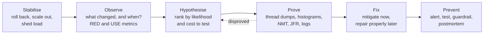

[⬅️ Prev: 31 · API Design Between Services](31-api-design-between-services.md) · [🏠 Index](README.md) · [Next: 33 · Annotated Mock Interviews ➡️](33-annotated-mock-interviews.md)

# 32 · Production Troubleshooting Scenarios

> *"Our service is slow" is where staff interviews really begin. They're not testing whether you've memorised `jcmd` flags. They're watching how you reason under uncertainty: what you check first, what you rule out, how you prove a cause, and what you change so it never happens again.*

Chapters [10](10-memory-and-garbage-collection.md), [11](11-concurrency-foundations-jmm.md), [21](21-performance-engineering-troubleshooting.md) and [22](22-production-readiness-observability-resilience.md) teach the tools. This chapter applies them end to end, on twelve incidents that come up again and again in Java production systems and in interviews. **Cases 1–8 were reproduced on OpenJDK 25** (and JDK 21 where the comparison matters), and every output is real. Cases 9–12 involve infrastructure that can't be reproduced in a single process, so they're described.

🧪 **Runnable labs:** [the programs behind this chapter's outputs](labs.md#chapter-32--troubleshooting-scenarios)

---

## Table of contents
- [A method for any incident](#a-method-for-any-incident-)
- [The toolbox, by question](#the-toolbox-by-question-)
- [Case 1: OOMKilled while the heap looks healthy](#case-1-oomkilled-while-the-heap-looks-healthy-)
- [Case 2: requests hang, CPU idle, "no deadlock found"](#case-2-requests-hang-cpu-idle-no-deadlock-found-)
- [Case 3: throughput collapsed after enabling virtual threads](#case-3-throughput-collapsed-after-enabling-virtual-threads-)
- [Case 4: OutOfMemoryError: Metaspace after days of uptime](#case-4-outofmemoryerror-metaspace-after-days-of-uptime-)
- [Case 5: the heap grows until it dies](#case-5-the-heap-grows-until-it-dies-)
- [Case 6: the GC death spiral](#case-6-the-gc-death-spiral-)
- [Case 7: pool timeouts while the database is idle](#case-7-pool-timeouts-while-the-database-is-idle-)
- [Case 8: one pod pinned at 100% CPU](#case-8-one-pod-pinned-at-100-cpu-)
- [Case 9: latency spikes on a schedule](#case-9-latency-spikes-on-a-schedule-)
- [Case 10: Kafka consumer lag explodes after a deploy](#case-10-kafka-consumer-lag-explodes-after-a-deploy-)
- [Case 11: pods restart in a loop during rollout](#case-11-pods-restart-in-a-loop-during-rollout-)
- [Case 12: errors persist long after a database failover](#case-12-errors-persist-long-after-a-database-failover-)
- [Telling the story in an interview](#telling-the-story-in-an-interview-)
- [Interview questions](#interview-questions)
- [References](#references)

---

## A method for any incident 🟣


1. **Stabilise before you diagnose.** If a deploy correlates with the incident, roll back first and investigate afterwards. Users don't care about your hypothesis.
2. **"What changed?"** answers most incidents: deploys, config, feature flags, traffic shape, dependency versions, infrastructure (a node pool, a JDK image, kernel settings).
3. **Prove the cause with evidence** before declaring it. A plausible story isn't a root cause, and "we restarted it and it went away" means you've lost the evidence. Take thread dumps, histograms and a JFR recording *before* restarting, if it's safe to.
4. **Prevent the class of problem, not the instance:** an alert that would have fired earlier, a test that would have caught it, a guardrail that makes it impossible.

## The toolbox, by question 🔴

| Question | Command |
|---|---|
| What are the threads doing? | `jcmd <pid> Thread.print`, three times about 5 s apart. With virtual threads: `jcmd <pid> Thread.dump_to_file -format=json <file>` |
| What's on the heap? | `jcmd <pid> GC.class_histogram` (diff two), `jcmd <pid> GC.heap_dump <file>` |
| Where is native memory going? | `jcmd <pid> VM.native_memory summary` (needs `-XX:NativeMemoryTracking=summary` at startup); `baseline` then `summary.diff` |
| How is GC behaving? | `-Xlog:gc*:file=gc.log` (always on in production); `jstat -gcutil <pid> 1000` |
| What's burning CPU? | `top -H -p <pid>`, then a JFR recording (`jcmd <pid> JFR.start duration=60s filename=/tmp/rec.jfr`) or async-profiler |
| How was the JVM started? | `jcmd <pid> VM.flags`, `VM.command_line`, `VM.system_properties` |
| Did the kernel kill it? | `kubectl describe pod` (`OOMKilled`, exit code 137), `memory.events` in the pod's cgroup, `dmesg` |

---

## Case 1: OOMKilled while the heap looks healthy 🔴

**Symptom:** pods are killed with `OOMKilled` (exit code 137) every few hours. Heap dashboards show 30–40% used. There's no `OutOfMemoryError` in the logs.

**First five minutes:** confirm it was the *kernel* (the pod status says `OOMKilled`, and the cgroup's `memory.events` counts an `oom_kill`), not the JVM. The heap is only part of RSS, so list the non-heap suspects: direct buffers, Metaspace, thread stacks, code cache, GC structures, native libraries.

**Reproduced:** a buffer pool that never returns 1 MB direct buffers (JDK 25, `-Xmx256m -XX:MaxDirectMemorySize=64m -XX:NativeMemoryTracking=summary`):
```java
static final List<ByteBuffer> retained = new ArrayList<>();
for (int i = 1; ; i++) retained.add(ByteBuffer.allocateDirect(1 << 20));     // 1 MB off-heap, never released
```
```
buffers= 16  heap used=  2 MB  direct= 16 MB
buffers= 32  heap used=  2 MB  direct= 32 MB
buffers= 48  heap used=  2 MB  direct= 48 MB
buffers= 64  heap used=  2 MB  direct= 64 MB
java.lang.OutOfMemoryError: Cannot reserve 1048576 bytes of direct buffer memory (allocated: 67108864, limit: 67108864)
-                 Java Heap (reserved=268435456, committed=10485760)
-                     Other (reserved=67108864, committed=67108864)
```
The heap stayed at **2 MB** while 64 MB grew off-heap. NMT files direct buffers under **"Other"**. Here a `MaxDirectMemorySize` limit produced a clear Java error. **Without that limit, the direct-memory ceiling defaults to the maximum heap size**, so the process can grow past the container limit and be killed by the kernel with no Java error at all. That's the production version of this case.

**Root causes seen in practice:** leaked pooled buffers (Netty `ByteBuf` not released: enable Netty's leak detector in tests), NIO-heavy libraries, memory-mapped files, JNI or native libraries, or simply `MaxRAMPercentage` set so high that heap plus non-heap exceeds the limit.

**Fix and prevent:** set `-XX:MaxDirectMemorySize` explicitly, size the heap so that non-heap fits ([Chapter 30 §5](30-startup-footprint-aot-native-image.md#5-where-jvm-memory-goes-measured-with-nmt-)), run with NMT summary in production (it's cheap) and diff it over time, and alert on RSS approaching the container limit, not on heap usage.

---

## Case 2: requests hang, CPU idle, "no deadlock found" 🔴

**Symptom:** after a refactoring, some requests never complete under load. CPU is near zero. A thread dump *doesn't* report a Java-level deadlock.

**Reproduced:** each request runs on a 4-thread pool and fans out two subtasks *to the same pool*, then blocks waiting for them:
```java
ExecutorService pool = Executors.newFixedThreadPool(4, ...);
pool.submit(() -> {
    Future<String> price = pool.submit(() -> "price-" + id);    // child task on the SAME pool
    Future<String> stock = pool.submit(() -> "stock-" + id);
    return price.get() + "/" + stock.get();                     // parent blocks a pool thread waiting for its children
});
```
```
requests done after 1 s: [false, false, false, false]
0                                    ← occurrences of "Found one Java-level deadlock" in the thread dump
"orders-pool-1" #21 [6787] prio=5 os_prio=0 cpu=1.70ms elapsed=2.68s tid=0x00007efe246157b0 nid=6787 waiting on condition  [0x00007efe28221000]
   java.lang.Thread.State: WAITING (parking)
	at jdk.internal.misc.Unsafe.park(java.base@25.0.5.0.3/Native Method)
	- parking to wait for  <0x00000000a5fea880> (a java.util.concurrent.FutureTask)
	at java.util.concurrent.locks.LockSupport.park(java.base@25.0.5.0.3/LockSupport.java:223)
	at java.util.concurrent.FutureTask.awaitDone(java.base@25.0.5.0.3/FutureTask.java:511)
	at java.util.concurrent.FutureTask.get(java.base@25.0.5.0.3/FutureTask.java:192)
	at PoolDeadlock.lambda$main$1(PoolDeadlock.java:23)
```
All four pool threads are parents waiting on children, and the children sit in the queue behind them. That's a **thread-starvation deadlock**. The JVM's deadlock detector only finds cycles of *monitors and locks*, so it reports nothing. The diagnostic signature is **every thread in a pool `WAITING` in `Future.get` / `join` with the work queue non-empty**.

**Fix:** never block a pool's threads on tasks queued to the same pool. Use a separate pool for the children, compose without blocking (`CompletableFuture.thenCombine`), or use virtual threads or structured concurrency, where blocking is cheap and there's no fixed pool to exhaust. **Prevent:** an architecture rule against nested submission to the same executor, per-pool metrics (active threads, queue depth, task wait time), and timeouts on every `get`.

---

## Case 3: throughput collapsed after enabling virtual threads 🔴

**Symptom:** a team switched a service to virtual threads on JDK 21 to *increase* throughput. Under load, throughput dropped sharply, and only a couple of requests seemed to make progress at a time.

**Reproduced:** 200 virtual threads, each doing a 50 ms blocking call inside `synchronized` (common in older client libraries). There's one lock per task, so no contention at all:
```java
exec.submit(() -> { synchronized (monitor) { sleep(50); } return null; });
```
```
JDK 21, synchronized: 200 virtual threads x 50 ms blocking ->  5049 ms  (2 carrier threads)
JDK 21, ReentrantLock: 200 virtual threads x 50 ms blocking ->    72 ms  (2 carrier threads)
JDK 25, synchronized: 200 virtual threads x 50 ms blocking ->    81 ms  (2 carrier threads)
```
On JDK 21, blocking inside `synchronized` **pins** the virtual thread to its carrier. With 2 carriers (one per core), only two sleeps can be in progress at a time: 200 × 50 ms / 2 ≈ 5 s. The same code with `ReentrantLock`, or on JDK 25, where JEP 491 lets virtual threads unmount inside `synchronized`, finished in under 100 ms. JDK 21 can show you the pinning directly:
```
$ java -Djdk.tracePinnedThreads=short ...
VirtualThread[#20]/runnable@ForkJoinPool-1-worker-2 reason:MONITOR
    Pinning.lambda$main$0(Pinning.java:24) <== monitors:1
```
**Fix:** upgrade to JDK 24+ (the real fix), or replace `synchronized` around blocking calls with `ReentrantLock`, or upgrade the offending library. Use the JFR `jdk.VirtualThreadPinned` event in production. Pinning through native frames (JNI) still exists on new JDKs. **Prevent:** load-test the switch to virtual threads with realistic dependencies, and watch carrier utilisation as well as request concurrency ([Chapter 12](12-concurrency-advanced-juc-loom.md)).

---

## Case 4: `OutOfMemoryError: Metaspace` after days of uptime 🔴

**Symptom:** a service that hot-reloads rules or scripts dies with `OutOfMemoryError: Metaspace` after a few days. Heap usage is fine.

**Reproduced:** each "reload" defines the plugin class in a new class loader, and the old instances stay in a registry (`-XX:MaxMetaspaceSize=48m`):
```java
Class<?> c = new PluginLoader().define(bytes);           // a NEW loader each time = a new class in Metaspace
plugins.add(c.getDeclaredConstructor().newInstance());   // instance -> class -> loader: nothing can be unloaded
```
```
plugin classes loaded= 4000  metaspace used= 8 MB
plugin classes loaded= 8000  metaspace used=17 MB
after 8012 plugin classes: java.lang.OutOfMemoryError: Metaspace
```
A class can only be unloaded when its **class loader** becomes unreachable, and a loader stays reachable as long as any instance of any of its classes does. One forgotten reference (a registry, a `ThreadLocal`, a JDBC driver registration, a shutdown hook, a static cache in a parent loader) keeps every class of that loader alive.

**Diagnose:** watch Metaspace and the loaded-class count over time (`jcmd <pid> VM.classloader_stats`, or the JMX class-loading metrics). In a heap dump, look for many instances of the same loader class, and follow the GC-root path to whatever retains them. **Common sources:** script engines compiling a fresh class per evaluation, bytecode-generating libraries creating new loaders per call, redeploys in application servers, and reflection-heavy frameworks misconfigured to spin new proxies per request. **Prevent:** always set `MaxMetaspaceSize` (a leak should fail loudly and early, not eat the node), and alert on a monotonically increasing loaded-class count.

---

## Case 5: the heap grows until it dies 🔴

**Symptom:** old-generation usage after each GC rises steadily for days, then `OutOfMemoryError: Java heap space`. Restarts "fix" it.

**Reproduced:** a session "cache" with no eviction. Two class histograms, 4 seconds apart:
```
$ jcmd <pid> GC.class_histogram          (top rows)
   1:       1652772      175750672  [B (java.base@25.0.5.0.3)
   2:       1104694       26512656  java.lang.String (java.base@25.0.5.0.3)
   3:        549014       17568448  java.util.HashMap$Node (java.base@25.0.5.0.3)
   4:        548001       17536032  SessionLeak$Session
--- 4 s later
   1:       3632771      390278656  [B (java.base@25.0.5.0.3)
   2:       2424693       58192632  java.lang.String (java.base@25.0.5.0.3)
   3:       1209014       38688448  java.util.HashMap$Node (java.base@25.0.5.0.3)
   4:       1208001       38656032  SessionLeak$Session
```
**Read it like an investigator.** `[B`, `String` and `HashMap$Node` are always near the top, so they're symptoms, not suspects. The interesting line is **your own class** growing in lockstep with them: `SessionLeak$Session` went from 548,001 to 1,208,001 instances, with one `HashMap$Node` each. That points straight at a map of sessions that's never cleaned up. (`GC.class_histogram` triggers a full GC first, so the counts are live objects. Take it at a quiet moment on large heaps.)

**Confirm** with a heap dump (`jcmd <pid> GC.heap_dump`) and a dominator-tree view in Eclipse MAT: the biggest retained set will be that map, and the GC-root path names the field that holds it. **Fix:** a bounded cache with expiry (Caffeine: `maximumSize`, `expireAfterAccess`), or an external session store with TTLs. **Prevent:** alert on old-gen usage *after* GC trending upwards, ban unbounded static maps in reviews, and run soak tests long enough to see slow leaks.

---

## Case 6: the GC death spiral 🔴

**Symptom:** latency rises over minutes, CPU climbs, throughput falls, and eventually the service dies with an OOM, or worse, staggers on, barely responsive. Health checks flap.

**Reproduced:** a live set that slowly grows into a 128 MB heap, while normal request garbage keeps flowing. The GC log split into ten slices of the run:
```
java.lang.OutOfMemoryError: Java heap space after 2024 ms, live set ~121 MB
pauses: 1292 (young: 865, full: 238); run 2.0s
   0.00- 0.20s:   40 pauses,  21.7% of wall time paused
   0.20- 0.41s:   55 pauses,  28.8% of wall time paused
   0.41- 0.61s:   99 pauses,  31.4% of wall time paused
   0.61- 0.82s:  165 pauses,  39.6% of wall time paused
   0.82- 1.02s:  215 pauses,  46.5% of wall time paused
   1.02- 1.22s:  202 pauses,  66.9% of wall time paused
   1.22- 1.43s:  155 pauses,  87.6% of wall time paused
   1.43- 1.63s:  136 pauses,  95.0% of wall time paused
   1.63- 1.84s:  122 pauses,  95.9% of wall time paused
   1.84- 2.04s:  103 pauses,  97.4% of wall time paused
[2.032s][info][gc] GC(1324) Pause Full (G1 Compaction Pause) 124M->123M(128M) 3.252ms
[2.036s][info][gc] GC(1326) Pause Full (G1 Compaction Pause) 123M->123M(128M) 3.607ms
```
As the live set approaches the heap size, each collection frees less, so collections come more often. By the end, the application was paused **97% of the time**, running back-to-back full GCs that reclaimed almost nothing (`124M->123M`). In production this phase can last minutes, which is why it's worse than an immediate OOM: the instance stays "up" but useless.

**Detect it early:** alert on the **share of time spent in GC** (for example, above 10% over 5 minutes) and on old-gen occupancy after GC, not on pause length alone. **Fix:** find what grew (Case 5's technique) or give the real live set the heap it needs. **Make failure fast:** `-XX:+ExitOnOutOfMemoryError` (plus `-XX:+HeapDumpOnOutOfMemoryError` with a path) lets the orchestrator replace the instance instead of leaving a zombie.

---

## Case 7: pool timeouts while the database is idle 🔴

**Symptom:** under moderate load, requests fail with "connection is not available, request timed out". Database CPU and active queries are low. "Just increase the pool size" is the first suggestion.

**Reproduced:** a 10-connection pool, 100 requests/s, 10 ms of database work per request, plus a 200 ms call to another service, made either *inside* the transaction or *before* it:
```java
if (!remoteInsideTx) remoteCall();                                // call the other service BEFORE taking a connection
if (!pool.tryAcquire(1, TimeUnit.SECONDS)) return TIMEOUT;
try {
    db();
    if (remoteInsideTx) remoteCall();                             // a @Transactional method that also calls a remote service
    db();
} finally { pool.release(); }
```
```
remote call INSIDE the transaction:    ok=187  pool timeouts=113  p50= 1208 ms  p99= 1220 ms
remote call before taking a connection: ok=300  pool timeouts=  0  p50=  220 ms  p99=  221 ms
```
Same work, same pool, same traffic. The only difference is **how long each request holds a connection**. Little's law ([Chapter 21](21-performance-engineering-troubleshooting.md)): holding a connection for about 220 ms means 10 connections serve at most about 45 requests/s. At 100 requests/s the queue grows until requests time out, while the database itself sits nearly idle, because the connections are busy waiting for *another service*.

**Fix:** move remote calls (HTTP, messaging, file I/O) out of transactional methods, keep transactions short, and use the outbox pattern when a remote side effect must follow a commit ([Chapter 23](23-distributed-systems-microservices.md)). Increasing the pool only moves the bottleneck and can overload the database. **Prevent:** monitor pool *acquire time* and *usage time* (HikariCP exposes both through Micrometer), and set leak detection thresholds.

---

## Case 8: one pod pinned at 100% CPU 🔴

**Symptom:** one instance shows 100% of a core and climbing latency. The others are fine.

**Reproduced workflow:** from operating-system thread to Java stack line.
```
$ top -H -b -n 1 -p 7175
  PID USER      PR  NI    VIRT    RES    SHR S  %CPU  %MEM     TIME+ COMMAND
 7195 root      20   0 4191952  53476  26024 R  99.9   0.7   0:06.13 order-val+
 7175 root      20   0 4191952  53476  26024 S   0.0   0.7   0:00.00 java
 7177 root      20   0 4191952  53476  26024 S   0.0   0.7   0:00.01 java
```
Java threads carry their names down to the OS (truncated to 15 characters), so `top -H` already says `order-val…`. Take the hot thread ID, **7195**, to the thread dump:
```
$ jcmd 7175 Thread.print
"order-validator-1" #21 [7195] prio=5 os_prio=0 cpu=7453.66ms elapsed=7.50s tid=0x00007fd0d0609620 nid=7195 runnable  [0x00007fd0b47fc000]
   java.lang.Thread.State: RUNNABLE
	at java.util.regex.Pattern$BmpCharPropertyGreedy.match(java.base@25.0.5.0.3/Pattern.java:4511)
	at java.util.regex.Pattern$GroupHead.match(java.base@25.0.5.0.3/Pattern.java:4969)
	at java.util.regex.Pattern$Loop.match(java.base@25.0.5.0.3/Pattern.java:5078)
	at java.util.regex.Pattern$GroupTail.match(java.base@25.0.5.0.3/Pattern.java:5000)
```
Modern JDKs print the OS thread ID in decimal (both in `[7195]` and in `nid=7195`). Older JDKs printed `nid` in hex, so you had to convert first (`printf '%x' 7195` gives `0x1c1b`). Here the stack is deep inside `java.util.regex`: catastrophic backtracking on an input that one customer happened to send ([Chapter 03](03-strings.md)). That explains why only one pod was affected.

**Fix:** a non-backtracking pattern (possessive quantifiers, atomic groups, or simpler validation), input-length limits, and a timeout on regex evaluation for untrusted input. **Prevent:** add regex patterns to code review checklists, fuzz validators with long inputs, and keep JFR continuously recording so the next time you have `jfr view hot-methods` instead of a guess.

---

## Case 9: latency spikes on a schedule 🔴

**Symptom:** p99 latency spikes every 10 minutes, almost exactly. Nothing is logged.

**Hypotheses ranked by how often they're the answer:**
1. **Synchronised cache expiry:** everything was cached at startup with the same TTL, so it all expires together, and the next requests stampede the database. Signature: spikes aligned to the TTL, with database load spiking at the same moment.
2. **Scheduled jobs:** `@Scheduled` reports, cache rebuilds or batch exports competing for the same pools, connections or CPU. Signature: aligned with cron expressions, and visible in thread dumps or JFR during the spike.
3. **Platform cycles:** token or certificate refreshes, metrics scrapes with expensive collectors, log rotation, or a cron job on the node.
4. **GC:** periodic old-generation or mixed collections, if the allocation pattern is regular. The GC log answers this in minutes.

**Prove it:** align timestamps across metrics, GC logs and job schedules. Correlation in time is the strongest signal you'll get. **Fix (cache case):** add jitter to TTLs (for example ±10%), refresh ahead of expiry (`refreshAfterWrite`), coalesce concurrent misses for the same key so one request loads and the others wait ([Chapter 23 §11](23-distributed-systems-microservices.md#11-caching-in-distributed-systems-)), and move heavy scheduled jobs to separate instances or pools.

---

## Case 10: Kafka consumer lag explodes after a deploy 🔴

**Symptom:** after a deploy that added an enrichment call to message processing, consumer lag grows without bound. Logs show repeated rebalances, and some messages are processed more than once.

**What's happening:** each `poll()` returns up to `max.poll.records` (500 by default). If processing that batch takes longer than `max.poll.interval.ms` (5 minutes by default), the consumer is considered dead and evicted from the group. That triggers a **rebalance**, the partitions move, uncommitted work is **reprocessed** by another consumer (which may hit the same limit), and the group spends more time rebalancing than consuming.

**Diagnose:** lag per partition, rebalance rate, processing time per batch, and log lines about leaving the group or failed commits. **Fix:**
- Make processing faster than the poll interval: smaller `max.poll.records`, timeouts on the enrichment call, or parallel processing per partition while preserving key order.
- Reduce rebalance cost: the cooperative incremental protocol (the `CooperativeStickyAssignor`, or the new consumer group protocol from KIP-848, generally available since Kafka 4.0), and static membership (`group.instance.id`), so rolling restarts don't reshuffle everything.
- Keep processing idempotent, because reprocessing *will* happen ([Chapter 23](23-distributed-systems-microservices.md)).

**Prevent:** alert on lag growth rate and rebalance frequency, and load-test consumers with realistic per-message latency, not empty handlers.

---

## Case 11: pods restart in a loop during rollout 🔴

**Symptom:** a new version never becomes ready. Pods start, run for about 60 seconds, get killed, and restart, over and over. The old version is still serving, so this is "only" a stuck deploy, until someone forces it through.

**Typical causes:**
- **A liveness probe that fires during a slow startup.** A JVM that needs 70 s to start (classpath scanning, migrations, cache warmup) gets killed at 60 s and never finishes. Use a **startup probe** with a generous budget, and only start liveness checks after startup succeeds.
- **A liveness probe that checks dependencies.** If the database is slow, every pod fails liveness at once and the whole fleet restarts, which makes things worse. Liveness should only answer "is this process wedged?". Dependencies belong in readiness ([Chapter 22](22-production-readiness-observability-resilience.md)).
- **CPU throttling during startup.** A CPU limit far below what JIT compilation and class loading need at boot stretches startup dramatically. Watch the cgroup throttling metrics.

**Fix and prevent:** startup probes, dependency-free liveness checks, startup time tracked as a metric (and reduced with the [Chapter 30](30-startup-footprint-aot-native-image.md) techniques), and a deployment that fails fast and rolls back automatically.

---

## Case 12: errors persist long after a database failover 🔴

**Symptom:** the database failed over to a replica in 30 seconds, but the service kept erroring for 10–30 minutes, until it was restarted.

**What's happening:**
- **Pooled connections still point at the old primary.** They're either dead and only discovered when used, or connected to a node that's now read-only. Without validation and a bounded connection lifetime, the pool hands them out for a long time.
- **DNS caching.** The JVM caches successful lookups (by default 30 seconds without a security manager, configurable through the `networkaddress.cache.ttl` security property). Some images and configurations set it much higher, or to forever. If the failover changes DNS records, stale addresses persist.
- **TCP half-open connections:** without keepalives, a connection to a node that vanished can hang until a read timeout, if one is set at all.

**Fix and prevent:**
- Bound the connection lifetime (HikariCP `maxLifetime`, kept below any network or database idle timeout) and set connection and socket timeouts.
- Use drivers' failover-aware configuration (multi-host URLs, target-server-type settings, or a database proxy).
- Keep the DNS TTL modest, and enable TCP keepalive.
- **Rehearse failovers regularly in staging** ([Chapter 24 §13](24-system-design-for-java-architects.md#13-multi-region-disaster-recovery--cells-)). A failover you haven't practised is a theory.

---

## Telling the story in an interview 🟣

When an interviewer says "pods are OOMKilled every few hours", they're grading **structure** and **reasoning**, not trivia:
1. **Clarify and stabilise:** "Is it all pods or some? Since when? Any deploy? First I'd make sure we have headroom or roll back if a deploy correlates."
2. **Narrow it down with cheap checks:** "OOMKilled means the kernel, not the JVM, so I'm looking at RSS versus the limit, not heap."
3. **Name your hypotheses and how you'd test each one:** "Direct buffers, Metaspace, thread count, or a heap sized too close to the limit. NMT summary diffs over time will tell me which."
4. **Show the evidence you'd expect** ("If it's direct memory, NMT's 'Other' grows while the heap stays flat"), then the fix and the prevention.
5. **Close with the systemic lesson:** the alert, the guardrail, the default you'd change for the whole fleet.

That arc, and the habit of saying how you'd *prove* things rather than guessing, is what separates staff-level answers. [Chapter 33](33-annotated-mock-interviews.md) shows it in full mock transcripts.

---

## Interview questions

<details>
<summary><b>Q1. 🔴 Pods are OOMKilled, but the heap is only 40% used. How do you diagnose it?</b></summary>

`OOMKilled` (exit code 137) means the kernel killed the process for exceeding the container's memory limit, so compare RSS with the limit and inventory non-heap memory. Enable NMT (`-XX:NativeMemoryTracking=summary`) and diff `jcmd VM.native_memory` over time: growth in "Other" points to direct buffers, Metaspace to class loading, Thread to too many threads. Check `MaxDirectMemorySize` (it defaults to the max heap size), Netty buffer leaks, mapped files and native libraries, and whether `MaxRAMPercentage` leaves room for non-heap memory at all. Fix the leak, set explicit limits, and alert on RSS versus the limit.
</details>

<details>
<summary><b>Q2. 🔴 A service hangs with idle CPU, and the thread dump reports no deadlock. What could it be?</b></summary>

Most likely a thread-starvation deadlock: all threads in a bounded pool are blocked waiting (in `Future.get` or `join`) for tasks that are queued behind them in the same pool. The JVM only detects lock-cycle deadlocks, so nothing is reported. The signature is every pool thread `WAITING` in `get`/`join` with a non-empty queue. Other candidates: connection-pool exhaustion (threads waiting for a connection), remote calls without timeouts (threads in socket reads), and lost wake-ups. Fix it by not blocking pool threads on same-pool work, by composing asynchronously, or by using virtual threads. Add timeouts everywhere.
</details>

<details>
<summary><b>Q3. 🔴 Throughput dropped after switching to virtual threads on JDK 21. Why, and how do you confirm and fix it?</b></summary>

Pinning. On JDK 21, a virtual thread that blocks inside `synchronized` (or a native frame) can't unmount, so it holds one of the few carrier threads. Our reproduction took 5,049 ms instead of about 75 ms. Confirm with `-Djdk.tracePinnedThreads` on JDK 21, or the JFR `jdk.VirtualThreadPinned` event. Fix it by upgrading to JDK 24+ (JEP 491 removes `synchronized` pinning), replacing `synchronized` around blocking I/O with `ReentrantLock`, or upgrading the library that does it.
</details>

<details>
<summary><b>Q4. 🔴 How do you find a heap leak when a full heap dump is too big or too risky in production?</b></summary>

Take two or three `jcmd GC.class_histogram` snapshots minutes apart, and look for *your own* classes growing steadily, alongside the generic `byte[]`, `String` and `HashMap$Node` entries that follow them. In our reproduction, `Session` went from 548,001 to 1,208,001 instances in 4 seconds. Correlate with old-gen usage after GC. Then reproduce in a lower environment, or take a heap dump from a canary or a drained instance, and use a dominator tree to find the retaining field.
</details>

<details>
<summary><b>Q5. 🔴 What is a GC death spiral, and how do you detect it before the OOM?</b></summary>

As the live set approaches the heap size, each collection frees less, so collections run more often and the application gets less time to run. In our reproduction, the paused share of wall time rose from 22% to 97% before the OOM, with back-to-back full GCs freeing almost nothing. Detect it by alerting on the fraction of time in GC and on old-gen occupancy after GC trending upwards. Mitigate it with `ExitOnOutOfMemoryError`, so the orchestrator replaces a zombie instance quickly, then find what grew.
</details>

<details>
<summary><b>Q6. 🔴 The database connection pool is exhausted, but the database looks idle. What's going on?</b></summary>

Connections are held while the application does something other than database work, usually a remote call inside a `@Transactional` method, or slow processing between queries. By Little's law, a pool's capacity is its size divided by hold time. In our reproduction, a 200 ms remote call inside the transaction caused 113 timeouts out of 300 requests, and moving it outside caused none. Fix the transaction boundaries (no remote I/O inside transactions; use an outbox for side effects), rather than enlarging the pool. Monitor connection acquire and usage times.
</details>

<details>
<summary><b>Q7. 🔴 One pod is at 100% CPU. Take me from the OS to the line of code.</b></summary>

Use `top -H -p <pid>` (or per-thread CPU from `/proc/<pid>/task`) to find the hot thread ID. Java thread names are often visible there already. Take a thread dump with `jcmd <pid> Thread.print` and find that ID: modern JDKs print it in decimal as `[tid]` and `nid=tid`; older ones printed `nid` in hex. Take two or three dumps to confirm it's consistently in the same code. For a fuller picture, record JFR or use async-profiler, and read the hottest stack frames. In our reproduction, this led to regex backtracking within a minute.
</details>

<details>
<summary><b>Q8. 🔴 p99 latency spikes every 10 minutes exactly. What are your hypotheses?</b></summary>

Exact periodicity points to something scheduled: synchronised cache TTL expiry causing a stampede (TTLs set at the same moment); scheduled jobs (`@Scheduled`, batch exports) competing for pools or the database; platform cycles (token refresh, metrics scrapes, log rotation, node cron jobs); or periodic GC behaviour. Prove it by aligning timestamps across metrics, GC logs, scheduler logs and database load. Fix stampedes with TTL jitter, refresh-ahead and request coalescing, and isolate heavy jobs.
</details>

<details>
<summary><b>Q9. 🔴 Kafka consumer lag keeps growing after a deploy, with repeated rebalances. Why?</b></summary>

Processing a poll batch now takes longer than `max.poll.interval.ms`, so the consumer is evicted. That triggers a rebalance, uncommitted messages are reprocessed elsewhere, and the cycle repeats. Fix it by shortening the work per poll (smaller `max.poll.records`, timeouts on enrichment calls, parallelism that preserves key order), using cooperative rebalancing (or the KIP-848 consumer protocol) and static membership, and keeping handlers idempotent. Alert on lag growth and rebalance rate.
</details>

<details>
<summary><b>Q10. 🔵 How do you run a postmortem so the fixes actually stick?</b></summary>

Keep it blameless and evidence-based: a timeline from detection to recovery, the root cause *and* the contributing factors (why it wasn't caught earlier, why recovery took so long). Turn those into a small number of owned, dated action items, prioritising systemic ones: an alert that would have fired, a test that would have caught it, a guardrail or default that prevents the class of problem fleet-wide. Track the action items to completion in the normal planning process, share the learning beyond the team, and check later that the alert or guardrail actually works (for example, with a game day).
</details>

<details>
<summary><b>Q11. 🟣 How do you structure your answer to an open-ended "debug this" interview question?</b></summary>

Clarify the scope and timeline, and stabilise first (roll back or scale if needed). Use cheap checks to narrow the space ("OOMKilled means kernel, so RSS, not heap"). State ranked hypotheses, and for each one, the evidence that would confirm or refute it. Explain the tools and what the output would look like. Propose an immediate mitigation and a permanent fix. Close with prevention: alerts, tests, guardrails and the lesson for the fleet. Thinking out loud in this structure is what interviewers grade.
</details>

---

## References
- JDK tools: [`jcmd`](https://docs.oracle.com/en/java/javase/25/docs/specs/man/jcmd.html), Native Memory Tracking, JFR (`jfr view`), unified GC logging (`-Xlog:gc*`)
- JEP 491 (virtual threads without pinning on `synchronized`) and JEP 444 (virtual threads)
- Eclipse Memory Analyzer (MAT): dominator trees and GC-root paths
- HikariCP documentation on pool sizing and `maxLifetime`; Micrometer pool metrics
- Apache Kafka consumer configuration (`max.poll.interval.ms`, `max.poll.records`, `group.instance.id`) and KIP-848 (the new consumer group protocol)
- Kubernetes documentation: liveness, readiness and startup probes; container resource limits and OOM behaviour
- Google SRE book and workbook: incident management and blameless postmortems

---

[⬅️ Prev: 31 · API Design Between Services](31-api-design-between-services.md) · [🏠 Index](README.md) · [Next: 33 · Annotated Mock Interviews ➡️](33-annotated-mock-interviews.md)
