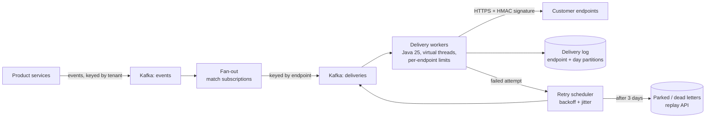

[⬅️ Prev: 32 · Troubleshooting Scenarios](32-production-troubleshooting-scenarios.md) · [🏠 Index](README.md) · [Next: 34 · Data Stores ➡️](34-data-stores-redis-cassandra-dynamodb.md)

# 33 · Annotated Mock Interviews

> *Knowing the material and performing in the room are different skills. These transcripts show the second one: how a strong answer unfolds under follow-up questions, where a solid senior answer stops, and what a staff-level candidate does with the extra minutes.*

**About these transcripts:** every interview here is a constructed example, written to teach technique. They're not records of real interviews, candidates or companies. Each one has annotations:
> 🎯 **Signal:** something the interviewer will write down in your favour
> ⚠️ **Missed:** a weaker answer would lose points here
> 🧠 **Staff move:** where a staff-level answer goes beyond a senior one

The code in Mock 4 was compiled and run on JDK 25, and its output is real.

🧪 **Runnable labs:** [the programs behind this chapter's outputs](labs.md#chapter-33--mock-interviews)

---

## Table of contents
1. [Mock 1: JVM & concurrency deep-dive](#mock-1-jvm--concurrency-deep-dive-)
2. [Mock 2: system design, a webhook delivery platform](#mock-2-system-design-a-webhook-delivery-platform-)
3. [Mock 3: behavioural, influence without authority](#mock-3-behavioural-influence-without-authority-)
4. [Mock 4: coding, a per-key rate limiter](#mock-4-coding-a-per-key-rate-limiter-)
5. [Scoring yourself](#scoring-yourself-)
6. [How to practise with these](#how-to-practise-with-these-)
7. [Practice prompts](#practice-prompts)

---

## Mock 1: JVM & concurrency deep-dive 🟣

*Format: 45 minutes, a Java platform round in a staff loop.*

**Interviewer:** We moved an order service from Java 17 to Java 21 and turned on virtual threads. At normal load it's fine. At peak, p99 went from 180 ms to 2.4 s. How would you investigate?

**Candidate:** A few questions first. Did anything else change in that deploy: Spring Boot version, GC flags, container limits? Is the degradation a cliff at some load level, or gradual? All instances or some? And what do CPU, error rates and the downstream latencies look like during the spike?

> 🎯 **Signal:** clarifies scope and "what changed" before guessing. Asking whether it's a *cliff* or *gradual* is smart, because cliffs suggest a saturated fixed resource.

**Interviewer:** Only the JDK upgrade and virtual threads. CPU is about 30% at peak. Database latency is unchanged. There are some timeouts.

**Candidate:** Low CPU with high latency means requests are *waiting*, not computing. Since the trigger was virtual threads, my ranked hypotheses are:
1. **Pinning.** On JDK 21, a virtual thread that blocks inside `synchronized` can't unmount, so it holds a carrier. There are only as many carriers as cores, so a library that does blocking I/O inside `synchronized` caps concurrency at about the core count. That fits low CPU, a cliff under load, and the fact that it only started with virtual threads.
2. **Unbounded concurrency hitting a fixed pool.** Virtual threads removed the old thread-pool limit, so far more requests reach the connection pool at once and queue there. Pool acquire time would show it.
3. Less likely: GC behaviour or `ThreadLocal`-heavy libraries now allocating per virtual thread. The GC log and allocation profiling rule those in or out quickly.

To prove the first one, I'd record JFR during a peak and look at `jdk.VirtualThreadPinned` events with their stack traces. For the second, the connection pool's acquire-time metrics.

> 🎯 **Signal:** ranked hypotheses, each paired with the evidence that would confirm it. Reasoning from *low CPU + high latency* is exactly the inference interviewers hope to hear.
> ⚠️ **Missed (weaker answer):** "I'd take a heap dump" or "I'd tune the GC". That's activity without a hypothesis.

**Interviewer:** JFR shows thousands of pinned events. The stacks point into the database driver's connection-acquisition code, inside a `synchronized` block.

**Candidate:** Then that's our bottleneck. With, say, 8 carriers, at most 8 requests can be inside that blocking section at a time, and everything else queues. That's why the latency curve is a cliff. Options, from immediate to durable:
- **Immediate:** turn virtual threads off for this service (one property), or move the database work onto a bounded platform-thread pool. That gets p99 back today.
- **Short term:** upgrade the driver. Many drivers replaced `synchronized` with `ReentrantLock` specifically for virtual threads. Verify with a load test, and with the pinned-event count dropping to near zero.
- **Durable:** move to JDK 24 or later, where JEP 491 lets virtual threads unmount inside `synchronized`. On JDK 25, this whole class of problem largely disappears, except for native frames.
- **Either way:** put an explicit concurrency limit, for example a semaphore sized to the connection pool, in front of the database. Then excess requests fail fast instead of piling up thousands of waiting virtual threads.

> 🎯 **Signal:** separates mitigation from repair, and names how to *verify* the fix (the pinned-event count). Mentioning the concurrency limit shows understanding that virtual threads remove *thread* limits, not *resource* limits.

**Interviewer:** Good. Anything else?

**Candidate:** Yes, and this is the part I'd spend time on as a staff engineer. This driver is probably used by dozens of services, and other teams are enabling virtual threads too. I'd:
1. **Inventory:** find which services use the affected driver versions and have virtual threads enabled. That's a query against our SBOMs plus a config search.
2. **Publish guidance:** a short "virtual threads readiness" note. JDK 24+ preferred; a list of vetted library versions; a required load test with realistic downstream latency before enabling.
3. **Instrument the fleet:** JFR is cheap enough to run continuously, so I'd export pinned-event counts as a metric and dashboard them. Next time we'd see this in a canary, not at peak.
4. **Fix the default:** make JDK 25 the paved-road base image, which removes most of the risk for everyone.
5. **Write it down:** an ADR or postmortem entry, so the reasoning survives.

> 🧠 **Staff move:** a senior answer stops at "upgrade the driver". The staff answer turns one incident into a **fleet-level guardrail** (inventory, guidance, telemetry, a better default) without being asked. That's the scope signal in a staff loop.

**Rubric for this round:**
| Signal | Weak | Senior | Staff |
|---|---|---|---|
| Framing | Jumps to tools | Clarifies the change and the symptoms | Clarifies, then reasons from the shape of the symptoms (cliff, low CPU) |
| Hypotheses | One guess | Ranked, plausible | Ranked, each with its proving evidence |
| Depth | Buzzwords | Explains pinning | Explains why it's a cliff, the carrier count, JEP 491, the remaining native-frame cases |
| Fix | "Turn it off" | Mitigation plus driver upgrade | Mitigate, repair, verify, add a concurrency limit |
| Scope | — | This service | The fleet: inventory, guidance, telemetry, defaults, ADR |

---

## Mock 2: system design, a webhook delivery platform 🟣

*Format: 60 minutes. Condensed to the moments that decide the grade.*

**Interviewer:** Design the system that delivers webhooks to our SaaS customers. Customers register URLs, and we send them events when things happen in their accounts.

**Candidate:** Let me pin down requirements. Roughly how many events and tenants? What delivery guarantee: at-least-once, with retries? Do customers need ordering? How long do we keep retrying a failing endpoint? What latency should a healthy endpoint see? And do customers need visibility: delivery logs, replay?

**Interviewer:** About 20,000 tenants and a peak of 50,000 events per second. At-least-once. Ordering is "nice to have" for some customers. Retry for up to 3 days. Healthy endpoints should get the first attempt within a few seconds. Yes to logs and replay.

**Candidate:** Quick numbers. 50K events/s at about 2 KB each is roughly 100 MB/s of ingest at peak. For the delivery log, at around 2 billion events a day with about 1.3 attempts each, kept for 7 days at around 500 bytes per attempt record, that's about 9 TB, so a partitioned wide-column or key-value store rather than a single relational database. Retries for 3 days mean a large *parked* backlog for dead endpoints, which shouldn't live in the hot path.

> 🎯 **Signal:** the numbers drive decisions: the storage choice, and separating the backlog from the hot path. ([Chapter 24 §2](24-system-design-for-java-architects.md#2-back-of-the-envelope-estimation-))



**Candidate:** The core flow: product services publish domain events to Kafka. A fan-out service matches each event against subscriptions and writes one delivery task per endpoint, keyed by endpoint ID, so each endpoint's traffic lands on one partition. Delivery workers make the HTTPS calls, using virtual threads because this is almost pure I/O wait, with per-endpoint concurrency limits and strict timeouts (2 s connect, 10 s total). Every attempt is recorded in the delivery log. Failures go to a retry scheduler with exponential backoff and jitter: minutes, then hours. After 3 days a delivery is parked, available for replay through the API.

**Interviewer:** A big customer's endpoint is down for three days. What happens?

**Candidate:** Without care, their retries crowd out everyone else. So:
- A **per-endpoint circuit breaker:** after N consecutive failures, stop attempting deliveries and send only a periodic probe. New events for that endpoint go straight to the parked store instead of cycling through retries.
- **Backlog storage** for parked endpoints lives outside the hot Kafka topics, so a 3-day outage doesn't bloat partitions that other tenants share.
- When the probe succeeds, **drain the backlog at a controlled rate** so we don't flatten the customer's endpoint the moment it recovers. Customers can also trigger a replay.
- **Notify the customer:** email or dashboard alerts at thresholds, and automatic disabling after the retention window, with a clear explanation.

> 🎯 **Signal:** isolation thinking (one tenant's failure must not consume shared capacity), plus recovery behaviour (a controlled drain), which many candidates forget.

**Interviewer:** Another tenant suddenly sends ten times their usual volume.

**Candidate:** That's the noisy-neighbour problem. Per-tenant quotas at the fan-out stage, with fair scheduling across tenants rather than first-come-first-served, so a burst delays mostly its own tenant. For the very largest tenants, dedicated partitions or a separate **cell** with its own workers, which also limits the blast radius ([Chapter 24 §13](24-system-design-for-java-architects.md#13-multi-region-disaster-recovery--cells-)). Workers autoscale on consumer lag, but quotas come first, because autoscaling alone just lets the burst consume more shared infrastructure.

**Interviewer:** Ordering?

**Candidate:** Strict ordering conflicts with retries and throughput: one stuck event would block everything behind it. I'd offer *optional* per-resource ordering. For subscribers who opt in, a single in-flight delivery per (endpoint, resource ID), at the cost of throughput for that endpoint. For everyone, include a sequence number and timestamp in each payload, so consumers can detect and discard stale updates. Most consumers should treat webhooks as hints and fetch current state if order matters.

> 🎯 **Signal:** names the trade-off explicitly and offers a tiered answer instead of pretending one design serves everyone.

**Interviewer:** Security?

**Candidate:** Three parts. **Authenticity:** sign each payload with HMAC-SHA256 over a timestamp plus the body, with a tolerance window so captured requests can't be replayed later, and support two active secrets per endpoint for rotation. **Our own safety:** customer URLs are an SSRF vector. Resolve the address once, reject private and metadata ranges, connect to the validated address, re-check on redirects, and send through an egress proxy ([Chapter 25 §4](25-security-for-java-engineers.md#4-deserialization--ssrf-)). **Data:** minimise the payload, so customers fetch sensitive details through the authenticated API.

> 🧠 **Staff move:** spotting that *our* platform is the attack surface (SSRF through customer-supplied URLs). That's the failure-mode thinking that separates staff designs.

**Candidate (closing):** For operations, the SLO would be something like 99.9% of events to healthy endpoints attempted within 60 seconds. I'd have per-tenant success-rate and latency dashboards, and alerts on lag and on the size of the parked backlog. For v1 I'd skip optional ordering and a self-serve replay UI, and ship the core with the circuit breaker and quotas, because those protect everyone else from day one.

**Rubric for this round:**
| Signal | Senior | Staff |
|---|---|---|
| Requirements and numbers | Asks, estimates | Estimates that change the design (the storage choice, backlog isolation) |
| Core design | Queue, workers, retries | Same, keyed by endpoint, with per-endpoint limits and timeouts |
| Failure modes | Retries with backoff | Circuit breaker, parked backlog, controlled drain, customer notification |
| Multi-tenancy | Mentions rate limits | Quotas plus fair scheduling, cells for whales, autoscaling *after* quotas |
| Security | HMAC signatures | Signatures with replay protection and rotation, **plus SSRF on our side** |
| Prioritisation | — | An explicit v1 scope and what's deferred, and why |

---

## Mock 3: behavioural, influence without authority 🟣

**Interviewer:** Tell me about a time you had to change a decision or practice in teams you didn't manage.

The same underlying story told three ways. It's an illustrative composite: a breaking change to an event schema caused an outage, and the candidate drove compatibility rules across teams.

### Version A: the weak answer
> "We had some issues with Kafka messages breaking consumers, so we decided to add a schema registry. I talked to the teams and eventually everyone agreed, and things got better."

⚠️ **Why it fails:** no situation, no numbers, no personal actions ("we decided"), no conflict, no result, no learning. The interviewer learns nothing about how you operate.

### Version B: a solid senior answer
> "A producer team renamed a field in an order event, and three consumer services started failing. It took about four hours to find and roll back. I owned one of the affected consumers, so I proposed a schema registry with compatibility checks. I set it up for our topics, wrote a short guide, and presented it at the backend guild. Two other teams adopted it, and our team hasn't had a breaking event change since."

🎯 **Better:** concrete trigger, personal actions, a result. ⚠️ **Still senior-shaped:** the scope is "my team plus two volunteers". The rest of the organisation is still exposed, and there's no sign of how resistance was handled or how the change was made durable.

### Version C: a staff answer
> "**Situation:** a producer renamed a field in our order-events schema. Three consumers failed, including billing, and it took four hours to detect and roll back. Looking back over six months of incident reports, I found five more incidents with the same root cause: uncoordinated event-schema changes across about 40 topics owned by 9 teams.
>
> **Task:** I was a staff engineer on the platform team. None of those teams reported to me, but event infrastructure was in my area, so I took ownership of fixing the class of problem.
>
> **Action:** I wrote a two-page proposal: a schema registry with BACKWARD_TRANSITIVE compatibility enforced in CI for every topic, plus the six incidents and their cost. Before the review, I met the tech leads of the three highest-volume producers. Two objected: compatibility checks would block legitimate breaking changes, and CI would get slower. I changed the proposal. Breaking changes became possible through a documented path (a new event type plus a dual-publishing window), and the check ran only when schema files changed, adding seconds. I built the CI step into our shared pipeline template so adopting it was a one-line change, migrated the two most painful topics myself as a reference, and published a dashboard of topics and their compatibility status.
>
> **Result:** within two quarters, 38 of 40 topics were enforced. In the following year we had no incidents caused by event-schema changes, against six in the previous half-year. Two teams used the breaking-change path without any outage.
>
> **Learning:** the objections made the design better. Without the breaking-change path, teams would have routed around the rule. I now take a draft to the most sceptical people first, and I always design the escape hatch together with the rule."

🎯 **Signals:**
- **Scope:** a class of incidents across 9 teams, not one team's pain.
- **Diagnosis with data:** six incidents found in six months of history.
- **Influence mechanics:** a written proposal, pre-wiring with sceptics, changing the design based on feedback.
- **Easy adoption:** a pipeline template, reference migrations, a dashboard.
- **Measured results**, and a **learning that changed how the candidate works**.

🧠 **Staff move:** turning a fix into a *mechanism* (CI enforcement in the paved road) with a sanctioned escape hatch. Rules without escape hatches get routed around, and staff engineers know it.

**Likely follow-ups, and what makes a good answer:**
- *"What did the most resistant team say, specifically?"* Have the real objection ready, and say what you changed because of it.
- *"What would you do differently?"* Something real: start with incident data earlier, involve consumers in drafting, set an adoption deadline sooner.
- *"How did you know it was the registry, and not just luck, that reduced incidents?"* The rejected CI checks are evidence: count how many breaking changes the check stopped.

---

## Mock 4: coding, a per-key rate limiter 🔴

*Format: 45 minutes of live coding, then follow-ups.*

**Interviewer:** Implement an in-process rate limiter for our API gateway. Limit each API key separately.

**Candidate:** Questions first. Should it allow bursts, or enforce a smooth rate? Is it called from many threads at once? The number of keys is unbounded, since anyone can send a key, so memory needs a bound. And I'd like the clock to be injectable, so it's testable. Is a token bucket per key acceptable: a burst capacity plus a sustained refill rate?

**Interviewer:** Yes: bursts of 5, then 1 request per second per key, thread-safe.

> 🎯 **Signal:** raises *unbounded keys* (memory) and *testability* (the clock) up front. Both are things interviewers otherwise have to drag out.

```java
public final class KeyedRateLimiter {
    private static final class Bucket {
        private final long capacity;
        private final double refillPerNano;
        private double tokens;
        private long lastRefill;
        private volatile long lastUsed;

        Bucket(long capacity, double refillPerSecond, long now) {
            this.capacity = capacity;
            this.refillPerNano = refillPerSecond / 1_000_000_000.0;
            this.tokens = capacity;                      // start full: allows an initial burst
            this.lastRefill = now;
            this.lastUsed = now;
        }

        synchronized boolean tryAcquire(long now) {      // per-bucket lock: keys never contend with each other
            tokens = Math.min(capacity, tokens + (now - lastRefill) * refillPerNano);
            lastRefill = now;
            lastUsed = now;
            if (tokens >= 1.0) { tokens -= 1.0; return true; }
            return false;
        }
    }

    private final ConcurrentHashMap<String, Bucket> buckets = new ConcurrentHashMap<>();
    private final long capacity;
    private final double refillPerSecond;
    private final LongSupplier nanoClock;

    public KeyedRateLimiter(long capacity, double refillPerSecond, LongSupplier nanoClock) {
        if (capacity < 1 || refillPerSecond <= 0) throw new IllegalArgumentException("capacity >= 1 and refill > 0 required");
        this.capacity = capacity;
        this.refillPerSecond = refillPerSecond;
        this.nanoClock = nanoClock;
    }

    public boolean tryAcquire(String key) {
        long now = nanoClock.getAsLong();
        return buckets.computeIfAbsent(key, k -> new Bucket(capacity, refillPerSecond, now)).tryAcquire(now);
    }

    /** A bucket idle long enough to be full again behaves exactly like a new one, so it can be dropped. */
    public int evictIdle() {
        long now = nanoClock.getAsLong();
        long fullRefillNanos = (long) (capacity / refillPerSecond * 1_000_000_000L);
        int before = buckets.size();
        buckets.entrySet().removeIf(e -> now - e.getValue().lastUsed > fullRefillNanos);
        return before - buckets.size();
    }
}
```
**Candidate:** Let me test it with a fake clock, including concurrency:
```java
AtomicLong clock = new AtomicLong();
KeyedRateLimiter limiter = new KeyedRateLimiter(5, 1.0, clock::get);
// 6 calls for "alice" at t=0; advance 2 s; 3 more calls; "bob" separately; 8 threads x 1000 calls for "carol"; then advance 10 s and evict
```
```
alice, 6 calls at t=0s : [true, true, true, true, true, false]
alice, 3 calls at t=2s : [true, true, false]
bob is independent    : 5 of 5 allowed
carol, 8 threads x 1000 calls at one instant: 5 allowed
t=12s: evicted 3 idle buckets, tracking 0
```
> 🎯 **Signal:** tests the burst, the refill, key isolation, a **concurrency invariant** (exactly 5 of 8,000 concurrent calls allowed), and eviction, all deterministic thanks to the injected clock. That's production-grade discipline in an interview setting.

**Interviewer:** What happens with ten million distinct keys?

**Candidate:** Each key costs a bucket (about 56 bytes), a map node (about 32) and the key string itself (often 50 or more), so roughly 140 bytes. Ten million keys would take around 1.4 GB of heap. `evictIdle()` drops buckets that have been idle long enough to be full again, which is safe because a full bucket is indistinguishable from a new one. I'd run it periodically. In production I'd likely use Caffeine with `expireAfterAccess` and a maximum size instead of maintaining eviction myself.

**Interviewer:** Is there a race between eviction and `tryAcquire`?

**Candidate:** Yes, a small one. A thread can fetch a bucket, eviction removes it, and the thread consumes a token from the removed bucket. The next call then creates a fresh, full bucket, so that key could get up to one extra burst. Since we only evict buckets that were idle long enough to be full, the practical effect is tiny. If it mattered, I'd make removal conditional on the bucket still being idle *at removal time*, inside `computeIfPresent`, or accept it and document it. Rate limits are usually approximate anyway.

> 🎯 **Signal:** finds the race honestly, quantifies its impact and offers a fix. Interviewers trust candidates who volunteer their code's weaknesses.

**Interviewer:** We run 20 gateway instances. Now what?

**Candidate:** Three options:
- **Local limits** set to the global rate divided by the instance count: no coordination, but inaccurate when traffic is uneven across instances, and wrong during scaling.
- **Centralised buckets** in Redis, with an atomic Lua script per request: accurate, but a network hop and a dependency. Decide what happens when Redis is down (fail open or closed, per use case).
- **Hybrid:** local buckets that lease batches of tokens from Redis, so most calls stay local.

For an API gateway I'd start with Redis Lua for paid-tier keys where accuracy matters, and local approximate limits for anonymous traffic ([Chapter 24 §6](24-system-design-for-java-architects.md#6-rate-limiting-algorithms-and-a-java-token-bucket-)).

> 🧠 **Staff move:** chooses differently for different classes of traffic, instead of one answer for everything.

---

## Scoring yourself 🟣

After each practice round, score yourself 1–4 on each line (1 = absent, 4 = strong and unprompted):

| Dimension | What a 4 looks like |
|---|---|
| **Clarifying** | Scope, constraints and "what changed?" before solving |
| **Structure** | A visible plan: hypotheses → evidence → fix, or requirements → estimates → design → deep dives |
| **Depth** | Explains *why* (mechanisms such as pinning, Little's law, HTTP/2 multiplexing), not just *what* |
| **Evidence** | Says how to prove claims (which metric, dump, log or test) |
| **Trade-offs** | Names the costs of each choice, and when the alternative wins |
| **Failure modes** | Raises what breaks before the interviewer does |
| **Scope** | Generalises from one instance to the team or fleet (guardrails, defaults, ADRs) |
| **Communication** | Concise, checks in, adapts to hints, lands the conclusion |

A senior bar is mostly 3s. A staff bar is 3s and 4s, with **Scope** and **Failure modes** at 4.

## How to practise with these 🟣

1. **Cover the candidate lines** and answer each interviewer prompt out loud first, then compare.
2. **Role-play** with a friend. One person interviews from these scripts; then swap. The interviewer's job is to push with follow-ups.
3. **Record yourself** on video for one behavioural and one design session. Watch for rambling, missing numbers and hidden "I"s.
4. **Vary the prompt** with the practice prompts below, and reuse the same structure.
5. **Do the timing.** Hit the deep dives in a design round by minute 25, and finish coding by minute 30 so there's time to test.

---

## Practice prompts

<details>
<summary><b>Q1. 🟣 JVM round: "After moving to Kubernetes, our GC pauses doubled and throughput fell." How do you approach it?</b></summary>

Clarify what else changed: JDK version, heap flags (fixed `-Xmx` vs `MaxRAMPercentage`), CPU limits, node type. Likely causes: **CPU throttling** (a low CPU limit starves GC and JIT threads; check cgroup throttling metrics), **the JVM seeing fewer CPUs** and sizing GC threads down (check `-Xlog:gc+init`, `ActiveProcessorCount`), **a smaller heap** than on the old hosts (container-aware sizing), or **noisy neighbours**. Prove it with GC logs before and after, throttling metrics, and `VM.flags`. Fix: right-size CPU requests and limits (or remove CPU limits for latency-sensitive services), set the heap explicitly, validate with a load test. Staff extension: fleet guidance for JVM container settings in the paved-road base image.
</details>

<details>
<summary><b>Q2. 🟣 Design round: "Design a feature-flag service used by 300 Java services."</b></summary>

Requirements: flag types (booleans, percentages, targeting rules), evaluation latency (in-process, microseconds), update propagation (seconds), auditability, and safety (kill switches). Design: a control plane (UI and API, audit log, versioned rule sets) and a data plane (an SDK in each service that evaluates locally from a cached rule set, updated by streaming or polling, with a last-known-good snapshot on disk for startup). The key failure mode is the flag service being down, which must **never** break the services: they keep evaluating from their cache with safe defaults. Also cover consistent bucketing (hashing user IDs), stale-flag cleanup, governance (owners, expiry dates), and the SDK's own footprint and thread usage.
</details>

<details>
<summary><b>Q3. 🟣 Behavioural: "Tell me about a decision you made that turned out to be wrong."</b></summary>

Pick a real, consequential decision, not a disguised strength. Structure: the context and the information you had, *why* the decision was reasonable then, what happened and how you noticed (the signals), what you did to correct course, and what you changed in how you decide (a checkpoint you now add, a reversibility assessment, earlier involvement of a specific group). Show accountability without self-flagellation, and a learning that's specific enough to be credible.
</details>

<details>
<summary><b>Q4. 🔴 Coding: "Implement a thread-safe LRU cache with per-entry TTL."</b></summary>

Clarify capacity, TTL semantics (expire after write or after access), concurrency level, and whether reads may be slightly stale. Implement a `HashMap` plus a doubly linked list with sentinels for O(1) LRU ([Chapter 26 §7](26-coding-and-lld-interview-patterns.md#7-lld-1-lru-cache-from-scratch-)), store an expiry time per node, expire lazily on read, and optionally sweep. Guard it with one lock (explain why a read-write lock doesn't work: `get` mutates recency). Inject the clock and test eviction order, expiry, and concurrent puts and gets. Follow-ups: lock striping, Caffeine's design, memory bounds.
</details>

<details>
<summary><b>Q5. 🟣 Design review: "This checkout flow makes six synchronous calls in sequence. Critique it."</b></summary>

Availability multiplies: six dependencies at 99.9% give at most about 99.4%. Latency adds up, and tail latencies compound. Retries at several layers can amplify load. Suggestions: run independent calls in parallel with per-call budgets; make non-critical calls asynchronous (recommendations, analytics, emails via events and an outbox); cache reference data; set timeouts as a budget under the overall deadline; add circuit breakers and fallbacks for optional data; use idempotency keys for the payment step; consider whether some calls can be pre-computed. Prioritise by impact, and propose measuring the critical path with tracing.
</details>

<details>
<summary><b>Q6. 🟣 Architecture: "A team proposes splitting the monolith into 12 microservices. How do you evaluate it?"</b></summary>

Ask what problem the split solves (deploy contention, scaling hotspots, team autonomy, reliability isolation), and what the evidence is. Check boundary quality: domain seams with low coupling, data ownership, no distributed transactions on hot paths. Weigh the costs: operations, observability, network failure modes, consistency, and the platform maturity needed. Often the better first step is a modular monolith with enforced boundaries, extracting the one or two services where independent scaling or deployment really pays. Propose a strangler-fig plan with measurable milestones ([Chapter 24 §12](24-system-design-for-java-architects.md#12-migrating-legacy-systems-)) and an ADR.
</details>

<details>
<summary><b>Q7. 🔴 Debugging: "p99 doubles every Monday at 09:00." What are your hypotheses?</b></summary>

Weekly and time-anchored suggests a traffic pattern (Monday-morning logins and report runs), scheduled jobs (weekly batches, compactions, backups, index rebuilds on the database), cold caches after weekend inactivity (cache TTLs or scale-down), autoscaling lag (scaled in over the weekend; slow JVM startup delays scale-out), or certificate and token renewals. Correlate with traffic, autoscaling events, scheduler logs and database maintenance windows. Typical fixes: scheduled pre-scaling, cache warmup, moving batch jobs, faster startup ([Chapter 30](30-startup-footprint-aot-native-image.md)).
</details>

<details>
<summary><b>Q8. 🟣 Leadership: "Two senior engineers strongly disagree about Kafka vs RabbitMQ for a new system, and you're asked to decide."</b></summary>

Don't decide by preference or seniority. Restate the requirements both sides agree on, and turn the disagreement into explicit criteria: replay and retention, ordering, throughput, routing patterns, operational expertise, existing platform, cost. Ask each engineer to present the strongest case for the *other* option (it surfaces real trade-offs and cools emotions). If a criterion is uncertain, run a time-boxed spike that measures it. Decide, write an ADR including the dissent and the conditions that would make us revisit, and make sure both engineers have meaningful ownership in the outcome. Disagree-and-commit applies to you as well.
</details>

---

[⬅️ Prev: 32 · Troubleshooting Scenarios](32-production-troubleshooting-scenarios.md) · [🏠 Index](README.md) · [Next: 34 · Data Stores ➡️](34-data-stores-redis-cassandra-dynamodb.md)
