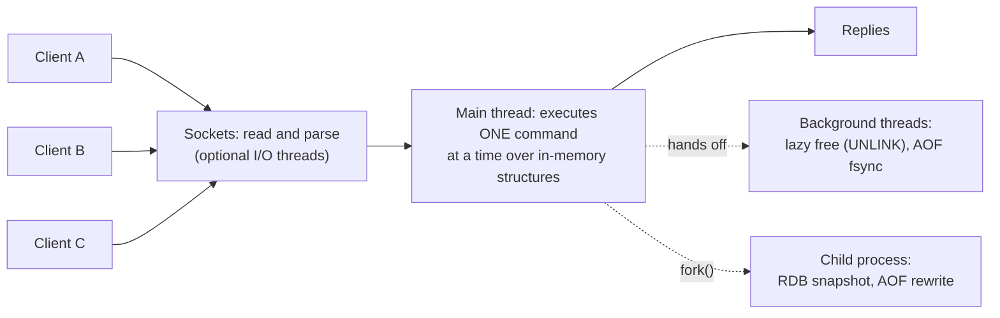
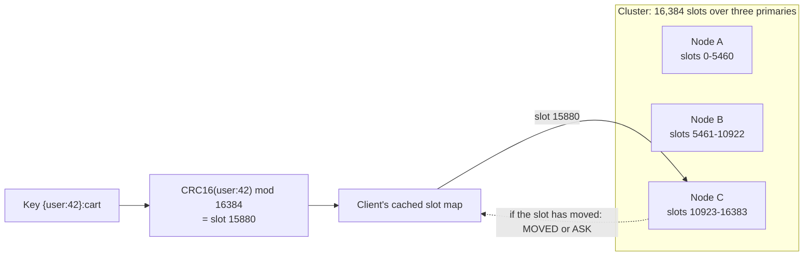
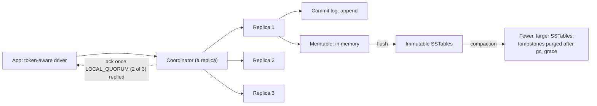

[⬅️ Prev: 33 · Mock Interviews](33-annotated-mock-interviews.md) · [🏠 Index](README.md) · [Next: 35 · AI Features in Java ➡️](35-ai-features-spring-ai-langchain4j-rag.md)

# 34 · Data Stores: Redis, Cassandra & DynamoDB

> *A relational database lets you ask questions you didn't plan for. Redis, Cassandra and DynamoDB ask you to plan the questions up front, and repay you with predictable latency at almost any scale. Most expensive mistakes with them come from forgetting which kind of database you're using.*

The Redis experiments in §3–§6 and §8 ran from JDK 25 against Redis 7.0 (Ubuntu's package), through a small RESP client in the labs, so no client library hides what happens on the wire. The hash-slot check in §7 ran against a cluster-mode node. These commands behave the same on Redis 8 and Valkey. No Cassandra cluster or DynamoDB endpoint was available here, so §10–§14 are design guidance with worked arithmetic, not measurements.

🧪 **Runnable labs:** [the programs behind this chapter's outputs](labs.md#chapter-34--data-stores)

---

## Table of contents
1. [Choosing a store: what each one is for](#1-choosing-a-store-what-each-one-is-for-)
2. [Redis: the model that explains everything](#2-redis-the-model-that-explains-everything-)
3. [Round trips and pipelining (measured)](#3-round-trips-and-pipelining-measured-)
4. [Commands that stop the world: KEYS and big deletes (measured)](#4-commands-that-stop-the-world-keys-and-big-deletes-measured-)
5. [Atomic read-modify-write (measured)](#5-atomic-read-modify-write-measured-)
6. [Memory, eviction and expiry (measured)](#6-memory-eviction-and-expiry-measured-)
7. [Persistence, replication and Redis Cluster](#7-persistence-replication-and-redis-cluster-)
8. [Redis patterns: caches, locks, rate limits, streams (measured)](#8-redis-patterns-caches-locks-rate-limits-streams-measured-)
9. [Redis from Java](#9-redis-from-java-)
10. [Cassandra: the architecture in one page](#10-cassandra-the-architecture-in-one-page-)
11. [Cassandra data modelling: queries first](#11-cassandra-data-modelling-queries-first-)
12. [DynamoDB: the model and its limits](#12-dynamodb-the-model-and-its-limits-)
13. [DynamoDB single-table design, worked through](#13-dynamodb-single-table-design-worked-through-)
14. [Cassandra and DynamoDB from Java](#14-cassandra-and-dynamodb-from-java-)
15. [Staff lens](#15-staff-lens-)
16. [Interview questions](#16-interview-questions)
17. [References](#17-references)

---

## 1. Choosing a store: what each one is for 🟡

| | Redis / Valkey | Cassandra | DynamoDB | PostgreSQL (for contrast) |
|---|---|---|---|---|
| **Data lives** | In memory, optionally persisted | On disk, replicated across nodes | On disk, managed, replicated across AZs | On disk, one primary |
| **Latency** | Sub-millisecond | Single-digit milliseconds | Single-digit milliseconds | Milliseconds |
| **Model** | Data structures by key | Wide partitions; one table per query | Items in partitions; designed per access pattern | Relations, ad-hoc SQL |
| **Scales by** | Sharding over 16,384 slots | Adding nodes (near-linear writes) | Automatic partitioning, no servers | Bigger machine, replicas, partitioning |
| **Transactions** | Atomic commands, MULTI/EXEC, Lua (one shard) | Per-partition LWT; Accord multi-partition ACID in 6.0 (alpha in 2026) | Up to 100 items, serializable | Full ACID |
| **Operations** | Memory sizing, persistence, failover | Repair, compaction, tombstones, capacity | Almost none, but AWS-only and priced per request | Moderate |
| **Typical use** | Cache, sessions, counters, rate limits, leaderboards, short-lived coordination | Write-heavy time series, messaging, IoT, multi-datacentre active-active | AWS services with known access patterns at any scale: carts, user state, orders | System of record; evolving queries; reporting |

> [!NOTE]
> **The position I'd defend:** keep a relational database as the system of record unless you have a measured reason not to. Add Redis for what memory is good at (caching, counters, rate limits, short-lived coordination), each use with a TTL and a plan for Redis being empty or down. Reach for Cassandra or DynamoDB when access patterns are known and stable, and write volume, data size or availability targets outgrow one primary. Between those two: DynamoDB if you're on AWS and want to operate nothing; Cassandra for multi-cloud or on-premises, very high write rates, or cost control at scale, with the operational investment that requires.

---

## 2. Redis: the model that explains everything 🟡→🔴

- **In memory, with optional persistence.** Data structures are the API: strings, hashes, lists, sets, sorted sets, streams, bitmaps, HyperLogLog and geo indexes. Redis 8 folded the former Redis Stack modules into the core (JSON, search and vector indexes, time series, probabilistic structures), and 8.8 added an array type.
- **One command at a time.** The main thread executes commands sequentially over in-memory structures. That is why every single command is atomic, and why **one slow command delays every client**. Since Redis 6, optional I/O threads can read and write sockets in parallel, but command execution stays single-threaded.
- **Complexity is the performance model.** Most commands are O(1) or O(log N). Commands that walk a whole collection are O(N): `KEYS`, `SMEMBERS` or `HGETALL` on a huge collection, `DEL` of a big key, `LRANGE 0 -1`, long Lua scripts. §4 measures what they cost everybody else.
- **Licensing, which platform interviews do ask about.** Redis was BSD-licensed until 7.2. In March 2024 it moved to RSALv2/SSPLv1, and the Linux Foundation forked 7.2.4 as **Valkey** (BSD), which cloud providers adopted for their managed services. Redis 8 (May 2025) added **AGPLv3** as a third licence option. Valkey 9.0 (October 2025) added atomic slot migration, per-field hash expiration and multiple databases in cluster mode. Both speak the same protocol (RESP), so Java clients work with either.



---

## 3. Round trips and pipelining (measured) 🔴

Every command costs a network round trip. The lab sent 10,000 `SET`s directly, then through a proxy that delays traffic by 0.25 ms in each direction (with its own overhead, a round trip came to about 0.8 ms, similar to a hop between availability zones):

```
1. Round trips vs pipelining
  localhost, one command per round trip      10,000 ops in    156.3 ms =     63,982 ops/s
  localhost, pipelined (batches of 1,000)    10,000 ops in      9.6 ms =  1,039,460 ops/s
  (through the delay proxy, a PING round trip now takes 0.8 ms)
  0.8 ms RTT, one command per round trip      1,000 ops in    851.5 ms =      1,174 ops/s
  0.8 ms RTT, pipelined (batches of 1,000)   10,000 ops in     24.2 ms =    413,720 ops/s
  0.8 ms RTT, MSET with 1,000 keys each      10,000 ops in     15.0 ms =    668,372 ops/s
```

**What it shows:**
1. **Over a real network, one-at-a-time throughput is capped by latency, not by Redis.** One connection with one command in flight can do at most 1/RTT operations per second: about 1,200/s here. That's Little's law ([Chapter 21 §2](21-performance-engineering-troubleshooting.md#2-the-laws-little-amdahl-and-the-queueing-knee-)).
2. **Pipelining was about 350× faster** at 0.8 ms RTT: the client writes 1,000 commands, then reads 1,000 replies. Multi-key commands (`MSET`, `MGET`, `HSET` with many fields) go further by sending one command instead of many.
3. Even on localhost, pipelining won by more than 10×, because every round trip costs system calls and context switches. (One-at-a-time localhost throughput varied between about 32,000 and 107,000 operations per second across runs on this 2-vCPU VM. The ratios were stable.)

💣 **Pipelining isn't a transaction.** Other clients' commands interleave with yours, and some commands in a pipeline can fail while others succeed. In Redis Cluster, a pipeline has to be split per node; Lettuce and Jedis do that for you.

🧠 **N+1 queries exist here too.** A loop of `HGET`s over 200 product IDs on a request path is 200 round trips, about 160 ms at this latency. Batch it (`MGET`, a pipeline, or a Lua script) the same way you'd fix an ORM N+1 ([Chapter 19 §8](19-persistence-jdbc-jpa-hibernate.md#8-fetching-and-the-n1-problem-)).

---

## 4. Commands that stop the world: KEYS and big deletes (measured) 🔴

A second client sent one `PING` per millisecond and recorded how long each waited, while the first ran the command under test:

```
2. KEYS blocks every client; SCAN doesn't
  loaded 1,000,000 keys
  KEYS *   returned 1,000,000 keys in    624 ms   | other client: worst PING 282.0 ms, 1 of 246 PINGs over 10 ms
  SCAN     visited 1,000,000 keys in    834 ms (1,000 calls) | other client: worst PING 4.5 ms, 0 of 495 PINGs over 10 ms

3. Deleting one big key: DEL vs UNLINK
  DEL    a 2,000,000-field hash (123.48M): the command took  588.66 ms, lazyfree_pending_objects=0 | other client: worst PING 588.6 ms, 1 of 252 PINGs over 10 ms
  UNLINK a 2,000,000-field hash (123.48M): the command took    0.81 ms, lazyfree_pending_objects=1 | other client: worst PING 0.1 ms, 0 of 270 PINGs over 10 ms
```

- **`KEYS *` froze the server for about 280 ms** (the rest of the 624 ms was moving a million keys to the client). Every other client waited behind it. At 10,000 requests per second, that's around 2,800 requests delayed by up to 280 ms, from one administrative command.
- **`SCAN` did the same job in 1,000 small slices.** It took longer in total, but nobody else waited more than 4.5 ms. Its contract: a cursor you pass back each time; it may return a key twice; keys that exist for the whole iteration are guaranteed to be returned; `COUNT` is a hint; `MATCH` filters *after* fetching, so a selective pattern can return empty pages. `HSCAN`, `SSCAN` and `ZSCAN` do the same inside one big collection.
- **Deleting a 2-million-field hash with `DEL` blocked everyone for 589 ms.** Freeing memory is O(N). **`UNLINK` returned in under a millisecond** and freed the memory on a background thread (`lazyfree_pending_objects=1` shows the work queued). `lazyfree-lazy-user-del yes` makes `DEL` behave like `UNLINK`; the related `lazyfree-lazy-eviction`, `lazyfree-lazy-expire` and `FLUSHALL ASYNC` cover the other ways big keys get freed.

**Finding and preventing these:** `redis-cli --bigkeys` and `--memkeys` (they sample with `SCAN`), `MEMORY USAGE key`, `SLOWLOG GET`, and `LATENCY DOCTOR`. Use ACLs to take dangerous commands away from application users (for example `-@dangerous`, which covers `KEYS`, `FLUSHALL` and `DEBUG`), and keep collections bounded by design: a hash per user, not one hash for all users.

---

## 5. Atomic read-modify-write (measured) 🔴

Four clients each incremented one counter 2,500 times, four different ways:

```
4. Read-modify-write: 4 clients x 2,500 increments each
  GET, then SET                        counter= 3,286 of 10,000  (lost 6,714)  retries=0  212 ms
  WATCH + MULTI/EXEC, retry on abort   counter=10,000 of 10,000  (correct)  retries=13,284  826 ms
  INCR                                 counter=10,000 of 10,000  (correct)  retries=0  115 ms
  Lua script (atomic on the server)    counter=10,000 of 10,000  (correct)  retries=0  152 ms
```

- **`GET` then `SET` lost two thirds of the increments.** Each command is atomic; the pair isn't. It's the same lost update as `count++` across threads ([Chapter 11 §5](11-concurrency-foundations-jmm.md)), now across the network.
- **Prefer a command that does the whole operation on the server:** `INCR`/`INCRBY`, `HINCRBY`, `ZINCRBY`, `SET … NX`/`XX`/`GET`, `GETDEL`, `LMOVE`. Redis 8.4 added compare-and-set and compare-and-delete for strings (`SET key value IFEQ old`, `DELEX key IFEQ value`).
- **Lua scripts (and Redis 7 Functions) run atomically:** nothing else executes while they run. That also means a slow script blocks everyone like any slow command; past `busy-reply-threshold` (5 seconds by default) other clients get `BUSY` errors. Keep scripts short and bounded.
- **`WATCH` + `MULTI`/`EXEC` is optimistic locking.** `EXEC` returns null if a watched key changed, and you retry. It was correct, but under contention it needed 13,284 retries for 10,000 increments and was 7× slower than `INCR`.
- 💣 **`MULTI`/`EXEC` alone doesn't solve read-modify-write.** Commands inside it are queued, so you can't read a value and decide based on it. And there's **no rollback**: if one queued command fails at run time (a wrong type, say), the others still apply.

---

## 6. Memory, eviction and expiry (measured) 🔴

With `maxmemory 32mb`, the lab wrote 60,000 values of 1 KB, without TTLs, under three policies:

```
5. maxmemory 32mb, writing 60,000 values of 1 KB (no TTLs)
  noeviction    wrote 24,061  evicted      0  key:0 still there: true   then: OOM command not allowed when used memory > 'maxmemory'.
  volatile-lru  wrote 24,060  evicted      0  key:0 still there: true   then: OOM command not allowed when used memory > 'maxmemory'.
  allkeys-lru   wrote 60,000  evicted 35,941  key:0 still there: false  no errors
```

- **The default policy, `noeviction`, rejects writes when memory is full.** A cache must be configured to evict.
- 💣 **`volatile-*` policies only evict keys that have a TTL.** The application here forgot TTLs, so `volatile-lru` behaved exactly like `noeviction`. This shows up in production as "the cache started failing writes".
- **`allkeys-lru` or `allkeys-lfu` for a pure cache;** `volatile-lru`/`volatile-lfu`/`volatile-ttl` only when the same instance also holds keys that must never be evicted (a separate instance is cleaner). LRU and LFU are approximated by sampling a few keys (`maxmemory-samples`, 5 by default).
- **Per-key overhead is large.** 24,061 values of 1 KB filled 32 MB: about 1.4 KB per key. For small values the overhead (dictionary entry, key object, allocator rounding) can exceed the data. Small hashes, lists, sets and sorted sets use compact encodings (listpack, up to 128 entries of up to 64 bytes for hashes by default), which is why grouping small objects into hashes saves memory.
- **Expiry is lazy plus active.** A key is deleted when someone touches it after its TTL, or when a background cycle samples keys with TTLs and finds it expired. Replicas don't expire keys on their own; they apply the primary's deletes. Give every cache key a TTL, with jitter so they don't all expire together ([Chapter 23 §11](23-distributed-systems-microservices.md#11-caching-in-distributed-systems-)). Redis 7.4 and Valkey 9.0 can also expire individual hash fields (`HEXPIRE`).
- **Watch `used_memory` vs `used_memory_rss`** (`INFO memory`): their ratio is fragmentation, and `activedefrag` can reclaim it. Leave headroom for the copy-on-write that persistence causes (§7).

---

## 7. Persistence, replication and Redis Cluster 🔴

### Persistence

| Mode | How | On a crash you lose | Cost |
|---|---|---|---|
| None | A pure cache | Everything | Nothing |
| RDB snapshot | `fork()`; the child writes a compact snapshot while the parent keeps serving | Everything since the last snapshot (often minutes) | Fork pauses on large datasets; copy-on-write can nearly double memory under heavy writes |
| AOF, `appendfsync everysec` (the usual) | Every write appended; fsync once per second | About one second | Disk I/O; periodic AOF rewrite (Redis 7 uses a multi-part AOF) |
| AOF, `appendfsync always` | fsync on every write | Almost nothing, on that node | Throughput bounded by fsync latency |

### Replication and failover
- **Replication is asynchronous.** The primary acknowledges your write before replicas have it, so a failover (Sentinel or Cluster) can **lose acknowledged writes**.
- `WAIT numreplicas timeout` blocks until replicas acknowledge, and `WAITAOF` (7.2) waits for fsync. They shrink the window but, as the Redis documentation itself says, they don't make Redis strongly consistent.
- **Sentinel** monitors a primary and its replicas, promotes a replica on failure, and tells clients the new primary. `min-replicas-to-write` limits how long an isolated primary keeps accepting writes.
- 💣 **Don't make Redis the only copy of data you can't lose** unless you've designed for these windows, or you use a durable variant such as Amazon MemoryDB, which commits writes to a multi-AZ transaction log before acknowledging them.

### Redis Cluster
- The keyspace is split into **16,384 hash slots**: `slot = CRC16(key) mod 16384`. Each primary owns ranges of slots, each with its own replicas, and failover needs agreement from a majority of primaries.
- Clients cache the slot map. A `MOVED` reply means "this slot lives elsewhere now" (refresh the map); `ASK` is a one-off redirect during a migration. Redis 8.4 (`CLUSTER MIGRATION`) and Valkey 9.0 added atomic slot migration.
- 💣 **Multi-key operations must stay in one slot.** `MGET`, `MULTI`/`EXEC` and Lua across slots fail with `CROSSSLOT`. **Hash tags** put related keys in one slot: only the part between the first `{` and the first `}` after it is hashed. The lab's CRC16 matched the server on every key:

```
  user:42                slot 15880  = CLUSTER KEYSLOT
  user:43                slot 11817  = CLUSTER KEYSLOT
  cart:user:42           slot  7950  = CLUSTER KEYSLOT
  {user:42}:cart         slot 15880  = CLUSTER KEYSLOT
  {user:42}:profile      slot 15880  = CLUSTER KEYSLOT
  {user:42}:orders       slot 15880  = CLUSTER KEYSLOT
  {}user:42              slot 14080  = CLUSTER KEYSLOT
  user:{}42              slot 13116  = CLUSTER KEYSLOT
  {user:42               slot  6315  = CLUSTER KEYSLOT
  x{user:42}y{order:7}   slot 15880  = CLUSTER KEYSLOT
```

An empty `{}` or an unclosed brace means the whole key is hashed, and only the first tag counts (`x{user:42}y{order:7}` lands with `user:42`). 💣 **Hash tags concentrate load:** tag every key of a huge tenant with `{tenant:1}` and that tenant lives on one shard, along with its traffic.



---

## 8. Redis patterns: caches, locks, rate limits, streams (measured) 🔴

### Caches and sessions
Cache-aside with a TTL on every key, delete on write, stampede protection, negative caching for missing keys ([Chapter 23 §11](23-distributed-systems-microservices.md#11-caching-in-distributed-systems-)). Two more things matter at scale: **client-side caching** (RESP3 key tracking, where the server tells the client when a cached key changes) for a handful of very hot keys, and a **cache-down plan**: can the database survive a cold or missing cache, and does a circuit breaker stop every request from waiting on a dead Redis? Sessions are the same pattern with a sliding TTL (Spring Session Data Redis).

### Counters, leaderboards, rate limits
Sorted sets give leaderboards for free: `ZINCRBY` and `ZADD` are O(log N), `ZREVRANGE` reads the top-k, `ZREVRANK` a user's position. For a fixed-window rate limit, `INCR` then `EXPIRE key 60 NX` (the `NX` option, Redis 7) avoids resetting the window on every hit; a token bucket in Lua ([Chapter 24 §6](24-system-design-for-java-architects.md#6-rate-limiting-algorithms-and-a-java-token-bucket-)) is smoother, and Redis 8.8 added a native window-counter command, `INCREX`.

### Locks (measured)
Two clients, a 200 ms lease, and a holder that stalls for 300 ms (a GC pause, a slow call):

```
6. A 200 ms lock lease, and a client that pauses for 300 ms
  A: SET lock NX PX 200 -> OK, fencing token 1
  B: SET lock NX PX 5000 -> OK, fencing token 2   (A's lease expired while A was paused)
  A wakes up, finishes, and releases with plain DEL -> deleted 1 key: B's lock is gone (EXISTS=0)
  Same release as compare-and-delete (Lua) -> deleted 0: B's lock survives (EXISTS=1)
  Storage that checks fencing tokens: A's write with token 1 -> rejected; data = 'written by B'
```

1. **Acquire** with one command, `SET key <random token> NX PX <ttl>`, never `SETNX` followed by `EXPIRE` (a crash between them leaves a lock that never expires).
2. **Release** with compare-and-delete: the Lua script in the lab, or `DELEX key IFEQ token` on Redis 8.4+. A plain `DEL` deleted somebody else's lock.
3. **A lease can expire under a paused holder**, so for a while *two* clients believe they hold the lock. Only a **fencing token checked by the resource** makes that safe ([Chapter 23 §12](23-distributed-systems-microservices.md#12-coordination-consensus-leader-election-locks--fencing-)). Redlock (the multi-node variant) doesn't fix pauses.
4. **Use Redis locks for efficiency** (avoid doing the same work twice), not correctness. For correctness, use the database: a unique constraint, a conditional update, or `SELECT … FOR UPDATE SKIP LOCKED`.

### Streams vs Pub/Sub (measured)

```
7. Streams: a consumer dies before XACK; another one reclaims its messages
  c1 read 3 messages and crashed before XACK
  c2 read and acknowledged the other 3
  XPENDING summary: [3, 1794824882462-0, 1794824882462-2, [[c1, 3]]]
  c2: XAUTOCLAIM min-idle 100 ms -> claimed 3 messages
    pending 1794824882462-0 owner=c2 delivered 2 times
    pending 1794824882462-1 owner=c2 delivered 2 times
    pending 1794824882462-2 owner=c2 delivered 2 times
  after XACK, pending = 0
  PUBLISH to a channel with nobody subscribed -> received by 0 clients; the message is gone
```

- **Streams with consumer groups are at-least-once.** Messages read but not acknowledged sit in the pending entries list (PEL) of the consumer that read them. When a consumer dies, another one claims messages that have been idle long enough (`XAUTOCLAIM`; Redis 8.4 adds a `CLAIM` option to `XREADGROUP` that reads idle pending and new messages in one call). The delivery count tells you when a message keeps failing: after N deliveries, move it to a dead-letter stream. Consumers must be idempotent.
- **Bound the memory:** `XADD … MAXLEN ~ 1000000` or `MINID` trims old entries. A stream lives in RAM, so it isn't Kafka: choose Kafka for long, disk-backed retention, replay, very high throughput or many independent consumer groups ([Chapter 23 §10](23-distributed-systems-microservices.md#10-kafka-for-java-engineers-)).
- **Pub/Sub is at-most-once.** Nothing is stored; a subscriber that's disconnected misses the message (`PUBLISH` returned 0 receivers). It's fine for cache-invalidation hints and live notifications, not for anything that must arrive.

---

## 9. Redis from Java 🟡→🔴

| Client | Model | Notes |
|---|---|---|
| **Lettuce** (Spring Boot's default) | Netty-based; sync, async and reactive APIs; one thread-safe connection shared by many threads | Pool connections only for blocking commands (`BLPOP`) and `MULTI`/`WATCH`, which carry connection state. **The default command timeout is 60 seconds**, so set your own |
| **Jedis** | Blocking; one connection per thread at a time | Use `JedisPool`; pool size caps concurrency, which is useful with virtual threads |
| **Redisson** | High-level distributed objects: locks (with a lease-extending watchdog), maps, queues, rate limiters | Convenient, with the same lease caveats as §8 |
| **Valkey GLIDE** | Rust core with a Java binding, from the Valkey project | For Valkey and Redis OSS |

```properties
spring.data.redis.timeout=250ms              # command timeout: Lettuce's own default is 60 s
spring.data.redis.connect-timeout=200ms      # lower than the command timeout
spring.cache.type=redis
spring.cache.redis.time-to-live=10m          # every @Cacheable entry gets a TTL
spring.cache.redis.cache-null-values=false
```

- 💣 **Serialisation:** a `RedisTemplate<Object, Object>` defaults to JDK serialisation: opaque bytes, coupled to class versions, and a gadget-chain risk if anyone else can write to the instance ([Chapter 13 §10](13-io-nio-networking-serialization.md#10-java-serialization-and-why-its-dangerous-)). Use `StringRedisTemplate` or a JSON serialiser, and **version your key names** (`price:v2:{sku}`) so a deploy never reads an old shape.
- **Timeouts and retries:** a command timeout that fits your latency budget (hundreds of milliseconds, not 60 seconds), retries only for idempotent commands (`INCR` isn't one), and a circuit breaker around cache reads with a fallback to the database ([Chapter 22 §8](22-production-readiness-observability-resilience.md#8-resilience-patterns-)).
- **Observability:** command latency per command type (Lettuce publishes Micrometer metrics), connection counts, `evicted_keys`, `keyspace_misses`, replication lag, and the slow log.

---

## 10. Cassandra: the architecture in one page 🔴

- **A ring of equal nodes, with no primary.** Each row's **partition key** is hashed with Murmur3 to a token, and each node owns ranges of tokens (16 virtual nodes per node by default since 4.0). Any node can coordinate a request; token-aware drivers send it straight to a replica.
- **Replication factor per keyspace and datacentre** (`NetworkTopologyStrategy`, for example `{'dc1': 3, 'dc2': 3}`).
- **Consistency per request:** `ONE`, `LOCAL_QUORUM`, `QUORUM`, `EACH_QUORUM`, `ALL`, plus `SERIAL`/`LOCAL_SERIAL` for lightweight transactions. With RF = 3, writing and reading at `LOCAL_QUORUM` (2 + 2 > 3) gives read-your-writes within a datacentre ([Chapter 23 §5](23-distributed-systems-microservices.md#5-cap-pacelc-and-consistency-models-)).
- **Write path (a log-structured merge tree):** append to the commit log, write to the memtable, acknowledge. Memtables flush to immutable SSTables, and compaction merges them. Writes are sequential I/O, which is why Cassandra absorbs write-heavy workloads so well ([Chapter 24 §3](24-system-design-for-java-architects.md#3-building-blocks-you-must-be-fluent-in-) compares B-trees and LSM trees).
- **Read path:** merge the memtable and the SSTables that might hold the partition (Bloom filters skip the others); for each cell, the newest timestamp wins. A read that touches many SSTables is slow, which is why the compaction strategy matters: size-tiered for write-heavy, leveled for read-heavy, time-window for TTL'd time series, and 5.0's Unified Compaction Strategy, which can be tuned to behave like either of the first two.
- **Deletes write tombstones**, which compaction purges only after `gc_grace_seconds` (10 days by default), and only safely if **repair** has run on every replica in that window; otherwise deleted data can come back.
- **Anti-entropy:** hinted handoff (writes held for a replica that's briefly down, 3 hours by default), read repair, and regular repair (`nodetool repair`, or the repair scheduler that 6.0 builds into the database).
- **Versions:** 5.0 (September 2024) brought storage-attached indexes (SAI), vector search, UCS and Java 17 support, and is the production line in 2026. 6.0, in alpha during 2026, brings **Accord** (multi-partition ACID transactions), Transactional Cluster Metadata, automated repair and a JDK 21 default.



---

## 11. Cassandra data modelling: queries first 🔴

1. **List the queries first.** Then design one table per query, and denormalise: the same data written to several tables, each keyed for one access pattern.
2. **The partition key decides placement** and must spread load. Every query must restrict it. A query that doesn't needs `ALLOW FILTERING`, which means scanning partitions across the cluster: a design smell.
3. **Clustering columns decide the order inside a partition**, which makes range slices ("the last 50", "between two times") cheap.
4. **Bound every partition.** A common guideline is to stay under roughly 100 MB and 100,000 rows. Bucket by time when a partition would grow forever.
5. **Avoid hot partitions** (one celebrity account, one global counter) and **delete-heavy patterns** (queues).
6. **Writes are upserts**, so plain writes are idempotent and safe to retry. Lightweight transactions (`IF NOT EXISTS`, `IF col = ?`) run Paxos, with several round trips per write; use them only where you need compare-and-set.

**A worked example: messages by conversation**
```sql
CREATE TABLE chat.messages_by_conversation (
    conversation_id uuid,
    day             date,                    -- the bucket: keeps each partition bounded
    message_id      timeuuid,                -- time-ordered and unique
    sender_id       uuid,
    body            text,
    PRIMARY KEY ((conversation_id, day), message_id)
) WITH CLUSTERING ORDER BY (message_id DESC)
  AND default_time_to_live = 31536000;       -- one year

-- the newest 50 messages of the day: one partition, already in order
SELECT message_id, sender_id, body FROM chat.messages_by_conversation
 WHERE conversation_id = ? AND day = ? LIMIT 50;
```

| Design, for a busy group chat with 20,000 messages a day of about 500 bytes | One day | After three years |
|---|---|---|
| `PRIMARY KEY (conversation_id, message_id)` | The partition grows by about 10 MB | About 11 GB in one partition: slow reads, painful compaction and repair, one hot set of replicas |
| `PRIMARY KEY ((conversation_id, day), message_id)` | One partition of about 10 MB | About 1,100 partitions of about 10 MB, spread across the ring |

The same arithmetic sizes a time-series bucket: a sensor reporting once a second writes 86,400 rows a day, about 5 MB at 60 bytes each, so daily buckets are fine; at 100 readings a second, bucket by hour.

**Uniqueness, with a lookup table and a lightweight transaction:**
```sql
CREATE TABLE users_by_email (email text PRIMARY KEY, user_id uuid);
INSERT INTO users_by_email (email, user_id) VALUES (?, ?) IF NOT EXISTS;   -- [applied] = false if taken
```

**The rest of the toolbox, with its caveats:**
- **Logged batches** keep denormalised tables in step (all the writes eventually apply, or none do), but without isolation. They aren't a bulk-loading tool: a large multi-partition batch overloads its coordinator.
- **SAI indexes** (5.0) answer queries on other columns, and best when the partition key is also restricted. Vector search in 5.0 builds on SAI ([Chapter 35](35-ai-features-spring-ai-langchain4j-rag.md)).
- **Materialized views** are still experimental and disabled by default. Maintain your own denormalised tables instead.
- **Counters** are a special column type, and they aren't idempotent: a retried increment can count twice.
- 💣 **Cassandra as a queue:** workers insert jobs and delete them when done. Each delete leaves a tombstone, and reads at the head of the partition scan more and more of them, until they pass `tombstone_warn_threshold` (1,000) and then fail at `tombstone_failure_threshold` (100,000). Use a log (Kafka) or a database queue (`SKIP LOCKED`) instead.

---

## 12. DynamoDB: the model and its limits 🔴

- **Tables hold items** of up to **400 KB** (attribute names count). The primary key is a **partition key**, or a partition key plus a **sort key**; items sharing a partition key form an **item collection**, sorted by sort key.
- **Reads:** `GetItem` by full key; `Query` within one partition key with a sort-key condition (`=`, `<`, `between`, `begins_with`), forwards or backwards, up to 1 MB per page (continue with `LastEvaluatedKey`). `Scan` reads the whole table. 💣 A `FilterExpression` is applied *after* the read: you pay for everything read, not for what was returned.
- **Capacity:** one read capacity unit is one strongly consistent read per second of up to 4 KB (or two eventually consistent ones); one write capacity unit is one write per second of up to 1 KB; transactions cost twice as much. **On-demand** mode bills per request; since AWS halved its price in November 2024, AWS says most workloads come out cheaper on it. **Provisioned** mode with auto scaling (and reserved capacity) still wins for steady, predictable, well-utilised load.
- **Physical partitions** each serve up to **3,000 RCU and 1,000 WCU** and hold about 10 GB. DynamoDB splits partitions as data and traffic grow, and adaptive capacity shifts throughput towards hot partitions, but **no single partition key value can go past those per-partition limits**. Exceed them and requests are throttled, however much capacity the table has.
- **Global secondary indexes:** their own key schema and capacity, **eventually consistent only**, up to 20 per table, and *sparse* (an item without the index's key attributes isn't in the index). 💣 In provisioned mode, a GSI that can't keep up throttles writes to the base table. **Local secondary indexes** share the partition key with another sort key, allow strongly consistent reads, must be created with the table, and cap each item collection at 10 GB.
- **Consistency:** reads are eventually consistent unless you ask for a strongly consistent read (base table only).
- **Conditional writes** (`attribute_not_exists(pk)`, `version = :expected`) give create-if-absent and optimistic locking. **Transactions** group up to 100 actions (4 MB in total) with serializable isolation for those items; a `ClientRequestToken` makes `TransactWriteItems` idempotent for 10 minutes.
- **Streams** are a 24-hour, per-item-ordered change log: DynamoDB's built-in outbox ([Chapter 23 §6](23-distributed-systems-microservices.md#6-the-dual-write-problem--the-transactional-outbox-)).
- **TTL** deletes expired items in the background, "typically within a few days", without using write capacity, so filter expired items out on read. TTL deletes appear in Streams, which is how you archive them.
- **Global tables** replicate across Regions: multi-Region eventual consistency (the default; last writer wins) or **multi-Region strong consistency** (GA June 2025). Since February 2026 replicas can live in different AWS accounts.
- **Vector search** (GA August 2026) indexes embeddings stored in items and queries them with a new `SearchVectors` API ([Chapter 35 §6](35-ai-features-spring-ai-langchain4j-rag.md#6-vector-stores-and-indexes-measured-)).

---

## 13. DynamoDB single-table design, worked through 🔴→🟣

**Step 1: write the access patterns down.** For an order service:

| # | Access pattern | Volume |
|---|---|---|
| 1 | Customer profile and their 10 newest orders (account page) | High |
| 2 | One order by ID (support tools, webhooks) | High |
| 3 | Open orders for the warehouse, oldest first | Medium; must not create a hot key |
| 4 | Create a customer with a unique email | Low |
| 5 | Change an order's status without lost updates | Medium |

**Step 2: design keys that answer them.** One table, generic key attributes (`PK`, `SK`, `GSI1PK`, …), and entity types distinguished by key prefixes:

| Item | `PK` | `SK` | `GSI1PK` / `GSI1SK` | `GSI2PK` / `GSI2SK` | Other attributes |
|---|---|---|---|---|---|
| Customer | `CUST#42` | `PROFILE` | | | name, email |
| Order | `CUST#42` | `ORDER#2026-11-16T10:15:00Z#A-1001` | `ORDER#A-1001` / `ORDER#A-1001` | `OPEN#3` / `2026-11-16T10:15:00Z` while open | status, total, items (bounded), version |
| Email claim | `EMAIL#jane@example.com` | `EMAIL` | | | customerId |

**Step 3: check every pattern is one request:**
1. **Profile and newest orders:** `Query PK = CUST#42`, newest first, `Limit 11`. Because `PROFILE` sorts after `ORDER#…` (`P` > `O`), a descending query returns the profile first, then the 10 newest orders. One request, one item collection.
2. **Order by ID:** `Query GSI1 where GSI1PK = ORDER#A-1001`. GSI1 inverts the relationship so an order can be found without knowing its customer.
3. **Open orders:** GSI2 is **sparse**: only open orders carry `GSI2PK`, so the index holds exactly the warehouse's work. The status is **write-sharded** over 10 keys (`OPEN#0` … `OPEN#9`, chosen by hashing the order ID). At 3,000 new orders a second, a single `OPEN` key would need 3,000 writes per second on one GSI partition, three times its 1,000 WCU limit, and the GSI's back-pressure would throttle the table. Spread over 10 shards, each takes 300. Readers query the 10 shards in parallel and merge by `GSI2SK`. When an order ships, `UpdateItem` removes `GSI2PK` and the order leaves the index.
4. **Unique email:** `TransactWriteItems` with two puts, the customer and the email claim, each conditioned on `attribute_not_exists(PK)`: both succeed or neither does.
5. **Status changes:** `UpdateItem … ConditionExpression version = :expected`, incrementing `version`; on `ConditionalCheckFailedException`, re-read and retry ([Chapter 19 §5](19-persistence-jdbc-jpa-hibernate.md#5-locking-optimistic-pessimistic-skip-locked-)).

🧠 **When single-table design is the wrong tool:** access patterns that are unknown or keep changing, analytics (export to S3 and query it there instead), or entities owned by different teams (a table per bounded context is fine). The principle that matters isn't "one table"; it's "**design keys for access patterns, and fetch related items in one request**". Changing a key design later means a new GSI or a migration to a new table, with a backfill throttled to your capacity.

---

## 14. Cassandra and DynamoDB from Java 🟡→🔴

**DynamoDB with the AWS SDK for Java 2.x Enhanced Client** (the code wasn't run here):
```java
@DynamoDbBean
public class OrderItem {
    private String pk, sk, status, gsi2pk, gsi2sk;
    private Long version;

    @DynamoDbPartitionKey public String getPk() { return pk; }
    @DynamoDbSortKey      public String getSk() { return sk; }
    @DynamoDbVersionAttribute public Long getVersion() { return version; }      // optimistic locking on every write
    @DynamoDbSecondaryPartitionKey(indexNames = "GSI2") public String getGsi2pk() { return gsi2pk; }
    @DynamoDbSecondarySortKey(indexNames = "GSI2")      public String getGsi2sk() { return gsi2sk; }
    // setters omitted
}

DynamoDbTable<OrderItem> orders = enhanced.table("shop", TableSchema.fromBean(OrderItem.class));

// access pattern 1: profile + 10 newest orders, one Query on one item collection
var page = orders.query(r -> r.queryConditional(QueryConditional.keyEqualTo(k -> k.partitionValue("CUST#42")))
                              .scanIndexForward(false)
                              .limit(11));
```
- The version attribute adds `version = :expected` to every put and update, and a conflict surfaces as `ConditionalCheckFailedException`.
- **Throttling is normal behaviour, not an outage:** the SDK retries with backoff, but set call and attempt timeouts, and alarm on `ThrottledRequests` and consumed capacity. `ReturnConsumedCapacity` in tests shows what each access pattern costs.
- `BatchWriteItem` (25 items) and `BatchGetItem` (100 items) can partly fail: retry the `UnprocessedItems`, with backoff.

**Cassandra with the Apache Cassandra Java driver** (`org.apache.cassandra:java-driver-core`, the former DataStax driver, 4.18+):
```java
try (CqlSession session = CqlSession.builder().withKeyspace("chat").build()) {    // contact points and local DC in application.conf
    PreparedStatement latest = session.prepare("""
            SELECT message_id, sender_id, body FROM messages_by_conversation
             WHERE conversation_id = ? AND day = ? LIMIT 50""");
    ResultSet rows = session.execute(latest.bind(conversationId, LocalDate.now(ZoneOffset.UTC))
            .setConsistencyLevel(DefaultConsistencyLevel.LOCAL_QUORUM)
            .setIdempotent(true));                                                  // lets the driver retry and speculate safely
    for (Row row : rows) render(row.getUuid("sender_id"), row.getString("body"));
}
```
- **One `CqlSession` per application:** it's thread-safe and expensive to create. **Prepare once, bind many**; a prepared statement with the partition key bound lets the driver route straight to a replica.
- **Mark idempotent statements idempotent** (plain inserts and updates are; counter updates and lightweight transactions aren't); only then will the driver retry them or send speculative duplicates to cut tail latency.
- Configure the local datacentre (required by the default load-balancing policy), the request timeout (2 seconds by default) and the page size (5,000 rows by default); page through large results with the paging state.
- Spring Data Cassandra adds repositories and `CassandraTemplate` on top. Keep the queries visible: every repository method still has to hit a partition key.

---

## 15. Staff lens 🟣

1. **Access patterns are the contract.** Write them down, with expected volumes, before choosing a store, and review them like an API. A new access pattern on Cassandra or DynamoDB is a schema change: a new table or index, and a backfill.
2. **Every store has a failure mode you design for up front:** Redis loses acknowledged writes on failover and stalls on one slow command; Cassandra needs repair, compaction and tombstone discipline; DynamoDB throttles hot keys, back-pressures from GSIs, and charges for every scan and filter.
3. **Make caches optional.** The system must survive Redis being empty or down: a database sized for a cold cache, stampede protection, and circuit breakers. Test it with a game day, not a hope.
4. **Price the business transaction.** Redis costs memory-hours, Cassandra costs node-hours plus an operations team, DynamoDB costs per request plus storage. "What does one order cost us in data-store spend?" is a staff-level question, and it often decides between them.
5. **Standardise the client layer in the platform:** timeouts, retries only for idempotent operations, serialisation formats, key naming with versions, and metrics. Most incidents with these stores start with a client default nobody chose.

---

## 16. Interview questions

<details>
<summary><b>Q1. 🟡 Redis is single-threaded. Why is it still fast, and what does single-threaded mean in practice?</b></summary>

It keeps data in memory in purpose-built structures, uses an event loop with non-blocking I/O, and most commands are O(1) or O(log N), so one core serves a very large number of operations per second. "Single-threaded" means commands *execute* one at a time on the main thread (I/O threads can parallelise socket reads and writes, and background threads free memory and fsync). The consequences: every individual command is atomic, and any slow command (`KEYS`, a huge `DEL`, a long Lua script) delays every other client. In the lab, one `KEYS *` over a million keys made another client wait 282 ms.
</details>

<details>
<summary><b>Q2. 🟡 What's wrong with <code>KEYS</code>, and why can deleting one key take half a second?</b></summary>

`KEYS` walks the whole keyspace in one command, blocking the server (282 ms for a million keys in the lab). Use `SCAN`, which iterates with a cursor in small slices; it can return duplicates and treats `COUNT` as a hint, but it never blocks for long (worst 4.5 ms for the other client). Deleting is O(N) in the size of the value: `DEL` of a 2-million-field hash blocked everyone for 589 ms. `UNLINK` (or `lazyfree-lazy-user-del yes`) removes the key from the keyspace immediately and frees the memory on a background thread, returning in under a millisecond.
</details>

<details>
<summary><b>Q3. 🔴 Pipelining, MULTI/EXEC and Lua: what does each give you?</b></summary>

Pipelining cuts round trips: the client sends many commands before reading the replies. It gives no atomicity; other clients' commands interleave. Measured at about 0.8 ms RTT: 1,174 operations a second one at a time, 413,720 pipelined. `MULTI`/`EXEC` executes the queued commands as one atomic block, but you can't read values mid-transaction and there's no rollback if a command fails at run time; with `WATCH` it becomes optimistic concurrency control (abort and retry if a watched key changed). A Lua script (or Redis 7 Function) runs atomically on the server with logic, so read-decide-write happens in one step, at the price of blocking everyone while it runs.
</details>

<details>
<summary><b>Q4. 🔴 Four services increment a Redis counter with GET then SET. What happens, and how do you fix it?</b></summary>

Lost updates: two clients read the same value and both write value+1. In the lab, 4 clients × 2,500 increments produced 3,286 instead of 10,000. Fixes, best first: let the server do the whole operation (`INCR`, `HINCRBY`, or Redis 8.4's `SET … IFEQ` for compare-and-set); a Lua script for logic that no single command covers; or `WATCH`/`MULTI`/`EXEC` with retry, which was correct but needed 13,284 retries under that contention.
</details>

<details>
<summary><b>Q5. 🔴 Your Redis cache starts rejecting writes with "OOM command not allowed". Why, and what do you change?</b></summary>

`maxmemory` was reached under `noeviction` (the default), or under a `volatile-*` policy while keys have no TTL: `volatile-*` only evicts keys with an expiry, so it behaves exactly like `noeviction` when TTLs are missing (the lab showed both failing at about 24,000 keys). For a pure cache, use `allkeys-lru` or `allkeys-lfu`, put a TTL (with jitter) on every key anyway, size memory with real per-key overhead in mind (about 1.4 KB per 1 KB value in the lab), and keep data that must not be evicted in a separate instance. Monitor `evicted_keys`, hit ratio and memory headroom for forks.
</details>

<details>
<summary><b>Q6. 🔴 Is a Redis lock safe?</b></summary>

For efficiency, yes, if done right: `SET key token NX PX ttl` to acquire, compare-and-delete to release (a Lua script, or `DELEX key IFEQ token` on Redis 8.4+). For correctness, not by itself: a holder can pause past its lease, so two clients believe they hold the lock. The lab showed it, and showed a plain `DEL` releasing somebody else's lock. Correctness needs a fencing token that the protected resource checks and rejects when stale, or a database mechanism (unique constraints, conditional updates). Redlock doesn't fix pauses.
</details>

<details>
<summary><b>Q7. 🔴 What can you lose with Redis persistence and replication?</b></summary>

With RDB only, everything since the last snapshot. With AOF `everysec`, about a second. Replication is asynchronous, so a failover can lose writes the primary had already acknowledged; `WAIT` and `WAITAOF` narrow the window but don't make Redis strongly consistent. RDB snapshots and AOF rewrites fork the process, and copy-on-write under heavy writes can nearly double memory use. If the data can't be lost, it needs another system of record, or a durable variant that commits to a replicated log before acknowledging.
</details>

<details>
<summary><b>Q8. 🔴 You move from a single Redis node to Redis Cluster. What breaks?</b></summary>

Multi-key commands, transactions and Lua scripts must touch keys in a single slot, or they fail with `CROSSSLOT`; hash tags (`{user:42}:cart`, `{user:42}:profile`) co-locate related keys, and the lab confirmed they map to the same slot (15880). Clients must handle `MOVED` and `ASK` redirects and keep a slot map. `SELECT` of other databases isn't available (Valkey 9 changed that). Hot keys and big keys now load one shard, and hash tags can concentrate a big tenant on one node. Pipelines are split per node by the client.
</details>

<details>
<summary><b>Q9. 🔴 Model chat messages in Cassandra.</b></summary>

Start from the query: "the newest N messages of a conversation, then older ones". Partition by `(conversation_id, day)` to bound partition size, cluster by a `timeuuid` in descending order so the newest messages come first, and page backwards through days. Do the arithmetic: 20,000 messages a day at 500 bytes is about 10 MB per daily partition; without the bucket, a busy conversation reaches about 11 GB in three years. Write and read at `LOCAL_QUORUM` with RF = 3, use a TTL for retention, and keep other access patterns (a user's conversations) in their own denormalised tables.
</details>

<details>
<summary><b>Q10. 🔴 What are tombstones, and why is Cassandra a bad queue?</b></summary>

A delete writes a tombstone, because data is immutable in SSTables. Compaction can purge it only after `gc_grace_seconds` (10 days by default), and only safely if repair has run, or deleted data can reappear. A queue table, where workers delete each job, accumulates tombstones at the head of the partition; every read scans them, latency climbs, and reads fail past `tombstone_failure_threshold` (100,000 by default). Use Kafka or a database queue (`SKIP LOCKED`).
</details>

<details>
<summary><b>Q11. 🔴 How do you get read-your-writes in Cassandra?</b></summary>

Make the read and write replica sets overlap: R + W > RF. With RF = 3, `LOCAL_QUORUM` writes and reads (2 + 2 > 3) give it within a datacentre; `EACH_QUORUM` writes or `QUORUM` reads stretch it across datacentres at a latency cost. For compare-and-set (unique usernames, "only if still pending"), use lightweight transactions (`IF NOT EXISTS`, serial consistency), which run Paxos and cost several round trips; Cassandra 6.0's Accord adds multi-partition transactions.
</details>

<details>
<summary><b>Q12. 🔴 A DynamoDB table throttles while its total capacity is mostly unused. Why?</b></summary>

A hot partition key: each partition serves at most 3,000 RCU and 1,000 WCU, and adaptive capacity can't lift one key value above that. Common causes: a status or date used as a partition key, a global counter, a celebrity item, or a GSI keyed on a low-cardinality attribute (which, in provisioned mode, also throttles writes to the base table). Fixes: higher-cardinality keys, write sharding (`OPEN#0` … `OPEN#9`) with parallel reads, caching hot reads, and sparse indexes so only relevant items are indexed.
</details>

<details>
<summary><b>Q13. 🟣 When is DynamoDB single-table design right, and when is it a mistake?</b></summary>

It's right when the access patterns are known and stable and related items should be fetched together: one `Query` on an item collection returns a customer and their newest orders, and overloaded GSIs serve other lookups. It's a mistake when queries are exploratory or keep changing, for analytics (export to S3 instead), or when entities belong to different teams, where a table per bounded context is clearer. The real principle is "design keys for access patterns and fetch related data in one request", not "one table"; and changing it later means new indexes or a migration with a throttled backfill.
</details>

<details>
<summary><b>Q14. 🟣 PostgreSQL, Redis, Cassandra or DynamoDB: how do you choose?</b></summary>

Start from access patterns, consistency needs, scale and operating model. PostgreSQL is the default system of record: transactions, constraints, ad-hoc queries. Redis is for what fits memory and can be rebuilt or lost: caches, counters, rate limits, ephemeral coordination, always with TTLs and a cache-down plan. Cassandra suits write-heavy, partition-shaped data (time series, messaging) at scale, multi-datacentre, on infrastructure you control, if you staff its operations. DynamoDB suits AWS workloads with known access patterns that want no servers and predictable latency at any scale, priced per request. Then price the business transaction on each candidate, and name what you'd give up.
</details>

---

## 17. References
- Redis documentation: data types, [pipelining](https://redis.io/docs/latest/develop/using-commands/pipelining/), transactions, Lua scripting and Functions, key eviction, persistence, replication, the Redis Cluster specification (hash slots, `MOVED`/`ASK`), latency monitoring; [`DELEX`](https://redis.io/docs/latest/commands/delex/); Redis 8.4, 8.6 and 8.8 release notes; [licences](https://redis.io/legal/licenses/)
- [Valkey 9.0 announcement](https://valkey.io/blog/introducing-valkey-9/)
- Martin Kleppmann, [*How to do distributed locking*](https://martin.kleppmann.com/2016/02/08/how-to-do-distributed-locking.html) (2016)
- Lettuce reference (connection sharing, timeouts, cluster topology refresh); Spring Data Redis and Spring Boot caching reference
- Apache Cassandra documentation: data modelling, the storage engine, compaction (including UCS), repair, lightweight transactions, SAI and vector search; CEP-15 (Accord) and the 6.0 release notes; Artem Chebotko et al., *A Big Data Modeling Methodology for Apache Cassandra*
- Amazon DynamoDB Developer Guide: core components, partitions and data distribution, best practices for partition keys, secondary indexes, transactions, [TTL](https://docs.aws.amazon.com/amazondynamodb/latest/developerguide/TTL.html), global tables (MREC and MRSC), service quotas
- Alex DeBrie, *The DynamoDB Book*; Rick Houlihan's re:Invent talks on advanced DynamoDB design patterns
- AWS SDK for Java 2.x, DynamoDB Enhanced Client guide; Apache Cassandra Java driver manual

---

[⬅️ Prev: 33 · Mock Interviews](33-annotated-mock-interviews.md) · [🏠 Index](README.md) · [Next: 35 · AI Features in Java ➡️](35-ai-features-spring-ai-langchain4j-rag.md)
