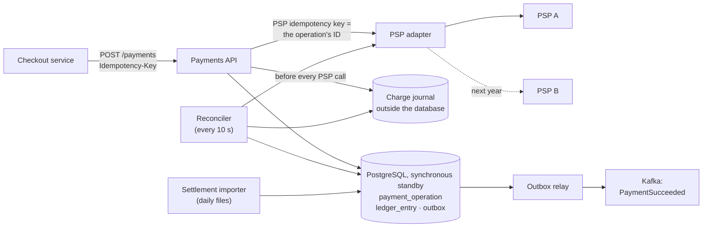
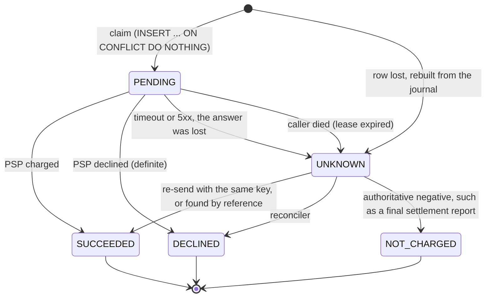

[⬅️ Prev: 35 · AI Features](35-ai-features-spring-ai-langchain4j-rag.md) · [🏠 Index](README.md) · [Next: 37 · Case Study: Fleet JDK Upgrade ➡️](37-case-study-fleet-jdk-upgrade.md)

# 36 · Case Study: Payments That Never Charge Twice

> *A payment system is judged on its worst day: the timeout that hides a charge, the retry that arrives twice, the crash between two writes. This case study takes Chapter 24's payment design to a design review, with the evidence a reviewer should ask for.*

> [!NOTE]
> **How to read the case studies (36–38).** Each one is written as the packet you'd bring to a design review: the brief, the invariants, a proposal, the alternatives, an ADR, the failure analysis, migration stages, rollback limits and the operational evidence. **The company, its numbers and its incidents are invented** to make the decisions concrete. **Every output block is real**, from the labs in this repository. Read the brief, then write your own proposal before you read mine.

🧪 **Runnable labs:** [the programs behind this case study's outputs](labs.md#chapter-36--case-study-payments)

---

## Table of contents
1. [The brief](#1-the-brief-)
2. [Invariants](#2-invariants-)
3. [The proposal](#3-the-proposal-)
4. [Alternatives considered](#4-alternatives-considered-)
5. [The decision record](#5-the-decision-record-)
6. [Failure analysis, with evidence](#6-failure-analysis-with-evidence-)
7. [Migration stages](#7-migration-stages-)
8. [Rollback limits](#8-rollback-limits-)
9. [Operational evidence](#9-operational-evidence-)
10. [Review questions](#10-review-questions)
11. [References](#11-references)

---

## 1. The brief 🟣

*Illustrative scenario.* **Northwind Market** runs a marketplace. Its checkout service calls a payments service, which charges cards through one payment processor (PSP) today; a second PSP is planned for next year. Volumes: about 2 million payments a day (roughly 23 per second on average, 400 per second during sales). The payments API has a p99 target of 1.5 s, dominated by the PSP, and 99.95% availability.

**Why now:** during a PSP latency spike last month, checkout's retries charged 0.3% of that hour's customers twice. Support refunded them by hand, and some customers raised chargebacks. The current code does what most first versions do: look for a saved response, charge, then save.

**Goals:** never charge one checkout twice; never lose a charge (every charge at the PSP is recorded here); keep the ledger balanced at all times; recover from crashes and PSP timeouts without a human, within minutes; reconcile with the PSP's settlement files every day; keep PCI scope small.

**Non-goals for this review:** payouts to sellers, currency conversion, fraud scoring.

---

## 2. Invariants 🟣

Write the invariants down before the design: each one needs a mechanism that enforces it and a check that would notice if it broke.

| # | Invariant | Enforced by | Checked by |
|---|---|---|---|
| I1 | One checkout produces at most one successful charge | Claiming the idempotency key before charging (§3); one PSP key per operation | The lab's checks; the daily settlement reconciliation, counting charges per reference |
| I2 | Every charge at the PSP has exactly one operation recorded as `SUCCEEDED` here | Recording outcomes with a guarded update; the reconciler | Settlement reconciliation: "orphan charges" must be zero |
| I3 | Every transfer's debits equal its credits; balances are derived, never edited | Immutable double-entry rows written in the same transaction as the state change | An hourly SQL check (§9) |
| I4 | An operation's state only moves forward along allowed transitions | `UPDATE … WHERE state IN (…)` | An audit table of transitions; alerts on impossible ones |
| I5 | Nothing stays unresolved (`PENDING` past its lease, or `UNKNOWN`) for more than 15 minutes without a person knowing | The reconciler, every 10 seconds; escalation when it can't decide | An alert on the oldest unresolved operation's age |
| I6 | Recovery never makes a charge it can't prove is the original request, and never concludes "not charged" from silence | A re-send only with the operation's own key, at the PSP that owns it, inside the key window, with the operation's age and PSP kept in a charge journal outside the database; `NOT_CHARGED` only from an authoritative source | The lab (§6, parts 5–7); escalations per day (§9) |

---

## 3. The proposal 🟣



**The operation record is the heart of it.** The client's `Idempotency-Key` is claimed as a row *before* any money moves:
```sql
CREATE TABLE payment_operation (
    id              uuid        PRIMARY KEY,      -- also the PSP idempotency key and our reference at the PSP
    merchant_id     bigint      NOT NULL,
    idempotency_key text        NOT NULL,         -- from the client, once per checkout
    request_hash    bytea       NOT NULL,         -- SHA-256 of the canonical request
    amount_minor    bigint      NOT NULL CHECK (amount_minor > 0),
    currency        char(3)     NOT NULL,
    state           text        NOT NULL,         -- PENDING, SUCCEEDED, DECLINED, UNKNOWN, NOT_CHARGED
    psp             text        NOT NULL,         -- the processor that owns this operation, for life
    psp_charge_id   text,
    response        jsonb,                        -- what retries get replayed
    created_at      timestamptz NOT NULL DEFAULT now(),
    updated_at      timestamptz NOT NULL DEFAULT now(),
    UNIQUE (merchant_id, idempotency_key)
);
CREATE INDEX payment_operation_unresolved ON payment_operation (created_at)
    WHERE state IN ('PENDING', 'UNKNOWN');            -- small, and exactly what the reconciler scans

CREATE TABLE ledger_entry (
    id            bigserial PRIMARY KEY,
    operation_id  uuid   NOT NULL REFERENCES payment_operation (id),
    account       text   NOT NULL,                    -- e.g. psp:A:clearing, merchant:7:payable
    debit_minor   bigint NOT NULL DEFAULT 0,
    credit_minor  bigint NOT NULL DEFAULT 0,
    created_at    timestamptz NOT NULL DEFAULT now()
);
```

The claim is `INSERT … ON CONFLICT DO NOTHING` with **no conflict target**. The primary key is derived from the same key (below), so a duplicate violates both unique constraints, and PostgreSQL absorbs a conflict only on the constraints the target names: with `ON CONFLICT (merchant_id, idempotency_key)`, a few racing duplicates failed on the primary key instead (§6.2).

**The operation's ID is derived, not random:** a name-based UUID of `(merchant_id, idempotency_key)`, and it doubles as the PSP's idempotency key. If this database loses the row, the client's retry recreates the same ID and the same PSP key. **That protects less than it seems.** The PSP replays the first charge only while it still remembers the key, and only if the retry goes to the same PSP. Stripe documents that it may prune keys once they're at least 24 hours old, and treats a pruned key as a new request; in the lab, a retry 26 hours after the row was lost charged a second time (§6, part 7). So the design doesn't rest on the ID alone:
1. **The claim is durable before money moves.** The database commits synchronously to a standby (`synchronous_commit = on` with a `synchronous_standby_names` entry), and failover promotes only a standby that confirmed the commit. A committed claim survives a failover. This is the main defence; the next two are for when it fails, such as a botched failover or a restore from backup. The cost is a network round trip on every commit, and commits stall while no synchronous standby is available.
2. **A charge journal outside the database**, written after the claim and before every PSP call, records the operation ID, the client's key, the request fingerprint, the amount, the PSP and the creation time. It's append-only and replicated (a Kafka topic written with `acks=all` and `min.insync.replicas=2`, say). Nothing calls a PSP until its operation is in the journal, so a key that's in neither the database nor the journal never reached a PSP and is safe to treat as new. A key found only in the journal is an old operation whose row was lost: it comes back as `UNKNOWN`, with its original age and PSP.
3. **Recovery charges only when it can prove it's re-sending the same request**: the same key, to the PSP the journal names, while the operation is younger than the PSP's key window by the journal's clock. Otherwise it only reads. If it can't establish the age or the PSP, it stops and escalates.



**The request path** is the one in [Chapter 23 §7](23-distributed-systems-microservices.md#7-idempotency-the-property-that-makes-retries-safe-): claim in its own short transaction, append the operation to the journal, call the PSP with no transaction open, then record the outcome, the ledger rows and an outbox row in one transaction with a guarded update. A retry finds the row and gets the stored response, `409` while the first request is running, `422` if the payload differs, or `202` while the outcome is unknown. A key with no row is checked against the journal (and, during the migration, the old table: §7) before it's treated as new.

**The reconciler** runs every 10 seconds, takes a batch of unresolved operations with `FOR UPDATE SKIP LOCKED` (so several instances can share the work), and for each one:
1. **Within the PSP's key window, at the PSP that owns it:** re-sends the same request with the same key. The window runs from the operation's creation time, which the journal keeps even when the row had to be rebuilt; Stripe may prune keys once they're 24 hours old, so this design stops at 23. The PSP replays the first outcome, or performs the charge exactly once if the first request never arrived.
2. **After the window, or with a PSP that has no idempotency keys:** never re-sends. It searches the PSP for a charge carrying our reference (the operation ID, in the charge's metadata), and a hit settles the operation as `SUCCEEDED`. **An empty result settles nothing.** Stripe's search is eventually consistent: data is usually searchable within a minute, can fall up to an hour behind during an outage, and Stripe says not to use search for read-after-write flows. So the operation stays `UNKNOWN` until an authoritative source answers: one the PSP documents as complete for that period (Stripe points read-after-write flows to its list APIs), or the settlement report once it's final. Only that makes it `NOT_CHARGED`.
3. **When it can't decide:** after N passes, or as soon as the operation's age or PSP can't be established, it stops, moves the operation to a human queue and pages, because I5 is about to break. It never charges again "to see".

**Operations are pinned to their PSP.** When PSP B arrives, an `UNKNOWN` operation is resolved only by asking the PSP that owns it. Failing over to the other PSP is allowed only for *new* operations; re-sending an unresolved one elsewhere is the most direct way to charge twice. The journal records each operation's PSP, so the pin survives a lost row.

**Settlement reconciliation** runs daily against the PSP's files and sorts every mismatch into a class: a charge with no `SUCCEEDED` operation (an orphan: record it or refund it), a `SUCCEEDED` operation with no settled charge (PSP lag, or our bug), or an amount mismatch. Each class has an owner and a target of zero.

---

## 4. Alternatives considered 🟣

| Option | Assessment |
|---|---|
| **A. Keep "check, charge, then save"** | Double-charges under concurrent retries and crashes; the lab reproduces both (§6) |
| **B. Hold a row lock across the PSP call** (`SELECT … FOR UPDATE`, charge, commit) | Serialises duplicates correctly, but holds a connection and a lock for the PSP's seconds-long latency, which drains the pool under load ([Chapter 32, case 7](32-production-troubleshooting-scenarios.md#case-7-pool-timeouts-while-the-database-is-idle-)). A crash still leaves no record of whether the charge happened |
| **C. A Redis lock around the charge** | A lease that expires during a pause isn't mutual exclusion ([Chapter 34 §8](34-data-stores-redis-cassandra-dynamodb.md#8-redis-patterns-caches-locks-rate-limits-streams-measured-)). Adds a dependency and still needs reconciliation |
| **D. Forward the client's key to the PSP and rely on the PSP alone** | Covers retries within the PSP's window, but leaves nothing here to replay, ties correctness to one PSP's retention rules, and doesn't help once a second PSP exists |
| **E. A durable workflow engine** (Temporal or similar) | Excellent when the flow has many steps (authorise, capture, refund, payout), and it gives retries and state for free. Adds a platform to operate; the PSP boundary still needs idempotency keys. Revisit when the flow grows |
| **F. Claim first, one PSP key per operation, a charge journal, reconcile (proposed)** | Small, built on the database the team already runs, and every failure mode has a defined path (§6). Costs: an extra write per payment, a journal append before every PSP call, a round trip to the synchronous standby on every commit, a reconciler to run and watch, and the `202` "processing" state that clients must handle |

---

## 5. The decision record 🟣

```markdown
# ADR-031: Claim payment operations before charging, with one PSP key per operation
- Status: Proposed (2026-11-18) · Deciders: payments team, platform architect · Consulted: SRE, finance operations
- Context: Retries during PSP latency spikes charged 0.3% of an hour's customers twice. The service checks for a
  saved response, charges, then saves, so concurrent duplicates and crashes both produce second charges.
  A second PSP is planned for 2027.
- Decision: Claim the client's Idempotency-Key as a payment_operation row (unique per merchant and key) before
  calling a PSP, committed to a synchronous standby. The operation ID, a name-based UUID of (merchant, key), is
  the PSP idempotency key for every re-send. Append each operation to a charge journal outside the database
  before any PSP call. Record outcomes with guarded updates in the same transaction as ledger and outbox rows.
  A reconciler settles PENDING (lease expired) and UNKNOWN operations: re-send within 23 hours of the journal's
  timestamp, at the operation's own PSP; after that, read only. An empty search keeps an operation UNKNOWN;
  only an authoritative source makes it NOT_CHARGED. Operations are pinned to their PSP. Each merchant moves
  to the new path only after a drain and a backfill, and each version looks up the other's records.
- Consequences:
  + No double charges from concurrent retries, crashes, lost responses, lagging searches, a lost row or the
    cutover (lab: parts 1 to 8, checked; PostgreSQL lab: both directions of the cutover)
  + Every charge is traceable to one operation; settlement mismatches become a measurable, owned queue
  - Clients must handle 409 (retry later) and 202 (processing; poll or wait for the event)
  - A reconciler and a journal to operate, with an alert on unresolved age; one more write per payment, and
    a standby round trip on every commit
  - Some operations wait a day for the settlement report before they can be called NOT_CHARGED
- Reconsider if: the flow grows beyond charge and refund (consider a workflow engine); a PSP offers no
  idempotency keys (then every retry is a look-up first, as in part 6); a PSP changes its key retention (the
  23-hour window is configuration, checked against its documentation); or volumes make the operation table's
  unique index a hotspot (partition by merchant).
```

---

## 6. Failure analysis, with evidence 🔴

### 6.1 The simulation

`PaymentIdempotency.java` runs both designs against a simulated PSP that deduplicates on its own keys for 24 hours, with a 2 ms network delay so the races are real. Its search lags five minutes behind its charges, and its settlement report is final 30 hours after the fact. Run on JDK 25; part 1 varies a little from run to run:
```
1. Four identical requests at once, for each of 1,000 payments (same Idempotency-Key)
   handler                    PSP charges   charged 2+ times   first responses
   check, charge, then save         3,997                999   1,000 x 201 charged, 3 x 201 replayed, 2,997 x 500 duplicate key
   claim the key first              1,000                  0   1,000 x 201 charged, 9 x 201 replayed, 2,991 x 409 in progress
   2,991 clients that got 409 retried after Retry-After: 2,991 x 201 replayed
```
Parts 2 to 8 are deterministic:
<!-- lab-output: PaymentIdempotency.java -->
```
2. The process dies after the PSP charged the card, before the outcome is saved
   check, charge, then save: nothing was saved, so the retry charged again (201 charged ch_4002)    PSP charges: 2
     the daily settlement check finds 1 charge with no saved payment -> refund it by hand
   claim the key first: the operation stayed PENDING; a retry got 409 idempotency_key_in_use, Retry-After: 1;
     after the 30 s lease the reconciler re-sent it with the same PSP key and the PSP replayed
     the charge; the next retry got 201 charged ch_4001 (replayed)    PSP charges: 1

3. The PSP charges the card but the response is lost (a timeout), so the service retries the PSP call
   PSP key on the retry                            PSP charges
   a new key per attempt (op-6e3fae65-attempt-2)             2   client got 201 charged ch_4002
   the operation's key again (op-6e3fae65)                   1   client got 201 charged ch_4001

4. The same Idempotency-Key with a different amount
   25.00 EUR -> 201 charged ch_4001; then 40.00 EUR with the same key -> 422 idempotency_key_reused    PSP charges: 1

5. An outcome still unknown 26 hours later (say the reconciler was down); the PSP keeps keys for 24 hours
   reconciler                               PSP charges
   re-sends with the same key                         2   client had 202 processing, Retry-After: 5; now SUCCEEDED ch_4002
   looks the charge up by our reference               1   client had 202 processing, Retry-After: 5; now SUCCEEDED ch_4001

6. A PSP without idempotency keys: after a timeout, look the charge up before charging again
   (its search lags up to 5 minutes behind its charges)
   when the search finds nothing                     PSP charges
   take it as "not charged" and charge again                   2   client got 201 charged ch_4002; the first charge is now a double charge
   keep it UNKNOWN until an answer is authoritative            1   client got 202 processing, Retry-After: 5; 10 min later the search found it: SUCCEEDED ch_4001

7. The database fails over and loses the payment's row; the client retries with the same key
   recovery evidence                           retry after  PSP charges   outcome
   the derived operation ID only                    10 min            1   201 charged ch_4001 (the PSP replayed it under the same key)
   the derived operation ID only                      26 h            2   201 charged ch_4002 (the PSP had pruned the key)
   ID + a charge journal outside the database         26 h            1   202 processing, Retry-After: 5, then SUCCEEDED ch_4001 (found by reference; nothing re-sent)
     ... the call never reached the PSP               26 h            0   202 processing, Retry-After: 5; UNKNOWN until the settlement report was final, then NOT_CHARGED -> 402 payment_failed: not charged

8. Moving a merchant from the old handler to the new one while its clients retry
   cutover                                                 PSP charges   the client's retry got
   switch; the new handler treats the key as new                     2   201 charged ch_4002
   copy the old handler's payments, then look up old keys            1   201 charged ch_4001 (replayed)
   a retry arrives while the old handler is still charging:
     switch at once                                                  2   201 charged ch_4002
     drain the old handler, copy its payments, then switch           1   503 switching handlers, Retry-After: 1, then 201 charged ch_4001 (replayed)

Checks on the claim-first handler (parts 1-8, the correct configurations)
   no checkout charged more than once                         ok
   every SUCCEEDED payment has exactly one matching charge    ok
   no charge without a SUCCEEDED payment                      ok
   ledger debits equal credits, per payment                   ok
```

What each part says to a reviewer:
- **Concurrent duplicates (part 1).** With the old order, 999 of 1,000 payments were charged more than once in this run, and the unique constraint fired *after* the money moved, as 2,997 errors. Claiming first turned the duplicates into `409`s that later replayed the one charge.
- **A crash at the worst moment (part 2).** The old design lost the knowledge that a charge happened; only the settlement file revealed it, a day later, as a manual refund. The new one kept a `PENDING` row, so the reconciler found it after the lease and the PSP's key turned the re-send into a replay.
- **Ambiguous outcomes (part 3).** "Retry with a new key" is the single most expensive bug in this area. One key per *operation* makes every re-send safe; a new key belongs only to a new operation after a definite failure.
- **Keys don't last forever (part 5).** Re-sending after the PSP pruned its key charged twice. Past the window, look up; never re-send.
- **An empty search isn't a "no" (part 6).** A PSP without idempotency keys forces a look-up before any second attempt, and its search lags its charges. Reading the empty result as "not charged" charged twice. Keeping the operation `UNKNOWN` until an answer could be trusted charged once: ten minutes later the search found the charge.
- **What survives a failover (part 7).** The derived ID turned a lost row into a replay only while the PSP still held the key: after 10 minutes it replayed, after 26 hours it charged again. With the journal, the retry was recognised as an old operation with its age and PSP intact, so recovery read instead of re-sending, and found the charge by reference. When the first call had never reached the PSP, the operation stayed `UNKNOWN` until the settlement report was final, then became `NOT_CHARGED`; the client got a definite failure and can start a new payment with a new key.
- **The cutover is a test case (part 8).** A switch with no legacy lookup treated every old key as new and charged again; copying the old handler's payments and looking up old keys replayed them. A retry that arrived while the old handler was still charging slipped past an instant switch; draining first answered `503` for a moment, then replayed. §7 runs the same test against PostgreSQL, in both directions.
- **The checks are the invariants (§2)**, run on every correct configuration and counted per checkout, so a legacy charge and a new one for the same checkout count as two. The lab exits with status 1 if any check fails, so it doubles as a regression test.

Failures the lab doesn't simulate, and the design's answer:
- **The PSP is down** (connections refused): the operation is claimed, the call fails, the state becomes `UNKNOWN`, and checkout shows "processing". A circuit breaker on the adapter fails *new* operations fast instead of stacking them up. The reconciler settles the claimed ones when the PSP returns.
- **The journal is down:** nothing calls a PSP until its operation is in the journal, so new payments fail fast (`503` with `Retry-After`) and claimed ones wait. Payments stop, but nothing is charged that recovery couldn't explain later.
- **Both the row and its journal entry are lost**, a double failure beyond the design's assumptions: the client's retry looks new. The derived ID still makes it a replay within 24 hours at the same PSP. After that, the daily settlement reconciliation catches the second charge as an orphan, which is why I1 and I2 are checked from the PSP's side as well as ours.

### 6.2 Against a real PostgreSQL

A simulation can't show a database's own semantics. `PaymentsPostgres.java` runs the claim, the outcome transaction, the reconcilers and the cutover against PostgreSQL 16 through JDBC, with 32 threads sharing 16 connections, and checks the §9 queries after every part. Part 1 found something the simulation couldn't. Run on JDK 25; part 1 varies from run to run:
```
1. Four identical requests at once for each of 500 checkouts, on 32 threads sharing 16 connections
   handler                                                       PSP charges  charged 2+ times   responses
   check, charge, then save                                            1,977               500   500 x 201 charged, 23 x 201 replayed, 1,477 x 500 duplicate key
   claim: ON CONFLICT (merchant_id, idempotency_key) DO NOTHING          500                 0   500 x 201 charged, 92 x 201 replayed, 1,389 x 409 in progress, 19 x 500 duplicate key
   claim: ON CONFLICT DO NOTHING (any unique constraint)                 500                 0   500 x 201 charged, 101 x 201 replayed, 1,399 x 409 in progress
   SQL checks on the last run: ledger balanced, one debit per success, one outbox row per success: ok
```
Parts 2 to 4 are deterministic:
<!-- lab-output: PaymentsPostgres.java -->
```
2. The process dies inside the outcome transaction, after the state change and one ledger row
   after the crash:                          state PENDING, ledger rows 0, outbox rows 0
   after the reconciler re-sent the same key: state SUCCEEDED, ledger rows 2, outbox rows 1, PSP charges 1

3. Two writers record the same outcome at the same moment (the request and the reconciler), for 200 payments
   the outcome update                                          ledger rows payments debited 2x
   UPDATE ... WHERE id = ?                                             800                 200
   UPDATE ... WHERE id = ? AND state IN ('PENDING','UNKNOWN')          400                   0

4. Three reconcilers share 300 unresolved payments: each claims 20 with FOR UPDATE SKIP LOCKED and a lease,
   commits, then calls the PSP with no transaction open
   payments handled: 300 in all, by 3 reconcilers; handled twice: 0; still unresolved: 0; PSP charges: 300
```
- **The conflict target matters (part 1).** With a derived primary key, a duplicate claim violates two unique constraints at once, `(merchant_id, idempotency_key)` and the primary key. PostgreSQL takes the `DO NOTHING` action only when an arbiter named by the conflict target is violated, so with the target written out, a duplicate that raced past the arbiter check could still collide on the primary key, which isn't an arbiter, and fail with an error: 19 of 2,000 claims in this run. Without a target, conflicts on every unique constraint are handled, and every duplicate became a `409` or a replay. Either leave the target out, or don't derive the primary key from the client's key.
- **All or nothing (part 2).** A process that died inside the outcome transaction, after the state change and one ledger row, left nothing behind: the operation was still `PENDING`, with no ledger or outbox rows, so the reconciler's re-send recorded it once. Ledger rows never exist without the state change, and vice versa.
- **Exactly one writer (part 3).** When the request and the reconciler recorded the same outcome at the same moment, the unguarded update debited all 200 payments twice. With `AND state IN ('PENDING','UNKNOWN')`, the second `UPDATE` waits for the first one's row lock, then, under READ COMMITTED, re-checks its `WHERE` clause against the committed row and matches nothing.
- **Shared work, handled once (part 4).** Three reconcilers took batches with `FOR UPDATE SKIP LOCKED` and a lease, committed, and only then called the PSP: 300 payments, each handled by exactly one of them, with no transaction open during a PSP call.

---

## 7. Migration stages 🔵

From "check, charge, then save" to the new design, without a big bang. The rule that runs through it: **each version looks up the other's records before it charges**, so neither can mistake a payment the other completed for a new one.

| Stage | What happens | Gate to the next stage |
|---|---|---|
| 0. Measure | Settlement reconciliation counts charges per reference, so double charges become a number (the baseline) | A week of baseline data |
| 1. Expand, both ways | Create `payment_operation`, `ledger_entry` and the journal next to the old idempotency table. Ship a **read shim** in the old code: before charging, it also checks `payment_operation` and answers from it (replay, `409`, `202`). Give the new path a **legacy lookup**: before treating a key as new, it checks the old table and adopts a completed payment (its response, PSP charge ID, creation time and ledger rows) without calling the PSP | The shim is deployed everywhere, and the **migration test** below passes against a copy of production's schema |
| 2. Reconciler, report-only | It finds unresolved operations and logs what it *would* do | Its proposed actions match a manual review of 200 cases |
| 3. Pilot | The new path for one internal merchant, then 1% of merchants. Each merchant moves `OLD` → `DRAINING` → `NEW`: while draining, requests get `503` with `Retry-After: 1` until no old-path request is in flight; then one transaction copies the merchant's completed payments into `payment_operation` (response, charge ID, creation time, ledger rows), and the merchant switches. The legacy lookup stays on for stragglers | Zero double charges; oldest unresolved operation under 15 min; p99 within +50 ms; no new error classes |
| 4. Ramp | 10%, 50%, 100% of merchants, a day apart; the reconciler now acts | The same gates, plus settlement mismatches at or below baseline |
| 5. Contract | Turn the legacy lookup off once it has adopted nothing for longer than any client's retry horizon, then drop the old table 60 days later (longer than the dispute window ops needs for lookups) | A sign-off from finance operations |

**The migration test.** A cutover is code that can charge twice, so it gets a test that fails when it does. `PaymentsPostgres.java` parts 5 and 6 run it against PostgreSQL in both directions, and the lab exits with status 1 if a correct configuration charges anyone twice:
<!-- lab-output: PaymentsPostgres.java -->
```
5. Cutover from the old idempotency table: the old handler completed 100 payments, then their clients retry
   how the merchant moves to the new handler                     PSP charges   the retries got
   switch; the new handler treats every key as new                       200   100 x 201 charged
   drain, copy the old rows (response, charge, age), switch              100   100 x 201 replayed
     ... then a row the copy missed (legacy lookup on)                   101   101 x 201 replayed
   50 retries while 50 old requests are charging: drain first             50   50 x 201 replayed, 50 x 503 switching

6. Rollback: the new handler completed 100 payments and left 1 UNKNOWN (the PSP charged it, but the answer
   was lost); then the merchant goes back to the old handler, and all 101 clients retry
   how the merchant moves back                                   PSP charges   the retries got
   switch back; the old handler reads only its own table                 202   101 x 201 charged
   switch back; the old handler also reads payment_operation             101   100 x 201 replayed, 1 x 202 processing
       (the old code has no reconciler, so that client sees 202 until someone settles it by hand)
     ... after a drain, in which the reconciler settled the rest         101   101 x 201 replayed
```
- **Forward (part 5).** Switching with no lookup charged all 100 old payments again. Draining and copying replayed them, with their original responses, charge IDs and ages (the lab checks all three), and the legacy lookup caught a row the copy missed. Retries that arrived while 50 old requests were still charging got `503`, then the replay.
- **Back (part 6).** Without the shim, the old code charged every checkout the new one had handled, 101 second charges. With the shim it replayed the 100 completed ones, but answered `202` for the unresolved one indefinitely: the old code has no reconciler. Draining first, so the new reconciler could settle that operation before the switch, made every retry a replay.

**Ownership:** the payments team owns stages 0–5; SRE owns the alerts in §9; finance operations owns the settlement mismatch queue. Each owner is named in the plan, not just the team.

---

## 8. Rollback limits 🔵

"We can always roll back" is a claim that needs proof for each stage. Three questions decide it.

**1. After the new version has written, can the old version still read what it wrote?** Not by default. The old code only knows the old idempotency table. If it took over after the new path had handled a checkout, a client's retry would find no saved response, and the old code would charge again: in §7's part 6, a rollback without a shim charged all 101 checkouts a second time. That's why stage 1 ships a **read shim** into the old version *before* any new writes: it checks `payment_operation` too, and answers from it instead of charging. It's the mirror image of the new path's legacy lookup. Rollback safety is a property you deploy in advance, not one you discover during the incident.

**2. What must flow back?**
- **Responses for completed operations:** nothing to copy. The shim reads them where they are.
- **Operations still `PENDING` or `UNKNOWN`:** the old code has no reconciler, so the shim can only answer `202` for them, indefinitely. Before handing traffic back, set the merchant to `DRAINING`, wait until no new-path request is in flight, let the reconciler settle every unresolved operation, then switch. Anything that can't settle yet (an operation waiting for a settlement report, say) goes to the human queue, and the new reconciler keeps running until it's done.
- **Ledger rows:** the schema is shared and unchanged, so nothing to copy.
- **Events:** keep the same event ID scheme in both versions, or downstream consumers will see duplicates their dedup can't recognise.

**3. When does rollback become a forward repair?**
- **Once money has moved under the new PSP keys.** Rolling back the code doesn't roll back a charge; refunds and reconciliation are forward repairs, whatever the deploy tool says.
- **At stage 5**, when the legacy lookup is off and the old table is dropped. "Rollback" then means restoring the table and an old build: a project, not a flag.
- **When PSP B goes live.** The old code can't reconcile operations pinned to a PSP it doesn't know.

| Stage | How to go back | What must flow back | Becomes a forward repair when |
|---|---|---|---|
| 1–2 | Redeploy; nothing new has charged | Nothing | n/a |
| 3–4 | Set the merchant to `DRAINING`, let the reconciler settle what's unresolved, then `OLD`; the shim answers for everything the new path completed | Nothing is copied; unresolved operations are settled in place first | Never for code, but charges made in the window stay made |
| 5 | Restore the old table and a build with the shim | Whatever the old build needs to start | Immediately: plan it as a migration, not a rollback |

Say the point of no return out loud in the plan, and hold a go/no-go review before crossing it.

---

## 9. Operational evidence 🔵

What proves the design works in production, and who looks at it:

| Signal | Target | Why |
|---|---|---|
| Double charges per day (settlement, charges per reference) | 0 | I1, measured by an independent source |
| Orphan charges per day (charge with no `SUCCEEDED` operation) | 0 | I2 |
| Oldest unresolved operation | < 15 min, page at 15 | I5; a stuck reconciler shows up here first |
| Reconciler actions per hour, by result (replayed, looked up, not charged, escalated) | Stable; escalations rare | A spike in "looked up" means re-sends are arriving late |
| `UNKNOWN` operations waiting for an authoritative answer, and the oldest one's age | Few; none older than the settlement report's delay | I6: an empty search settles nothing, so these wait for the report |
| Operations rebuilt from the journal, per failover | Counted, and every one settled | How much a failover lost; above zero means the standby wasn't synchronous |
| Escalations because recovery couldn't establish an operation's age or PSP | 0; each one investigated | I6: recovery stopped rather than guessing |
| During the cutover: `503`s while a merchant drains, the drain's duration, and legacy lookups that adopted a payment | Seconds; adoptions falling to 0 | A long drain means old requests are stuck; zero adoptions for a full retry horizon means stage 5 can start |
| `409` rate per client | Low and steady | Concurrent retries: a client retrying too aggressively |
| `422` rate per client | 0 | Key reuse: a client bug |
| PSP timeouts and 5xx, by PSP | Within the PSP's SLA | Feeds the breaker and the case for a second PSP |
| Ledger balance check, hourly | 0 imbalanced transfers | I3 |

```sql
-- I3: transfers whose debits and credits differ (must return no rows)
SELECT operation_id FROM ledger_entry GROUP BY operation_id HAVING sum(debit_minor) <> sum(credit_minor);

-- I1/I2 from our side: succeeded operations without exactly one debit row for the full amount
SELECT o.id FROM payment_operation o
LEFT JOIN ledger_entry e ON e.operation_id = o.id AND e.debit_minor > 0
WHERE o.state = 'SUCCEEDED'
GROUP BY o.id, o.amount_minor HAVING count(e.id) <> 1 OR coalesce(sum(e.debit_minor), 0) <> o.amount_minor;

-- I6: unresolved operations past the PSP's key window; the reconciler may only read these (must match its queue)
SELECT id, psp, created_at FROM payment_operation
WHERE state IN ('PENDING', 'UNKNOWN') AND created_at < now() - interval '23 hours';
```

**A game day before stage 4:** in staging, inject PSP timeouts (with and without the charge going through), kill payment pods mid-request, fail over the database, and make the PSP's search lag. Pass criteria: the invariant checks hold, no operation is settled `NOT_CHARGED` from a search alone, and every operation is resolved, or escalated with a reason, within 15 minutes. The labs are the unit-sized version of the same exercise.

---

## 10. Review questions

<details>
<summary><b>Q1. 🟣 Why must the idempotency key be claimed before the charge, rather than saved after it?</b></summary>

Because the unique constraint only protects what happens after it fires. If the key is saved after the charge, two concurrent requests both find nothing, both charge, and the constraint rejects the second *save* when the money has already moved. A crash between charge and save leaves no record at all, so a retry charges again. Claiming first (insert `PENDING` under the constraint, commit, then charge) decides ownership before any side effect: in the lab, four simultaneous copies of 1,000 payments produced about 4,000 charges with save-after (3,997 in the run shown) and exactly 1,000 with claim-first.
</details>

<details>
<summary><b>Q2. 🔴 A PSP call times out. What state is the payment in, and what do you do?</b></summary>

Unknown: the card may or may not have been charged. Record `UNKNOWN`, tell the client "processing" (`202`), and resolve it with the reconciler. While the PSP still keeps its idempotency key, re-send the same request with the same key, at the same PSP, so the PSP replays its first outcome or performs the charge exactly once. After that window, never re-send: look the charge up by your own reference, and if the search finds nothing, keep waiting for an authoritative answer, because search indexes lag. Never retry with a new key; in the lab that charged twice.
</details>

<details>
<summary><b>Q3. 🟣 The operation ID is derived from the merchant and the client's key. What does that protect, and what doesn't it?</b></summary>

If the row is lost and the client retries, a random ID would make a new PSP key and a second charge; a derived one recreates the same key, so the PSP replays the first charge. But only while the PSP still holds the key, and only at the same PSP: Stripe may prune keys after 24 hours, and in the lab a retry 26 hours after the loss charged twice. So make the claim durable first (synchronous replication, and failover only to a standby that confirmed it), keep a journal outside the database with each operation's age and PSP, and let recovery re-send only inside the key window at that PSP. Outside it, recovery only reads, and when it can't establish the age or the PSP it escalates.
</details>

<details>
<summary><b>Q4. 🟣 Why pin each operation to one PSP, even when you have two?</b></summary>

Idempotency keys are scoped to one PSP. If an operation's outcome is unknown at PSP A and you send it to PSP B, both may charge. Failover is safe only for new operations; unresolved ones must be resolved by asking the PSP that owns them.
</details>

<details>
<summary><b>Q5. 🔵 How do you make rollback safe for a change like this?</b></summary>

Answer three questions per stage. Can the old version read what the new one writes? Not by default, so ship a read shim to the old version first: it checks the new table before charging. What must flow back? Not the responses, which the shim reads in place, but the unresolved operations: drain the merchant and let the new reconciler settle them before handing traffic back, because the old code has no reconciler. When does rollback become a forward repair? Once charges have been made under the new keys, once the old table is dropped, and once a second PSP is live. Name that point in the plan, hold a go/no-go review before crossing it, and test the way back as well as the way forward.
</details>

<details>
<summary><b>Q6. 🔴 What does daily settlement reconciliation catch that the rest of the design doesn't?</b></summary>

Everything the design's assumptions miss: bugs in the reconciler, operations lost in a failover, PSP-side anomalies, amount mismatches, and charges made outside the normal path. It compares an independent source (the PSP's settlement file) with your records, so it's the only check that doesn't share your code's blind spots. Each mismatch class needs an owner and a target of zero.
</details>

<details>
<summary><b>Q7. 🔵 Which numbers would you put on the dashboard for this design, and why those?</b></summary>

One per invariant, measured independently where possible: double charges and orphan charges per day from settlement data, the age of the oldest unresolved operation, imbalanced ledger transfers, reconciler actions by result, and escalations where recovery couldn't establish an operation's age or PSP. Then client-behaviour signals: the 409 rate (aggressive retries) and the 422 rate (key-reuse bugs), plus PSP timeouts per PSP. Each one maps to an invariant or a decision, so it changes what somebody does.
</details>

<details>
<summary><b>Q8. 🔴 The PSP's search finds no charge for an <code>UNKNOWN</code> payment. Can you mark it <code>NOT_CHARGED</code>?</b></summary>

No. Absence in a search index is not evidence of absence: Stripe documents its search as eventually consistent, usually current within a minute but up to an hour behind during outages, and says not to use it for read-after-write flows. In the lab, taking an empty search as "not charged" and charging again produced two charges. Keep the operation `UNKNOWN`, keep telling the client "processing", and settle it only from an authoritative source: one the PSP documents as complete for that period, or the settlement report once it's final. If that takes too long, escalate to a person rather than guess.
</details>

<details>
<summary><b>Q9. 🔵 How do you move merchants from the old idempotency table to the new design without charging anyone twice, in either direction?</b></summary>

Make each version look up the other's records before it charges: a legacy lookup in the new path, which adopts a completed payment with its response, charge ID and age, and a read shim in the old one, deployed first. Switch each merchant through a drain: no old request in flight, a backfill in one transaction, then the switch. Going back, drain again and let the new reconciler settle unresolved operations first, because the old code can't. Then prove it with a migration test in both directions: in the PostgreSQL lab, a switch without a lookup charged 100 payments again, and a rollback without a shim charged 101 again; with the lookup, the shim and the drains, nothing was charged twice.
</details>

<details>
<summary><b>Q10. 🔴 Your claim is <code>INSERT … ON CONFLICT (merchant_id, idempotency_key) DO NOTHING</code>, and a few duplicates fail with a primary-key violation under load. Why?</b></summary>

Because the primary key is derived from the same merchant and key, so a duplicate violates two unique constraints, and `ON CONFLICT` only absorbs conflicts on the arbiters its target names. A duplicate that races past the arbiter check can still collide on the primary key and raise an error (19 of 2,000 claims in the PostgreSQL lab). Omit the conflict target, which makes every unique constraint an arbiter for `DO NOTHING`, or stop deriving the primary key from the client's key.
</details>

---

## 11. References
- Stripe API reference, [*Idempotent requests*](https://docs.stripe.com/api/idempotent_requests) (keys may be pruned after 24 hours), [*Search*](https://docs.stripe.com/search) (data freshness, and why not to use search for read-after-write) and [*Advanced error handling*](https://docs.stripe.com/error-low-level) (retry windows, reconciling unknown outcomes)
- PostgreSQL 16 documentation: [*INSERT*](https://www.postgresql.org/docs/16/sql-insert.html) (`ON CONFLICT` and arbiter indexes), [*Transaction Isolation*](https://www.postgresql.org/docs/16/transaction-iso.html) (how READ COMMITTED re-checks an `UPDATE`'s `WHERE` clause) and [*Synchronous Replication*](https://www.postgresql.org/docs/16/warm-standby.html#SYNCHRONOUS-REPLICATION)
- IETF HTTPAPI working group, [*The Idempotency-Key HTTP Header Field*](https://datatracker.ietf.org/doc/draft-ietf-httpapi-idempotency-key-header/) (draft)
- Brandur Leach, *Implementing Stripe-like Idempotency Keys in Postgres*
- Martin Kleppmann, *Designing Data-Intensive Applications*, chapters 7 and 9
- In this repository: [Chapter 23 §6–§8](23-distributed-systems-microservices.md#6-the-dual-write-problem--the-transactional-outbox-), [Chapter 24 §8](24-system-design-for-java-architects.md#8-design-2-payments--a-double-entry-ledger-), [Chapter 19 §3–§5](19-persistence-jdbc-jpa-hibernate.md#3-transactions-isolation--anomalies-), [Chapter 31 §4](31-api-design-between-services.md#4-idempotency-and-retries-over-http-)

---

[⬅️ Prev: 35 · AI Features](35-ai-features-spring-ai-langchain4j-rag.md) · [🏠 Index](README.md) · [Next: 37 · Case Study: Fleet JDK Upgrade ➡️](37-case-study-fleet-jdk-upgrade.md)
