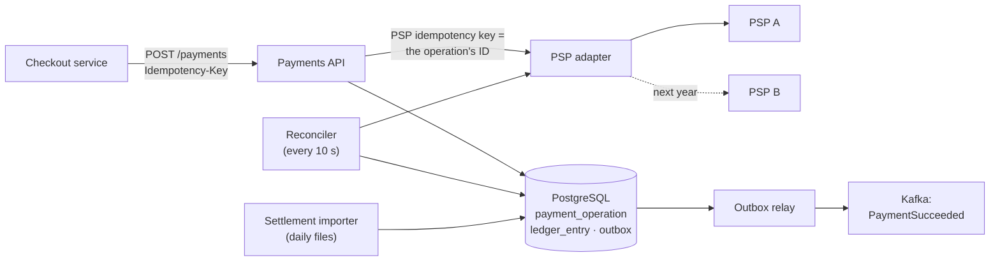
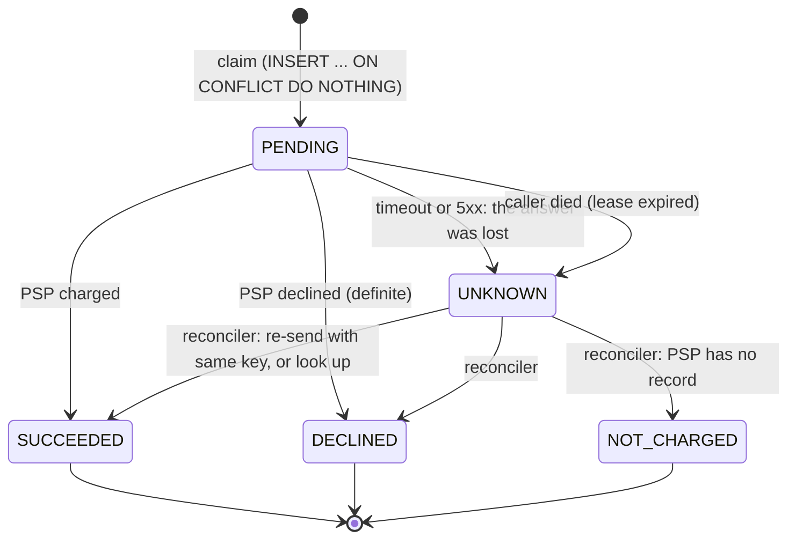

[⬅️ Prev: 35 · AI Features](35-ai-features-spring-ai-langchain4j-rag.md) · [🏠 Index](README.md) · [Next: 37 · Case Study: Fleet JDK Upgrade ➡️](37-case-study-fleet-jdk-upgrade.md)

# 36 · Case Study: Payments That Never Charge Twice

> *A payment system is judged on its worst day: the timeout that hides a charge, the retry that arrives twice, the crash between two writes. This case study takes Chapter 24's payment design to a design review, with the evidence a reviewer should ask for.*

> [!NOTE]
> **How to read the case studies (36–38).** Each one is written as the packet you'd bring to a design review: the brief, the invariants, a proposal, the alternatives, an ADR, the failure analysis, migration stages, rollback limits and the operational evidence. **The company, its numbers and its incidents are invented** to make the decisions concrete. **Every output block is real**, from the labs in this repository. Read the brief, then write your own proposal before you read mine.

🧪 **Runnable labs:** [the programs behind this case study's outputs](labs.md#chapter-36--case-study-payments)

---

## Table of contents
1. [The brief](#1-the-brief-)
2. [Invariants](#2-invariants-)
3. [The proposal](#3-the-proposal-)
4. [Alternatives considered](#4-alternatives-considered-)
5. [The decision record](#5-the-decision-record-)
6. [Failure analysis, with evidence](#6-failure-analysis-with-evidence-)
7. [Migration stages](#7-migration-stages-)
8. [Rollback limits](#8-rollback-limits-)
9. [Operational evidence](#9-operational-evidence-)
10. [Review questions](#10-review-questions)
11. [References](#11-references)

---

## 1. The brief 🟣

*Illustrative scenario.* **Northwind Market** runs a marketplace. Its checkout service calls a payments service, which charges cards through one payment processor (PSP) today; a second PSP is planned for next year. Volumes: about 2 million payments a day (roughly 23 per second on average, 400 per second during sales). The payments API has a p99 target of 1.5 s, dominated by the PSP, and 99.95% availability.

**Why now:** during a PSP latency spike last month, checkout's retries charged 0.3% of that hour's customers twice. Support refunded them by hand, and some customers raised chargebacks. The current code does what most first versions do: look for a saved response, charge, then save.

**Goals:** never charge one checkout twice; never lose a charge (every charge at the PSP is recorded here); keep the ledger balanced at all times; recover from crashes and PSP timeouts without a human, within minutes; reconcile with the PSP's settlement files every day; keep PCI scope small.

**Non-goals for this review:** payouts to sellers, currency conversion, fraud scoring.

---

## 2. Invariants 🟣

Write the invariants down before the design: each one needs a mechanism that enforces it and a check that would notice if it broke.

| # | Invariant | Enforced by | Checked by |
|---|---|---|---|
| I1 | One checkout produces at most one successful charge | Claiming the idempotency key before charging (§3); one PSP key per operation | The lab's checks; the daily settlement reconciliation, counting charges per reference |
| I2 | Every charge at the PSP has exactly one operation recorded as `SUCCEEDED` here | Recording outcomes with a guarded update; the reconciler | Settlement reconciliation: "orphan charges" must be zero |
| I3 | Every transfer's debits equal its credits; balances are derived, never edited | Immutable double-entry rows written in the same transaction as the state change | An hourly SQL check (§9) |
| I4 | An operation's state only moves forward along allowed transitions | `UPDATE … WHERE state IN (…)` | An audit table of transitions; alerts on impossible ones |
| I5 | Nothing stays unresolved (`PENDING` past its lease, or `UNKNOWN`) for more than 15 minutes | The reconciler, every 10 seconds | An alert on the oldest unresolved operation's age |

---

## 3. The proposal 🟣



**The operation record is the heart of it.** The client's `Idempotency-Key` is claimed as a row *before* any money moves:
```sql
CREATE TABLE payment_operation (
    id              uuid        PRIMARY KEY,      -- also the PSP idempotency key and our reference at the PSP
    merchant_id     bigint      NOT NULL,
    idempotency_key text        NOT NULL,         -- from the client, once per checkout
    request_hash    bytea       NOT NULL,         -- SHA-256 of the canonical request
    amount_minor    bigint      NOT NULL CHECK (amount_minor > 0),
    currency        char(3)     NOT NULL,
    state           text        NOT NULL,         -- PENDING, SUCCEEDED, DECLINED, UNKNOWN, NOT_CHARGED
    psp             text        NOT NULL,         -- the processor that owns this operation, for life
    psp_charge_id   text,
    response        jsonb,                        -- what retries get replayed
    created_at      timestamptz NOT NULL DEFAULT now(),
    updated_at      timestamptz NOT NULL DEFAULT now(),
    UNIQUE (merchant_id, idempotency_key)
);
CREATE INDEX payment_operation_unresolved ON payment_operation (created_at)
    WHERE state IN ('PENDING', 'UNKNOWN');            -- small, and exactly what the reconciler scans

CREATE TABLE ledger_entry (
    id            bigserial PRIMARY KEY,
    operation_id  uuid   NOT NULL REFERENCES payment_operation (id),
    account       text   NOT NULL,                    -- e.g. psp:A:clearing, merchant:7:payable
    debit_minor   bigint NOT NULL DEFAULT 0,
    credit_minor  bigint NOT NULL DEFAULT 0,
    created_at    timestamptz NOT NULL DEFAULT now()
);
```

**The operation's ID is derived, not random:** a name-based UUID of `(merchant_id, idempotency_key)`. It doubles as the PSP's idempotency key, so even if this database lost the row (an asynchronous failover), the client's retry would recreate the *same* ID, and the PSP would replay the first charge instead of making a second.



**The request path** is the one in [Chapter 23 §7](23-distributed-systems-microservices.md#7-idempotency-the-property-that-makes-retries-safe-): claim in its own short transaction, call the PSP with no transaction open, then record the outcome, the ledger rows and an outbox row in one transaction with a guarded update. A retry finds the row and gets the stored response, `409` while the first request is running, `422` if the payload differs, or `202` while the outcome is unknown.

**The reconciler** runs every 10 seconds, takes a batch of unresolved operations with `FOR UPDATE SKIP LOCKED` (so several instances can share the work), and for each one:
1. **Within the PSP's key window** (Stripe documents that keys may be pruned after 24 hours; this design stops at 23): re-sends the same request with the same key. The PSP replays the first outcome, or performs the charge exactly once if the first request never arrived.
2. **After the window:** never re-sends. It searches the PSP for a charge carrying our reference (the operation ID in the charge's metadata), records what it finds, and marks the operation `NOT_CHARGED` if there's nothing.
3. **After N failed passes:** moves the operation to a human queue and pages, because I5 is about to break.

**Operations are pinned to their PSP.** When PSP B arrives, an `UNKNOWN` operation is resolved only by asking the PSP that owns it. Failing over to the other PSP is allowed only for *new* operations; re-sending an unresolved one elsewhere is the most direct way to charge twice.

**Settlement reconciliation** runs daily against the PSP's files and sorts every mismatch into a class: a charge with no `SUCCEEDED` operation (an orphan: record it or refund it), a `SUCCEEDED` operation with no settled charge (PSP lag, or our bug), or an amount mismatch. Each class has an owner and a target of zero.

---

## 4. Alternatives considered 🟣

| Option | Assessment |
|---|---|
| **A. Keep "check, charge, then save"** | Double-charges under concurrent retries and crashes; the lab reproduces both (§6) |
| **B. Hold a row lock across the PSP call** (`SELECT … FOR UPDATE`, charge, commit) | Serialises duplicates correctly, but holds a connection and a lock for the PSP's seconds-long latency, which drains the pool under load ([Chapter 32, case 7](32-production-troubleshooting-scenarios.md#case-7-pool-timeouts-while-the-database-is-idle-)). A crash still leaves no record of whether the charge happened |
| **C. A Redis lock around the charge** | A lease that expires during a pause isn't mutual exclusion ([Chapter 34 §8](34-data-stores-redis-cassandra-dynamodb.md#8-redis-patterns-caches-locks-rate-limits-streams-measured-)). Adds a dependency and still needs reconciliation |
| **D. Forward the client's key to the PSP and rely on the PSP alone** | Covers retries within the PSP's window, but leaves nothing here to replay, ties correctness to one PSP's retention rules, and doesn't help once a second PSP exists |
| **E. A durable workflow engine** (Temporal or similar) | Excellent when the flow has many steps (authorise, capture, refund, payout), and it gives retries and state for free. Adds a platform to operate; the PSP boundary still needs idempotency keys. Revisit when the flow grows |
| **F. Claim first, one PSP key per operation, reconcile (proposed)** | Small, built on the database the team already runs, and every failure mode has a defined path (§6). Costs: an extra write per payment, a reconciler to run and watch, and the `202` "processing" state that clients must handle |

---

## 5. The decision record 🟣

```markdown
# ADR-031: Claim payment operations before charging, with one PSP key per operation
- Status: Proposed (2026-11-18) · Deciders: payments team, platform architect · Consulted: SRE, finance operations
- Context: Retries during PSP latency spikes charged 0.3% of an hour's customers twice. The service checks for a
  saved response, charges, then saves, so concurrent duplicates and crashes both produce second charges.
  A second PSP is planned for 2027.
- Decision: Claim the client's Idempotency-Key as a payment_operation row (unique per merchant and key) before
  calling a PSP. The operation ID, a name-based UUID of (merchant, key), is the PSP idempotency key for every
  re-send. Record outcomes with guarded updates in the same transaction as ledger and outbox rows. A reconciler
  settles PENDING (lease expired) and UNKNOWN operations: re-send within 23 hours, look up by reference after.
  Operations are pinned to their PSP.
- Consequences:
  + No double charges from concurrent retries, crashes or lost responses (lab: 1,000 of 1,000 charged once)
  + Every charge is traceable to one operation; settlement mismatches become a measurable, owned queue
  - Clients must handle 409 (retry later) and 202 (processing; poll or wait for the event)
  - A reconciler to operate, with an alert on unresolved age; one more write per payment
- Reconsider if: the flow grows beyond charge and refund (consider a workflow engine); a PSP offers no
  idempotency keys (then look-up-before-retry becomes mandatory); or volumes make the operation table's
  unique index a hotspot (partition by merchant).
```

---

## 6. Failure analysis, with evidence 🔴

`PaymentIdempotency.java` runs both designs against a simulated PSP that deduplicates on its own keys for 24 hours, with a 2 ms network delay so the races are real (run on JDK 25):
```
1. Four identical requests at once, for each of 1,000 payments (same Idempotency-Key)
   handler                    PSP charges   charged 2+ times   first responses
   check, charge, then save         3,999              1,000   1,000 x 201 charged, 1 x 201 replayed, 2,999 x 500 duplicate key
   claim the key first              1,000                  0   1,000 x 201 charged, 3 x 201 replayed, 2,997 x 409 in progress
   2,997 clients that got 409 retried after Retry-After: 2,997 x 201 replayed

2. The process dies after the PSP charged the card, before the outcome is saved
   check, charge, then save: nothing was saved, so the retry charged again (201 charged ch_4002)    PSP charges: 2
     the daily settlement check finds 1 charge with no saved payment -> refund it by hand
   claim the key first: the operation stayed PENDING; a retry got 409 idempotency_key_in_use, Retry-After: 1;
     after the 30 s lease the reconciler re-sent it with the same PSP key and the PSP replayed
     the charge; the next retry got 201 charged ch_4001 (replayed)    PSP charges: 1

3. The PSP charges the card but the response is lost (a timeout), so the service retries the PSP call
   PSP key on the retry                     PSP charges
   a new key per attempt (op-17-attempt-2)            2   client got 201 charged ch_4002
   the operation's key again (op-17)                  1   client got 201 charged ch_4001

4. The same Idempotency-Key with a different amount
   25.00 EUR -> 201 charged ch_4001; then 40.00 EUR with the same key -> 422 idempotency_key_reused    PSP charges: 1

5. An outcome still unknown 26 hours later (say the reconciler was down); the PSP keeps keys for 24 hours
   reconciler                               PSP charges
   re-sends with the same key                         2   client had 202 processing, Retry-After: 5; now SUCCEEDED ch_4002
   looks the charge up by our reference               1   client had 202 processing, Retry-After: 5; now SUCCEEDED ch_4001

Checks on the claim-first handler (parts 1-5, the correct configurations)
   no payment charged more than once                          ok
   every SUCCEEDED payment has exactly one matching charge    ok
   no charge without a SUCCEEDED payment                      ok
   ledger debits equal credits, per payment                   ok
```

What each part says to a reviewer:
- **Concurrent duplicates (part 1).** With the old order, every one of 1,000 payments was charged more than once, and the unique constraint fired *after* the money moved, as 2,999 errors. Claiming first turned the duplicates into `409`s that later replayed the one charge.
- **A crash at the worst moment (part 2).** The old design lost the knowledge that a charge happened; only the settlement file revealed it, a day later, as a manual refund. The new one kept a `PENDING` row, so the reconciler found it after the lease and the PSP's key turned the re-send into a replay.
- **Ambiguous outcomes (part 3).** "Retry with a new key" is the single most expensive bug in this area. One key per *operation* makes every re-send safe; a new key belongs only to a new operation after a definite failure.
- **Keys don't last forever (part 5).** Re-sending after the PSP pruned its key charged twice. Past the window, look up; never re-send.
- **The checks are the invariants (§2)**, run on every correct configuration. The lab exits with status 1 if any fails, so it doubles as a regression test.

Failures the lab doesn't simulate, and the design's answer:
- **The PSP is down** (connections refused): the operation is claimed, the call fails, the state becomes `UNKNOWN`, and checkout shows "processing". A circuit breaker on the adapter fails *new* operations fast instead of stacking them up. The reconciler settles the claimed ones when the PSP returns.
- **The database fails over and loses recent commits** (asynchronous replication): a claimed or even recorded operation can vanish. The client's retry recreates the same operation ID (it's derived from the key), the PSP replays the charge, and the ledger is rebuilt from the replayed result. Without the derived ID, this is the scenario that double-charges after a failover.
- **A client reuses a key for a different checkout**: `422`, never a charge. Count them per client; a rising count is a client bug to chase.
- **The ledger write fails after the PSP charged**: the outcome transaction rolls back as a whole, leaving the operation `PENDING`, so the reconciler replays and records it. Ledger rows never exist without the state change, and vice versa.

---

## 7. Migration stages 🔵

From "check, charge, then save" to the new design, without a big bang:

| Stage | What happens | Gate to the next stage |
|---|---|---|
| 0. Measure | Settlement reconciliation counts charges per reference, so double charges become a number (the baseline) | A week of baseline data |
| 1. Expand | Create `payment_operation` and `ledger_entry` next to the old idempotency table. Ship a **read shim** in the old code: it also checks `payment_operation` before charging (see §8) | The shim is deployed everywhere |
| 2. Reconciler, report-only | It finds unresolved operations and logs what it *would* do | Its proposed actions match a manual review of 200 cases |
| 3. Pilot | The new path for one internal merchant, then 1% of merchants, behind a per-merchant flag. The new path also writes the old table's response row | Zero double charges; oldest unresolved operation under 15 min; p99 within +50 ms; no new error classes |
| 4. Ramp | 10%, 50%, 100% of merchants, a day apart; the reconciler now acts | The same gates, plus settlement mismatches at or below baseline |
| 5. Contract | Stop writing the old table, then drop it 60 days later (longer than any client's retry horizon, and than the dispute window ops needs for lookups) | A sign-off from finance operations |

**Ownership:** the payments team owns stages 0–5; SRE owns the alerts in §9; finance operations owns the settlement mismatch queue. Each owner is named in the plan, not just the team.

---

## 8. Rollback limits 🔵

"We can always roll back" is a claim that needs proof for each stage. Three questions decide it.

**1. After the new version has written, can the old version still read what it wrote?** Not by default. The old code only knows the old idempotency table. If it took over after the new path had handled a checkout, a client's retry would find no saved response, and the old code would charge again. That's why stage 1 ships a **read shim** into the old version *before* any new writes: it checks `payment_operation` too. Rollback safety is a property you deploy in advance, not one you discover during the incident.

**2. What data must flow back?**
- Responses for completed operations: the new path writes the old table's row as well, until stage 5.
- Operations still `PENDING` or `UNKNOWN`: the old code has no reconciler. Before handing traffic back, stop new claims, let the reconciler drain them, and hand any leftovers to the human queue.
- Ledger rows: the schema is shared and unchanged, so nothing to copy.
- Events: keep the same event ID scheme in both versions, or downstream consumers will see duplicates their dedup can't recognise.

**3. When does rollback become a forward repair?**
- **Once money has moved under the new PSP keys.** Rolling back the code doesn't roll back a charge; refunds and reconciliation are forward repairs, whatever the deploy tool says.
- **At stage 5**, when the old table stops being written. "Rollback" then means rebuilding the old table from the new one: a data migration, which is a forward repair.
- **When PSP B goes live.** The old code can't reconcile operations pinned to a PSP it doesn't know.

| Stage | How to go back | What must flow back | Becomes a forward repair when |
|---|---|---|---|
| 1–2 | Redeploy; nothing new has charged | Nothing | n/a |
| 3–4 | Flip the merchant flag off; old code with the shim takes over | Drain unresolved operations first; responses are already dual-written | Never for code, but charges made in the window stay made |
| 5 | Rebuild the old table from `payment_operation`, then flip | Every response and every unresolved operation | Immediately: plan it as a migration, not a rollback |

Say the point of no return out loud in the plan, and hold a go/no-go review before crossing it.

---

## 9. Operational evidence 🔵

What proves the design works in production, and who looks at it:

| Signal | Target | Why |
|---|---|---|
| Double charges per day (settlement, charges per reference) | 0 | I1, measured by an independent source |
| Orphan charges per day (charge with no `SUCCEEDED` operation) | 0 | I2 |
| Oldest unresolved operation | < 15 min, page at 15 | I5; a stuck reconciler shows up here first |
| Reconciler actions per hour, by result (replayed, looked up, not charged, escalated) | Stable; escalations rare | A spike in "looked up" means re-sends are arriving late |
| `409` rate per client | Low and steady | Concurrent retries: a client retrying too aggressively |
| `422` rate per client | 0 | Key reuse: a client bug |
| PSP timeouts and 5xx, by PSP | Within the PSP's SLA | Feeds the breaker and the case for a second PSP |
| Ledger balance check, hourly | 0 imbalanced transfers | I3 |

```sql
-- I3: transfers whose debits and credits differ (must return no rows)
SELECT operation_id FROM ledger_entry GROUP BY operation_id HAVING sum(debit_minor) <> sum(credit_minor);

-- I1/I2 from our side: succeeded operations without exactly one debit row for the full amount
SELECT o.id FROM payment_operation o
LEFT JOIN ledger_entry e ON e.operation_id = o.id AND e.debit_minor > 0
WHERE o.state = 'SUCCEEDED'
GROUP BY o.id, o.amount_minor HAVING count(e.id) <> 1 OR coalesce(sum(e.debit_minor), 0) <> o.amount_minor;
```

**A game day before stage 4:** in staging, inject PSP timeouts (with and without the charge going through), kill payment pods mid-request, and fail over the database. Pass criteria: the invariant checks hold, and every operation is resolved within 15 minutes. The lab is the unit-sized version of the same exercise.

---

## 10. Review questions

<details>
<summary><b>Q1. 🟣 Why must the idempotency key be claimed before the charge, rather than saved after it?</b></summary>

Because the unique constraint only protects what happens after it fires. If the key is saved after the charge, two concurrent requests both find nothing, both charge, and the constraint rejects the second *save* when the money has already moved. A crash between charge and save leaves no record at all, so a retry charges again. Claiming first (insert `PENDING` under the constraint, commit, then charge) decides ownership before any side effect: in the lab, four simultaneous copies of 1,000 payments produced 3,999 charges with save-after and exactly 1,000 with claim-first.
</details>

<details>
<summary><b>Q2. 🔴 A PSP call times out. What state is the payment in, and what do you do?</b></summary>

Unknown: the card may or may not have been charged. Record `UNKNOWN`, tell the client "processing" (`202`), and resolve it with the reconciler. While the PSP still keeps its idempotency key, re-send the same request with the same key, so the PSP replays its first outcome or performs the charge exactly once. After that window, never re-send: look the charge up by your own reference. Never retry with a new key; in the lab that charged twice.
</details>

<details>
<summary><b>Q3. 🟣 Why derive the operation ID from the merchant and the client's key instead of generating a random one?</b></summary>

Because the operation ID is also the PSP's idempotency key, and a database can lose recent commits during an asynchronous failover. If the row vanishes and the client retries, a random ID would create a new PSP key and a second charge. A name-based ID recreates the same key, so the PSP replays the first charge. It turns a data-loss scenario into a replay.
</details>

<details>
<summary><b>Q4. 🟣 Why pin each operation to one PSP, even when you have two?</b></summary>

Idempotency keys are scoped to one PSP. If an operation's outcome is unknown at PSP A and you send it to PSP B, both may charge. Failover is safe only for new operations; unresolved ones must be resolved by asking the PSP that owns them.
</details>

<details>
<summary><b>Q5. 🔵 How do you make rollback safe for a change like this?</b></summary>

Answer three questions per stage. Can the old version read what the new one writes? Not by default, so ship a read shim to the old version first. What must flow back? Responses (dual-write the old table) and unresolved operations (drain them through the reconciler before handing traffic back). When does rollback become a forward repair? Once charges have been made under the new keys, once the old table stops being written, and once a second PSP is live. Name that point in the plan and hold a go/no-go review before crossing it.
</details>

<details>
<summary><b>Q6. 🔴 What does daily settlement reconciliation catch that the rest of the design doesn't?</b></summary>

Everything the design's assumptions miss: bugs in the reconciler, operations lost in a failover, PSP-side anomalies, amount mismatches, and charges made outside the normal path. It compares an independent source (the PSP's settlement file) with your records, so it's the only check that doesn't share your code's blind spots. Each mismatch class needs an owner and a target of zero.
</details>

<details>
<summary><b>Q7. 🔵 Which numbers would you put on the dashboard for this design, and why those?</b></summary>

One per invariant, measured independently where possible: double charges and orphan charges per day from settlement data, the age of the oldest unresolved operation, imbalanced ledger transfers, and reconciler actions by result. Then client-behaviour signals: the 409 rate (aggressive retries) and the 422 rate (key-reuse bugs), plus PSP timeouts per PSP. Each one maps to an invariant or a decision, so it changes what somebody does.
</details>

---

## 11. References
- Stripe API reference, [*Idempotent requests*](https://docs.stripe.com/api/idempotent_requests), and [*Advanced error handling*](https://docs.stripe.com/error-low-level) (retry windows, reconciling unknown outcomes)
- IETF HTTPAPI working group, [*The Idempotency-Key HTTP Header Field*](https://datatracker.ietf.org/doc/draft-ietf-httpapi-idempotency-key-header/) (draft)
- Brandur Leach, *Implementing Stripe-like Idempotency Keys in Postgres*
- Martin Kleppmann, *Designing Data-Intensive Applications*, chapters 7 and 9
- In this repository: [Chapter 23 §6–§8](23-distributed-systems-microservices.md#6-the-dual-write-problem--the-transactional-outbox-), [Chapter 24 §8](24-system-design-for-java-architects.md#8-design-2-payments--a-double-entry-ledger-), [Chapter 19 §3–§5](19-persistence-jdbc-jpa-hibernate.md#3-transactions-isolation--anomalies-), [Chapter 31 §4](31-api-design-between-services.md#4-idempotency-and-retries-over-http-)

---

[⬅️ Prev: 35 · AI Features](35-ai-features-spring-ai-langchain4j-rag.md) · [🏠 Index](README.md) · [Next: 37 · Case Study: Fleet JDK Upgrade ➡️](37-case-study-fleet-jdk-upgrade.md)
