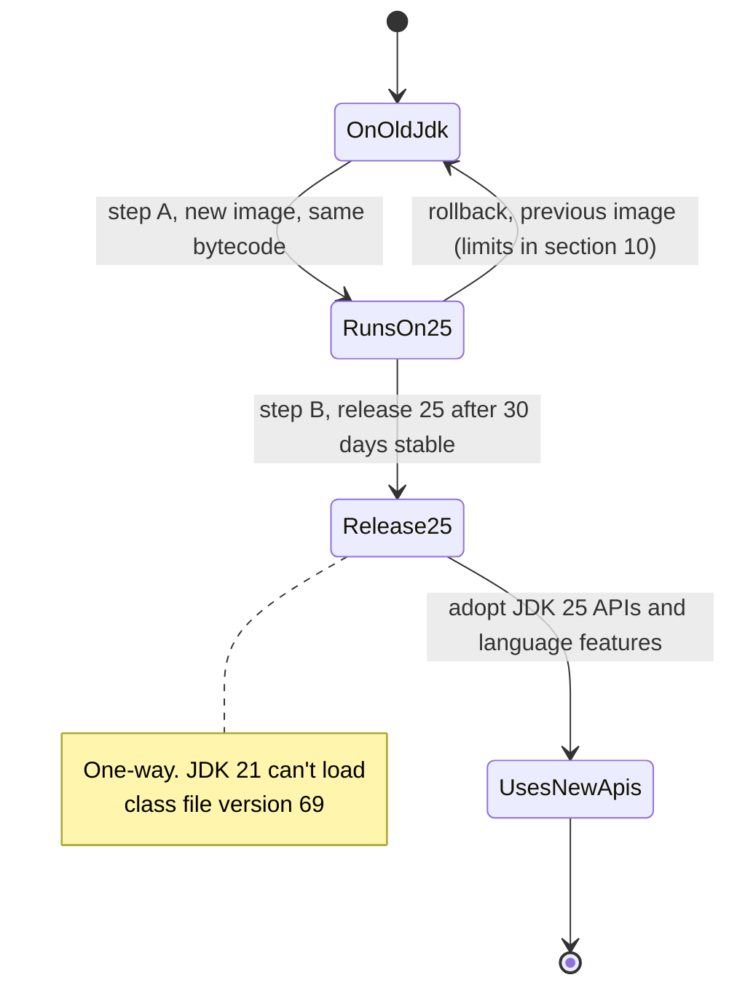
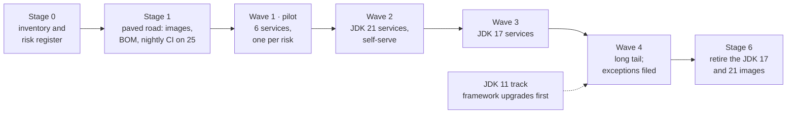

[⬅️ Prev: 36 · Case Study: Payments](36-case-study-payments.md) · [🏠 Index](README.md) · [Next: 38 · Case Study: Webhook Delivery ➡️](38-case-study-webhook-delivery.md)

# 37 · Case Study: Moving 180 Services to JDK 25

> *A fleet upgrade is only partly about the JDK. Most of the work is finding what depends on the old one, deciding who does what, and knowing which steps can't be undone. This case study takes [Chapter 27's upgrade playbook](27-staff-architect-interview-playbook.md#7-leading-a-fleet-wide-java-upgrade-) to a design review, with the evidence a reviewer should ask for.*

> [!NOTE]
> **Illustrative scenario, real outputs.** As in all three case studies (36–38), the company, its fleet and its numbers are invented. **Every output block is real**: the labs in this repository, run on JDK 17.0.21, 21.0.12 and 25.0.5 on Linux x86-64. Read the brief and sketch your own plan before you read mine.

🧪 **Runnable labs:** [the programs and scripts behind this case study's outputs](labs.md#chapter-37--case-study-fleet-jdk-upgrade)

---

## Table of contents
1. [The brief](#1-the-brief-)
2. [What must stay true](#2-what-must-stay-true-)
3. [Inventory, with evidence](#3-inventory-with-evidence-)
4. [Risk register](#4-risk-register-)
5. [The proposal](#5-the-proposal-)
6. [Alternatives considered](#6-alternatives-considered-)
7. [The decision record](#7-the-decision-record-)
8. [Rollout gates, with evidence](#8-rollout-gates-with-evidence-)
9. [Migration stages and ownership](#9-migration-stages-and-ownership-)
10. [Rollback limits](#10-rollback-limits-)
11. [Cost and effort](#11-cost-and-effort-)
12. [Operational evidence](#12-operational-evidence-)
13. [Review questions](#13-review-questions)
14. [References](#14-references)

---

## 1. The brief 🟣

*Illustrative scenario.* Northwind Market, the company from [Chapter 36](36-case-study-payments.md), runs **180 JVM services owned by 34 teams**: 130 on JDK 21, 40 on JDK 17 and 10 on JDK 11. Most are Spring Boot services on Kubernetes; about 20 are Kafka consumers and batch jobs. Traffic is uneven: 25 services take more than 500 requests per second at peak, 95 take between 20 and 500, and 60 take fewer than 20 or don't serve requests at all.

**The ask:** every service on JDK 25 by the end of June 2027, with no customer-visible incidents, well before the next peak-season change freeze (mid-November to early January).

**Why now:**
- **Support.** From next year, Northwind's JDK support contract covers 21 and 25 only. Staying on 17 means a second, extended-support contract; the JDK 11 services are already on one.
- **Cost.** In [Chapter 30's measurements](30-startup-footprint-aot-native-image.md#6-compact-object-headers-measured-), compact object headers cut a small-object heap by a quarter, and startup went from 614 ms with JDK 21's default CDS to 332 ms with JDK 25's AOT cache. The AOT cache arrived in JDK 24, and compact headers became a product option in 25.
- **Virtual threads.** Twelve services adopted virtual threads on JDK 21 and then limited them, because a virtual thread blocked inside `synchronized` pins its carrier thread. From JDK 24 a virtual thread can unmount inside `synchronized` (JEP 491).
- **One platform.** Three JDKs mean three base images, three sets of security updates every quarter, and library upgrades held back by the oldest JDK.

**Constraints:** the platform team has five engineers, three of whom can work on this. Service teams have their own roadmaps, so each team's share must be small and predictable.

**Non-goals:** native images; framework upgrades for their own sake. Where a service's framework version doesn't support JDK 25, the framework upgrade comes first and counts towards this programme.

---

## 2. What must stay true 🟣

| # | Constraint | How we'll know |
|---|---|---|
| C1 | No customer-visible regression: each service's SLOs hold through its move | The canary gates (§8), and SLO burn during and after each move |
| C2 | Any service can go back to its previous JDK until a declared point of no return | A rollback rehearsed in the pilot, and the limits written down (§10) |
| C3 | Teams aren't blocked: the platform work lands first, and a typical service costs at most 3 engineer-days | Effort per service, tracked against the estimate (§11) |
| C4 | Security updates keep flowing: no service runs more than one quarterly JDK update behind | Runtime versions on the fleet dashboard (§12) |
| C5 | No moves during the change freeze | Wave dates |
| C6 | Every exception is written down, owned and time-boxed | The exception register (§9) |

---

## 3. Inventory, with evidence 🔴

Six kinds of finding, from six checks. Each catches something the others miss.

### 3.1 Libraries that use JDK internals or APIs marked for removal

`fleet-inventory.sh` runs `jdeps --jdk-internals` and `jdeprscan --for-removal` from the **target** JDK over a list of JARs. Here it is against real library JARs (the versions Ubuntu ships):
```
$ cd /usr/share/java       # $REPO is this repository's folder; JDK 25 is on the PATH; takes about 40 s
$ "$REPO"/fleet-inventory.sh guava-32.0.1-jre.jar protobuf-3.21.12.jar gson-2.10.1.jar jackson-core-2.14.1.jar \
    jackson-databind-2.14.0.jar jackson-annotations-2.14.0.jar bcprov-1.77.jar commons-lang3-3.14.0.jar \
    commons-logging-1.3.0.jar
Target release: 25

JAR                                JDK internals (jdeps)      Deprecated for removal (jdeprscan --for-removal)
guava-32.0.1-jre.jar               sun.misc.Unsafe            java.security.AccessController x5, java.lang.Object::finalize x2, java.security.AccessControlException x1, java.lang.ThreadDeath x1
protobuf-3.21.12.jar               sun.misc.Unsafe            java.security.AccessController x1
gson-2.10.1.jar                    none                       java.security.AccessController x1
jackson-core-2.14.1.jar            none                       none
jackson-databind-2.14.0.jar        none                       java.security.AccessController x2, java.lang.System::getSecurityManager x2, java.lang.SecurityManager x2
jackson-annotations-2.14.0.jar     none                       none
bcprov-1.77.jar                    none                       java.security.AccessController x11, java.lang.SecurityManager x5, java.lang.System::getSecurityManager x2, java.security.AccessControlException x1
commons-lang3-3.14.0.jar           none                       none
commons-logging-1.3.0.jar          none                       java.security.AccessController x3, java.lang.ThreadDeath x1
```
How to read it:
- **Two libraries use `sun.misc.Unsafe`.** Its memory-access methods were deprecated for removal in JDK 23 (JEP 471) and print a warning from JDK 24 (JEP 498). A later release is planned to deny them by default.
- **Five libraries use Security Manager APIs.** The Security Manager can't be enabled from JDK 24 (JEP 486), but these APIs still exist so that old code still links. `jdeprscan` lists them because they're deprecated for removal: a warning about a future release, not a failure today.
- **`Object::finalize` and `ThreadDeath`** are in the same category: future work.
- **What a static scan can't tell you** is what happens when the code runs. That takes the next check.

### 3.2 Same finding, different outcomes

`UnsafeProbe` exercises a code path in each flagged library: on JDK 21, on JDK 25 with its default, and on JDK 25 with `--sun-misc-unsafe-memory-access=deny`, the setting a future JDK will make the default.
```
JDK 21, sun.misc.Unsafe memory access: (JDK default)
  Guava UnsignedBytes comparator   ok: UnsignedBytes.lexicographicalComparator() (sun.misc.Unsafe version)
  Guava murmur3_128 hash           ok: f3c924a895bc80854706eeba59d3b84a
  protobuf Struct round trip       ok: service=orders
JDK 25, sun.misc.Unsafe memory access: (JDK default)
WARNING: A terminally deprecated method in sun.misc.Unsafe has been called
WARNING: sun.misc.Unsafe::arrayBaseOffset has been called by com.google.common.primitives.UnsignedBytes$LexicographicalComparatorHolder$UnsafeComparator (file:/usr/share/java/guava-32.0.1-jre.jar)
WARNING: Please consider reporting this to the maintainers of class com.google.common.primitives.UnsignedBytes$LexicographicalComparatorHolder$UnsafeComparator
WARNING: sun.misc.Unsafe::arrayBaseOffset will be removed in a future release
  Guava UnsignedBytes comparator   ok: UnsignedBytes.lexicographicalComparator() (sun.misc.Unsafe version)
  Guava murmur3_128 hash           ok: f3c924a895bc80854706eeba59d3b84a
  protobuf Struct round trip       ok: service=orders
JDK 25, sun.misc.Unsafe memory access: --sun-misc-unsafe-memory-access=deny
  Guava UnsignedBytes comparator   ok: UnsignedBytes.lexicographicalComparator() (pure Java version)
  Guava murmur3_128 hash           ok: f3c924a895bc80854706eeba59d3b84a
  protobuf Struct round trip       FAILS: ExceptionInInitializerError, caused by UnsupportedOperationException: arrayBaseOffset
```
The static scan flagged Guava and protobuf identically. At run time **Guava falls back to a pure-Java comparator, and protobuf-java 3.21 fails in a static initialiser.** In a service, the first request that touches that class fails, and every later use throws `NoClassDefFoundError`, because a class whose initialiser failed can't be used again.

Notice **who the warning names**: only the first caller (Guava), not every library that uses `Unsafe`. Counting warning lines undercounts the problem.

Two decisions follow:
1. Every service gets a **second, non-blocking CI job** on JDK 25 with `--sun-misc-unsafe-memory-access=deny` and `--finalization=disabled`. It turns a future JDK's defaults into a list of failing tests today.
2. The **platform BOM** moves to library versions that pass that job, and the scan reruns on every BOM change.

### 3.3 Flags in deployment manifests

`jvm-flags-check.sh` starts a JVM with each flag set and reports whether it starts:
<!-- lab-output: jvm-flags-check.sh, JDK 17, 21 and 25 -->
```
JDK 17.0.21.1
  -XX:+UseConcMarkSweepGC                WON'T START  Unrecognized VM option 'UseConcMarkSweepGC'
  --illegal-access=permit                starts, but  OpenJDK 64-Bit Server VM warning: Ignoring option --illegal-access=permit; support was removed in 17.0
  -XX:+UseBiasedLocking                  starts, but  OpenJDK 64-Bit Server VM warning: Option UseBiasedLocking was deprecated in version 15.0 and will likely be re
  -XX:+UseZGC -XX:-ZGenerational         WON'T START  Unrecognized VM option 'ZGenerational'
  -Djava.security.manager=allow          starts
  -XX:+UseCompactObjectHeaders           WON'T START  Unrecognized VM option 'UseCompactObjectHeaders'
  -XX:AOTCache=app.aot                   WON'T START  Unrecognized VM option 'AOTCache=app.aot'
  --sun-misc-unsafe-memory-access=deny   WON'T START  Unrecognized option: --sun-misc-unsafe-memory-access=deny
  --enable-native-access=ALL-UNNAMED     starts
JDK 21.0.12.1
  -XX:+UseConcMarkSweepGC                WON'T START  Unrecognized VM option 'UseConcMarkSweepGC'
  --illegal-access=permit                starts, but  OpenJDK 64-Bit Server VM warning: Ignoring option --illegal-access=permit; support was removed in 17.0
  -XX:+UseBiasedLocking                  WON'T START  Unrecognized VM option 'UseBiasedLocking'
  -XX:+UseZGC -XX:-ZGenerational         starts
  -Djava.security.manager=allow          starts
  -XX:+UseCompactObjectHeaders           WON'T START  Unrecognized VM option 'UseCompactObjectHeaders'
  -XX:AOTCache=app.aot                   WON'T START  Unrecognized VM option 'AOTCache=app.aot'
  --sun-misc-unsafe-memory-access=deny   WON'T START  Unrecognized option: --sun-misc-unsafe-memory-access=deny
  --enable-native-access=ALL-UNNAMED     starts
JDK 25.0.5.0.3
  -XX:+UseConcMarkSweepGC                WON'T START  Unrecognized VM option 'UseConcMarkSweepGC'
  --illegal-access=permit                starts, but  OpenJDK 64-Bit Server VM warning: Ignoring option --illegal-access=permit; support was removed in 17.0
  -XX:+UseBiasedLocking                  WON'T START  Unrecognized VM option 'UseBiasedLocking'
  -XX:+UseZGC -XX:-ZGenerational         starts, but  OpenJDK 64-Bit Server VM warning: Ignoring option ZGenerational; support was removed in 24.0
  -Djava.security.manager=allow          WON'T START  Error occurred during initialization of VM
  -XX:+UseCompactObjectHeaders           starts
  -XX:AOTCache=app.aot                   starts, but  [0.005s][error][aot] An error has occurred while processing the AOT cache. Run with -Xlog:aot for details.
  --sun-misc-unsafe-memory-access=deny   starts
  --enable-native-access=ALL-UNNAMED     starts
```
Six groups, six actions:

| Group | Flags in this run | Action |
|---|---|---|
| Dead everywhere | CMS (won't start); `--illegal-access` (ignored) | Delete them now, before anything moves |
| A warning today, a failed start later | `-XX:+UseBiasedLocking`: deprecated with a warning on 17, won't start on 21 or 25 | Delete before the JDK 17 services move: the warning nobody reads becomes a JVM that doesn't start |
| New JDK only | `UseCompactObjectHeaders`, `AOTCache`, `--sun-misc-unsafe-memory-access` | Keep them out of any manifest that might run an older JDK: **JDK 17 and 21 won't start with them**, so a rollback that only swaps the image fails |
| Old JDK only | `-Djava.security.manager=allow`: starts on 17 and 21 | Remove before the move: **JDK 25 won't start with it** |
| Silently different | `-XX:-ZGenerational`: unknown on 17, honoured on 21, ignored on 25 | The warning on 25 goes to standard output, where nobody reads it (see below) |
| Safe everywhere | `--enable-native-access=ALL-UNNAMED`: accepted by 17, 21 and 25 | Add before the move: it silences JDK 25's JNI warnings |

The ZGC row needs a closer look, because the change doesn't depend on the flag at all:
```
$ java -XX:+UseZGC -Xlog:gc+init -version   # on JDK 17
[…][info][gc,init] Initializing The Z Garbage Collector
$ java -XX:+UseZGC -Xlog:gc+init -version   # on JDK 21
[…][info][gc,init] Initializing The Z Garbage Collector
[…][info][gc,init] Using legacy single-generation mode
$ java -XX:+UseZGC -XX:+ZGenerational -Xlog:gc+init -version   # on JDK 21
[…][info][gc,init] Initializing The Z Garbage Collector
$ java -XX:+UseZGC -Xlog:gc+init -version   # on JDK 25
[…][info][gc,init] Initializing The Z Garbage Collector
$ java -XX:+UseZGC -XX:+ZGenerational -Xlog:gc+init -version   # on JDK 25
OpenJDK 64-Bit Server VM warning: Ignoring option ZGenerational; support was removed in 24.0
[…][info][gc,init] Initializing The Z Garbage Collector
```
On JDK 17, single-generation ZGC is the only kind, and on JDK 21 `-XX:+UseZGC` alone still means the **legacy single-generation** collector. On 25 ZGC is always generational: JDK 23 made that the default (JEP 474) and JDK 24 removed the old mode (JEP 490). **Every ZGC service on 17, and every one that didn't opt in on 21, changes collector algorithm when it moves**, whatever its flags say. Generational ZGC usually needs less CPU and memory for the same pause times, but "usually" isn't a gate. These services go into the pilot.

The rule that matters most: **JDK-specific flags travel with the image, not the manifest.** The base image sets them in `JDK_JAVA_OPTIONS`, which the `java` launcher reads (and announces on standard error), so switching the image back switches the flags back. Manifests keep only flags that every JDK in play accepts, must not set `JDK_JAVA_OPTIONS` themselves, and CI runs the flags check against each of those JDKs on every manifest change.

### 3.4 Data the service writes

`LocaleDrift` formats 15:30 with the US short time format, then reads two stored strings back, strictly and leniently:
<!-- lab-output: LocaleDrift.java, JDK 17, 21 and 25 -->
```
JDK 17, java.locale.providers=(default): 15:30 is written as "3:30[U+0020]PM"
  reading "3:30[U+0020]PM"  strict: ok, 15:30          lenient: ok, 15:30
  reading "3:30[U+202F]PM"  strict: FAILS at index 4   lenient: FAILS at index 4
JDK 21, java.locale.providers=(default): 15:30 is written as "3:30[U+202F]PM"
  reading "3:30[U+0020]PM"  strict: FAILS at index 4   lenient: FAILS at index 4
  reading "3:30[U+202F]PM"  strict: ok, 15:30          lenient: ok, 15:30
Nov 18, 2026 9:20:22 PM sun.util.locale.provider.LocaleProviderAdapter <clinit>
WARNING: COMPAT locale provider will be removed in a future release
JDK 21, java.locale.providers=COMPAT: 15:30 is written as "3:30[U+0020]PM"
  reading "3:30[U+0020]PM"  strict: ok, 15:30          lenient: ok, 15:30
  reading "3:30[U+202F]PM"  strict: FAILS at index 4   lenient: FAILS at index 4
JDK 25, java.locale.providers=(default): 15:30 is written as "3:30[U+202F]PM"
  reading "3:30[U+0020]PM"  strict: FAILS at index 4   lenient: ok, 15:30
  reading "3:30[U+202F]PM"  strict: ok, 15:30          lenient: ok, 15:30
Nov 18, 2026 9:20:23 PM sun.util.locale.provider.LocaleProviderAdapter <clinit>
INFO: Invalid locale provider adapter "COMPAT" ignored.
Nov 18, 2026 9:20:23 PM sun.util.locale.provider.LocaleProviderAdapter <clinit>
WARNING: COMPAT locale provider has been removed
JDK 25, java.locale.providers=COMPAT: 15:30 is written as "3:30[U+202F]PM"
  reading "3:30[U+0020]PM"  strict: FAILS at index 4   lenient: ok, 15:30
  reading "3:30[U+202F]PM"  strict: ok, 15:30          lenient: ok, 15:30
```
Three facts sit behind this output:
- **JDK 20 moved to CLDR 42 locale data**, which puts a narrow no-break space (U+202F) before AM and PM. JDK 21 already writes it; JDK 17, with older locale data, writes an ordinary space, and can't read U+202F even leniently.
- **The `COMPAT` provider**, the usual workaround for that change, was removed in JDK 23. On 25 it's ignored with a log line, and the service starts writing U+202F.
- **From JDK 23, lenient parsing treats all space separators alike**, so JDK 25's lenient parser reads both forms. JDK 21's doesn't.

So **a JDK 17 service, or a JDK 21 service pinned to `COMPAT`, writes different strings after the move.** If those strings go anywhere durable (a database column, a cache key, a partner's CSV), rollback gets hard: the old version can't read what the new one wrote, strictly or leniently (§10).

Finding these uses is mechanical: OpenRewrite has a search recipe for locale-sensitive date and time formatting. The fix is a design rule: **text that machines read uses ISO-8601** (`DateTimeFormatter.ISO_LOCAL_TIME` and friends), never a localised format.

### 3.5 The default charset, for the JDK 17 services

Until JDK 18, the default charset came from the operating system's locale; from JDK 18 it's UTF-8 (JEP 400). Many container images set no locale at all. `DefaultCharset` writes a UTF-8 file and reads it back, once with the default charset and once with an explicit one, then writes the same text with the default charset:
<!-- lab-output: DefaultCharset.java, JDK 17 and 25 -->
```
JDK 17, LANG=(unset): default charset US-ASCII (native.encoding=ANSI_X3.4-1968)
  new FileReader(file), default charset: Caf[U+FFFD][U+FFFD] at 15:30, 20 [U+FFFD][U+FFFD][U+FFFD]
  Files.readString(file), always UTF-8: Caf[U+00E9] at 15:30, 20 [U+20AC]
  written by new FileWriter(file), read back as UTF-8: Caf? at 15:30, 20 ?
JDK 17, LANG=C.UTF-8: default charset UTF-8 (native.encoding=UTF-8)
  new FileReader(file), default charset: Caf[U+00E9] at 15:30, 20 [U+20AC]
  Files.readString(file), always UTF-8: Caf[U+00E9] at 15:30, 20 [U+20AC]
  written by new FileWriter(file), read back as UTF-8: Caf[U+00E9] at 15:30, 20 [U+20AC]
JDK 25, LANG=(unset): default charset UTF-8 (native.encoding=ANSI_X3.4-1968)
  new FileReader(file), default charset: Caf[U+00E9] at 15:30, 20 [U+20AC]
  Files.readString(file), always UTF-8: Caf[U+00E9] at 15:30, 20 [U+20AC]
  written by new FileWriter(file), read back as UTF-8: Caf[U+00E9] at 15:30, 20 [U+20AC]
```
(JDK 21 prints the same as JDK 25.)
- **On JDK 17 with no locale, the default is US-ASCII.** Anything that relies on it (`new FileReader(file)`, `new FileWriter(file)`, `new String(bytes)`, `getBytes()`) reads "é" and "€" as replacement characters and writes them as `?`, which loses them for good.
- **After the move, the same code reads them correctly.** It's a fix, but a change: output that downstream systems were built around changes too, and a rollback to JDK 17 garbles whatever the new version wrote.
- **`native.encoding`** still reports the operating system's choice on 25 (`ANSI_X3.4-1968` here), for the code that really needs it.
- **Builds depend on it as well.** JDK 17's `javac` in such a container refuses a source file with a non-ASCII character unless it's told the encoding: `error: unmappable character (0xC3) for encoding US-ASCII`. Set the source encoding in the build (Maven's `project.build.sourceEncoding`, Gradle's `options.encoding`), so it never depends on the build machine's locale.

### 3.6 Defaults that change in update releases too

`java -XshowSettings:security:properties -version` prints the security properties, including the TLS algorithms a build refuses. On the three builds used here (17.0.21, 21.0.12 and 25.0.5), the TLS and certificate-path lists are **identical**: all three disable the `TLS_RSA_*` cipher suites and SHA-1 handshake signatures. The only difference is the list of legacy algorithms that `keytool` and `jarsigner` warn about, which is longer on 21 and 25. For these builds, then, the move changes no TLS defaults; an older update of any of them might well differ. The lesson isn't "TLS is safe". It's that **security defaults also change in quarterly update releases**, so you compare the builds you actually run, not their version numbers.

---

## 4. Risk register 🔴

The inventory, run across Northwind's repositories and manifests (*the counts are illustrative*):

| Risk | Found by | Services | Mitigation | Owner |
|---|---|---|---|---|
| Libraries that fail when `Unsafe` memory access is denied | `fleet-inventory.sh`, then the deny-mode CI job | 71 (protobuf-java 3.x) | BOM upgrade, proven by the deny-mode job | Platform (BOM), service teams |
| Flags that stop a JVM starting, or are ignored | `jvm-flags-check.sh` over every manifest | 52, including 9 with `java.security.manager=allow` | Delete dead flags now; move JDK-specific flags into the image | Platform (lint), service teams |
| ZGC changes mode | Flag scan, then `-Xlog:gc+init` | 14 | Pilot under production-like load; compare pauses, GC CPU share and RSS | Service teams, SRE |
| Locale-formatted text written to storage | OpenRewrite search, `LocaleDrift` | 6 (2 pinned to `COMPAT`) | ISO-8601 for machine-read text; a read shim on the old version first (§10) | Service teams |
| UTF-8 default charset (JDK 18, JEP 400) for JDK 17 services | `DefaultCharset`, then tests in an image with no `LANG` set | 3 | Test with UTF-8; read `native.encoding` where the OS encoding really matters | Service teams |
| Native-access warnings (JDK 24, JEP 472) | Warnings in canary logs | 23 (native transports, compression, RocksDB) | `--enable-native-access=ALL-UNNAMED` in the image | Platform |
| Agents loaded at run time (warnings since JDK 21, JEP 451) | Warnings in test and canary logs | Most test suites (Mockito's inline mock maker); 2 services attach a profiler | Load agents with `-javaagent` at startup | Service teams |
| Tools that read class files: ASM, Byte Buddy, JaCoCo, Lombok, APM agents, build plugins | The nightly build on 25 | All | BOM and plugin upgrades before wave 2 | Platform |
| AOT cache built for a different JDK | `-Xlog:aot`; startup time | Services that adopt it | Build the cache per image, in the image build | Platform |
| Security defaults (TLS, certificates) | Compare `-XshowSettings:security:properties` per build | Partners with old TLS stacks | Identical on the builds here; recheck on every update | Security |

---

## 5. The proposal 🟣

### 5.1 Pave the road first

Before any team moves a service, the platform team ships:
- **Base images per JDK**, with JDK-specific flags in `JDK_JAVA_OPTIONS`, `--enable-native-access=ALL-UNNAMED` included, and an AOT cache built in the image build for services that opt in.
- **A platform BOM** of library and plugin versions that pass the deny-mode job.
- **Build images on the JDK 25 compiler**, with each service's `--release` unchanged. The artefacts still run on the old JDK, so this step is invisible in production.
- **Nightly CI** that builds and tests every service on JDK 25, plus the non-blocking deny-mode job. Results go to the dashboard, so the platform team sees breakage before the teams do.
- **Manifest lint**: `jvm-flags-check.sh` with each manifest's flags, against both JDKs.
- **Recipes and a playbook**: OpenRewrite's `UpgradeToJava25` for step B, the locale search recipe for §3.4, and a known-issues page updated after every wave.

### 5.2 Two steps per service


- **Step A, run on 25.** A new base image, the same bytecode (still `--release 21` or `17`). The runtime changes: the collector, defaults, locale data, warnings. **Reversible** by switching the image back, within the limits in §10.
- **Step B, raise the release.** `--release 25`, then new APIs and language features. **One-way**: JDK 21 refuses the class files (§10). It happens only after 30 days stable on step A, and shared libraries go last.

This refines [Chapter 27 §7](27-staff-architect-interview-playbook.md#7-leading-a-fleet-wide-java-upgrade-)'s four steps (build, run, bump, adopt). The build step happens fleet-wide in §5.1, and §10 shows why "independently reversible" holds for the deploy but not always for the data.

### 5.3 Waves



| Wave | When | Services | How |
|---|---|---|---|
| 1 · Pilot | February | 6, chosen to cover the risk register: the busiest service, a 15 req/s service, a single-generation ZGC service, a JNI-heavy service, a service that stores formatted times, a batch job | A platform engineer pairs with each team; one rollback is rehearsed for real |
| 2 · JDK 21 | March–April | The remaining JDK 21 services, about 30 a week | Self-serve with the playbook; the platform team raises the image PRs and runs office hours twice a week |
| 3 · JDK 17 | April–May | The JDK 17 services | More change: charset, locale data, agent warnings, library upgrades. Platform pairs on the first five |
| 4 · Long tail | June | Whatever is left | Hands-on help; anything still unmoved becomes an exception |
| JDK 11 track | Its own plan | 10 | Framework upgrades first; each starts as an exception with an owner and a date |

**The position I'd defend:** the platform team owns everything that's the same for every service, and each service team owns the risk of its own service. A central team that upgrades everyone moves faster in the first month and owns every incident after that.

---

## 6. Alternatives considered 🟣

| Option | For | Against | Verdict |
|---|---|---|---|
| A. Each team upgrades when it suits them | No coordination; teams pick their timing | The long tail never finishes, every library upgrade waits for the oldest JDK, and it's how the fleet ended up on three JDKs | Rejected |
| B. The platform team upgrades every service centrally | Fast; one team learns everything once | It doesn't know each service's traffic, data and failure modes, and it isn't clear who owns an incident | Rejected, but its automation is kept: the platform raises the PRs in wave 2 |
| C. Wait for the next LTS (JDK 29, due September 2027) and move once | One migration instead of two | Another year of the JDK 17 contract; a bigger jump later; the inventory work is the same | Rejected; the follow-up review revisits the cadence |
| D. Stay on 17 and 21 with extended support | No migration work now | Pays for no improvement, and the move only gets bigger | Rejected |
| E. Only new services start on 25 | No risk to existing services | A third platform to maintain; the old fleet still has to move | Rejected |
| F. Paved road, two steps per service, waves, time-boxed exceptions | Shared work done once; teams own their own risk; the one-way steps are explicit | A platform team for a quarter, a dashboard, and an exception process someone has to police | **Chosen** |

---

## 7. The decision record 🟣

```markdown
# ADR-044: Move the fleet to JDK 25 with a paved road, two steps per service, and waves
- Status: Proposed (2026-11-18) · Deciders: platform architecture group · Consulted: service team leads, SRE, security
- Context: 180 services on three JDKs (130 on 21, 40 on 17, 10 on 11). JDK 17 needs a separate support contract
  from next year. The inventory found 71 services that fail with Unsafe memory access denied (protobuf-java 3.x),
  52 with flags that stop JDK 25 starting or that it ignores, 14 that change ZGC mode, and 6 that store
  locale-formatted text.
- Decision: The platform team first ships JDK 25 base images (JDK-specific flags inside the image), a BOM that
  passes a deny-mode CI job, nightly builds of every service on 25, and manifest linting. Each team then moves
  its services in two steps: A, run on 25 at the old --release (reversible by switching the image); B, raise
  --release to 25 after 30 days stable (one-way; shared libraries last). Services move in waves (pilot, JDK 21,
  JDK 17, long tail), gated on canary metrics after at least 20,000 canary requests. Exceptions last 90 days.
- Consequences:
  + One JDK to patch; heap and startup improvements become available to every service
  + Breakage is found by nightly CI and the pilot, not by each team on its own
  + The one-way steps are named, with a go/no-go before each
  - About 3 engineer-quarters of platform work, plus 1.5 to 4 engineer-days per service (estimate in §11)
  - Low-traffic services need synthetic load or long bakes to pass the gates
  - Two runtime images per service family until stage 6
- Reconsider if: the pilot's effort per service is more than double the estimate; a pilot service shows a
  regression the gates can't catch; or the deny-mode job finds a library with no fixed release.
```

---

## 8. Rollout gates, with evidence 🔴

"Compare the canary's p99 with the baseline" is the gate everyone writes. `CanaryGate` measures how often that gate is wrong. It simulates a service whose latencies are lognormal (median 80 ms, p99 about 407 ms) and three releases: no change, everything 10% slower, and 2% of requests 400 ms slower, which is what a collector regression usually looks like. The gate blocks a release when the canary's percentile is more than 5% worse than the baseline's.
<!-- lab-output: CanaryGate.java, JDK 25 -->
```
1. The releases being judged (true values, from 4 million requests each)
   no regression            p50  80.0 ms ( +0.0%)   p99 407.3 ms ( +0.0%)
   everything 10% slower    p50  88.0 ms (+10.0%)   p99 449.5 ms (+10.4%)
   2% of requests +400 ms   p50  81.4 ms ( +1.7%)   p99 513.8 ms (+26.1%)

2. How often the gate is wrong, by the number of requests the canary has served
     canary   false alarms:             misses:                   misses:
   requests   no regression             everything 10% slower     2% of requests +400 ms
              p99 gate    p50 gate      p99 gate    p50 gate      p99 gate    p50 gate
        200      21.1%       20.3%          59.7%       27.7%          11.5%       72.0%
      1,000      19.2%        3.1%          33.7%        5.9%           0.0%       87.1%
      5,000       8.4%        0.0%          11.6%        0.0%           0.0%       99.8%
     20,000       0.5%        0.0%           0.7%        0.0%           0.0%      100.0%
    100,000       0.0%        0.0%           0.0%        0.0%           0.0%      100.0%

3. How long the canary takes to serve that many requests (it gets 5% of the traffic)
    service traffic        canary   1,000 requests  20,000 requests  100,000 requests
        2,000 req/s       100/s             10 s            3 min            17 min
          200 req/s        10/s            100 s           33 min             2.8 h
           20 req/s         1/s           17 min            5.6 h            27.8 h
```
(This is the JDK 25 run; JDK 21's agrees to within 0.2 percentage points.)

What it says:
- **Below a few thousand requests, a p99 gate is mostly noise.** At 1,000 canary requests it raises a false alarm on 19% of healthy releases and misses a third of 10% regressions. Teams learn to override it, and then it protects nothing.
- **A p50 gate can't see tail regressions.** It misses 87–100% of the "2% of requests +400 ms" case: exactly the shape of a collector change.
- **At about 20,000 canary requests, both error rates fall below 1%.** So gates count requests, not minutes. That's 3 minutes for a 2,000 req/s service, 33 minutes at 200 req/s and 5.6 hours at 20 req/s.

The gates for step A:

| Signal | Gate | Why |
|---|---|---|
| p99 latency | Within 5% of baseline, judged after at least 20,000 canary requests that include a daily peak | The simulation above |
| Error rate | No higher than baseline at the same request count | Often the first sign, such as `NoClassDefFoundError` after a failed initialiser (§3.2) |
| GC | Pause p99 and GC CPU share within 10% of baseline | The collector itself may have changed (§3.3) |
| Memory | RSS within 10% of baseline; no OOM kills | Native memory against the container limit ([Chapter 10 §13](10-memory-and-garbage-collection.md#13-the-jvm-in-containers-)) |
| New warnings | No unexplained `WARNING:` lines at startup or in the first hour | Unsafe, native access, agents, locale provider: each one names a future break |
| Batch jobs | Duration within 10%; output checksums identical to a run on the old JDK | No request latency to watch |

For the 60 services under 20 req/s, the canary first runs against replayed or synthetic traffic in pre-production until it has served 20,000 requests. It then bakes for 24 hours in production, judged on the direct signals: errors, GC, memory and warnings.

---

## 9. Migration stages and ownership 🔵

| Stage | What happens | Owner | Gate to the next stage |
|---|---|---|---|
| 0. Inventory | Run the checks over every repository and manifest; build the risk register and the dashboard | Platform | Every service has a row: JDK, framework, flags, findings, owner |
| 1. Pave the road | Images, BOM, JDK 25 compiler in the build images, nightly CI on 25, the deny-mode job, manifest lint, the playbook | Platform | Nightly builds green for at least 90% of services; pilot teams signed up |
| 2. Pilot (wave 1) | Step A for 6 services, with one rollback rehearsed | Service teams, with platform pairing | All 6 pass the gates for two weeks; playbook updated; effort per service measured |
| 3. Waves 2–4 | Step A for everyone else | Service teams | Each service passes its gates; each wave's escapes are reviewed before the next wave starts |
| 4. Step B | Raise `--release` to 25, service by service, after 30 days stable. Shared libraries last | Service teams, library owners | For a library: no consumer still on its old JDK |
| 5. Exceptions | Every unmoved service has an entry: owner, reason, plan, expiry, cost | Architecture group | Register reviewed monthly |
| 6. Retire | Remove the JDK 17 and 21 images, and block them in CI | Platform | No running service uses them; a go/no-go review |

Who does what:

| | Platform team | Service teams | SRE | Security | Architecture group |
|---|---|---|---|---|---|
| Paved road (images, BOM, CI, lint) | **Accountable**, does the work | Consulted | Consulted | Consulted | Informed |
| Moving a service (steps A and B) | Consulted | **Accountable**, does the work | Consulted | Informed | Informed |
| Gates and dashboards | Builds them | Consulted | **Accountable** | Informed | Informed |
| Exceptions | Consulted | Requests one | Informed | Consulted | **Accountable**: approves |
| Retiring the old images | **Accountable**, does the work | Informed | Consulted | Consulted | Consulted |

**The exception process.** A team that can't move by its wave files an exception: the reason, the plan, the date, and the compensating control (usually staying on a supported, patched build of the old JDK). An exception lasts 90 days. Renewing it takes the architecture group and the team's director. Each exception's cost, its share of the extended-support contract and of the old images' upkeep, appears on the team's showback. Exceptions aren't failures; untracked ones are.

---

## 10. Rollback limits 🔵

For step A, the rollback plan is "switch the image back". Three questions decide whether that works.

**1. After the new version has written, can the old version still read it?** Mostly, because step A changes no bytecode, libraries or schemas. The exceptions are things the JDK itself produces:
- **Locale-formatted text.** A JDK 21 service pinned to `COMPAT` writes "3:30 PM" with an ordinary space. After a week on 25 it has written strings with U+202F, and §3.4 shows the old version failing on them, strictly and leniently.
- **JDK-specific caches.** An AOT cache works only on the JDK release that created it, on the same OS and CPU architecture, with a consistent class path. With the wrong cache the JVM prints an error and starts without it (§3.3), so the rollback works, but startup is slow until the cache is rebuilt.
- **Text written in the default charset.** A JDK 17 service in a container with no locale writes and reads files as US-ASCII; after the move it uses UTF-8, and if it's rolled back, it garbles whatever the new version wrote (§3.5).
- **Other JDK behaviour you've persisted**, such as `HashMap` iteration order baked into files or checksums. That order isn't specified and may change between releases.

**2. What must flow back?**
- **Flags:** nothing, if JDK-specific flags live in the image. If they live in the manifest, the rollback doesn't start: §3.3 shows JDK 21 refusing `-XX:+UseCompactObjectHeaders`.
- **Stored text:** before a service that stores locale-formatted text moves, it ships a **read shim on the old JDK** that replaces U+202F and U+00A0 with an ordinary space before parsing. Then both versions read both forms. Better still, move the column to ISO-8601 first.
- **Caches:** rebuilt per image in the image build, so each image brings its own.

**3. When does rollback become a forward repair?**
- **At step B.** These commands are in the labs index; the output is real:
```
== compiled with JDK 25 --release 21, run on JDK 21
hello from 21.0.12.1+1-1-24.04.4-Ubuntu
== compiled with JDK 25 --release 25, run on JDK 21
Error: LinkageError occurred while loading main class Hello
	java.lang.UnsupportedClassVersionError: Hello has been compiled by a more recent version of the Java Runtime (class file version 69.0), this version of the Java Runtime only recognizes class file versions up to 65.0
```
  After step B, going back means reverting to an older artefact (losing everything since) or rebuilding at the old release, which fails as soon as the code uses a JDK 25 API.
- **When a shared library is released at 25.** Every consumer is forced forward with it, which is why libraries go last.
- **When text in the new format has left your control:** a partner's import, a data-lake table.
- **At stage 6**, when the old images are deleted.

| Step | How to go back | What must flow back | Becomes a forward repair when |
|---|---|---|---|
| Stage 1 (JDK 25 compiler, old release) | Rebuild with the old compiler | Nothing | n/a |
| Step A | The previous image | Locale-formatted text (ship the shim first); nothing for flags if they're in the image | Text in the new format has reached systems you don't control |
| Step B | Revert the commit and rebuild at the old release | Every change made since | The code uses a JDK 25 API |
| Stage 6 | Rebuild the old images | Everything | Immediately: plan it as a migration, not a rollback |

Say the points of no return out loud: for each service, merging step B; for the platform, stage 6. Each gets a go/no-go.

---

## 11. Cost and effort 🔵

The estimate before the pilot (*illustrative*):

| Work | Estimate | Basis |
|---|---|---|
| Platform: images, BOM, CI, lint, dashboard, playbook | 3 engineers × 13 weeks = 39 engineer-weeks | Similar work on the JDK 21 move |
| Pilot: 6 services with pairing | 6 × 5 days = 6 engineer-weeks | Deliberately generous: the pilot is where the unknowns are |
| Wave 2: about 125 JDK 21 services | 1.5 days each ≈ 38 engineer-weeks | Image change, flag clean-up, gates. Most breakage is fixed once, in the BOM |
| Wave 3: about 39 JDK 17 services | 4 days each ≈ 31 engineer-weeks | Library upgrades, charset and locale checks, agent warnings |
| Step B: 170 services | 0.5 days each ≈ 17 engineer-weeks | A one-line change and a release; more where code adopts new APIs |
| **Total** | **≈ 131 engineer-weeks, about 2.5 engineer-years** | Plus CI minutes for nightly builds, and two images per family until stage 6 |

What it buys, stated as assumptions the pilot will test:
- **No JDK 17 support contract** from next year, and one JDK line to patch each quarter instead of three.
- **Memory:** Chapter 30 measured a quarter less heap for small objects with compact headers. The plan assumes nothing until the pilot measures RSS per service; if the median pilot service saves 10%, memory requests come down at the next capacity review.
- **Startup:** services that scale out often gain the most from the AOT cache. Each one opts in separately, since it adds a training run to its build.

The cost that's easiest to forget is attention. Each wave takes time from thirty-odd teams, which is why the per-service estimate is a constraint (C3), tracked like a budget. [Chapter 39](39-staff-artefact-exercises.md), exercise 4, asks you to turn this into a full comparison against option C.

---

## 12. Operational evidence 🔵

| Signal | Target | Why |
|---|---|---|
| Services by runtime and release level, from what's running (Spring Boot's `jvm.info` metric carries the version) | 100% on step A by the end of June | The headline, measured from production rather than from tickets |
| Unexplained `WARNING:` lines per service | 0 | Each one names a future break: Unsafe, native access, agents, locale provider |
| Manifest lint failures | 0 before a service's wave | Flags that would stop a JVM starting |
| Gate results: passed, blocked (by reason), overridden | Overrides rare, each with a written reason | Frequent overrides mean a miscalibrated gate (§8) |
| Escapes: regressions found after promotion | No severe ones | The gates' real miss rate |
| p99, CPU per request, RSS and GC CPU share, before and after, per service | Report the median and the worst five | The benefit case, and where to look next |
| Engineer-days per service against the estimate | Within 1.5× | C3, and the ADR's reconsider trigger |
| Exceptions: count, age, days to expiry | None older than 90 days without a renewal | C6 |
| Patch latency: days from a JDK update's release to 95% of the fleet running it | Shorter than before the programme | C4, and the main reason for one platform |

**The follow-up review.** Ninety days after the last wave, the programme's owner writes a short memo: did we get what the ADR promised, at the cost we expected, and what would we change next time (for example, whether waiting for an LTS would have been cheaper)? [Chapter 39](39-staff-artefact-exercises.md), exercise 5, is that memo.

---

## 13. Review questions

<details>
<summary><b>Q1. 🔴 The static scan flagged Guava and protobuf the same way. Why isn't a static scan enough, and what do you add?</b></summary>

`jdeps` reports references, not behaviour. A library can reference `sun.misc.Unsafe` and fall back when it's refused, or fail. In §3.2, Guava 32 fell back to pure Java under `deny`, and protobuf-java 3.21 failed in a static initialiser, which in a service means every later use of that class fails too. Add a CI job that runs the tests with the future default (`--sun-misc-unsafe-memory-access=deny`) so those failures appear today, and treat every startup `WARNING:` line as a finding. Count libraries from the scan, not from warnings: the warning names only the first caller.
</details>

<details>
<summary><b>Q2. 🔴 Where should JDK-specific JVM flags live, and why does it matter for rollback?</b></summary>

In the image, for example in `JDK_JAVA_OPTIONS`, not in the deployment manifest. Flags are JDK-specific in both directions: JDK 21 won't start with `-XX:+UseCompactObjectHeaders` or `--sun-misc-unsafe-memory-access`, and JDK 25 won't start with `-Djava.security.manager=allow`. If the flags sit in the manifest, a rollback that switches only the image fails to start, at the moment you most need it. Keep only flags both JDKs accept in manifests, and lint every manifest against both JDKs in CI.
</details>

<details>
<summary><b>Q3. 🔴 A service runs <code>-XX:+UseZGC</code> on JDK 21 with no other GC flags. What changes on JDK 25, and how would you gate it?</b></summary>

The collector algorithm. On JDK 21, `-XX:+UseZGC` alone selects the legacy single-generation ZGC (the `gc+init` log says so); on 25 ZGC is always generational, and `-XX:±ZGenerational` is ignored with a warning. Generational ZGC usually needs less CPU and memory for similar pauses, but treat it as a GC change: put the service in the pilot, run it under production-like load, and gate on pause p99, GC CPU share, allocation stalls and RSS as well as request latency. The p99 gate needs enough requests to see a tail regression (§8).
</details>

<details>
<summary><b>Q4. 🟣 Why gate on request counts rather than bake time? What do you do for a service with 15 requests per second?</b></summary>

Because a percentile's noise depends on how many requests it's estimated from, not on how long you waited. In the simulation, a p99 gate with 1,000 canary requests raised false alarms on 19% of healthy releases and missed a third of 10% regressions; at 20,000 both errors were under 1%. A 15 req/s service with a 5% canary needs about 7 hours to collect 20,000 requests, so gate it on replayed or synthetic traffic in pre-production first, then bake for a day in production on signals that need fewer samples: error counts, GC, RSS and new warnings.
</details>

<details>
<summary><b>Q5. 🔵 Which steps of the migration are one-way, and how do you sequence shared libraries?</b></summary>

Running on the new JDK (step A) is reversible by switching the image back, as long as flags travel with the image and nothing the new JDK wrote is unreadable by the old one. Raising the release level (step B) is one-way: JDK 21 refuses class file version 69. Shared libraries move last, because a library compiled for 25 forces every consumer onto 25. So: every consumer finishes step A, the library raises its release, then consumers raise theirs. Retiring the old images is the platform's point of no return, and it gets its own go/no-go.
</details>

<details>
<summary><b>Q6. 🔵 Ten services are on JDK 11, and two teams say they can't move this half. What do you do?</b></summary>

Make it explicit rather than fight it. The JDK 11 services get their own track, because they need framework upgrades first; each one starts as an exception with an owner, a plan and a date. The two teams file exceptions: reason, plan, date, and a compensating control (a supported, patched build of their current JDK). Exceptions last 90 days, renewals need the architecture group and a director, and their cost shows on the team's showback. Then find out why they can't move: if it's capacity, the platform team can pair; if it's a missing library release, that's a risk for everyone and goes on the register.
</details>

<details>
<summary><b>Q7. 🔵 Six months later, how do you know whether the programme was worth it?</b></summary>

Compare against what the ADR promised, with numbers from production: services on 25 by runtime metric, patch latency before and after, RSS and CPU per request before and after (median and worst), severe incidents caused by the move, engineer-days spent against the estimate, and exceptions still open. Then write it down as a follow-up memo, including what you'd do differently, such as whether waiting for an LTS would have been cheaper. A decision you never revisit can't teach you anything.
</details>

---

## 14. References
- JEPs: [400](https://openjdk.org/jeps/400) (UTF-8 by default), [421](https://openjdk.org/jeps/421) (finalization deprecated for removal), [451](https://openjdk.org/jeps/451) (dynamic agent loading), [471](https://openjdk.org/jeps/471) and [498](https://openjdk.org/jeps/498) (`sun.misc.Unsafe` memory access), [472](https://openjdk.org/jeps/472) (restricting JNI), [474](https://openjdk.org/jeps/474) and [490](https://openjdk.org/jeps/490) (generational ZGC), [483](https://openjdk.org/jeps/483) (AOT class loading and linking), [486](https://openjdk.org/jeps/486) (Security Manager), [491](https://openjdk.org/jeps/491) (virtual threads and `synchronized`), [519](https://openjdk.org/jeps/519) (compact object headers)
- Locale data: [JDK-8284840](https://bugs.openjdk.org/browse/JDK-8284840) (CLDR 42 in JDK 20), [JDK-8325568](https://bugs.openjdk.org/browse/JDK-8325568) (`COMPAT` removed in JDK 23), [JDK-8324990](https://bugs.openjdk.org/browse/JDK-8324990) (lenient parsing of space separators); Spring Framework wiki, [*Date and Time Formatting with JDK 20 and higher*](https://github.com/spring-projects/spring-framework/wiki/Date-and-Time-Formatting-with-JDK-20-and-higher)
- OpenRewrite, [*Find locale-sensitive date/time formatting*](https://docs.openrewrite.org/recipes/java/migrate/search/findlocaledatetimeformats)
- `jdeps` and `jdeprscan` man pages ([JDK 25 tool specifications](https://docs.oracle.com/en/java/javase/25/docs/specs/man/))
- Google SRE Workbook, [*Canarying Releases*](https://sre.google/workbook/canarying-releases/)
- In this repository: [Chapter 27 §7](27-staff-architect-interview-playbook.md#7-leading-a-fleet-wide-java-upgrade-), [Chapter 30 §3 and §6](30-startup-footprint-aot-native-image.md#3-from-cds-to-the-aot-cache-measured-), [Chapter 10 §11 and §13](10-memory-and-garbage-collection.md#11-choosing-and-tuning-a-collector-), [Chapter 14 §9](14-reflection-annotations-proxies.md#9-integrity-by-default-where-the-jdk-is-heading-), [Chapter 15](15-modules-and-build-tools.md), [Chapter 22 §10](22-production-readiness-observability-resilience.md#10-deployment-strategies-)

---

[⬅️ Prev: 36 · Case Study: Payments](36-case-study-payments.md) · [🏠 Index](README.md) · [Next: 38 · Case Study: Webhook Delivery ➡️](38-case-study-webhook-delivery.md)
