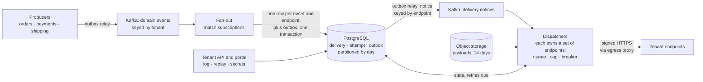
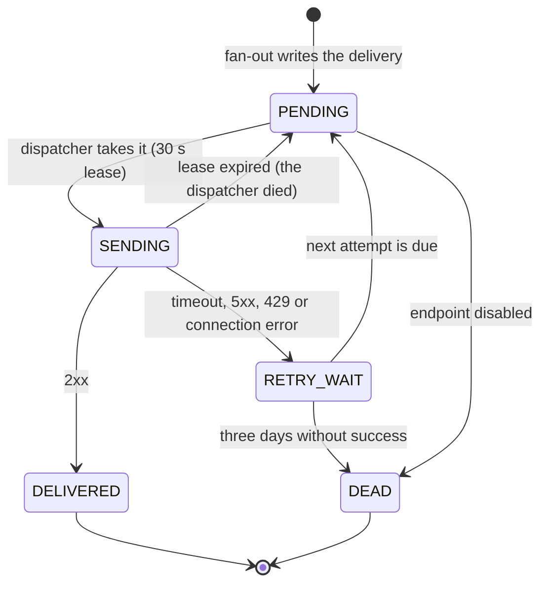
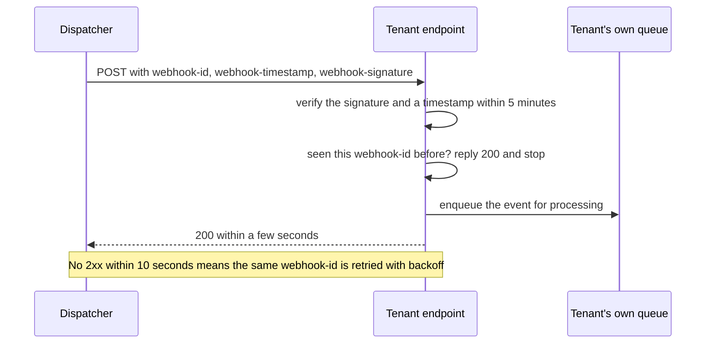

[⬅️ Prev: 37 · Case Study: Fleet JDK Upgrade](37-case-study-fleet-jdk-upgrade.md) · [🏠 Index](README.md) · [Next: 39 · Staff & Architect Artefacts ➡️](39-staff-artefact-exercises.md)

# 38 · Case Study: A Multi-Tenant Webhook Delivery Platform

> *Webhooks look like a queue and an HTTP client. The hard part is the tenants: the one whose endpoint hangs, the one that sends a backfill of thirty thousand events, and the one who says an event never arrived. [Chapter 33's Mock 2](33-annotated-mock-interviews.md#mock-2-system-design-a-webhook-delivery-platform-) sketches this design in an interview; this case study takes it to a design review, with the evidence a reviewer should ask for.*

> [!NOTE]
> **Illustrative scenario, real outputs.** As in all three case studies (36–38), the company and its numbers are invented. **Every output block is real**, from the labs in this repository. Read the brief and sketch your own design before you read mine.

🧪 **Runnable labs:** [the programs behind this case study's outputs](labs.md#chapter-38--case-study-webhook-delivery)

---

## Table of contents
1. [The brief](#1-the-brief-)
2. [Promises and invariants](#2-promises-and-invariants-)
3. [The proposal](#3-the-proposal-)
4. [Alternatives considered](#4-alternatives-considered-)
5. [The decision record](#5-the-decision-record-)
6. [Failure analysis, with evidence](#6-failure-analysis-with-evidence-)
7. [Migration stages](#7-migration-stages-)
8. [Rollback limits](#8-rollback-limits-)
9. [Operational evidence](#9-operational-evidence-)
10. [Review questions](#10-review-questions)
11. [References](#11-references)

---

## 1. The brief 🟣

*Illustrative scenario.* Northwind Market sends webhooks to the systems of its sellers and partners: order created, payment succeeded ([Chapter 36](36-case-study-payments.md)), shipment updated, refund issued. There are **4,000 tenants with 5,500 endpoints**, **30 million events a day**, and peaks of 3,000 events per second during sales. Payloads average 2 KB, with a 64 KB maximum.

**Today** each producing service (orders, payments, shipping) posts its own webhooks from a thread pool, retries three times within a minute, then gives up. Only one of the three signs its requests, and none has a delivery log.

**Why now:** during last month's sale, a large seller's endpoint hung. The orders service's webhook pool filled with calls waiting out a 30-second timeout, its queue grew, and order confirmations for *every* seller ran up to 40 minutes late. Separately, partners file about 15 tickets a week saying an event never arrived, and nobody can prove whether it did.

**Goals:** producers never wait on a tenant; one tenant's endpoint can't delay another's events; at-least-once delivery with retries for three days; signed requests; a delivery log and replay that tenants can use themselves.

**Non-goals for this review:** event schemas (versioning is [Chapter 31](31-api-design-between-services.md)'s job), ordering guarantees beyond a per-resource sequence number, and exactly-once delivery, which no HTTP sender can promise.

---

## 2. Promises and invariants 🟣

What tenants are promised (the public contract):

| # | Promise |
|---|---|
| P1 | **At least once.** Every accepted event is delivered with a 2xx, or, after three days of failures, marked dead and shown to the tenant. Nothing is dropped silently |
| P2 | **A stable ID.** Every attempt at a delivery carries the same `webhook-id`, so receivers can discard duplicates. A replay is a new delivery, with a new ID |
| P3 | **Isolation.** A healthy endpoint gets 99% of its events within 5 seconds, whatever other tenants' endpoints are doing |
| P4 | **Authenticity.** Every request is signed, with a timestamp the receiver checks |
| P5 | **No global order.** Payloads carry a per-resource sequence number; receivers that need order compare it |
| P6 | **Replay** of any event from the last 14 days, as often as the tenant asks. Each replay request is delivered once, however often the call that made it is retried |

What must hold inside the platform:

| # | Invariant |
|---|---|
| I1 | Every delivery is in exactly one state, and every accepted event's deliveries reach `DELIVERED` or `DEAD` within the retry window |
| I2 | An endpoint never has more than its cap of attempts in flight (16 by default) |
| I3 | Producers never call a tenant: they only write events to their outbox ([Chapter 23 §6](23-distributed-systems-microservices.md#6-the-dual-write-problem--the-transactional-outbox-)) |
| I4 | We connect only to global unicast addresses that we checked, and we connect to the address we checked |

---

## 3. The proposal 🟣

### 3.1 The shape


- **Producers** publish domain events through their outbox, as payments already does. They never see a tenant's endpoint.
- **Fan-out** matches each event against subscriptions and writes one `delivery` row per endpoint, unique on (event ID, endpoint ID, replay ID). Fan-out always writes replay ID 0, so an event processed twice doesn't create a second delivery, while a replay, with an ID of its own, can (§3.2). The notices keyed by endpoint ID go out through an outbox in the same transaction ([Chapter 23 §6](23-distributed-systems-microservices.md#6-the-dual-write-problem--the-transactional-outbox-)), so a crash can't leave a delivery without its notice. The payload goes to object storage once per event.
- **Dispatchers** consume the notices. Kafka's partition assignment gives **each endpoint exactly one owner** at a time, so the per-endpoint queue, the in-flight count and the breaker are plain local state: no distributed locks.
- **The database is the source of truth**, Kafka only the doorbell. Because the delivery row already exists, a dispatcher can commit a notice's offset as soon as it has queued the delivery, and retries are scheduled in the database, not by holding Kafka offsets back. That matters because a Kafka consumer commits *positions*: one endpoint's retry, held as an uncommitted offset, would pin the position of every other endpoint in that partition. After a restart or rebalance, the new owner loads its endpoints' pending deliveries from the database, and every dispatcher sweeps for pending deliveries older than a minute as a backstop.

### 3.2 A delivery's life


- **Retries:** exponential backoff with jitter, from 30 seconds up to 6 hours apart, for three days (about 20 attempts). A `429` with `Retry-After` pauses the endpoint's queue for that long and doesn't count towards its breaker. A `410 Gone` disables the subscription, because the receiver asked.
- **Replays** create a *new* delivery with a new `webhook-id`, since the receiver asked to see the event again and its dedupe mustn't drop it. The payload's `event_id` stays the same. A replay starts as a call to `POST /replays`, from the API or the portal, with its own `Idempotency-Key`. In one transaction, the platform claims the key as a `replay_request` row, unique on (tenant ID, key), and writes the delivery with that row's ID as its replay ID. A retried call finds the row and gets the first answer, so it can't queue a second delivery, while two separate requests are two deliveries. The `webhook-id` is a name-based UUID of (event ID, endpoint ID) for the original, which is what producers derive in stage 1 (§7), and of (event ID, endpoint ID, replay ID) for a replay; each delivery's retries reuse its own. §6.3 shows the schema doing this against PostgreSQL.
- **An expired lease** can mean the request reached the tenant before the dispatcher died, so the next attempt is a duplicate with the same `webhook-id`. That's what P2 is for.

### 3.3 Scheduling: the part that decides isolation

Each dispatcher keeps one queue per endpoint it owns and takes work **round-robin across endpoints that have work**, subject to three limits:
- **A concurrency cap per endpoint** (16 by default; a tenant can ask for less). It bounds how much of the worker pool one endpoint can hold, whatever its latency. A rate limit can't do that: a slow endpoint at 10 requests per second still ties up 100 workers if each call takes 10 seconds.
- **A circuit breaker per endpoint.** It opens after 5 consecutive failures, for 30 seconds, doubling up to 2 minutes; then one probe decides. While it's open, deliveries wait in the queue **without spending attempts**, though the three-day clock keeps running.
- **A global limit per dispatcher** (2,000 requests in flight on virtual threads; [Chapter 12 §12](12-concurrency-advanced-juc-loom.md#12-virtual-threads-project-loom-)), with a 2-second connect timeout, a 10-second total timeout, and at most 4 KB of each response read.

When an endpoint recovers, the cap also paces the drain: its backlog comes back at 16 requests at a time, not all at once.

### 3.4 The contract with receivers


Receivers keep seen IDs for at least the retry window (three days), acknowledge quickly and do the work afterwards. The headers follow the **Standard Webhooks** specification, so tenants can use its published verification libraries instead of writing their own.

### 3.5 Security on our side

- **Signatures:** HMAC-SHA256 over `id.timestamp.body` with a per-endpoint secret, stored encrypted and shown once. During rotation we sign with both secrets, so receivers can switch whenever they're ready (§6.2).
- **Our own attack surface.** A tenant chooses the URL we call, which makes the sender an SSRF tool unless it's careful ([Chapter 25 §4](25-security-for-java-engineers.md#4-deserialization--ssrf-)). Endpoint hosts are resolved and checked against an **allow-list of global unicast addresses**, at registration and again at every send. All traffic goes through an **egress proxy** that resolves, checks and connects in one place, so the address we checked is the address we use (no DNS-rebinding window). TLS still verifies the hostname. Redirects aren't followed: a 3xx counts as a failure.
- **Data:** payloads stay minimal. Card and personal details are fetched through the API, where normal authorisation applies.

### 3.6 Sizing (illustrative)

| Quantity | Estimate |
|---|---|
| Deliveries | 30 M events × 1.3 endpoints ≈ 39 M a day; about 450/s on average and 4,000/s at peak |
| Requests in flight, healthy | 4,000/s × 0.15 s ≈ 600 at peak (Little's law) |
| Requests in flight, one dead endpoint without a breaker | up to its cap, 16, for as long as it's dead |
| Delivery and attempt rows | ≈ 19 GB a day; ≈ 270 GB over 14 days, in daily partitions dropped as they age |
| Payloads | 30 M × 2 KB ≈ 60 GB a day in object storage; the Kafka notice carries the payload for the first attempt |

At this scale a partitioned PostgreSQL table is enough. Mock 2's interviewer described 50,000 events per second, where the same log becomes several terabytes and belongs in a wide-column store ([Chapter 34 §11](34-data-stores-redis-cassandra-dynamodb.md#11-cassandra-data-modelling-queries-first-)). Same design, different numbers, different storage: the ADR records the threshold.

---

## 4. Alternatives considered 🟣

| Option | Isolation | Cost and complexity | Verdict |
|---|---|---|---|
| A. Keep producers sending, with a shared library for signing and retries | None: producers still wait on tenants (last month's incident) | Low | Rejected |
| B. One shared queue and worker pool | Poor: in the lab, healthy tenants waited 71 s at the median during one outage and a backfill (§6) | Low | Rejected |
| C. A Kafka topic or partition per tenant | Good between tenants | Thousands of partitions, retries still block a partition, and every new tenant is a broker change | Rejected |
| D. Per-endpoint queues and caps, no breakers | Good: healthy tenants unaffected in the lab | Moderate; but a dead endpoint keeps 16 workers busy timing out | Rejected: wasteful under long outages |
| E. D plus a circuit breaker per endpoint | Good, and a dead endpoint costs almost nothing | Moderate; recovery is noticed up to one probe interval later | **Chosen** |
| F. Buy a managed webhook service | Typically good | Fastest to ship; per-message pricing at 39 M deliveries a day, payment data leaving our infrastructure, and tenant-facing features tied to a vendor | Rejected for now; revisit at the first annual cost review |

---

## 5. The decision record 🟣

```markdown
# ADR-052: Deliver webhooks from a dedicated platform with per-endpoint queues, caps and circuit breakers
- Status: Proposed (2026-11-18) · Deciders: integrations team, platform architect · Consulted: SRE, security, partner support
- Context: Producers post webhooks themselves. Last month one hung endpoint delayed order confirmations for every
  seller by up to 40 minutes. Partners file about 15 "never received" tickets a week that we can't answer.
  Volumes: 30 M events and 39 M deliveries a day, 4,000 deliveries/s at peak, 5,500 endpoints.
- Decision: Producers publish events through their outbox. A fan-out service writes one delivery row per endpoint
  (PostgreSQL, partitioned by day) and, through an outbox, a Kafka notice keyed by endpoint. Dispatchers own
  endpoints through Kafka partition assignment and keep a queue, a 16-request concurrency cap and a circuit breaker
  per endpoint, serving endpoints round-robin. The database is the source of truth for retries (backoff with
  jitter, 30 s to 6 h, for 3 days). Requests follow the Standard Webhooks headers and signatures and leave through
  an egress proxy that allows only global unicast addresses. Deliveries are unique per (event, endpoint, replay);
  a replay is a request with its own idempotency key, delivered once under a webhook-id of its own.
- Consequences:
  + A tenant's outage or backfill no longer delays other tenants (lab: healthy p99 120 ms instead of 6.2 min)
  + A dead endpoint costs a probe every couple of minutes instead of a slice of the pool (lab: 25 timed-out
    attempts instead of 960 per 10-minute outage)
  + Every attempt is logged, so "never received" tickets are answered with evidence, and tenants can replay
    (lab: two replays of one event, two deliveries; eleven retries of one replay call, one delivery)
  - Receivers must deduplicate by webhook-id and must not rely on order
  - A recovered endpoint is noticed up to one probe interval later (lab: backlog cleared in 60 s instead of 31 s)
  - A new service, a delivery database and an egress proxy to operate
- Reconsider if: sustained deliveries exceed about 20,000/s or the log exceeds a few terabytes (move it to a
  wide-column store); a tenant needs strict ordering at volume (a dedicated cell); or a managed service's price
  at our volume drops below our running cost.
```

---

## 6. Failure analysis, with evidence 🔴

### 6.1 Isolation: one broken endpoint and one backfill

`WebhookFairness` is a deterministic, discrete-event model of the dispatcher: 64 workers and 22 tenants instead of thousands, and a compressed retry schedule. The ratios are what matter. It runs the same traffic through three strategies:
<!-- lab-output: WebhookFairness.java -->
```
Simulated webhook delivery: 64 workers, a 10 s timeout, retries backing off from 1 s (doubling, +-20% jitter,
at most 5 min apart), 10 attempts, then the dead-letter queue. 20 minutes of traffic:
  20 steady tenants: 10 events/s each; their endpoints answer in 40-120 ms
  1 bulk tenant: 30,000 events at once, 1 minute in (a backfill); its endpoint answers in 60-100 ms
  1 broken tenant: 10 events/s; its endpoint hangs until our timeout for the first 10 minutes, then recovers

1. Delivery delay for the 20 steady tenants (event created -> 2xx received)
   strategy                                                 p50       p99       max later than 5 s
   one shared FIFO queue                                 71.0 s   6.2 min   6.2 min          60.6%
   per-tenant queues, max 16 in flight per endpoint       80 ms    120 ms    120 ms           0.0%
     ... plus a circuit breaker per endpoint              80 ms    120 ms    120 ms           0.0%

2. The bulk tenant's 30,000 events, and the broken tenant's endpoint
   strategy                                           bulk drained  timed-out worker-hours  outage backlog
                                                             after   attempts  on timeouts   cleared after
   one shared FIFO queue                                   2.3 min      3,257          9.0         109.3 s
   per-tenant queues, max 16 in flight per endpoint        2.5 min        960          2.7          30.6 s
     ... plus a circuit breaker per endpoint               2.5 min         25          0.1          60.3 s

   "Outage backlog" is the broken tenant's events created during the outage; its timer starts at recovery.
   Check, shared: 280,511 events created, 280,511 delivered, 0 dead-lettered
   Check, fair: 280,511 events created, 280,511 delivered, 0 dead-lettered
   Check, fair breaker: 280,511 events created, 280,511 delivered, 0 dead-lettered
```
(JDK 21 and JDK 25 print identical output.)

**Why the shared queue collapses.** By Little's law, the broken endpoint alone needs 10 events/s × 10 s = **100 workers** to keep up with its own first attempts, and the pool has 64. So the pool fills with hung calls, everything queues behind them, and healthy tenants wait 71 seconds at the median and over 6 minutes at the tail. That's last month's incident in miniature.

**Why fair queues fix it.** With a cap of 16, the broken endpoint can hold at most a quarter of the pool, and round-robin keeps the other 48 workers serving everyone else. Healthy tenants see only their own endpoints' latency (80 ms median, 120 ms worst). The backfill drains slightly *slower* than with a shared queue (2.5 minutes against 2.3), because it's capped too. That's the trade we want: the tenant with the burst waits for its own burst.

**What breakers add.** Fair queues still spend a quarter of the pool timing out for ten minutes: 960 timed-out attempts, 2.7 worker-hours. Breakers cut that to 25 attempts, about a fortieth. They protect the retry budget too: events queued behind an open breaker don't spend attempts, so a long outage takes longer to exhaust them. **The price** is recovery: the backlog clears 60 seconds after the endpoint recovers instead of 31, because the breaker only notices at its next probe. The maximum open interval is that trade's dial.

All three strategies delivered all 280,511 events. The lab's self-check fails the run unless the counts balance (created = delivered + dead-lettered); in production the same balance is a query (§9).

### 6.2 Security: what the receiver checks, and what we refuse

`WebhookSigning` signs a delivery the Standard Webhooks way and plays out the cases a receiver meets. It then puts a list of endpoint hosts through two checks: a naive one (refuse loopback and RFC 1918 addresses) and the strict allow-list from §3.5.
<!-- lab-output: WebhookSigning.java -->
```
1. Signatures (Standard Webhooks: HMAC-SHA256 over "id.timestamp.body", 5-minute tolerance)
   case                                                           receiver's verdict
   genuine delivery                                               accepted
   body altered in transit ("amount":100 -> 900)                  rejected: no signature matches
   captured and replayed 10 minutes later                         rejected: timestamp outside tolerance
   same body and signature under a new webhook-id                 rejected: no signature matches
   rotation: signed with old and new secrets, receiver has old    accepted
   rotation: signed with old and new secrets, receiver has new    accepted
   after rotation: signed with new only, receiver still has old   rejected: no signature matches
   Header sent with the genuine delivery:
     webhook-id: msg_2Qx7Lk9c
     webhook-timestamp: 1795000000
     webhook-signature: v1,6n6BW4ulGRyRM6YMwGchV76UhFxjkWtCqFOzI1kgSU4=

2. Endpoint addresses: a naive check (loopback or RFC 1918) vs a strict one (only global unicast)
   endpoint host           Java resolves it to          naive check     strict check                                    what it is
   8.8.8.8                 8.8.8.8                      allowed         allowed                                         public
   2606:4700:4700::1111    2606:4700:4700:0:0:0:0:1111  allowed         allowed                                         public (IPv6)
   localhost               127.0.0.1                    refused         refused: loopback                               a name: resolved from /etc/hosts
   127.1                   127.0.0.1                    refused         refused: loopback                               loopback, short form
   2130706433              127.0.0.1                    refused         refused: loopback                               loopback, one 32-bit number
   10.0.0.5                10.0.0.5                     refused         refused: private (RFC 1918)                     private
   172.16.3.4              172.16.3.4                   refused         refused: private (RFC 1918)                     private
   192.168.1.20            192.168.1.20                 refused         refused: private (RFC 1918)                     private
   169.254.169.254         169.254.169.254              ALLOWED (miss)  refused: link-local                             cloud metadata service
   ::ffff:169.254.169.254  169.254.169.254              ALLOWED (miss)  refused: link-local                             metadata, as IPv4-mapped IPv6
   100.64.0.1              100.64.0.1                   ALLOWED (miss)  refused: carrier-grade NAT (100.64.0.0/10)      carrier-grade NAT, used inside some clouds
   0.0.0.0                 0.0.0.0                      ALLOWED (miss)  refused: unspecified                            unspecified: on Linux, a connect reaches this host
   ::1                     0:0:0:0:0:0:0:1              refused         refused: loopback                               loopback (IPv6)
   ::                      0:0:0:0:0:0:0:0              ALLOWED (miss)  refused: unspecified                            unspecified (IPv6)
   fd00::1                 fd00:0:0:0:0:0:0:1           ALLOWED (miss)  refused: not global unicast (outside 2000::/3)  unique local (IPv6 private)
   fe80::1                 fe80:0:0:0:0:0:0:1           ALLOWED (miss)  refused: link-local                             link-local (IPv6)
   ::127.0.0.1             0:0:0:0:0:0:7f00:1           ALLOWED (miss)  refused: not global unicast (outside 2000::/3)  IPv4-compatible IPv6 (deprecated)
   0177.0.0.1              177.0.0.1                    allowed         allowed                                         C's inet_aton reads 0177 as octal: 127.0.0.1
   The naive check let through 8 of the 15 addresses that must be refused.
   0177.0.0.1: Java reads 177.0.0.1 (a public address), so connect to the address you checked, never re-parse the name.
```
What it shows:
- **The signature binds the ID and the timestamp as well as the body.** An attacker can't reuse a captured signature under a fresh `webhook-id` to get past dedupe, or replay it later than the tolerance.
- **Rotation is ordered.** Sign with both secrets for a while; the receiver switches when it's ready; only then drop the old one. The last row is the outage you get if you skip the overlap.
- **The naive address check misses 8 of 15**, including the cloud metadata service in two spellings, `0.0.0.0` (which reaches the local host on Linux) and every IPv6 private range. Java's `isSiteLocalAddress()` covers only the long-deprecated `fec0::/10` for IPv6, not unique local addresses. So the strict check allow-lists global unicast instead of deny-listing private ranges.
- **Parsers disagree.** Java reads `0177.0.0.1` as decimal (177.0.0.1); C's `inet_aton` reads it as octal (127.0.0.1). If one component checks the address and another one parses the name again to connect, they can reach different machines. Hence I4: resolve once, check, and connect to exactly that address.

### 6.3 Replays: one delivery per request, not per event

The first draft of this design made deliveries unique on (event ID, endpoint ID) and promised replays as new deliveries: a contradiction, since a replay keeps the event ID. `WebhookReplayPostgres.java` runs the schema against PostgreSQL 16 (deterministic):
<!-- lab-output: WebhookReplayPostgres.java -->
```
1. A tenant replays one delivered event twice, a day apart (each replay inserts a delivery, as fan-out does)
   delivery rows unique on                  replays accepted  deliveries queued by replays  distinct webhook-ids
   (event_id, endpoint_id)                                 2                             0                     1
   (event_id, endpoint_id, replay_id)                      2                             2                     3
   With the first constraint, both replays were accepted and nothing was sent: ON CONFLICT DO NOTHING hid it.

2. Fan-out processes the same event twice (a redelivered Kafka message): rows inserted 1, then 0; originals: 1
   its webhook-id equals the one producers derived in stage 1 from (event_id, endpoint_id): yes

3. The portal's replay call is retried: 3 times in a row, then 8 copies at once
   replay call                                  replay requests  deliveries   responses
   no Idempotency-Key                                        11          11   11 x 202, 11 different replay IDs
   Idempotency-Key, UNIQUE (tenant_id, key)                   1           1   11 x 202 replay 1
   the same key with a different event                        1           1   422 idempotency_key_reused

4. 20 different replay requests for the same event at once: 20 deliveries, 20 distinct webhook-ids, 0 errors
```
- **The old constraint fails silently.** Each replay was accepted and nothing was sent: the replay's insert hit the (event, endpoint) constraint, and the `ON CONFLICT DO NOTHING` that makes fan-out safe swallowed it. The tenant would have been told "replay queued" and received nothing, which is worse than an error.
- **A replay ID separates replays without weakening fan-out's dedupe.** The original keeps replay ID 0 and the `webhook-id` producers already derive, so a redelivered Kafka message still writes nothing new.
- **The replay call needs its own idempotency.** Without a key, eleven retries of one click became eleven deliveries, each with a new `webhook-id`, which the receiver can't tell from eleven deliberate replays. With a key unique per tenant, the same eleven calls made one replay and got one answer, and reusing the key for a different event was refused.
- **Concurrent replays don't collide.** Twenty different requests for the same event at once got twenty deliveries and twenty IDs, with no errors, because the replay ID comes from the request's own row rather than a counter read and incremented.

---

## 7. Migration stages 🔵

From "producers send" to the platform, one tenant at a time:

| Stage | What happens | Gate to the next stage |
|---|---|---|
| 0. Measure | Count each producer's sends, failures and give-ups per tenant; tag "never received" tickets | Two weeks of baseline |
| 1. Headers first | Producers add `webhook-id` and signatures to their existing sends. The ID is derived from (event ID, endpoint ID), a name-based UUID, so the platform will derive the same one later for the original delivery (replays add their replay ID: §3.2). Endpoint registrations and secrets move to one shared store | Docs published; tenants told they can verify and dedupe |
| 2. Shadow | The platform consumes events and records what it *would* send, without sending | Its deliveries match the producers' sends per tenant within 0.1% |
| 3. Switch by tenant | A per-tenant flag in the shared store: the platform sends, the producers skip. Internal test endpoints, then 1%, 10%, 50%, 100% of tenants, a few days apart | Healthy endpoints' p99 under 5 s; no tenant's success rate lower than its baseline |
| 4. Contract | Delete the producers' sending code; open the portal (log, replay, secret rotation) to everyone | 30 days at 100% with no rollback |

**Ownership:** the integrations team owns the platform and stages 0–4; each producing team owns its stage 1 change and its stage 4 deletion; partner support owns tenant communication; SRE owns the dashboards in §9.

---

## 8. Rollback limits 🔵

**1. After the new path has sent, can the old path take over?** Mostly, because of stage 1. Both paths derive the same `webhook-id` and sign with the same secrets from the same store, so if both send an event during a switch, receivers drop the duplicate. What the old path can't see is the platform's **retry state**: producers keep none.

**2. What must flow back?**
- **Pending retries.** Turning the flag off moves *new* events back to the producers. The platform keeps running in **drain mode** for that tenant's pending deliveries until they're delivered or dead. Shutting it down instead would drop them, which breaks P1.
- **Registrations and secrets:** nothing, as long as both paths read the one store from stage 1. If the portal ever keeps its own copy, rollback would sign with stale secrets.

**3. When does rollback become a forward repair?**
- **When tenants rely on what only the platform does:** three days of retries instead of one minute, the delivery log, replay, the portal. Rolling back then breaks their integrations, whatever the deploy tool says.
- **At stage 4**, when the producers' sending code is deleted.

| Stage | How to go back | What must flow back | Becomes a forward repair when |
|---|---|---|---|
| 1–2 | Revert the header change; stop the shadow | Nothing | n/a |
| 3 | Flip the tenant's flag off; the platform drains | Pending retries stay with the platform until done | Tenants have started using the portal or replay |
| 4 | Restore the producers' code from history and re-test it | Every tenant's flag, plus a drain | Immediately: plan it as a migration, not a rollback |

---

## 9. Operational evidence 🔵

| Signal | Target | Why |
|---|---|---|
| Delivery delay p99 for healthy endpoints (2xx to at least 99% of attempts in the past hour) | < 5 s | P3: the isolation SLI |
| Deliveries older than the retry window but not `DELIVERED` or `DEAD` | 0 | I1 |
| Worker-seconds spent on failing attempts, per endpoint | Alert when one endpoint takes more than 5% of a dispatcher's capacity | What the caps and breakers bound (§6.1) |
| Endpoints with an open breaker; endpoints disabled | Trend, with the tenant notified | Outages on their side, and our probes |
| Dead deliveries per day; replays requested | Low, and each visible to its tenant | P1, P6 |
| Replay calls answered from an earlier request (retries), and replay requests without a delivery | Retries: measured; requests without a delivery: 0 | P6: a retried call must not replay twice, and an accepted replay must send |
| Duplicate sends (an attempt after a recorded 2xx) | Rare; measured, not assumed | The cost of at-least-once: leases and rebalances |
| Refused endpoint addresses, by tenant | Every refusal logged | I4; a spike means someone is probing |
| "Never received" tickets per week | Down from about 15, each answered from the log | The business reason for the platform |

```sql
-- I1: deliveries past the 3-day retry window that never finished (must return no rows)
SELECT id, endpoint_id, state FROM delivery
WHERE created_at < now() - interval '3 days 1 hour' AND state NOT IN ('DELIVERED', 'DEAD');

-- P6: accepted replay requests that queued no delivery (must return no rows)
SELECT r.id FROM replay_request r
LEFT JOIN delivery d ON d.event_id = r.event_id AND d.endpoint_id = r.endpoint_id AND d.replay_id = r.id
WHERE d.id IS NULL;

-- P3, per endpoint: queued work older than 5 seconds (healthy endpoints should never appear here)
SELECT endpoint_id, now() - min(created_at) AS oldest FROM delivery
WHERE state IN ('PENDING', 'SENDING') GROUP BY endpoint_id HAVING now() - min(created_at) > interval '5 seconds';
```

**A game day before stage 3 reaches 10%:** in staging, make one test tenant's endpoint hang for ten minutes while another test tenant loads a 30,000-event backfill: the lab's scenario at full size. Pass criteria: healthy test tenants keep their p99 under 5 seconds, the hung endpoint's breaker opens within 30 seconds, and afterwards every delivery is `DELIVERED` or still within its retry window.

---

## 10. Review questions

<details>
<summary><b>Q1. 🔴 One tenant's endpoint hangs. Why does every tenant slow down when deliveries share one queue?</b></summary>

Little's law: the requests in flight equal the arrival rate times the time each one takes. A hung endpoint receiving 10 events per second, each held until a 10-second timeout, needs 100 workers just for its own first attempts, and retries add more. With a pool of 64, the hung calls take every worker, and every other tenant's events queue behind them. In the lab, healthy tenants waited 71 seconds at the median and over 6 minutes at p99. The fix is to bound how much of the pool one endpoint can hold (a per-endpoint concurrency cap) and to serve endpoints fairly.
</details>

<details>
<summary><b>Q2. 🟣 Why a concurrency cap per endpoint rather than a rate limit per tenant?</b></summary>

Because the scarce resource is worker time, and a rate limit doesn't bound it. At 10 requests per second, a fast endpoint holds one worker, but a 10-second endpoint holds 100. A concurrency cap bounds the pool share directly, whatever the endpoint's latency, and it also paces the drain when an endpoint recovers. Rate limits still have a place, to protect a receiver that asks for one or to enforce a contract. Use both, but isolation comes from the cap.
</details>

<details>
<summary><b>Q3. 🔴 Fair queues already isolate tenants. What do circuit breakers add, and what do they cost?</b></summary>

They stop paying for an endpoint that's known to be down. With fair queues alone, the dead endpoint still holds its cap of workers timing out: 960 timed-out attempts and 2.7 worker-hours in a 10-minute outage in the lab. With breakers, 25 attempts. Queued events also stop spending their retry attempts while the breaker is open. The cost is recovery latency: the breaker only notices recovery at its next probe, so the backlog cleared after 60 seconds instead of 31. The maximum open interval trades waste against recovery time.
</details>

<details>
<summary><b>Q4. 🟣 What do you tell receivers about duplicates and ordering?</b></summary>

Duplicates will happen: a lost response, an expired lease or a rebalance causes a resend with the same `webhook-id`. So: verify the signature, keep seen IDs for at least the retry window (three days here), reply 2xx quickly and process afterwards. A replay isn't a duplicate: it arrives with a new `webhook-id` and the same `event_id`, because the tenant asked to see the event again, so receivers whose processing isn't idempotent per event should also check the `event_id`. Order isn't guaranteed, because retries reorder events. Each payload carries a per-resource sequence number, so receivers can ignore stale updates, and receivers that need the current state should fetch it through the API, treating the webhook as a hint.
</details>

<details>
<summary><b>Q5. 🔴 How do you stop tenants using your webhook sender to reach internal systems?</b></summary>

Treat it as SSRF, because the tenant chooses the URL. Resolve the host, check every resolved address against an allow-list of global unicast addresses (not a deny-list of private ranges), and connect to exactly the address you checked, ideally through an egress proxy that does all three, so DNS can't change the answer in between. Don't follow redirects. In the lab, a "loopback or private" check let through 8 of 15 addresses it should have refused, including the metadata service at 169.254.169.254 written two ways, 0.0.0.0, and IPv6 private ranges, which Java's `isSiteLocalAddress()` doesn't cover.
</details>

<details>
<summary><b>Q6. 🔵 How do you move tenants from producer-sent webhooks to the platform without double sends or lost events?</b></summary>

Make duplicates harmless first, then switch. Stage 1 adds a `webhook-id` derived from the event and endpoint to the producers' existing sends, so the platform will derive the same ID and receivers can dedupe across both paths. Stage 2 shadows: the platform records what it would send, and you compare. Stage 3 switches tenants with a per-tenant flag, small cohorts first. Rolling a tenant back moves new events back to the producers, while the platform drains that tenant's pending retries; shutting it down would lose them.
</details>

<details>
<summary><b>Q7. 🔵 A large tenant says an event never arrived. How do you answer, and what must exist before you can?</b></summary>

Answer from the delivery log: every attempt, with its time, the address we connected to, the status code and the latency. If there's a 2xx, show it, with the `webhook-id` they can search their own logs for. If it failed, show why and offer a replay. That needs an attempt log, kept at least as long as tenants can raise a ticket, and a replay API. Build both before the first escalation, because "we think it was sent" doesn't end the conversation.
</details>

<details>
<summary><b>Q8. 🟣 A tenant replays an event; the call times out and their client retries it. How do you deliver exactly one replay, distinct from the original?</b></summary>

Make the replay a request with its own identity. The call carries an `Idempotency-Key`, claimed as a `replay_request` row unique on (tenant, key), and the new delivery is written in the same transaction with that row's ID as its replay ID. Deliveries are unique on (event, endpoint, replay ID), so fan-out's dedupe still holds for the original (replay ID 0), and the replay's `webhook-id` is derived from (event, endpoint, replay ID), new to the receiver but stable across the replay's own retries. In the PostgreSQL lab, the old (event, endpoint) constraint silently swallowed both replays; with the replay ID, two replays made two deliveries; eleven retries of one call made one, and without a key they made eleven.
</details>

---

## 11. References
- [Standard Webhooks specification](https://github.com/standard-webhooks/standard-webhooks/blob/main/spec/standard-webhooks.md) (headers, signatures, rotation)
- OWASP, [*Server-Side Request Forgery Prevention Cheat Sheet*](https://cheatsheetseries.owasp.org/cheatsheets/Server_Side_Request_Forgery_Prevention_Cheat_Sheet.html)
- RFC 6890, *Special-Purpose IP Address Registries*
- AWS Builders' Library, [*Fairness in multi-tenant systems*](https://aws.amazon.com/builders-library/fairness-in-multi-tenant-systems/) and [*Timeouts, retries, and backoff with jitter*](https://aws.amazon.com/builders-library/timeouts-retries-and-backoff-with-jitter/)
- In this repository: [Chapter 33, Mock 2](33-annotated-mock-interviews.md#mock-2-system-design-a-webhook-delivery-platform-), [Chapter 22 §8](22-production-readiness-observability-resilience.md#8-resilience-patterns-), [Chapter 23 §6–§7](23-distributed-systems-microservices.md#6-the-dual-write-problem--the-transactional-outbox-), [Chapter 24 §13](24-system-design-for-java-architects.md#13-multi-region-disaster-recovery--cells-), [Chapter 25 §4](25-security-for-java-engineers.md#4-deserialization--ssrf-), [Chapter 12 §12](12-concurrency-advanced-juc-loom.md#12-virtual-threads-project-loom-), [Chapter 34 §11](34-data-stores-redis-cassandra-dynamodb.md#11-cassandra-data-modelling-queries-first-)

---

[⬅️ Prev: 37 · Case Study: Fleet JDK Upgrade](37-case-study-fleet-jdk-upgrade.md) · [🏠 Index](README.md) · [Next: 39 · Staff & Architect Artefacts ➡️](39-staff-artefact-exercises.md)
