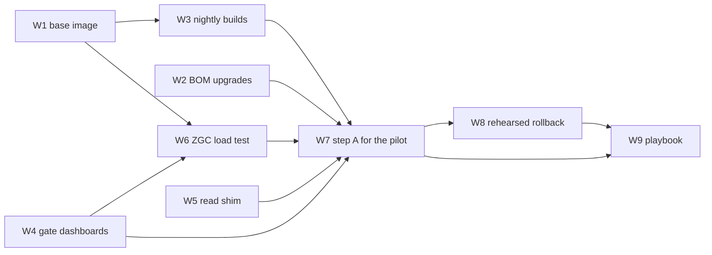

[⬅️ Prev: 38 · Case Study: Webhook Delivery](38-case-study-webhook-delivery.md) · [🏠 Index](README.md)

# 39 · Staff & Architect Artefacts: Exercises

> *At staff and architect level, most of the work you're judged on is written down: a proposal, an RFC, a migration plan, a cost case, and the follow-up that says whether the decision worked. This chapter gives you a format for decisions, five exercises with rubrics, and a log for the evidence your interview stories will need.*

> [!IMPORTANT]
> **Real and illustrative are kept apart.** Every worked example here is marked *Illustrative*: Northwind and its outcomes are invented to show the format. Lab output is real. **Your own evidence log (§9) holds only real entries**: dates, numbers, sources and people's roles. An interviewer will probe a story until it either holds or doesn't, so never let an illustrative outcome drift into your own record.

🧪 **Runnable labs:** [the experiment and the cost model behind the worked examples](labs.md#chapter-39--staff--architect-artefacts)

---

## Table of contents
1. [What each artefact is for](#1-what-each-artefact-is-for-)
2. [A format for decisions: eight parts](#2-a-format-for-decisions-eight-parts-)
3. [Worked through: virtual threads for a catalogue service](#3-worked-through-virtual-threads-for-a-catalogue-service-)
4. [Exercise 1: a one-page proposal for a sceptical manager](#4-exercise-1-a-one-page-proposal-for-a-sceptical-manager-)
5. [Exercise 2: an RFC with open questions and dissent](#5-exercise-2-an-rfc-with-open-questions-and-dissent-)
6. [Exercise 3: a migration plan with owners and dependencies](#6-exercise-3-a-migration-plan-with-owners-and-dependencies-)
7. [Exercise 4: a cost comparison that counts people](#7-exercise-4-a-cost-comparison-that-counts-people-)
8. [Exercise 5: the follow-up memo](#8-exercise-5-the-follow-up-memo-)
9. [Your evidence log](#9-your-evidence-log-)
10. [Using all this in interviews](#10-using-all-this-in-interviews-)
11. [Review questions](#11-review-questions)
12. [References](#12-references)

---

## 1. What each artefact is for 🔵

| Artefact | Reader | Its job | Length |
|---|---|---|---|
| One-page proposal | A busy decision-maker | Get a yes, a no or a smaller yes, quickly | One page |
| RFC (request for comments) | Everyone affected | Find the flaws and the dissent *before* deciding | As long as the problem needs |
| ADR (decision record) | Whoever touches this in two years | Record what was decided, why, and what would reopen it | Half a page |
| Migration plan | The people doing the work | Coordinate owners, dependencies, gates and rollback points | A table and a diagram |
| Cost comparison | Whoever funds it | Make the trade-off explicit, people included, and show which assumption decides it | A table and a paragraph |
| Follow-up memo | The same decision-makers, later | Say whether it worked, against criteria set beforehand | One page |

They're one chain. The proposal gets permission to look; the RFC finds what you missed; the ADR records the outcome; the plan delivers it; the cost comparison funds it; the follow-up closes the loop. [Chapter 24 §14](24-system-design-for-java-architects.md#14-communicating-architecture-c4-design-docs-adrs-) has a design-doc template; the case studies in 36–38 show the full packet.

---

## 2. A format for decisions: eight parts 🟣

Use it for any decision big enough to defend in a design review, and for the "decision record for a payment-like flow of your own" in the decision-first path.

| Part | Answer this | The usual failure |
|---|---|---|
| **1. Problem** | What's wrong, for whom, how much, and why now? | A solution posing as a problem ("we need Kafka") |
| **2. Constraints** | What must stay true, and what can't change (people, time, budget, rules, other teams' systems)? | Leaving out the constraint that decides it |
| **3. Options** | At least three, including doing nothing and the boring one | One real option and two straw men |
| **4. Decision** | The choice, the reason in a sentence, and what you're giving up | No stated cost |
| **5. Experiment** | The cheapest test that could prove the decision wrong | A demo that can only succeed |
| **6. Acceptance criteria** | Numbers that mean "yes", written down *before* the experiment runs | Criteria chosen after seeing the results |
| **7. Delivery** | Stages, owners, gates, and where rollback stops being possible | "We'll roll it out gradually" |
| **8. Reconsideration** | The evidence that would reopen it, and when you'll look | Nothing; the decision lives forever |

Part 6 is the one most often skipped, and the one that carries the most weight. Criteria set in advance turn an experiment into evidence; criteria chosen afterwards turn it into a story.

---

## 3. Worked through: virtual threads for a catalogue service 🟣

*Illustrative scenario; the experiment's output is real.*

**1. Problem.** During the October sale, Northwind's catalogue service went from a 40 ms p99 to 2.1 s, and 6% of requests timed out. It runs on Tomcat with 200 platform threads. Each request makes one query through a pool of 20 database connections. The team's proposal: set `spring.threads.virtual.enabled=true` "so we can handle more concurrency".

**2. Constraints.** The connection pool stays at 20: the primary's connection budget is shared, and the DBAs won't raise it this quarter. A query takes about 30 ms, so the database answers at most about 666 requests a second. The web front end gives up after 500 ms. Sale peaks reach about 1.5 times that capacity for ten minutes at a time. No new infrastructure this quarter.

**3. Options.**
- A. Keep the platform pool and tune its queue.
- B. Virtual threads, no other change (the proposal).
- C. Virtual threads, plus a **bulkhead** of 20 permits (a semaphore matching the connection pool, waiting at most 50 ms) and **deadlines** (skip work whose caller has already given up).
- D. Cache the hottest products. It complements A–C rather than replacing them.
- E. A reactive rewrite ([Chapter 29](29-reactive-java-reactor-webflux.md)): months of work for the same database.
- F. A read replica: the real capacity fix, but next quarter.

**4. Decision.** C now, D next. The database is the bottleneck, and no thread model makes 20 connections answer more than about 666 queries a second. What we *can* choose is what happens to the excess: wait in a queue until the caller has gone (A and B), or refuse quickly so the front end can fall back to cached data (C). We give up: at 1.5× load, about a third of requests fail fast instead of eventually succeeding for some of them.

**5. Experiment.** `VtDecision` runs all three designs with real threads against a simulated database (20 connections × 30 ms), first at normal load, then at 1.5× capacity.

**6. Acceptance criteria**, written before the run: at 1.5× capacity, the p99 of answered requests ≤ 200 ms; fewer than 1% of callers time out; fewer than 1% of queries run for callers who've gone; every failure returns within 100 ms.
```
Database: 20 connections x 30 ms per query (about 666 answers/s). Callers give up after 500 ms.
Acceptance criteria at 1.5x capacity: p99 of answered requests <= 200 ms, under 1% of callers time out,
under 1% of queries run for callers who have gone, and every failure comes back within 100 ms.

Normal load: 400 requests/s for 4 s
   design                                          answered  p50 / p99 (ms)     fast     slow  callers  wasted   peak meets
                                                  in time/s     of answered failures failures  gave up queries in flight criteria
   platform pool: 200 threads, queue of 1,000           400      30 /    32        0        0        0       0     14
   virtual threads, no limits                           400      30 /    32        0        0        0       0     15
   virtual threads + bulkhead of 20 + deadlines         400      30 /    31        0        0        0       0     14

Overload (1.5x capacity): 1,000 requests/s for 4 s
   design                                          answered  p50 / p99 (ms)     fast     slow  callers  wasted   peak meets
                                                  in time/s     of answered failures failures  gave up queries in flight criteria
   platform pool: 200 threads, queue of 1,000           445     262 /   498        0      554    2,221   1,608    939 no
   virtual threads, no limits                           234     248 /   499        0      684    3,065   2,320  1,018 no
   virtual threads + bulkhead of 20 + deadlines         671      79 /    81    1,316        0        0       0     75 yes
```
(JDK 25 on two vCPUs. The lab uses real threads and real time, so the numbers move from run to run and machine to machine; on JDK 21 the three overload rows answered 436, 236 and 670 per second. The pattern holds.)

What it shows:
- **At normal load the designs are indistinguishable.** A test at normal load can't tell you anything about this decision.
- **Under overload, unbounded virtual threads are the *worst* design.** Removing the thread limit removed the only thing that limited the queue in front of the database. Answers arrive after callers have left: 2,320 queries ran for nobody, and only 234 requests per second were answered in time.
- **The platform pool is better only by accident.** Its 200 threads cap the queue, but 1,608 queries still ran for callers who'd gone.
- **The bulkhead and deadlines answer 671 per second in time**, which is the database's capacity, with a p99 of 81 ms, no wasted queries and 75 requests in flight. The excess, a third of requests, comes back as fast failures the front end can serve from its cache. The decision's cost, stated in part 4, shows up here as 1,316 fast failures.

**7. Delivery.** A flag selects the design, per instance. Canary at 5%, gated on request counts as in [Chapter 37 §8](37-case-study-fleet-jdk-upgrade.md#8-rollout-gates-with-evidence-). A load test at 1.5× in pre-production runs before the canary. New metrics: permits in use, bulkhead wait time, rejections, deadline skips. The front-end team owns the fallback (serve cached product data on a `503`, and honour `Retry-After`); the catalogue team owns the rest. Rollback is the flag, and nothing here is one-way.

**8. Reconsideration.** Reopen it if the connection pool changes (permits must match it), if rejections exceed 1% at normal load, or if the database's p99 rises above 50 ms (the bulkhead's wait budget). Look again after the next sale, in a follow-up memo (§8).

> 🧠 **Staff lens:** "use virtual threads" sounds like a capacity decision; it's a *queueing* decision ([Chapter 12 §12](12-concurrency-advanced-juc-loom.md#12-virtual-threads-project-loom-), [Chapter 27 §8](27-staff-architect-interview-playbook.md#8-virtual-threads-vs-reactive-a-decision-framework-)). The eight parts force that out: the constraint (20 connections) decides it, and the criteria, fixed in advance, catch the design that looks like progress.

---

## 4. Exercise 1: a one-page proposal for a sceptical manager 🔵

**The prompt.** Your engineering manager thinks moving your team's six services to JDK 25 ([Chapter 37](37-case-study-fleet-jdk-upgrade.md)) is "tech for tech's sake" and wants the quarter spent on features. Write one page asking for three engineer-weeks. Or use a real proposal of your own.

**Rules for the page:** at most 400 words. The first paragraph states the ask and the return. Every claim that matters has a number or a source. It names what could go wrong and where the limit is, and it ends with options the manager can choose between, not a single yes or no.

**A worked example** (*illustrative*):

> **Move our six services to JDK 25 this quarter: 3 engineer-weeks**
> *To: Engineering manager, catalogue team · Decision needed by: 6 January*
>
> **The ask.** Three engineer-weeks this quarter, in slices that avoid the sale freeze, to move our six services to JDK 25. In return we stop paying our share of the JDK 17 support contract from April, and we move on the platform team's tested path instead of alone next year.
>
> **Why now.** The platform team supports this move until June: base images, a library BOM, pairing, rollout gates. After June we'd do it alone and keep paying for JDK 17 in the meantime.
>
> **The cost.** Platform estimates 1.5 days per JDK 21 service and 4 per JDK 17 service: 14 days for our four and two, so three weeks with margin. Feature X slips by one week; nothing else moves.
>
> **What could go wrong.** Our two ZGC services change collector mode, and the pricing export writes formatted times. Both are on the platform's risk register, with a test for each. Every service can switch back to its old image until we raise its release level, which we do only after 30 days stable.
>
> **Your options.** (a) All six now, as proposed. (b) Only the two JDK 17 services now (8 days; removes the contract cost); the rest in Q3. (c) Defer everything to Q3: we pay the contract, and the move takes about five weeks without platform support.
>
> **My recommendation:** (a) if feature X can slip a week, otherwise (b).

**What a reviewer looks for:**

| Criterion | Weak | Strong |
|---|---|---|
| The first paragraph | Background and history | The ask, the cost and the return |
| Evidence | "Newer is better", "faster" | Numbers with sources, and their limits |
| Risk | Not mentioned, or "low" | Named risks, the mitigation, and where rollback stops |
| The manager's choice | Yes or no | Two or three options with their costs, and a recommendation |
| Length | Two pages "for completeness" | One page; detail linked, not pasted |

---

## 5. Exercise 2: an RFC with open questions and dissent 🟣

**The prompt.** Write the RFC for [Chapter 38](38-case-study-webhook-delivery.md)'s webhook platform, or for a design of your own. It must have at least three open questions, each with an owner and a date, and at least one dissent written in its strongest form, with your response and its status.

**A skeleton:** summary · motivation (with data) · proposal · alternatives · **open questions** · **dissent** · rollout and rollback · who decides, and by when.

**A worked excerpt** (*illustrative*):

| # | Open question | Why it matters | Owner | Needed by |
|---|---|---|---|---|
| OQ1 | Does any tenant need strict per-resource ordering? | If so, those endpoints need one delivery in flight per resource, at a cost in throughput | Partner support | Before stage 3 |
| OQ2 | May payment event payloads leave our infrastructure? | It decides whether buying a managed service is allowed at all | Security and legal | Before the cost review |
| OQ3 | Do we keep payloads for 14 days or 30? | It doubles the payload storage, and sets how far back replay reaches | Product | Before the build starts |

> **Dissent 1: put the delivery log in Cassandra from day one** (SRE lead).
> *Their case, at its strongest:* the log is write-heavy, append-only and time-ordered, which suits a wide-column store; moving a live log later is harder than starting there; and Mock 2's volumes show where this is heading.
> *Response:* at our volumes the log is about 270 GB over 14 days in daily partitions, which PostgreSQL handles; nobody on the team has run Cassandra in production; and the ADR names the threshold for moving (about 20,000 deliveries a second, or a log of several terabytes).
> *Status:* not adopted. The SRE lead disagrees and commits; the threshold is on the dashboard, and the question reopens when it's crossed.
>
> **Dissent 2: payments should keep sending its own webhooks** (payments team).
> *Their case:* payment notifications carry regulatory weight, and a shared platform adds a dependency to a regulated flow.
> *Status:* open. It turns on OQ2, and the payments team joins the security review.

**What a reviewer looks for:**

| Criterion | Weak | Strong |
|---|---|---|
| Open questions | None ("the design is complete") or vague | Specific, each with an owner, a date and the decision it affects |
| Dissent | Missing, or a straw man | Stated so that its author would sign it; answered with evidence |
| Status | Every disagreement "resolved" | Honest: adopted, not adopted (with commit), or open |
| Decision process | Unclear who decides | A named decider and a date |

---

## 6. Exercise 3: a migration plan with owners and dependencies 🔵

**The prompt.** Turn [Chapter 37's ADR](37-case-study-fleet-jdk-upgrade.md#7-the-decision-record-) into a plan for its pilot wave: work items, owners, dependencies, what "done" means for each, the critical path, and the rollback points. Or plan a migration of your own.

**A worked example** (*illustrative*; the owners are roles here, but in a real plan they're people's names):

| ID | Work | Owner | Depends on | Done when |
|---|---|---|---|---|
| W1 | JDK 25 base image, JDK-specific flags in `JDK_JAVA_OPTIONS` | Platform engineer 1 | — | Published; flags check passes on both JDKs |
| W2 | BOM: library upgrades that pass the deny-mode job | Platform engineer 2 | — | Deny-mode job green for the six pilot services |
| W3 | Nightly builds on JDK 25 for the pilot services | Platform engineer 3 | W1 | Two green nights in a row |
| W4 | Gate dashboards that count requests | SRE | — | Gates visible for all six services |
| W5 | Read shim for formatted times in the pricing export | Pricing team | — | Shim live on JDK 21 |
| W6 | Load test of the ZGC service in pre-production | Search team, SRE | W1, W4 | Pause p99 and GC CPU share within 10% |
| W7 | Step A for the six pilot services | Each service team | W1–W4; W5 for pricing; W6 for search | Gates pass for two weeks |
| W8 | One rollback, rehearsed for real | Orders team, SRE | W7 (orders) | Back on JDK 21 within 15 minutes, no errors |
| W9 | Playbook updated for wave 2 | Platform lead | W7, W8 | Published, with the effort measured per service |


**The critical path** runs W1 → W6 → W7 → W8 → W9: the base image gates the ZGC load test, which gates the search service's move. W2 and W5 have slack, but each blocks one service, so each gets a date. **Rollback points:** every W7 move is reversible by image until that service's step B; W8 proves it once, for real.

**What a reviewer looks for:**

| Criterion | Weak | Strong |
|---|---|---|
| Owners | Teams, or nobody | One named person per item |
| Dependencies | Implicit | Explicit, with the critical path and where the slack is |
| "Done" | "Finished" | Observable: a gate, a dashboard, a test result |
| Rollback | "We can roll back" | Where each step can be undone, and where it can't |
| Communication | Not mentioned | Who hears what, and when (status, known issues, the playbook) |

---

## 7. Exercise 4: a cost comparison that counts people 🟣

**The prompt.** Compare two options over three years, counting engineering effort to build and to run, operations, infrastructure, licences, and the cost of delay. Then find the assumption that decides it. Two suggestions: Chapter 37's "move now" against "wait for the next LTS" (options F and C), or Chapter 38's build against buy (options E and F), worked below.

`CostModel` makes the arithmetic explicit, month by month, with every input at the top of the file (*illustrative inputs*):
<!-- lab-output: CostModel.java -->
```
Build vs buy for webhook delivery over 3 years. ILLUSTRATIVE inputs: edit them at the top of the file.
  an engineer-year costs $180,000; 39 M deliveries a day today, growing 40% a year
  build: 4 engineers for 5 months, then 1.5 engineers and $8,000 a month of infrastructure (grows with volume)
  buy:   3 engineers for 3 months (integration, security review), then 0.5 engineers and $15 per million deliveries

1. Cost by year, $ thousands
                              year 1   year 2   year 3     total
   build                         528      428      491     1,446
   buy                           398      440      581     1,419
   buy minus build              -130       13       90       -27

2. Buy minus build over 3 years, $ thousands (negative: buying is cheaper)
   vendor price per         volume growth per year
   million deliveries             0%      20%      40%      80%
   $5                           -667     -690     -718     -789
   $10                          -472     -426     -372     -236
   $15                          -276     -162      -27     +316
   $20                           -80     +102     +319     +868
   $30                          +311     +630   +1,009   +1,972

3. The vendor price at which the two options cost the same over 3 years
   at   0% growth: $22.05 per million deliveries
   at  20% growth: $18.07 per million deliveries
   at  40% growth: $15.39 per million deliveries
   at  80% growth: $12.14 per million deliveries
```
How to read it:
- **On these assumptions it's a wash**: $27k apart over three years, 2% of the total. A comparison this close doesn't decide anything by itself, and saying so is the honest result.
- **The shape matters more than the total.** Buying is $130k cheaper in year 1, because nothing is built, and dearer every year after, by a growing margin, because the vendor's bill grows with volume and the team's cost doesn't.
- **Two numbers decide it: the real quote and the growth rate.** At 40% growth the break-even is about $15 per million deliveries. So the next step isn't more analysis: it's getting a quote, and agreeing a growth assumption with the business.
- **When cost is a wash, constraints decide.** Chapter 38's open question about payment data leaving our infrastructure (OQ2 above) can rule buying out whatever the price. The comparison has still done its job: it shows what that constraint costs.

What people leave out of cost comparisons: on-call and incident time, the engineers who integrate and later *exit* a vendor, migration costs at both ends, the opportunity cost of the team that builds, and the cost of delay (here, buying ships two months sooner, which ends the "never received" tickets sooner).

**What a reviewer looks for:**

| Criterion | Weak | Strong |
|---|---|---|
| People | Infrastructure and licences only | Build, run, on-call, integration and exit, at a loaded cost |
| Time | One total | Cost by year: the shape shows lock-in and growth |
| Uncertainty | One point estimate | A sensitivity table, and the break-even for the deciding assumption |
| Honesty | The preferred option wins by construction | "It's a wash; here's what decides it" |
| Non-cost factors | Ignored | Named, and priced where possible |

---

## 8. Exercise 5: the follow-up memo 🔵

**The prompt.** Pick a decision at least three months old, ideally one of your own. Write one page: what was decided and why, the criteria it was meant to meet, what actually happened (with numbers and their sources), what surprised you, what you changed, and whether you'd decide the same way again.

**A worked example** (*illustrative: these outcomes are invented to show the format*):

> **Follow-up: bulkhead and deadlines for the catalogue service, 90 days on**
>
> **Decided** (October): virtual threads with a 20-permit bulkhead and deadlines, plus a cached fallback in the front end (§3). **Criteria** at 1.5× capacity: p99 of answered requests ≤ 200 ms, timeouts < 1%, wasted queries < 1%, every failure within 100 ms.
>
> **What happened** in the January sale (peak at about 1.4× database capacity for 25 minutes): answered p99 of 85 ms; 27% of requests failed fast at the peak and were served from the front end's cache; timeouts 0.2%; wasted queries too few to measure. Sources: the sale dashboard and the load-test reports, both linked.
>
> **What surprised us.** The front end retried every `503` immediately, which tripled the load on the bulkhead for the first four minutes. We fixed it during the sale by honouring `Retry-After` and adding a retry budget, and a test now covers it. We also had no bulkhead wait-time histogram at launch, so the first diagnosis took longer than it should have.
>
> **Would we decide the same?** Yes. The cache (option D) comes next quarter, because a third of peak traffic falling back to it shows how much it's worth. The criteria stand; we've added one for retry amplification.
>
> **Reopen if** the read replica (option F) lands, since the permits must then change, or if rejections pass 1% at normal load.

**What a reviewer looks for:**

| Criterion | Weak | Strong |
|---|---|---|
| Criteria | Invented after the fact | The ones written before the decision, quoted |
| Evidence | Impressions | Numbers with sources |
| Surprises | None ("it went to plan") | What you didn't foresee, and what it taught you |
| Conclusion | Defends the original call regardless | Keeps, changes or reverses it, with reasons, and updates the triggers |

---

## 9. Your evidence log 🔵

Interviewers ask for decisions you made, who disagreed, what changed, and how it turned out. A log kept over months answers with dates and numbers instead of reconstructed memories. One row per decision you drove or materially shaped:

| Date | Context | What I decided or recommended | Who challenged it, and how | What changed as a result | Outcome, measured, with source | What I learned | Shareable? |
|---|---|---|---|---|---|---|---|
| | | | | | | | |

The **challenged** and **changed** columns matter most. Staff interviews probe for disagreement handled well and for minds changed by evidence, including your own. A log with nothing in them describes someone nobody argued with, which interviewers read as someone whose decisions didn't matter much.

An example row, to show the level of detail (*EXAMPLE, ILLUSTRATIVE: not a real outcome*):

| Date | Context | Decided | Challenged | Changed | Outcome | Learned | Shareable? |
|---|---|---|---|---|---|---|---|
| *2026-10-14* | *Catalogue timeouts in the October sale* | *Recommended a bulkhead and deadlines over plain virtual threads* | *Team lead: "virtual threads will absorb it"* | *We ran the experiment (§3) with criteria agreed first; the lead proposed the deadline skip* | *January sale: answered p99 85 ms, 0.2% timeouts (sale dashboard)* | *Agree acceptance criteria before the test; it ended the argument* | *Yes, without customer names* |

**Rules for the log:**
1. **Real entries only.** Practice material from this book goes in a separate file, or under a heading that says *practice*.
2. **Numbers with a source**: a dashboard, a ticket, a document. If you can't find the source again, the number isn't evidence.
3. **Record failures and reversals.** "A decision that turned out wrong" is a standard question, and the honest entry is the strong answer.
4. **Fill in outcomes later.** Leave the column blank, set a reminder, and link the follow-up memo when you write it.
5. **Mind confidentiality.** Note what you may say outside the company, and practise the anonymised version.

---

## 10. Using all this in interviews 🔵

| What the interviewer asks | Draw on | Chapter 27 |
|---|---|---|
| "Walk me through a significant project" | The eight-part record and its follow-up memo | [§3](27-staff-architect-interview-playbook.md#3-the-project-deep-dive-) |
| "Tell me about a disagreement" | An RFC's dissent, and the evidence log's "challenged" column | [§4](27-staff-architect-interview-playbook.md#4-behavioural-rounds-starl-and-a-story-bank-) |
| "How did you make that decision?" | Options, the constraint that decided it, and the criteria set beforehand | [§5](27-staff-architect-interview-playbook.md#5-talking-about-trade-offs-and-decisions-) |
| "How did you get buy-in?" | The one-page proposal and the options it offered | [§6](27-staff-architect-interview-playbook.md#6-technical-strategy-and-influence-) |
| "A decision you got wrong" | A follow-up memo that reversed or changed something | §4 |
| System design: "what would you do first?" | The migration plan's critical path and rollback points | — |

---

## 11. Review questions

<details>
<summary><b>Q1. 🔵 What goes in the first paragraph of a one-page proposal, and why?</b></summary>

The ask, its cost and its return, in that order. A busy reader decides from the first paragraph whether to read on, and a proposal that opens with background makes them hunt for what you want. The rest of the page supports the first paragraph: why now, the evidence, the risks and their limits, and options the reader can choose between, including a smaller yes.
</details>

<details>
<summary><b>Q2. 🟣 Why write acceptance criteria before running the experiment?</b></summary>

Because criteria chosen after seeing the results bend to fit them, and then the experiment proves nothing. Writing them first also forces agreement on what "better" means: in the catalogue example, "answered p99 ≤ 200 ms, timeouts < 1%, wasted queries < 1%, failures within 100 ms" ruled out the design that looked like progress (unbounded virtual threads). Agreed criteria also end arguments: people can disagree about designs and still agree about thresholds.
</details>

<details>
<summary><b>Q3. 🔵 How do you record dissent in an RFC, and what happens when you lose the argument?</b></summary>

Write the dissent in its strongest form, so its author would sign it, then your response with evidence, then an honest status: adopted, not adopted, or open. If the decision goes against you, say so in the record and commit to making it work ("disagree and commit"), and attach a trigger that would reopen it. That's different from silent compliance: the disagreement and its condition are on record, so the organisation can learn whether you were right.
</details>

<details>
<summary><b>Q4. 🔵 What turns a list of tasks into a migration plan?</b></summary>

Owners who are named people; explicit dependencies, with the critical path and where the slack is; an observable "done" for each item; gates between stages; and the rollback points, especially where rollback stops being possible. A communication plan too: who hears what, and when. Without these, a plan is a wish list, and its first slip surprises everyone.
</details>

<details>
<summary><b>Q5. 🟣 A cost comparison says two options are within 2% over three years. What do you do?</b></summary>

Say it's a wash, then show what decides it. A sensitivity table finds the assumptions that flip the answer (in the build-versus-buy model, the vendor's price and the growth rate), and the next step is to pin those down: get a quote, agree the growth assumption. Look at the shape over time as well as the total, since a cost that grows with volume behaves differently from a fixed one. And let the non-cost constraints decide, priced where you can: data that may not leave your infrastructure, the team's experience, how reversible each option is.
</details>

<details>
<summary><b>Q6. 🟣 In the experiment, unbounded virtual threads did worse under overload than a platform pool. Why?</b></summary>

The bottleneck was 20 database connections. The platform pool's 200 threads accidentally limited how much work queued in front of them; virtual threads removed that limit, so far more requests waited for a connection, answers arrived after callers had given up, and the database spent its capacity on queries for nobody (234 answered in time per second, 2,320 wasted queries). Virtual threads make waiting cheap; they don't add capacity. The fix is to bound concurrency at the bottleneck (a bulkhead) and drop work whose deadline has passed, which answered at the database's full capacity.
</details>

<details>
<summary><b>Q7. 🔵 Why keep an evidence log, and what makes an entry useful in an interview?</b></summary>

Because interviews probe specific decisions until they hold or crack, and memory reconstructs. A useful entry has a date, the decision, who challenged it and how, what changed as a result, a measured outcome with a source, and what you learned. The "challenged" and "changed" columns carry the most signal at staff level, because they show influence and judgement. Keep only real entries, mark anything else as practice, and fill in outcomes later with a follow-up memo.
</details>

---

## 12. References
- Michael Nygard, *Documenting Architecture Decisions* (2011), the original ADR format
- Will Larson, *Staff Engineer: Leadership Beyond the Management Track* (2021)
- Tanya Reilly, *The Staff Engineer's Path* (O'Reilly, 2022)
- Neal Ford, Mark Richards, Pramod Sadalage and Zhamak Dehghani, *Software Architecture: The Hard Parts* (O'Reilly, 2021)
- In this repository: [Chapter 27](27-staff-architect-interview-playbook.md) (the interview playbook), [Chapter 24 §14](24-system-design-for-java-architects.md#14-communicating-architecture-c4-design-docs-adrs-) (design docs and ADRs), [Chapter 16 §11](16-design-principles-clean-architecture.md#11-staff-lens-decisions-trade-offs-adrs-) (ADRs), and the case studies in [36](36-case-study-payments.md), [37](37-case-study-fleet-jdk-upgrade.md) and [38](38-case-study-webhook-delivery.md)

---

[⬅️ Prev: 38 · Case Study: Webhook Delivery](38-case-study-webhook-delivery.md) · [🏠 Index](README.md)
