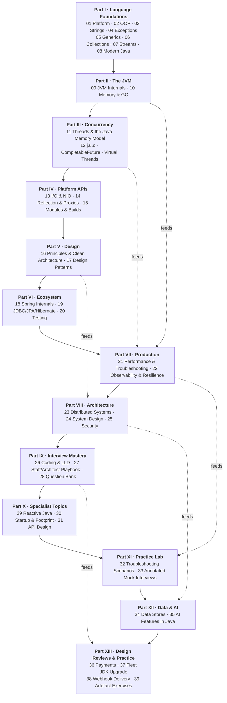

<div align="center">

# ☕ Java Interview Mastery
### Java, from the fundamentals to staff and architect interviews

**39 chapters · deep internals · diagrams · runnable labs · 640 self-test questions as flashcards · one-page revision sheets · three case studies and five artefact exercises**


</div>

---

## Preface

Most Java interview material falls into one of two traps. It's either a list of trivia ("What is the default capacity of an `ArrayList`?") or a pile of buzzwords ("Explain microservices"). Neither gets you through a staff or architect loop. Those interviews aren't checking whether you *remember* things. They check whether you *understand* them well enough to make expensive decisions under uncertainty, and whether you can explain those decisions to people who will push back.

So these notes go deep on purpose. When I explain `HashMap`, I don't stop at "it uses buckets". I show you the hash-spreading function, why the table size is a power of two, what happens to each bucket during a resize, why a bucket turns into a red-black tree at 8 entries but not before the table reaches 64, and what all of that means for your service at 3 a.m. when p99 latency suddenly doubles. That's the level a staff interviewer probes, often in their second or third follow-up question.

Each chapter climbs from the basics to the internals:

```
  🟢 What is it?  →  🟡 How do I use it well?  →  🔴 How does it work, and how does it fail?
                 →  🟣 Which design should we bet on?  →  🔵 How do we get there across teams?
```

If you're just starting, read the 🟢 and 🟡 sections first and come back later. If you're experienced, skim the green, slow down on the red, argue with the purple, and practise the blue: Part XIII turns it into case studies and exercises.

> [!IMPORTANT]
> **Don't just read. Answer first.** Every chapter ends with interview questions whose answers are hidden behind a click. Say your answer out loud (yes, out loud) *before* you expand it. Being able to explain it is the skill that gets tested. Recognising it isn't enough.

---

## How to read these notes

The coloured markers say **what a section is for**, not which job title it belongs to. Knowing more JVM internals doesn't make anyone ready for a staff role; making sound decisions that other teams adopt, and showing the evidence, does. Every role uses all five kinds of knowledge, in different proportions.

| Marker | Purpose | The question it answers |
|---|---|---|
| 🟢 **Fundamentals** | The concepts and rules to know cold | What is it, and what are the rules? |
| 🟡 **Applied practice** | Idioms, pitfalls and everyday trade-offs | How do I use it well? |
| 🔴 **Mechanisms & diagnosis** | How it works inside, how it fails, and how to prove what's happening in production. These stay together on purpose: the internals are here to explain production symptoms | Why does it behave like that, and how would I show it? |
| 🟣 **System decisions** | Choosing between designs under stated constraints: invariants, failure modes, cost, evolution | What should we build, and what evidence would change my mind? |
| 🔵 **Organisational execution** | Making a decision happen across teams: proposals, rollout, ownership, adoption, influence | How do we get there together, and how do we know it worked? |

| Callout | Meaning |
|---|---|
| 🧭 **Decision guide** | At the top of each advanced chapter: when the decision matters, the default under stated assumptions, the alternatives, the failure modes, and the evidence that would change the recommendation. |
| 🎯 **Interviewer's lens** | What the interviewer is really testing with this topic. |
| 💣 **Trap** | A classic wrong answer or production bug. |
| 🧠 **Staff lens** | How a staff engineer would frame the decision. |

GitHub alert boxes (`NOTE`, `TIP`, `IMPORTANT`, `WARNING`, `CAUTION`) highlight the things worth remembering.

**Code conventions.** Examples target **Java 21+** unless marked otherwise. Anything that needs a newer release is labelled **(Java 25+)**, and preview features are labelled **(preview)**, which means they need `--enable-preview`. Most snippets are complete and run as-is with `java File.java` (single-file source launch, no `javac` needed).

---

## The roadmap



---

## Table of contents

### Part I — Language Foundations
| # | Chapter | You will master | Markers |
|---|---|---|---|
| 01 | [Java Platform Fundamentals](01-java-platform-fundamentals.md) | JDK/JRE/JVM, compilation pipeline, primitives, IEEE 754, overflow, Unicode, pass-by-value, initialization order | 🟢→🔴 |
| 02 | [OOP & the Object Model](02-oop-and-object-model.md) | Overloading resolution, dispatch, `equals`/`hashCode`, inner classes, records, sealed types, enums, immutability | 🟢→🔴 |
| 03 | [Strings](03-strings.md) | String pool, compact strings, `invokedynamic` concat, `intern`, regex backtracking, encodings | 🟢→🔴 |
| 04 | [Exceptions & Error Handling](04-exceptions.md) | try-with-resources internals, suppressed exceptions, exception cost, API error design | 🟢→🟣 |
| 05 | [Generics](05-generics.md) | Erasure, bridge methods, PECS, wildcard capture, heap pollution, type tokens | 🟡→🔴 |
| 06 | [Collections Framework](06-collections.md) | `HashMap`/`ConcurrentHashMap` internals, fail-fast iterators, immutable collections, choosing structures | 🟢→🔴 |
| 07 | [Lambdas, Streams & Functional Java](07-lambdas-streams-functional.md) | `invokedynamic` lambdas, stream pipeline mechanics, collectors, parallel streams, gatherers | 🟢→🔴 |
| 08 | [Modern Java: 8 → 27](08-modern-java-8-to-27.md) | Every feature that matters, version by version; records, patterns, sealed, Loom, Leyden | 🟡→🟣 |

### Part II — The JVM
| # | Chapter | You will master | Markers |
|---|---|---|---|
| 09 | [JVM Internals](09-jvm-internals.md) | Class loading, bytecode, object layout, JIT tiers, inlining, escape analysis, safepoints, AOT | 🔴 |
| 10 | [Memory Management & GC](10-memory-and-garbage-collection.md) | TLABs, references, G1/ZGC/Shenandoah internals, GC logs, leaks, OOM taxonomy, containers | 🔴→🟣 |

### Part III — Concurrency
| # | Chapter | You will master | Markers |
|---|---|---|---|
| 11 | [Concurrency Foundations & the JMM](11-concurrency-foundations-jmm.md) | Thread states, `synchronized` internals, `volatile`, happens-before, safe publication, deadlocks, `ThreadLocal` | 🟡→🔴 |
| 12 | [Advanced Concurrency: j.u.c & Loom](12-concurrency-advanced-juc-loom.md) | AQS, locks, atomics, `LongAdder`, executors, `CompletableFuture`, virtual threads, structured concurrency | 🔴→🟣 |

### Part IV — Platform APIs
| # | Chapter | You will master | Markers |
|---|---|---|---|
| 13 | [I/O, NIO, Networking & Serialization](13-io-nio-networking-serialization.md) | Buffers, selectors, zero-copy, mmap, `HttpClient`, deserialization attacks | 🟡→🔴 |
| 14 | [Reflection, Annotations, Proxies & Agents](14-reflection-annotations-proxies.md) | `MethodHandle`, annotation processing, JDK vs ByteBuddy proxies, Java agents, SPI | 🔴 |
| 15 | [Modules & Build Tools](15-modules-and-build-tools.md) | JPMS, `jlink`, Maven dependency mediation, Gradle configurations, dependency hell | 🟡→🟣 |

### Part V — Design
| # | Chapter | You will master | Markers |
|---|---|---|---|
| 16 | [Design Principles & Clean Architecture](16-design-principles-clean-architecture.md) | SOLID done properly, API design, hexagonal architecture, DDD tactical patterns | 🟡→🟣 |
| 17 | [Design Patterns](17-design-patterns.md) | GoF patterns in modern Java, patterns inside the JDK & Spring, when patterns hurt | 🟡→🔴 |

### Part VI — Ecosystem
| # | Chapter | You will master | Markers |
|---|---|---|---|
| 18 | [Spring Internals](18-spring-internals.md) | Bean lifecycle, proxies, `@Transactional` traps, auto-configuration, MVC request flow, Boot 4 | 🟡→🔴 |
| 19 | [Persistence: JDBC, JPA & Hibernate](19-persistence-jdbc-jpa-hibernate.md) | Isolation anomalies, MVCC, locking, persistence context, N+1, batching, pool sizing | 🟡→🟣 |
| 20 | [Testing & Quality](20-testing-and-quality.md) | JUnit 6 (Jupiter), Mockito internals, Testcontainers, contract tests, JMH, mutation testing | 🟡→🔴 |

### Part VII — Production
| # | Chapter | You will master | Markers |
|---|---|---|---|
| 21 | [Performance Engineering & Troubleshooting](21-performance-engineering-troubleshooting.md) | Little's law, coordinated omission, JFR, async-profiler, thread/heap dump playbooks | 🔴→🟣 |
| 22 | [Production Readiness, Observability & Resilience](22-production-readiness-observability-resilience.md) | Logging, metrics, tracing, timeouts, retries, circuit breakers, JVM in Kubernetes | 🔴→🟣 |

### Part VIII — Architecture
| # | Chapter | You will master | Markers |
|---|---|---|---|
| 23 | [Distributed Systems & Microservices](23-distributed-systems-microservices.md) | CAP/PACELC, sagas, outbox, idempotency, Kafka semantics, caching, consensus | 🟣 |
| 24 | [System Design for Java Architects](24-system-design-for-java-architects.md) | A design framework, estimation, sharding, and worked designs (rate limiter, payments, scheduler…) | 🟣 |
| 25 | [Security for Java Engineers](25-security-for-java-engineers.md) | OWASP in Java, JCA/JCE done right, TLS, OAuth2/JWT, supply chain, post-quantum | 🔴→🟣 |

### Part IX — Interview Mastery
| # | Chapter | You will master | Markers |
|---|---|---|---|
| 26 | [Coding & LLD Interview Patterns](26-coding-and-lld-interview-patterns.md) | Java idioms for DSA, 15 core patterns, concurrency coding, machine-coding rounds | 🟡→🔴 |
| 27 | [The Staff & Architect Interview Playbook](27-staff-architect-interview-playbook.md) | What's evaluated, project deep-dives, behavioural stories, influence, strategy | 🟣→🔵 |
| 28 | [The Question Bank](28-question-bank.md) | Rapid-fire Q&A across every chapter, graded by level, for final revision | 🟢→🟣 |

### Part X — Specialist Topics
| # | Chapter | You will master | Markers |
|---|---|---|---|
| 29 | [Reactive Java: Reactor & WebFlux](29-reactive-java-reactor-webflux.md) | The Reactive Streams contract (traced), backpressure, schedulers, event-loop blocking (measured), context propagation, WebFlux internals | 🟡→🟣 |
| 30 | [Startup & Footprint: AOT Cache, Native Image & CRaC](30-startup-footprint-aot-native-image.md) | CDS → Leyden AOT cache (measured on JDK 21 and 25), native memory, compact object headers, native image and CRaC trade-offs | 🔴→🟣 |
| 31 | [API Design Between Services](31-api-design-between-services.md) | HTTP semantics, idempotency, cursor pagination, ETags, evolution (Jackson and Protobuf demos), gRPC, GraphQL, event schemas | 🟡→🟣 |

### Part XI — Practice Lab
| # | Chapter | You will master | Markers |
|---|---|---|---|
| 32 | [Production Troubleshooting Scenarios](32-production-troubleshooting-scenarios.md) | Twelve incident patterns, eight reproduced with real output, from symptom to proof to prevention | 🔴→🟣 |
| 33 | [Annotated Mock Interviews](33-annotated-mock-interviews.md) | Full transcripts (JVM deep-dive, system design, behavioural, coding) annotated with what interviewers score | 🔴→🔵 |

### Part XII — Data & AI
| # | Chapter | You will master | Markers |
|---|---|---|---|
| 34 | [Data Stores: Redis, Cassandra & DynamoDB](34-data-stores-redis-cassandra-dynamodb.md) | Redis internals and patterns (pipelining, atomicity, eviction, locks, streams: all measured on a live server), Cassandra and DynamoDB data modelling, a single-table design worked through | 🟡→🟣 |
| 35 | [AI Features in Java: Spring AI, LangChain4j, RAG & Guardrails](35-ai-features-spring-ai-langchain4j-rag.md) | RAG end to end, HNSW and quantisation (measured), the Vector API, tool calling and MCP, structured output, prompt injection, evaluation | 🟡→🟣 |

### Part XIII — Design Reviews & Practice
| # | Chapter | You will master | Markers |
|---|---|---|---|
| 36 | [Case Study: Payments That Never Charge Twice](36-case-study-payments.md) | A payment flow taken through a design review: invariants, claim-first idempotency, unknown outcomes and reconciliation, what survives a failover, an ADR, a migration tested in both directions and rollback limits, with the failure analysis measured in a simulation and against PostgreSQL | 🟣→🔵 |
| 37 | [Case Study: Moving 180 Services to JDK 25](37-case-study-fleet-jdk-upgrade.md) | A fleet upgrade from real evidence: what static scans miss, flags that stop a JVM starting, locale and GC changes, canary gates that count requests, owners, exceptions and the one-way steps | 🔴→🔵 |
| 38 | [Case Study: A Multi-Tenant Webhook Delivery Platform](38-case-study-webhook-delivery.md) | Isolation measured (shared queue vs per-endpoint caps vs breakers), signatures and SSRF checks, a delivery state machine, replays that are neither swallowed nor doubled, and moving tenants without double sends | 🟣→🔵 |
| 39 | [Staff & Architect Artefacts: Exercises](39-staff-artefact-exercises.md) | A decision worked through in eight parts with a real experiment and its control; a one-page proposal, an RFC with dissent, a migration plan, a cost comparison and a follow-up memo, each with a rubric; your evidence log | 🟣→🔵 |

---

## Study tools

| Tool | What it is | Use it when |
|---|---|---|
| 🧪 [**Labs**](labs.md) | The Java programs behind the chapters' measured outputs (timings, GC logs, thread dumps, `javap` listings), indexed by chapter with run commands. Each file's header says what it shows, what it needs and when it was last verified. `./run-quick.sh` runs the fast ones in about a minute and a half; `./verify-labs.sh` runs all of them on every JDK you give it | Reading a chapter: run the program, then change it and predict the new output |
| 🃏 [**Flashcards**](flashcards.md) | All 640 questions as an Anki deck (tagged by chapter, part and purpose) and as a CSV | Daily, from the first week: spaced repetition turns recognition into recall |
| 📋 [**Revision sheets**](revision.md) | One page per part: the numbers, rules, traps and one-liners worth having in your head | The last week before an interview, one part a day |

---

## Study plans

Pick the plan that matches your runway and your target role. The foundation-first plans build depth in order. The decision-first path starts from the problems staff and architect loops actually pose, and visits the mechanisms only when a decision needs them.

> [!NOTE]
> **Coverage isn't readiness.** Finishing a plan means you've covered the material. Readiness for a staff or architect role shows in decisions you've made, the evidence behind them, and what happened afterwards. [Chapter 39](39-staff-artefact-exercises.md)'s exercises and evidence log are where you practise that.

### 🧭 Decision-first path (6 weeks, experienced engineers preparing for staff or architect loops)
Each week is one problem, worked the way you'd take it to a design review: **state the problem → name the invariants → choose the mechanisms → check them against how Java and the infrastructure really behave → defend the rollout**.

| Week | Problem | Start with | Visit for the mechanisms | Produce |
|---|---|---|---|---|
| 1 | How staff and architect work is judged | 27, 33 | 26 §1 (how coding rounds are scored) | A story bank (27 §4) and the evidence log from 39 |
| 2 | A payment workflow that never charges twice | 36, 24 §8, 23 §6–§8 | 19 §3–§5 (isolation, MVCC, locking), 31 §4 (retries), 22 §8 (resilience), 11 §5 (races) | A decision record for a payment-like flow of your own (39) |
| 3 | Moving a fleet of services to a new JDK | 37, 27 §7 | 15 §3 and §7 (`jdeps`, dependency conflicts), 10 §11 and §13 (collectors, containers), 12 §12 (virtual threads), 30 §3 (the AOT cache) | A migration plan with owners and gates (39, exercise 3) |
| 4 | A multi-tenant delivery platform | 38, 33 Mock 2, 22 §8–§9 | 12 §7 and §9 (semaphores, pool sizing), 23 §6 (the outbox), 25 §4 (SSRF), 31 §12 (asynchronous APIs), 34 §8 (Redis patterns) | An RFC with open questions and dissent (39, exercise 2) and a cost comparison (exercise 4) |
| 5 | Production under pressure | 32, 21 §1–§3 | 10 §12–§14 (GC logs, containers, leaks), 11 §12 (liveness), 21 §8 (thread dumps) | Two incident write-ups in Chapter 32's format |
| 6 | Rehearse | 33 (timed), 28 (daily), the [revision sheets](revision.md) | Whatever the mocks exposed | A follow-up memo on one of your own past decisions (39, exercise 5) |

### 👥 Paths by role
Staff and architect responsibilities overlap, and "architect" isn't the next rung after staff everywhere: some companies hire architects at staff level, some at principal level, and some have no architect title at all. Prepare for the work the role does:

| | Staff engineer emphasis | Architect emphasis |
|---|---|---|
| The core of the job | Delivering a difficult change across teams | Setting boundaries and direction across systems |
| Making it stick | Adoption made practical: tools, defaults, migration support | Standards made practical: clear ownership and an exceptions process |
| Evidence you'll be asked for | Reliability, delivery and adoption outcomes | Lifecycle cost, interoperability, and how designs evolved |
| Where depth shows | Connecting technical depth to a concrete problem | Connecting business constraints to technical choices |

- **Staff engineer:** the decision-first path, plus one area of real depth you can defend through several follow-up questions (the JVM in 09–10, concurrency in 11–12, or data in 19 and 34), production in 21, 22 and 32, and the fleet migration in 37. Practise exercises 1, 3 and 5 in Chapter 39.
- **Architect:** the decision-first path, weighted towards boundaries and evolution: 16 (architecture styles, DDD, ADRs), 23, 24, 31 (contracts between services), 25 (security), and the case studies in 36 and 38. Practise exercises 2 and 4 in Chapter 39, and write down what would change your mind in every decision.

### ⚡ 4-week sprint (already senior, interview soon)
| Week | Focus | Chapters |
|---|---|---|
| 1 | Internals that get probed hardest | 06, 09, 10 |
| 2 | Concurrency end-to-end | 11, 12, 21 |
| 3 | Architecture & production | 18, 19, 22, 23 |
| 4 | Design rounds, incidents, storytelling | 24, 26, 27, 32, 33, 28 (daily), then the [revision sheets](revision.md) |

### 📘 8-week standard (broad coverage for experienced engineers)
| Week | Focus | Chapters |
|---|---|---|
| 1 | Language core | 01, 02, 03, 04 |
| 2 | Types & data structures | 05, 06, 07 |
| 3 | Modern Java + JVM | 08, 09 |
| 4 | Memory + concurrency I | 10, 11 |
| 5 | Concurrency II + I/O | 12, 13, 14 |
| 6 | Design & ecosystem | 15, 16, 17, 18 |
| 7 | Data, tests, production | 19, 20, 21, 22, 32 |
| 8 | Architecture & interview | 23, 24, 25, 26, 27, 33, 36, 28, then the [revision sheets](revision.md) |

### 🏔️ 12-week full-coverage path (every core chapter, fundamentals first)
Weeks 1–4: Part I, one chapter every 2–3 days, writing every example yourself. · Weeks 5–6: Part II (run the GC and JIT experiments). · Weeks 7–8: Part III (implement the concurrency exercises without looking). · Week 9: Parts IV–V. · Week 10: Part VI. · Week 11: Parts VII–VIII. · Week 12: Parts IX and XI, including two timed mock interviews in Chapter 33's format, one case study from Part XIII, then the [revision sheets](revision.md). Throughout: [flashcards](flashcards.md) daily.

**Part X (29–31) and Part XII (34–35)** are specialist material: add each chapter when your target role needs it (reactive stacks, cost- or startup-sensitive platforms, API-heavy architect roles, teams that run Redis, Cassandra or DynamoDB, and roles building AI features). **Part XIII (36–39)** is practice for every staff and architect candidate: case studies to take apart and artefacts to write.

> [!TIP]
> **The 3-pass method.** Pass 1: read the chapter and run its [labs](labs.md). Pass 2 (two days later): answer the chapter questions with the answers hidden (or review its [flashcards](flashcards.md)), and mark the ones you missed. Pass 3 (one week later): explain the 🔴 sections to a rubber duck, a friend, or a recording of yourself. If you can't explain it simply, you haven't finished learning it.

---

## What changes between levels

Interviewers ask the same question differently depending on the level they're hiring for:

| Topic | Mid-level asks… | Senior asks… | Staff / Architect asks… |
|---|---|---|---|
| `HashMap` | How does `get` work? | Why must `equals` and `hashCode` agree? | Why did p99 spike when one tenant's keys started colliding, and how would you have caught it? |
| Threads | `Runnable` vs `Thread`? | How do you size a pool? | We're moving 40 services to virtual threads. What breaks, and how do you de-risk the rollout? |
| GC | What is garbage collection? | G1 vs Parallel? | Heap is 70% of the container limit, the pod gets OOM-killed, but the heap looks fine. Walk me through it. |
| Spring | What is DI? | Why doesn't `@Transactional` work here? | Should we standardise on reactive or virtual threads across the org? Defend it. |
| Design | What's a singleton? | Strategy vs State? | How do you keep 30 teams from turning a modular monolith into a distributed monolith? |

The right-hand column is where these notes spend most of their time.

---

## Repository layout

Everything sits in one folder, with no subfolders. File names keep it in order: chapters start with their number, so they sort first.

| Files | What they are |
|---|---|
| `README.md` | You are here |
| `01-java-platform-fundamentals.md` … `39-staff-artefact-exercises.md` | The 39 chapters |
| `labs.md`, `run-quick.sh`, `verify-labs.sh`, `check_quotes.py`, and the `.java`, `.sh`, `.py` and `.proto` files | The runnable programs behind the chapters' outputs; `labs.md` indexes them by chapter, and `check_quotes.py` checks the outputs the chapters quote |
| `flashcards.md`, `flashcards-anki.txt`, `flashcards.csv`, `export_flashcards.py` | All questions as an Anki deck and a CSV, generated from the chapters by `export_flashcards.py` |
| `revision.md`, `revision-part-01-language-foundations.md` … `revision-part-13-design-reviews-and-practice.md` | One-page revision sheets, one per part |
| `.svg` files | Illustrations used across chapters |

Each chapter is self-contained, with navigation links at the top and bottom, so you can study on GitHub directly, on desktop or mobile.

---

## A note on versions

These notes reflect the platform as of **late 2026**: **Java 25** is the current LTS, **Java 27** is the latest feature release, and **Java 29** (expected September 2027) is the next LTS. On the Spring side, Spring Boot 4.x / Spring Framework 7 is current. Where behaviour changed between versions (and in Java, a lot has), the chapter tells you which version changed it. Interviewers love "Is that still true in Java 21?"

Measured examples (timings, memory figures, GC logs, thread dumps) come from real runs on OpenJDK 21 and 25 on a small 2-vCPU Linux VM. Treat the numbers as illustrations of *relative* effects, not as benchmarks for your hardware.

---

<div align="center">

**Start here → [01 · Java Platform Fundamentals](01-java-platform-fundamentals.md)**

*Fork it, annotate it, argue with it. That's how it sticks.*

</div>
